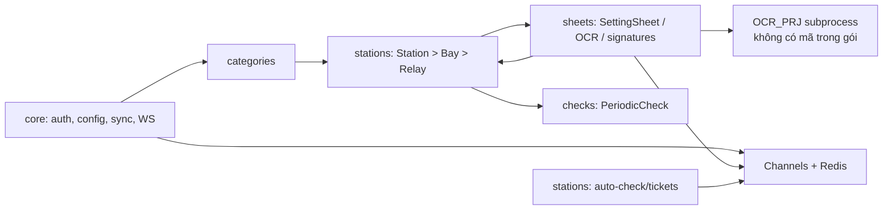
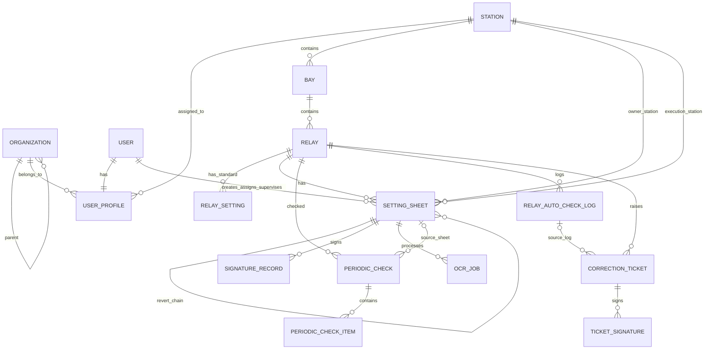
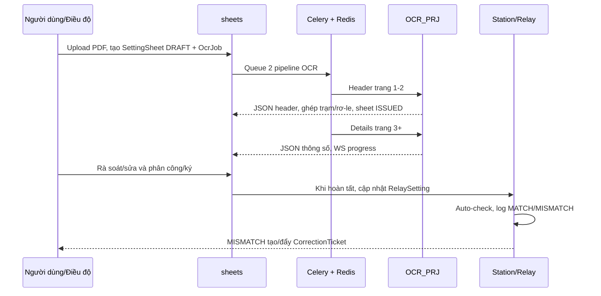

# Rà soát mã nguồn cũ — EVN RMS backend

> **Phạm vi chứng cứ:** tài liệu này chỉ đọc `repomix-backend.md` (bản đóng gói Repomix). Không đọc hay đối chiếu tệp nào khác. Repomix nêu rõ rằng nó chỉ đóng gói một tập con và thay các khối mã bằng `⋮----`; vì vậy mọi đường dẫn URL, cấu hình, trường hoặc nhánh không còn nhìn thấy được đều được ghi **Không xác định**. Những mô tả trong `docs/` và `README.md` được xem là tài liệu định hướng; nhận định vận hành chỉ được nêu khi cũng có mã thực thi tương ứng.

## 1. MỤC ĐÍCH & TÍNH NĂNG

### 1.1. Mục đích tổng quan

EVN RMS là backend Django cho quản lý rơ-le và phiếu chỉnh định kỹ thuật số. Luồng nghiệp vụ được mã nguồn thể hiện là: quản lý danh mục hạ tầng (đơn vị → trạm → ngăn lộ → rơ-le), tiếp nhận PDF phiếu chỉnh định, chạy OCR bất đồng bộ, để người dùng rà soát/chỉnh sửa, phân công và ký xác nhận, lấy thông số trở thành chuẩn của rơ-le, sau đó kiểm tra định kỳ và xử lý sai lệch. Căn cứ: `README.md`, `stations/models.py`, `sheets/models.py`, `sheets/tasks.py`, `stations/api_mock.py`.

Hệ thống dùng Django ORM; cấu hình và tài liệu triển khai đề cập PostgreSQL, Redis, Celery, Django Channels/ASGI và lưu file media. Việc một môi trường đang chạy thực tế có đầy đủ các thành phần này hay không là **Không xác định**.

### 1.2. Tính năng lõi và use case có mã thực thi

| Nhóm | Chức năng / use case thực tế thể hiện trong mã |
|---|---|
| Danh mục & tài sản | Người quản trị/người đã đăng nhập xem, tìm kiếm, thêm/sửa/xóa danh mục; quản lý đơn vị, hãng/nước SX, sở hữu, cấp điện áp, loại/trạng thái thiết bị, đường dây, công trình, vị trí, trạm, ngăn lộ và rơ-le. Có API CRUD DRF cho các thực thể này. |
| Đồng bộ danh mục ngoài | Quản trị cấu hình URL và header xác thực theo `SystemConfig`, kích hoạt đồng bộ một hoặc nhiều URL, mở rộng mẫu `{{DONVI}}`, `{{LOAI}}`, `{{LOAI_TB}}`, rồi ánh xạ dữ liệu vào danh mục/trạm/ngăn lộ/rơ-le. Có tự chạy theo chu kỳ. |
| Quản lý phiếu | Điều độ/người tạo upload một hay nhiều PDF để lập `SettingSheet`, xem danh sách/KPI, xem chi tiết split-view, gắn/sửa trạm-rơ-le, hiệu chỉnh dữ liệu OCR, lưu nhật ký sửa và so sánh với phiếu trước của cùng rơ-le. |
| OCR bất đồng bộ | Tạo `OcrJob`, chạy hai pipeline: header trang 1–2 rồi details từ trang 3+, lưu JSON kết quả và artifact trên media, phát tiến độ qua WebSocket, retry và watchdog job kẹt. OCR engine nằm ở `OCR_PRJ`, nhưng mã của thư mục đó bị loại khỏi gói nên thuật toán OCR thực tế **Không xác định**. |
| Ghép rơ-le | Dùng `relay_matcher` để chấm ứng viên dựa trên dữ liệu OCR, tên/model/hãng/chức năng/mạch; tự ghép trạm và rơ-le khi tìm được ứng viên. |
| Phân công & phê duyệt | Phân tuyến phiếu về trạm thực thi, phân công KTV và giám sát, quản lý nhóm người dùng/quyền, cập nhật trạng thái và gửi thông báo realtime. Các vai trò xuất hiện: `DISPATCHER`, `STATION_LEADER`, `TECHNICIAN`, `SUPERVISOR`, `ADMIN`. |
| Chữ ký | Có khởi tạo/xác nhận phiên ký và lưu `SignatureRecord`; kiểm tra thứ tự chữ ký phía server, sau đó cập nhật trạng thái phiếu và đồng bộ thông số sang `RelaySetting`. **Triển khai hiện tại là mock**, không phải tích hợp SmartCA thực. |
| Kiểm tra rơ-le | Cấu hình lịch auto-check cho từng rơ-le, đối chiếu thông số, lưu log, tạm dừng lịch khi lệch, tạo/từng bước xử lý `CorrectionTicket`, ký ticket và khôi phục lịch khi xử lý xong. API lấy dữ liệu thực địa hiện tại là **mock**. |
| Kiểm tra định kỳ thủ công | Tạo `PeriodicCheck` theo rơ-le, sinh item từ `RelaySetting`, KTV nhập giá trị đo và hệ thống tính độ lệch/tình trạng dung sai. |
| Quan sát vận hành | Dashboard theo vai trò, badge thông báo, danh sách tiến độ OCR JSON/HTML, WebSocket cho thông báo, OCR và bulk progress. |

### 1.3. Phần được mô tả nhưng không thể xác nhận là hoàn thiện

- Tích hợp chữ ký EVN SmartCA thật: **Không xác định/không được xác nhận**; mã thực thi chỉ có `MockEVNSignatureService` và URL `mock-sign.evn.com.vn`.
- Giao tiếp API rơ-le thực địa: **không có trong tập mã**; `stations/api_mock.py` cố ý sinh dữ liệu lệch ngẫu nhiên.
- Tính đúng đắn của OCR, xử lý hình ảnh và mô hình AI: **Không xác định**, vì `OCR_PRJ/**` bị loại khỏi gói.
- Frontend/template, CSRF form, thông báo hiển thị và URL thực tế: **Không xác định** vì templates/static không nằm trong phần mã được dùng làm chứng cứ, và `urlpatterns` đã bị rút gọn.

## 2. KIẾN TRÚC MÃ NGUỒN CŨ

### 2.1. Bản đồ module và phụ thuộc

| Module | Trách nhiệm thấy được | Phụ thuộc/chủ thể liên quan |
|---|---|---|
| `rms_project/` | Django settings, ASGI/WSGI, Celery bootstrap, URL gốc. | Nạp các app; ASGI/Channels; Redis/Celery theo settings. Nội dung route gốc bị lược bỏ. |
| `core/` | `Organization`, `UserProfile`, `SystemConfig`; dashboard, user/role matrix, cấu hình sync; WebSocket consumer; auto-sync; JSON/XML renderer. | Django auth/contenttypes; `sheets.SettingSheet`; `stations.Station`; `categories` trong `utils/api_sync.py`; Channels/Redis. |
| `categories/` | Danh mục dùng chung và CRUD API/UI: đơn vị, hãng, cấp điện áp, đường dây, công trình, vị trí; đồng thời phơi API cho Station/Bay/Relay. | DRF; `stations` để serializer/viewset cho 3 tài sản; `core.utils.api_sync` ghi dữ liệu vào đây. |
| `stations/` | Cây tài sản Station–Bay–Relay; chuẩn thông số rơ-le, auto-check/log, correction ticket; tìm kiếm alias, HTMX/UI và lịch Celery. | `sheets.SettingSheet` (qua quan hệ ngược), Channels, dữ liệu mock; `core.UserProfile` gắn Station. |
| `sheets/` | Phiếu, chữ ký, OCR job; matcher; task OCR/batch; cache signal; UI, phân công, chỉnh sửa, OCR retry. | `stations` cho Station/Relay/RelaySetting; auth, Celery, Redis/cache, Channels; subprocess gọi `OCR_PRJ`; `sheets.services` mock signing. |
| `checks/` | Lịch kiểm tra định kỳ thủ công và item đo. | `stations.Relay`, `stations.RelaySetting`, `sheets.SettingSheet`. |
| `docs/` | Đặc tả/thiết kế và hướng dẫn, không phải runtime. | Không có quan hệ runtime được chứng minh. |
| `Dockerfile`, `docker-compose.yml`, `.env.example`, `requirements.txt` | Đóng gói/cấu hình phụ thuộc. | Môi trường triển khai. Chi tiết service runtime đầy đủ **Không xác định** từ các khối bị lược bỏ. |

Luồng phụ thuộc chính:

### 2.2. Những phần cần loại bỏ hoặc thay thế khi viết mới — “Đừng mang theo”

| Phần | Bằng chứng | Hành động đề xuất |
|---|---|---|
| Mock ký số | `sheets/services.py`: `MockEVNSignatureService`, URL mock, hash tạo từ thời gian. | Loại bỏ khỏi production; thay bằng adapter nhà cung cấp ký có xác thực, audit trail và kiểm chứng chữ ký. |
| OCR giả lập | `sheets/views.py`: `perform_mock_ocr`, `run_mock_ocr`, sinh dữ liệu/độ tin cậy ngẫu nhiên. | Loại bỏ hoặc chỉ giữ trong test fixture tách biệt. |
| Auto-check giả lập | `stations/api_mock.py`: sleep 0.3s và 25% cố ý tạo sai lệch; `upload_relay_pdf_compare` còn có 20% tự tạo sai khác. | Không đưa vào production; thay adapter giao tiếp thiết bị và test determinist. |
| Bulk create/test extract | `sheets/views_bulk.py` tự chọn ngẫu nhiên Station/Relay, mã `AUTO-*`, API extract fallback sleep/mock. | Tách thành seed/test-only hoặc bỏ; không để endpoint production. |
| Default secret và tài khoản mẫu | `settings.py` có fallback `default-unsafe-secret-key`; `.env.example`/README chứa admin và mật khẩu mẫu. | Bắt buộc secret từ môi trường/secret manager; không seed mật khẩu cố định ở production. |
| Reset/khôi phục tự chạy bằng thread trong app startup | `core/apps.py` gọi `time.sleep(5)` rồi resume sync. | Chuyển sang job điều phối có lock/lease; không chạy side effect trong `AppConfig.ready()`. |
| Dấu vết tài liệu/khung cũ không có runtime | `docs/features/03-digital-signature.md` có ví dụ `DigitalSignature`; model runtime là `SignatureRecord`. | Không di trú nguyên xi tài liệu/mẫu cũ; thống nhất một mô hình. |

**Không đủ bằng chứng để kết luận là code chết:** bất kỳ hàm/view/file nào khác. Việc một hàm không được gọi trực tiếp trong gói không chứng minh nó không được route, template, Celery beat hoặc lệnh quản trị sử dụng.

### 2.3. Điểm đáng ngờ cần xử lý trước khi kế thừa

| Mức | Quan sát có chứng cứ | Rủi ro/ý nghĩa |
|---|---|---|
| Cao | `core/utils/api_sync.py` gọi HTTP với `verify=False`; ép `http://` thành `https://`; có `LegacySSLAdapter`. | Bỏ kiểm tra TLS có thể chấp nhận chứng chỉ không hợp lệ; ép scheme có thể làm sai endpoint. Cần chính sách CA/timeout/retry rõ ràng. |
| Cao | `core/views.py.custom_logout` dùng `@csrf_exempt` với ghi chú “easier multi-tab testing”. | Logout không CSRF protection; cần xem lại mô hình session và CSRF. |
| Cao | `settings.py` đặt `ALLOWED_HOSTS = ['*']`, fallback secret không an toàn. | Cấu hình production không an toàn nếu biến môi trường thiếu. |
| Cao | Các luồng nghiệp vụ sản xuất dùng `random`/mock (OCR, auto-check, so sánh PDF). | Kết quả không lặp lại, có thể sinh ticket/sai lệch giả. |
| Cao | `SettingSheet.extracted_data`, `edit_logs`, `OcrJob.result_data`, log/check data lưu JSONField. | Linh hoạt nhưng khó ràng buộc schema, tìm kiếm và audit; cần version schema/validation trước khi chuyển đổi. |
| Trung bình | Danh mục Station/Bay/Relay chứa nhiều `id_*` dạng `CharField`, trong khi model danh mục tương ứng cũng tồn tại. | Không có FK DB thể hiện trong model; có thể sinh tham chiếu mồ côi/không nhất quán. |
| Trung bình | So khớp trạm/rơ-le và phân loại ANSI dựa vào regex, alias và `icontains`; nhiều fallback lấy `.first()`. | Có nguy cơ ghép sai khi trùng tên/model. Cần score minh bạch, ngưỡng, xác nhận người dùng và lưu lý do. |
| Trung bình | `execute_parallel_ocr_batch` dùng thread/semaphore trong worker, phối hợp thêm cache/file artifact. | Khó đảm bảo idempotency/race condition khi worker restart; Redis cache mất sẽ đổi nhánh fallback. |
| Trung bình | OCC dùng `_original_updated_at` trong form ở category/sheet/user. | Cần kiểm tra so sánh/atomic update đầy đủ; đoạn điều kiện chi tiết bị `⋮----` nên hiệu lực thực tế **Không xác định**. |
| Trung bình | Đường dẫn OCR artifact ghép từ `MEDIA_ROOT`, correlation ID; input file và JSON đọc/ghi qua disk. | Cần xác thực path, lifecycle dọn dẹp và phân quyền file; hiện không thấy chính sách retention. |
| Thấp | API/UI handlers thường chỉ `@login_required`; một số quyền dùng custom permission, một số không. | Kiểm soát quyền có thể không đồng đều; cần ma trận quyền ở service layer. |
| Thấp | Test rỗng ở `categories`, `checks`, `core`, `stations`; `sheets` có test pipeline. | Coverage nghiệp vụ trọng yếu có vẻ thiếu; mức coverage thật **Không xác định**. |

## 3. MÔ HÌNH DỮ LIỆU & DATABASE

### 3.1. Nơi lưu trữ và tổ chức dữ liệu

- Dữ liệu quan hệ do Django ORM quản lý; README, `.env.example` và Docker/requirements cho thấy mục tiêu là **PostgreSQL**. Chuỗi kết nối và schema database đang triển khai thực tế: **Không xác định**.
- File PDF scan dùng `FileField(upload_to='scans/')`, với `MEDIA_ROOT = BASE_DIR / 'media'` trong settings; OCR đọc/ghi artifact dưới `media/ocr_artifacts/<correlation_id>_*`.
- Cache/session, tiến độ OCR và idempotency dùng cache/Redis theo settings và code. Thời hạn/eviction ngoài các chỗ ghi chú trong code: **Không xác định**.
- `JSONField` lưu payload OCR, log sửa, dữ liệu auto-check/schedule; cấu trúc JSON đầy đủ không được ràng buộc bằng model.

### 3.2. ERD theo các foreign key nhìn thấy

`USER` là model auth Django được tham chiếu nhưng trường chi tiết không nằm trong tệp. Cardinality ở các FK nullable chỉ nói rằng quan hệ có thể vắng mặt, không đồng nghĩa với quan hệ nghiệp vụ luôn bắt buộc.

### 3.3. Thực thể, trường và kiểu dữ liệu thấy được

| Bảng/thực thể | Trường thấy được (kiểu Django) | Quan hệ / ràng buộc thấy được |
|---|---|---|
| `Organization` | `code CharField(50, unique)`, `name CharField(255)`, `org_type CharField(50)`, `parent FK self nullable` | Tự phân cấp 1-n. |
| `UserProfile` | `user OneToOne(User)`, `organization FK nullable`, `station FK nullable`, `phone_number CharField(20) nullable`, `updated_at DateTime(auto_now)` | User 1-1 profile; Organization/Station 1-n profile. |
| `SystemConfig` | `key CharField(100, unique)`, `value CharField(500)`, `description Text nullable`, `auth_header CharField(500) nullable`, `auto_sync_enabled Boolean`, `sync_interval_minutes Integer`, `last_sync_time DateTime nullable`, `last_sync_status CharField(255) nullable`, `sync_count Integer`, `is_syncing Boolean` | Không FK. |
| `ManagementUnit` | Kế thừa CategoryBase: `code CharField(50, unique)`, `name CharField(255)`, `description Text nullable`, timestamps; thêm `sort_order CharField(50) nullable`, `parent_code CharField(50) nullable`, `unit_level Integer` | `parent_code` là text, không phải FK trong model. |
| Danh mục đơn giản | `ManufacturingCountry` (+`legacy_id`), `Manufacturer`, `Ownership`, `VoltageLevel` (+`legacy_code`), `EquipmentType`, `OperationalStatus`; tất cả kế thừa CategoryBase | Không FK. |
| `Line` | CategoryBase + `id_capda`, `id_ttvh`, `da_tke`, `id_da_tke`, `i_chophep`, `ngay_vh DateTime nullable`, `tong_cdai`, `so_mach`, `id_dvi`, `id_sohuu`, `id_dz`, `dz_cha`, `id_dz_cha`, đầu/nhận TBA-NLO `id_*`/tên, `sort_order Integer nullable` | Các `id_*` đều CharField trong phần thấy được. |
| `Project` / `Location` | Project: CategoryBase + `id_ct`, `nam_xd`, `ma_ct_cha`, `ten_ct_cha`. Location: CategoryBase + `id_vitri`, `khoang_neo`, `khoang_cot`, `id_khuvuc`, `khu_vuc`, `ten_ct`, `duong_vao`, `hanh_lang`, `id_sodo`, `so_do`. Các trường bổ sung chủ yếu CharField nullable. | Không FK thấy được. |
| `Station` | `station_code CharField(50, unique)`, `station_name CharField(200)`, `location CharField nullable`; dữ liệu PMIS: `id_tba`, địa giới `id_tinh/tinh/id_quan/quan/id_phuong/phuong`, `id_capda`, `id_ttvh`, kiểu/loại trạm và ID, `ngay_vh/ngay_ld DateTime nullable`, `id_dvi`, `id_vung/vung`, `id_sohuu`, `kieu_ht_dk/id_kieu_ht_dk`, `sort_order Integer nullable`, `updated_at`. | Station 1-n Bay. |
| `Bay` | `station FK nullable`, `bay_code CharField(50)`, `bay_name CharField(255)`, `ten_tram`, `id_nlo`, `u_dm`, `i_dm`, `sdm` (CharField nullable trong phần thấy được). | Bay 1-n Relay. Uniqueness/fields còn lại: **Không xác định**. |
| `Relay` | `bay FK nullable`, `relay_code CharField(50)`, `relay_name CharField(255)`, `manufacturer CharField(100) nullable`, `id_tbi`, `id_hang_sx`, `id_nuoc_sx`, `id_loai_tb`, `id_loai_dt`, `id_doituong`, `id_vtri_dat` (CharField nullable); auto-check `auto_check_enabled Boolean`, `check_interval_value Integer`, `check_interval_unit CharField(1)`, `last_checked_at/next_check_at DateTime nullable`; correction `is_paused_for_correction Boolean`, `paused_schedule_data JSON nullable`. | Relay 1-n các sheet, setting, log, ticket. |
| `RelaySetting` | `relay FK`, `parameter_code CharField(50)`, `parameter_name CharField(100)`, `standard_value Float`, `unit CharField(20)`, `tolerance_min Float`, `tolerance_max Float` | 1 rơ-le–n chuẩn thông số. Unique constraint theo rơ-le/mã: **Không xác định**. |
| `SettingSheet` | `sheet_code CharField(100, unique)`, `title CharField(255) nullable`, `status CharField(50, choices)`, `scan_file File nullable`, `created_by/assigned_to/supervisor_assigned FK User nullable`, `assigned_at DateTime nullable`, `relay FK nullable`, `relay_text CharField(255) nullable`, `station/execution_station FK nullable`, `extracted_data JSON nullable`, `edit_logs JSON list`, `has_parameters_changed Boolean`, `is_temporary Boolean`, `valid_until DateTime nullable`, `revert_to_sheet FK self nullable`, `reverted Boolean`, timestamps. | Sheet 1-n SignatureRecord/OcrJob; self-revert. |
| `SignatureRecord` | `sheet FK`, `signer_name CharField(100)`, `role CharField(50)`, `signed_at DateTime(auto_now_add)`, `signature_hash CharField(256)` | Sheet 1-n signature. |
| `OcrJob` | `sheet FK`, `correlation_id CharField(128, unique)`, `device_mode CharField(10, choices)`, `status CharField(50, choices)`, `review_status CharField(50) nullable`, `result_data JSON nullable`, `error_code/error_stage CharField(50) nullable`, `error_detail Text nullable` | Sheet 1-n job. Timestamps/other fields có thể có nhưng không thấy rõ. |
| `PeriodicCheck` | `relay FK`, `sheet FK nullable`, `scheduled_date Date`, `actual_check_date Date nullable`, `status CharField(50, choices)` | Check 1-n item. |
| `PeriodicCheckItem` | `periodic_check FK`, `parameter_code CharField(50)`, `measured_value Float`, `deviation_percent Float`, `is_within_tolerance Boolean` | N item / check. |
| `RelayAutoCheckLog` | `relay FK`, `checked_at DateTime(auto_now_add)`, `status CharField(20, choices)`, `api_raw_data JSON nullable`, `differences JSON nullable` | Log 1-n ticket theo FK ticket nullable. |
| `CorrectionTicket` | `relay FK`, `log FK RelayAutoCheckLog nullable`, `status CharField(20, choices)`, `created_at DateTime(auto_now_add)` | Ticket 1-n TicketSignature. |
| `TicketSignature` | `ticket FK`, `signer_name CharField(100)`, `role CharField(50)`, `signed_at DateTime(auto_now_add)`, `notes Text nullable`, `signature_hash CharField(256)` | Chữ ký ticket. |

**Lưu ý schema:** mã model không khai báo khóa chính tường minh; quy ước PK/migration đầy đủ bị nén nên không liệt kê như một trường mã nguồn xác nhận. Values đầy đủ của các `STATUS_CHOICES` cũng bị lược bỏ; chỉ các giá trị được logic nhìn thấy như `DRAFT`, `ISSUED`, `ROUTED_TO_STATION`, `IN_PROGRESS`, `PENDING_ADMIN_APPROVAL`, `COMPLETED`, `PENDING`, `PROCESSING`, `SUCCESS`, `SUCCESS_WITH_WARNINGS`, `FAILED`, `MATCH`, `MISMATCH`, `RESOLVED` là có chứng cứ.

## 4. QUI TẮC NGHIỆP VỤ (BUSINESS RULES)

### 4.1. Quy tắc cần giữ lại (sau khi xác nhận nghiệp vụ)

1. **Cây hạ tầng:** rơ-le thuộc ngăn lộ, ngăn lộ thuộc trạm; các dữ liệu PMIS được auto-link Bay↔Station qua `Bay.id_tba` và Relay↔Bay qua `Relay.id_vtri_dat` khi đồng bộ.
2. **Phiếu chuẩn thông số:** khi chữ ký hoàn tất theo luồng, mã cập nhật/xóa/thêm `RelaySetting` theo `extracted_data`; chuẩn rơ-le phải phản ánh nội dung phiếu hoàn thành hiện hành.
3. **So sánh phiên bản:** phiếu mới của cùng rơ-le được so với phiếu trước; cờ `has_parameters_changed` được cập nhật. Nếu không có phiếu trước, util cũ coi là không đổi.
4. **Tính toàn vẹn trạm/rơ-le:** lúc hiển thị/ghép sheet, nếu rơ-le đang lưu không thuộc trạm của phiếu thì mã bỏ liên kết rơ-le đó để UI gợi ý lại đúng phạm vi trạm.
5. **Phạm vi quyền:** admin có phạm vi toàn cục ở nhiều view; người dùng gắn trạm bị lọc phiếu theo trạm/`execution_station`; nếu không gắn trạm, fallback theo người tạo. KTV/giám sát được lấy theo Station và group khi có station.
6. **Chữ ký theo thứ tự:** server kiểm tra sự tồn tại chữ ký KTV/giám sát trước nhánh ký tiếp; sau ADMIN đặt trạng thái `PENDING_ADMIN_APPROVAL` trong khối thấy được. Thứ tự trạng thái/chữ ký đầy đủ phải được xác nhận vì một phần khối bị lược bỏ.
7. **Auto-check:** chỉ check rơ-le bật `auto_check_enabled`; có sai lệch thì pause schedule, trạng thái khớp trở lại thì phục hồi schedule đã lưu; chế độ check một lần không tính kỳ lặp tiếp.
8. **Ticket hiệu chỉnh:** flow hiển thị `DISPATCHER → STATION → TECH → SUPERVISOR → ADMIN → RESOLVED`; khi đạt `RESOLVED`, view khôi phục rơ-le/lịch đã tạm dừng.
9. **OCR:** pipeline header xử lý trang 1–2 trước, sau đó details chờ và xử lý trang 3+; header có thể đổi mã phiếu/trạm/rơ-le; sau header code chuyển sheet sang `ISSUED` và details không đổi trạng thái để tránh ghi đè phân công.
10. **Retry OCR:** job kẹt `PROCESSING` quá 15 phút được watchdog tìm; cache retry tối đa 2 lần tự retry theo mã nhìn thấy.
11. **Đồng bộ danh mục:** template URL có thể nhân theo `{{DONVI}}`, `{{LOAI}}` (TBA/DZ) và `{{LOAI_TB}}`; dữ liệu được map theo mã/ID, date `NGAY_VH` được parse, và URL được xử lý tuần tự từ `start_idx` để resume.

### 4.2. Quy tắc ngầm / edge case đáng lưu ý

| Điều kiện trong mã | Logic ngầm cần quyết định lại |
|---|---|
| OCR không tìm được Station bằng `icontains` | Chuẩn hóa tên, bỏ tiền tố “trạm”, phần trong ngoặc/mã điều độ, rồi lấy ứng viên đầu tiên khớp từ khóa. Đây là heuristic, không phải định danh chắc chắn. |
| Ghép Relay | Lọc ứng viên trong trạm, score theo model/serial/ANSI/hãng/mạch và loại trừ thiết bị phụ trợ. Ngưỡng score/luật chọn cuối cùng **Không xác định** vì phần thân bị nén. |
| Lưu sửa dữ liệu OCR | Giá trị cũ/mới nếu ép được float thì so số; nếu không thì so chuỗi. Dòng có cờ xóa bị loại khỏi `updated_data`; các trường matrix BO/BI có `group/type/config` riêng. |
| Relay ID người dùng nhập không phải số | UI có thể cho nhập text; code tìm trong Station trước theo mã/tên, rồi fallback toàn cục hoặc lưu `relay_text`. Điều này cho phép sheet chưa liên kết Relay chuẩn. |
| Phiếu tạm | `is_temporary`, `valid_until`, `revert_to_sheet`, `reverted` có tồn tại; cơ chế tự revert nào chạy, thời điểm/điều kiện: **Không xác định** trong mã thấy được. |
| Định kỳ manual check | Lúc tạo item, `measured_value=0.0` chờ KTV cập nhật; nếu người dùng chưa cập nhật thì 0 có thể bị hiểu như phép đo thực. Cần một trạng thái “chưa đo”. |
| `Relay.active_sheet` | Lấy sheet `COMPLETED` mới nhất theo `created_at`, không thấy lọc `reverted`, `valid_until` hay tạm thời trong phần nhìn thấy. Đây có thể xung đột với chức năng phiếu tạm. |
| JSON OCR có nhiều dạng | Mã chấp nhận `extracted_data` là list hoặc dict rồi chuyển dict thành list; cơ chế này cần được chuẩn hóa schema để tránh nhánh xử lý khác nhau. |
| API sync resume | Tiến độ được parse từ chuỗi `last_sync_status` phân tách `:`; lỗi format thì behavior chi tiết **Không xác định**. Đây là state machine ngầm trong text thay vì cột dữ liệu. |

## 5. DANH SÁCH API ENDPOINTS & LUỒNG XỬ LÝ

### 5.1. Giới hạn dữ liệu endpoint

Tất cả `urlpatterns` trong gói chỉ còn `urlpatterns = [` và các khối route bị thay bởi `⋮----`. Vì vậy **đường dẫn URL chính xác là Không xác định**, trừ bằng chứng test có `POST /sheets/create/`. Các method bên dưới là **method nghiệp vụ suy ra từ dữ liệu request** (`GET`, `POST`, upload/JSON); mã đã thấy không luôn có guard `request.method`, nên việc server có từ chối method khác hay không cũng **Không xác định**. “Lỗi” chỉ ghi lỗi có chứng cứ; không suy diễn status HTTP.

### 5.2. API REST danh mục (DRF)

`categories/urls.py` cho thấy `DefaultRouter`, `ModelViewSet` và đăng ký `equipments` (Relay). Tên prefix còn lại bị nén. Với mỗi ViewSet, DRF chuẩn cung cấp list/create/retrieve/update/delete nhưng đường dẫn detail, serializer validation và response/error cụ thể **Không xác định từ tệp này**.

| ViewSet | Thực thể | Method/ngõ vào | Đầu ra/lỗi thấy được |
|---|---|---|---|
| `ManagementUnitViewSet`, `ManufacturingCountryViewSet`, `ManufacturerViewSet`, `OwnershipViewSet`, `VoltageLevelViewSet`, `EquipmentTypeViewSet`, `OperationalStatusViewSet`, `LineViewSet`, `ProjectViewSet`, `LocationViewSet` | Các danh mục cùng tên | CRUD DRF; body là fields serializer `__all__` | JSON model. URL, validation/error: Không xác định. |
| `StationViewSet`, `BayViewSet`, `RelayViewSet` | Station, Bay, Relay; Relay được đăng ký router prefix `equipments` | CRUD DRF; body serializer model | JSON model. URL Station/Bay và các error: Không xác định. |

### 5.3. Handler core, categories và checks

| View identifier | Method/ngõ vào thấy được | Luồng/đầu ra | Lỗi/quyền thấy được |
|---|---|---|---|
| `custom_logout` | Không xác định input | Logout tùy biến | `csrf_exempt`; yêu cầu auth không thấy trong khối. |
| `get_badges_api` | GET có thể suy ra từ tên; input không thấy | Dữ liệu badge từ `notification_badges` | `login_required`. JSON shape: Không xác định. |
| `dashboard` | GET: `period`, `start_date`, `end_date` | Dashboard/KPI/chart theo role | `login_required`; parse date lỗi: Không xác định. |
| `user_list`, `user_create`, `user_update`, `user_toggle_status` | List/view hoặc POST form (chi tiết inputs phần lớn bị nén); update dùng `_original_updated_at` | Quản lý user, khóa/mở khóa | create/update/toggle dùng permission `sheets.can_manage_users` ở các decorator thấy được; response/error: Không xác định. |
| `role_matrix`, `role_matrix_update` | Update POST: `group_id`, `perm_id`, `action` add/remove | Xem/sửa ma trận custom permission của SettingSheet | `sheets.can_manage_users`; ID không hợp lệ error: Không xác định. |
| `dispatcher_routed_relays`, `profile` | GET | Danh sách relay có phiếu COMPLETED mới nhất / profile | `login_required`; HTML/error: Không xác định. |
| `system_config_view/create/bulk_create/delete/update/row` | View/row GET; create: `key,value,description,auth_header`; bulk: `urls`; update: config và auto-sync fields; delete: `config_id` | CRUD cấu hình nguồn sync, render HTML/HTMX row | `sheets.can_manage_users` (trừ row? decorator thấy có); response/error cụ thể Không xác định. |
| `api_sync_endpoint` | POST: config, `specific_unit`, `custom_url`, `action` | Run/resume sync, có nhánh nền hay trực tiếp và render kết quả HTMX | `login_required`; lỗi HTTP/upstream được bắt/hiển thị nhưng format không xác định. |
| `manage_team` | POST: `tech_id`, `sup_id`, `sheet_ids[]` | Trưởng trạm phân KTV/giám sát cho sheets | `login_required`; `.get()` có thể không tìm thấy đối tượng, response chi tiết Không xác định. |
| `category_dashboard`, `category_list` | GET: `category_id`, `q`, `page` | Dashboard/list category, search/paginate HTML | `login_required`; category không hợp lệ phụ thuộc `get_model_class`, error cụ thể Không xác định. |
| `category_form` | POST form + `_original_updated_at`; hoặc GET form; `category_id`, tùy chọn `pk` | Tạo/sửa category với OCC | `login_required`; conflict có cờ `has_conflict`; response chi tiết Không xác định. |
| `category_delete` | Semantics delete; `category_id, pk`; method guard không thấy | Xóa instance | `login_required`; route/method/error Không xác định. |
| `asset_line_list`, `asset_location_list`, `asset_project_list` | GET: search/filter/page/detail tùy view | Advanced list + slide-over detail | `login_required`; HTML. |
| `check_list`, `check_detail` | GET; `pk` cho detail | List/chi tiết periodic check | `login_required`; not-found do `get_object_or_404`. |
| `check_create` | POST: `relay_id`, `scheduled_date` | Tạo check và item từ RelaySetting, measured=0 | `login_required`; relay không có → 404; lỗi date/validation Không xác định. |
| `check_update_item` | POST: `item_id`, `measured_value` | Lưu đo, tính deviation/tolerance realtime HTMX | `login_required`; ép float có thể lỗi; handling không xác định. |
| `check_complete` | `pk`; input/method không thấy | Hoàn tất check | `login_required`; chi tiết Không xác định. |

### 5.4. Handler sheets/OCR

| View identifier | Method/ngõ vào thấy được | Luồng/đầu ra | Lỗi/quyền thấy được |
|---|---|---|---|
| `sheet_list`, `my_sheets`, `updated_sheets` | GET: list dùng `q,status,sub_filter,voltage,page` | Danh sách/KPI, scope theo role | `login_required`; HTML. |
| `sheet_create` | Upload file(s), title/relative path và optional initial relay code (tên input đầy đủ bị nén) | Tạo sheet DRAFT + OcrJob, đưa batch OCR vào queue | `login_required`; lỗi upload/queue Không xác định. Bằng chứng test route: `POST /sheets/create/`. |
| `sheet_detail` | GET `pk` | Split-view dữ liệu OCR, version diff, metadata, assignment candidates | `login_required`; not-found 404. |
| `sheet_assign` | POST: `_original_updated_at, assignee_id, supervisor_id, status` | Giao KTV/giám sát, cập nhật status, WS notify | `login_required`; status phải thuộc choices; conflict/response không xác định. |
| `sheet_route_to_station` | POST: `station_id, relay_id, execution_station_id` | Phân tuyến về trạm, có thể lưu metadata và hash | `login_required`; requires dispatch permission/admin/creator; relay ID invalid được xử lý một phần, response không xác định. |
| `sheet_update_status` | Input/method không thấy | Cập nhật status HTMX **mock logic** | `login_required`; không dùng làm production contract. |
| `initiate_signature` | POST: `role` (default ADMIN) | Tạo mock signing session | `login_required`; output mock URL/session, error không xác định. |
| `confirm_signature` | POST: `role`; signer lấy user hiện tại | Mock confirm, sequence check, tạo SignatureRecord, cập nhật chuẩn rơ-le | `login_required`; thứ tự sai có validation nhưng thông điệp/status không xác định. |
| `run_mock_ocr` | `pk` | Kích hoạt OCR giả lập | `login_required`; test-only. |
| `sheet_save_actual_data` | POST: `_original_updated_at`, sheet_code/title/station/relay, các `ocr_*_{index}` | OCC, sửa header + parameters, edit log | `login_required`; permission dispatcher được tính; validation/error cụ thể Không xác định. |
| `sheet_update_metadata` | POST metadata, `relay_id`/`relay_text` | Cập nhật mã/trạm/rơ-le sau OCR | `login_required`; fallback relay text. |
| `ocr_job_list` | GET: `status,device_mode,q,page`; có nhánh AJAX/JSON | Danh sách/metric job, JSON hoặc HTML | `login_required`; status filters thấy được. |
| `ocr_job_retry` | `pk`; device mode từ POST, GET hoặc JSON body | Reset job/sheet DRAFT, WS notify, requeue | `login_required`; JSON decode có thể lỗi, format response không xác định. |
| `sheet_rerun_ocr` | `pk` | Tạo/dùng job để rerun full pipeline | `login_required`; không có PDF → thông báo lỗi. |
| `ocr_job_retry_all` | Input/method bị nén | Requeue các job FAILED | `login_required`; output/error Không xác định. |
| `ocr_job_json` | `pk` | JSON chi tiết OCR job (suy ra tên) | `login_required`; payload/error Không xác định. |
| `bulk_create_ui`, `bulk_create_execute` | UI GET; execute POST: `idempotency_key`, `scan_files[]` | Bulk sheet test, cache idempotency, Celery task | `login_required`; mô tả nói chỉ Dispatcher, cách enforcement/response không xác định. |
| `api_extract_test_ui`, `api_extract_test_execute` | UI GET; execute POST: `api_url`, file upload | Forward file đến URL hoặc mock response | `login_required`; URL caller-controlled, timeout 30s; SSRF/error handling chi tiết Không xác định. |

### 5.5. Handler stations, auto-check và ticket

| View identifier | Method/ngõ vào thấy được | Luồng/đầu ra | Lỗi/quyền thấy được |
|---|---|---|---|
| `station_list` | GET: `q,page` | Search Station/Bay/Relay, alias hãng, paginate | `login_required`; HTML. |
| `station_create`, `bay_create`, `relay_create` | Form input; Bay có `station_id`, Relay có `bay_id` | Tạo tài sản | `login_required`; fields/response/error Không xác định. |
| `relay_bulk_create`, `global_bulk_create` | Upload CSV/paste text (thấy trong code) | Tạo hàng loạt Station/Bay/Relay | `login_required`; format CSV/text và lỗi chi tiết Không xác định. |
| `relay_status_dashboard` | GET: tab/filter | Thống kê relay có/không phiếu và phần trăm | `login_required`; HTML. |
| `get_bays_htmx`, `get_relays_htmx` | GET `station_id`/`bay_id` | Partial options danh sách | `login_required`; HTML partial. |
| `search_suggestions` | GET query | Gợi ý hãng, trạm, bay, relay | `login_required`; JSON shape Không xác định. |
| `run_autocheck_now` | POST/trigger semantics; `relay_id` | Chạy đối chiếu, clear cache, HTMX triggers | `login_required`; hiện dùng mock API. |
| `update_relay_schedule` | POST schedule, `relay_id` | Cập nhật next check | `login_required`; inputs đầy đủ/error Không xác định. |
| `autocheck_dashboard`, `autocheck_row` | GET; row có `relay_id` | Dashboard/partial trạng thái auto-check | `login_required`; HTML. |
| `workflow_continue` | POST, `relay_id` | Tiếp tục bước correction flow | `login_required`; step/permission checks chi tiết Không xác định. |
| `workflow_create_ticket` | POST, `relay_id` | Pause relay, tạo CorrectionTicket và sheet từ dữ liệu API | `login_required`; API dữ liệu là mock. |
| `ticket_sign` | POST: `ticket_id` và dữ liệu ký không thấy | Lưu chữ ký giả lập, advance/resolve ticket, restore schedule | `login_required`; signature hiện không đáng tin cậy. |
| `relay_parameters_modal` | GET `relay_id` | Modal thông số/so sánh | `login_required`; HTML. |
| `upload_relay_pdf_compare` | Upload `pdf_file`, `relay_id` | Parse text PDF, đối chiếu active sheet, lưu RelayAutoCheckLog | `login_required` + `is_admin`; có nhánh random tự tạo lệch nên không tin cậy. |
| `get_relay_detail_modal` | GET `relay_id`, tùy chọn `sheet_id` | Tìm relay nhiều fallback, phân loại ANSI, so với OCR scan | `login_required`; relay không tìm thấy và output chi tiết Không xác định. |
| `get_station_relays_json` | GET `station_id` | List relay JSON: id, bay_id, code, name, manufacturer | `login_required`; station không hợp lệ/error Không xác định. |

### 5.6. Luồng xử lý chính cần thay thế có kiểm soát

## Kết luận chuyển đổi

Nên giữ **nghiệp vụ và mô hình quan hệ** (tài sản, phiếu/OCR, chuẩn thông số, phân công, kiểm tra và ticket), nhưng viết lại các boundary không tin cậy: tích hợp thiết bị, ký số, OCR adapter, state machine, validation JSON, phân quyền và audit. Không di trú các mock, random, cấu hình TLS/secret không an toàn hay side effect lúc app startup. Trước khi chốt thiết kế mới, cần bổ sung bản `urls.py` nguyên vẹn, migrations nguyên vẹn, contract API ngoài, schema OCR JSON mẫu và ma trận trạng thái/chữ ký được nghiệp vụ phê duyệt; các phần này đều không thể xác định chắc chắn chỉ từ `repomix-backend.md`.
