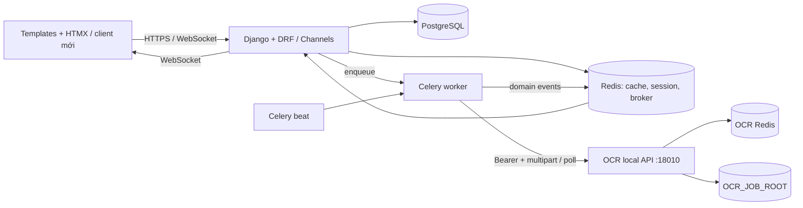
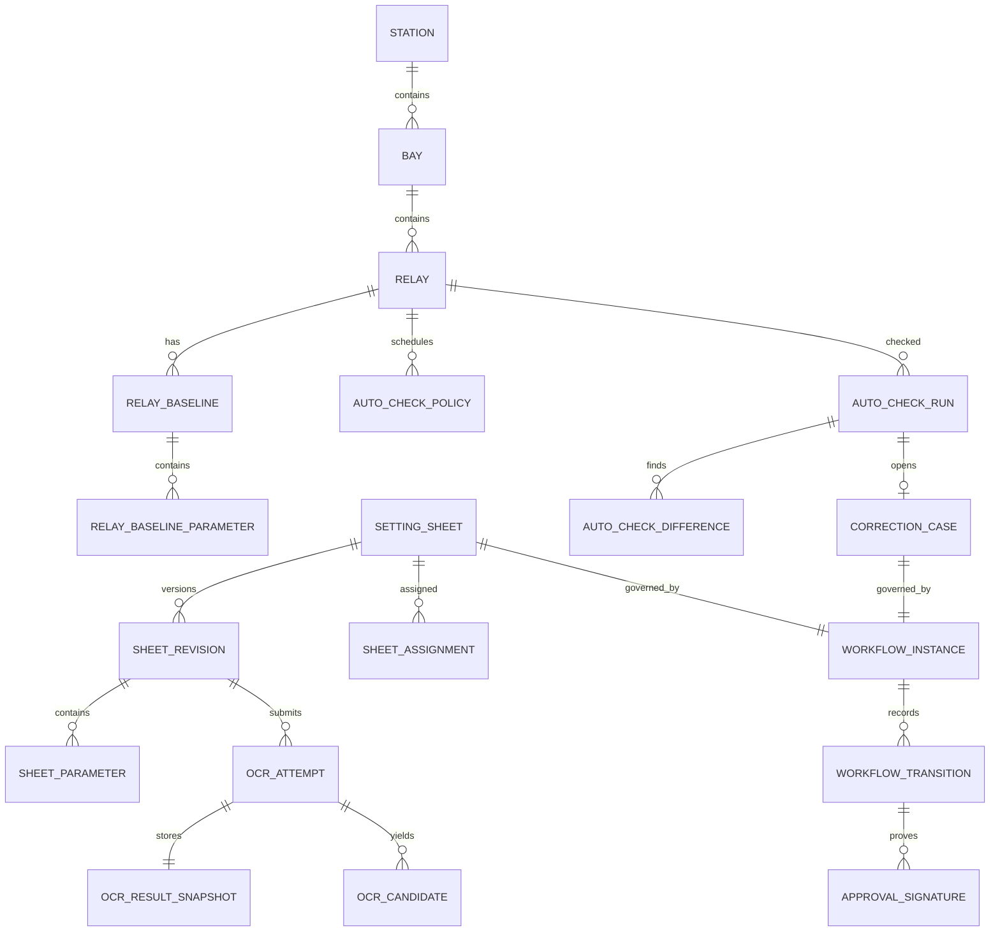

# Đề xuất kiến trúc backend mới cho EVN RMS

> **Căn cứ:** `repomix-backend.md`, `repomix-frontend.md`, `repomix-urls.md`, `API_CONTRACT.md`. Đây là thiết kế mục tiêu, không phải khẳng định rằng mọi chi tiết đã tồn tại trong mã cũ. Công nghệ được giữ: Python/Django + Django REST Framework, PostgreSQL, Redis, Celery, Django Channels/Daphne, Docker Compose và dịch vụ OCR local hiện hữu.

## Quyết định nghiệp vụ đã được xác nhận

Các quyết định dưới đây do chủ sản phẩm cung cấp sau bản đề xuất. Chúng có ưu tiên cao hơn các phương án mặc định ở các phần sau.

### Vòng đời phiếu và vai trò

1. Chỉ **Điều độ** và **Admin** tạo phiếu.
2. Điều độ rà soát OCR, xác nhận đúng trạm/ngăn lộ/rơ-le và xác nhận phiếu. Trưởng trạm không tham gia bước rà soát OCR.
3. Trưởng trạm tiếp nhận phiếu và phân công KTV, Giám sát.
4. KTV xử lý thông số được giao và ký xác nhận.
5. Giám sát kiểm tra và ký duyệt.
6. Admin phê duyệt cuối. Chỉ khi Admin duyệt thành công, phiếu chuyển `COMPLETED` và baseline rơ-le mới được cập nhật.
7. Người từ chối phải nhập lý do. Phiếu được trả về đúng vai trò cần chỉnh sửa; chữ ký trước đó được giữ trong lịch sử. Sau khi chỉnh sửa, quy trình ký lại từ đầu.
8. Phiếu `COMPLETED` là bất biến. Thay đổi sau đó phải tạo phiếu mới.
9. Điều độ có quyền liên quan đến phiếu, nhưng không có quyền quản trị hệ thống. Admin cấp quyền theo nguyên tắc tối thiểu cần thiết; quyền duyệt cuối vẫn thuộc Admin.
10. Trưởng trạm và Giám sát có quyền nghiệp vụ ngang KTV theo chỉ đạo hiện tại; quyền riêng để tiếp nhận/phân công, kiểm tra/ký vẫn là các capability riêng của vai trò trong workflow, không suy ra chỉ từ quyền KTV.

### OCR và lưu trữ

- Điều độ xác nhận trạm/rơ-le và kết quả OCR. Xác nhận thông số theo hướng **hàng loạt**, nhưng phạm vi chọn hàng loạt và khả năng loại trừ từng dòng vẫn cần mô tả UI/validation chi tiết.
- OCR lỗi không tự retry. Điều độ hoặc Admin phải upload lại PDF để tạo lần chạy mới.
- PDF và kết quả OCR được lưu vô hạn trong RMS. Vì OCR service chỉ giữ mặc định 7 ngày, RMS phải lấy và lưu result ngay khi OCR hoàn tất; cần có chính sách backup/khôi phục tương ứng.
- Ký số thật không thuộc MVP; MVP dùng chữ ký ảo. Chữ ký ảo phải được thể hiện rõ trong UI/audit và không được coi là bằng chứng SmartCA đã xác minh.
- Auto-check thiết bị và đồng bộ PMIS không thuộc giai đoạn MVP.
- Mỗi rơ-le chỉ được có tối đa **một phiếu tạm đang hiệu lực**. Không duyệt phiếu tạm mới nếu phiếu tạm hiện tại chưa hết hạn hoặc chưa được Admin hoàn tác.

### Asset 1A: khóa chính và phạm vi quyền

Các quyết định dưới đây là mặc định thiết kế cho backend mới, dùng làm nền cho lát cắt Asset; đây không phải khẳng định về hành vi cũ và không làm thay đổi quy trình phiếu:

1. **Khóa chính nội bộ:** dùng `BigAutoField` cho các thực thể RMS tạo mới, thống nhất với `DEFAULT_AUTO_FIELD` hiện tại của Django. ID từ PMIS/hệ thống ngoài không dùng làm PK; lưu riêng dưới dạng chuỗi trong `ExternalReference.external_id`.
2. **Cây tổ chức:** mỗi `Organization` có thể có một `parent`. Một `RoleGrant` ở phạm vi `ORGANIZATION` chỉ áp dụng cho đúng đơn vị được gán và asset có `Station.organization_id` bằng đơn vị đó. Không tự kế thừa quyền xuống các đơn vị con; muốn cấp ở đơn vị con thì tạo grant riêng.
3. **Phạm vi trạm:** `RoleGrant` ở phạm vi `STATION` áp dụng cho đúng trạm được gán và các Bay/Relay thuộc cây tài sản của trạm đó. Không tự mở rộng lên các trạm khác hoặc quyền cấp ngược cho đơn vị.
4. **Phạm vi toàn cục:** `GLOBAL` áp dụng toàn hệ thống. Các grant cộng gộp; quyền `is_superuser` tiếp tục là bypass quản trị của Django. `is_staff` không tự cấp quyền nghiệp vụ trên asset.
5. **Hồ sơ user:** `UserProfile.organization_id` là đơn vị công tác/tham chiếu mặc định, không tự nó cấp quyền. Mọi truy cập asset phải kiểm tra `RoleGrant` ở backend.
6. **Ranh giới module:** `assets` được phép có FK tới `identity.Organization`; `identity` không tạo FK ngược tới `assets.Station`. Trường tham chiếu trạm trong `UserProfile`/`RoleGrant` là scalar ID. Schema đích dùng số nguyên tương thích `BigAutoField`; hai trường `CharField` trong scaffold hiện tại chỉ là dạng trung gian và sẽ được chuyển bằng migration có kiểm tra dữ liệu trong lát cắt asset.
7. **Cây asset:** `Station.organization_id` bắt buộc; `Bay.station_id` bắt buộc; `Relay.bay_id` bắt buộc. Khi kiểm tra quyền của Bay/Relay, application service phải phân giải về Station sở hữu rồi truyền đúng `station_id` vào policy.

### Điểm đang mâu thuẫn hoặc chưa chốt

- **Dòng OCR rỗng/không hiểu được:** Điều độ xác nhận toàn bộ một lần và có thể sửa một số dòng; dòng không có candidate phải hiển thị rõ là trống/chưa nhận diện, không tự sinh giá trị. Cần xác nhận có cho phép hoàn tất review khi một số dòng vẫn trống không.
- **Retention vô hạn:** đã được yêu cầu; backup, mã hóa, quyền truy cập và quy trình khôi phục cần được thiết kế tương ứng.

## 1. Quyết định kiến trúc

Chọn **modular monolith Django** làm hệ thống RMS chính, chạy cùng PostgreSQL, Redis, Celery worker/beat và Daphne/Channels. OCR vẫn là một dịch vụ local độc lập tại `http://127.0.0.1:18010`, được gọi qua HTTP theo `API_CONTRACT.md`. Không sao chép OCR engine vào Django, không để browser gọi trực tiếp OCR API, và không dùng artifact/file của OCR làm nguồn dữ liệu nghiệp vụ lâu dài.

RMS chịu trách nhiệm về người dùng, phân quyền, asset, workflow, lịch sử/audit, retry của RMS và dữ liệu OCR đã chuẩn hóa. OCR service chỉ chịu trách nhiệm nhận PDF, xử lý và trả `job_id`, trạng thái và `result.json`.



### Nguyên tắc biên hệ thống

- `OCR_API_TOKEN` chỉ ở cấu hình server/secret store của RMS. Frontend không biết token và không gọi port 18010.
- Một lần gửi OCR tạo **một attempt mới** trong RMS và một `job_id` mới ở OCR. Với contract hiện có, không thể yêu cầu OCR retry/xóa/list job.
- RMS poll OCR bằng Celery, ánh xạ trạng thái `queued/running/succeeded/failed` của OCR sang trạng thái nội bộ, tải `/result` duy nhất sau `succeeded`, xác thực schema rồi lưu snapshot JSON và dữ liệu chuẩn hóa trong PostgreSQL.
- File PDF gốc do RMS quản lý theo retention riêng. OCR giữ file/result tối đa mặc định 7 ngày; RMS không phụ thuộc khả năng tải lại result sau mốc đó.
- HTTP view/controller chỉ xác thực và phát lệnh. Business use case chạy trong service layer; worker chỉ gọi các use case đó, không chép lại nghiệp vụ.

## 2. Cấu trúc thư mục, trách nhiệm và quy tắc phụ thuộc

```text
rms/
  config/                         # settings theo môi trường, ASGI, Celery, URL root
  apps/
    identity/                     # User profile, organization, role/capability, policy
    catalog/                      # danh mục chuẩn và external reference
    assets/                       # Station, Bay, Relay, relay baseline parameters
    sheets/                       # sheet/revision, parameter, assignment, workflow, signature
    ocr/                          # OCR submission/attempt/result normalization, OCR client adapter
    monitoring/                   # policy auto-check, run, measurement/difference, correction case
    integrations/                 # PMIS/API catalog sync, config endpoint, sync run
    notifications/                # outbox event, WebSocket projection, notification preference
    audit/                        # immutable audit event, idempotency key, attachment metadata
  shared/
    api/                          # error envelope, pagination, DRF permission/base classes
    domain/                       # Result/error primitives, IDs, time, event interface
    storage/                      # document storage abstraction and retention policy
    tasks/                        # Celery task entry points, retry scheduling only
  templates/                      # adapter UI cũ HTMX trong giai đoạn chuyển đổi
  static/
  manage.py
```

| Lớp | Trách nhiệm | Được phép phụ thuộc |
|---|---|---|
| `api`/views/serializers/consumers | HTTP, WebSocket, DTO, authn, response; không quyết định transition nghiệp vụ | application services của app, `shared.api` |
| application services/use cases | Transaction, permission policy, orchestration domain, idempotency, phát event | domain model/repository của app và interface của app khác |
| domain models/policies | Entity, invariant, state transition thuần nghiệp vụ | cùng app, `shared.domain`; không import Django view, Celery hay requests |
| infrastructure/adapters | ORM repository, OCR HTTP client, storage, PMIS client, cache/outbox | interface từ application/domain; library/framework |
| Celery task/beat | Trigger use case, poll/schedule, retry kỹ thuật | application service; không chứa rule workflow |

### Quy tắc phụ thuộc bắt buộc

1. `identity` và `catalog` không phụ thuộc vào `sheets`, `monitoring`, `ocr`.
2. `assets` có thể tham chiếu `catalog` và `identity` nhưng không phụ thuộc `sheets` hoặc UI.
3. `sheets` tham chiếu `assets`, `identity`, `ocr` qua interface/use case; `monitoring` chỉ đọc baseline đã được sheets công bố, không sửa trực tiếp dữ liệu sheet.
4. `ocr` chỉ biết `SheetRevision`/`Document` qua ID và port `OcrGateway`; không có import OCR engine hay thao tác đường dẫn `OCR_JOB_ROOT`.
5. `integrations` không cập nhật bảng domain rải rác trong client HTTP: mapping/import chạy qua service rõ ràng, tạo `SyncRun` và audit.
6. Không đặt `random`, mock service, parse UI text/DOM, logic quyền, hoặc transition status trong template/JS. Mock chỉ tồn tại trong test fixture hoặc adapter dev riêng.
7. Mọi thay đổi trạng thái nghiệp vụ phải ghi `AuditEvent` và phát domain event theo outbox trong cùng transaction.

## 3. Luồng OCR theo contract local

### 3.1. Trạng thái nội bộ đề xuất

| Trạng thái `OcrAttempt` RMS | Nguồn/khi nào | Hành động tiếp |
|---|---|---|
| `PENDING_SUBMIT` | Upload sheet thành công, chưa gọi OCR | Celery submit PDF. |
| `SUBMITTING` | Worker đang gọi `POST /api/v1/jobs` | Nhận `remote_job_id` hoặc phân loại lỗi submit. |
| `QUEUED` | OCR trả `202` và `status=queued` | Lập lịch poll. |
| `RUNNING` | Poll trả `running` | Tiếp tục poll với backoff giới hạn. |
| `FETCHING_RESULT` | Poll trả `succeeded` | GET `/result`, validate schema version. |
| `SUCCEEDED` | Result lưu/chuẩn hóa thành công | Chuyển revision sang `OCR_READY`; tạo event cho UI. |
| `FAILED_SUBMISSION` | 400/401/413/415 hoặc network error lúc submit | Không tự resubmit vô hạn; hiển thị lỗi kỹ thuật đã phân loại. |
| `FAILED_PROCESSING` | OCR status `failed`, 404 remote job, 409 sai thời điểm, result/schema không hợp lệ | Không auto retry. Điều độ/Admin phải upload lại PDF để tạo attempt mới. |
| `CANCELLED` | RMS hủy trước khi submit hoặc bỏ attempt nội bộ | OCR API không có cancel, nên remote job có thể vẫn chạy. |

`OcrAttempt` không dùng trạng thái cũ `PENDING/PROCESSING/SUCCESS/SUCCESS_WITH_WARNINGS/FAILED` như contract công khai. Nếu cần tương thích UI, mapping được đặt tại API presenter duy nhất.

### 3.2. Luồng chi tiết

1. User upload PDF vào RMS; backend kiểm tra quyền, loại/kích thước theo policy RMS, tạo `Document`, `SheetRevision`, `OcrAttempt(PENDING_SUBMIT)` và outbox event trong một transaction.
2. Celery task đọc `Document` qua storage adapter, gửi multipart `file` tới `POST /api/v1/jobs` với Bearer token. Lưu `remote_job_id`, `page_count`, `source_filename`, thời điểm submit.
3. Beat/task poll `GET /api/v1/jobs/{remote_job_id}`. Interval/backoff là cấu hình RMS; không suy diễn progress từng trang vì OCR contract không trả progress.
4. Khi `succeeded`, worker gọi `GET /result`, lưu nguyên bản vào `OcrResultSnapshot.payload`, kiểm tra `schema_version`, rồi normalizer tạo header/parameter candidate có provenance. Không ghi thẳng OCR JSON vào baseline Relay.
5. Điều độ review và xác nhận sheet; sau đó workflow lần lượt qua Trưởng trạm tiếp nhận/phân công, KTV xử lý/ký, Giám sát kiểm tra/ký và Admin phê duyệt.
6. Chỉ khi Admin phê duyệt thành công, phiếu chuyển `COMPLETED` và use case publish mới cập nhật `RelayBaselineParameter`. Phiếu hoàn tất không được sửa; cần thay đổi thì tạo phiếu mới.
7. OCR `failed` không có error detail theo contract. RMS phải lưu mã `OCR_REMOTE_FAILED` và metadata status; không tự bịa nguyên nhân.

## 4. Mô hình dữ liệu mới

Các bảng RMS dùng `BigAutoField` làm khóa chính nội bộ, cùng `created_at`, `updated_at` và unique/index theo nhu cầu. ID từ hệ thống ngoài là `varchar` riêng, không làm khóa chính nội bộ. Các kiểu dữ liệu khác gồm `varchar`, `text`, `boolean`, `integer`, `numeric`, `timestamptz`, `jsonb`, FK.

### 4.1. Identity, catalog và tài sản

| Thực thể | Trường/chủ thể chính | Thay đổi so với cũ và lý do |
|---|---|---|
| `Organization` | `id BigAutoField`, `code` unique, `name`, `type`, `parent_id` nullable FK | Giữ cây tổ chức; `parent_code` text cũ được thay bằng FK. Quyền cấp cho một tổ chức chỉ áp dụng đúng node đó, không tự truyền xuống tổ chức con. |
| `UserProfile` | `user_id` 1-1, `organization_id`, `home_station_id` scalar, contact | Giữ thông tin đơn vị/trạm mặc định. Organization trong profile không tự cấp quyền; identity giữ station ID dạng scalar để không phụ thuộc ngược vào assets. |
| `Role`, `RoleGrant` | role code, user/group/org/station scope, effective dates | Tách role assignment có scope khỏi các `if group name`; quyền được kiểm tra nhất quán. Organization grant áp dụng đúng org và Station trực tiếp thuộc org; Station grant áp dụng Station và Bay/Relay bên dưới. Việc giữ Django Group làm implementation chi tiết: quyết định sau. |
| `CatalogType`, `CatalogItem` | Type: `code` unique, `name`, `description`, `is_active`. Item: `catalog_type_id`, `code` unique trong type, `name`, `description`, `sort_order`, `is_active`, timestamps | Gộp các danh mục cùng cấu trúc cũ; giảm nhiều model/viewset trùng. Nếu catalog cần trường riêng thì mở extension table, không nhét JSON tùy tiện. |
| `ExternalReference` | `system`, `entity_type`, `entity_id` scalar, `external_id`, `payload_hash`, `last_synced_at`, timestamps | Unique `(system, entity_type, external_id)` để một ID nguồn không trỏ nhầm nhiều entity; index `(entity_type, entity_id)` để tìm ID ngoài theo entity RMS. Không tạo FK giả qua module boundary. |
| `Station` | `id BigAutoField`, code unique, name, address/location, organization FK bắt buộc, voltage-level FK, lifecycle fields | Dùng FK thật tới catalog nơi danh mục thuộc RMS; phần ngoại hệ thống nằm `ExternalReference`. |
| `Bay` | `id BigAutoField`, `station_id` non-null FK, code, name, electrical attributes | Bắt buộc thuộc Station sau khi data migration xử lý orphan; unique `(station_id, code)`. |
| `Relay` | `id BigAutoField`, `bay_id` non-null FK, code, name/model, manufacturer FK nullable, lifecycle metadata | Bắt buộc thuộc Bay, unique `(bay_id, code)` hoặc natural key được nghiệp vụ xác nhận. Không dùng `relay_text` như entity thay thế. |
| `RelayBaseline` + `RelayBaselineParameter` | Relay, revision/sheet published from, effective range; code, name, value text+normalized numeric, unit, tolerance, provenance | Thay `RelaySetting` float-only. Thông số relay có thể là text/matrix, cần lưu value gốc, numeric nếu parse được, version hiệu lực và nguồn. |

### 4.2. Document, OCR và sheet workflow

| Thực thể | Trường/chủ thể chính | Thay đổi so với cũ và lý do |
|---|---|---|
| `Document` | storage key, original name, media type, size, SHA-256, uploaded_by, retention state | Tách file upload khỏi sheet để chống trùng và quản retention/quyền truy cập. |
| `SettingSheet` | code unique, title, `relay_id` nullable lúc OCR, `station_id`, owner/execution station, current revision, lifecycle state | Giữ khái niệm phiếu; code và asset chỉ được xác nhận bằng review workflow, không tự coi OCR guess là dữ liệu chuẩn. |
| `SheetRevision` | sheet, sequence unique per sheet, source document, state, created_by, supersedes, effective_from/until, is_temporary, temporary_expiry_at, restored_from_baseline_id | Thay fields `revert_to_sheet`, `reverted`, `has_parameters_changed` trên một bản ghi. Version và temporary/revert trở nên minh bạch/auditable; snapshot baseline khi duyệt phiếu tạm được định danh cụ thể. |
| `SheetParameter` | revision, parameter code/name, group, raw value, normalized value/type/unit, range/tolerance, page/source coordinates, review state | Thay `extracted_data JSONField`: searchable, validate được, diff/version được, giữ provenance OCR. JSON snapshot vẫn lưu riêng để trace. |
| `SheetAssignment` | sheet/revision, assignment role, assignee, assigned_by, due_at, active | Thay `assigned_to`, `supervisor_assigned`, `assigned_at` cố định; hỗ trợ đổi người và lịch sử. |
| `WorkflowInstance`, `WorkflowTransition` | subject type/id, current state, transition, actor, reason, at, version | Thay status string và nhiều if/else phân tán; áp dụng cho sheet và correction case. |
| `ApprovalSignature` | workflow transition, signer, signer role, mode (`VIRTUAL`/provider), provider reference nullable, signed_at, content hash, status, rejection reason | MVP dùng `VIRTUAL`; lưu rõ chế độ ký để không nhầm với chữ ký nhà cung cấp đã xác minh. Có thể bổ sung provider thật sau này. |
| `OcrAttempt` | revision, `remote_job_id` unique nullable, status, submitted/polled/completed timestamps, page count, failure code, retry_of, attempt number | Tách local/OCR external job. Một revision có nhiều attempt; `remote_job_id` là ID của OCR API. |
| `OcrResultSnapshot` | attempt 1-1, schema version, payload jsonb, checksum, fetched_at | Lưu nguyên result OCR trước khi normalize; tránh phụ thuộc retention 7 ngày của OCR. |
| `OcrCandidate` | attempt, candidate type/header/parameter, value JSON, confidence nullable, source locator, accepted/rejected/reviewed_by | Tách kết quả chưa xác nhận khỏi SheetParameter đã review. Contract không bắt buộc confidence nên nullable. |

### 4.3. Monitoring, ticket, integration và audit

| Thực thể | Trường/chủ thể chính | Thay đổi so với cũ và lý do |
|---|---|---|
| `AutoCheckPolicy` | relay, enabled, schedule/interval, next_run_at, paused_reason, version | Tách lịch/check state ra Relay; dễ lock/schedule/audit. |
| `AutoCheckRun` | relay, baseline id, started/finished, status, source adapter, raw response snapshot, error code | Thay `RelayAutoCheckLog`; một run là một lần gọi, luôn biết baseline được so. |
| `AutoCheckDifference` | run, parameter/baseline ref, expected/actual raw values, comparison rule, severity, resolved state | Thay mảng `differences JSON`; query/report/ticket được. |
| `CorrectionCase` | relay, triggering run, workflow instance, priority, opened/resolved timestamps | Thay `CorrectionTicket.status` tự quản lý; giữ quan hệ với sai lệch và workflow. |
| `IntegrationEndpoint`, `SyncRun`, `SyncItemResult` | endpoint/template/auth secret ref; run status/checkpoint; từng record mapping result | Thay `SystemConfig` kiêm config/trạng thái/progress text. Không lưu secret header plaintext trong entity. |
| `AuditEvent`, `OutboxEvent`, `IdempotencyRecord` | actor/action/target/before/after redacted; event type/payload/delivery; request key/response hash | Lịch sử sửa `edit_logs JSON`, WebSocket và idempotency được chuẩn hóa, retry được và có audit. |

### Quan hệ trọng yếu



## 5. Hợp đồng API RMS mới

### 5.1. Quy ước chung

- Prefix chính: `/api/v2/`. API JSON là contract lâu dài; template/HTMX cũ là adapter tạm thời, không phải nguồn contract mới.
- Auth RMS: session hiện hữu cho UI hoặc Bearer/JWT nếu hệ thống đã có cơ chế được phê duyệt. Loại auth API public chưa có yêu cầu trong nguồn nên **cần quyết định**.
- Error envelope RMS thống nhất: `{"error":{"code":"...","message":"...","details":{...},"request_id":"..."}}`. Không áp dụng envelope này cho OCR API external vì phải tôn trọng `API_CONTRACT.md`.
- Mutating request nhận `Idempotency-Key`; response trả `ETag`/`version` cho resource cần optimistic concurrency. `409` biểu thị version/state transition xung đột.
- List dùng `page`, `page_size`, `sort`, filter cụ thể; response `{items, page, page_size, total}`.
- WebSocket `/ws/notifications/` vẫn có thể giữ; event RMS phải version hóa và không lộ OCR token/raw secret.

### 5.2. API domain đề xuất

| Method & endpoint | Đầu vào chính | Đầu ra / lỗi trọng yếu | Khác API cũ |
|---|---|---|---|
| `GET /api/v2/assets/stations` | q, organization, voltage, page | Station list; 400 filter, 403 scope | Thay tree/list HTML và danh mục API phân tán bằng asset API thống nhất. |
| `GET /api/v2/assets/stations/{id}/tree` | depth=`bays|relays` | cây station-bay-relay đã scope | Thay hai endpoint HTMX lazy load; UI vẫn có thể tải lazy qua JSON. |
| `POST /api/v2/assets/imports` | file/reference + mode | import job | Thay bulk create/paste semantics không chuẩn; format import cần chốt. |
| `GET/POST /api/v2/relays/{id}/baselines` | create chỉ qua publish workflow | baseline/version/parameters | Cũ cập nhật `RelaySetting` khi ký trực tiếp; mới chỉ publish transition được phép. |
| `POST /api/v2/sheets` | metadata, document upload/reference, idempotency key | 201 sheet + revision + first OCR attempt | Thay `sheets/create/`; upload and domain response tách rõ. |
| `GET /api/v2/sheets`, `GET /api/v2/sheets/{id}` | filters/status/scope; include | sheet/revision/assignments/workflow summary | Thay list/detail HTML và status filter rải rác. |
| `POST /api/v2/sheets/{id}/revisions` | document, temporary/effective metadata | 201 revision | Cũ dùng một SettingSheet với flags revert/temporary. |
| `PATCH /api/v2/sheet-revisions/{id}/metadata` | station/relay/version | metadata đã validate | Thay fallback relay text/DOM; 409 conflict, 422 asset invalid. |
| `PUT /api/v2/sheet-revisions/{id}/parameters` | full parameter command + version | revised parameters/diff summary | Thay field form `ocr_*_{index}`; payload typed and atomic. |
| `POST /api/v2/sheet-revisions/{id}/ocr-attempts` | user request; source document đã lưu hoặc upload document; idempotency | 202 attempt status | Thay `run-mock-ocr`/rerun; không chạy lại tự động. Vai trò cho phép: Điều độ/Admin. |
| `GET /api/v2/ocr-attempts/{id}` | none | local status, remote status summary, failure code, links | Thay `ocr-job/*/json` shape cũ; không expose remote token. |
| `POST /api/v2/ocr-attempts/{id}/retry` | reason | 202 new attempt | Khác OCR external: RMS creates a new attempt because OCR lacks retry API. |
| `GET /api/v2/ocr-attempts/{id}/result` | none | normalized candidates + reviewed status; raw snapshot only privileged | Thay path `/data/` không tồn tại và JSON raw lẫn UI data. |
| `POST /api/v2/sheets/{id}/assignments` | role, assignee, due date, version | active assignment + workflow state | Thay `assign` và `route-to-station` split logic; execution station is a typed field. |
| `POST /api/v2/sheets/{id}/transitions` | transition, comment, version | new workflow state | Thay `update-status` mock and implicit role/status changes. |
| `POST /api/v2/workflow-transitions/{id}/signatures` | virtual confirmation, transition version; rejection requires reason | virtual signature/audit record | MVP thay mock initiate/confirm bằng một lần xác nhận chữ ký ảo có role/state validation; không gọi SmartCA. |
| `GET/PATCH /api/v2/relays/{id}/auto-check-policy` | schedule, enabled, version | policy | Thay schedule fields on Relay. |
| `POST /api/v2/relays/{id}/auto-check-runs` | source/action idempotency | 202 run | Thay mock `autochecks/now`; actual device adapter chosen server-side. |
| `GET /api/v2/auto-check-runs/{id}` | include differences | run/difference list | Thay HTML rows/JSON arrays. |
| `POST /api/v2/correction-cases/{id}/transitions` | transition, comment, version | state/history | Thay ticket-sign action that advances demo flow. |
| `GET/POST /api/v2/integrations/endpoints` | config without plaintext secret | endpoint metadata | Thay SystemConfig general fields; secrets referenced, not returned. |
| `POST /api/v2/integrations/endpoints/{id}/sync-runs` | scope/options/idempotency | 202 sync run | Thay UI looping over buttons with 3-second delay. |
| `GET /api/v2/sync-runs/{id}` | none | progress, checkpoint, item errors | Thay progress encoded in `last_sync_status` text. |
| `GET /api/v2/notifications/badges` | none | badge counts by capability | Compatible conceptual successor of `/system/api/badges/`. |

### 5.3. RMS-to-OCR adapter contract (giữ nguyên external API)

| RMS operation | OCR HTTP call bắt buộc | RMS xử lý |
|---|---|---|
| Submit attempt | `POST http://127.0.0.1:18010/api/v1/jobs`, multipart `file`, `Authorization: Bearer <OCR_API_TOKEN>` | Lưu `job_id`, `page_count`; map 400/401/413/415 thành failure code RMS; không retry request không idempotent một cách mù quáng. |
| Poll | `GET /api/v1/jobs/{job_id}` cùng Bearer | Map `queued/running/succeeded/failed`; 404 là remote job missing; API không có failure detail. |
| Fetch result | `GET /api/v1/jobs/{job_id}/result` cùng Bearer, chỉ sau succeeded | 200: snapshot/normalize. 409: poll lại. 404: fail RMS. Không giả định luôn có `page1` hoặc `page3_plus`. |
| Health | `GET /health` | Dùng readiness/monitoring; Redis error không có error JSON riêng theo contract. |

### 5.4. Compatibility plan

1. Giữ các URL cũ trong `repomix-urls.md` ở lớp adapter, bên trong gọi v2 service. Không thêm nghiệp vụ mới vào handler cũ.
2. Trả HTML partial cho HTMX trong thời gian frontend chưa chuyển, nhưng canonical command/query và error code do v2 service trả.
3. Loại bỏ route mock (`run-mock-ocr`, bulk/API extract test) khỏi production surface hoặc bảo vệ bằng environment/admin development policy.
4. Frontend chuyển các hardcode path cũ (`/sheets/ocr-job/.../data|delete`) sang v2. Chỉ thêm API xóa attempt sau khi chốt retention/audit; không xóa remote OCR job vì external contract không hỗ trợ.

## 6. Hai phương án có đánh đổi lớn

### Phương án A — Modular monolith RMS + OCR local service riêng (khuyến nghị)

RMS là một Django deployment gồm web, worker và beat; OCR vẫn là service local được adapter gọi qua HTTP. PostgreSQL là nguồn dữ liệu RMS, Redis dùng cache/session/broker RMS; OCR dùng Redis và storage riêng theo contract.

- Ưu điểm: phù hợp codebase/công nghệ hiện hữu; transaction và RBAC đơn giản; ít vận hành; tách OCR process nặng và token khỏi web; migration từ URL/template cũ dễ.
- Đánh đổi: cùng codebase vẫn cần kỷ luật dependency và test integration để tránh thành monolith rối.
- Chọn khi: một đội phát triển, triển khai on-premise, quy mô nghiệp vụ hiện tại và OCR local là boundary rõ ràng.

### Phương án B — Tách thêm dịch vụ workflow/integration khỏi RMS web

Tách `sheets/workflow`, `monitoring`, `integrations` thành deployable services riêng, vẫn dùng Django/Celery/PostgreSQL/Redis và OCR local.

- Ưu điểm: scale/sự cố của PMIS sync, device check hoặc workflow không trực tiếp ảnh hưởng web; ranh giới ownership rõ nếu nhiều đội.
- Đánh đổi: phải giải quyết distributed transaction, versioned event contract, observability, migration data, permission propagation và vận hành nhiều deployment. Các tài liệu nguồn chưa chứng minh nhu cầu tải/đội ngũ để bù chi phí này.
- Chọn khi: các phần có owner độc lập, có yêu cầu scale/SLA độc lập, và đã có năng lực vận hành event/service contract.

**Khuyến nghị:** Phương án A. Thiết kế package theo boundary của Phương án B để có thể tách sau này, nhưng chưa tách deployable service ngoài OCR. Đây là mức đơn giản nhất vẫn xử lý được rủi ro của code cũ: state rải rác, mock, JSON không chuẩn, gọi OCR subprocess và workflow trong view.

## 7. Thứ tự xây dựng theo lát cắt dọc

| Lát cắt | Phạm vi end-to-end | Tiêu chí hoàn thành |
|---|---|---|
| 0. Nền tảng | Settings môi trường, Docker Compose, PostgreSQL migrations, Redis/Celery/Channels, identity tối thiểu, error/idempotency/audit/outbox, health/readiness RMS | Một user scope được auth; một command có idempotency; audit/outbox được ghi trong cùng transaction; worker/beat và WebSocket hoạt động. |
| 1. Asset & quyền scope | Catalog, Station–Bay–Relay, external reference, asset list/tree API và adapter UI | Không tạo Bay/Relay mồ côi; scope tổ chức/trạm được kiểm tra server-side; import có SyncRun/audit; list/tree có pagination/filter ổn định. |
| 2. Sheet upload + OCR local | Document, SheetRevision, OcrAttempt/Gateway/poll, snapshot, WebSocket event, màn hình trạng thái | Upload PDF hợp lệ tạo attempt; RMS gọi đúng ba endpoint OCR theo contract; remote `job_id` được lưu; result được snapshot lâu dài; `failed/404/409/401/413/415` có failure code RMS và không lộ token; không auto retry; Điều độ/Admin chủ động tạo attempt mới. |
| 3. Review dữ liệu OCR & version | Normalize candidate, bulk confirmation/edit typed, metadata asset validation, diff revision | Chỉ Điều độ xác nhận station/bay/relay; xác nhận thông số hàng loạt có audit; parameter có provenance; diff revision chính xác; OCR JSON không cập nhật baseline trực tiếp. |
| 4. Assignment & workflow sheet | Scoped role grants, assignment, transition machine, virtual signature, rejection/return | Chỉ Điều độ/Admin tạo; luồng ký theo quyết định đã xác nhận; từ chối bắt buộc lý do; giữ chữ ký cũ, sau sửa ký lại từ đầu; chỉ Admin hoàn tất; COMPLETED bất biến; quyền được kiểm tra server-side. |
| 5. Publish baseline & temporary setting | Publish approved revision, immutable version, effective source sheet, baseline snapshot, expiry task, audit | Baseline chỉ đổi sau Admin approve và COMPLETED; phiếu tạm thuộc MVP, lưu snapshot baseline trước khi áp dụng; hết hạn tự khôi phục snapshot và ghi sự kiện; tác vụ cũ không thể ghi đè baseline mới hơn; chặn duyệt phiếu tạm thứ hai khi rơ-le đang có phiếu tạm hiệu lực; phiếu COMPLETED không sửa được. |
| 6. Auto-check & correction case (sau MVP) | Policy/scheduler, device adapter, run/difference, case workflow | Bắt đầu sau MVP theo quyết định hiện tại; khi làm, mỗi run phải tham chiếu baseline xác định và các thay đổi phải auditable. |
| 7. PMIS/catalog integration (sau MVP) | Integration endpoint secret ref, SyncRun/checkpoint/item results, mapping and resume | Không thuộc MVP; khi triển khai không có `verify=False` mặc định, secret không trả về UI/log, resume theo record/run. |
| 8. Compatibility cutover & hardening | Map routes cũ, migrate frontend, retention/backup, metrics/log/tracing, load/security tests, retire mocks | Không còn hardcode API không tồn tại; API contract versioned; OCR retention 7 ngày không làm mất dữ liệu RMS; monitoring phát hiện OCR/Redis/worker failure; mock/test endpoint không public production. |

## 8. Tiêu chí hoàn tất MVP và các quyết định còn mở

### Tiêu chí nghiệm thu MVP

MVP được xem là hoàn tất khi tất cả tiêu chí sau đạt trong môi trường staging chạy bằng các công nghệ đã chọn:

1. **Luồng phiếu đầu-cuối:** Điều độ/Admin tạo phiếu; OCR local hoàn tất; Điều độ rà soát metadata, xác nhận toàn bộ candidate và sửa được một số dòng; Trưởng trạm tiếp nhận/phân công; KTV cập nhật thông số/ký; Giám sát kiểm tra/ký; Admin duyệt; chỉ lúc đó phiếu thành `COMPLETED` và baseline đổi.
2. **Quyền và trạng thái:** request trái vai trò/scope hoặc transition không hợp lệ bị từ chối ở backend; không thể dùng UI/API để sửa phiếu `COMPLETED`; Điều độ không truy cập chức năng quản trị hệ thống nếu không được cấp capability riêng.
3. **Từ chối và làm lại:** từ chối bắt buộc có lý do; phiếu quay đúng vai trò cần chỉnh sửa; chữ ký cũ vẫn tra cứu được; sau chỉnh sửa toàn bộ chuỗi ký lại từ đầu; lịch sử có actor và thời gian.
4. **OCR local:** kiểm chứng được submit multipart có Bearer token, poll, fetch result sau `succeeded`, xử lý `400/401/404/409/413/415`, timeout/network error và `failed`; không auto retry; Điều độ/Admin upload lại để tạo attempt mới; token không xuất hiện trong browser/log thông thường.
5. **Lưu trữ:** PDF gốc, OCR result snapshot, candidate, revision và audit còn đọc được sau khi OCR service hết retention 7 ngày; dữ liệu vẫn còn sau khi phiếu bị từ chối hoặc hoàn tác.
6. **Phiếu tạm:** Admin duyệt phiếu tạm lưu snapshot baseline đang hiệu lực; đúng thời điểm hết hạn hệ thống khôi phục snapshot và ghi sự kiện tự hoàn tác; tác vụ hết hạn trễ/retry không ghi đè baseline mới hơn; Admin có thể hoàn tác sớm với lý do và audit; hai phiếu tạm hiệu lực đồng thời trên cùng rơ-le bị từ chối.
7. **Chữ ký ảo:** lưu người ký, vai trò, thời điểm, nội dung/hash theo thiết kế, chế độ `VIRTUAL` và lịch sử; UI ghi rõ đây không phải chữ ký SmartCA đã xác minh.
8. **Vận hành:** worker/beat khởi động lại không làm mất trạng thái; job OCR đang chờ tiếp tục được poll; lỗi có correlation ID; backup/restore staging giữ được PDF, result và dữ liệu nghiệp vụ.
9. **Giao diện:** không yêu cầu giữ nguyên toàn bộ UI cũ. Chỉ kế thừa pattern hữu ích; các màn hình MVP phải hoàn tất luồng và có loading/error/empty state, không dựa vào route mock/test.
10. **API:** OpenAPI khớp với hành vi thực; route cũ chỉ giữ khi frontend chuyển đổi cần adapter; frontend không gọi endpoint OCR delete hoặc data path không tồn tại.

### Còn cần xác nhận

1. **Candidate rỗng:** có cho Điều độ xác nhận phiếu khi một số dòng OCR không nhận diện được không, hay bắt buộc sửa/loại các dòng đó trước?
2. **Ma trận quyền:** Admin cấp quyền tối thiểu, nhưng các capability bắt buộc để hoàn tất workflow phải luôn có người được giao. Cần lập ma trận cuối theo hành động/scope trước khi triển khai.
3. **Retention vô hạn:** xác nhận dữ liệu không bị xóa khỏi RMS; cần chọn backup/khôi phục và quyền truy cập PDF/OCR raw.
