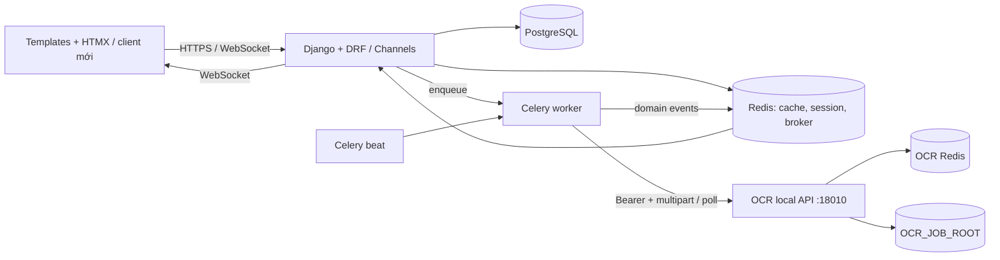
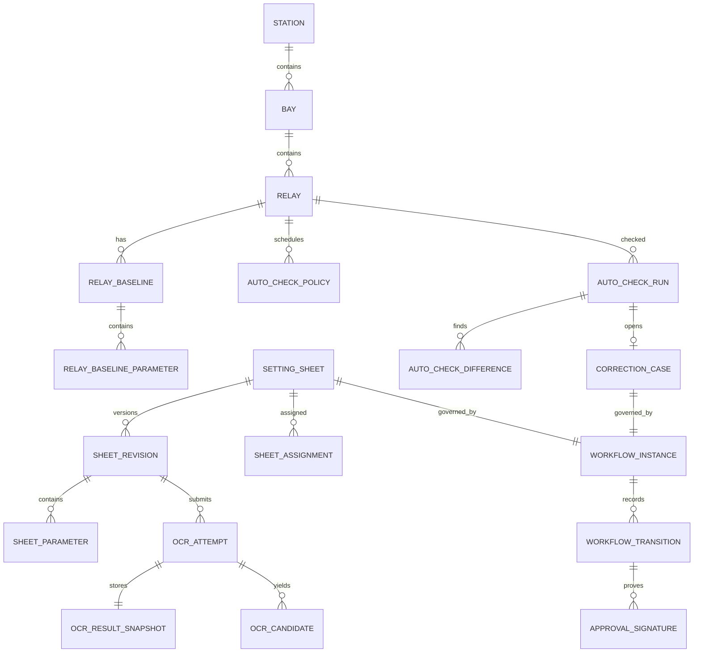

# Đề xuất kiến trúc backend mới cho EVN RMS

> **Căn cứ:** `repomix-backend.md`, `repomix-frontend.md`, `repomix-urls.md`, `API_CONTRACT.md`. Đây là thiết kế mục tiêu, không phải khẳng định rằng mọi chi tiết đã tồn tại trong mã cũ. Công nghệ được giữ: Python/Django + Django REST Framework, PostgreSQL, Redis, Celery, Django Channels/Daphne, Docker Compose và dịch vụ OCR local hiện hữu.

## 1. Quyết định kiến trúc

Chọn **modular monolith Django** làm hệ thống RMS chính, chạy cùng PostgreSQL, Redis, Celery worker/beat và Daphne/Channels. OCR vẫn là một dịch vụ local độc lập tại `http://127.0.0.1:18010`, được gọi qua HTTP theo `API_CONTRACT.md`. Không sao chép OCR engine vào Django, không để browser gọi trực tiếp OCR API, và không dùng artifact/file của OCR làm nguồn dữ liệu nghiệp vụ lâu dài.

RMS chịu trách nhiệm về người dùng, phân quyền, asset, workflow, lịch sử/audit, retry của RMS và dữ liệu OCR đã chuẩn hóa. OCR service chỉ chịu trách nhiệm nhận PDF, xử lý và trả `job_id`, trạng thái và `result.json`.



### Nguyên tắc biên hệ thống

- `OCR_API_TOKEN` chỉ ở cấu hình server/secret store của RMS. Frontend không biết token và không gọi port 18010.
- Một lần gửi OCR tạo **một attempt mới** trong RMS và một `job_id` mới ở OCR. Với contract hiện có, không thể yêu cầu OCR retry/xóa/list job.
- RMS poll OCR bằng Celery, ánh xạ trạng thái `queued/running/succeeded/failed` của OCR sang trạng thái nội bộ, tải `/result` duy nhất sau `succeeded`, xác thực schema rồi lưu snapshot JSON và dữ liệu chuẩn hóa trong PostgreSQL.
- File PDF gốc do RMS quản lý theo retention riêng. OCR giữ file/result tối đa mặc định 7 ngày; RMS không phụ thuộc khả năng tải lại result sau mốc đó.
- HTTP view/controller chỉ xác thực và phát lệnh. Business use case chạy trong service layer; worker chỉ gọi các use case đó, không chép lại nghiệp vụ.

## 2. Cấu trúc thư mục, trách nhiệm và quy tắc phụ thuộc

```text
rms/
  config/                         # settings theo môi trường, ASGI, Celery, URL root
  apps/
    identity/                     # User profile, organization, role/capability, policy
    catalog/                      # danh mục chuẩn và external reference
    assets/                       # Station, Bay, Relay, relay baseline parameters
    sheets/                       # sheet/revision, parameter, assignment, workflow, signature
    ocr/                          # OCR submission/attempt/result normalization, OCR client adapter
    monitoring/                   # policy auto-check, run, measurement/difference, correction case
    integrations/                 # PMIS/API catalog sync, config endpoint, sync run
    notifications/                # outbox event, WebSocket projection, notification preference
    audit/                        # immutable audit event, idempotency key, attachment metadata
  shared/
    api/                          # error envelope, pagination, DRF permission/base classes
    domain/                       # Result/error primitives, IDs, time, event interface
    storage/                      # document storage abstraction and retention policy
    tasks/                        # Celery task entry points, retry scheduling only
  templates/                      # adapter UI cũ HTMX trong giai đoạn chuyển đổi
  static/
  manage.py
```

| Lớp | Trách nhiệm | Được phép phụ thuộc |
|---|---|---|
| `api`/views/serializers/consumers | HTTP, WebSocket, DTO, authn, response; không quyết định transition nghiệp vụ | application services của app, `shared.api` |
| application services/use cases | Transaction, permission policy, orchestration domain, idempotency, phát event | domain model/repository của app và interface của app khác |
| domain models/policies | Entity, invariant, state transition thuần nghiệp vụ | cùng app, `shared.domain`; không import Django view, Celery hay requests |
| infrastructure/adapters | ORM repository, OCR HTTP client, storage, PMIS client, cache/outbox | interface từ application/domain; library/framework |
| Celery task/beat | Trigger use case, poll/schedule, retry kỹ thuật | application service; không chứa rule workflow |

### Quy tắc phụ thuộc bắt buộc

1. `identity` và `catalog` không phụ thuộc vào `sheets`, `monitoring`, `ocr`.
2. `assets` có thể tham chiếu `catalog` và `identity` nhưng không phụ thuộc `sheets` hoặc UI.
3. `sheets` tham chiếu `assets`, `identity`, `ocr` qua interface/use case; `monitoring` chỉ đọc baseline đã được sheets công bố, không sửa trực tiếp dữ liệu sheet.
4. `ocr` chỉ biết `SheetRevision`/`Document` qua ID và port `OcrGateway`; không có import OCR engine hay thao tác đường dẫn `OCR_JOB_ROOT`.
5. `integrations` không cập nhật bảng domain rải rác trong client HTTP: mapping/import chạy qua service rõ ràng, tạo `SyncRun` và audit.
6. Không đặt `random`, mock service, parse UI text/DOM, logic quyền, hoặc transition status trong template/JS. Mock chỉ tồn tại trong test fixture hoặc adapter dev riêng.
7. Mọi thay đổi trạng thái nghiệp vụ phải ghi `AuditEvent` và phát domain event theo outbox trong cùng transaction.

## 3. Luồng OCR theo contract local

### 3.1. Trạng thái nội bộ đề xuất

| Trạng thái `OcrAttempt` RMS | Nguồn/khi nào | Hành động tiếp |
|---|---|---|
| `PENDING_SUBMIT` | Upload sheet thành công, chưa gọi OCR | Celery submit PDF. |
| `SUBMITTING` | Worker đang gọi `POST /api/v1/jobs` | Nhận `remote_job_id` hoặc phân loại lỗi submit. |
| `QUEUED` | OCR trả `202` và `status=queued` | Lập lịch poll. |
| `RUNNING` | Poll trả `running` | Tiếp tục poll với backoff giới hạn. |
| `FETCHING_RESULT` | Poll trả `succeeded` | GET `/result`, validate schema version. |
| `SUCCEEDED` | Result lưu/chuẩn hóa thành công | Chuyển revision sang `OCR_READY`; tạo event cho UI. |
| `FAILED_SUBMISSION` | 400/401/413/415 hoặc network error lúc submit | Không tự resubmit vô hạn; hiển thị lỗi kỹ thuật đã phân loại. |
| `FAILED_PROCESSING` | OCR status `failed`, 404 remote job, 409 sai thời điểm, result/schema không hợp lệ | Người dùng hoặc policy tạo attempt mới. |
| `CANCELLED` | RMS hủy trước khi submit hoặc bỏ attempt nội bộ | OCR API không có cancel, nên remote job có thể vẫn chạy. |

`OcrAttempt` không dùng trạng thái cũ `PENDING/PROCESSING/SUCCESS/SUCCESS_WITH_WARNINGS/FAILED` như contract công khai. Nếu cần tương thích UI, mapping được đặt tại API presenter duy nhất.

### 3.2. Luồng chi tiết

1. User upload PDF vào RMS; backend kiểm tra quyền, loại/kích thước theo policy RMS, tạo `Document`, `SheetRevision`, `OcrAttempt(PENDING_SUBMIT)` và outbox event trong một transaction.
2. Celery task đọc `Document` qua storage adapter, gửi multipart `file` tới `POST /api/v1/jobs` với Bearer token. Lưu `remote_job_id`, `page_count`, `source_filename`, thời điểm submit.
3. Beat/task poll `GET /api/v1/jobs/{remote_job_id}`. Interval/backoff là cấu hình RMS; không suy diễn progress từng trang vì OCR contract không trả progress.
4. Khi `succeeded`, worker gọi `GET /result`, lưu nguyên bản vào `OcrResultSnapshot.payload`, kiểm tra `schema_version`, rồi normalizer tạo header/parameter candidate có provenance. Không ghi thẳng OCR JSON vào baseline Relay.
5. User review và xác nhận sheet. Chỉ use case publish/approve mới tạo hoặc cập nhật `RelayBaselineParameter`.
6. OCR `failed` không có error detail theo contract. RMS phải lưu mã `OCR_REMOTE_FAILED` và metadata status; không tự bịa nguyên nhân.

## 4. Mô hình dữ liệu mới

Tất cả bảng có `id` UUID hoặc bigint thống nhất, `created_at`, `updated_at`, và các unique/index được ghi khi cần. Kiểu chính: `UUID`, `varchar`, `text`, `boolean`, `integer`, `numeric`, `timestamptz`, `jsonb`, FK. Kiểu đầy đủ/DDL là bước thiết kế chi tiết tiếp theo.

### 4.1. Identity, catalog và tài sản

| Thực thể | Trường/chủ thể chính | Thay đổi so với cũ và lý do |
|---|---|---|
| `Organization` | `code` unique, `name`, `type`, `parent_id` | Giữ cây tổ chức; thay `parent_code` text bằng FK ở nơi cần toàn vẹn. |
| `UserProfile` | `user_id` 1-1, `organization_id`, `home_station_id`, contact | Giữ dữ liệu phân quyền theo đơn vị/trạm. |
| `Role`, `RoleGrant` | role code, user/group/org/station scope, effective dates | Tách role assignment có scope khỏi các `if group name`; quyền có thể kiểm tra nhất quán. Việc giữ Django Group làm implementation chi tiết: quyết định sau. |
| `CatalogType`, `CatalogItem` | type, `code`, `name`, active, source metadata | Gộp các danh mục cùng cấu trúc cũ; giảm nhiều model/viewset trùng. Nếu một catalog cần fields riêng thì mở extension table, không nhét JSON tùy tiện. |
| `ExternalReference` | `system`, `entity_type`, `entity_id`, `external_id`, `payload_hash`, last synced | Thay các cột `id_*` text rải rác; giữ ID PMIS nhưng truy vết nguồn/không tạo FK giả. |
| `Station` | code unique, name, address/location, organization FK, voltage-level FK, lifecycle fields | Dùng FK thật tới catalog nơi danh mục thuộc RMS; phần ngoại hệ thống nằm `ExternalReference`. |
| `Bay` | `station_id` non-null, code, name, electrical attributes | Bắt buộc thuộc Station sau khi data migration xử lý orphan; unique `(station_id, code)`. |
| `Relay` | `bay_id` non-null, code, name/model, manufacturer FK nullable, lifecycle metadata | Bắt buộc thuộc Bay, unique `(bay_id, code)` hoặc natural key được nghiệp vụ xác nhận. Không dùng `relay_text` như entity thay thế. |
| `RelayBaseline` + `RelayBaselineParameter` | Relay, revision/sheet published from, effective range; code, name, value text+normalized numeric, unit, tolerance, provenance | Thay `RelaySetting` float-only. Thông số relay có thể là text/matrix, cần lưu value gốc, numeric nếu parse được, version hiệu lực và nguồn. |

### 4.2. Document, OCR và sheet workflow

| Thực thể | Trường/chủ thể chính | Thay đổi so với cũ và lý do |
|---|---|---|
| `Document` | storage key, original name, media type, size, SHA-256, uploaded_by, retention state | Tách file upload khỏi sheet để chống trùng và quản retention/quyền truy cập. |
| `SettingSheet` | code unique, title, `relay_id` nullable lúc OCR, `station_id`, owner/execution station, current revision, lifecycle state | Giữ khái niệm phiếu; code và asset chỉ được xác nhận bằng review workflow, không tự coi OCR guess là dữ liệu chuẩn. |
| `SheetRevision` | sheet, sequence unique per sheet, source document, state, created_by, supersedes, effective_from/until, is_temporary | Thay fields `revert_to_sheet`, `reverted`, `has_parameters_changed` trên một bản ghi. Version và temporary/revert trở nên minh bạch/auditable. |
| `SheetParameter` | revision, parameter code/name, group, raw value, normalized value/type/unit, range/tolerance, page/source coordinates, review state | Thay `extracted_data JSONField`: searchable, validate được, diff/version được, giữ provenance OCR. JSON snapshot vẫn lưu riêng để trace. |
| `SheetAssignment` | sheet/revision, assignment role, assignee, assigned_by, due_at, active | Thay `assigned_to`, `supervisor_assigned`, `assigned_at` cố định; hỗ trợ đổi người và lịch sử. |
| `WorkflowInstance`, `WorkflowTransition` | subject type/id, current state, transition, actor, reason, at, version | Thay status string và nhiều if/else phân tán; áp dụng cho sheet và correction case. |
| `ApprovalSignature` | workflow transition, signer, signer role, provider, provider reference, signed_at, verified_at, content hash, status | Thay `SignatureRecord` mock; hỗ trợ adapter ký thật và audit không sửa. |
| `OcrAttempt` | revision, `remote_job_id` unique nullable, status, submitted/polled/completed timestamps, page count, failure code, retry_of, attempt number | Tách local/OCR external job. Một revision có nhiều attempt; `remote_job_id` là ID của OCR API. |
| `OcrResultSnapshot` | attempt 1-1, schema version, payload jsonb, checksum, fetched_at | Lưu nguyên result OCR trước khi normalize; tránh phụ thuộc retention 7 ngày của OCR. |
| `OcrCandidate` | attempt, candidate type/header/parameter, value JSON, confidence nullable, source locator, accepted/rejected/reviewed_by | Tách kết quả chưa xác nhận khỏi SheetParameter đã review. Contract không bắt buộc confidence nên nullable. |

### 4.3. Monitoring, ticket, integration và audit

| Thực thể | Trường/chủ thể chính | Thay đổi so với cũ và lý do |
|---|---|---|
| `AutoCheckPolicy` | relay, enabled, schedule/interval, next_run_at, paused_reason, version | Tách lịch/check state ra Relay; dễ lock/schedule/audit. |
| `AutoCheckRun` | relay, baseline id, started/finished, status, source adapter, raw response snapshot, error code | Thay `RelayAutoCheckLog`; một run là một lần gọi, luôn biết baseline được so. |
| `AutoCheckDifference` | run, parameter/baseline ref, expected/actual raw values, comparison rule, severity, resolved state | Thay mảng `differences JSON`; query/report/ticket được. |
| `CorrectionCase` | relay, triggering run, workflow instance, priority, opened/resolved timestamps | Thay `CorrectionTicket.status` tự quản lý; giữ quan hệ với sai lệch và workflow. |
| `IntegrationEndpoint`, `SyncRun`, `SyncItemResult` | endpoint/template/auth secret ref; run status/checkpoint; từng record mapping result | Thay `SystemConfig` kiêm config/trạng thái/progress text. Không lưu secret header plaintext trong entity. |
| `AuditEvent`, `OutboxEvent`, `IdempotencyRecord` | actor/action/target/before/after redacted; event type/payload/delivery; request key/response hash | Lịch sử sửa `edit_logs JSON`, WebSocket và idempotency được chuẩn hóa, retry được và có audit. |

### Quan hệ trọng yếu



## 5. Hợp đồng API RMS mới

### 5.1. Quy ước chung

- Prefix chính: `/api/v2/`. API JSON là contract lâu dài; template/HTMX cũ là adapter tạm thời, không phải nguồn contract mới.
- Auth RMS: session hiện hữu cho UI hoặc Bearer/JWT nếu hệ thống đã có cơ chế được phê duyệt. Loại auth API public chưa có yêu cầu trong nguồn nên **cần quyết định**.
- Error envelope RMS thống nhất: `{"error":{"code":"...","message":"...","details":{...},"request_id":"..."}}`. Không áp dụng envelope này cho OCR API external vì phải tôn trọng `API_CONTRACT.md`.
- Mutating request nhận `Idempotency-Key`; response trả `ETag`/`version` cho resource cần optimistic concurrency. `409` biểu thị version/state transition xung đột.
- List dùng `page`, `page_size`, `sort`, filter cụ thể; response `{items, page, page_size, total}`.
- WebSocket `/ws/notifications/` vẫn có thể giữ; event RMS phải version hóa và không lộ OCR token/raw secret.

### 5.2. API domain đề xuất

| Method & endpoint | Đầu vào chính | Đầu ra / lỗi trọng yếu | Khác API cũ |
|---|---|---|---|
| `GET /api/v2/assets/stations` | q, organization, voltage, page | Station list; 400 filter, 403 scope | Thay tree/list HTML và danh mục API phân tán bằng asset API thống nhất. |
| `GET /api/v2/assets/stations/{id}/tree` | depth=`bays|relays` | cây station-bay-relay đã scope | Thay hai endpoint HTMX lazy load; UI vẫn có thể tải lazy qua JSON. |
| `POST /api/v2/assets/imports` | file/reference + mode | import job | Thay bulk create/paste semantics không chuẩn; format import cần chốt. |
| `GET/POST /api/v2/relays/{id}/baselines` | create chỉ qua publish workflow | baseline/version/parameters | Cũ cập nhật `RelaySetting` khi ký trực tiếp; mới chỉ publish transition được phép. |
| `POST /api/v2/sheets` | metadata, document upload/reference, idempotency key | 201 sheet + revision + first OCR attempt | Thay `sheets/create/`; upload and domain response tách rõ. |
| `GET /api/v2/sheets`, `GET /api/v2/sheets/{id}` | filters/status/scope; include | sheet/revision/assignments/workflow summary | Thay list/detail HTML và status filter rải rác. |
| `POST /api/v2/sheets/{id}/revisions` | document, temporary/effective metadata | 201 revision | Cũ dùng một SettingSheet với flags revert/temporary. |
| `PATCH /api/v2/sheet-revisions/{id}/metadata` | station/relay/version | metadata đã validate | Thay fallback relay text/DOM; 409 conflict, 422 asset invalid. |
| `PUT /api/v2/sheet-revisions/{id}/parameters` | full parameter command + version | revised parameters/diff summary | Thay field form `ocr_*_{index}`; payload typed and atomic. |
| `POST /api/v2/sheet-revisions/{id}/ocr-attempts` | optional resubmit reason; idempotency | 202 attempt status | Thay `run-mock-ocr`/rerun; dùng OCR local thật. |
| `GET /api/v2/ocr-attempts/{id}` | none | local status, remote status summary, failure code, links | Thay `ocr-job/*/json` shape cũ; không expose remote token. |
| `POST /api/v2/ocr-attempts/{id}/retry` | reason | 202 new attempt | Khác OCR external: RMS creates a new attempt because OCR lacks retry API. |
| `GET /api/v2/ocr-attempts/{id}/result` | none | normalized candidates + reviewed status; raw snapshot only privileged | Thay path `/data/` không tồn tại và JSON raw lẫn UI data. |
| `POST /api/v2/sheets/{id}/assignments` | role, assignee, due date, version | active assignment + workflow state | Thay `assign` và `route-to-station` split logic; execution station is a typed field. |
| `POST /api/v2/sheets/{id}/transitions` | transition, comment, version | new workflow state | Thay `update-status` mock and implicit role/status changes. |
| `POST /api/v2/workflow-transitions/{id}/signatures` | provider response/reference, signature material policy | verified/pending signature | Thay mock initiate/confirm pair. Provider-specific challenge endpoints only added when real signing contract exists. |
| `GET/PATCH /api/v2/relays/{id}/auto-check-policy` | schedule, enabled, version | policy | Thay schedule fields on Relay. |
| `POST /api/v2/relays/{id}/auto-check-runs` | source/action idempotency | 202 run | Thay mock `autochecks/now`; actual device adapter chosen server-side. |
| `GET /api/v2/auto-check-runs/{id}` | include differences | run/difference list | Thay HTML rows/JSON arrays. |
| `POST /api/v2/correction-cases/{id}/transitions` | transition, comment, version | state/history | Thay ticket-sign action that advances demo flow. |
| `GET/POST /api/v2/integrations/endpoints` | config without plaintext secret | endpoint metadata | Thay SystemConfig general fields; secrets referenced, not returned. |
| `POST /api/v2/integrations/endpoints/{id}/sync-runs` | scope/options/idempotency | 202 sync run | Thay UI looping over buttons with 3-second delay. |
| `GET /api/v2/sync-runs/{id}` | none | progress, checkpoint, item errors | Thay progress encoded in `last_sync_status` text. |
| `GET /api/v2/notifications/badges` | none | badge counts by capability | Compatible conceptual successor of `/system/api/badges/`. |

### 5.3. RMS-to-OCR adapter contract (giữ nguyên external API)

| RMS operation | OCR HTTP call bắt buộc | RMS xử lý |
|---|---|---|
| Submit attempt | `POST http://127.0.0.1:18010/api/v1/jobs`, multipart `file`, `Authorization: Bearer <OCR_API_TOKEN>` | Lưu `job_id`, `page_count`; map 400/401/413/415 thành failure code RMS; không retry request không idempotent một cách mù quáng. |
| Poll | `GET /api/v1/jobs/{job_id}` cùng Bearer | Map `queued/running/succeeded/failed`; 404 là remote job missing; API không có failure detail. |
| Fetch result | `GET /api/v1/jobs/{job_id}/result` cùng Bearer, chỉ sau succeeded | 200: snapshot/normalize. 409: poll lại. 404: fail RMS. Không giả định luôn có `page1` hoặc `page3_plus`. |
| Health | `GET /health` | Dùng readiness/monitoring; Redis error không có error JSON riêng theo contract. |

### 5.4. Compatibility plan

1. Giữ các URL cũ trong `repomix-urls.md` ở lớp adapter, bên trong gọi v2 service. Không thêm nghiệp vụ mới vào handler cũ.
2. Trả HTML partial cho HTMX trong thời gian frontend chưa chuyển, nhưng canonical command/query và error code do v2 service trả.
3. Loại bỏ route mock (`run-mock-ocr`, bulk/API extract test) khỏi production surface hoặc bảo vệ bằng environment/admin development policy.
4. Frontend chuyển các hardcode path cũ (`/sheets/ocr-job/.../data|delete`) sang v2. Chỉ thêm API xóa attempt sau khi chốt retention/audit; không xóa remote OCR job vì external contract không hỗ trợ.

## 6. Hai phương án có đánh đổi lớn

### Phương án A — Modular monolith RMS + OCR local service riêng (khuyến nghị)

RMS là một Django deployment gồm web, worker và beat; OCR vẫn là service local được adapter gọi qua HTTP. PostgreSQL là nguồn dữ liệu RMS, Redis dùng cache/session/broker RMS; OCR dùng Redis và storage riêng theo contract.

- Ưu điểm: phù hợp codebase/công nghệ hiện hữu; transaction và RBAC đơn giản; ít vận hành; tách OCR process nặng và token khỏi web; migration từ URL/template cũ dễ.
- Đánh đổi: cùng codebase vẫn cần kỷ luật dependency và test integration để tránh thành monolith rối.
- Chọn khi: một đội phát triển, triển khai on-premise, quy mô nghiệp vụ hiện tại và OCR local là boundary rõ ràng.

### Phương án B — Tách thêm dịch vụ workflow/integration khỏi RMS web

Tách `sheets/workflow`, `monitoring`, `integrations` thành deployable services riêng, vẫn dùng Django/Celery/PostgreSQL/Redis và OCR local.

- Ưu điểm: scale/sự cố của PMIS sync, device check hoặc workflow không trực tiếp ảnh hưởng web; ranh giới ownership rõ nếu nhiều đội.
- Đánh đổi: phải giải quyết distributed transaction, versioned event contract, observability, migration data, permission propagation và vận hành nhiều deployment. Các tài liệu nguồn chưa chứng minh nhu cầu tải/đội ngũ để bù chi phí này.
- Chọn khi: các phần có owner độc lập, có yêu cầu scale/SLA độc lập, và đã có năng lực vận hành event/service contract.

**Khuyến nghị:** Phương án A. Thiết kế package theo boundary của Phương án B để có thể tách sau này, nhưng chưa tách deployable service ngoài OCR. Đây là mức đơn giản nhất vẫn xử lý được rủi ro của code cũ: state rải rác, mock, JSON không chuẩn, gọi OCR subprocess và workflow trong view.

## 7. Thứ tự xây dựng theo lát cắt dọc

| Lát cắt | Phạm vi end-to-end | Tiêu chí hoàn thành |
|---|---|---|
| 0. Nền tảng | Settings môi trường, Docker Compose, PostgreSQL migrations, Redis/Celery/Channels, identity tối thiểu, error/idempotency/audit/outbox, health/readiness RMS | Một user scope được auth; một command có idempotency; audit/outbox được ghi trong cùng transaction; worker/beat và WebSocket hoạt động. |
| 1. Asset & quyền scope | Catalog, Station–Bay–Relay, external reference, asset list/tree API và adapter UI | Không tạo Bay/Relay mồ côi; scope tổ chức/trạm được kiểm tra server-side; import có SyncRun/audit; list/tree có pagination/filter ổn định. |
| 2. Sheet upload + OCR local | Document, SheetRevision, OcrAttempt/Gateway/poll, snapshot, WebSocket event, màn hình trạng thái | Upload PDF hợp lệ tạo attempt; RMS gọi đúng ba endpoint OCR theo contract; remote `job_id` được lưu; result được snapshot; `failed/404/409/401/413/415` có failure code RMS và không lộ token; retry tạo attempt mới. |
| 3. Review dữ liệu OCR & version | Normalize candidate, parameter review/edit typed, metadata asset validation, diff revision | Không có UI fallback tự quyết định relay; reviewer chấp nhận/từ chối candidate có audit; parameter có provenance; diff giữa revision trả chính xác; OCR JSON không cập nhật baseline trực tiếp. |
| 4. Assignment & workflow sheet | Scoped role grants, assignment, transition machine, approval signature adapter interface | Mọi transition bị chặn khi role/state/version sai; lịch sử immutable; người được giao chỉ xem/sửa đúng scope; mock signature không tồn tại ở production. |
| 5. Publish baseline & temporary setting | Publish approved revision, effective period, temporary/revert job, RelayBaselineParameter | Baseline chỉ đổi qua transition hợp lệ; active baseline được chọn rõ theo thời gian/revert; mọi parameter có nguồn sheet revision. |
| 6. Auto-check & correction case | Policy/scheduler, device adapter interface, run/difference, case workflow | Một run luôn so với baseline xác định; mismatch sinh differences có query được; pause/resume policy auditable; case không thể tự tiến bước qua role trái phép. |
| 7. PMIS/catalog integration | Integration endpoint secret ref, SyncRun/checkpoint/item results, mapping and resume | Không có `verify=False` mặc định; secret không trả về UI/log; retry/resume theo record/run; sync-all là một server job, không phải click DOM tuần tự. |
| 8. Compatibility cutover & hardening | Map routes cũ, migrate frontend, retention/backup, metrics/log/tracing, load/security tests, retire mocks | Không còn hardcode API không tồn tại; API contract versioned; OCR retention 7 ngày không làm mất dữ liệu RMS; monitoring phát hiện OCR/Redis/worker failure; mock/test endpoint không public production. |

## 8. Quyết định cần chốt trước khi triển khai lát cắt 4–7

Các tài liệu nguồn không đủ để tự suy đoán các điểm sau, nên cần nghiệp vụ phê duyệt:

1. State machine chính xác của sheet: các trạng thái hợp lệ, transition, ai được thực hiện và điều kiện ký.
2. Giá trị pháp lý của chữ ký: nhà cung cấp, callback/challenge contract, dữ liệu lưu, verification/retention.
3. Định nghĩa active baseline khi có sheet tạm, hết hạn và revert; precedence theo thời gian.
4. Contract thiết bị/PMIS thực: auth, TLS/CA, schema, idempotency, rate limit, retry và error codes.
5. Schema version và trường bắt buộc trong `page1`/`page3_plus` OCR; API contract hiện chỉ nói các trường này có thể vắng mặt/lồng nhau.
6. Retention, backup, phân loại dữ liệu nhạy cảm và quyền tải PDF/OCR raw result.
7. SLO/tải dự kiến để quyết định batch size, worker concurrency, poll interval và khi nào cần tách dịch vụ.
