This file is a merged representation of a subset of the codebase, containing specifically included files and files not matching ignore patterns, combined into a single document by Repomix.
The content has been processed where empty lines have been removed, line numbers have been added, content has been compressed (code blocks are separated by ⋮---- delimiter).

# File Summary

## Purpose
This file contains a packed representation of a subset of the repository's contents that is considered the most important context.
It is designed to be easily consumable by AI systems for analysis, code review,
or other automated processes.

## File Format
The content is organized as follows:
1. This summary section
2. Repository information
3. Directory structure
4. Repository files (if enabled)
5. Multiple file entries, each consisting of:
  a. A header with the file path (## File: path/to/file)
  b. The full contents of the file in a code block

## Usage Guidelines
- This file should be treated as read-only. Any changes should be made to the
  original repository files, not this packed version.
- When processing this file, use the file path to distinguish
  between different files in the repository.
- Be aware that this file may contain sensitive information. Handle it with
  the same level of security as you would the original repository.

## Notes
- Some files may have been excluded based on .gitignore rules and Repomix's configuration
- Binary files are not included in this packed representation. Please refer to the Repository Structure section for a complete list of file paths, including binary files
- Only files matching these patterns are included: README.md, PROJECT_REQUIREMENTS.md, docs/**/*.md, manage.py, rms_project/**/*.py, core/**/*.py, stations/**/*.py, sheets/**/*.py, checks/**/*.py, categories/**/*.py, requirements.txt, Dockerfile, docker-compose.yml, .env.example
- Files matching these patterns are excluded: OCR_PRJ/**, venv/**, **/__pycache__/**, staticfiles/**, vendor/**, .git/**, .env, **/*.xlsx, **/*.docx, **/*.log, **/*.json, stations/relay_specs.py, repomix-output.*
- Files matching patterns in .gitignore are excluded
- Files matching default ignore patterns are excluded
- Empty lines have been removed from all files
- Line numbers have been added to the beginning of each line
- Content has been compressed - code blocks are separated by ⋮---- delimiter
- Files are sorted by Git change count (files with more changes are at the bottom)

# Directory Structure
````
categories/
  migrations/
    __init__.py
    0001_initial.py
    0002_managementunit_parent_code_managementunit_sort_order_and_more.py
    0003_manufacturingcountry_legacy_id_and_more.py
    0004_ownership_sort_order.py
    0005_voltagelevel_legacy_code_voltagelevel_sort_order.py
    0006_station.py
    0007_delete_station.py
    0008_line_da_tke_line_dz_cha_line_i_chophep_line_id_capda_and_more.py
    0009_project_id_capda_project_id_ct_project_id_dvi_and_more.py
    0010_location_duong_vao_location_hanh_lang_and_more.py
  __init__.py
  admin.py
  apps.py
  models.py
  serializers.py
  tests.py
  urls.py
  views.py
checks/
  migrations/
    __init__.py
    0001_initial.py
    0002_alter_periodiccheck_sheet.py
  __init__.py
  admin.py
  apps.py
  models.py
  tests.py
  urls.py
  views.py
core/
  management/
    commands/
      seed_data.py
      seed_permissions.py
      seed_users.py
  migrations/
    __init__.py
    0001_initial.py
    0002_userprofile_station.py
    0003_systemconfig.py
    0004_systemconfig_auth_header.py
    0005_systemconfig_auto_sync_enabled_and_more.py
    0006_systemconfig_sync_count.py
    0007_systemconfig_is_syncing.py
    0008_userprofile_updated_at.py
    0009_alter_systemconfig_last_sync_status.py
  templatetags/
    __init__.py
    auth_extras.py
    core_extras.py
  utils/
    api_sync.py
    xml_converter.py
  __init__.py
  admin.py
  api_renderers.py
  apps.py
  consumers.py
  context_processors.py
  models.py
  routing.py
  tasks.py
  tests.py
  urls.py
  views.py
docs/
  cores/
    01-database.md
    02-backend.md
    03-frontend.md
    04-security.md
    05-testing.md
    06-deployment.md
  features/
    01-station-management.md
    02-calibration-sheet.md
    03-digital-signature.md
    04-periodic-check.md
    05-ai-ocr.md
  mvt_design/
    MODELS_DESIGN.md
    REQUIREMENTS_MVT.md
    TEMPLATES_UI.md
    VIEWS_URLS_MAP.md
rms_project/
  __init__.py
  asgi.py
  celery.py
  settings.py
  urls.py
  wsgi.py
sheets/
  management/
    commands/
      __init__.py
      sync_hybrid_pipeline.py
    __init__.py
  migrations/
    __init__.py
    0001_initial.py
    0002_alter_settingsheet_options.py
    0003_alter_settingsheet_status.py
    0004_alter_settingsheet_options.py
    0005_settingsheet_assigned_to_settingsheet_created_by.py
    0006_settingsheet_assigned_supervisor_and_more.py
    0007_remove_settingsheet_assigned_supervisor_and_more.py
    0008_alter_settingsheet_status.py
    0009_settingsheet_supervisor_assigned.py
    0010_settingsheet_is_temporary_and_more.py
    0011_alter_settingsheet_options_alter_settingsheet_status.py
    0012_settingsheet_station.py
    0013_settingsheet_assigned_at_alter_settingsheet_status.py
    0014_settingsheet_edit_logs_alter_settingsheet_status.py
    0015_settingsheet_has_parameters_changed.py
    0016_alter_settingsheet_scan_file.py
    0017_settingsheet_updated_at.py
    0018_ocrjob.py
    0019_ocrjob_error_detail.py
    0020_ocrjob_device_mode.py
    0021_settingsheet_execution_station.py
  __init__.py
  admin.py
  apps.py
  models.py
  relay_matcher.py
  services.py
  signals.py
  tasks.py
  tests.py
  urls.py
  utils.py
  views_bulk.py
  views.py
stations/
  management/
    commands/
      __init__.py
      run_autocheck.py
    __init__.py
  migrations/
    __init__.py
    0001_initial.py
    0002_relayautochecklog.py
    0003_relay_auto_check_enabled_relay_check_interval_unit_and_more.py
    0004_alter_relay_check_interval_unit.py
    0005_alter_relay_auto_check_enabled_and_more.py
    0006_relay_is_paused_for_correction_and_more.py
    0007_alter_station_options_station_id_capda_and_more.py
    0008_bay_i_dm_bay_id_capda_bay_id_dvi_bay_id_nlo_and_more.py
    0009_relay_id_capda_relay_id_doituong_relay_id_dvi_and_more.py
    0010_alter_bay_bay_name_alter_bay_ten_tram_and_more.py
    0011_bay_updated_at_relay_updated_at_station_updated_at.py
  __init__.py
  admin.py
  api_mock.py
  apps.py
  models.py
  search_utils.py
  tasks.py
  tests.py
  urls.py
  views.py
.env.example
docker-compose.yml
Dockerfile
manage.py
PROJECT_REQUIREMENTS.md
README.md
requirements.txt
````

# Files

## File: categories/migrations/__init__.py
````python

````

## File: categories/migrations/0001_initial.py
````python
# Generated by Django 6.0.7 on 2026-07-28 16:28
⋮----
class Migration(migrations.Migration)
⋮----
initial = True
⋮----
dependencies = [
⋮----
operations = [
````

## File: categories/migrations/0002_managementunit_parent_code_managementunit_sort_order_and_more.py
````python
# Generated by Django 6.0.7 on 2026-07-28 16:45
⋮----
class Migration(migrations.Migration)
⋮----
dependencies = [
⋮----
operations = [
````

## File: categories/migrations/0003_manufacturingcountry_legacy_id_and_more.py
````python
# Generated by Django 6.0.7 on 2026-07-28 16:48
⋮----
class Migration(migrations.Migration)
⋮----
dependencies = [
⋮----
operations = [
````

## File: categories/migrations/0004_ownership_sort_order.py
````python
# Generated by Django 6.0.7 on 2026-07-28 16:51
⋮----
class Migration(migrations.Migration)
⋮----
dependencies = [
⋮----
operations = [
````

## File: categories/migrations/0005_voltagelevel_legacy_code_voltagelevel_sort_order.py
````python
# Generated by Django 6.0.7 on 2026-07-28 16:52
⋮----
class Migration(migrations.Migration)
⋮----
dependencies = [
⋮----
operations = [
````

## File: categories/migrations/0006_station.py
````python
# Generated by Django 6.0.7 on 2026-07-28 16:59
⋮----
class Migration(migrations.Migration)
⋮----
dependencies = [
⋮----
operations = [
````

## File: categories/migrations/0007_delete_station.py
````python
# Generated by Django 6.0.7 on 2026-07-28 17:03
⋮----
class Migration(migrations.Migration)
⋮----
dependencies = [
⋮----
operations = [
````

## File: categories/migrations/0008_line_da_tke_line_dz_cha_line_i_chophep_line_id_capda_and_more.py
````python
# Generated by Django 6.0.7 on 2026-07-28 17:09
⋮----
class Migration(migrations.Migration)
⋮----
dependencies = [
⋮----
operations = [
````

## File: categories/migrations/0009_project_id_capda_project_id_ct_project_id_dvi_and_more.py
````python
# Generated by Django 6.0.7 on 2026-07-28 17:12
⋮----
class Migration(migrations.Migration)
⋮----
dependencies = [
⋮----
operations = [
````

## File: categories/migrations/0010_location_duong_vao_location_hanh_lang_and_more.py
````python
# Generated by Django 6.0.7 on 2026-07-28 17:14
⋮----
class Migration(migrations.Migration)
⋮----
dependencies = [
⋮----
operations = [
````

## File: categories/__init__.py
````python

````

## File: categories/admin.py
````python

````

## File: categories/apps.py
````python
class CategoriesConfig(AppConfig)
⋮----
name = 'categories'
````

## File: categories/models.py
````python
class CategoryBase(models.Model)
⋮----
code = models.CharField(max_length=50, unique=True, verbose_name="Mã")
name = models.CharField(max_length=255, verbose_name="Tên")
description = models.TextField(blank=True, null=True, verbose_name="Mô tả")
created_at = models.DateTimeField(auto_now_add=True)
updated_at = models.DateTimeField(auto_now=True)
⋮----
class Meta
⋮----
abstract = True
⋮----
def __str__(self)
⋮----
class ManagementUnit(CategoryBase)
⋮----
sort_order = models.CharField(max_length=50, blank=True, null=True, verbose_name="Sắp xếp (SAPXEP)")
parent_code = models.CharField(max_length=50, blank=True, null=True, verbose_name="Mã đơn vị cha (MA_DONVI_CHA)")
unit_level = models.IntegerField(default=1, verbose_name="Cấp đơn vị (CAP_DONVI)")
⋮----
verbose_name = "Đơn vị quản lý"
verbose_name_plural = "Đơn vị quản lý"
⋮----
class ManufacturingCountry(CategoryBase)
⋮----
legacy_id = models.CharField(max_length=50, blank=True, null=True, verbose_name="Mã ID gốc (ID)")
⋮----
verbose_name = "Nước sản xuất"
verbose_name_plural = "Nước sản xuất"
⋮----
class Manufacturer(CategoryBase)
⋮----
verbose_name = "Hãng sản xuất"
verbose_name_plural = "Hãng sản xuất"
⋮----
class Ownership(CategoryBase)
⋮----
verbose_name = "Sở hữu"
verbose_name_plural = "Sở hữu"
⋮----
class VoltageLevel(CategoryBase)
⋮----
legacy_code = models.CharField(max_length=50, blank=True, null=True, verbose_name="Mã phụ (MA)")
⋮----
verbose_name = "Cấp điện áp"
verbose_name_plural = "Cấp điện áp"
⋮----
class EquipmentType(CategoryBase)
⋮----
verbose_name = "Loại thiết bị"
verbose_name_plural = "Loại thiết bị"
⋮----
class OperationalStatus(CategoryBase)
⋮----
verbose_name = "Trạng thái vận hành"
verbose_name_plural = "Trạng thái vận hành"
⋮----
class Line(CategoryBase)
⋮----
id_capda = models.CharField(max_length=50, blank=True, null=True, verbose_name="ID Cấp điện áp (ID_CAPDA)")
id_ttvh = models.CharField(max_length=50, blank=True, null=True, verbose_name="ID Trạng thái vận hành (ID_TTVH)")
da_tke = models.CharField(max_length=50, blank=True, null=True, verbose_name="Điện áp thiết kế (DA_TKE)")
id_da_tke = models.CharField(max_length=50, blank=True, null=True, verbose_name="ID Điện áp thiết kế (ID_DA_TKE)")
i_chophep = models.CharField(max_length=50, blank=True, null=True, verbose_name="Dòng điện cho phép (I_CHOPHEP)")
⋮----
ngay_vh = models.DateTimeField(blank=True, null=True, verbose_name="Ngày vận hành (NGAY_VH)")
tong_cdai = models.CharField(max_length=50, blank=True, null=True, verbose_name="Tổng chiều dài (TONG_CDAI)")
so_mach = models.CharField(max_length=50, blank=True, null=True, verbose_name="Số mạch (SO_MACH)")
id_dvi = models.CharField(max_length=50, blank=True, null=True, verbose_name="ID Đơn vị (ID_DVI)")
id_sohuu = models.CharField(max_length=50, blank=True, null=True, verbose_name="ID Sở hữu (ID_SOHUU)")
⋮----
id_dz = models.CharField(max_length=100, blank=True, null=True, verbose_name="ID Đường dây (ID_DZ)")
dz_cha = models.CharField(max_length=200, blank=True, null=True, verbose_name="Đường dây cha (DZ_CHA)")
id_dz_cha = models.CharField(max_length=100, blank=True, null=True, verbose_name="ID Đường dây cha (ID_DZ_CHA)")
⋮----
id_tba_cap = models.CharField(max_length=100, blank=True, null=True, verbose_name="ID TBA cấp (ID_TBA_CAP)")
tba_cap = models.CharField(max_length=200, blank=True, null=True, verbose_name="TBA cấp (TBA_CAP)")
id_nlo_cap = models.CharField(max_length=100, blank=True, null=True, verbose_name="ID Ngăn lộ cấp (ID_NLO_CAP)")
nlo_cap = models.CharField(max_length=200, blank=True, null=True, verbose_name="Ngăn lộ cấp (NLO_CAP)")
⋮----
id_tba_nhan = models.CharField(max_length=100, blank=True, null=True, verbose_name="ID TBA nhận (ID_TBA_NHAN)")
tba_nhan = models.CharField(max_length=200, blank=True, null=True, verbose_name="TBA nhận (TBA_NHAN)")
id_nlo_nhan = models.CharField(max_length=100, blank=True, null=True, verbose_name="ID Ngăn lộ nhận (ID_NLO_NHAN)")
nlo_nhan = models.CharField(max_length=200, blank=True, null=True, verbose_name="Ngăn lộ nhận (NLO_NHAN)")
⋮----
sort_order = models.IntegerField(blank=True, null=True, verbose_name="Sắp xếp (SAPXEP)")
⋮----
verbose_name = "Đường dây"
verbose_name_plural = "Đường dây"
⋮----
class Project(CategoryBase)
⋮----
id_ct = models.CharField(max_length=100, blank=True, null=True, verbose_name="ID Công trình (ID_CT)")
⋮----
nam_xd = models.CharField(max_length=50, blank=True, null=True, verbose_name="Năm xây dựng (NAM_XD)")
⋮----
ma_ct_cha = models.CharField(max_length=100, blank=True, null=True, verbose_name="Mã Công trình cha (MA_CT_CHA)")
ten_ct_cha = models.CharField(max_length=200, blank=True, null=True, verbose_name="Tên Công trình cha (TEN_CT_CHA)")
⋮----
verbose_name = "Công trình"
verbose_name_plural = "Công trình"
⋮----
class Location(CategoryBase)
⋮----
id_vitri = models.CharField(max_length=100, blank=True, null=True, verbose_name="ID Vị trí (ID_VITRI)")
⋮----
khoang_neo = models.CharField(max_length=100, blank=True, null=True, verbose_name="Khoảng néo (KHOANG_NEO)")
khoang_cot = models.CharField(max_length=100, blank=True, null=True, verbose_name="Khoảng cột (KHOANG_COT)")
⋮----
id_khuvuc = models.CharField(max_length=50, blank=True, null=True, verbose_name="ID Khu vực (ID_KHUVUC)")
khu_vuc = models.CharField(max_length=200, blank=True, null=True, verbose_name="Khu vực (KHU_VUC)")
⋮----
ten_ct = models.CharField(max_length=200, blank=True, null=True, verbose_name="Tên Công trình (TEN_CT)")
⋮----
duong_vao = models.CharField(max_length=200, blank=True, null=True, verbose_name="Đường vào (DUONG_VAO)")
hanh_lang = models.CharField(max_length=200, blank=True, null=True, verbose_name="Hành lang (HANH_LANG)")
⋮----
id_sodo = models.CharField(max_length=50, blank=True, null=True, verbose_name="ID Sơ đồ (ID_SODO)")
so_do = models.CharField(max_length=100, blank=True, null=True, verbose_name="Sơ đồ (SO_DO)")
⋮----
verbose_name = "Vị trí"
verbose_name_plural = "Vị trí"
````

## File: categories/serializers.py
````python
# Generic serializer for all CategoryBase models
class CategoryBaseSerializer(serializers.ModelSerializer)
⋮----
class Meta
⋮----
fields = '__all__'
⋮----
def create_serializer(model_class)
⋮----
model = model_class
⋮----
ManagementUnitSerializer = create_serializer(ManagementUnit)
ManufacturingCountrySerializer = create_serializer(ManufacturingCountry)
ManufacturerSerializer = create_serializer(Manufacturer)
OwnershipSerializer = create_serializer(Ownership)
VoltageLevelSerializer = create_serializer(VoltageLevel)
EquipmentTypeSerializer = create_serializer(EquipmentType)
OperationalStatusSerializer = create_serializer(OperationalStatus)
LineSerializer = create_serializer(Line)
ProjectSerializer = create_serializer(Project)
LocationSerializer = create_serializer(Location)
⋮----
# Serializers for existing Station, Bay, Relay to match the format somewhat
class StationSerializer(serializers.ModelSerializer)
⋮----
model = Station
⋮----
class BaySerializer(serializers.ModelSerializer)
⋮----
model = Bay
⋮----
class RelaySerializer(serializers.ModelSerializer)
⋮----
model = Relay
````

## File: categories/tests.py
````python
# Create your tests here.
````

## File: categories/urls.py
````python
router = DefaultRouter()
⋮----
# Include existing stations app categories for consistency in the API namespace
⋮----
router.register(r'equipments', views.RelayViewSet) # Exposing Relay as equipment
⋮----
urlpatterns = [
⋮----
# UI endpoints
⋮----
# Asset Management UI
⋮----
# API endpoints
````

## File: categories/views.py
````python
class CategoryBaseViewSet(viewsets.ModelViewSet)
⋮----
# Base class can hold common logic if needed
⋮----
class ManagementUnitViewSet(CategoryBaseViewSet)
⋮----
queryset = ManagementUnit.objects.all()
serializer_class = ManagementUnitSerializer
⋮----
class ManufacturingCountryViewSet(CategoryBaseViewSet)
⋮----
queryset = ManufacturingCountry.objects.all()
serializer_class = ManufacturingCountrySerializer
⋮----
class ManufacturerViewSet(CategoryBaseViewSet)
⋮----
queryset = Manufacturer.objects.all()
serializer_class = ManufacturerSerializer
⋮----
class OwnershipViewSet(CategoryBaseViewSet)
⋮----
queryset = Ownership.objects.all()
serializer_class = OwnershipSerializer
⋮----
class VoltageLevelViewSet(CategoryBaseViewSet)
⋮----
queryset = VoltageLevel.objects.all()
serializer_class = VoltageLevelSerializer
⋮----
class EquipmentTypeViewSet(CategoryBaseViewSet)
⋮----
queryset = EquipmentType.objects.all()
serializer_class = EquipmentTypeSerializer
⋮----
class OperationalStatusViewSet(CategoryBaseViewSet)
⋮----
queryset = OperationalStatus.objects.all()
serializer_class = OperationalStatusSerializer
⋮----
class LineViewSet(CategoryBaseViewSet)
⋮----
queryset = Line.objects.all()
serializer_class = LineSerializer
⋮----
class ProjectViewSet(CategoryBaseViewSet)
⋮----
queryset = Project.objects.all()
serializer_class = ProjectSerializer
⋮----
class LocationViewSet(CategoryBaseViewSet)
⋮----
queryset = Location.objects.all()
serializer_class = LocationSerializer
⋮----
class StationViewSet(viewsets.ModelViewSet)
⋮----
queryset = Station.objects.all()
serializer_class = StationSerializer
⋮----
class BayViewSet(viewsets.ModelViewSet)
⋮----
queryset = Bay.objects.all()
serializer_class = BaySerializer
⋮----
class RelayViewSet(viewsets.ModelViewSet)
⋮----
queryset = Relay.objects.all()
serializer_class = RelaySerializer
⋮----
# ==========================================
# UI Views for HTMX + TailwindCSS
⋮----
# Map category ID to model class
CATEGORY_MODELS = {
⋮----
def get_model_class(category_id)
⋮----
module = importlib.import_module(module_name)
⋮----
def get_category_form(model_class)
⋮----
class DynamicCategoryForm(forms.ModelForm)
⋮----
class Meta
⋮----
model = model_class
exclude = ['created_at', 'updated_at']
⋮----
def __init__(self, *args, **kwargs)
⋮----
# Tối ưu hóa: Tránh load toàn bộ dữ liệu (VD: 8600+ Ngăn lộ) vào dropdown
⋮----
# Chỉ giữ lại giá trị hiện tại để dropdown hiển thị, không load 8600 mục khác
⋮----
widget = field.widget
attrs = widget.attrs
⋮----
@login_required
def category_dashboard(request)
⋮----
categories = [{'id': k, 'name': v[2], 'api': k.replace('_', '-')} for k, v in CATEGORY_MODELS.items()]
⋮----
@login_required
def category_list(request, category_id)
⋮----
model_class = get_model_class(category_id)
⋮----
queryset = model_class.objects.all().order_by('-id')
⋮----
query = request.GET.get('q', '')
⋮----
query_clean = query.replace(',', ' ').replace('-', ' ')
terms = [t for t in query_clean.split() if t]
⋮----
queryset = queryset.filter(Q(station_name__icontains=term) | Q(station_code__icontains=term))
⋮----
queryset = queryset.filter(Q(bay_name__icontains=term) | Q(bay_code__icontains=term))
⋮----
queryset = queryset.filter(Q(relay_name__icontains=term) | Q(relay_code__icontains=term))
⋮----
queryset = queryset.filter(Q(name__icontains=term) | Q(code__icontains=term))
⋮----
paginator = Paginator(queryset, 10)
page_number = request.GET.get('page')
page_obj = paginator.get_page(page_number)
⋮----
context = {
⋮----
@login_required
def category_form(request, category_id, pk=None)
⋮----
FormClass = get_category_form(model_class)
⋮----
instance = get_object_or_404(model_class, pk=pk) if pk else None
⋮----
form = FormClass(request.POST, instance=instance)
⋮----
has_conflict = False
⋮----
original_updated_at = request.POST.get('_original_updated_at')
⋮----
has_conflict = True
⋮----
form = FormClass(instance=instance)
⋮----
@login_required
def category_delete(request, category_id, pk)
⋮----
instance = get_object_or_404(model_class, pk=pk)
⋮----
# Asset Management Views (Advanced List + Slide-over)
⋮----
@login_required
def asset_line_list(request)
⋮----
"""Danh sách Đường dây với Advanced Table + Slide-over"""
⋮----
queryset = Line.objects.all().order_by('code')
⋮----
q = request.GET.get('q', '')
filter_capda = request.GET.get('capda', '')
filter_ttvh = request.GET.get('ttvh', '')
⋮----
queryset = queryset.filter(name__icontains=q) | queryset.filter(code__icontains=q)
⋮----
vl = VoltageLevel.objects.filter(code=filter_capda).first()
capda_val = vl.legacy_code if (vl and vl.legacy_code) else filter_capda
queryset = queryset.filter(id_capda=capda_val)
⋮----
queryset = queryset.filter(id_ttvh=filter_ttvh)
⋮----
paginator = Paginator(queryset, 25)
page_obj = paginator.get_page(request.GET.get('page'))
⋮----
# Detail view for slide-over
detail_pk = request.GET.get('detail')
detail_obj = Line.objects.filter(pk=detail_pk).first() if detail_pk else None
⋮----
@login_required
def asset_location_list(request)
⋮----
"""Danh sách Vị trí / Cột điện với Advanced Table + Slide-over"""
⋮----
queryset = Location.objects.all().order_by('code')
⋮----
detail_obj = Location.objects.filter(pk=detail_pk).first() if detail_pk else None
⋮----
@login_required
def asset_project_list(request)
⋮----
"""Danh sách Công trình với Advanced Table + Slide-over"""
⋮----
queryset = Project.objects.all().order_by('code')
⋮----
detail_obj = Project.objects.filter(pk=detail_pk).first() if detail_pk else None
````

## File: checks/migrations/__init__.py
````python

````

## File: checks/migrations/0001_initial.py
````python
# Generated by Django 6.0.7 on 2026-07-18 15:46
⋮----
class Migration(migrations.Migration)
⋮----
initial = True
⋮----
dependencies = [
⋮----
operations = [
````

## File: checks/migrations/0002_alter_periodiccheck_sheet.py
````python
# Generated by Django 6.0.7 on 2026-07-19 06:58
⋮----
class Migration(migrations.Migration)
⋮----
dependencies = [
⋮----
operations = [
````

## File: checks/__init__.py
````python

````

## File: checks/admin.py
````python
# Register your models here.
````

## File: checks/apps.py
````python
class ChecksConfig(AppConfig)
⋮----
name = 'checks'
````

## File: checks/models.py
````python
class PeriodicCheck(models.Model)
⋮----
STATUS_CHOICES = (
⋮----
relay = models.ForeignKey(Relay, on_delete=models.CASCADE)
sheet = models.ForeignKey(SettingSheet, on_delete=models.CASCADE, null=True, blank=True)
scheduled_date = models.DateField()
actual_check_date = models.DateField(null=True, blank=True)
status = models.CharField(max_length=50, choices=STATUS_CHOICES, default='SCHEDULED')
⋮----
def __str__(self)
⋮----
class PeriodicCheckItem(models.Model)
⋮----
periodic_check = models.ForeignKey(PeriodicCheck, related_name='items', on_delete=models.CASCADE)
parameter_code = models.CharField(max_length=50)
measured_value = models.FloatField()
deviation_percent = models.FloatField()
is_within_tolerance = models.BooleanField()
````

## File: checks/tests.py
````python
# Create your tests here.
````

## File: checks/urls.py
````python
urlpatterns = [
````

## File: checks/views.py
````python
@login_required
def check_list(request)
⋮----
"""View danh sách lịch kiểm tra định kỳ."""
checks = PeriodicCheck.objects.all().order_by('-scheduled_date')
⋮----
@login_required
def check_create(request)
⋮----
"""View tạo lịch kiểm tra mới."""
⋮----
relay_id = request.POST.get('relay_id')
scheduled_date = request.POST.get('scheduled_date')
⋮----
relay = get_object_or_404(Relay, pk=relay_id)
⋮----
# Tạo Check mới
check = PeriodicCheck.objects.create(
⋮----
# Load các thông số từ RelaySetting để tạo các Item trống
settings = RelaySetting.objects.filter(relay=relay)
⋮----
measured_value=0.0, # Sẽ được KTV update sau
⋮----
relays = Relay.objects.all()
⋮----
@login_required
def check_detail(request, pk)
⋮----
"""View chi tiết đợt kiểm tra và form nhập liệu."""
check = get_object_or_404(PeriodicCheck, pk=pk)
⋮----
# Ghép Item với Setting tương ứng
items_with_settings = []
⋮----
setting = RelaySetting.objects.filter(relay=check.relay, parameter_code=item.parameter_code).first()
⋮----
context = {
⋮----
@login_required
def check_update_item(request, pk)
⋮----
"""View API dùng cho HTMX để lưu và tính toán sai lệch realtime."""
⋮----
item_id = request.POST.get('item_id')
measured_value = float(request.POST.get('measured_value', 0))
⋮----
item = get_object_or_404(PeriodicCheckItem, pk=item_id)
setting = RelaySetting.objects.filter(relay=item.periodic_check.relay, parameter_code=item.parameter_code).first()
⋮----
std = setting.standard_value
# Calculate deviation %
⋮----
deviation = abs(measured_value - std) / abs(std) * 100
⋮----
deviation = 0.0
⋮----
is_within = setting.tolerance_min <= measured_value <= setting.tolerance_max
⋮----
@login_required
def check_complete(request, pk)
⋮----
"""Đóng đợt kiểm tra."""
````

## File: core/management/commands/seed_data.py
````python
class Command(BaseCommand)
⋮----
help = 'Seeds the database with initial sample data'
⋮----
def handle(self, *args, **kwargs)
⋮----
# 1. Tạo Users và Organizations
⋮----
# 2. Tạo Trạm biến áp (Station)
⋮----
# 3. Tạo Ngăn lộ (Bay)
bays = []
⋮----
# 4. Tạo Rơ-le (Relay) và Cài đặt (RelaySetting)
relay_count = 0
⋮----
# Tạo settings chuẩn cho Relay
````

## File: core/management/commands/seed_permissions.py
````python
class Command(BaseCommand)
⋮----
help = 'Assign default permissions to groups'
⋮----
def handle(self, *args, **kwargs)
⋮----
content_type = ContentType.objects.get_for_model(SettingSheet)
⋮----
# Matrix mapping
matrix = {
⋮----
perm = Permission.objects.get(codename=perm_codename, content_type=content_type)
````

## File: core/management/commands/seed_users.py
````python
class Command(BaseCommand)
⋮----
help = 'Seed initial roles (groups) and dummy users for testing'
⋮----
def handle(self, *args, **kwargs)
⋮----
roles = [
⋮----
# Create Group
⋮----
# Create User
username = email.split('@')[0]
⋮----
# Assign user to group
⋮----
# Give admin user superuser status
````

## File: core/migrations/__init__.py
````python

````

## File: core/migrations/0001_initial.py
````python
# Generated by Django 6.0.7 on 2026-07-18 15:46
⋮----
class Migration(migrations.Migration)
⋮----
initial = True
⋮----
dependencies = [
⋮----
operations = [
````

## File: core/migrations/0002_userprofile_station.py
````python
# Generated by Django 6.0.7 on 2026-07-21 02:10
⋮----
class Migration(migrations.Migration)
⋮----
dependencies = [
⋮----
operations = [
````

## File: core/migrations/0003_systemconfig.py
````python
# Generated by Django 6.0.7 on 2026-07-28 16:40
⋮----
class Migration(migrations.Migration)
⋮----
dependencies = [
⋮----
operations = [
````

## File: core/migrations/0004_systemconfig_auth_header.py
````python
# Generated by Django 6.0.7 on 2026-07-29 03:45
⋮----
class Migration(migrations.Migration)
⋮----
dependencies = [
⋮----
operations = [
````

## File: core/migrations/0005_systemconfig_auto_sync_enabled_and_more.py
````python
# Generated by Django 6.0.7 on 2026-07-29 08:37
⋮----
class Migration(migrations.Migration)
⋮----
dependencies = [
⋮----
operations = [
````

## File: core/migrations/0006_systemconfig_sync_count.py
````python
# Generated by Django 6.0.7 on 2026-07-29 08:53
⋮----
class Migration(migrations.Migration)
⋮----
dependencies = [
⋮----
operations = [
````

## File: core/migrations/0007_systemconfig_is_syncing.py
````python
# Generated by Django 6.0.7 on 2026-07-29 09:10
⋮----
class Migration(migrations.Migration)
⋮----
dependencies = [
⋮----
operations = [
````

## File: core/migrations/0008_userprofile_updated_at.py
````python
# Generated by Django 6.0.7 on 2026-07-30 03:19
⋮----
class Migration(migrations.Migration)
⋮----
dependencies = [
⋮----
operations = [
````

## File: core/migrations/0009_alter_systemconfig_last_sync_status.py
````python
# Generated by Django 6.0.8 on 2026-10-12 18:15
⋮----
class Migration(migrations.Migration)
⋮----
dependencies = [
⋮----
operations = [
````

## File: core/templatetags/__init__.py
````python
# Empty
````

## File: core/templatetags/auth_extras.py
````python
register = template.Library()
⋮----
@register.filter(name='has_group')
def has_group(user, group_name)
⋮----
@register.simple_tag(takes_context=True)
def url_replace(context, field, value)
⋮----
dict_ = context['request'].GET.copy()
````

## File: core/templatetags/core_extras.py
````python
register = template.Library()
⋮----
@register.filter
def replace_donvi(value, unit_code)
⋮----
"""Replaces {{DONVI}} in the string with the given unit code."""
````

## File: core/utils/api_sync.py
````python
logger = logging.getLogger(__name__)
⋮----
def run_api_sync(config_key=None, config_id=None, specific_unit=None, custom_url=None, is_background=False, start_idx=0)
⋮----
"""
    Chạy quá trình đồng bộ cho một SystemConfig cụ thể.
    Nếu specific_unit được truyền vào (mã đơn vị), chỉ đồng bộ cho đơn vị đó (nếu URL chứa {{DONVI}}).
    Nếu custom_url được truyền vào, sử dụng trực tiếp URL này thay vì URL mẫu.
    Trả về (success: bool, count: int, error_message: str)
    """
⋮----
config = SystemConfig.objects.get(id=config_id)
⋮----
config = SystemConfig.objects.get(key=config_key)
⋮----
url_template = config.value
⋮----
urls_to_process = []
⋮----
# Bước 1: Xử lý biến {{DONVI}}
temp_urls_1 = []
⋮----
units = ManagementUnit.objects.values_list('code', flat=True)
⋮----
temp_urls_1.append(url_template) # Fallback
⋮----
# Bước 1.5: Xử lý biến {{LOAI}} (Theo Excel: LOAI là DZ/TBA hoặc để trắng)
temp_urls_1_5 = []
⋮----
# Theo chuẩn Excel: để trắng LOAI là lấy tất cả thiết bị (cả ĐZ và TBA)
⋮----
loai_types = ['TBA', 'DZ']
⋮----
temp_urls_1_5 = temp_urls_1
⋮----
# Bước 2: Xử lý biến {{LOAI_TB}}
⋮----
# Đối với hệ thống RMS (Relay Management), mặc định LOAI_TB=ROLE theo chuẩn TH_API_PMIS.xlsx
⋮----
all_eq_codes = EquipmentType.objects.values_list('code', flat=True)
⋮----
urls_to_process.append(u) # Fallback
⋮----
urls_to_process = temp_urls_1_5
⋮----
total_lst_data = []
total_errors = []
⋮----
class LegacySSLAdapter(requests.adapters.HTTPAdapter)
⋮----
def init_poolmanager(self, connections, maxsize, block=False)
⋮----
ctx = ssl.create_default_context(ssl.Purpose.SERVER_AUTH)
ctx.options |= 0x4  # ssl.OP_LEGACY_SERVER_CONNECT
⋮----
sess = requests.Session()
⋮----
total_urls = len(urls_to_process)
total_saved_count = 0
urls_to_process = urls_to_process[start_idx:]
⋮----
idx = start_idx + relative_idx
# Lưu tiến trình
⋮----
# Tự động ép dùng HTTPS vì Cloudrity chặn cổng HTTP
⋮----
url = url.replace('http://', 'https://', 1)
⋮----
parsed_url = urlparse(url)
⋮----
headers = {
⋮----
auth_val = config.auth_header.strip()
⋮----
encoded = base64.b64encode(auth_val.encode('utf-8')).decode('utf-8')
⋮----
res = sess.get(url, headers=headers, timeout=20, verify=False)
⋮----
data_json = json.loads(res.text)
⋮----
preview = res.text[:200].replace('\n', ' ')
⋮----
# Extract list data
current_lst = []
⋮----
current_lst = data_json[0]['lst']
⋮----
current_lst = data_json['lst']
⋮----
current_lst = data_json
⋮----
# Stream: Process mapping immediately!
⋮----
saved = process_db_mapping(config, current_lst)
⋮----
# DB mapping is now done incrementally, so we just return here
⋮----
def process_db_mapping(config, lst_data)
⋮----
# DB Mapping
count = 0
⋮----
code = item.get('MA_DONVI')
⋮----
code = item.get('MA') or item.get('MA_TRAM')
⋮----
code = item.get('MA') or item.get('MA_NLO')
⋮----
mfg_map = dict(Manufacturer.objects.values_list('code', 'name'))
⋮----
code = item.get('MA') or item.get('MA_TBI')
id_tbi = item.get('ID_TBI', '')
⋮----
raw_id_capda = item.get('ID_CAPDA', '')
raw_id_loaitb = item.get('ID_LOAI_TB', '')
id_loai_tb_new = f"{raw_id_capda}_{raw_id_loaitb}" if raw_id_capda and raw_id_loaitb else raw_id_loaitb
⋮----
id_hang_sx = item.get('ID_HANG_SX', '')
mfg_name = mfg_map.get(id_hang_sx, '') or item.get('TEN_HANG_SX', '')
⋮----
# Parse SAPXEP
raw_sapxep = item.get('SAPXEP')
sort_order = None
⋮----
sort_order = int(raw_sapxep)
⋮----
# Parse NGAY_VH
raw_ngay_vh = item.get('NGAY_VH')
parsed_ngay_vh = None
⋮----
val_clean = raw_ngay_vh.strip().split('.')[0]
dt = parse_datetime(val_clean)
⋮----
parsed_ngay_vh = dt if is_aware(dt) else make_aware(dt)
⋮----
d = datetime.date.fromisoformat(val_clean[:10])
dt = datetime.datetime(d.year, d.month, d.day)
parsed_ngay_vh = make_aware(dt)
⋮----
defaults = {
⋮----
relay = None
⋮----
relay = Relay.objects.filter(id_tbi=id_tbi).first()
⋮----
relay = Relay.objects.filter(relay_code=code).first()
⋮----
code = item.get('MA') or item.get('MA_NUOC')
⋮----
code = item.get('ID') or item.get('MA') or item.get('MA_HANG')
⋮----
code = item.get('ID') or item.get('MA') or item.get('MA_SOHUU')
⋮----
code = item.get('MA') or item.get('MA_CAPDA')
⋮----
voltage_levels = VoltageLevel.objects.all()
⋮----
ma_loai_tb = item.get('MA') or item.get('MA_LOAI_TB')
ten_loai_tb = item.get('TEN', '') or item.get('TEN_LOAI_TB', '')
⋮----
# Tạo ID mới: Mã Cấp điện áp + '_' + Mã Loại thiết bị
code = f"{vl.code}_{ma_loai_tb}"
# Cập nhật tên để dễ phân biệt (Ví dụ: Máy biến áp 500kV)
name = f"{ten_loai_tb} {vl.name}".strip()
⋮----
# Trường hợp chưa đồng bộ Cấp điện áp thì vẫn lưu gốc
⋮----
code = item.get('MA') or item.get('MA_TTVH')
⋮----
code = item.get('MA') or item.get('MA_DZ')
⋮----
code = item.get('MA') or item.get('MA_CT')
⋮----
code = item.get('MA') or item.get('MA_VITRI')
⋮----
# Default generic mapping handler
count = len(lst_data)
⋮----
# --- AUTO-LINK RELATIONS (Batch optimized) ---
# Nối Ngăn Lộ (Bay) vào Trạm (Station)
⋮----
station_lookup = {}
⋮----
orphaned_bays = Bay.objects.filter(station__isnull=True).exclude(id_tba__isnull=True).exclude(id_tba='')
bays_to_update = []
⋮----
matched_s_id = station_lookup.get(str(bay.id_tba))
⋮----
# Nối Rơ-le (Relay) vào Ngăn Lộ (Bay)
⋮----
bay_lookup = {}
⋮----
orphaned_relays = Relay.objects.filter(bay__isnull=True).exclude(id_vtri_dat__isnull=True).exclude(id_vtri_dat='')
relays_to_update = []
⋮----
matched_b_id = bay_lookup.get(str(relay.id_vtri_dat))
````

## File: core/utils/xml_converter.py
````python
def json_to_xml(json_obj, root_tag='root')
⋮----
"""
    Chuyển đổi một đối tượng JSON (dict/list) thành chuỗi XML.
    """
root = ET.Element(root_tag)
⋮----
def build_tree(parent, data)
⋮----
child = ET.SubElement(parent, key)
⋮----
child = ET.SubElement(parent, 'item')
⋮----
# Prettify the XML
xml_string = ET.tostring(root, encoding='utf-8')
parsed_xml = minidom.parseString(xml_string)
````

## File: core/__init__.py
````python

````

## File: core/admin.py
````python
# Register your models here.
````

## File: core/api_renderers.py
````python
class CustomXMLRenderer(XMLRenderer)
⋮----
"""
    Tùy chỉnh XML Renderer để bọc response vào chuẩn:
    <root>
        <success>true</success>
        <message>...</message>
        <data>...</data>
    </root>
    """
def render(self, data, accepted_media_type=None, renderer_context=None)
⋮----
response = renderer_context.get('response') if renderer_context else None
⋮----
is_success = True
message = "Thành công"
⋮----
is_success = False
message = "Có lỗi xảy ra"
⋮----
message = str(data['detail'])
⋮----
wrapped_data = {
````

## File: core/apps.py
````python
def create_default_groups(sender, **kwargs)
⋮----
# We must ensure models are loaded, so we get the content type from the app registry
⋮----
content_type = ContentType.objects.get_for_model(SettingSheet)
⋮----
matrix = {
⋮----
# Chỉ gán quyền mặc định nếu nhóm chưa có quyền nào (lần đầu khởi tạo)
⋮----
perm = Permission.objects.get(codename=perm_codename, content_type=content_type)
⋮----
class CoreConfig(AppConfig)
⋮----
name = 'core'
⋮----
def ready(self)
⋮----
# Auto-resume interrupted API syncs
⋮----
def resume_syncs()
⋮----
time.sleep(5)  # Delay to allow DB to be fully ready
⋮----
interrupted = SystemConfig.objects.filter(is_syncing=True)
⋮----
start_idx = 0
⋮----
parts = cfg.last_sync_status.split(":")
⋮----
start_idx = int(parts[2])
⋮----
def bg_resume(config_id, s_idx)
⋮----
c = SystemConfig.objects.get(id=config_id)
⋮----
status_text = f"Đã đồng bộ {count} bản ghi (Khôi phục)" if success else f"Lỗi: {err}"
⋮----
# Avoid running twice in runserver
````

## File: core/consumers.py
````python
logger = logging.getLogger(__name__)
⋮----
class NotificationConsumer(AsyncWebsocketConsumer)
⋮----
async def connect(self)
⋮----
# Kiểm tra xem user đã đăng nhập chưa
⋮----
# Khởi tạo danh sách các group
⋮----
# Group name cho từng user dựa vào ID
user_group = f"user_{self.scope['user'].id}"
⋮----
# Nếu là admin thì nhận thêm thông báo hệ thống (như autocheck)
# Dùng sync_to_async để tránh lỗi SynchronousOnlyOperation
user = self.scope['user']
⋮----
async def disconnect(self, close_code)
⋮----
# Bỏ qua lỗi timeout khi Redis mất kết nối lúc disconnect
⋮----
# Receive message from WebSocket (nếu FE có gửi lên, hiện tại không cần)
async def receive(self, text_data)
⋮----
# Receive message from room group
async def send_notification(self, event)
⋮----
message = event['message']
title = event.get('title', 'Thông báo')
type = event.get('type', 'info')
⋮----
# Gửi xuống WebSocket
⋮----
# Bỏ qua lỗi nếu kết nối đã đóng
⋮----
async def bulk_progress(self, event)
⋮----
# Chuyển tiếp toàn bộ data tiến trình từ Celery sang Frontend
⋮----
async def ocr_event(self, event)
⋮----
# Chuyển tiếp sự kiện cập nhật tiến trình OCR thời gian thực sang Frontend
````

## File: core/context_processors.py
````python
def notification_badges(request)
⋮----
user = request.user
⋮----
badges = {
⋮----
# 0. Số phiếu có thay đổi thông số cần lưu ý
⋮----
# 1. ADMIN - Chờ Duyệt Ban hành
⋮----
# 2. DISPATCHER / CREATOR
⋮----
base_qs = SettingSheet.objects.filter(created_by=user) if not user.is_superuser else SettingSheet.objects.all()
⋮----
# 3. STATION_LEADER (Dispatch at station level)
⋮----
station = user.userprofile.station
base_qs = SettingSheet.objects.filter(
⋮----
# 4. SUPERVISOR
⋮----
base_qs = SettingSheet.objects.filter(supervisor_assigned=user)
⋮----
# 5. TECHNICIAN
⋮----
base_qs = SettingSheet.objects.filter(assigned_to=user)
````

## File: core/models.py
````python
class Organization(models.Model)
⋮----
code = models.CharField(max_length=50, unique=True)
name = models.CharField(max_length=255)
org_type = models.CharField(max_length=50) # VTC, OPERATION, TRANSMISSION...
parent = models.ForeignKey('self', on_delete=models.SET_NULL, null=True, blank=True)
⋮----
def __str__(self)
⋮----
class UserProfile(models.Model)
⋮----
user = models.OneToOneField(User, on_delete=models.CASCADE)
organization = models.ForeignKey(Organization, on_delete=models.SET_NULL, null=True)
station = models.ForeignKey('stations.Station', on_delete=models.SET_NULL, null=True, blank=True, related_name='users')
phone_number = models.CharField(max_length=20, null=True, blank=True)
updated_at = models.DateTimeField(auto_now=True)
⋮----
class SystemConfig(models.Model)
⋮----
key = models.CharField(max_length=100, unique=True, verbose_name="Mã cấu hình")
value = models.CharField(max_length=500, verbose_name="Giá trị")
description = models.TextField(blank=True, null=True, verbose_name="Mô tả")
auth_header = models.CharField(max_length=500, blank=True, null=True, verbose_name="Token/Header xác thực")
⋮----
# Auto-sync settings
auto_sync_enabled = models.BooleanField(default=False, verbose_name="Tự động đồng bộ")
sync_interval_minutes = models.IntegerField(default=1440, verbose_name="Chu kỳ đồng bộ (phút)")
last_sync_time = models.DateTimeField(null=True, blank=True, verbose_name="Lần đồng bộ cuối")
last_sync_status = models.CharField(max_length=255, null=True, blank=True, verbose_name="Trạng thái đồng bộ cuối")
sync_count = models.IntegerField(default=0, verbose_name="Số lần đồng bộ")
is_syncing = models.BooleanField(default=False, verbose_name="Đang đồng bộ")
````

## File: core/routing.py
````python
websocket_urlpatterns = [
````

## File: core/tasks.py
````python
logger = logging.getLogger(__name__)
⋮----
@shared_task
def check_and_run_auto_sync()
⋮----
"""
    Quét các cấu hình API có bật tự động đồng bộ.
    Kiểm tra nếu (bây giờ >= lần đồng bộ cuối + chu kỳ đồng bộ) thì tiến hành gọi API.
    """
⋮----
now = timezone.now()
⋮----
# Lấy các cấu hình đang bật auto-sync
configs = SystemConfig.objects.filter(auto_sync_enabled=True)
⋮----
should_run = False
⋮----
# Chưa từng chạy
should_run = True
⋮----
# Kiểm tra thời gian
next_run_time = config.last_sync_time + timedelta(minutes=config.sync_interval_minutes)
⋮----
# Set state to syncing
⋮----
# Thực thi đồng bộ
⋮----
# Cập nhật kết quả vào DB
⋮----
# Always clear the syncing state
````

## File: core/tests.py
````python
# Create your tests here.
````

## File: core/urls.py
````python
urlpatterns = [
````

## File: core/views.py
````python
@csrf_exempt
def custom_logout(request)
⋮----
"""Custom logout view that ignores CSRF for easier multi-tab testing."""
⋮----
@login_required
def get_badges_api(request)
⋮----
"""API endpoint to get badge counts for real-time updates."""
⋮----
data = notification_badges(request)
⋮----
@login_required
def dashboard(request)
⋮----
"""Trang chủ hiển thị thống kê tổng quan theo Role."""
⋮----
user = request.user
⋮----
role = 'admin'
period = request.GET.get('period', '7days')
start_date_str = request.GET.get('start_date', '')
end_date_str = request.GET.get('end_date', '')
⋮----
role = 'station_leader'
⋮----
role = 'supervisor'
⋮----
role = 'technician'
⋮----
role = 'dispatcher'
⋮----
# 1. ADMIN
⋮----
total_sheets = SettingSheet.objects.count()
total_users = User.objects.count()
total_stations = Station.objects.count()
PENDING_ADMIN_APPROVAL = SettingSheet.objects.filter(status='PENDING_ADMIN_APPROVAL').count()
⋮----
# Chart Data
today = timezone.now().date()
chart_title = "Lưu lượng tạo Phiếu (7 ngày qua)"
start_date = today - datetime.timedelta(days=6)
end_date = today
group_by = 'date'
⋮----
start_date = today.replace(day=1)
chart_title = "Lưu lượng tạo Phiếu (Tháng này)"
⋮----
start_date = today.replace(month=1, day=1)
group_by = 'month'
chart_title = "Lưu lượng tạo Phiếu (Năm nay)"
⋮----
start_date = datetime.datetime.strptime(start_date_str, '%Y-%m-%d').date()
end_date = datetime.datetime.strptime(end_date_str, '%Y-%m-%d').date()
⋮----
chart_title = f"Lưu lượng tạo Phiếu ({start_date.strftime('%d/%m/%Y')} - {end_date.strftime('%d/%m/%Y')})"
⋮----
start_datetime = timezone.make_aware(datetime.datetime.combine(start_date, datetime.time.min))
end_datetime = timezone.make_aware(datetime.datetime.combine(end_date, datetime.time.max))
⋮----
qs = SettingSheet.objects.filter(created_at__gte=start_datetime, created_at__lte=end_datetime)
⋮----
chart_labels = []
chart_data = []
⋮----
daily_counts = qs.annotate(date=TruncDate('created_at')).values('date').annotate(count=Count('id')).order_by('date')
count_dict = {str(item['date']): item['count'] for item in daily_counts}
⋮----
delta_days = (end_date - start_date).days
⋮----
d = start_date + datetime.timedelta(days=i)
⋮----
else: # month
monthly_counts = qs.annotate(month=TruncMonth('created_at')).values('month').annotate(count=Count('id')).order_by('month')
count_dict = {str(item['month'].date()): item['count'] for item in monthly_counts}
⋮----
curr = start_date.replace(day=1)
⋮----
next_month = curr.month % 12 + 1
next_year = curr.year + (curr.month // 12)
curr = curr.replace(year=next_year, month=next_month)
⋮----
recent_activities = SignatureRecord.objects.select_related('sheet').order_by('-signed_at')[:5]
_ = list(recent_activities)
⋮----
# Calculate status breakdown for Doughnut Chart
status_counts_raw = qs.values('status').annotate(count=Count('id')).order_by('-count')
⋮----
# Define color mappings for statuses (matching Tailwind colors)
STATUS_COLORS = {
⋮----
'DRAFT': '#94a3b8',           # slate-400
'PENDING_ADMIN_APPROVAL': '#f43f5e', # rose-500
'ISSUED': '#3b82f6',          # blue-500
'ROUTED_TO_STATION': '#f59e0b', # amber-500
'TRANSFERRED': '#8b5cf6',     # violet-500
'RECEIVED': '#10b981',        # emerald-500
'COMPLETED': '#14b8a6',       # teal-500
'REJECTED': '#ef4444'         # red-500
⋮----
STATUS_LABELS = dict(SettingSheet.STATUS_CHOICES)
⋮----
status_labels = []
status_data = []
status_colors = []
⋮----
st = item['status']
⋮----
status_colors.append(STATUS_COLORS.get(st, '#cbd5e1')) # default slate-300
⋮----
# If no data, provide a dummy 'Chưa có phiếu' slice so chart isn't empty
⋮----
status_labels = ['Chưa có phiếu']
status_data = [1]
status_colors = ['#f1f5f9'] # slate-100
⋮----
context = {
⋮----
# 3. DISPATCHER
⋮----
base_qs = SettingSheet.objects.filter(created_by=user)
issued_count = base_qs.filter(status='ISSUED').count()
routed_count = base_qs.filter(status='ROUTED_TO_STATION').count()
received_count = base_qs.filter(status='RECEIVED').count()
⋮----
tracking_sheets = base_qs.filter(status__in=['ISSUED', 'ROUTED_TO_STATION', 'TRANSFERRED', 'RECEIVED']).order_by('-created_at')[:5]
recent_activities = SignatureRecord.objects.filter(sheet__created_by=user).select_related('sheet').order_by('-signed_at')[:5]
recent_routed_sheets = base_qs.filter(
⋮----
# 1. Area Chart Logic with Period
⋮----
end_date = timezone.now().date()
start_date = end_date - datetime.timedelta(days=6)
⋮----
start_date = end_date.replace(day=1)
⋮----
first_day_this_month = end_date.replace(day=1)
end_date = first_day_this_month - datetime.timedelta(days=1)
⋮----
chart_title = "Lưu lượng tạo Phiếu (Tháng trước)"
⋮----
start_date = end_date.replace(month=1, day=1)
⋮----
chart_title = f"Lưu lượng ({start_date.strftime('%d/%m/%Y')} - {end_date.strftime('%d/%m/%Y')})"
⋮----
qs_chart = base_qs.filter(created_at__gte=start_datetime, created_at__lte=end_datetime)
⋮----
daily_counts = qs_chart.annotate(date=TruncDate('created_at')).values('date').annotate(count=Count('id')).order_by('date')
⋮----
monthly_counts = qs_chart.annotate(month=TruncMonth('created_at')).values('month').annotate(count=Count('id')).order_by('month')
⋮----
# 2. Status Doughnut Chart Logic
status_counts_raw = qs_chart.values('status').annotate(count=Count('id')).order_by('-count')
⋮----
status_colors = ['#f1f5f9']
⋮----
_ = list(tracking_sheets)
⋮----
_ = list(recent_routed_sheets)
⋮----
# STATION_LEADER
⋮----
my_station = None
⋮----
my_station = user.userprofile.station
⋮----
base_qs = SettingSheet.objects.filter(
⋮----
station_techs = User.objects.filter(
⋮----
base_qs = SettingSheet.objects.none()
station_techs = []
⋮----
pending_assign = base_qs.filter(status='ROUTED_TO_STATION').count()
in_progress = base_qs.filter(status__in=['TRANSFERRED', 'RECEIVED']).count()
PENDING_ADMIN_APPROVAL = base_qs.filter(status='PENDING_ADMIN_APPROVAL').count()
completed = base_qs.filter(status='COMPLETED').count()
⋮----
recent_sheets = base_qs.filter(status__in=['ROUTED_TO_STATION', 'TRANSFERRED', 'RECEIVED']).order_by('-created_at')[:4]
doughnut_data = [pending_assign, in_progress, PENDING_ADMIN_APPROVAL, completed]
⋮----
chart_title = "Số Lượng Phiếu (7 ngày qua)"
⋮----
chart_title = "Số Lượng Phiếu (Tháng này)"
⋮----
chart_title = "Số Lượng Phiếu (Tháng trước)"
⋮----
chart_title = "Số Lượng Phiếu (Năm nay)"
⋮----
chart_title = f"Số Lượng Phiếu ({start_date.strftime('%d/%m/%Y')} - {end_date.strftime('%d/%m/%Y')})"
⋮----
tech_chart_labels = json.dumps(chart_labels)
tech_chart_data = json.dumps(chart_data)
⋮----
# Calculate doughnut data based on filtered date range
pending_assign_chart = qs_chart.filter(status='ROUTED_TO_STATION').count()
in_progress_chart = qs_chart.filter(status__in=['TRANSFERRED', 'RECEIVED']).count()
pending_admin_chart = qs_chart.filter(status='PENDING_ADMIN_APPROVAL').count()
completed_chart = qs_chart.filter(status='COMPLETED').count()
doughnut_data = [pending_assign_chart, in_progress_chart, pending_admin_chart, completed_chart]
⋮----
_ = list(station_techs) if hasattr(station_techs, '__iter__') else station_techs
_ = list(recent_sheets)
⋮----
# 4. SUPERVISOR
⋮----
active_techs = User.objects.filter(groups__name='TECHNICIAN', userprofile__station=my_station).count()
⋮----
active_techs = 0
⋮----
pending_supervision = base_qs.filter(status='RECEIVED').count()
⋮----
recent_sheets = base_qs.filter(status__in=['TRANSFERRED', 'RECEIVED', 'PENDING_ADMIN_APPROVAL']).order_by('-created_at')[:5]
⋮----
today = timezone.localdate()
daily_labels = []
⋮----
chart_datasets = []
total_data = []
⋮----
d = today - timedelta(days=i)
⋮----
c = SettingSheet.objects.filter(
⋮----
c = 0
⋮----
tech_chart_labels = json.dumps(daily_labels)
tech_chart_datasets = json.dumps(chart_datasets)
⋮----
# 5. TECHNICIAN
⋮----
assigned_sheets = SettingSheet.objects.filter(assigned_to=request.user)
new_sheets = assigned_sheets.filter(status='TRANSFERRED').count()
in_progress = assigned_sheets.filter(status='RECEIVED').count()
completed = assigned_sheets.filter(status__in=['PENDING_ADMIN_APPROVAL', 'COMPLETED']).count()
⋮----
total_tasks = new_sheets + in_progress + completed
progress_percent = int((completed / total_tasks * 100)) if total_tasks > 0 else 0
⋮----
recent_sheets = assigned_sheets.exclude(status='COMPLETED').order_by('-created_at')[:5]
⋮----
template_name = context.get('_template_name', 'core/dashboard.html')
⋮----
@login_required
@permission_required('sheets.can_manage_users', raise_exception=True)
def user_list(request)
⋮----
search_query = request.GET.get('search', '')
⋮----
users = User.objects.all().prefetch_related('groups').order_by('-date_joined')
⋮----
users = users.filter(
⋮----
groups = Group.objects.all()
⋮----
GROUP_NAMES_VI = {
⋮----
paginator = Paginator(users, 30)
page_number = request.GET.get('page', 1)
page_obj = paginator.get_page(page_number)
⋮----
@login_required
@permission_required('sheets.can_manage_users', raise_exception=True)
def user_create(request)
⋮----
username = request.POST.get('username')
email = request.POST.get('email')
first_name = request.POST.get('first_name')
password = request.POST.get('password')
group_id = request.POST.get('group')
station_id = request.POST.get('station_id')
⋮----
user = User.objects.create_user(username=username, email=email, password=password, first_name=first_name)
⋮----
group = Group.objects.get(id=group_id)
⋮----
station = Station.objects.get(id=station_id)
⋮----
@login_required
@permission_required('sheets.can_manage_users', raise_exception=True)
def user_update(request, user_id)
⋮----
user = get_object_or_404(User, id=user_id)
⋮----
# OCC
⋮----
original_updated_at = request.POST.get('_original_updated_at')
⋮----
# Handle station id for specific groups
⋮----
@login_required
@permission_required('sheets.can_manage_users', raise_exception=True)
def user_toggle_status(request, user_id)
⋮----
status_msg = "mở khóa" if user.is_active else "khóa"
⋮----
@login_required
@permission_required('sheets.can_manage_users', raise_exception=True)
def role_matrix(request)
⋮----
groups = Group.objects.all().order_by('id')
content_type = ContentType.objects.get_for_model(SettingSheet)
# Filter only custom permissions for the matrix
custom_perms_codenames = [
permissions = Permission.objects.filter(content_type=content_type, codename__in=custom_perms_codenames).order_by('id')
⋮----
PERM_NAMES_VI = {
⋮----
# Inject vi_name directly into the permission object for easy template access
⋮----
# Pre-calculate matrix state
matrix = {}
⋮----
@login_required
@permission_required('sheets.can_manage_users', raise_exception=True)
def role_matrix_update(request)
⋮----
group_id = request.POST.get('group_id')
perm_id = request.POST.get('perm_id')
action = request.POST.get('action') # 'add' or 'remove'
⋮----
perm = Permission.objects.get(id=perm_id)
⋮----
@login_required
def dispatcher_routed_relays(request)
⋮----
"""Trang xem tất cả các rơ-le có phiếu mới nhất đã được duyệt về trạm."""
⋮----
# Lấy các phiếu có rơ-le và đã được Admin phê duyệt (COMPLETED)
all_routed_sheets = SettingSheet.objects.filter(
⋮----
all_routed_sheets = all_routed_sheets.filter(created_by=request.user)
⋮----
all_routed_sheets = all_routed_sheets.select_related('relay', 'relay__bay', 'relay__bay__station').order_by('-created_at')
⋮----
# Lọc unique rơ-le (chỉ lấy phiếu mới nhất của mỗi rơ-le đã duyệt)
seen_relays = set()
unique_routed_sheets = []
⋮----
# Phân trang
⋮----
paginator = Paginator(unique_routed_sheets, 40)
⋮----
@login_required
def profile(request)
⋮----
"""Trang xem thông tin tài khoản cá nhân."""
⋮----
@login_required
@permission_required('sheets.can_manage_users', raise_exception=True)
def system_config_view(request)
⋮----
"""Trang cấu hình hệ thống (API Endpoints động)."""
⋮----
# Init default configs if they don't exist
default_configs = [
⋮----
# Danh sách thứ tự ưu tiên đồng bộ (Nếu chưa có dữ liệu)
SYNC_ORDER = [
⋮----
q = request.GET.get('q', '').strip()
⋮----
all_configs = list(SystemConfig.objects.filter(models.Q(key__icontains=q) | models.Q(description__icontains=q)))
⋮----
all_configs = list(SystemConfig.objects.all())
⋮----
def sort_key(c)
⋮----
configs = sorted(all_configs, key=sort_key)
⋮----
units = ManagementUnit.objects.all().order_by('code')
⋮----
@login_required
@permission_required('sheets.can_manage_users', raise_exception=True)
def system_config_create(request)
⋮----
key = request.POST.get('key', '').strip()
value = request.POST.get('value', '').strip()
description = request.POST.get('description', '')
auth_header = request.POST.get('auth_header', '').strip()
⋮----
key = f"API_AUTO_{int(time.time())}"
⋮----
# Tự động đổi sang https khi thêm mới (theo yêu cầu)
⋮----
value = value.replace('http://', 'https://', 1)
⋮----
@login_required
@permission_required('sheets.can_manage_users', raise_exception=True)
def system_config_bulk_create(request)
⋮----
urls_text = request.POST.get('urls', '')
urls = [u.strip() for u in urls_text.split('\n') if u.strip().startswith('http')]
count = 0
⋮----
key = f"API_AUTO_{int(time.time())}_{idx}"
⋮----
def render_system_config_row(config, sync_message=None)
⋮----
sync_url = reverse('api_sync_endpoint')
delete_url = reverse('system_config_delete', args=[config.id])
⋮----
key_esc = (config.key or "").replace("'", "\\'")
val_esc = (config.value or "").replace("'", "\\'")
desc_esc = (config.description or "").replace("'", "\\'")
auth_esc = (config.auth_header or "").replace("'", "\\'")
⋮----
last_sync_html = f'<div class="text-[10px] text-slate-500 mt-1" title="{config.last_sync_status}">Lần cuối: {config.last_sync_time.strftime("%d/%m/%Y %H:%M")}</div>' if config.last_sync_time else ''
sync_count_html = f'<div class="text-[10px] text-blue-500 mt-1 font-semibold">Đã đồng bộ: {config.sync_count} lần</div>'
⋮----
sync_interval = config.sync_interval_minutes
⋮----
interval_str = f"{sync_interval // 525600} năm"
⋮----
interval_str = f"{sync_interval // 43200} tháng"
⋮----
interval_str = f"{sync_interval // 1440} ngày"
⋮----
interval_str = f"{sync_interval // 60} giờ"
⋮----
interval_str = f"{sync_interval} phút"
⋮----
sync_col_html = f'''
⋮----
sync_btn_html = f'''
⋮----
status_text = "Tiến trình đang khởi động... Vui lòng đợi!"
progress_html = ""
pct = 0
⋮----
parts = config.last_sync_status.split(':')
⋮----
pct = parts[1]
idx = parts[2]
total = parts[3]
status_text = f"Đang lấy dữ liệu ({idx}/{total} request)..."
progress_html = f'''
⋮----
sync_result_html = f'''<div id="sync-result-{config.id}" class="text-xs text-blue-600 font-medium mt-2 p-2 bg-blue-50 border border-blue-100 rounded block">
⋮----
sync_result_html = sync_message
⋮----
is_err = "lỗi" in config.last_sync_status.lower()
is_success = config.last_sync_status.startswith("Đã đồng bộ")
⋮----
color = "emerald"
icon = "fa-check-circle"
⋮----
color = "rose"
icon = "fa-exclamation-triangle"
⋮----
color = "amber"
icon = "fa-info-circle"
⋮----
sync_result_html = f'''<div id="sync-result-{config.id}" class="text-xs text-{color}-600 font-medium mt-2 p-2 bg-{color}-50 border border-{color}-100 rounded flex items-center">
⋮----
sync_result_html = f'<div id="sync-result-{config.id}"></div>'
⋮----
htmx_polling = ""
⋮----
row_url = reverse('system_config_row', args=[config.id])
htmx_polling = f'hx-get="{row_url}" hx-trigger="every 2s" hx-swap="outerHTML"'
⋮----
# Xử lý xem có hỗ trợ DONVI không
has_donvi = '{{DONVI}}' in (config.value or '')
expand_btn_html = f'''
⋮----
# Render sub-row if has_donvi
sub_row_html = ''
⋮----
# Lấy danh sách units từ cache hoặc db (đã tối ưu trong view context, nhưng render_system_config_row chạy độc lập nên ta query luôn)
⋮----
sub_items = ""
⋮----
generated_url = (config.value or "").replace('{{DONVI}}', u.code).replace("'", "\\'")
sub_sync_btn = f'''
⋮----
sub_row_html = f'''
⋮----
action_buttons = f'''
⋮----
@login_required
@permission_required('sheets.can_manage_users', raise_exception=True)
def system_config_delete(request, config_id)
⋮----
@login_required
@permission_required('sheets.can_manage_users', raise_exception=True)
def system_config_update(request)
⋮----
config_id = request.POST.get('config_id')
new_value = request.POST.get('value')
new_key = request.POST.get('key')
new_desc = request.POST.get('description')
new_auth = request.POST.get('auth_header')
⋮----
auto_sync_enabled = request.POST.get('auto_sync_enabled') == 'on'
sync_interval_minutes = request.POST.get('sync_interval_minutes')
⋮----
config = SystemConfig.objects.get(id=config_id)
⋮----
val = new_value.strip()
⋮----
val = val.replace('http://', 'https://', 1)
⋮----
@login_required
@permission_required('sheets.can_manage_users', raise_exception=True)
def system_config_row(request, config_id)
⋮----
@login_required
def api_sync_endpoint(request)
⋮----
logger = logging.getLogger(__name__)
⋮----
specific_unit = request.POST.get('specific_unit')
custom_url = request.POST.get('custom_url')
action = request.POST.get('action')
⋮----
# Chạy ngầm cho tính năng Đồng bộ Tất cả (Tránh timeout)
⋮----
def bg_task()
⋮----
cfg = SystemConfig.objects.get(id=config_id)
⋮----
start_idx = 0
⋮----
parts = cfg.last_sync_status.split(":")
⋮----
start_idx = int(parts[2])
⋮----
# Chỉ cập nhật kết quả nếu không bị dừng đột ngột bởi user
⋮----
status_msg = f"Đã đồng bộ {count} bản ghi" if success else f"Lỗi: {err}"
⋮----
# Check if it's a resume or a fresh start
start_idx_init = 0
⋮----
parts = config.last_sync_status.split(":")
⋮----
start_idx_init = int(parts[2])
⋮----
# Đồng bộ riêng (Nhanh, chạy trực tiếp)
⋮----
# Increment count for manual syncs too
⋮----
sync_message = f'''<div class="text-[10px] text-red-600 font-medium mt-1 p-1 bg-red-50 border border-red-100 rounded">
⋮----
sync_message = f'''<div class="text-[10px] text-emerald-600 font-medium mt-1 p-1 bg-emerald-50 border border-emerald-100 rounded flex items-center justify-between">
⋮----
error_msg = str(e).replace('<', '&lt;').replace('>', '&gt;')
⋮----
sync_message = f'''<div id="sync-result-{config_id}" class="text-xs text-red-600 font-medium mt-2 p-2 bg-red-50 border border-red-100 rounded">
⋮----
@login_required
def manage_team(request)
⋮----
"""Trang quản lý các thành viên trong trạm (Dành cho Trưởng nhóm Trạm)."""
⋮----
my_station = request.user.userprofile.station
⋮----
tech_id = request.POST.get('tech_id')
sup_id = request.POST.get('sup_id')
sheet_ids = request.POST.getlist('sheet_ids')
⋮----
tech = User.objects.get(id=tech_id, userprofile__station=my_station, groups__name='TECHNICIAN')
sheets_to_assign = SettingSheet.objects.filter(id__in=sheet_ids, status='ROUTED_TO_STATION', assigned_to__isnull=True)
assigned_count = 0
⋮----
sup = User.objects.get(id=sup_id, userprofile__station=my_station, groups__name='SUPERVISOR')
# Supervisor can be assigned to sheets that don't have a supervisor yet
sheets_to_assign = SettingSheet.objects.filter(id__in=sheet_ids, supervisor_assigned__isnull=True)
⋮----
# Lấy danh sách thành viên KTV trong trạm
⋮----
# Lấy danh sách Giám sát viên trong trạm
station_supervisors = User.objects.filter(
⋮----
# Giám sát viên theo dõi các phiếu đã được phân công cho họ và chưa hoàn thành/chờ admin duyệt
⋮----
# Lấy các phiếu chờ phân công cho KTV
unassigned_sheets = SettingSheet.objects.filter(
⋮----
# Lấy các phiếu chưa có giám sát
unassigned_sup_sheets = SettingSheet.objects.filter(
````

## File: docs/cores/01-database.md
````markdown
# Thiết kế Cơ sở Dữ liệu Hệ thống RMS (Database Design Specification)

Tài liệu này đặc tả toàn bộ kiến trúc cơ sở dữ liệu thực tế của dự án **Hệ thống Quản lý Phiếu Chỉnh định Rơ-le (RMS - Relay Management System)** trên nền tảng **PostgreSQL 15**.

---

## 1. Sơ đồ Thực thể Quan hệ (ERD - Entity Relationship Diagram)

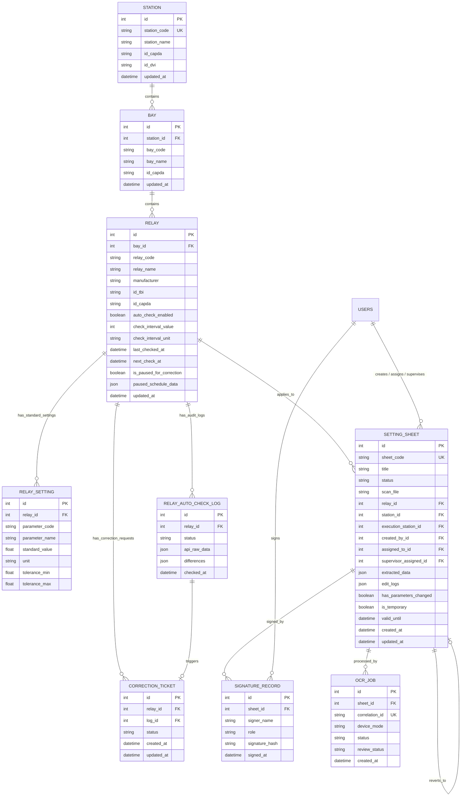

---

## 2. Đặc tả Chi tiết các Bảng Nghiệp vụ (Tables Specification)

### 2.1 Quản lý Lưới điện & Rơ-le (App: `stations`)

#### Bảng: `stations_station`
Lưu trữ thông tin Trạm Biến áp hoặc Nhà máy Điện thuộc lưới truyền tải/phân phối.
* `id` (PK, AutoField)
* `station_code` (VARCHAR(50), UNIQUE): Mã trạm EVN (ví dụ: `TBA_500_QN`, `TBA_220_VC`).
* `station_name` (VARCHAR(255)): Tên đầy đủ trạm (ví dụ: `Trạm 500kV Quảng Ninh`).
* `id_capda` (VARCHAR(50)): Mã cấp điện áp danh định (500kV, 220kV, 110kV...).
* `id_dvi` (VARCHAR(50)): Đơn vị quản lý (PTC1, PTC2, PC...).

#### Bảng: `stations_bay`
Lưu trữ thông tin Ngăn lộ (xuất tuyến đường dây, ngăn MBA, thanh cái, máy cắt liên lạc).
* `id` (PK, AutoField)
* `station_id` (FK $\rightarrow$ `stations_station`, ON DELETE CASCADE)
* `bay_code` (VARCHAR(50)): Mã ngăn lộ (ví dụ: `571`, `572`, `171`, `MC_Lien_Lac`).
* `bay_name` (VARCHAR(255)): Tên mô tả ngăn lộ.

#### Bảng: `stations_relay`
Lưu trữ thiết bị Rơ-le bảo vệ và điều khiển số thực tế tại trạm.
* `id` (PK, AutoField)
* `bay_id` (FK $\rightarrow$ `stations_bay`, ON DELETE CASCADE, nullable)
* `relay_code` (VARCHAR(50)): Số hiệu/Mã rơ-le theo sơ đồ nguyên lý (ví dụ: `F87R1`, `SEL-751`, `7SA87`).
* `relay_name` (VARCHAR(255)): Tên và chức năng rơ-le.
* `manufacturer` (VARCHAR(100)): Hãng sản xuất (SIEMENS, ABB, SEL, SCHNEIDER/MICOM, TOSHIBA, GE...).
* `id_tbi` (VARCHAR(100)): ID thiết bị theo phần mềm quản lý kỹ thuật EVN PMIS.
* `auto_check_enabled` (BOOLEAN, default=False, db_index=True): Cờ bật/tắt quét định kỳ.
* `is_paused_for_correction` (BOOLEAN, default=False, db_index=True): Cờ đánh dấu rơ-le đang có sai lệch thông số cần rà soát/chỉnh định lại.
* `paused_schedule_data` (JSONField): Lưu thông tin nguyên nhân tạm dừng, file PDF phát hiện sai lệch.

#### Bảng: `stations_relayautochecklog`
Nhật ký lịch sử đối chiếu thông số rơ-le (giữa Phiếu Chỉnh định và File PDF/API thực tế).
* `id` (PK, AutoField)
* `relay_id` (FK $\rightarrow$ `stations_relay`, ON DELETE CASCADE)
* `checked_at` (DATETIME, auto_now_add=True)
* `status` (VARCHAR(20)): `MATCH` (Trùng khớp 100%), `MISMATCH` (Có sai lệch), `API_ERROR`.
* `api_raw_data` (JSONField): Danh sách toàn bộ thông số đối chiếu kèm cờ `is_diff`, `db_value`, `value`.
* `differences` (JSONField): Danh sách các thông số bị phát hiện sai lệch.

#### Bảng: `stations_correctionticket`
Phiếu yêu cầu điều phối xử lý sai lệch xuống Trạm / Kỹ thuật viên hiện trường.
* `status`: `DISPATCHER` $\rightarrow$ `STATION` $\rightarrow$ `TECH` $\rightarrow$ `SUPERVISOR` $\rightarrow$ `ADMIN` $\rightarrow$ `RESOLVED`.

---

### 2.2 Quản lý Phiếu Chỉnh định & OCR (App: `sheets`)

#### Bảng: `sheets_settingsheet`
Phiếu Chỉnh định rơ-le bảo vệ - trung tâm dữ liệu kỹ thuật của hệ thống.
* `sheet_code` (VARCHAR(100), UNIQUE): Mã phiếu chính thức (ví dụ: `A0-01-2020/QN500`).
* `title` (VARCHAR(255)): Tiêu đề phiếu.
* `status` (VARCHAR(50)):
  * `DRAFT`: Bản nháp vừa tạo / đang OCR.
  * `ISSUED`: Đã phát hành, chờ rà soát.
  * `ROUTED_TO_STATION`: Đã chuyển về Trạm phụ trách.
  * `TRANSFERRED`: Đã giao cho Kỹ thuật viên hiện trường.
  * `RECEIVED`: Đang thực hiện cài đặt tại trạm.
  * `PENDING_ADMIN_APPROVAL`: Chờ Admin ký duyệt ban hành.
  * `COMPLETED`: Hoàn thành, có đủ chữ ký số.
* `scan_file` (FILE): Đường dẫn file scan / PDF phiếu gốc lưu tại `media/scans/`.
* `extracted_data` (JSONB): Mảng JSON lưu trữ toàn bộ các trị số chỉnh định bóc tách được (Mã thông số, tên, trị số, đơn vị, nhóm cài đặt, chức năng ANSI).
* `has_parameters_changed` (BOOLEAN): Cờ đánh dấu phiếu có thay đổi trị số so với phiên bản trước đó.
* `is_temporary` (BOOLEAN): Đánh dấu phiếu chỉnh định phương thức tạm thời.

#### Bảng: `sheets_signaturerecord`
Lưu trữ chữ ký số điện tử của các bên tham gia quy trình chỉnh định rơ-le.
* `sheet_id` (FK $\rightarrow$ `sheets_settingsheet`, ON DELETE CASCADE)
* `signer_name` (VARCHAR(100)): Họ tên người ký.
* `role` (VARCHAR(50)): Vai trò khi ký (Người lập, Điều độ viên, KTV rơ-le, Giám sát trạm).
* `signature_hash` (VARCHAR(256)): Chuỗi băm SHA-256 bảo đảm tính toàn vẹn của nội dung phiếu tại thời điểm ký.
* `signed_at` (DATETIME, auto_now_add=True).

---

## 3. Chiến lược Lưu trữ Dữ liệu Bán Cấu trúc (JSONB Strategy)

Trong hệ thống điện lực, mỗi dòng rơ-le (Siemens, ABB, SEL, MiCOM...) có số lượng và cấu trúc thông số hoàn toàn khác nhau (từ vài chục đến hàng trăm trị số). Do đó:
1. **Dữ liệu quan hệ cố định (RDBMS)**: Quản lý cây thực thể `Trạm` $\rightarrow$ `Ngăn lộ` $\rightarrow$ `Rơ-le` $\rightarrow$ `Phiếu chỉnh định` để đảm bảo tính toàn vẹn khóa ngoại (Foreign Keys) và tìm kiếm tốc độ cao với B-Tree index.
2. **Dữ liệu thông số linh hoạt (PostgreSQL JSONB)**:
   * Trường `extracted_data` trong `SettingSheet` và `api_raw_data` trong `RelayAutoCheckLog` lưu dạng mảng đối tượng:
     ```json
     [
       {
         "parameter_code": "50_1_I",
         "parameter_name": "Dòng cắt nhanh cấp 1",
         "value": "12.5",
         "unit": "A",
         "group_id": "Group 1",
         "is_diff": false
       }
     ]
     ```
   * Hỗ trợ truy vấn NoSQL trực tiếp trong PostgreSQL mà không cần tạo hàng trăm cột động trong cơ sở dữ liệu.
````

## File: docs/cores/02-backend.md
````markdown
# Thiết kế Kiến trúc Backend & Dịch vụ Hệ thống RMS (Backend Architecture)

Tài liệu này đặc tả kiến trúc backend, quy chuẩn mã nguồn, dịch vụ xử lý bất đồng bộ và chuẩn giao tiếp trong **Hệ thống Quản lý Phiếu Chỉnh định Rơ-le (RMS)**.

---

## 1. Công nghệ Sử dụng (Backend Stack)

* **Ngôn ngữ thực thi**: Python 3.12 (môi trường Docker Linux).
* **Framework Web chính**: Django 5.x theo mô hình kiến trúc **MVT (Model - View - Template)**.
* **ASGI Server (Asynchronous)**: `Daphne` (lắng nghe cổng 9000), xử lý đồng thời HTTP/1.1, HTTP/2 và WebSocket.
* **Thời gian thực (Realtime)**: `Django Channels 4.x` kết nối Redis Channel Layer.
* **Hàng đợi Tác vụ ngầm (Background Task Queue)**: `Celery 5.x` kết hợp `Celery Beat`.
* **Message Broker & Cache Layer**: `Redis 7.x (Alpine)` (cổng 6379).
* **Cơ sở dữ liệu chính**: `PostgreSQL 15 (Alpine)` (cổng 5440).
* **Thư viện xử lý PDF & Dữ liệu kỹ thuật**: `pypdf`, `openpyxl`, `numpy`.

---

## 2. Cấu trúc Thư mục Ứng dụng (Modular Django Architecture)

Mã nguồn được tổ chức thành các Django App chuyên biệt hóa theo từng phân vùng nghiệp vụ:

```text
📂 electricity-web
 ┣ 📂 rms_project            # Cấu hình lõi hệ thống Django
 ┃ ┣ 📜 asgi.py              # Khởi tạo ASGI routing (HTTP + WebSockets)
 ┃ ┣ 📜 celery.py            # Cấu hình Celery app & beat schedule
 ┃ ┣ 📜 settings.py          # Biến môi trường, database, cache, auth
 ┃ ┗ 📜 urls.py              # Root URL router
 ┣ 📂 stations               # App Quản lý Trạm, Ngăn lộ, Rơ-le & Trung tâm Đối chiếu
 ┃ ┣ 📜 models.py            # Station, Bay, Relay, RelaySetting, RelayAutoCheckLog, CorrectionTicket
 ┃ ┣ 📜 views.py             # Logic trạm, đối chiếu PDF (upload_relay_pdf_compare), modal thông số
 ┃ ┣ 📜 urls.py              # Endpoints: /stations/autochecks/, /relay/<id>/parameters/ ...
 ┃ ┣ 📜 tasks.py             # Celery task quét tự động theo lịch hẹn giờ
 ┃ ┗ 📜 api_mock.py          # Module mô phỏng/kết nối API thực địa rơ-le
 ┣ 📂 sheets                 # App Quản lý Phiếu Chỉnh định & Vòng đời Phê duyệt
 ┃ ┣ 📜 models.py            # SettingSheet, SignatureRecord, OcrJob
 ┃ ┣ 📜 views.py             # Luồng tạo phiếu, ký số, duyệt phiếu, xuất PDF
 ┃ ┣ 📜 tasks.py             # Celery pipeline xử lý tác vụ bóc tách OCR
 ┃ ┣ 📜 relay_matcher.py     # Bộ máy nhận diện Model rơ-le & Chức năng bảo vệ ANSI C37.2
 ┃ ┗ 📜 utils.py             # Hàm so sánh diff giữa các phiên bản phiếu
 ┣ 📂 categories             # App Danh mục Kỹ thuật Dùng chung
 ┃ ┣ 📜 models.py            # Hãng sản xuất (Manufacturer), Cấp điện áp, Loại rơ-le
 ┃ ┗ 📜 views.py             # CRUD danh mục hệ thống
 ┣ 📂 templates              # Giao diện Server-Driven UI (HTML + Tailwind + Alpine.js + HTMX)
 ┗ 📜 docker-compose.yml     # Quản lý 4 container (web, db, redis, celery)
```

---

## 3. Các Phân hệ Backend Cốt lõi

### 3.1 Bộ máy Nhận diện Rơ-le & Chức năng ANSI (`sheets/relay_matcher.py`)
Module cốt lõi tự động hóa phân loại rơ-le trên toàn hệ thống điện lực:
* **Chuẩn hóa chuỗi (Normalization)**: Tự động loại bỏ dấu tiếng Việt, xử lý đồng thời định dạng có gạch nối (`SEL-751`, `SEL-787`) và dạng viết liền EVN PMIS (`SEL751`, `SEL787_1`, `SEL487E_1`, `F87R-SEL787`).
* **Kho tra cứu Model (MODEL_REGISTRY)**:
  * **Siemens**: `7SJ86/85/82/64/62/61` (50/51, 67, BCU), `7SA87/86/82/6` (21, 87L), `7SD87/86/82/61/52` (87L), `7UT87/86/85/82/6` (87T, 87R, 64REF).
  * **ABB / Hitachi Energy**: `REF615/620/630`, `RET615/620/630`, `RED615/670`, `REL670`, `REC670`.
  * **Schweitzer Engineering Laboratories (SEL)**: `SEL-751/751A` (50/51, 67, BCU), `SEL-787/487E` (87T, 87R, 64REF), `SEL-411L` (87L, 21, BCU, 79, 25), `SEL-487B` (87B, 50BF).
  * **Schneider Electric / MiCOM**: `P122/123/127`, `P141..145`, `P441..443` (21), `P541..546` (87L), `P642..645` (87T).
* **Suy luận Hãng từ Phần mềm**: Tự động nhận diện hãng rơ-le nếu phiếu nhắc đến các công cụ cấu hình chuyên dụng (`DIGSI 5`, `PCM600`, `acSELerator QuickSet`, `MiCOM S1 Agile`, `EnerVista`).

### 3.2 Bộ máy Đối chiếu Dữ liệu PDF & Trị số Chuẩn (Diff Engine)
Nằm tại `stations/views.py:upload_relay_pdf_compare`:
1. Tiếp nhận file PDF từ kỹ sư hiện trường/đơn vị thí nghiệm.
2. Trích xuất text và bảng số liệu bằng `pypdf`.
3. Lấy dữ liệu chuẩn từ **Phiếu Chỉnh định mới nhất (`relay.active_sheet`)**.
4. So khớp từng thông số (theo mã, tên, giá trị, đơn vị).
5. Phân loại:
   * **`MATCH`**: Trùng khớp 100% $\rightarrow$ Rơ-le đạt chuẩn an toàn.
   * **`MISMATCH`**: Phát hiện sai lệch $\rightarrow$ Tự động đánh dấu `relay.is_paused_for_correction = True` và cung cấp nút bấm 1-chạm tạo `CorrectionTicket` chuyển về Trạm.

---

## 4. Chuẩn Giao tiếp API & HTMX (Server-Driven Communication)

Dự án ưu tiên phương thức **Server-Driven UI** bằng cách trả về các đoạn HTML Partial (`HTML Snippets`) để HTMX cập nhật trực tiếp vào DOM:

### 4.1 Quy tắc Phản hồi HTMX (HTMX Responses)
* **Trả về HTML Partial**: Ví dụ `render(request, 'stations/partials/_relay_row.html', {'relay': relay})`.
* **Điều khiển Client qua HTTP Header `HX-Trigger`**:
  ```python
  response["HX-Trigger"] = json.dumps({
      f"refreshRow-{relay.id}": "",  # Làm mới dòng rơ-le tương ứng
      "closeUploadModal": "",        # Đóng modal tải file
      "openResultModal": "",         # Mở modal hiển thị kết quả
      "notify": {                    # Bắn thông báo Toast
          "title": "Hoàn tất",
          "message": "Đã đối chiếu xong thông số.",
          "level": "success"
      }
  })
  ```

### 4.2 Kênh Thông báo Thời gian thực (WebSocket - Django Channels)
* **Kênh Thông báo Chung**: `/ws/notifications/` $\rightarrow$ Phát sóng khi có phiếu mới được duyệt, có đợt rà soát hoặc tác vụ bóc tách OCR hoàn tất.
* **Kênh Cập nhật Đối chiếu**: Group `autocheck_updates` $\rightarrow$ Tự động đẩy trạng thái rơ-le mới nhất đến màn hình Dashboard khi có tiến trình kiểm tra hoàn tất.
````

## File: docs/cores/03-frontend.md
````markdown
# Thiết kế Kiến trúc Frontend & Giao diện UI/UX (Frontend Architecture)

Tài liệu này đặc tả kiến trúc giao diện, chuẩn tương tác người dùng (UI/UX) và hệ thống thiết kế phía Client trong **Hệ thống Quản lý Phiếu Chỉnh định Rơ-le (RMS)**.

---

## 1. Công nghệ Sử dụng (Frontend Stack)

Hệ thống được xây dựng theo mô hình **Server-Driven UI** hiện đại, loại bỏ sự phức tạp cồng kềnh của SPA (Single Page Application) mà vẫn đảm bảo tốc độ phản hồi tức thời như ứng dụng desktop:

* **Engine Render Giao diện**: `Django Templates` kế thừa cấu trúc từ `templates/base.html`.
* **Giao tiếp AJAX & Cập nhật DOM**: `HTMX 1.9+` (tải và chèn các HTML Partials động không cần tải lại toàn bộ trang).
* **Quản lý Trạng thái Phía Client (Client Reactivity)**: `Alpine.js 3.x` (quản lý trạng thái đóng/mở Modal, Tabs, Tìm kiếm tức thì, Phân trang client-side).
* **CSS Framework & Styling**: `Tailwind CSS` (utility-first, tối ưu responsive cho cả Desktop, Tablet và Mobile).
* **Bộ Icon Kỹ thuật**: `Font Awesome 6 Pro / Free`.
* **Sơ đồ & Lưu đồ**: `Mermaid.js` và KaTeX cho công thức toán học điện lực.

---

## 2. Cấu trúc Thư mục Giao diện (`templates/`)

```text
📂 templates
 ┣ 📜 base.html                          # Layout khung ứng dụng gốc (Sidebar, Navbar, Modals)
 ┣ 📂 partials                           # Các phân mảnh dùng chung toàn hệ thống
 ┃ ┣ 📜 _sidebar.html                    # Thanh điều hướng trái phân tầng
 ┃ ┣ 📜 _header.html                     # Thanh tiêu đề, thông báo chuông, profile
 ┃ ┗ 📜 pagination.html                  # Phân trang động tích hợp HTMX
 ┣ 📂 sheets                             # Giao diện Phân hệ Phiếu Chỉnh định
 ┃ ┣ 📜 sheet_list.html                  # Danh sách phiếu theo bộ lọc trạng thái
 ┃ ┣ 📜 sheet_detail.html                # Chi tiết phiếu, Split-view đối chiếu bản scan
 ┃ ┗ 📂 partials                         # Bảng thông số, nhật ký sửa đổi, chữ ký số
 ┣ 📂 stations                           # Giao diện Quản lý Trạm & Đối chiếu Rơ-le
 ┃ ┣ 📜 station_list.html                # Cây cấu trúc Trạm -> Ngăn lộ -> Rơ-le
 ┃ ┣ 📜 autocheck_dashboard.html         # Trung tâm Đối chiếu Thông số Rơ-le
 ┃ ┗ 📂 partials
 ┃   ┣ 📜 _autocheck_table.html          # Bảng dữ liệu đối chiếu rơ-le
 ┃   ┣ 📜 _relay_row.html                # Một hàng rơ-le phản ứng nhanh với HTMX trigger
 ┃   ┣ 📜 _relay_parameters_modal.html   # Modal xem toàn bộ thông số rơ-le với tìm kiếm tức thì
 ┃   ┣ 📜 _autocheck_results.html        # Bảng so sánh 2 cột Side-by-side Diff
 ┃   ┗ 📜 relay_detail_modal.html        # Modal toàn diện (ANSI, định mức, lịch sử phiếu)
 ┗ 📂 categories                         # Giao diện Quản trị Danh mục Hệ thống
```

---

## 3. Các Nguyên tắc Thiết kế & Trải nghiệm (UI/UX Design System)

### 3.1 Bảng màu Chuẩn Công nghiệp Điện lực (Power Grid Color Palette)
* **Xanh Slate/Zinc (Chủ đạo)**: Tạo cảm giác tin cậy, vững chãi của hệ thống vận hành trạm điện.
* **Xanh dương EVN (`#005baa` / Tailwind Blue-600)**: Màu nhận diện chuẩn của Tập đoàn Điện lực Việt Nam.
* **Xanh ngọc / Teal (`teal-600`)**: Sử dụng cho các tác vụ nạp file PDF và xử lý dữ liệu thực địa.
* **Tím Indigo (`purple-600`)**: Sử dụng cho bảng trị số cài đặt rơ-le.
* **Mã màu Trạng thái Nghiệp vụ**:
  * 🟢 **Xanh lá (Emerald)**: Phiếu `COMPLETED`, Đối chiếu `Trùng khớp 100%`, Rơ-le đang vận hành an toàn.
  * 🔴 **Đỏ (Red/Rose)**: Rơ-le có `Sai lệch thông số`, Phiếu bị từ chối, Cảnh báo quá hạn.
  * 🟡 **Vàng/Cam (Amber)**: Phiếu `Chờ rà soát (ISSUED)`, Rơ-le đang tạm dừng chờ chỉnh định lại.
  * 🔵 **Xanh lam (Sky/Blue)**: Phiếu `Đang thực hiện (RECEIVED)`.

### 3.2 Hỗ trợ Đa Chế độ Sáng/Tối (Light & Dark Theme)
* Tự động phát hiện và đồng bộ trạng thái giao diện qua `localStorage.getItem('theme')`.
* Toàn bộ các component đều có lớp màu tương thích kép:
  `bg-white dark:bg-slate-800 text-slate-800 dark:text-slate-100 border-slate-200 dark:border-slate-700`.

---

## 4. Chuẩn Tương tác HTMX & Alpine.js trong Dự án

### 4.1 Quy tắc HTMX (Server-Driven Partial Swaps)
1. **Tìm kiếm & Lọc không giật trang**:
   ```html
   <form hx-get="" 
         hx-target="#autocheck-table-container" 
         hx-swap="outerHTML" 
         hx-indicator=".htmx-indicator" 
         hx-trigger="keyup delay:400ms from:input[name='q'], change from:select[name='status']">
   ```
2. **Cập nhật từng Hàng Rơ-le sau khi Thao tác (Single Row Refresh)**:
   Mỗi hàng `<tr>` lắng nghe sự kiện riêng để chỉ tải lại đúng hàng đó thay vì tải lại cả trang:
   ```html
   <tr id="relay-row-{{ relay.id }}" 
       hx-get="" 
       hx-trigger="refreshRow-{{ relay.id }} from:body" 
       hx-swap="outerHTML">
   ```
3. **Hiển thị Spinner khi xử lý ngầm**:
   Sử dụng class `.htmx-indicator` để hiển thị spinner mượt mà trong khi đang bóc tách file PDF hoặc gọi kiểm tra API.

### 4.2 Quy tắc Alpine.js (Client-side Reactivity)
1. **Quản lý Modal**:
   Dùng các hàm JavaScript toàn cục hoặc sự kiện `$dispatch` để đóng/mở modal mượt mà, không phụ thuộc vào thư viện JS bên thứ ba.
2. **Lọc và Tìm kiếm Cục bộ (Instant Filter)**:
   Ví dụ trong `_relay_parameters_modal.html` và `_autocheck_results.html`: Toàn bộ danh sách trị số được nạp vào Alpine.js `items` để người dùng gõ từ khóa tìm kiếm phản hồi trong **0 miligiây**.
````

## File: docs/cores/04-security.md
````markdown
# Thiết kế Xác thực & Bảo mật Hệ thống RMS (Security & Access Control)

Tài liệu này đặc tả kiến trúc bảo mật, cơ chế kiểm soát truy cập phân tầng (RBAC) và bảo vệ dữ liệu toàn vẹn trong **Hệ thống Quản lý Phiếu Chỉnh định Rơ-le (RMS)**.

---

## 1. Cơ chế Xác thực Người dùng (Authentication)

Vì đây là hệ thống quản lý thông số rơ-le vận hành lưới điện (hạ tầng trọng yếu quốc gia - Critical Infrastructure OT/IT):
* **Phương thức xác thực**: Sử dụng cơ chế **Django Session Authentication** bảo mật cao, kết hợp Session Store lưu tại PostgreSQL / Redis.
* **Bảo vệ Cookie**:
  * `sessionid` và `csrftoken` được cấu hình với các cờ `HttpOnly`, `SameSite=Lax` (hoặc `Strict`), ngăn chặn hoàn toàn nguy cơ rò rỉ qua tấn công XSS.
* **Bảo vệ Biểu mẫu (CSRF Protection)**:
  * Tất cả các HTTP Request làm thay đổi trạng thái (`POST`, `PUT`, `DELETE`) bắt buộc phải có CSRF Token hợp lệ (`` đối với Form hoặc header `X-CSRFToken` đối với các yêu cầu HTMX).

---

## 2. Ma trận Phân quyền Vai trò Nghiệp vụ EVN (RBAC Matrix)

Hệ thống triển khai phân quyền dựa trên `django.contrib.auth.models.Permission` kết hợp các nhóm quyền (Groups):

| Mã Quyền hạn (Permission Code) | Tên Quyền | A0 / A1 (Điều độ) | Đơn vị Quản lý Trạm | Kỹ thuật viên (KTV) | Giám sát Trạm | Quản trị viên (Admin) |
| :--- | :--- | :---: | :---: | :---: | :---: | :---: |
| `can_create_sheet` | Tạo phiếu mới & nạp scan | ✅ | ❌ | ❌ | ❌ | ✅ |
| `can_approve_sheet` | Rà soát & Duyệt ban hành | ✅ | ❌ | ❌ | ❌ | ✅ |
| `can_dispatch_sheet` | Điều phối / Giao việc KTV | ❌ | ✅ | ❌ | ❌ | ✅ |
| `can_execute_sheet` | Cài đặt rơ-le & ký xác nhận | ❌ | ❌ | ✅ | ❌ | ✅ |
| `can_supervise_sheet`| Nghiệm thu & ký giám sát | ❌ | ❌ | ❌ | ✅ | ✅ |
| `can_view_checks` | Xem & Đối chiếu thông số | ✅ | ✅ | ✅ | ✅ | ✅ |
| `can_manage_users` | Quản trị tài khoản & danh mục| ❌ | ❌ | ❌ | ❌ | ✅ |

### Cơ chế Kiểm tra Quyền ở Tầng Mã nguồn:
1. **Tại Views**:
   Sử dụng decorators `@login_required` và `@permission_required('sheets.can_approve_sheet')` hoặc `@user_passes_test(is_admin)`.
2. **Tại Giao diện (Templates)**:
   Ẩn/hiện nút bấm theo quyền của người dùng đăng nhập:
   ```html
   
       <button ...>Phê duyệt Phiếu</button>
   
   ```

---

## 3. Bảo vệ Tính Toàn vẹn Dữ liệu Kỹ thuật (Data Integrity & Digital Signature)

Thông số chỉnh định rơ-le liên quan trực tiếp đến an toàn lưới điện truyền tải (tránh nhảy máy cắt gây rã lưới). Do đó:
1. **Bảo vệ Trạng thái Hoàn thành (`COMPLETED`)**:
   Khi một phiếu đã chuyển sang trạng thái `COMPLETED` (đã có đủ chữ ký số xác nhận của KTV và Giám sát), phiếu sẽ bị **khóa cứng vĩnh viễn (Read-only)**. Không bất kỳ người dùng nào, kể cả Admin, được phép chỉnh sửa trực tiếp giá trị trong `extracted_data`. Nếu cần thay đổi, bắt buộc phải phát hành phiếu mới hoặc tạo phiếu rà soát.
2. **Ký số & Lưu trữ Chuỗi Băm (SHA-256 Hashing)**:
   Mỗi lần ký xác nhận (`SignatureRecord`), hệ thống tính toán chuỗi băm mật mã học (cryptographic hash):
   $$\text{SignatureHash} = \text{SHA256}(\text{SheetCode} + \text{Timestamp} + \text{Signer} + \text{CanonicalParameters})$$
   Chuỗi băm này được lưu trữ vĩnh viễn để đối chứng pháp lý trong trường hợp xảy ra sự cố điện lực cần kiểm tra nguyên nhân.
3. **Nhật ký Chỉnh sửa Không thể Xóa (`edit_logs`)**:
   Mọi thao tác chỉnh sửa từng thông số trên phiếu đều được tự động ghi vết vào trường `edit_logs` của phiếu: bao gồm *Ai sửa*, *Thời gian*, *Giá trị cũ* và *Giá trị mới*.

---

## 4. Bảo mật Môi trường Nội bộ (On-Premise OT Security)

* **Không gọi dịch vụ Cloud công cộng**: Toàn bộ quá trình bóc tách và đối chiếu dữ liệu được thực thi trong mạng nội bộ cô lập (On-premise / Intranet), tuân thủ tiêu chuẩn an toàn thông tin hệ thống SCADA/EMS của Tập đoàn Điện lực Việt Nam.
* **Tự động làm sạch dữ liệu đầu vào**: Chống tấn công SQL Injection thông qua ORM Parameterized Query và chống tấn công XSS thông qua cơ chế tự động escape HTML của Django Template Engine.
````

## File: docs/cores/05-testing.md
````markdown
# Đặc tả Kiểm thử Dự án Hệ thống RMS (Testing Specification)

Tài liệu này quy định chiến lược kiểm thử, cấu hình môi trường kiểm thử và các quy tắc viết ca kiểm thử (Test Cases) trong **Hệ thống Quản lý Phiếu Chỉnh định Rơ-le (RMS)**.

---

## 1. Chiến lược Kiểm thử Đa tầng (Testing Strategy)

Hệ thống được bảo đảm chất lượng thông qua 3 tầng kiểm thử chính:

1. **Kiểm thử Đơn vị (Unit Tests)**:
   * Kiểm tra bộ máy nhận diện model rơ-le và chức năng ANSI C37.2 (`sheets/relay_matcher.py`).
   * Kiểm tra hàm chuẩn hóa chuỗi tiếng Việt và định dạng tên EVN PMIS (có gạch nối và viết liền).
   * Kiểm tra logic tính toán chênh lệch giá trị và phát hiện sai lệch (Diff Engine).
2. **Kiểm thử Nghiệp vụ & Quyền hạn (Integration & RBAC Tests)**:
   * Kiểm tra vòng đời trạng thái phiếu (`DRAFT` $\rightarrow$ `ISSUED` $\rightarrow$ `ROUTED_TO_STATION` $\rightarrow$ `COMPLETED`).
   * Kiểm tra quyền hạn ký số và ngăn chặn chỉnh sửa khi phiếu đã `COMPLETED`.
   * Kiểm tra luồng tạo `CorrectionTicket` khi phát hiện sai lệch rơ-le.
3. **Kiểm thử Giao tiếp HTTP/HTMX (View & Endpoint Tests)**:
   * Kiểm tra các View trả về mã HTTP 200 và render đúng HTML partial.
   * Kiểm tra các header `HX-Trigger` phát tín hiệu làm mới giao diện phía client (`refreshRow-{id}`, `notify`...).
   * Kiểm tra luồng upload file PDF và đối chiếu dữ liệu.

---

## 2. Công cụ Sử dụng (Testing Stack)

* **Test Framework**: `django.test.TestCase` kết hợp `unittest`.
* **Giả lập Request**: `django.test.Client` và `RequestFactory`.
* **Cơ sở dữ liệu Kiểm thử**: PostgreSQL Test Database (sử dụng cờ `--keepdb` để tăng tốc độ chạy kiểm thử từ vài phút xuống dưới 30 giây).

---

## 3. Lệnh Thực thi Kiểm thử (Execution Commands)

Tất cả các lệnh kiểm thử được chạy trực tiếp trong container `rms_web` hoặc từ máy host:

```bash
# 1. Kiểm tra toàn bộ tính toàn vẹn hệ thống và cú pháp models
docker exec rms_web python manage.py check

# 2. Chạy toàn bộ bộ kiểm thử phân hệ Phiếu Chỉnh định (sheets)
docker exec rms_web python manage.py test sheets --keepdb

# 3. Chạy toàn bộ bộ kiểm thử phân hệ Trạm & Rơ-le (stations)
docker exec rms_web python manage.py test stations --keepdb

# 4. Chạy kiểm thử chi tiết một lớp kiểm thử cụ thể
docker exec rms_web python manage.py test sheets.tests.SheetWorkflowTests --keepdb -v 2
```

---

## 4. Cấu trúc Ca Kiểm thử Chuẩn (Standard TestCase Example)

Ví dụ ca kiểm thử luồng đối chiếu thông số rơ-le từ file PDF và phát hiện sai lệch:

```python
from django.test import TestCase, Client
from django.contrib.auth.models import User
from stations.models import Relay, RelayAutoCheckLog
from sheets.models import SettingSheet
import io

class RelaySettingAuditTests(TestCase):
    def setUp(self):
        self.user = User.objects.create_superuser('admin', 'admin@evn.vn', 'pass123')
        self.client = Client()
        self.client.force_login(self.user)
        self.relay = Relay.objects.create(relay_code='SEL-751', relay_name='Quá dòng ngăn 571')
        self.sheet = SettingSheet.objects.create(
            sheet_code='PCD-TEST-01',
            relay=self.relay,
            status='COMPLETED',
            extracted_data=[
                {'parameter_code': '50_1_I', 'parameter_name': 'Cắt nhanh', 'value': '12.5', 'unit': 'A'}
            ]
        )

    def test_upload_pdf_detects_mismatch(self):
        """Kiểm tra hệ thống phát hiện chính xác khi file PDF có thông số lệch so với phiếu"""
        dummy_pdf = io.BytesIO(b"%PDF-1.4...")
        dummy_pdf.name = "Bao_cao_thi_nghiem.pdf"

        response = self.client.post(
            f'/stations/relay/{self.relay.id}/upload_pdf_compare/',
            {'pdf_file': dummy_pdf}
        )
        self.assertEqual(response.status_code, 200)
        self.assertIn(f"refreshRow-{self.relay.id}", response.headers.get('HX-Trigger', ''))
        
        # Kiểm tra bản ghi log được tạo trong CSDL
        log = self.relay.auto_checks.first()
        self.assertIsNotNone(log)
        self.assertIn(log.status, ['MATCH', 'MISMATCH'])
```

---

## 5. Tiêu chuẩn Đạt chuẩn Kiểm thử (Quality Gates)

1. **100% Pass Rate**: Tuyệt đối không chấp nhận bất kỳ ca test nào bị lỗi (Failed/Error) trước khi bàn giao mã nguồn.
2. **Không để rò rỉ dữ liệu thử nghiệm**: Mọi bản ghi tạo ra trong quá trình test phải được dọn dẹp sạch sẽ sau khi kết thúc ca kiểm thử.
````

## File: docs/cores/06-deployment.md
````markdown
# Quy trình Triển khai & Vận hành Hệ thống RMS (Deployment & Operations Guide)

Tài liệu này đặc tả kiến trúc triển khai trên môi trường Docker, biến môi trường, quản lý volume và các quy trình bảo trì vận hành **Hệ thống Quản lý Phiếu Chỉnh định Rơ-le (RMS)**.

---

## 1. Kiến trúc Đóng gói Môi trường (Docker Compose Architecture)

Toàn bộ hệ thống được container hóa thông qua `docker-compose.yml` gồm 4 dịch vụ cốt lõi hoạt động độc lập và bảo đảm độ sẵn sàng cao:

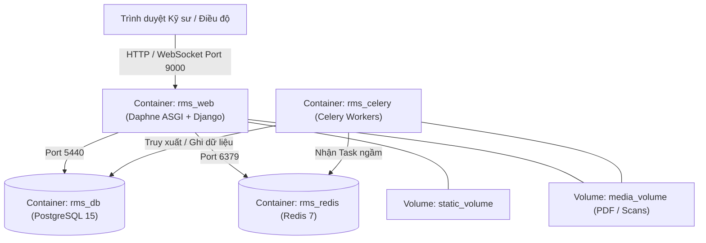

### Chi tiết 4 Dịch vụ (Services):
1. **`rms_db` (PostgreSQL 15 Alpine)**:
   * Cổng máy host: `5440` (chuyển tiếp tới 5440 trong container).
   * Lưu trữ dữ liệu quan hệ, dữ liệu JSONB và lịch sử kiểm tra rơ-le.
   * Dữ liệu được lưu bền vững (Persistent Volume) tại `postgres_data`.
2. **`rms_redis` (Redis Alpine)**:
   * Cổng máy host: `6379`.
   * Đóng vai trò Channel Layer cho WebSocket realtime và Message Broker cho Celery.
   * Dữ liệu được lưu tại `redis_data`.
3. **`rms_web` (Django 5 + Daphne ASGI)**:
   * Cổng dịch vụ web: `9000`.
   * Lệnh khởi chạy:
     `collectstatic` $\rightarrow$ `migrate` $\rightarrow$ `seed_permissions` $\rightarrow$ `daphne -b 0.0.0.0 -p 9000 rms_project.asgi:application`.
   * Mount thư mục mã nguồn máy host vào `/app` để phát triển và cập nhật trực tiếp.
4. **`rms_celery` (Celery Worker + Beat)**:
   * Chạy ngầm các tác vụ nặng: xử lý OCR đa luồng và quét tự động thông số rơ-le theo lịch hẹn giờ.

---

## 2. Quản lý Biến Môi trường (`.env`)

Tất cả các tham số nhạy cảm được quản lý tại tệp `.env` ở thư mục gốc của dự án:

| Tên biến (Key) | Mô tả (Description) | Ví dụ / Mặc định |
| :--- | :--- | :--- |
| `DEBUG` | Chế độ gỡ lỗi (False trên production) | `True` / `False` |
| `SECRET_KEY` | Khóa bí mật bảo vệ Session & CSRF Django | `django-insecure-rms-...` |
| `POSTGRES_DB` | Tên cơ sở dữ liệu PostgreSQL | `rms_db` |
| `POSTGRES_USER` | Tên tài khoản quản trị DB | `rms_user` |
| `POSTGRES_PASSWORD` | Mật khẩu truy cập DB | `secure_password_123` |
| `POSTGRES_HOST` | Địa chỉ máy chủ DB trong mạng Docker | `db` |
| `PGPORT` | Cổng kết nối PostgreSQL | `5440` |
| `REDIS_URL` | URL kết nối Redis Broker | `redis://redis:6379/0` |

---

## 3. Các Lệnh Vận hành Cơ bản (Operational Commands)

### 3.1 Khởi động và Khởi động lại Hệ thống:
```bash
# Khởi động toàn bộ cụm 4 dịch vụ ngầm
docker-compose up -d

# Khởi động lại dịch vụ Web khi có thay đổi mã nguồn Python
docker restart rms_web

# Khởi động lại dịch vụ Celery
docker restart rms_celery

# Xem trạng thái hoạt động của các container
docker ps
```

### 3.2 Kiểm tra Nhật ký Hoạt động (Logs Inspection):
```bash
# Xem log thời gian thực của máy chủ Web Daphne
docker logs -f --tail 100 rms_web

# Xem log tác vụ ngầm Celery
docker logs -f --tail 100 rms_celery

# Xem log cơ sở dữ liệu PostgreSQL
docker logs -f --tail 50 rms_db
```

### 3.3 Quản trị Cơ sở dữ liệu & Cập nhật Schema:
```bash
# Tạo migration mới khi có thay đổi models
docker exec rms_web python manage.py makemigrations

# Áp dụng migration vào DB
docker exec rms_web python manage.py migrate

# Gom tệp tĩnh mới vào thư mục staticfiles
docker exec rms_web python manage.py collectstatic --noinput

# Chạy lệnh kiểm tra tính hợp lệ hệ thống
docker exec rms_web python manage.py check
```

---

## 4. Sao lưu & Phục hồi Dữ liệu (Backup & Recovery)

```bash
# Sao lưu cơ sở dữ liệu ra tệp .sql trên máy host
docker exec -t rms_db pg_dump -U rms_user -p 5440 rms_db > backup_rms_$(date +%Y%m%d).sql

# Phục hồi dữ liệu từ file backup
docker exec -i rms_db psql -U rms_user -p 5440 rms_db < backup_rms_20261104.sql
```
````

## File: docs/features/01-station-management.md
````markdown
# Phân hệ Quản lý Trạm, Ngăn lộ & Rơ-le (Station Management)

> [!WARNING]
> Phân hệ này đã được dời sang Giai đoạn 5 (Module Tài sản) theo SRS mới nhất. Trong phiên bản MVP, hệ thống không quản lý danh mục thiết bị chi tiết mà lưu dưới dạng văn bản trong Phiếu chỉnh định. Tài liệu dưới đây mang tính chất tham khảo cho tương lai.

**App Django**: `apps/stations`
**User Stories liên quan**: `[US-STN-01]` đến `[US-STN-05]`

---

## 1. Tổng quan Nghiệp vụ

Phân hệ này cho phép **Công ty Truyền tải** (user chính) quản lý toàn bộ danh mục hạ tầng vật lý của lưới điện truyền tải, bao gồm 3 cấp độ:

```
Trạm Biến áp (Station)
 └── Ngăn lộ / Bay (Bay)
       └── Rơ-le Bảo vệ (Relay)
             └── Thông số Định mức (RelaySetting)
```

---

## 2. Luồng Nghiệp vụ Chi tiết

### 2.1 Tạo Dự án (Trạm Biến áp) từ File Cấu hình [US-STN-01]

Đây là **Figure 1** trong tài liệu UseCase gốc.

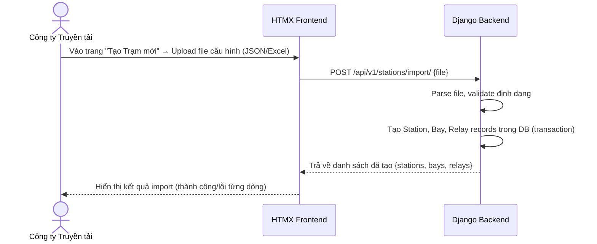

**Định dạng file cấu hình (JSON)**:
```json
{
  "station": {
    "code": "TBA_220KV_HOA_BINH",
    "name": "Trạm biến áp 220kV Hòa Bình",
    "location": "Tỉnh Hòa Bình",
    "voltage_level": "220kV"
  },
  "bays": [
    {
      "code": "BAY_AT1",
      "name": "Ngăn Máy biến áp AT1",
      "bay_type": "Máy biến áp",
      "relays": [
        {
          "code": "REL_AT1_87T",
          "name": "Rơ-le so lệch biến áp AT1",
          "manufacturer": "ABB",
          "model_number": "RET670",
          "serial_number": "SN-2024-001",
          "settings": [
            { "code": "ID_MIN", "name": "Dòng khởi động tối thiểu", "standard_value": 0.2, "unit": "A", "tolerance_min": 0.18, "tolerance_max": 0.22 },
            { "code": "TD_1", "name": "Thời gian tác động cấp 1", "standard_value": 0.0, "unit": "s", "tolerance_min": 0.0, "tolerance_max": 0.02 }
          ]
        }
      ]
    }
  ]
}
```

### 2.2 Quản lý Thủ công Trạm / Ngăn lộ / Rơ-le [US-STN-02..05]

- **Xem danh sách**: Bảng có tìm kiếm theo tên/mã, lọc theo cấp điện áp, phân trang 20 bản ghi/trang.
- **Tạo mới thủ công**: Form nhập từng trường, validation ngay trên FE (Django Forms / HTML5 Validation).
- **Chỉnh sửa**: Các trường có thể sửa (tên, địa điểm, trạng thái active). Không cho phép sửa mã (code) sau khi tạo.
- **Vô hiệu hóa**: Đặt `is_active = False`, không xóa vật lý. Các bản ghi con (bay, relay) không bị ảnh hưởng.

---

## 3. Business Rules (Quy tắc Nghiệp vụ)

| # | Quy tắc |
|---|---|
| BR-STN-01 | Mã trạm (`station_code`) phải là duy nhất trong toàn hệ thống. |
| BR-STN-02 | Không thể xóa trạm nếu còn ngăn lộ đang hoạt động. |
| BR-STN-03 | Không thể vô hiệu hóa rơ-le nếu đang có phiếu chỉnh định ở trạng thái DRAFT hoặc ISSUED. |
| BR-STN-04 | Giá trị `tolerance_min` phải luôn nhỏ hơn `tolerance_max` trong thông số định mức. |
| BR-STN-05 | Import file: Nếu `station_code` đã tồn tại, hệ thống hỏi xác nhận trước khi ghi đè. |

---

## 4. API Endpoints Chi tiết

### POST `/api/v1/stations/`
**Quyền**: `TRANSMISSION_COMPANY`

**Request Body**:
```json
{
  "station_code": "TBA_220KV_HA_NOI",
  "station_name": "Trạm biến áp 220kV Hà Nội",
  "location": "Quận Hoàng Mai, Hà Nội",
  "voltage_level": "220kV"
}
```

**Response (201)**:
```json
{
  "success": true,
  "message": "Tạo trạm biến áp thành công",
  "data": {
    "id": 5,
    "station_code": "TBA_220KV_HA_NOI",
    "station_name": "Trạm biến áp 220kV Hà Nội",
    "is_active": true,
    "bays_count": 0
  }
}
```

### POST `/api/v1/stations/import/`
**Quyền**: `TRANSMISSION_COMPANY`
**Content-Type**: `multipart/form-data`

**Form Fields**:
- `file`: File JSON hoặc Excel cấu hình trạm

**Response (200)**:
```json
{
  "success": true,
  "message": "Import hoàn tất",
  "data": {
    "created_stations": 1,
    "created_bays": 3,
    "created_relays": 8,
    "errors": []
  }
}
```

---

## 5. Giao diện (UI Specification)

### Màn hình Danh sách Trạm (`/stations`)
- **Header**: Tiêu đề "Quản lý Trạm Biến áp" + nút "Tạo mới" + nút "Import từ file"
- **Filter bar**: Tìm kiếm theo tên/mã trạm | Lọc theo cấp điện áp (110kV / 220kV / 500kV) | Trạng thái (Đang hoạt động / Vô hiệu hóa)
- **Bảng dữ liệu**: Mã trạm | Tên trạm | Địa điểm | Cấp điện áp | Số ngăn lộ | Trạng thái | Hành động

### Màn hình Chi tiết Trạm (`/stations/:id`)
- **Thông tin chung**: Card hiển thị các thông tin cơ bản của trạm
- **Tab "Ngăn lộ"**: Danh sách ngăn lộ dạng accordion. Click vào ngăn lộ để xem rơ-le bên trong
- **Tab "Lịch sử"**: Timeline các thay đổi thông tin trạm
````

## File: docs/features/02-calibration-sheet.md
````markdown
# Phân hệ Quản lý Phiếu Chỉnh định (Calibration Sheet)

**App Django**: `apps/calibration`
**User Stories liên quan**: `[US-SHEET-01]` đến `[US-SHEET-10]`

---

## 1. Tổng quan Nghiệp vụ

Phiếu chỉnh định là tài liệu kỹ thuật quan trọng nhất trong hệ thống, ghi nhận lệnh chỉnh định thông số rơ-le từ Công ty Truyền tải tới Đơn vị chỉnh định. Mỗi phiếu trải qua vòng đời trạng thái nghiêm ngặt.

---

## 2. Vòng đời Trạng thái Phiếu (Sheet Lifecycle)

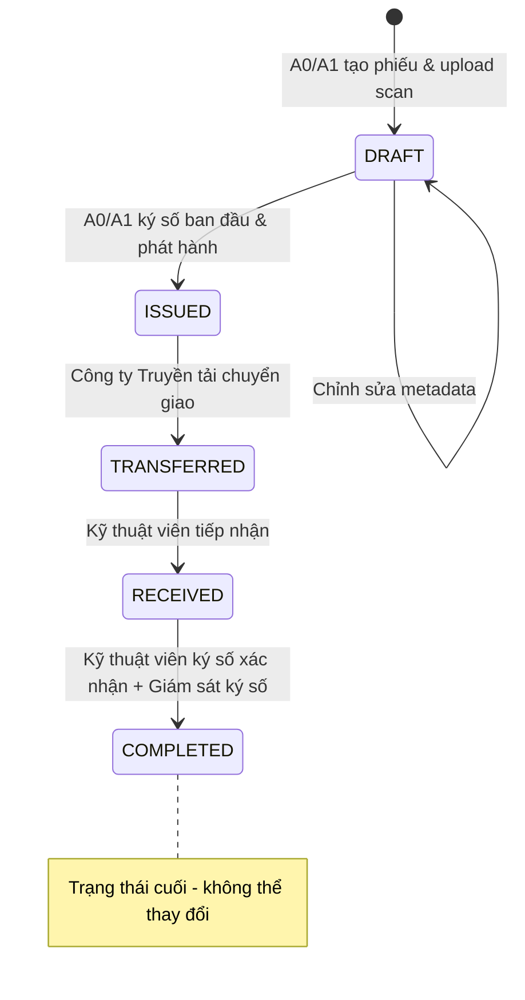

| Trạng thái | Mô tả | Người có thể hành động |
|---|---|---|
| `DRAFT` | Phiếu mới tạo, chưa phát hành | A0/A1 |
| `ISSUED` | Đã ký số ban đầu & phát hành | Công ty Truyền tải |
| `TRANSFERRED` | Đã chuyển giao cho Đơn vị chỉnh định | Kỹ thuật viên |
| `RECEIVED` | Kỹ thuật viên đã tiếp nhận phiếu | Kỹ thuật viên, Giám sát trạm |
| `COMPLETED` | Đã hoàn thành, có đủ chữ ký xác nhận | — (Chỉ xem) |

---

## 3. Luồng Nghiệp vụ Chi tiết

### 3.1 Import & Phát hành Phiếu [US-SHEET-01..03] — Figure 3

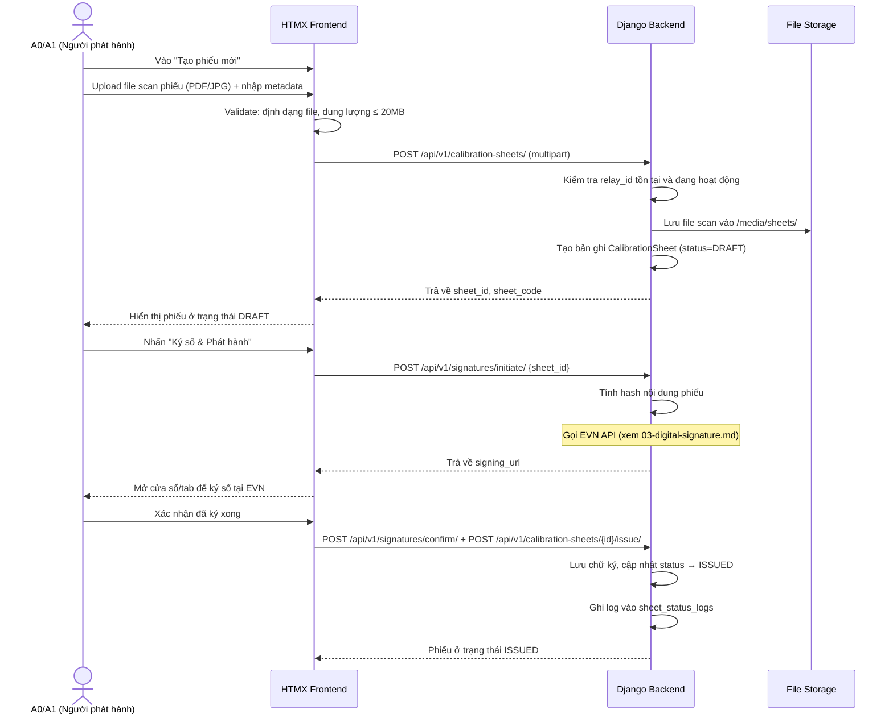

### 3.2 Chuyển giao Phiếu [US-SHEET-04] — Figure 4

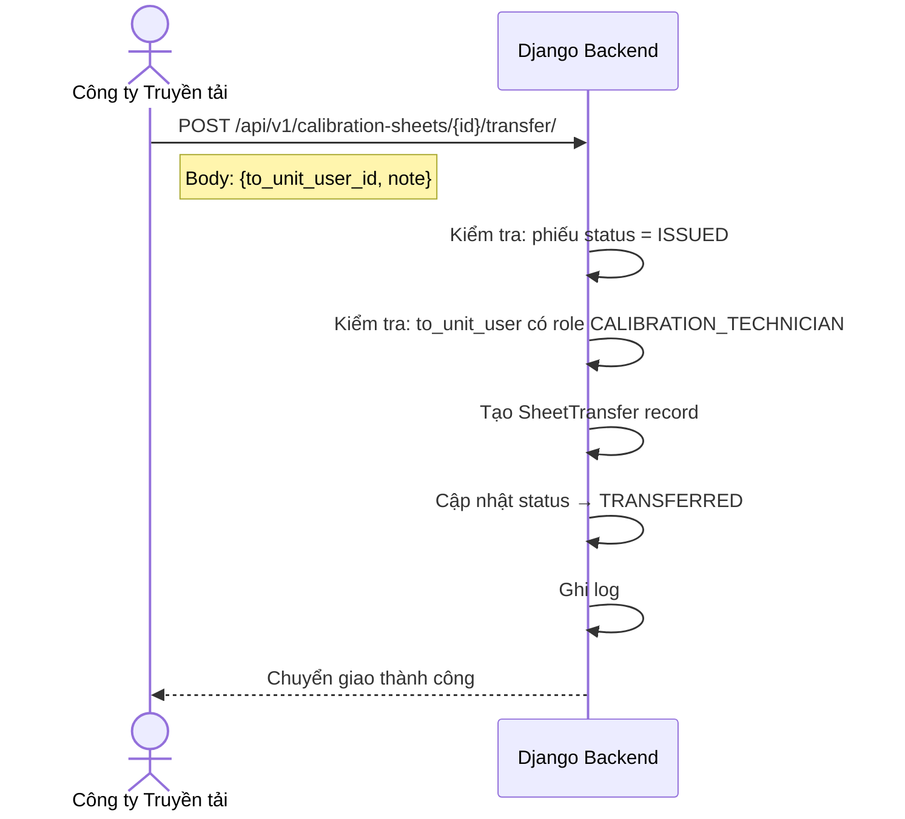

### 3.3 Tiếp nhận & Xác nhận Hoàn thành [US-SHEET-06..08] — Figure 5

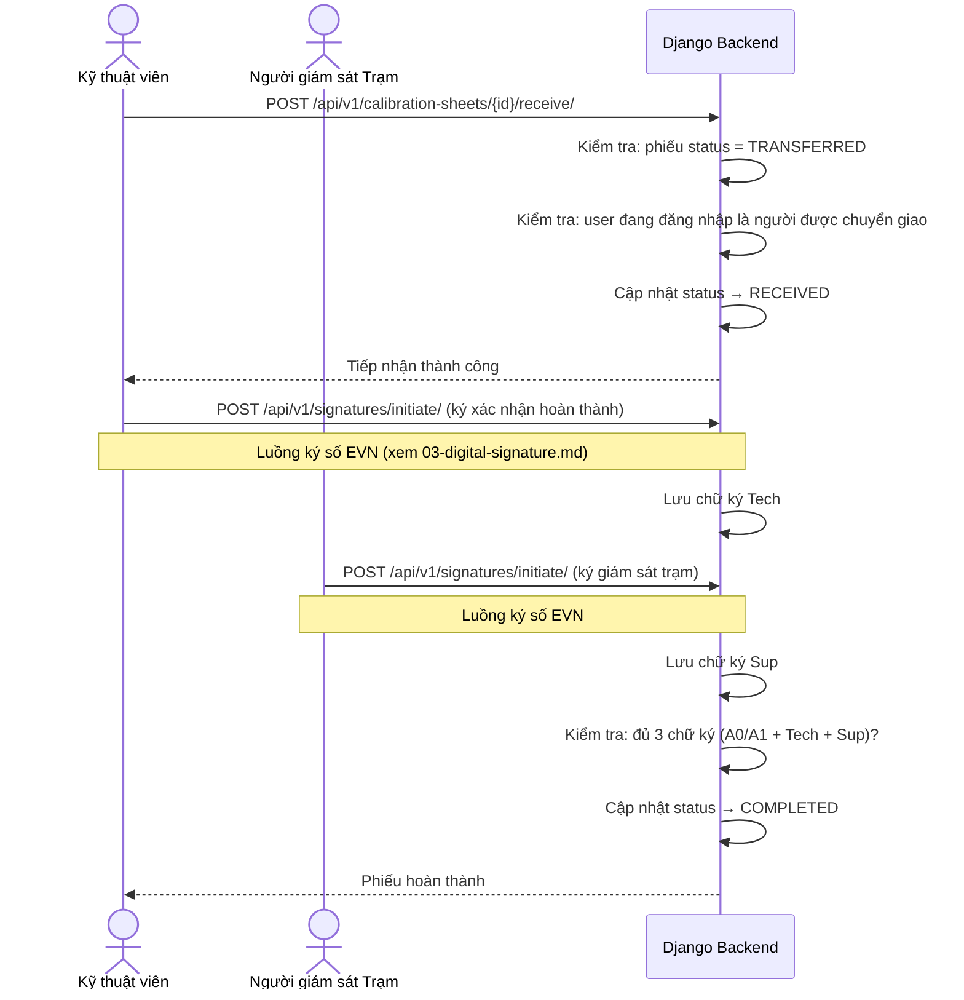

---

## 4. Business Rules (Quy tắc Nghiệp vụ)

| # | Quy tắc |
|---|---|
| BR-SHEET-01 | Phiếu chỉnh định **không bao giờ bị xóa vật lý** (`is_deleted` = True cho soft delete). |
| BR-SHEET-02 | Phiếu chỉ được phát hành (ISSUED) sau khi có **chữ ký số hợp lệ** của A0/A1. |
| BR-SHEET-03 | Phiếu chỉ được chuyển giao (TRANSFERRED) khi đang ở trạng thái ISSUED. |
| BR-SHEET-04 | Kỹ thuật viên chỉ có thể tiếp nhận phiếu được chuyển **đích danh cho họ**. |
| BR-SHEET-05 | Phiếu chỉ đạt COMPLETED khi có đủ **3 chữ ký số**: A0/A1 + Kỹ thuật viên + Giám sát trạm. |
| BR-SHEET-06 | Mã phiếu (`sheet_code`) tự động sinh theo format: `PHIEU-{YYYY}-{MM}-{SEQUENCE}`. |
| BR-SHEET-07 | Chỉ cho phép upload file: PDF, JPG, JPEG, PNG. Dung lượng tối đa: **20MB**. |

---

## 5. API Request/Response Chi tiết

### POST `/api/v1/calibration-sheets/`
**Content-Type**: `multipart/form-data`

| Field | Type | Bắt buộc | Mô tả |
|---|---|---|---|
| `relay_id` | integer | ✅ | ID rơ-le cần chỉnh định |
| `description` | string | ❌ | Mô tả nội dung phiếu |
| `scan_file` | file | ✅ | File bản scan phiếu |

**Response (201)**:
```json
{
  "success": true,
  "data": {
    "id": 42,
    "sheet_code": "PHIEU-2026-07-001",
    "status": "DRAFT",
    "relay": { "id": 5, "relay_code": "REL_AT1_87T", "relay_name": "Rơ-le so lệch AT1" },
    "scan_file_url": "/media/sheets/2026/07/scan_001.pdf",
    "issued_by": null,
    "issued_at": null,
    "created_at": "2026-07-11T16:30:00Z"
  }
}
```

### GET `/api/v1/calibration-sheets/` (với filter)

**Query Parameters**:
| Param | Mô tả | Ví dụ |
|---|---|---|
| `status` | Lọc theo trạng thái | `?status=ISSUED` |
| `station_id` | Lọc theo trạm | `?station_id=3` |
| `relay_id` | Lọc theo rơ-le | `?relay_id=5` |
| `date_from` | Từ ngày | `?date_from=2026-01-01` |
| `date_to` | Đến ngày | `?date_to=2026-12-31` |
| `search` | Tìm theo mã phiếu | `?search=PHIEU-2026` |
| `page` | Số trang | `?page=2` |

---

## 6. Giao diện (UI Specification)

### Màn hình Chi tiết Phiếu (`/calibration-sheets/:id`)

**Layout**: Chia 2 cột:
- **Cột trái (60%)**: Iframe/viewer hiển thị file scan phiếu
- **Cột phải (40%)**:
  - Thông tin metadata (Mã phiếu, Rơ-le, Ngày phát hành...)
  - **Panel "Trạng thái ký số"**: Hiển thị 3 ô ký số (A0/A1 | Kỹ thuật viên | Giám sát trạm) với badge màu: 🔴 Chưa ký / 🟡 Đang xử lý / 🟢 Đã ký hợp lệ
  - **Timeline lịch sử**: Các bước đã thực hiện theo thứ tự thời gian
  - **Nút hành động**: Hiển thị nút phù hợp với quyền và trạng thái phiếu hiện tại
````

## File: docs/features/03-digital-signature.md
````markdown
# Phân hệ Ký số Điện tử (Digital Signature — EVN Integration)

**App Django**: `apps/signatures`
**User Stories liên quan**: `[US-SIG-01]` đến `[US-SIG-04]`

---

## 1. Tổng quan Nghiệp vụ

Hệ thống RMS **không tự thực hiện ký số** mà ủy thác toàn bộ quá trình cho **Hệ thống Ký số của EVN** — một hệ thống bên ngoài cung cấp dịch vụ chữ ký số pháp lý cho toàn bộ Tập đoàn Điện lực Việt Nam.

Có **3 loại chữ ký** cần thu thập trên mỗi phiếu chỉnh định:
1. **Chữ ký A0/A1**: Xác nhận phiếu đã được soạn thảo và phát hành.
2. **Chữ ký Kỹ thuật viên**: Xác nhận đã hoàn thành công việc chỉnh định tại trạm.
3. **Chữ ký Giám sát trạm**: Xác nhận kỹ thuật viên đã đến trạm và thực hiện chỉnh định.

---

## 2. Luồng Ký số Chi tiết — Figure 5

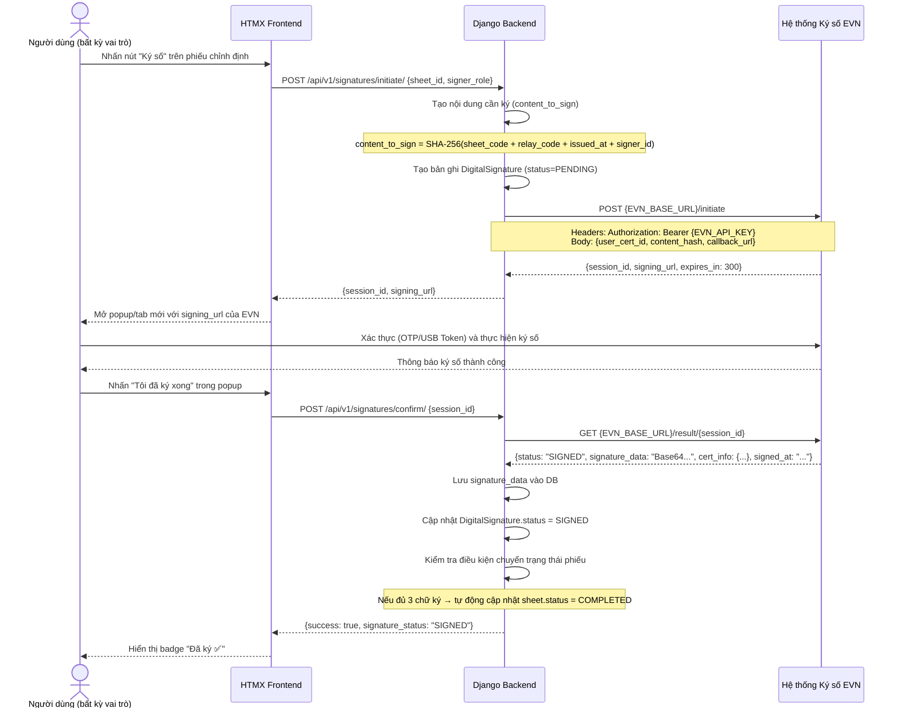

---

## 3. Service Layer: `EVNSignatureService`

```python
# apps/signatures/services.py

class EVNSignatureService:
    """
    Dịch vụ tích hợp với Hệ thống Ký số EVN.
    Đóng gói toàn bộ logic giao tiếp với API EVN bên ngoài.
    """

    def initiate_signing_session(self, user, sheet, signer_role: str) -> dict:
        """
        Khởi tạo phiên ký số với EVN.
        Trả về: {session_id, signing_url}
        Raises: EVNServiceUnavailableError nếu EVN API không phản hồi.
        """

    def get_signing_result(self, session_id: str) -> dict:
        """
        Lấy kết quả ký số từ EVN sau khi user hoàn thành.
        Trả về: {status, signature_data, cert_info, signed_at}
        Raises: EVNSessionExpiredError nếu session hết hạn (>5 phút).
        """

    def verify_signature(self, signature_id: int) -> bool:
        """
        Xác thực lại chữ ký số đã lưu với EVN.
        Trả về: True nếu hợp lệ, False nếu đã bị thu hồi/hết hiệu lực.
        """
```

---

## 4. Model: `DigitalSignature`

```python
# apps/signatures/models.py

class DigitalSignature(models.Model):
    # Phiếu chỉnh định được ký
    sheet = models.ForeignKey('calibration.CalibrationSheet', on_delete=models.PROTECT)

    # Người thực hiện ký
    signed_by = models.ForeignKey(settings.AUTH_USER_MODEL, on_delete=models.PROTECT)

    # Vai trò khi ký (A0_A1_ISSUER / CALIBRATION_TECHNICIAN / STATION_SUPERVISOR)
    signer_role = models.CharField(max_length=50)

    # Dữ liệu từ hệ thống EVN
    evn_session_id = models.CharField(max_length=200, unique=True)
    signature_data = models.TextField(null=True, blank=True)  # Base64 chữ ký
    certificate_info = models.JSONField(null=True, blank=True)  # Thông tin chứng thư

    # Trạng thái: PENDING / SIGNED / VERIFIED / INVALID
    signature_status = models.CharField(max_length=20, default='PENDING')

    signed_at = models.DateTimeField(null=True, blank=True)
    verified_at = models.DateTimeField(null=True, blank=True)
    created_at = models.DateTimeField(auto_now_add=True)

    class Meta:
        # Mỗi vai trò chỉ ký một lần trên mỗi phiếu
        unique_together = [('sheet', 'signer_role')]
```

---

## 5. Xử lý Lỗi (Error Handling)

| Tình huống | HTTP Status | error_code | Xử lý |
|---|---|---|---|
| EVN API không phản hồi (timeout) | 503 | `EVN_SERVICE_UNAVAILABLE` | Retry sau 30s, hiển thị thông báo |
| Phiên ký số hết hạn (>5 phút) | 400 | `EVN_SESSION_EXPIRED` | Người dùng phải khởi tạo lại |
| Chữ ký không hợp lệ (EVN từ chối) | 400 | `EVN_SIGNATURE_INVALID` | Log lỗi, không lưu vào DB |
| Người dùng đã ký (trùng vai trò) | 409 | `SIGNATURE_ALREADY_EXISTS` | Hiển thị chữ ký hiện tại |
| Người dùng không có chứng thư EVN | 403 | `EVN_CERT_NOT_FOUND` | Liên hệ Admin để đăng ký chứng thư |

---

## 6. API Endpoints

### POST `/api/v1/signatures/initiate/`
**Quyền**: Authenticated (vai trò phù hợp với phiếu)

**Request**:
```json
{
  "sheet_id": 42,
  "signer_role": "A0_A1_ISSUER"
}
```

**Response (200)**:
```json
{
  "success": true,
  "data": {
    "session_id": "EVN-SESSION-2026071100001",
    "signing_url": "https://sign.evn.com.vn/sign?session=EVN-SESSION-2026071100001",
    "expires_in": 300
  }
}
```

### POST `/api/v1/signatures/confirm/`

**Request**:
```json
{
  "session_id": "EVN-SESSION-2026071100001"
}
```

**Response (200)**:
```json
{
  "success": true,
  "data": {
    "signature_id": 15,
    "signer_role": "A0_A1_ISSUER",
    "signature_status": "SIGNED",
    "signed_at": "2026-07-11T10:00:00Z",
    "sheet_new_status": "ISSUED"
  }
}
```

---

## 7. Giao diện (UI Specification)

### Panel Trạng thái Ký số (trong màn hình Chi tiết Phiếu)

```
┌─────────────────────────────────────────┐
│  TRẠNG THÁI CHỮ KÝ SỐ                  │
├─────────────────────────────────────────┤
│  ✅ A0/A1 Phát hành                     │
│     Nguyễn Văn A • 11/07/2026 09:30    │
├─────────────────────────────────────────┤
│  ✅ Kỹ thuật viên                       │
│     Trần Văn B • 12/07/2026 14:00      │
├─────────────────────────────────────────┤
│  ⏳ Giám sát Trạm                       │
│     Chưa ký   [Nhấn để ký số →]        │
└─────────────────────────────────────────┘
```

- Badge `✅ Đã ký` màu xanh lá
- Badge `⏳ Chưa ký` màu vàng + nút "Ký số" (chỉ hiển thị với người có quyền ký)
- Badge `❌ Không hợp lệ` màu đỏ (khi xác thực lại thất bại)
````

## File: docs/features/04-periodic-check.md
````markdown
# Phân hệ Đối chiếu & Giám sát Thông số Rơ-le (Relay Setting Verification)

**App Django**: `stations`  
**Đường dẫn truy cập**: `/stations/autochecks/`  
**Tên hiển thị giao diện**: **Trung tâm Đối chiếu & Giám sát Thông số Rơ-le**

---

## 1. Tổng quan Nghiệp vụ

Trong quản lý kỹ thuật lưới điện của EVN (Điều độ A0/Ax, các Công ty Truyền tải điện PTC và Công ty Điện lực PC):
* Khi kỹ sư phương thức ban hành một **Phiếu Chỉnh định mới nhất** (trạng thái `COMPLETED`), các thông số trên phiếu là chuẩn mực quy định bắt buộc rơ-le phải tuân thủ.
* Trong thực tế vận hành, sau các đợt thí nghiệm định kỳ, nghiệm thu đóng điện hoặc phân tích sự cố: đơn vị công tác sẽ xuất ra **file báo cáo PDF** (từ các phần mềm rơ-le chuyên dụng như *Siemens DIGSI 4/5, ABB PCM600, SEL acSELerator QuickSet, Schneider MiCOM S1 Agile, GE EnerVista* hoặc *Biên bản thử nghiệm scan có chữ ký*).
* **Mục tiêu phân hệ**:
  1. Cho phép kỹ sư xem trực tiếp danh sách toàn bộ trị số cài đặt của rơ-le trên hệ thống.
  2. Bóc tách dữ liệu từ file PDF báo cáo thực tế và tự động đối chiếu với Phiếu Chỉnh định mới nhất đang có hiệu lực.
  3. Phát hiện chính xác các điểm sai lệch (Thông số nào sai? Quy định là bao nhiêu? Thực tế đang cài đặt là bao nhiêu?).
  4. Cung cấp nút bấm 1-chạm **"Tạo Phiếu yêu cầu Rà soát & Chỉnh định lại"** chuyển lệnh thẳng xuống Trạm / Kỹ thuật viên hiện trường để rà soát và nạp lại thông số chuẩn vào rơ-le.

---

## 2. Sơ đồ Luồng Nghiệp vụ (End-to-End Workflow)

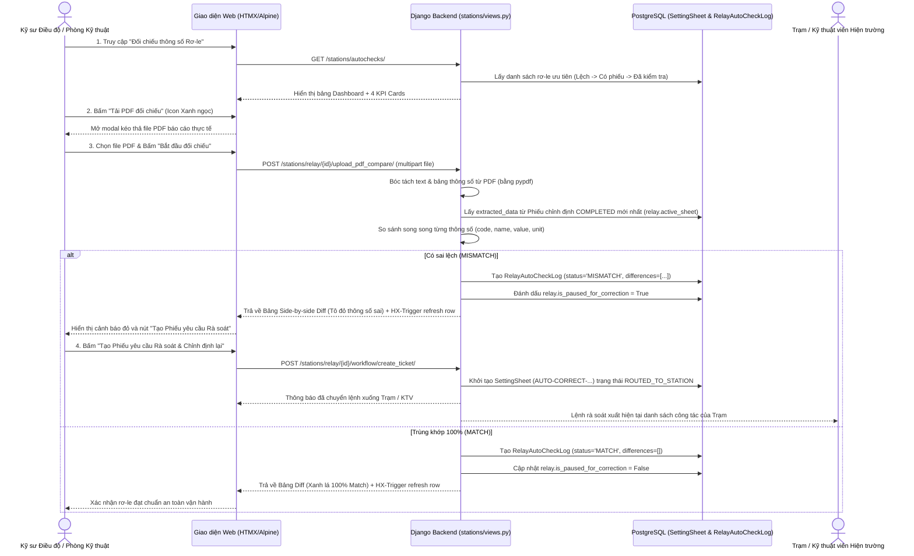

---

## 3. Các Thành phần Giao diện Cốt lõi

1. **Dashboard & 4 KPI Cards**:
   * **Tổng Rơ-le**: Quản lý toàn bộ 39.375 rơ-le trong hệ thống.
   * **Có Phiếu Chỉnh định**: Số lượng rơ-le đã được gán phiếu chính thức.
   * **Trùng khớp 100%**: Rơ-le đã đối chiếu và xác nhận khớp hoàn toàn với phiếu.
   * **Sai lệch (Cần rà soát)**: Rơ-le đang có sai lệch cần xử lý gấp.
2. **Modal Xem Thông số Rơ-le (`_relay_parameters_modal.html`)**:
   * Mở nhanh bằng nút tím `fa-sliders-h`.
   * Hiển thị toàn bộ trị số cài đặt kèm mã phiếu đang áp dụng.
   * Tích hợp ô tìm kiếm tức thì phản hồi ngay khi gõ từ khóa.
3. **Modal Nạp File PDF (`#upload-pdf-modal`)**:
   * Kéo thả file PDF báo cáo thử nghiệm/cài đặt.
   * Tự động nhận diện file và hiển thị tên file đính kèm.
4. **Modal Kết quả Đối chiếu Side-by-Side Diff (`_autocheck_results.html`)**:
   * Cột trái: Trị số Phiếu ban hành quy định (Màu xanh dương).
   * Cột phải: Trị số thực tế đọc từ file PDF (Tô đỏ nhạt nếu sai lệch).
   * Bộ lọc 3 chế độ: *Chỉ thông số sai lệch*, *Thông số trùng khớp*, *Tất cả*.
   * Nút điều phối: *"Tạo Phiếu yêu cầu Rà soát & Chỉnh định lại (Chuyển về Trạm)"*.

---

## 4. Các Quy tắc Nghiệp vụ (Business Rules)

| Mã Quy tắc | Nội dung Quy tắc |
| :--- | :--- |
| **BR-CHK-01** | Nguồn dữ liệu quy định chuẩn luôn ưu tiên lấy từ Phiếu Chỉnh định `COMPLETED` mới nhất của rơ-le (`relay.active_sheet`). Nếu chưa có phiếu `COMPLETED`, fallback lấy từ phiếu mới nhất hoặc `relay.settings`. |
| **BR-CHK-02** | Khi phát hiện bất kỳ thông số nào không trùng khớp giá trị số (numerical value) hoặc chuỗi cấu hình, hệ thống bắt buộc phải gán nhãn `MISMATCH` và lưu chi tiết vào mảng `differences`. |
| **BR-CHK-03** | Khi rơ-le rơi vào trạng thái `MISMATCH`, hệ thống tự động kích hoạt cờ `is_paused_for_correction = True` để hiển thị cảnh báo nhấp nháy trên Dashboard và tạm dừng các lịch quét tự động cho đến khi có xác nhận xử lý. |
| **BR-CHK-04** | Khi kỹ sư bấm *"Tạo Phiếu yêu cầu Rà soát"*, hệ thống tự động sinh một Phiếu Chỉnh định có tiền tố `AUTO-CORRECT-{Mã_Role}-{Thời_gian}` ở trạng thái `ROUTED_TO_STATION`, tự động đóng gói các trị số bị sai (`wrong_value`) và trị số đúng mục tiêu (`value`) để đơn vị dưới trạm biết chính xác điểm cần khắc phục. |
| **BR-CHK-05** | Sau khi rơ-le được nạp lại và đối chiếu đạt `MATCH` 100%, hệ thống tự động gỡ bỏ cờ cảnh báo `is_paused_for_correction = False` và khôi phục trạng thái vận hành an toàn. |

---

## 5. Quy chuẩn Đối soát Thông số Rơ-le Theo Hãng Sản xuất (11 Hệ sinh thái Chuyên sâu)

Hệ thống đối soát rơ-le ([stations/relay_specs.py](file:///d:/project/project-local/electric/electricity-web/stations/relay_specs.py)) được xây dựng theo chuẩn 5 tầng kỹ thuật cho toàn bộ các hãng có mặt trong cơ sở dữ liệu EVN:

### 1. Siemens SIPROTEC 5 & DIGSI 5
* **Dòng rơ-le**: `7SJ` (Quá dòng & Xuất tuyến), `7SA` (Khoảng cách ĐD), `7SD` (So lệch ĐD), `7SL` (So lệch + Khoảng cách), `7UT` (So lệch MBA), `7SS` (Thanh cái).
* **5 tầng**: Tỷ số biến CT/VT $\rightarrow$ Nhóm setting (`Setting Group 1..4`) $\rightarrow$ Kích hoạt hàm DIGSI (`FUNC_50_51`, `FUNC_67`) $\rightarrow$ Ngưỡng khởi động & Đặc tính (`IEC Normal Inverse`) $\rightarrow$ Khối liên kết logic `DIGSI CFC` & Đầu ra `BINARY_OUT_1`.

### 2. Schweitzer Engineering Laboratories (SEL) & acSELerator QuickSet SEL-5030
* **Dòng rơ-le**: `SEL-751/751A` (Xuất tuyến), `SEL-787/487E` (MBA), `SEL-411L` (Đường dây), `SEL-487B` (Thanh cái).
* **5 tầng**: `CTR`, `PTR`, `VNOM` $\rightarrow$ `ACTIVE_GROUP` $\rightarrow$ Cho phép chức năng (`E50P`, `E51P`, `E50G`, `E79`) $\rightarrow$ `50P1P`, `51P1P`, Time Dial $\rightarrow$ Phương trình `SELOGIC_TRIP` & Ánh xạ `OUT101_ASSIGN`.

### 3. ABB / Hitachi Energy & PCM600 (Protection and Control IED Manager)
* **Dòng rơ-le**: Relion Series: `REF615/620/630`, `RET670/650`, `RED670`, `REL670`, `REB670`, `REX640`.
* **5 tầng**: Tỷ số CT/VT $\rightarrow$ `Parameter Group` $\rightarrow$ Khối hàm Relion (`PHIPTOC1`, `EFIPTOC1`, `MPDIF`) $\rightarrow$ Ngưỡng khởi động `StartVal` & Trễ `OpDelay` $\rightarrow$ Mô hình ứng dụng `ACT (Application Configuration)` & Ma trận `Signal Matrix (SMT)`.

### 4. Toshiba (GR-Series: GR-TIEMS)
* **Dòng rơ-le**: `GRZ100/200` (Khoảng cách), `GRT100/200` (So lệch MBA), `GRD100/200` (Xuất tuyến), `GRB100/200` (Thanh cái), `GBU200` (BCU).
* **5 tầng**: Tỷ số CT/VT $\rightarrow$ `Active Setting Group` $\rightarrow$ `EN_MAIN_PROT`, `EN_DIF` $\rightarrow$ Trở kháng `Z1_REACH`, dòng khởi động `Idiff_START`, độ dốc `Slope 1/2` $\rightarrow$ Logic lập trình `GR_PLC_LOGIC` & Đầu ra `BO_TRIP_1`.

### 5. NARI / NR Electric (PCS-900 & RCS-900 Series)
* **Dòng rơ-le**: `PCS-9611S` (Xuất tuyến/F50), `PCS-931/RCS-931` (So lệch ĐD), `PCS-978/RCS-978` (So lệch MBA), `PCS-915` (Thanh cái), `PCS-9705S` (BCU).
* **5 tầng**: `Rated_Current_In`, `CT_Ratio` $\rightarrow$ `Active_Setting_Zone` $\rightarrow$ Từ điều khiển `Control_Word_Main` $\rightarrow$ Ngưỡng `I_DP1_Pickup`, `I_DP2_Pickup`, `Slope_K1/K2` $\rightarrow$ Ma trận logic `Logic_Trip_Matrix` & Tiếp điểm `Output_Relay_OUT1`.

### 6. GE / General Electric / Multilin (UR Series - EnerVista)
* **Dòng rơ-le**: `D60` (Khoảng cách), `L90` (So lệch ĐD), `T60` (So lệch MBA), `B30` (Thanh cái), `F650` (Feeder/BCU).
* **5 tầng**: `CT/VT Primary/Secondary` $\rightarrow$ `Active Setting Group` $\rightarrow$ `FUNCTION_50_51_ENABLE` $\rightarrow$ `IOC1_PICKUP`, `TOC1_PICKUP`, đường cong dốc $\rightarrow$ Phương trình `FlexLogic Equation` & Tiếp điểm `OUTPUT_CONTACT_TRIP1`.

### 7. Schneider / Alstom / Areva / MiCOM (S1 Agile & Sepam)
* **Dòng rơ-le**: `MiCOM P14x` (Xuất tuyến), `P44x` (Khoảng cách), `P54x` (So lệch ĐD), `P64x` (So lệch MBA), `P74x` (Thanh cái), `Sepam 80`.
* **5 tầng**: `Main_CT/VT` $\rightarrow$ `Active Group` $\rightarrow$ `I_Is1_Status`, `I_Is2_Status` $\rightarrow$ Trị số đặt `I> Current Set`, `t_Is1`, `Is2_Curve_Type` $\rightarrow$ Sơ đồ logic lập trình `PSL (Programmable Scheme Logic)` & Đầu ra `Relay_Output_RL1`.

### 8. A-Eberle (REG-D / REG-DA - WinREG)
* **Ứng dụng**: Rơ-le tự động điều chỉnh nấc phân áp dưới tải máy biến áp (AVR / OLTC ANSI 90).
* **5 tầng**: Điện áp đặt mục tiêu `VOLTAGE_SETPOINT_Uset`, Tỷ số VT/CT $\rightarrow$ Bộ thông số `Parameter Set 1` $\rightarrow$ Chế độ `AVR_AUTO_MODE`, bù sụt áp `LDC` $\rightarrow$ Dải nhạy cảm `Bandwidth_Bw`, ngưỡng khóa quá/kém áp, trễ đổi nấc `T1/T2` $\rightarrow$ Lệnh tăng/giảm nấc `OLTC_RAISE/LOWER_COMMAND`.

### 9. Bender (ISO685 / RCMS460)
* **Ứng dụng**: Thiết bị giám sát cách điện & rà soát chạm đất mạng điện 1 chiều DC trạm biến áp.
* **5 tầng**: Điện áp danh định `SYSTEM_VOLTAGE_Un` (220V DC) $\rightarrow$ Hồ sơ đo `Measurement Profile` $\rightarrow$ Giám sát chạm đất `EARTH_FAULT_MONITOR` $\rightarrow$ Ngưỡng cảnh báo cách điện Cấp 1 (`ALARM_1_THRESHOLD = 25 kOhm`) & Sự cố Cấp 2 (`ALARM_2 = 10 kOhm`) $\rightarrow$ Tiếp điểm cảnh báo SCADA `RELAY_K1/K2_ASSIGN`.

### 10. Protecta (EuroProt+ Series - EuroCAP)
* **Ứng dụng**: Rơ-le bảo vệ và tự động hóa trọn bộ ngăn lộ lưới điện phân phối/truyền tải.
* **5 tầng**: Định mức In/Un $\rightarrow$ `Active Group` $\rightarrow$ Cấu hình chức năng `TOC_51`, `IOC_50` $\rightarrow$ Ngưỡng dòng `I_Pickup_51`, `I_Instant_50`, thời gian trễ $\rightarrow$ Logic `Logic_Fast_Trip` & Tiếp điểm `Relay_Output_RO1`.

### 11. Arteche (Rơ-le Khóa Cắt F86 & Giám Sát Mạch Cắt F74)
* **Ứng dụng**: Rơ-le phụ trợ cơ điện tốc độ cao chuyên nhiệm chức năng cắt - khóa máy cắt và giám sát mạch cuộn cắt.
* **5 tầng**: Nguồn nuôi nhị thứ `RATED_AUX_VOLTAGE` (220V DC) $\rightarrow$ Chức năng `HIGH_SPEED_TRIP_F86` & `TCS_SUPERVISION_F74` $\rightarrow$ Điện áp tác động `>= 70% V_aux`, dòng đo lường `1.5 mA` $\rightarrow$ Thời gian tác động siêu tốc `< 10ms` (`OPERATING_TIME_F86 = 0.008s`) $\rightarrow$ Logic khóa liên động `LOCKOUT_INTERLOCK (BLOCK_CLOSE)` & Tiếp điểm công suất cao `4 NO + 4 NC`.

### 12. Vizimax (SynchroTeq - Đóng Cắt Đồng Pha Thông Minh ANSI 25)
* **Ứng dụng**: Bộ điều khiển đóng cắt đồng pha thông minh điểm 0 / đỉnh áp triệt tiêu dòng từ hóa đột biến (Inrush) và sốc điện áp đóng tụ bù.
* **5 tầng**: Điện áp/tần số hệ thống, thời gian thao tác máy cắt `CB_RATED_TIME` (45ms) $\rightarrow$ Kích hoạt `POW_SWITCHING`, bù trôi cơ khí theo nhiệt độ `TEMP_COMPENSATION`, học độ mài mòn tiếp điểm $\rightarrow$ Góc đóng mục tiêu MBA ($90^\circ/270^\circ$ đỉnh áp), góc đóng tụ bù ($0^\circ/180^\circ$ điểm 0), cửa sổ sai số pha cho phép ($\pm 0.5\text{ ms}$) $\rightarrow$ Bù thời gian truyền động cơ khí máy cắt, hệ số dốc bù nhiệt độ $\rightarrow$ Tiếp điểm cho phép đóng đồng pha `SYNCHROTEQ_READY_PERMISSIVE` & Báo lỗi sai lệch thời gian `ALARM_CB_TIMING_ERROR`.

### 13. MR - Maschinenfabrik Reinhausen (TAPCON / MSENSE)
* **Ứng dụng**: Bộ điều khiển tự động nấc phân áp dưới tải MBA & Hệ thống giám sát tiếp điểm buồng chân không OLTC.
* **5 tầng**: Tỷ số VT, số nấc tối đa (19/27 nấc), bước điện áp mỗi nấc (1.25%) $\rightarrow$ Tự động điều áp `TAPCON Auto`, thuật toán MBA song song triệt tiêu dòng tuần hoàn, giám sát mài mòn tiếp điểm $\rightarrow$ Điện áp đặt mục tiêu $U_{set}$ (110V), dải băng chết $\Delta U$ (1.5%), dòng tuần hoàn cực đại cho phép (0.15A) $\rightarrow$ Trễ chuyển nấc bước 1 ($T_1 = 30\text{s}$), trễ các nấc liên tiếp ($T_2 = 10\text{s}$), thời gian giám sát động cơ chạy nấc $\rightarrow$ Lệnh xuất xung tăng/giảm nấc (`RAISE/LOWER_PULSE`) & Cảnh báo kẹt nấc bộ chuyển đổi.

### 14. Messko / AKM / Hyoda (Đo Nhiệt Độ Dầu OTI & Cuộn Dây WTI MBA)
* **Ứng dụng**: Đồng hồ nhiệt độ và cảm biến Pt100 giám sát phát nóng MBA, điều khiển quạt giải nhiệt và bảo vệ quá nhiệt (ANSI 49).
* **5 tầng**: Cảm biến Pt100 RTD Class A, thang đo 0-160°C, gradient chênh nhiệt cuộn dây/dầu đỉnh (18°C) $\rightarrow$ Cho phép chạy quạt cấp 1/2, bảo vệ cắt nhiệt độ $\rightarrow$ Ngưỡng nhiệt chạy quạt 1 ($55^\circ\text{C}$), quạt 2 ($65^\circ\text{C}$), cảnh báo nhiệt dầu OTI ($85^\circ\text{C}$), cắt sự cố dầu OTI ($105^\circ\text{C}$), cảnh báo nhiệt cuộn dây WTI ($95^\circ\text{C}$), cắt sự cố WTI ($115^\circ\text{C}$) $\rightarrow$ Thời gian duy trì quạt chạy tối thiểu (180s), lọc rung tiếp điểm vi công tắc $\rightarrow$ Tiếp điểm cảnh báo SCADA & Tiếp điểm cắt sự cố gửi tới Rơ-le khóa 86.

### 15. EMB / Cedaspe / Comem (Bảo Vệ Hơi Buchholz & Van Xả Áp Lực PRD)
* **Ứng dụng**: Cụm phụ kiện an toàn cơ khí bảo vệ sự cố thùng máy biến áp và buồng dập hồ quang OLTC (ANSI 63B/PRD).
* **5 tầng**: Đường kính ống nối (DN80/50), môi chất dầu khoáng, kích thước họng van PRD (150mm) $\rightarrow$ Kích hoạt cảnh báo hơi (Phao trên), cắt sự cố dòng dầu (Phao dưới), cắt van xả áp PRD, cắt dòng dầu buồng nấc RS2001 $\rightarrow$ Thể tích khí tích tụ cảnh báo ($200\text{ cm}^3$), vận tốc dòng dầu tác động cắt ($1.0\text{ m/s}$), áp lực mở màng an toàn PRD ($55\text{ kPa} / 0.55\text{ bar}$), mức dầu cực tiểu bình phụ $\rightarrow$ Thời gian lọc tiếp điểm khí (1.0s), thời gian tác động cơ học cắt dòng dầu ($< 20\text{ ms}$) $\rightarrow$ Tiếp điểm cảnh báo khí SCADA & Tiếp điểm cắt tức thời kích hoạt Rơ-le 86 cô lập máy biến áp.

### 16. Qualitrol (Giám Sát Tích Hợp Online & DGA Máy Biến Áp)
* **Ứng dụng**: Hệ thống giám sát trực tuyến khí hòa tan trong dầu DGA, hành trình vi công tắc van xả áp và nhiệt độ điểm nóng Hotspot.
* **5 tầng**: Model 509ITM/Server-DGA, nguồn nuôi 220V, giao thức truyền thông IEC 61850 / Modbus TCP $\rightarrow$ Giám sát DGA trực tuyến, giám sát van PRD, mô hình toán nhiệt điểm nóng IEEE C57.91 $\rightarrow$ Ngưỡng cảnh báo khí $H_2$ (100 ppm), nguy cấp khí hồ quang $C_2H_2$ (5 ppm), cảnh báo quá áp thùng dầu (35 kPa), nhiệt độ điểm nóng cuộn dây ($110^\circ\text{C}$) $\rightarrow$ Khung thời gian theo dõi tốc độ sinh khí DGA (24h), bộ lọc chống xung nhiễu điện từ $\rightarrow$ Tiếp điểm cảnh báo khí DGA cao & Tiếp điểm liên động cắt bảo vệ an toàn thùng dầu.

### 17. Smitt (Rơ-le Khóa Cắt Master Trip Lockout ANSI 86)
* **Ứng dụng**: Rơ-le khóa đóng ngắt nhiều tiếp điểm chất lượng cao, tự giữ cơ học, chống đóng lặp lại khi sự cố chưa được kiểm tra giải trừ.
* **5 tầng**: Điện áp cuộn hút định mức (220V DC), cấu hình 8 NO + 8 NC Heavy Duty, phương thức giải trừ chốt Manual Hand Reset $\rightarrow$ Khóa cơ học tự giữ (86), giám sát tính liên tục mạch cắt TCS (ANSI 74) $\rightarrow$ Dòng kích hoạt cuộn hút ($\ge 1.5\text{A}$), dòng kiểm tra mạch cắt liên tục ($1.5\text{ mA}$) $\rightarrow$ Thời gian tác động lật chốt siêu tốc ($< 8\text{ ms}$), trễ xác nhận đứt mạch cắt $\rightarrow$ Tiếp điểm NO cắt đồng thời các máy cắt liên quan & Tiếp điểm NC ngắt hoàn toàn mạch đóng máy cắt.

### 18. Trench (Biến Dòng CT, Biến Áp VT/CVT & Cuộn Cản Bẫy Sóng Line Trap)
* **Ứng dụng**: Thiết bị đo lường cao thế và ghép nối tín hiệu tải ba truyền thông bảo vệ so lệch/khoảng cách đường dây.
* **5 tầng**: Dòng/áp sơ cấp định mức (1200A, 110kV), thứ cấp danh định (5A, 110V), tần số 50Hz $\rightarrow$ Cuộn đo lường 0.2S, cuộn bảo vệ 5P20, cuộn bảo vệ so lệch Class PX $\rightarrow$ Dung lượng tải phụ (30 VA), bội số dòng giới hạn ALF (20), điện áp điểm uốn $V_k$ (450V), dòng từ hóa cực đại $I_e$, điện trở nội cuộn thứ cấp $R_{ct}$ ($2.5\ \Omega$) $\rightarrow$ Dải tần số bẫy sóng Line Trap (50-500 kHz), hệ số quá độ ngắn mạch $K_{td}$ $\rightarrow$ Giám sát hở mạch nhị thứ CT & Khối trở kháng cao chặn tín hiệu cao tần không thoát ra trạm.

### 19. Sieyuan / Coelme / MESA (Máy Cắt SF6, Dao Cách Ly DS & Tiếp Địa ES)
* **Ứng dụng**: Thiết bị phân phối và đóng cắt cao thế ngoài trời và trong nhà (GIS/AIS), giám sát khí cách điện $SF_6$ và liên động đóng cắt an toàn.
* **5 tầng**: Cấp điện áp định mức (110kV/220kV/500kV), dòng định mức (2000A), khả năng chịu ngắn mạch (40kA/3s) $\rightarrow$ Giám sát mật độ áp lực khí $SF_6$ (ANSI 63G), giám sát nạp lò xo động cơ, logic khóa liên động cơ - điện (ANSI 3) $\rightarrow$ Áp lực $SF_6$ định mức ($0.60\text{ MPa}$), cảnh báo rò khí cấp 1 ($0.52\text{ MPa}$), khóa thao tác đóng cắt cấp 2 ($0.50\text{ MPa}$) $\rightarrow$ Thời gian thao tác đóng định mức (50ms), thời gian cắt định mức (25ms), thời gian nạp lại lò xo (12s), thời gian quay mở dao cách ly (8s) $\rightarrow$ Tiếp điểm khóa toàn bộ thao tác máy cắt khi mất khí $SF_6$, tiếp điểm phụ vị trí dao cách ly (89a/b) đưa vào liên động & Rơ-le chống nhấp nháy 52Y.

### 20. TBEA / Shenyang (SBW) / XD Xian / Hyundai / Mitsubishi (Máy Biến Áp Lực Cao Thế)
* **Ứng dụng**: Máy biến áp lực và kháng bù cao thế truyền tải (110kV/220kV/500kV).
* **5 tầng**: Công suất định mức các cuộn dây (63 MVA), tỷ số điện áp danh định (115/24 kV), tổ đấu dây bù pha ($YNd11$) $\rightarrow$ Tự động điều khiển hệ thống làm mát ONAN/ONAF, giám sát dòng chạm đất mạch từ, giám sát khí dầu DGA online $\rightarrow$ Điện áp ngắn mạch định mức $\%U_k$ (10.5%), tổn hao không tải $P_0$ (42 kW), tổn hao có tải $P_k$ (210 kW), dòng tiếp địa mạch từ cực đại cho phép (100 mA) $\rightarrow$ Thời gian suy giảm dòng từ hóa đóng máy Inrush (0.5s), hằng số quán tính nhiệt biến áp (120 min) $\rightarrow$ Tiếp điểm cảnh báo sự cố quạt/bơm làm mát & Tín hiệu sa thải/cắt khi quá tải nhiệt nguy hiểm.

### 21. Cooper (Tủ Điều Khiển Recloser Tự Đóng Lại Form 4/6)
* **Ứng dụng**: Máy cắt tự đóng lại xuất tuyến trung thế tích hợp rơ-le số thông minh trên lưới phân phối.
* **5 tầng**: Tỷ số CT pha (1000/1), CT đất (1000/1), điện áp định mức 22kV, hồ sơ chỉnh định $\rightarrow$ Cho phép chu trình tự đóng lại (ANSI 79), bảo vệ quá dòng chạm đất (50N/51N), thích nghi tải lạnh CLPU $\rightarrow$ Dòng khởi động cắt pha (400A), dòng khởi động cắt đất (80A), hệ số nhân dòng tải lạnh CLPU (2.0x) $\rightarrow$ Thời gian nghỉ lần 1 (2.0s), thời gian nghỉ lần 2 (15.0s), thời gian hoàn nguyên chu trình (30s) $\rightarrow$ Tiếp điểm khóa chết Recloser sau hết số lần đóng lại (Final Lockout) & Chế độ an toàn công tác đường dây Hot Line Tag.

### 22. Beckwith (Rơ-le Điều Áp M-2001D & Hòa Đồng Bộ M-0169)
* **Ứng dụng**: Rơ-le tự động điều chỉnh nấc máy biến áp và thiết bị kiểm tra hòa đồng bộ máy cắt (ANSI 90/25).
* **5 tầng**: Điện áp đầu vào VT danh định (120V), điện trở bù sụt áp đường dây LDC R (3V) & cảm kháng LDC X (6V) $\rightarrow$ Tự động bù sụt áp LDC, khóa đổi nấc khi có dòng công suất ngược (điện mặt trời/gió), kiểm tra hòa đồng bộ (ANSI 25) $\rightarrow$ Điện áp đặt trung tâm Bandcenter (120V), dải băng chết Bandwidth (2V), độ lệch áp hòa đồng bộ ($\Delta V \le 5\text{V}$), độ lệch tần số ($\Delta f \le 0.1\text{Hz}$), độ lệch góc pha ($\Delta \delta \le 15^\circ$) $\rightarrow$ Trễ đổi nấc bước 1 (30s), trễ các nấc liên tiếp (10s) $\rightarrow$ Xung lệnh tăng/giảm nấc (`PULSE_TAP_RAISE/LOWER`) & Tiếp điểm cho phép đóng máy cắt hòa đồng bộ `PERMISSIVE_SYNC_CLOSE`.
````

## File: docs/features/05-ai-ocr.md
````markdown
# Đặc tả Module AI OCR (Human-in-the-Loop)

Tài liệu này mô tả chi tiết kiến trúc, quy trình và yêu cầu kỹ thuật cho hệ thống AI bóc tách thông số (OCR) từ Phiếu chỉnh định dạng PDF/Image trong hệ thống **RMS**.

---

## 1. Mục tiêu Kiến trúc

1. **Bảo mật tuyệt đối (OT Compliance)**: Toàn bộ quá trình xử lý hình ảnh và bóc tách dữ liệu phải được thực hiện trên hạ tầng máy chủ nội bộ (On-premise). Tuyệt đối **không gửi** dữ liệu sang các dịch vụ Cloud bên ngoài (Google Cloud Vision, AWS Textract, etc.).
2. **Xử lý Bất đồng bộ (Asynchronous)**: Việc OCR tốn nhiều tài nguyên, không được chặn (block) request của người dùng khi upload file.
3. **Độ tin cậy dữ liệu**: Kết quả AI chỉ mang tính chất tham khảo (Draft). Bắt buộc phải có **sự đối chiếu và xác nhận của con người (Human-in-the-loop)** thông qua giao diện Split-view.

---

## 2. Các Thành phần Hệ thống

### 2.1 Backend / API (Django)
- Cung cấp API để nhận file PDF, lưu vào kho lưu trữ nội bộ.
- Sinh Task đẩy vào Message Broker.
- Cung cấp API cập nhật (PATCH) và chốt (POST) kết quả OCR sau khi người dùng review.

### 2.2 Task Queue & Message Broker (RabbitMQ)
- Quản lý hàng đợi các Task OCR (`ocr_jobs`).
- Hỗ trợ Retry có giới hạn khi Worker quá tải hoặc lỗi.

### 2.3 AI OCR Worker (Celery + Tesseract / PaddleOCR)
- Một service độc lập chạy ngầm.
- Xử lý convert PDF trang sang ảnh.
- Nhận diện ký tự, phân tích layout (bảng biểu).
- Trả kết quả JSON chứa: Text nguyên thủy, Key-Value đã bóc tách, Bounding Box (Toạ độ), Confidence Score.

---

## 3. Luồng Xử lý AI OCR (Workflow)

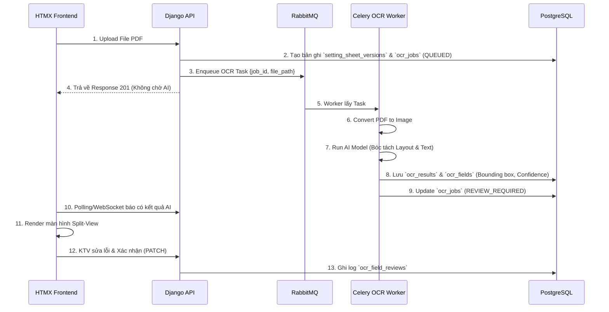

---

## 4. Giao diện Đối chiếu OCR (Split-View)

Màn hình Split-view là điểm tiếp xúc giữa con người và AI, yêu cầu thiết kế UX/UI tối ưu:

- **Khung bên trái (Trình xem PDF/Ảnh)**:
  - Phải hỗ trợ Zoom, cuộn trang.
  - Khi hover/click vào một thông số bên khung phải, hệ thống vẽ highlight (dựa trên bounding box) vào vị trí tương ứng trên ảnh.
- **Khung bên phải (Form dữ liệu)**:
  - Hiển thị danh sách các thông số AI đã bóc tách được.
  - Cảnh báo màu vàng (Warning) với những trường có Confidence Score < Ngưỡng (VD: < 80%).
  - Textbox có thể chỉnh sửa trực tiếp.
  - Mỗi khi sửa, người dùng được yêu cầu nhập "Lý do thay đổi" để lưu vết (Audit log).
- **Trạng thái chốt sổ**: Nút "Xác nhận toàn bộ dữ liệu" chỉ được phép bấm khi người dùng đã duyệt/xác nhận các trường dữ liệu quan trọng hoặc có Confidence thấp.

---

## 5. Xử lý Lỗi & Retry

- Lỗi không đọc được file (Corrupted PDF) → Cập nhật trạng thái `FAILED`, ghi rõ `error_message`, gửi thông báo cho người dùng.
- AI Worker crash / Timeout → RabbitMQ tự động đẩy lại Task (Max 3 retries).
- File quá dài (> 50 trang) → AI Worker có thể ngắt tác vụ, chuyển trạng thái về `FAILED_TOO_LARGE`, yêu cầu người dùng cắt nhỏ file.

---

## 6. Yêu cầu Huấn luyện (Future Scope)
Trong tương lai, để nâng cao độ chính xác:
- Có thể thu thập các mẫu phiếu đã được KTV đối chiếu (dữ liệu sạch) để huấn luyện lại mô hình (Fine-tuning PaddleOCR hoặc mô hình LayoutLM).
- Việc huấn luyện phải được thực hiện trên môi trường Sandbox chuyên dụng nội bộ, không dùng dữ liệu production chạy thẳng ra ngoài.
````

## File: docs/mvt_design/MODELS_DESIGN.md
````markdown
# Đặc tả Cơ sở Dữ liệu (Django + PostgreSQL)

**Database:** PostgreSQL 15+
**ORM:** Django ORM (PostgreSQL Backend)

Sử dụng mô hình CSDL quan hệ chuẩn (SQL) kết hợp với kiểu dữ liệu `JSONField` (JSONB) của PostgreSQL để xử lý các dữ liệu linh hoạt (như OCR) mà không cần phá vỡ cấu trúc của CSDL.

## 1. Khai báo Models
Sử dụng thư viện chuẩn `django.db.models`.

### 1.1 Quản lý Tổ chức & Phân quyền
Sử dụng Auth User mặc định của Django, mở rộng bằng Profile.

```python
from django.db import models
from django.contrib.auth.models import User

class Organization(models.Model):
    code = models.CharField(max_length=50, unique=True)
    name = models.CharField(max_length=255)
    org_type = models.CharField(max_length=50) # VTC, OPERATION, TRANSMISSION...
    parent = models.ForeignKey('self', on_delete=models.SET_NULL, null=True, blank=True)

class UserProfile(models.Model):
    user = models.OneToOneField(User, on_delete=models.CASCADE)
    organization = models.ForeignKey(Organization, on_delete=models.SET_NULL, null=True)
    phone_number = models.CharField(max_length=20, null=True, blank=True)
```

### 1.2 Trạm Biến áp & Rơ-le (Quan hệ 1-N)
Xây dựng quan hệ Trạm -> Ngăn lộ -> Rơ-le -> Cài đặt.

```python
class Station(models.Model):
    station_code = models.CharField(max_length=50, unique=True)
    station_name = models.CharField(max_length=200)
    location = models.CharField(max_length=255)

class Bay(models.Model):
    station = models.ForeignKey(Station, related_name='bays', on_delete=models.CASCADE)
    bay_code = models.CharField(max_length=50)
    bay_name = models.CharField(max_length=100)

class Relay(models.Model):
    bay = models.ForeignKey(Bay, related_name='relays', on_delete=models.CASCADE)
    relay_code = models.CharField(max_length=50)
    relay_name = models.CharField(max_length=100)
    manufacturer = models.CharField(max_length=100)

class RelaySetting(models.Model):
    relay = models.ForeignKey(Relay, related_name='settings', on_delete=models.CASCADE)
    parameter_code = models.CharField(max_length=50)
    parameter_name = models.CharField(max_length=100)
    standard_value = models.FloatField()
    unit = models.CharField(max_length=20)
    tolerance_min = models.FloatField()
    tolerance_max = models.FloatField()
```

### 1.3 Phiếu Chỉnh định & Lịch sử
Sử dụng `JSONField` của PostgreSQL cho dữ liệu không cấu trúc, và tạo bảng rời cho chữ ký số để đảm bảo tính chuẩn hóa 3NF.

```python
class SettingSheet(models.Model):
    sheet_code = models.CharField(max_length=100, unique=True)
    title = models.CharField(max_length=255)
    status = models.CharField(max_length=50) # DRAFT, PENDING_REVIEW, ASSIGNED, COMPLETED
    scan_file = models.FileField(upload_to='scans/')
    
    relay = models.ForeignKey(Relay, on_delete=models.SET_NULL, null=True)
    
    # OCR Data / Mock Data sử dụng JSONB của PostgreSQL
    extracted_data = models.JSONField(null=True, blank=True) 

class SignatureRecord(models.Model):
    sheet = models.ForeignKey(SettingSheet, related_name='signatures', on_delete=models.CASCADE)
    signer_name = models.CharField(max_length=100)
    role = models.CharField(max_length=50)
    signed_at = models.DateTimeField(auto_now_add=True)
    signature_hash = models.CharField(max_length=256)
```

### 1.4 Nhật ký Kiểm tra Định kỳ
```python
class PeriodicCheck(models.Model):
    relay = models.ForeignKey(Relay, on_delete=models.CASCADE)
    sheet = models.ForeignKey(SettingSheet, on_delete=models.CASCADE)
    scheduled_date = models.DateField()
    actual_check_date = models.DateField(null=True, blank=True)
    status = models.CharField(max_length=50)
    
class PeriodicCheckItem(models.Model):
    check = models.ForeignKey(PeriodicCheck, related_name='items', on_delete=models.CASCADE)
    parameter_code = models.CharField(max_length=50)
    measured_value = models.FloatField()
    deviation_percent = models.FloatField()
    is_within_tolerance = models.BooleanField()
```

## 2. Ưu điểm của Thiết kế này (PostgreSQL)
1. **Toàn vẹn Dữ liệu (ACID):** RDBMS như PostgreSQL đảm bảo tính nhất quán dữ liệu ở mức cao nhất, tránh mất mát thông tin quan trọng.
2. **Khả năng chứa dữ liệu động (extracted_data):** Tính năng `JSONField` (JSONB) của PostgreSQL cực kỳ tối ưu, cho phép lập chỉ mục (index) và truy vấn trên các trường bên trong file JSON (như kết quả OCR) mà không kém phần linh hoạt so với NoSQL.
3. **Mở rộng dễ dàng với ORM tiêu chuẩn:** Sử dụng 100% tính năng của Django ORM, dễ dàng viết các câu truy vấn phức tạp (Aggregation, Annotation), tích hợp tốt với các thư viện admin, form, và report của hệ sinh thái Django.
````

## File: docs/mvt_design/REQUIREMENTS_MVT.md
````markdown
# Đặc tả Yêu cầu Hệ thống (SRS)
**Dự án:** Hệ thống Quản lý Phiếu Chỉnh định Rơ-le (RMS)
**Kiến trúc:** Django (MVT) + PostgreSQL

## 1. Tổng quan Hệ thống
RMS là hệ thống web phục vụ quy trình lập phiếu, phê duyệt, chuyển giao và xác nhận hoàn thành công tác chỉnh định thông số bảo vệ rơ-le tại các trạm biến áp.
Hệ thống được thiết kế lại hoàn toàn theo kiến trúc **MVT của Django**, sử dụng **PostgreSQL làm cơ sở dữ liệu chính**.

## 2. Kiến trúc Công nghệ
- **Mô hình:** MVT (Model - View - Template)
- **Framework:** Django
- **Cơ sở dữ liệu:** PostgreSQL
- **Giao diện (Frontend):** Django Templates kết hợp TailwindCSS/Bootstrap (Sử dụng HTMX/Alpine.js cho tương tác AJAX động).
- **Tích hợp bên ngoài:** Hệ thống Ký số EVN (qua REST API).

## 3. Các Phân hệ Chức năng & Luồng Nghiệp vụ
### 3.1 Xác thực & Phân quyền (Auth & RBAC)
- Sử dụng Session Authentication mặc định của Django.
- **Vai trò:** A0/A1 (Phát hành), VTC/Vận hành/Điều độ (Rà soát), Kỹ thuật viên (Chỉnh định), Giám sát trạm (Xác nhận), Admin.
- Sử dụng `django.contrib.auth.models.Group` kết hợp custom model mở rộng.

### 3.2 Quản lý Trạm biến áp & Rơ-le
- CRUD thông tin Trạm biến áp (Station), Ngăn lộ (Bay), Rơ-le (Relay).
- **Upload File Cấu hình:** Người dùng upload JSON/Excel. Hệ thống xử lý và lưu vào các bảng quan hệ của PostgreSQL.

### 3.3 Quản lý Phiếu Chỉnh định (Sheet Lifecycle)
- **Khởi tạo & Upload:** A0/A1 chọn trạm, upload file PDF/JPG bản scan phiếu. Form hỗ trợ nhập metadata tạm thời (khi OCR chưa sẵn sàng) và lưu vào `JSONField` của PostgreSQL.
- **Phát hành (Ký số lần 1):** Click nút Ký số, Django View sẽ gọi API Ký số EVN và mở iframe cho A0/A1 thao tác. Xác nhận thành công sẽ chuyển trạng thái sang `PENDING_REVIEW`.
- **Rà soát Đa lớp:** VTC/Vận hành vào màn hình "Chờ rà soát", đối chiếu bản scan và thông số, chọn "Phê duyệt" hoặc "Từ chối". Phê duyệt xong chuyển thành `ASSIGNED_TO_SC`.
- **Chuyển giao:** Công ty Truyền tải gán KTV phụ trách.
- **Xác nhận hoàn thành (Ký số lần 2 & 3):** KTV chỉnh định xong, thực hiện Ký số. Sau đó Giám sát trạm ký xác nhận. Phiếu cập nhật thành `COMPLETED`.

### 3.4 Kiểm tra Định kỳ (Periodic Checks)
- Giao diện dạng bảng lưới (Grid) hiển thị các thông số tiêu chuẩn của Rơ-le.
- Người dùng nhập kết quả đo thực tế, nhấn "Lưu". Logic View tính toán sai lệch % và cảnh báo (ĐẠT / VƯỢT NGƯỠNG).

## 4. Giải pháp Kỹ thuật Lưu trữ với PostgreSQL
- **JSONB / Schemaless Data:** Các thông số `extracted_data` (từ OCR hoặc tự nhập) sẽ được lưu dưới dạng kiểu dữ liệu `JSONField` (JSONB) của PostgreSQL, kết hợp sức mạnh truy vấn NoSQL trong môi trường cơ sở dữ liệu quan hệ (RDBMS).
- **Tính toàn vẹn dữ liệu (Data Integrity):** PostgreSQL cung cấp các ràng buộc khóa ngoại (Foreign Keys) để đảm bảo tính toàn vẹn dữ liệu giữa các bảng như Trạm, Ngăn lộ, Rơ-le và Phiếu chỉnh định.
````

## File: docs/mvt_design/TEMPLATES_UI.md
````markdown
# Thiết kế Giao diện (Django Templates & UI)

Hệ thống theo kiến trúc MVT sẽ sử dụng bộ thư viện Frontend nhúng trực tiếp vào Django Templates.

## 1. Công nghệ Frontend
- **HTML/Template Engine:** Django Template Language (DTL)
- **CSS Framework:** TailwindCSS (via CDN hoặc pre-compiled) / Bootstrap 5.
- **Tương tác động (AJAX/DOM):** Sử dụng **HTMX** để thực hiện các thao tác Upload, Load dữ liệu không cần tải lại trang (Single Page App - like experience).
- **Icons:** FontAwesome / Heroicons.

## 2. Cấu trúc Thư mục Templates (`templates/`)

```text
templates/
│
├── base.html                  # Layout chính (Sidebar, Header, Footer)
├── auth/
│   ├── login.html             # Giao diện đăng nhập
│   └── password_reset.html    # Giao diện đổi mật khẩu
│
├── stations/
│   ├── station_list.html      # Bảng danh sách Trạm
│   ├── station_detail.html    # Chi tiết Trạm (Ngăn lộ, Rơ le)
│   └── import_form.html       # Form kéo thả file JSON/Excel
│
├── sheets/
│   ├── sheet_list.html        # Kanban board / Bảng danh sách Phiếu chỉnh định
│   ├── sheet_form.html        # Form tạo phiếu mới (Khu vực kéo thả file scan)
│   ├── sheet_detail.html      # Màn hình Split-View (Bên trái: PDF Viewer, Bên phải: Form Data)
│   ├── _sign_modal.html       # (Partial) Modal hiển thị trạng thái đang gọi API Ký số
│   └── sheet_review.html      # Màn hình dành cho VTC/Vận hành phê duyệt
│
└── checks/
    ├── check_list.html        # Lịch sử kiểm tra
    └── check_form.html        # Form dạng Lưới (Grid) để nhập dữ liệu đo đạc thực tế
```

## 3. Thiết kế Bố cục Chính (Layout - `base.html`)

Giao diện hỗ trợ Dark Mode, phong cách Sleek Design.

- **Sidebar (Trái - 250px):** 
  - Hiển thị logo EVN/RMS.
  - Menu điều hướng: Dashboard, Trạm Biến áp, Phiếu Chỉnh định, Biên bản Kiểm tra, Quản trị hệ thống.
- **Header (Trên):**
  - Thanh tìm kiếm toàn cục (Global Search).
  - Tên người dùng đang đăng nhập & Nút chuyển đổi Dark/Light mode.
  - Dropdown Đăng xuất.
- **Content Area (Giữa):** Hiển thị khối nội dung chính.

## 4. UI Đặc thù: Màn hình Chi tiết Phiếu Chỉnh định (Split-View)
Đây là màn hình quan trọng nhất của hệ thống, đòi hỏi UX tốt để rà soát.

Sử dụng cấu trúc Flexbox hoặc CSS Grid chia đôi màn hình:
- **Cột Trái (60%):** Nhúng thẻ `<iframe src="{{ sheet.scan_file.url }}">` hoặc thư viện PDF.js để render file scan trực tiếp trên trình duyệt.
- **Cột Phải (40%):** 
  - Phía trên: Hiển thị các Metadata của Phiếu (Mã phiếu, Trạm, Rơ-le, Người phát hành).
  - Giữa: Box Trạng thái Chữ ký (Hiển thị list user đã ký số). Nút **"Ký Số EVN"** to, rõ ràng.
  - Dưới: Nơi nhập liệu Mock Data/Form hoặc hiển thị `extracted_data` dạng JSON cho Kỹ thuật viên đối chiếu.

### 4.1 Tích hợp Ký số không Refresh trang bằng HTMX
```html
<!-- Nút ký số dùng htmx để post ngầm -->
<button hx-post="" 
        hx-target="#signature-status-box" 
        hx-swap="innerHTML"
        class="bg-blue-600 text-white px-4 py-2 rounded shadow">
    <i class="fas fa-file-signature"></i> Ký số & Phát hành
</button>

<div id="signature-status-box">
    <!-- Nơi hiển thị kết quả trả về từ View (ví dụ: Chữ ký thành công / Mở popup) -->
</div>
```

## 5. UI Đặc thù: Bảng nhập Liệu Định kỳ
- Tạo Table với Input ở mỗi dòng.
- Khi người dùng nhập số, sử dụng Alpine.js (chạy client-side) để tính toán màu sắc cảnh báo đỏ/xanh ngay lập tức trước khi bấm "Lưu".

```html
<tr x-data="{ measured: 0, standard: {{ item.standard_value }} }">
    <td>{{ item.parameter_name }}</td>
    <td>{{ item.standard_value }}</td>
    <td><input type="number" x-model="measured" name="measured_{{ item.code }}"></td>
    <td>
        <span x-text="Math.abs(measured - standard)" 
              :class="Math.abs(measured - standard) > 0.05 ? 'text-red-500' : 'text-green-500'">
        </span>
    </td>
</tr>
```
````

## File: docs/mvt_design/VIEWS_URLS_MAP.md
````markdown
# Thiết kế Routing và Views (MVT)

Thay vì thiết kế các API Endpoint trả về JSON (như DRF), hệ thống sẽ sử dụng các `urls.py` và `views.py` để lấy dữ liệu từ DB (thông qua Djongo ORM), gán vào Context và trả về mã HTML render từ Template.

## 1. Cấu trúc URL Định tuyến (`urls.py`)

| URL Pattern | Tên (Name) | Phương thức HTTP | Chức năng (Ý nghĩa) |
|---|---|---|---|
| `/` | `home` | GET | Trang Dashboard chính (Thống kê phiếu). |
| `/auth/login/` | `login` | GET, POST | Trang Đăng nhập hệ thống. |
| `/auth/logout/` | `logout` | POST | Đăng xuất. |
| `/stations/` | `station_list` | GET | Danh sách Trạm biến áp. |
| `/stations/<id>/` | `station_detail` | GET | Chi tiết Trạm (gồm danh sách Ngăn lộ, Rơ-le). |
| `/stations/import/` | `station_import` | GET, POST | Upload file JSON/Excel khởi tạo Cấu trúc Trạm. |
| `/sheets/` | `sheet_list` | GET | Danh sách Phiếu Chỉnh định. |
| `/sheets/new/` | `sheet_create` | GET, POST | Tạo phiếu mới & Upload file bản scan. |
| `/sheets/<id>/` | `sheet_detail` | GET | Xem chi tiết thông số phiếu & File PDF. |
| `/sheets/<id>/sign/` | `sheet_sign` | POST | Khởi tạo luồng Ký số EVN cho người dùng hiện tại. |
| `/sheets/<id>/review/` | `sheet_review` | GET, POST | VTC/Điều độ rà soát và phê duyệt phiếu. |
| `/sheets/<id>/transfer/`| `sheet_transfer`| POST | Chuyển giao phiếu cho Kỹ thuật viên (Giao việc). |
| `/checks/` | `check_list` | GET | Danh sách các biên bản kiểm tra định kỳ. |
| `/checks/new/<relay_id>/`| `check_create` | GET, POST | Form điền số liệu kiểm tra định kỳ rơ-le thực tế. |

## 2. Đặc tả Logic của Views (`views.py`)

Sử dụng kết hợp Class-Based Views (CBV) và Function-Based Views (FBV) theo chuẩn Django:

### 2.1 View Tạo Phiếu & Upload Bản Scan (`sheet_create`)
- **GET:** Trả về Template `sheets/sheet_form.html` kèm ModelForm của `SettingSheet`.
- **POST:** Nhận `scan_file` và `title`.
  - Validate file upload (đảm bảo là PDF/JPG hợp lệ, kích thước < 10MB).
  - Lưu vào MongoDB (file được lưu trên storage vật lý, đường dẫn lưu vào Mongo).
  - Trạng thái phiếu thiết lập ban đầu: `DRAFT`.
  - Redirect về `sheet_detail`.

### 2.2 View Khởi tạo Ký số (`sheet_sign`)
Đây là View thực hiện tích hợp API bên ngoài (Hệ thống Ký số EVN).
- **POST:** 
  1. Lấy `SettingSheet` từ Database.
  2. Hash nội dung file scan (`hash_sha256`).
  3. Gửi HTTP Request (bằng thư viện `requests`) sang `https://evn-sign-api/initiate/` kèm theo hash và User ID hiện tại.
  4. Lấy lại `session_id` và `signing_url` từ EVN.
  5. Trả về Template hoặc dùng HTMX trigger để mở `signing_url` dạng popup/iframe cho user ký.
  6. (Sau khi user ký xong) Hệ thống EVN callback hoặc View tự gọi lại EVN để lấy `signature_data` (Base64) -> Nhúng data vào `SettingSheet.signatures` (Mảng). Đổi trạng thái phiếu.

### 2.3 View Nhập liệu Kiểm tra Định kỳ (`check_create`)
Do MongoDB lưu toàn bộ thông số Rơ-le dạng Array trong DB, việc xuất form cực kỳ dễ dàng.
- **GET:** Lấy `Relay.settings`. Build một danh sách các field để render HTML dạng lưới (Grid/Table). 
- **POST:** Nhận cục `POST.dict()` từ Form.
  - Lặp qua danh sách thông số, so sánh `measured_value` với `standard_value` có sẵn trong Rơ-le (MongoDB Document).
  - Tính toán `deviation_percent = abs(do - chuan)/chuan * 100`.
  - Kiểm tra có nằm trong giới hạn (`tolerance_min` - `tolerance_max`) không.
  - Đóng gói toàn bộ kết quả vào một Array nhúng lưu vào Model `PeriodicCheck.items`.
  - Render ra template báo cáo (`checks/check_report.html`) cảnh báo Đỏ/Xanh.

## 3. Quản lý Permission tại Views
Sử dụng Mixins để chặn quyền truy cập (RBAC).

```python
from django.contrib.auth.mixins import UserPassesTestMixin
from django.views.generic import DetailView

class SheetReviewView(UserPassesTestMixin, DetailView):
    model = SettingSheet
    template_name = "sheets/sheet_review.html"

    # Chỉ VTC, Vận Hành, Điều độ mới được phép Rà soát
    def test_func(self):
        user = self.request.user
        return user.groups.filter(name__in=['VTC', 'OPERATION_UNIT', 'DISPATCHER']).exists()
```
````

## File: rms_project/__init__.py
````python
__all__ = ('celery_app',)
````

## File: rms_project/asgi.py
````python
"""
ASGI config for rms_project project.
It exposes the ASGI callable as a module-level variable named ``application``.
For more information on this file, see
https://docs.djangoproject.com/en/6.0/howto/deployment/asgi/
"""
⋮----
django_asgi_app = get_asgi_application()
⋮----
application = ProtocolTypeRouter({
````

## File: rms_project/celery.py
````python
# Set the default Django settings module for the 'celery' program.
⋮----
app = Celery('rms_project')
⋮----
# Using a string here means the worker doesn't have to serialize
# the configuration object to child processes.
# - namespace='CELERY' means all celery-related configuration keys
#   should have a `CELERY_` prefix.
⋮----
# Load task modules from all registered Django apps.
⋮----
'schedule': crontab(minute='*'),  # Run every minute
⋮----
@app.task(bind=True, ignore_result=True)
def debug_task(self)
⋮----
@worker_ready.connect
def reset_stuck_processing_jobs(sender, **kwargs)
⋮----
"""
    Khi Celery worker khởi động lại, chỉ reset các OcrJob đang ở trạng thái
    PROCESSING về FAILED — vì những task đó đang thực sự chạy và bị gián đoạn.
    Các job PENDING được giữ nguyên để Celery tiếp tục xử lý từ hàng đợi Redis.
    """
⋮----
pass  # Django đã được setup rồi
⋮----
# Chỉ reset PROCESSING (đang chạy thật) — KHÔNG đụng vào PENDING (đang xếp hàng)
stuck_jobs = list(OcrJob.objects.filter(status='PROCESSING').select_related('sheet', 'sheet__created_by'))
⋮----
job_ids = []
⋮----
# Xóa cache flags để tránh stale data
⋮----
# Đặt lại về PENDING để tự động chạy lại
⋮----
# Đẩy ngược lại vào hàng đợi với acks_late
````

## File: rms_project/settings.py
````python
"""
Django settings for rms_project project.
Generated by 'django-admin startproject' using Django 6.0.7.
For more information on this file, see
https://docs.djangoproject.com/en/6.0/topics/settings/
For the full list of settings and their values, see
https://docs.djangoproject.com/en/6.0/ref/settings/
"""
⋮----
# Build paths inside the project like this: BASE_DIR / 'subdir'.
BASE_DIR = Path(__file__).resolve().parent.parent
⋮----
# Load environment variables from .env file
⋮----
# Quick-start development settings - unsuitable for production
# See https://docs.djangoproject.com/en/6.0/howto/deployment/checklist/
⋮----
# SECURITY WARNING: keep the secret key used in production secret!
SECRET_KEY = os.getenv('SECRET_KEY', 'default-unsafe-secret-key')
⋮----
# SECURITY WARNING: don't run with debug turned on in production!
DEBUG = os.getenv('DEBUG', 'False').lower() == 'true'
⋮----
ALLOWED_HOSTS = []
⋮----
# Application definition
⋮----
INSTALLED_APPS = [
⋮----
# Custom apps
⋮----
MIDDLEWARE = [
⋮----
ROOT_URLCONF = 'rms_project.urls'
⋮----
TEMPLATES = [
⋮----
WSGI_APPLICATION = 'rms_project.wsgi.application'
⋮----
# Database
# https://docs.djangoproject.com/en/6.0/ref/settings/#databases
⋮----
DATABASES = {
⋮----
# Password validation
# https://docs.djangoproject.com/en/6.0/ref/settings/#auth-password-validators
⋮----
AUTH_PASSWORD_VALIDATORS = [
⋮----
# Internationalization
# https://docs.djangoproject.com/en/6.0/topics/i18n/
⋮----
LANGUAGE_CODE = 'en-us'
⋮----
TIME_ZONE = 'Asia/Ho_Chi_Minh'
⋮----
ALLOWED_HOSTS = ['*']
CSRF_TRUSTED_ORIGINS = ['https://electricity.nextdev.name.vn', 'http://electricity.nextdev.name.vn']
SECURE_PROXY_SSL_HEADER = ('HTTP_X_FORWARDED_PROTO', 'https')
⋮----
ASGI_APPLICATION = 'rms_project.asgi.application'
⋮----
CACHES = {
⋮----
SESSION_ENGINE = "django.contrib.sessions.backends.cache"
SESSION_CACHE_ALIAS = "default"
SESSION_COOKIE_AGE = 86400  # 24 hours in seconds
SESSION_SAVE_EVERY_REQUEST = True  # Reset timeout on every user interaction
⋮----
CHANNEL_LAYERS = {
⋮----
# Celery Configuration Options
CELERY_BROKER_URL = os.getenv('REDIS_URL', 'redis://127.0.0.1:6379/1')
CELERY_RESULT_BACKEND = os.getenv('REDIS_URL', 'redis://127.0.0.1:6379/1')
CELERY_ACCEPT_CONTENT = ['application/json']
CELERY_RESULT_SERIALIZER = 'json'
CELERY_TASK_SERIALIZER = 'json'
CELERY_TIMEZONE = 'Asia/Ho_Chi_Minh'
⋮----
USE_I18N = True
⋮----
USE_TZ = True
⋮----
# Static files (CSS, JavaScript, Images)
# https://docs.djangoproject.com/en/6.0/howto/static-files/
⋮----
STATIC_URL = 'static/'
STATICFILES_DIRS = [os.path.join(BASE_DIR, 'static')]
STATIC_ROOT = os.path.join(BASE_DIR, 'staticfiles')
⋮----
LOGIN_URL = 'login'
LOGIN_REDIRECT_URL = 'dashboard'
LOGOUT_REDIRECT_URL = 'login'
⋮----
# Allow iframes to load media files from the same origin (e.g. for PDF preview)
X_FRAME_OPTIONS = 'SAMEORIGIN'
⋮----
# Media files (Uploaded files)
MEDIA_URL = '/media/'
MEDIA_ROOT = BASE_DIR / 'media'
⋮----
REST_FRAMEWORK = {
````

## File: rms_project/urls.py
````python
urlpatterns = [
````

## File: rms_project/wsgi.py
````python
"""
WSGI config for rms_project project.
It exposes the WSGI callable as a module-level variable named ``application``.
For more information on this file, see
https://docs.djangoproject.com/en/6.0/howto/deployment/wsgi/
"""
⋮----
application = get_wsgi_application()
````

## File: sheets/management/commands/__init__.py
````python
# Django management commands package
````

## File: sheets/management/commands/sync_hybrid_pipeline.py
````python
# Ensure OCR_PRJ is on sys.path
ocr_prj_path = os.path.join(settings.BASE_DIR, 'OCR_PRJ')
⋮----
def sanitize_json(obj)
⋮----
class Command(BaseCommand)
⋮----
help = 'Synchronize and standardize all SettingSheets using the Hybrid Multi-Stage Pipeline'
⋮----
def add_arguments(self, parser)
⋮----
def handle(self, *args, **options)
⋮----
dry_run = options['dry_run']
auto_link = options['auto_link']
resume = options['resume']
limit = options['limit']
sheet_id = options.get('sheet_id')
start_id = options.get('start_id')
⋮----
artifacts_dir = Path(settings.MEDIA_ROOT) / 'ocr_artifacts'
service = Page3PlusLayoutAnalysisService()
⋮----
# Filter sheets to process
⋮----
sheets_qs = SettingSheet.objects.filter(id=sheet_id)
⋮----
sheets_qs = SettingSheet.objects.all().order_by('id')
⋮----
sheets_qs = sheets_qs.filter(id__gte=start_id)
⋮----
total_sheets = 0
success_sheets = 0
total_pages = 0
total_tables = 0
total_parameters = 0
auto_linked_relays = 0
start_time = time.time()
⋮----
job = sheet.ocr_jobs.order_by('-created_at').first()
cid = job.correlation_id if job else None
⋮----
details_dir = artifacts_dir / f"{cid}_details" / "pages"
⋮----
sheet_start = time.time()
⋮----
page_files = sorted(details_dir.glob('page_*.json'))
⋮----
all_setting_records = []
all_pages_payload = []
sheet_tables = 0
⋮----
# 1. Nạp Trang 1 (Header/Bìa) nếu có
header_p1_file = artifacts_dir / f"{cid}_header" / "pages" / "page_0001.json"
p1_data = None
⋮----
p1_data = json.load(f)
⋮----
# 2. Xử lý từng trang chi tiết từ trang 2 trở đi bằng Hybrid Pipeline
⋮----
p_data = json.load(f)
⋮----
p_num = p_data.get('page_number', 1)
img_path = Path(p_data.get('image_path', ''))
⋮----
# Thử fallback đường dẫn tương đối
alt_img = Path(settings.BASE_DIR) / str(img_path).lstrip('/')
⋮----
img_path = alt_img
⋮----
# Chạy Tầng 1 (Morphological Grid) & Tầng 2-3 (Geometric Reconstruction)
res = service.analyse_page(
⋮----
n_tables = len(res.layout.get('table_regions', []))
⋮----
# Cập nhật kết quả bố cục mới vào cấu trúc trang
⋮----
# Ghi đè file trang trên đĩa
⋮----
# Ánh xạ tên phân nhóm (group_title) vào từng bản ghi thông số
layout_groups = {}
⋮----
gid = g.get('group_id')
title = (g.get('title') or '').strip()
⋮----
flat = flatten_record(r)
⋮----
gid = flat.get('group_id')
⋮----
# 3. Tầng 5: Tự động nhận diện & liên kết Rơ-le / Trạm nếu còn trống
matched_relay_info = ""
⋮----
p1_fields = p1_data.get('layout', {}).get('fields', {})
⋮----
st_name = (p1_fields['station'].get('text') or '').strip()
⋮----
# Khớp tên trạm linh hoạt
norm_ocr_st = normalize_text(st_name).replace('tram', '').split('(')[0].strip()
⋮----
norm_s = normalize_text(s_obj.station_name).replace('tram', '').strip()
⋮----
flat_p1 = {k: v.get('text') for k, v in p1_fields.items() if isinstance(v, dict)}
candidates = list(Relay.objects.filter(bay__station=sheet.station).select_related('bay'))
⋮----
matched_relay_info = f" -> Đã khớp Rơ-le: {m_rl.relay_name} (Điểm: {m_score})"
⋮----
# 4. Lưu dữ liệu đã chuẩn hóa vào Cơ sở Dữ liệu
⋮----
clean_records = sanitize_json(all_setting_records)
clean_pages = sanitize_json(all_pages_payload)
⋮----
save_fields = ['extracted_data']
⋮----
# Đồng bộ sang OcrJob
⋮----
elapsed = time.time() - sheet_start
⋮----
relay_str = sheet.relay.relay_name if sheet.relay else "Chưa gán"
⋮----
total_time = time.time() - start_time
avg_time = (total_time / success_sheets) if success_sheets > 0 else 0
````

## File: sheets/management/__init__.py
````python
# Django management package
````

## File: sheets/migrations/__init__.py
````python

````

## File: sheets/migrations/0001_initial.py
````python
# Generated by Django 6.0.7 on 2026-07-18 15:46
⋮----
class Migration(migrations.Migration)
⋮----
initial = True
⋮----
dependencies = [
⋮----
operations = [
````

## File: sheets/migrations/0002_alter_settingsheet_options.py
````python
# Generated by Django 6.0.7 on 2026-07-18 20:09
⋮----
class Migration(migrations.Migration)
⋮----
dependencies = [
⋮----
operations = [
````

## File: sheets/migrations/0003_alter_settingsheet_status.py
````python
# Generated by Django 6.0.7 on 2026-07-18 20:26
⋮----
class Migration(migrations.Migration)
⋮----
dependencies = [
⋮----
operations = [
````

## File: sheets/migrations/0004_alter_settingsheet_options.py
````python
# Generated by Django 6.0.7 on 2026-07-18 20:26
⋮----
class Migration(migrations.Migration)
⋮----
dependencies = [
⋮----
operations = [
````

## File: sheets/migrations/0005_settingsheet_assigned_to_settingsheet_created_by.py
````python
# Generated by Django 6.0.7 on 2026-07-18 20:31
⋮----
class Migration(migrations.Migration)
⋮----
dependencies = [
⋮----
operations = [
````

## File: sheets/migrations/0006_settingsheet_assigned_supervisor_and_more.py
````python
# Generated by Django 6.0.7 on 2026-07-18 20:47
⋮----
class Migration(migrations.Migration)
⋮----
dependencies = [
⋮----
operations = [
````

## File: sheets/migrations/0007_remove_settingsheet_assigned_supervisor_and_more.py
````python
# Generated by Django 6.0.7 on 2026-07-19 06:51
⋮----
class Migration(migrations.Migration)
⋮----
dependencies = [
⋮----
operations = [
````

## File: sheets/migrations/0008_alter_settingsheet_status.py
````python
# Generated by Django 6.0.7 on 2026-07-19 08:29
⋮----
class Migration(migrations.Migration)
⋮----
dependencies = [
⋮----
operations = [
````

## File: sheets/migrations/0009_settingsheet_supervisor_assigned.py
````python
# Generated by Django 6.0.7 on 2026-07-19 14:27
⋮----
class Migration(migrations.Migration)
⋮----
dependencies = [
⋮----
operations = [
````

## File: sheets/migrations/0010_settingsheet_is_temporary_and_more.py
````python
# Generated by Django 6.0.7 on 2026-07-20 09:23
⋮----
class Migration(migrations.Migration)
⋮----
dependencies = [
⋮----
operations = [
````

## File: sheets/migrations/0011_alter_settingsheet_options_alter_settingsheet_status.py
````python
# Generated by Django 6.0.7 on 2026-07-21 02:11
⋮----
class Migration(migrations.Migration)
⋮----
dependencies = [
⋮----
operations = [
````

## File: sheets/migrations/0012_settingsheet_station.py
````python
# Generated by Django 6.0.7 on 2026-07-21 03:34
⋮----
class Migration(migrations.Migration)
⋮----
dependencies = [
⋮----
operations = [
````

## File: sheets/migrations/0013_settingsheet_assigned_at_alter_settingsheet_status.py
````python
# Generated by Django 6.0.7 on 2026-07-22 03:24
⋮----
class Migration(migrations.Migration)
⋮----
dependencies = [
⋮----
operations = [
````

## File: sheets/migrations/0014_settingsheet_edit_logs_alter_settingsheet_status.py
````python
# Generated by Django 6.0.7 on 2026-07-22 03:39
⋮----
class Migration(migrations.Migration)
⋮----
dependencies = [
⋮----
operations = [
````

## File: sheets/migrations/0015_settingsheet_has_parameters_changed.py
````python
# Generated by Django 6.0.7 on 2026-07-23 08:05
⋮----
class Migration(migrations.Migration)
⋮----
dependencies = [
⋮----
operations = [
````

## File: sheets/migrations/0016_alter_settingsheet_scan_file.py
````python
# Generated by Django 6.0.7 on 2026-07-23 18:25
⋮----
class Migration(migrations.Migration)
⋮----
dependencies = [
⋮----
operations = [
````

## File: sheets/migrations/0017_settingsheet_updated_at.py
````python
# Generated by Django 6.0.7 on 2026-07-30 03:19
⋮----
class Migration(migrations.Migration)
⋮----
dependencies = [
⋮----
operations = [
````

## File: sheets/migrations/0018_ocrjob.py
````python
# Generated by Django 6.0.7 on 2026-08-01 06:05
⋮----
class Migration(migrations.Migration)
⋮----
dependencies = [
⋮----
operations = [
````

## File: sheets/migrations/0019_ocrjob_error_detail.py
````python
# Generated by Django on 2026-08-03
⋮----
class Migration(migrations.Migration)
⋮----
dependencies = [
⋮----
operations = [
````

## File: sheets/migrations/0020_ocrjob_device_mode.py
````python
# Generated by Django 6.0.7 on 2026-08-03 05:44
⋮----
class Migration(migrations.Migration)
⋮----
dependencies = [
⋮----
operations = [
````

## File: sheets/migrations/0021_settingsheet_execution_station.py
````python
# Generated by Django 6.0.8 on 2026-10-06 15:10
⋮----
class Migration(migrations.Migration)
⋮----
dependencies = [
⋮----
operations = [
````

## File: sheets/__init__.py
````python

````

## File: sheets/admin.py
````python
# Register your models here.
````

## File: sheets/apps.py
````python
class SheetsConfig(AppConfig)
⋮----
name = 'sheets'
⋮----
def ready(self)
````

## File: sheets/models.py
````python
class SettingSheet(models.Model)
⋮----
STATUS_CHOICES = (
⋮----
sheet_code = models.CharField(max_length=100, unique=True)
title = models.CharField(max_length=255, null=True, blank=True)
status = models.CharField(max_length=50, choices=STATUS_CHOICES, default='DRAFT')
scan_file = models.FileField(upload_to='scans/', blank=True, null=True)
⋮----
created_by = models.ForeignKey('auth.User', related_name='created_sheets', on_delete=models.SET_NULL, null=True)
assigned_to = models.ForeignKey('auth.User', related_name='assigned_sheets', on_delete=models.SET_NULL, null=True, blank=True)
supervisor_assigned = models.ForeignKey('auth.User', related_name='supervised_sheets', on_delete=models.SET_NULL, null=True, blank=True)
assigned_at = models.DateTimeField(null=True, blank=True)
⋮----
relay = models.ForeignKey(Relay, on_delete=models.SET_NULL, null=True, blank=True)
relay_text = models.CharField(max_length=255, null=True, blank=True)
station = models.ForeignKey('stations.Station', on_delete=models.SET_NULL, null=True, blank=True)
⋮----
# Trạm được giao nhiệm vụ thực thi (Cross-Dispatching). Nếu null thì mặc định dùng station.
execution_station = models.ForeignKey('stations.Station', on_delete=models.SET_NULL, null=True, blank=True, related_name='executed_sheets')
⋮----
# OCR Data / Mock Data using JSONField of PostgreSQL
extracted_data = models.JSONField(null=True, blank=True)
⋮----
# Lịch sử sửa đổi thông số
edit_logs = models.JSONField(default=list, blank=True)
⋮----
# Đánh dấu phiếu có thông số thay đổi so với phiên bản trước đó
has_parameters_changed = models.BooleanField(default=False)
⋮----
is_temporary = models.BooleanField(default=False)
valid_until = models.DateTimeField(null=True, blank=True)
revert_to_sheet = models.ForeignKey('self', on_delete=models.SET_NULL, null=True, blank=True, related_name='revert_from_sheets')
reverted = models.BooleanField(default=False)
⋮----
created_at = models.DateTimeField(auto_now_add=True)
updated_at = models.DateTimeField(auto_now=True)
def __str__(self)
⋮----
def save(self, *args, **kwargs)
⋮----
class Meta
⋮----
ordering = ['-created_at']
permissions = [
⋮----
class SignatureRecord(models.Model)
⋮----
sheet = models.ForeignKey(SettingSheet, related_name='signatures', on_delete=models.CASCADE)
signer_name = models.CharField(max_length=100)
role = models.CharField(max_length=50)
signed_at = models.DateTimeField(auto_now_add=True)
signature_hash = models.CharField(max_length=256)
⋮----
class OcrJob(models.Model)
⋮----
DEVICE_CHOICES = (
⋮----
sheet = models.ForeignKey(SettingSheet, related_name='ocr_jobs', on_delete=models.CASCADE)
correlation_id = models.CharField(max_length=128, unique=True, help_text="ID duy nhất để giao tiếp với hệ thống OCR")
device_mode = models.CharField(max_length=10, choices=DEVICE_CHOICES, default='CPU', help_text="Chế độ phần cứng xử lý (CPU/GPU)")
status = models.CharField(max_length=50, choices=STATUS_CHOICES, default='PENDING')
review_status = models.CharField(max_length=50, null=True, blank=True)
⋮----
# Kết quả và lỗi
result_data = models.JSONField(null=True, blank=True, help_text="Toàn bộ JSON trả về từ OCR")
error_code = models.CharField(max_length=50, null=True, blank=True)
error_stage = models.CharField(max_length=50, null=True, blank=True)
error_detail = models.TextField(null=True, blank=True, help_text="Chi tiết nguyên nhân lỗi OCR")
````

## File: sheets/relay_matcher.py
````python
"""
Mô-đun nhận diện và ánh xạ rơ-le bảo vệ thông minh (Intelligent Relay Matching Engine).
Hỗ trợ đối soát đa tầng giữa thông tin OCR phiếu chỉnh định và Danh mục Rơ-le EVN (PMIS/RMS):
1. Khớp định danh trực tiếp (Model/Serial/Mã PMIS)
2. Tra cứu họ Model sang mã chức năng ANSI/IEEE C37.2 (7UT -> 87R/87T, 7SA -> 21/87L, SEL-387 -> 87T/87R, RET -> 87T/87R...)
3. Phân tích ngữ cảnh kỹ thuật: Mạch bảo vệ (Mạch 1 -> F87...1, Mạch 2 -> F87...2), Kiểu bảo vệ, Hãng sản xuất.
4. Loại trừ các thiết bị phụ trợ/cơ điện (Rơ le hơi, Van áp lực, Đồng hồ nhiệt độ/mức dầu...).
"""
⋮----
# 1. Bảng ánh xạ Tiền tố Model sang Chức năng ANSI & Hãng sản xuất
MODEL_REGISTRY = {
⋮----
# Siemens SIPROTEC 5 (Thế hệ mới - DIGSI 5) & SIPROTEC 4 (DIGSI 4)
# 1. Quá dòng và Xuất tuyến (7SJ Series)
⋮----
# 2. Bảo vệ Khoảng cách Đường dây (7SA Series)
⋮----
# 3. Bảo vệ So lệch Đường dây (7SD Series)
⋮----
# 4. Kết hợp Bảo vệ So lệch và Khoảng cách Đường dây (7SL Series)
⋮----
# 5. Bảo vệ So lệch Máy biến áp (7UT Series)
⋮----
# 6. Bảo vệ So lệch Thanh cái (7SS Series)
⋮----
# 7. Các dòng bảo vệ chuyên dụng khác của Siemens
⋮----
# Schweitzer Engineering Laboratories (SEL)
# 1. Bảo vệ Xuất tuyến / Feeder (SEL-751 Series)
⋮----
# 2. Bảo vệ Máy biến áp & Kháng (SEL-787, SEL-487E, SEL-387, SEL-587)
⋮----
# 3. Bảo vệ So lệch & Khoảng cách Đường dây (SEL-411L, SEL-311L, SEL-421, SEL-311C)
⋮----
# 4. Bảo vệ So lệch Thanh cái & Hư hỏng máy cắt (SEL-487B)
⋮----
# ABB / Hitachi Energy (Relion Series: 670, 650, 630, 620, 615 & REX)
# 1. Bảo vệ Máy biến áp (RET Series)
⋮----
# 2. Bảo vệ So lệch Đường dây & Cáp (RED Series)
⋮----
# 3. Bảo vệ Khoảng cách Đường dây (REL Series)
⋮----
# 4. Bảo vệ Thanh cái (REB Series)
⋮----
# 5. Bảo vệ & Điều khiển Xuất tuyến / Feeder (REF Series)
⋮----
# 6. Bảo vệ Động cơ (REM Series)
⋮----
# 7. Bảo vệ Máy phát điện (REG Series)
⋮----
# 8. Điều khiển & Giám sát Ngăn lộ (REC Series)
⋮----
# 9. Nền tảng Đa năng Relion REX Platform
⋮----
# 10. Tiền tố chung dòng ABB (Fallback)
⋮----
# MiCOM (Schneider / Alstom / AREVA)
⋮----
# Toshiba (GR-Series)
⋮----
# NR Electric / NARI
⋮----
# Protecta, Bender & Arteche
⋮----
# Tự động Điều chỉnh Điện áp (ANSI 90 - AVR / OLTC)
⋮----
# 2. Bảng ánh xạ Từ khóa Chức năng (ANSI & Tiếng Việt) có trong TÊN RƠ-LE CSDL
RELAY_FUNCTION_KEYWORDS = {
⋮----
# 3. Đồng nghĩa Hãng sản xuất
MANUFACTURER_ALIASES = {
⋮----
# 4. Danh sách từ khóa Thiết bị Phụ trợ / Cơ điện / Tiêu đề Công cụ Phần mềm (Cần loại trừ khi tìm rơ-le số chính)
AUXILIARY_KEYWORDS = [
⋮----
def normalize_text(text)
⋮----
"""Chuẩn hóa tiếng Việt: Bỏ dấu, lowercase, chỉ giữ chữ và số."""
⋮----
text = str(text)
nfkd = unicodedata.normalize('NFD', text)
no_accent = ''.join(c for c in nfkd if unicodedata.category(c) != 'Mn')
no_accent = no_accent.replace('đ', 'd').replace('Đ', 'D')
cleaned = re.sub(r'[^a-zA-Z0-9\s]', ' ', no_accent)
⋮----
def extract_circuit_number(ocr_fields)
⋮----
"""
    Trích xuất số mạch bảo vệ (1 hoặc 2) từ các trường OCR:
    'protection_circuit' ('Mạch Bảo Vệ'), 'protection_cabinet' ('Tủ Bảo Vệ'),
    'protected_equipment' hoặc 'relay_name'.
    """
raw_texts = [
norm_combined = normalize_text(' '.join(raw_texts))
⋮----
# Kiểm tra mạch 1
⋮----
# Kiểm tra mạch 2
⋮----
def extract_target_functions_and_model(ocr_fields)
⋮----
"""
    Xác định họ Model, hãng sản xuất, chức năng chính và chức năng phụ từ dữ liệu OCR.
    """
relay_name_raw = str(ocr_fields.get('relay_name') or ocr_fields.get('Tên Rơ-le') or '').strip()
relay_serial_raw = str(ocr_fields.get('relay_serial') or ocr_fields.get('Số Hiệu Rơ-le') or '').strip()
protection_type_raw = str(ocr_fields.get('protection_type') or ocr_fields.get('Kiểu Bảo Vệ') or '').strip()
equipment_raw = str(ocr_fields.get('protected_equipment') or ocr_fields.get('Thiết Bị Được Bảo Vệ') or '').strip()
manufacturer_raw = str(ocr_fields.get('manufacturer') or ocr_fields.get('Nhà Chế Tạo') or '').strip()
software_raw = str(ocr_fields.get('software') or ocr_fields.get('Phần mềm') or '').strip()
⋮----
norm_relay = normalize_text(f"{relay_name_raw} {relay_serial_raw}")
norm_relay_compact = norm_relay.replace(' ', '')
norm_prot = normalize_text(protection_type_raw)
norm_equip = normalize_text(equipment_raw)
norm_mfr = normalize_text(manufacturer_raw)
norm_software = normalize_text(software_raw)
⋮----
detected_model = None
detected_mfr = None
model_functions = set()
⋮----
# 1. Tra cứu Model từ MODEL_REGISTRY
⋮----
norm_prefix = normalize_text(prefix)
norm_prefix_compact = norm_prefix.replace(' ', '')
⋮----
detected_model = prefix
detected_mfr = info.get('mfr')
⋮----
# Suy diễn Hãng từ Phần mềm cấu hình nếu chưa có hãng
⋮----
detected_mfr = 'ABB'
⋮----
detected_mfr = 'SIEMENS'
⋮----
detected_mfr = 'MICOM'
⋮----
detected_mfr = 'SEL'
⋮----
detected_mfr = 'GE'
⋮----
# 2. Phân tách Chức năng CHÍNH (Primary) vs Chức năng PHỤ (Secondary)
# Phần đứng trước ngoặc đơn '(' hoặc trước từ 'kèm' là chức năng chính
primary_text = normalize_text(protection_type_raw.split('(')[0].split('kèm')[0].split('kem')[0])
primary_functions = set()
secondary_functions = set(model_functions)
⋮----
# 3. Định hướng thêm từ Thiết bị được bảo vệ:
⋮----
# Nếu chưa tìm thấy primary thì lấy các chức năng từ model/kiểu bảo vệ
⋮----
primary_functions = set(secondary_functions)
⋮----
def score_relay_candidate(relay_dict, ocr_fields, analysis)
⋮----
"""
    Tính điểm trùng khớp (0 - 150 điểm) cho một rơ-le ứng viên trong CSDL.
    relay_dict: dict có các key {'id', 'relay_code', 'relay_name', 'manufacturer', 'bay_id'}
    """
score = 0
match_reasons = []
⋮----
relay_code = str(relay_dict.get('relay_code') or '').strip()
relay_name = str(relay_dict.get('relay_name') or '').strip()
relay_mfr = str(relay_dict.get('manufacturer') or '').strip()
⋮----
norm_r_code = normalize_text(relay_code)
norm_r_name = normalize_text(relay_name)
norm_r_mfr = normalize_text(relay_mfr)
⋮----
# ── ĐIỀU KIỆN 0: Loại trừ thiết bị phụ trợ/cơ điện ─────────────────────────
⋮----
# Phạt cực nặng để không bao giờ chọn nhầm Van áp lực, Rơ le hơi, Đồng hồ...
⋮----
# ── TẦNG 1: Khớp Định danh Trực tiếp (Mã hoặc Tên rơ-le trùng thẳng) ───────
raw_model = analysis['relay_name_raw'].strip().lower()
⋮----
norm_model = normalize_text(raw_model)
⋮----
# ── TẦNG 2: Khớp Chức năng CHÍNH vs PHỤ (ANSI & Tiếng Việt) ───────────────
primary_functions = analysis['primary_functions']
secondary_functions = analysis['secondary_functions']
⋮----
matched_primary = []
⋮----
keywords = RELAY_FUNCTION_KEYWORDS.get(fn, [fn.lower()])
⋮----
is_short = len(kw) <= 3 or kw.isdigit()
⋮----
# Nếu không khớp chức năng chính, kiểm tra chức năng phụ
matched_secondary = []
⋮----
# ── TẦNG 3: Khớp Mạch Bảo Vệ (Mạch 1 -> F87...1, Mạch 2 -> F87...2) ───────
circuit_num = extract_circuit_number(ocr_fields)
combined_relay_text = f"{norm_r_code} {norm_r_name}"
⋮----
circuit_target = str(circuit_num)
opposite_circuit = '2' if circuit_num == 1 else '1'
⋮----
# So khớp mẫu Mạch bảo vệ (F50-1/F50-2, F87...1/F87...2, F21-1/F21-2, Mạch 1/2)
has_correct_circuit = bool(re.search(rf'(?:f)?(?:87[rtl]?|50|51|21)[\-_ \.]*{circuit_target}\b|mach\s*{circuit_target}\b|bo\s*{circuit_target}\b', combined_relay_text))
has_wrong_circuit = bool(re.search(rf'(?:f)?(?:87[rtl]?|50|51|21)[\-_ \.]*{opposite_circuit}\b|mach\s*{opposite_circuit}\b|bo\s*{opposite_circuit}\b', combined_relay_text))
⋮----
# ── TẦNG 4: Khớp hoặc Xung đột Hãng Sản Xuất ───────────────────────────────
expected_mfr = normalize_text(analysis['detected_mfr'])
⋮----
valid_aliases = MANUFACTURER_ALIASES.get(expected_mfr, [expected_mfr])
⋮----
known_mfrs = {"siemens", "abb", "hitachi", "schneider", "alstom", "areva", "sel", "ge", "nari"}
⋮----
# ── TẦNG 4B: Xung đột Dòng Model (Phạt nặng nếu mang dòng model khác) ─────
detected_model = analysis.get('detected_model')
⋮----
norm_det_model = normalize_text(detected_model)
⋮----
# ── TẦNG 5: Khớp Ngăn Lộ / Máy Cắt (Bay / Breaker Context) ────────────────
relay_bay_name = normalize_text(relay_dict.get('bay_name') or '')
ocr_breaker = normalize_text(ocr_fields.get('circuit_breaker') or ocr_fields.get('Máy Cắt') or '')
ocr_equip = normalize_text(ocr_fields.get('protected_equipment') or ocr_fields.get('Thiết Bị Được Bảo Vệ') or '')
⋮----
equip_tokens = [tok for tok in ocr_equip.split() if (len(tok) >= 3 and tok.isdigit()) or re.match(r'^[a-z]+\d+$', tok)]
matched_equip = False
⋮----
matched_equip = True
⋮----
def match_relay_from_ocr(ocr_fields, candidate_relays)
⋮----
"""
    Đánh giá danh sách candidate_relays và chọn ra rơ-le phù hợp nhất.
    ocr_fields: dict chứa các trường thông tin Trang 1 từ OCR
    candidate_relays: list of Relay instances hoặc dicts
    Trả về: (best_candidate, best_score, explanation_str) hoặc (None, 0, "")
    """
⋮----
analysis = extract_target_functions_and_model(ocr_fields)
⋮----
best_candidate = None
best_score = -999
best_reasons = []
⋮----
bay_name = ''
⋮----
bay_name = getattr(item.bay, 'bay_name', '')
relay_dict = {
⋮----
relay_dict = item
⋮----
best_score = score
best_candidate = relay_dict.get('obj', item)
best_reasons = reasons
⋮----
# Ngưỡng tin cậy an toàn: Cần đạt ít nhất 30 điểm
⋮----
reason_text = " • ".join(best_reasons)
````

## File: sheets/services.py
````python
class MockEVNSignatureService
⋮----
"""
    Dịch vụ mô phỏng API Ký số EVN.
    """
def initiate_signing_session(self, sheet_id, signer_role)
⋮----
"""Mô phỏng việc khởi tạo phiên ký số."""
session_id = f"EVN-MOCK-{uuid.uuid4().hex[:10].upper()}"
signing_url = f"https://mock-sign.evn.com.vn/sign?session={session_id}"
⋮----
def confirm_signature(self, sheet, signer_name, signer_role)
⋮----
"""Mô phỏng xác nhận ký số thành công."""
raw_content = f"{sheet.sheet_code}_{signer_role}_{datetime.now().isoformat()}"
signature_hash = hashlib.sha256(raw_content.encode('utf-8')).hexdigest()
⋮----
# Khởi tạo singleton
evn_service = MockEVNSignatureService()
````

## File: sheets/signals.py
````python
def invalidate_sheet_cache(sender, instance, **kwargs)
⋮----
"""
    Tự động tăng version cache khi có phiếu được thêm, sửa, hoặc xóa.
    Điều này làm vô hiệu hóa tất cả các cache cũ của danh sách phiếu,
    đảm bảo người dùng luôn thấy dữ liệu mới nhất.
    """
⋮----
# ValueError xảy ra khi key chưa tồn tại
⋮----
@receiver(post_save, sender=SettingSheet)
def on_sheet_save(sender, instance, **kwargs)
⋮----
@receiver(post_delete, sender=SettingSheet)
def on_sheet_delete(sender, instance, **kwargs)
````

## File: sheets/tasks.py
````python
@shared_task
def execute_bulk_create_task(idempotency_key, user_id, sheet_ids)
⋮----
user = User.objects.get(id=user_id)
⋮----
success_count = 0
failed_count = 0
⋮----
channel_layer = get_channel_layer()
⋮----
sheet = SettingSheet.objects.get(id=sheet_id)
file_name = sheet.title
⋮----
# Gửi thông báo đang bắt đầu xử lý file này
⋮----
# Perform OCR on the uploaded file
⋮----
# Update status to ISSUED (Chờ rà soát)
⋮----
# Simulate OCR processing delay
⋮----
result_data = {
⋮----
# Lưu kết quả vào Redis giữ trong 24h
⋮----
# Gửi thông báo WebSocket tới User
⋮----
"""
    Chạy OCR CLI subprocess và tuỳ chọn gọi ws_callback(page_no, total_pages, msg) khi có
    thông báo tiến trình từng trang từ stderr.
    Trả về: (returncode, data_dict, stderr_str)
    """
⋮----
project_root = settings.BASE_DIR
ocr_prj_root = os.path.join(project_root, 'OCR_PRJ')
⋮----
# ── Chọn đúng Python interpreter ──────────────────────────────────────────
⋮----
python_exe = os.path.join(ocr_prj_root, '.venv', 'Scripts', 'python.exe')
⋮----
python_exe = sys.executable
⋮----
# Dùng file tạm để nhận JSON output — tránh hoàn toàn vấn đề pipe deadlock
# khi nhiều job chạy song song (orphaned PaddleOCR child processes giữ pipe mở).
⋮----
cmd = [
⋮----
env = os.environ.copy()
⋮----
# ── Chạy subprocess, đọc stderr theo từng dòng để bắt tiến trình trang ───
proc = subprocess.Popen(
⋮----
stdout=subprocess.DEVNULL,   # stdout không dùng nữa (kết quả ở file)
⋮----
stderr_lines = []
def _read_stderr()
⋮----
"""Đọc toàn bộ stderr; gọi ws_callback khi thấy dòng tiến trình trang."""
⋮----
page_re = re.compile(r'trang\s+(\d+)/(\d+)', re.IGNORECASE)
⋮----
line = line.rstrip('\n')
⋮----
m = page_re.search(line)
⋮----
t_stderr = threading.Thread(target=_read_stderr, daemon=True)
⋮----
proc.wait(timeout=900)  # Timeout 15 phút
⋮----
# Đọc kết quả từ file — không bị ảnh hưởng bởi orphaned child processes
data = None
⋮----
data = json.load(f, parse_constant=lambda x: None)
⋮----
def _safe_send_ws(channel_layer, user_id, payload)
⋮----
def broadcast_ocr_job_update(job=None, job_id=None, stage_text=None)
⋮----
"""
    Phát sóng sự kiện cập nhật tiến trình OCR qua WebSocket (Django Channels)
    đến toàn bộ client trong group 'ocr_updates' theo thời gian thực.
    """
⋮----
job = OcrJob.objects.select_related('sheet', 'sheet__created_by').get(id=job_id)
⋮----
stage_text = cache.get(f"ocr_stage_{job.id}") or ''
⋮----
local_created_at = timezone.localtime(job.created_at) if job.created_at else None
⋮----
job_data = {
⋮----
admin_failed = OcrJob.objects.filter(status='FAILED').count()
admin_proc = OcrJob.objects.filter(status__in=['PENDING', 'PROCESSING']).count()
admin_succ = OcrJob.objects.filter(status__in=['SUCCESS', 'SUCCESS_WITH_WARNINGS']).count()
admin_total = OcrJob.objects.count()
⋮----
admin_payload = {
⋮----
user = job.sheet.created_by
⋮----
user_failed = OcrJob.objects.filter(sheet__created_by=user, status='FAILED').count()
user_proc = OcrJob.objects.filter(sheet__created_by=user, status__in=['PENDING', 'PROCESSING']).count()
user_succ = OcrJob.objects.filter(sheet__created_by=user, status__in=['SUCCESS', 'SUCCESS_WITH_WARNINGS']).count()
user_total = OcrJob.objects.filter(sheet__created_by=user).count()
⋮----
user_payload = {
⋮----
def _notify_page_progress(channel_layer, user_id, sheet_code, page_no, total_pages, stage_label)
⋮----
"""Gửi thông báo WebSocket tiến trình bóc tách từng trang."""
# Đã tắt thông báo popup để tránh spam màn hình khi xử lý nhiều phiếu
⋮----
# Cho phép cấu hình số luồng chạy song song cho từng công đoạn qua biến môi trường (mặc định 1)
# BoundedSemaphore cho phép cấu hình linh hoạt thay vì Lock (chỉ 1)
PIPELINE1_CONCURRENCY = int(os.environ.get('PIPELINE1_CONCURRENCY', 1))
PIPELINE2_CONCURRENCY = int(os.environ.get('PIPELINE2_CONCURRENCY', 2))
⋮----
_pipeline1_lock = threading.BoundedSemaphore(PIPELINE1_CONCURRENCY)
_pipeline2_lock = threading.BoundedSemaphore(PIPELINE2_CONCURRENCY)
⋮----
def _pipeline_header_worker(job_ids, user_id=None, device_mode='CPU')
⋮----
"""
    Pipeline 1 (chạy ngầm song song):
    Với mỗi file, bóc tách tuần tự Trang 1 rồi Trang 2 (theo thứ tự).
    Sau khi bóc tách xong Trang 1 & 2, cập nhật thông tin phiếu (Mã phiếu, trạm, thiết bị),
    đánh dấu cache `ocr_header_done_{job_id} = True` để Pipeline 2 tiếp quản xử lý Trang 3+,
    sau đó Pipeline 1 chuyển sang bóc tách Trang 1 & 2 của file tiếp theo.
    """
⋮----
output_root = os.path.join(settings.MEDIA_ROOT, 'ocr_artifacts')
⋮----
# ── Xóa cache cũ từ lần chạy trước (phòng flag stale gây lỗi) ─────────────
⋮----
# ── Lấy đường dẫn file PDF ────────────────────────────────────────────
input_pdf = None
⋮----
input_pdf = job.sheet.scan_file.path
⋮----
input_pdf = str(job.sheet.scan_file)
⋮----
sheet_code = job.sheet.sheet_code or f"Job#{job_id}"
⋮----
# ── Thông báo bắt đầu Pipeline 1 ─────────────────────────────────────
# Đã tắt thông báo popup
⋮----
# ── Định nghĩa callback cập nhật tiến trình trang ─────────────────────
⋮----
# ── Gọi OCR CLI cho stage=header (Trang 1 & 2 theo thứ tự) ───────────
⋮----
err_msg = (
⋮----
# ── Cập nhật thông tin phiếu từ kết quả Trang 1 ──────────────────────
business = data.get('business', {})
page1 = business.get('page1_fields', {})
⋮----
ocr_sheet_code = page1['ticket_number']['value']
⋮----
sheet_code = job.sheet.sheet_code
⋮----
station_name_ocr = page1['station']['value']
⋮----
# 1. Thử match trực tiếp
st = Station.objects.filter(station_name__icontains=station_name_ocr).first()
# 2. Nếu không được, tìm theo từ khóa trạm (chuẩn hóa tiếng Việt, bỏ tiền tố trạm, mã điều độ và hậu tố ngoặc)
⋮----
norm_ocr_st = normalize_text(station_name_ocr)
clean_ocr = norm_ocr_st.replace('tram', '').split('(')[0].strip()
ocr_words = [w for w in clean_ocr.split() if len(w) >= 3 and not re.match(r'^[e]\d+(\.\d+)?$', w)]
⋮----
norm_s_name = normalize_text(s_obj.station_name).replace('tram', '').strip()
⋮----
st = s_obj
⋮----
# Nhận diện Rơ-le thông minh qua Multi-Layer Relay Matcher
⋮----
flat_page1 = {k: v.get('value') for k, v in page1.items() if isinstance(v, dict)}
⋮----
candidate_relays = []
⋮----
# Quét toàn bộ rơ-le trong trạm (có prefetch bay để engine chấm điểm đa tầng cả bay và máy cắt)
candidate_relays = list(Relay.objects.filter(bay__station=job.sheet.station).select_related('bay'))
⋮----
job.sheet.status = 'ISSUED'   # Chuyển sang Chờ rà soát ngay sau Trang 1 & 2
⋮----
# ── Thông báo Pipeline 1 hoàn tất, Pipeline 2 được giải phóng ─────────
⋮----
def _load_header_data_from_disk(output_root, correlation_id)
⋮----
"""
    Fallback nạp dữ liệu header từ disk artifact nếu cache Redis bị mất
    (do worker restart, timeout hoặc cache miss).
    """
⋮----
header_dir = os.path.join(output_root, f"{correlation_id}_header")
extraction_path = os.path.join(header_dir, "extraction.json")
⋮----
raw_res = json.load(f)
p1_fields = {}
⋮----
pages = raw_res.get("pages", [])
pages_dir = os.path.join(header_dir, "pages")
⋮----
loaded_pages = []
⋮----
pages = loaded_pages
⋮----
def _pipeline_details_worker(job_ids, user_id=None, device_mode='CPU')
⋮----
"""
    Pipeline 2 (chạy ngầm song song):
    Chờ Pipeline 1 hoàn thành Trang 1 & 2 của từng file, sau đó bóc tách tuần tự
    Trang 3 → Trang 4 → Trang 5 → ... theo thứ tự.
    Sau khi hoàn tất, cập nhật bảng thông số và chuyển phiếu sang Chờ rà soát.
    """
⋮----
# ── Đợi Pipeline 1 hoàn tất file này (timeout 10 phút) ───────────────
wait_start = time.time()
⋮----
# Hết timeout: Pipeline 1 có thể bị chết — đánh dấu FAILED rõ ràng
⋮----
stuck_job = OcrJob.objects.select_related('sheet').get(id=job_id)
⋮----
# Nếu Pipeline 1 báo lỗi → bỏ qua file này
⋮----
page_count = 0
⋮----
page_count = len(doc)
⋮----
stage_txt = f'Đang khởi tạo OCR (Trang 2/{page_count})...'
⋮----
stage_txt = 'Đang khởi tạo OCR (Trang 2+)...'
⋮----
# ── Gọi OCR CLI cho stage=details (Trang 3+ theo thứ tự) ──────────────
⋮----
header_data = cache.get(f"ocr_header_data_{job_id}") or {}
⋮----
disk_header = _load_header_data_from_disk(output_root, job.correlation_id)
⋮----
header_data = disk_header
⋮----
setting_records = data.get('business', {}).get('setting_records', []) if isinstance(data, dict) else []
note_candidates = data.get('business', {}).get('note_candidates', []) if isinstance(data, dict) else []
⋮----
# Hợp nhất danh sách trang (ưu tiên trang từ details nếu có phân tích bảng)
pages_dict = {}
⋮----
# Đảm bảo trang 1 luôn có mặt nếu có artifact trên đĩa
⋮----
p1_file = os.path.join(output_root, f"{job.correlation_id}_header", "pages", "page_0001.json")
⋮----
combined_pages = [pages_dict[k] for k in sorted(pages_dict.keys())]
⋮----
# Ánh xạ tiêu đề phân nhóm (group_title) từ layout vào từng setting_record
layout_groups_by_page = {}
⋮----
pno = p.get('page_number')
layout = p.get('layout', {})
⋮----
gid = g.get('group_id')
title = (g.get('title') or '').strip()
⋮----
pno = r.get('page_number')
gid = r.get('group_id')
⋮----
# Không đổi status nữa vì đã ISSUED ở Pipeline 1. Chỉ lưu update_fields
# để tránh ghi đè thông tin phân công (assigned_to) nếu user đang thao tác
⋮----
error_detail = f"Lỗi hệ thống trong Pipeline 2: {str(e)}\n{traceback.format_exc()}"
⋮----
# ── Thông báo hoàn tất toàn bộ phiếu ─────────────────────────────────
⋮----
@shared_task(acks_late=True, reject_on_worker_lost=True)
def execute_parallel_ocr_batch(job_ids, user_id=None, device_mode='CPU')
⋮----
"""
    Điều phối 2 Pipeline OCR chạy song song ngầm:
      - Pipeline 1: Bóc tách Trang 1 → Trang 2 theo thứ tự cho từng file.
      - Pipeline 2: Đi theo sau, chờ Pipeline 1 bóc tách xong file nào thì bóc Trang 3+ của file đó.
    """
⋮----
logger = logging.getLogger(__name__)
⋮----
job_ids = [job_ids]
⋮----
f_header  = executor.submit(_pipeline_header_worker,  job_ids, user_id, device_mode)
f_details = executor.submit(_pipeline_details_worker, job_ids, user_id, device_mode)
⋮----
@shared_task(bind=True, max_retries=3, acks_late=True, reject_on_worker_lost=True)
def run_ocr_subprocess(self, job_id)
⋮----
"""Task đơn lẻ tương thích ngược: kích hoạt qua luồng 2 pipeline song song."""
⋮----
user_id = job.sheet.created_by.id if job.sheet.created_by else None
device_mode = getattr(job, 'device_mode', 'CPU')
⋮----
@shared_task
def check_gpu_availability_task()
⋮----
gpu_available = False
gpu_name = None
⋮----
gpu_available = torch.cuda.is_available()
⋮----
gpu_name = torch.cuda.get_device_name(0)
⋮----
gpu_info = {'available': gpu_available, 'name': gpu_name}
⋮----
@shared_task
def watchdog_stuck_ocr_jobs()
⋮----
"""
    Chạy định kỳ để tìm các OcrJob bị kẹt ở trạng thái PROCESSING quá 15 phút.
    Nếu tìm thấy, tự động Re-queue 1 lần nếu cần, hoặc chỉ báo FAILED để user thử lại.
    """
⋮----
timeout_threshold = timezone.now() - datetime.timedelta(minutes=15)
stuck_jobs = list(OcrJob.objects.filter(status='PROCESSING', updated_at__lt=timeout_threshold).select_related('sheet', 'sheet__created_by'))
⋮----
job_ids_to_requeue = []
⋮----
retry_key = f"ocr_job_retry_count_{job.id}"
retries = cache.get(retry_key, 0)
⋮----
if retries < 2:  # Tối đa 2 lần retry tự động
````

## File: sheets/tests.py
````python
class ParallelOcrPipelineTests(TransactionTestCase)
⋮----
def setUp(self)
⋮----
file1 = SimpleUploadedFile("test1.pdf", b"%PDF-1.4 test 1", content_type="application/pdf")
file2 = SimpleUploadedFile("test2.pdf", b"%PDF-1.4 test 2", content_type="application/pdf")
⋮----
def tearDown(self)
⋮----
@patch('sheets.tasks._run_ocr_cli')
    def test_parallel_batch_execution_success(self, mock_run_cli)
⋮----
# Giả lập kết quả trả về từ CLI
def fake_run_cli(input_pdf, output_root, correlation_id, stage="all", device_mode="CPU", **kwargs)
⋮----
result = execute_parallel_ocr_batch([self.job1.id, self.job2.id], user_id=self.user.id)
⋮----
@patch('sheets.tasks.execute_parallel_ocr_batch.delay')
    def test_sheet_create_with_folder_paths(self, mock_batch_delay)
⋮----
client = Client()
perm = Permission.objects.get(codename='can_create_sheet')
⋮----
pdf1 = SimpleUploadedFile("phieu_01.pdf", b"%PDF-1.4 sample content", content_type="application/pdf")
⋮----
response = client.post('/sheets/create/', {
⋮----
created_sheet = SettingSheet.objects.filter(title='TBA 500kV Nha Be / Phieu_01.pdf').first()
````

## File: sheets/urls.py
````python
urlpatterns = [
⋮----
# Bulk create (Test Utility)
⋮----
# API Extract (Test Utility)
````

## File: sheets/utils.py
````python
def update_has_parameters_changed_for_sheet(sheet)
⋮----
"""
    So sánh thông số của phiếu hiện tại với phiếu trước đó (của cùng một rơ-le).
    Cập nhật cờ has_parameters_changed = True nếu có thay đổi.
    """
⋮----
previous_sheet = SettingSheet.objects.filter(
⋮----
# Nếu không có phiếu trước đó, coi như không thay đổi (hoặc tuỳ logic business, ở đây theo logic cũ là không thêm vào list updated)
has_diff = False
⋮----
old_data = previous_sheet.extracted_data or []
⋮----
old_data = [{'parameter_code': k, 'value': v} for k, v in old_data.items()]
⋮----
old_data = []
⋮----
new_data = sheet.extracted_data or []
⋮----
new_data = [{'parameter_code': k, 'value': v} for k, v in new_data.items()]
⋮----
new_data = []
⋮----
old_dict = {item.get('parameter_code'): item for item in old_data if item.get('parameter_code')}
new_dict = {item.get('parameter_code'): item for item in new_data if item.get('parameter_code')}
⋮----
has_diff = True
⋮----
old_val = float(old_dict[code].get('value', 0))
new_val = float(new_item.get('value', 0))
⋮----
def beautify_relay_value(val)
⋮----
"""Chuẩn hóa cú pháp gán biến rơ-le (e.g. IRS-1 -> IRS = 1, CTR1?1200 -> CTR1 = 1200)."""
⋮----
s = val.strip()
⋮----
# Fix OCR ? in assignments: CTR1?1200 or SLP1 ? 20 -> CTR1 = 1200
s = re.sub(r'([A-Za-z0-9_]+)\s*\?\s*([0-9A-Za-z\.]+)', r'\1 = \2', s)
# Fix single hyphen in variable assignments: IRS-1, TH5D-250, E87W1 - Y (avoid English words like auto-connected)
⋮----
s = re.sub(r'([A-Za-z0-9_]{2,})\s*-\s*([0-9A-Za-z\.]+)', r'\1 = \2', s)
# Fix common OCR typos: 087P -> O87P (letter O), WICT -> W1CT
s = re.sub(r'\b087P\b', 'O87P', s)
s = re.sub(r'\bWICT\b', 'W1CT', s)
s = re.sub(r'\bWICTC\b', 'W1CTC', s)
⋮----
def parse_sub_values(val)
⋮----
"""
    Tách chuỗi biểu thức đa cuộn dây/đa biến (ví dụ: E87W1 = Y | E87W2 = Y | E87W3 = N)
    thành danh sách chip có trạng thái màu sắc.
    CHỈ áp dụng khi chuỗi thực sự là biểu thức đa biến (có từ 2 biến trở lên phân tách bởi '|' hoặc ';').
    Tuyệt đối không áp dụng cho dòng chỉ có 1 biến đơn lẻ (như RID = SEL-351A, E50P = 2, MVA = 450)
    để tránh hiển thị trùng lặp 2 thông số giống hệt nhau trên cùng một dòng.
    """
⋮----
# Nếu không có dấu phân tách đa biến (| hoặc ;), đây là giá trị đơn lẻ -> Không tạo sub_vals
⋮----
# Split by pipe or semicolon
raw_parts = [p.strip() for p in re.split(r'[|;]+', val) if p.strip()]
⋮----
sub_vals = []
⋮----
m = re.match(r'^([A-Za-z0-9_]+)\s*[:=]\s*([A-Za-z0-9_.\?\-]+)(?:\s*\((.*?)\))?$', p)
⋮----
k = m.group(1).strip()
v = m.group(2).strip()
note = (m.group(3) or '').strip()
⋮----
# Determine badge color type
v_upper = v.upper()
⋮----
status = 'success'
⋮----
status = 'neutral'
⋮----
status = 'info'
⋮----
# Phải có từ 2 biến trở lên mới hiển thị các thẻ chip phân rã
⋮----
def prepare_display_data(raw_data, pages=None)
⋮----
"""
    Chuẩn hóa và làm sạch dữ liệu OCR để hiển thị trên giao diện đẹp mắt, chuyên nghiệp:
    1. Phân chia rõ ràng các phân đoạn chức năng (Functional Sections / Setting Groups) từ OCR layout hoặc group_id.
    2. Loại bỏ triệt để các dòng rác Tiêu đề hành chính (TẬP ĐOÀN ĐIỆN LỰC, TRUNG TÂM ĐIỀU ĐỘ, PHIẾU CHỈNH ĐỊNH).
    3. Loại bỏ các dòng tiêu đề cột bị OCR bóc tách thành dòng dữ liệu (Setting Title, Value, Unit, Range).
    4. Tự động chuẩn hóa form bảng đa cột (NARI/NR Electric): Khôi phục giá trị thực khi bị đẩy sang description hoặc record_key.
    5. Tách các tiêu đề phân nhóm kỹ thuật (Section Headers: System Settings, Protection Settings,...).
    6. Hợp nhất phụ đề tiếng Việt trong ngoặc đơn (...) vào dòng cha thay vì tạo dòng rác lẻ loi.
    7. Bóc tách biểu thức đa biến số (W1..W4, CT Ratio) thành các Chip Badge trực quan.
    8. Tự động nhận diện cấu trúc từng trang: is_history_page, page_is_columnar, page_has_code.
    9. Giữ nguyên original_index để lưu đúng vào database.
    """
⋮----
group_regex = re.compile(r'\b(GROUP\s+[0-9]+|NHÓM\s+[0-9]+|GR\s+[0-9]+|System\s*Settings|Protection\s*Setting[A-Za-z0-9_/\s]*)\b', re.IGNORECASE)
leading_code_regex = re.compile(r'^\s*([0-9]{3,5}[A-Za-z]?)\s+(.+)$')
paren_regex = re.compile(r'^\s*\((.+)\)\s*$')
KNOWN_UNITS = {'hz', 'a', 'v', 'kv', 'deg', 's', 'ms', 'min', 'ohm', 'ω', '%', 'sec', 'a.', 'c.', 'kv.', 'mva'}
⋮----
VAL_PATTERNS = [
val_regex = re.compile(r'\s+(' + '|'.join(VAL_PATTERNS) + r')\s*$', re.IGNORECASE)
⋮----
# Xây dựng từ điển tra cứu OCR records và tiêu đề phân nhóm kỹ thuật
ocr_records_lookup = {}
layout_group_titles = {}
⋮----
pno = p.get('page_number')
layout = p.get('layout') or {}
⋮----
rid = r.get('record_id')
⋮----
gid = g.get('group_id')
title = (g.get('title') or '').strip()
⋮----
title = title.upper()
⋮----
def _get_txt(x)
⋮----
pending_section = None
initial_rows = []
current_group_key = object()
⋮----
# Pre-detect Matrix pages (Binary Output / Relay Contact Matrix: BO, BI, DO, DI)
matrix_pages = set()
⋮----
p = raw_item.get('page_number') or 1
p_code = str(raw_item.get('parameter_code') or '').strip().lower()
p_name = str(raw_item.get('parameter_name') or '').strip().lower()
p_val = str(raw_item.get('value') or '').strip().lower()
⋮----
page_notes = {}
⋮----
# Step 1: Filter noise, eliminate table headers, and normalize columnar/matrix items
⋮----
item = dict(raw_item)
⋮----
rk = str(item.get('record_key') or '').strip()
code = (item.get('parameter_code') or '').strip()
name = (item.get('parameter_name') or '').strip()
val = (item.get('value') or '').strip()
unit = (item.get('unit') or '').strip()
desc = (item.get('description') or '').strip()
page = item.get('page_number') or 1
gid = item.get('group_id')
rid = str(item.get('record_id') or '')
⋮----
# Khôi phục giá trị hoặc tên bị thiếu từ OCR records
ocr_r = ocr_records_lookup.get((page, rid)) or {}
ocr_extra = _get_txt(ocr_r.get('extra'))
ocr_val = _get_txt(ocr_r.get('value'))
ocr_name = _get_txt(ocr_r.get('parameter_name'))
ocr_desc = _get_txt(ocr_r.get('description'))
ocr_code = _get_txt(ocr_r.get('parameter_code'))
ocr_range = _get_txt(ocr_r.get('range'))
ocr_unit = _get_txt(ocr_r.get('unit'))
ocr_rk = _get_txt(ocr_r.get('record_key'))
⋮----
rk = ocr_rk
⋮----
code = ocr_code
⋮----
unit = ocr_unit
⋮----
val = ocr_val or ocr_extra or _get_txt(item.get('extra'))
⋮----
name = ocr_name
⋮----
name = desc
desc = ''
⋮----
name = ocr_desc
⋮----
range_val = _get_txt(item.get('range')) or ocr_range
⋮----
# Nhận diện phân nhóm chức năng khi chuyển group_id theo trang
item_group_key = (page, gid) if gid else None
⋮----
current_group_key = item_group_key
⋮----
pending_section = layout_group_titles[item_group_key]
⋮----
pending_section = item['group_title']
⋮----
# 1. Institutional header noise elimination
all_text = f"{code} {name} {desc} {val}".upper()
⋮----
# Matrix Table Handling (Binary Output / Contact Matrix: BO, No., Group, Information, Type, Configuration)
⋮----
# A. Leaked Matrix Header row
is_mat_header = (
⋮----
# B. Extract footnote from val or name if present
m_note = re.search(r'(Ghi chú\s*:.*)$', val, re.IGNORECASE)
⋮----
note_str = m_note.group(1).strip()
⋮----
note_str = note_str + ' output số 2)'
⋮----
val = val[:m_note.start()].strip()
⋮----
# C. Parse BO Contact Number
bo = code or ''
⋮----
bo = '7'
⋮----
bo = '8'
⋮----
bo = '2'
⋮----
# D. Parse Function / Signal Number (No.)
m_no = re.search(r'([0-9]{3,5}(?:\.[0-9A-Za-z]+)*)', name)
func_no = m_no.group(1) if m_no else name
⋮----
# E. Parse Output Type and Configuration
out_type = item.get('type') or 'OUT'
out_cfg = item.get('configuration') or 'U'
m_end = re.search(r'\b(J?OUTJ?)\s*([UL])?\s*$', val, re.IGNORECASE)
⋮----
out_type = 'OUT'
out_cfg = m_end.group(2) or 'U'
val = val[:m_end.start()].strip()
⋮----
val = re.sub(r'[\s/]*J?OUTJ?[\s/]*[UL]?\s*$', '', val, flags=re.IGNORECASE).strip()
⋮----
# F. Parse Group & Information text
existing_group = item.get('group') or item.get('matrix_group') or ''
existing_info = item.get('info') or item.get('matrix_info') or ''
⋮----
group_name = existing_group
info_text = existing_info
⋮----
m_grp = re.match(r'^(Diff\.\s*Prot|REF|Therm\.\s*Overload)\s+(.+)$', val, re.IGNORECASE)
⋮----
group_name = m_grp.group(1).strip()
info_text = m_grp.group(2).strip()
⋮----
v_low = val.lower()
⋮----
group_name = 'Diff. Prot'
info_text = re.sub(r'^diff\.\s*prot\s*', '', val, flags=re.IGNORECASE).strip()
⋮----
group_name = 'REF'
info_text = re.sub(r'^ref\s*', '', val, flags=re.IGNORECASE).strip()
⋮----
group_name = 'Therm. Overload'
info_text = re.sub(r'^therm\.\s*overload\s*', '', val, flags=re.IGNORECASE).strip()
⋮----
info_text = val
⋮----
group_name = existing_group or ''
info_text = existing_info or val
⋮----
# Standardize info text
⋮----
info_text = 'Differential prot.: TRIP by IDIFF>>'
⋮----
info_text = 'Differential prot.: TRIP by IDIFF>'
⋮----
info_text = 'Restr. earth flt.: TRIP'
⋮----
info_text = 'Thermal Overload Alarm'
⋮----
# 2. Leaked page ticket number row
⋮----
# 3. Leaked table column headers (STT / Setting Title / Value / Unit / Step / Range)
rk_lower = rk.lower()
val_lower = val.lower()
desc_lower = desc.lower()
code_lower = code.lower()
name_lower = name.lower()
⋮----
is_col_header_key = (
header_terms = ['setting', 'settings', 'function', 'scope', 'value', 'unit', 'step', 'range', 'chức năng', 'giá trị', 'dải']
has_header_term = any(t in desc_lower or t in val_lower or t in name_lower for t in header_terms)
⋮----
is_leaked_header = (
⋮----
m_sec = re.search(r'\b(Group\s+[^;]+(?:\s*;\s*Group\s+[^;\n]+)?|Device\s+Configuration)\b', f'{name} {val} {desc}', re.IGNORECASE)
⋮----
sec_clean = m_sec.group(1).strip()
sec_clean = re.sub(r'(?:\s+(?:Settings|Setting|Value|No\.?|Chức\s+năng|Thông\s+số))+\s*$', '', sec_clean, flags=re.IGNORECASE).strip()
pending_section = sec_clean
⋮----
# 4. Pure section divider
m_group = re.match(r'^\s*(Group\s+[^;]+(?:\s*;\s*Group\s+[^;\n]+)?|Device\s+Configuration)\s*$', name, re.IGNORECASE)
⋮----
m_group = re.match(r'^\s*(Group\s+[^;]+(?:\s*;\s*Group\s+[^;\n]+)?|Device\s+Configuration)\s*$', val, re.IGNORECASE)
⋮----
sec_clean = m_group.group(1).strip()
⋮----
# Strip trailing BM form codes and year noise
name = re.sub(r'\s+19[89][0-9]\b', '', name)
name = re.sub(r'\s*BM\.[0-9]+[A-Za-z0-9\.]*\s*$', '', name, flags=re.IGNORECASE).strip()
desc = re.sub(r'\s+19[89][0-9]\b', '', desc)
desc = re.sub(r'\s*BM\.[0-9]+[A-Za-z0-9\.]*\s*$', '', desc, flags=re.IGNORECASE).strip()
⋮----
# 5. Remove embedded next section from val if present (e.g. 0213)
⋮----
val = re.sub(r'Group\s+[^;]+;\s*Group\s+CT-Assign\s*', '', val, flags=re.IGNORECASE).strip()
⋮----
# Leading code extraction (Siemens)
⋮----
match_code = leading_code_regex.match(name)
⋮----
code = match_code.group(1).strip()
name = match_code.group(2).strip()
⋮----
# Embedded section divider inside name or val before parameter name
m_embed_name = re.match(r'^\s*(Group\s+[^;]+;\s*Group\s+[A-Za-z0-9_\'-]+)\s+(.+)$', name, re.IGNORECASE)
⋮----
pending_section = m_embed_name.group(1).strip()
name = m_embed_name.group(2).strip()
⋮----
# Check section titles
⋮----
# Layout groups from OCR layout are the ground truth for section dividers.
# Regex section splitting should only be used as a fallback when no layout groups exist.
has_layout = bool(layout_group_titles)
is_setting_group_param = bool(re.search(r'\b(setting\s+group|active\s+group|group\s+select)\b', name, re.IGNORECASE))
⋮----
match_grp = group_regex.search(name)
⋮----
next_sec = match_grp.group(1).strip()
name = name[:match_grp.start()].strip()
pending_section = next_sec
⋮----
match_val_grp = group_regex.search(val)
⋮----
next_sec = match_val_grp.group(1).strip()
val = val[:match_val_grp.start()].strip()
⋮----
# 6. Columnar / NARI form normalization
# Subcase A: record_key contains Setting Title (e.g. '- 50/51P.U2 VCE' or '9 50/51P1.t Op')
m_name = re.search(r'([0-9A-Za-z/_\.]+\.[A-Za-z0-9_]+)', rk)
⋮----
stt_match = re.search(r'^\s*([0-9]+)', rk)
stt = stt_match.group(1) if stt_match else ''
setting_name = rk[m_name.start():].strip().replace(' ', '_')
val_clean = name
unit_clean = desc if desc.lower() in KNOWN_UNITS or len(desc) <= 3 else ''
range_clean = val
⋮----
# Subcase B: Value was placed in description
is_paren_trans = desc.startswith('(') and desc.endswith(')')
⋮----
val_clean = desc
⋮----
val_clean = '-' + val_clean[1:]
unit_clean = unit
range_clean = ''
⋮----
unit_clean = val.upper() if val.lower() in ['v', 'a', 'kv'] else val
⋮----
stt = rk if re.match(r'^[0-9]+$', rk) else ''
⋮----
# Subcase C: Function block without parameters marked as "không sử dụng"
⋮----
# Subcase D: Columnar Setting Grid (STT | Setting Title | Value | Unit | Range)
⋮----
val_clean = beautify_relay_value(val)
⋮----
# Identical code and name resolution
⋮----
m_val = val_regex.search(val)
⋮----
name = val[:m_val.start()].strip()
val = m_val.group(1).strip()
⋮----
parts = val.split()
name = ' '.join(parts[:-1]).strip()
val = parts[-1].strip()
⋮----
val = '<none>'
⋮----
val = '2'
⋮----
val = beautify_relay_value(val)
⋮----
# Step 2: Smart Fusion of orphaned Vietnamese subtitles
merged_rows = []
⋮----
name = item.get('clean_name') or ''
desc = item.get('clean_desc') or ''
code = item.get('clean_code') or ''
val = item.get('clean_value') or ''
⋮----
is_subtitle = False
subtitle_text = ""
⋮----
is_subtitle = True
subtitle_text = name
⋮----
subtitle_text = desc
⋮----
prev = merged_rows[-1]
prev_desc = prev.get('clean_desc') or ''
⋮----
prev_val = prev.get('clean_value') or ''
⋮----
# Step 3: Detect history table pages vs technical parameter pages
page_stats = {}
page_items_map = {}
⋮----
p = item.get('page_number') or 1
⋮----
page_is_history = {}
⋮----
hist_hits = 0
⋮----
name = (it.get('clean_name') or '').strip()
desc = (it.get('clean_desc') or it.get('description') or '').strip()
val = (it.get('clean_value') or it.get('value') or '').strip()
all_text = f"{name} {desc} {val}".lower()
⋮----
# Step 4: Detect page_has_code, page_is_columnar, page_is_matrix
page_has_code = {}
page_is_columnar = {}
page_is_matrix = {}
⋮----
matrix_count = sum(1 for it in p_items if it.get('is_matrix'))
⋮----
col_count = sum(1 for it in p_items if it.get('is_columnar'))
is_col = col_count >= len(p_items) * 0.4
⋮----
code_count = sum(1 for it in p_items if it.get('clean_code') and not (it.get('clean_code').isdigit() and int(it.get('clean_code')) < 100))
⋮----
row_counters = {}
⋮----
is_hist = page_is_history.get(p, False)
is_col = page_is_columnar.get(p, False)
is_mat = page_is_matrix.get(p, False)
has_code = page_has_code.get(p, False)
⋮----
m_t = re.search(r'\b(?:[0-9]{2}/[0-9]{4}\.[A-Za-z0-9]+|A0-[0-9]{2}-[0-9]{4}(?:/[A-Za-z0-9]+)?)\b', f"{item.get('clean_name', '')} {item.get('clean_desc', '')} {item.get('description', '')} {item.get('clean_value', '')}")
````

## File: sheets/views_bulk.py
````python
@login_required
def bulk_create_ui(request)
⋮----
"""Render the UI for Bulk Sheet Creation (Test Utility)"""
# Only allow Dispatcher for testing
⋮----
# Get sheets created by this user in the last 24 hours
time_threshold = timezone.now() - timedelta(hours=24)
recent_sheets_qs = SettingSheet.objects.filter(
⋮----
total_recent = recent_sheets_qs.count()
⋮----
paginator = Paginator(recent_sheets_qs, 20)
page_number = request.GET.get('page', 1)
recent_sheets = paginator.get_page(page_number)
⋮----
@login_required
def bulk_create_execute(request)
⋮----
"""API endpoint to execute bulk creation logic via Celery with Idempotency"""
⋮----
idempotency_key = request.POST.get('idempotency_key')
⋮----
scan_files = request.FILES.getlist('scan_files')
⋮----
# Kiểm tra Idempotency Lock
cached_status = cache.get(idempotency_key)
⋮----
# Khóa Idempotency
⋮----
# Chuẩn bị dữ liệu: Tạo các bản ghi SettingSheet với trạng thái DRAFT
⋮----
station_ids = list(Station.objects.values_list('id', flat=True))
relay_ids = list(Relay.objects.values_list('id', flat=True))
⋮----
sheet_ids = []
⋮----
station_id = random.choice(station_ids) if station_ids else None
relay_id = random.choice(relay_ids) if relay_ids else None
# Generate random sheet code
unique_id = str(uuid.uuid4())[:8].upper()
sheet_code = f"AUTO-{unique_id}"
⋮----
sheet = SettingSheet.objects.create(
⋮----
status='DRAFT', # Will be processed by Celery
⋮----
# Kích hoạt Celery Worker
⋮----
@login_required
def api_extract_test_ui(request)
⋮----
"""Render the UI for API Extract Test"""
⋮----
@login_required
def api_extract_test_execute(request)
⋮----
"""Mock API endpoint to simulate data extraction"""
⋮----
api_url = request.POST.get('api_url')
⋮----
# Pass files to the real API
⋮----
# Prepare files for requests
files_to_send = []
⋮----
# requests expects a tuple (filename, fileobj, content_type)
⋮----
response = requests.post(api_url, files=files_to_send, timeout=30)
# Try to return the JSON directly from the API
⋮----
api_json = response.json()
⋮----
'raw_response': response.text[:500] # Return partial raw response for debugging
⋮----
# Simulate processing and return mock data if no api_url provided
# For multiple files, we'll return an array of results
⋮----
time.sleep(1) # Simulate API delay
⋮----
results = []
````

## File: sheets/views.py
````python
def get_sheet_kpis(base_sheets, status_filter)
⋮----
"""Tính toán các chỉ số KPI theo ngữ cảnh của trang danh sách phiếu."""
⋮----
kpi_type = 'ISSUED'
target_qs = base_sheets.filter(status='ISSUED')
kpi_stats = {
⋮----
kpi_type = 'ROUTED_TO_STATION'
target_qs = base_sheets.filter(status='ROUTED_TO_STATION')
⋮----
kpi_type = 'IN_PROGRESS'
target_qs = base_sheets.filter(status__in=['TRANSFERRED', 'RECEIVED'])
⋮----
kpi_type = 'COMPLETED'
target_qs = base_sheets.filter(status='COMPLETED')
⋮----
kpi_type = 'ALL'
⋮----
@login_required
def sheet_list(request)
⋮----
"""View danh sách phiếu chỉnh định."""
search_query = request.GET.get('q', '')
status_filter = request.GET.get('status', '')
sub_filter = request.GET.get('sub_filter', '')
voltage_filter = request.GET.get('voltage', '')
page_number = request.GET.get('page', 1)
⋮----
sheets = SettingSheet.objects.select_related('created_by', 'relay', 'relay__bay', 'relay__bay__station', 'station').all().order_by('-updated_at', '-created_at')
⋮----
# PBAC Data Filtering
⋮----
pass # Can see all sheets
⋮----
# Check if user is bound to a station
station = None
⋮----
station = request.user.userprofile.station
⋮----
sheets = sheets.filter(
⋮----
# Fallback to creator scope for users not bound to a station
sheets = sheets.filter(created_by=request.user)
⋮----
# Base sheets for KPI metrics calculation before search & sub filters
base_sheets = sheets
⋮----
# 1. Status Filter
⋮----
sheets = sheets.filter(status__in=status_filter.split(','))
⋮----
# Calculate KPI Stats
⋮----
# 2. Sub Filter (Quick Filter from KPI cards or Pill tabs)
⋮----
sheets = sheets.filter(relay__isnull=False)
⋮----
sheets = sheets.filter(relay__isnull=True)
⋮----
sheets = sheets.filter(has_parameters_changed=True)
⋮----
sheets = sheets.filter(assigned_to__isnull=True)
⋮----
sheets = sheets.filter(assigned_to__isnull=False)
⋮----
sheets = sheets.filter(status='TRANSFERRED')
⋮----
sheets = sheets.filter(status='RECEIVED')
⋮----
sheets = sheets.filter(status='ISSUED')
⋮----
sheets = sheets.filter(status__in=['ROUTED_TO_STATION', 'TRANSFERRED', 'RECEIVED', 'PENDING_ADMIN_APPROVAL'])
⋮----
sheets = sheets.filter(status='COMPLETED')
⋮----
# 3. Voltage Filter
⋮----
sheets = sheets.filter(Q(sheet_code__icontains='500') | Q(title__icontains='500') | Q(station__station_name__icontains='500'))
⋮----
sheets = sheets.filter(Q(sheet_code__icontains='220') | Q(title__icontains='220') | Q(station__station_name__icontains='220'))
⋮----
sheets = sheets.filter(Q(sheet_code__icontains='110') | Q(title__icontains='110') | Q(station__station_name__icontains='110'))
⋮----
# 4. Search Query Filter
⋮----
search_clean = search_query.replace(',', ' ').replace('-', ' ')
terms = [t for t in search_clean.split() if t]
⋮----
paginator = Paginator(sheets, 40)
page_obj = paginator.get_page(page_number)
⋮----
# Force queryset evaluation before caching
_ = list(page_obj.object_list)
⋮----
list_title = 'Tất cả Phiếu Chỉnh định'
⋮----
list_title = 'Hồ sơ Đã Ban hành'
⋮----
list_title = 'Phiếu Chờ Ký Duyệt'
⋮----
list_title = 'Phiếu Chờ Phân Công'
⋮----
list_title = 'Trạm Đang Xử Lý'
⋮----
list_title = 'Phiếu Chờ Rà soát'
⋮----
context = {
⋮----
@login_required
def my_sheets(request)
⋮----
"""View danh sách phiếu của tôi."""
⋮----
# Lấy các phiếu do mình tạo hoặc được assign cho mình
⋮----
sheets = SettingSheet.objects.select_related('created_by', 'relay', 'relay__bay', 'relay__bay__station', 'station').filter(
⋮----
@login_required
def updated_sheets(request)
⋮----
"""View danh sách các phiếu có thay đổi thông số so với bản cũ."""
⋮----
sheets = SettingSheet.objects.select_related('created_by', 'relay', 'relay__bay', 'relay__bay__station', 'station').filter(has_parameters_changed=True).order_by('-created_at')
⋮----
@login_required
def sheet_create(request)
⋮----
"""View upload PDF và tạo phiếu."""
⋮----
scan_files = request.FILES.getlist('scan_files')
⋮----
device_mode = request.POST.get('device_mode', 'CPU').strip().upper()
⋮----
device_mode = 'CPU'
⋮----
file_titles = request.POST.getlist('file_titles')
single_file_title = request.POST.get('file_title', '').strip()
relative_paths = request.POST.getlist('relative_paths')
single_relative_path = request.POST.get('relative_path', '').strip()
⋮----
job_ids = []
⋮----
temp_uuid = uuid.uuid4().hex[:8]
temp_sheet_code = f"OCR-TEMP-{temp_uuid}"
⋮----
# Ưu tiên lấy tên tiêu đề / đường dẫn thư mục để dễ quản lý theo dõi
display_title = ""
⋮----
display_title = file_titles[idx].strip()
⋮----
display_title = single_file_title
⋮----
display_title = relative_paths[idx].strip()
⋮----
display_title = single_relative_path
⋮----
display_title = scan_file.name
⋮----
sheet = SettingSheet.objects.create(
⋮----
status='DRAFT', # Khởi tạo ở trạng thái Nháp / Đang bóc tách OCR
⋮----
job = OcrJob.objects.create(
⋮----
created_count = len(job_ids)
⋮----
stations = Station.objects.all()
relays = Relay.objects.all()
initial_relay = request.GET.get('relay_code', '')
⋮----
@login_required
def sheet_detail(request, pk)
⋮----
"""View chi tiết phiếu - Split View."""
sheet = get_object_or_404(SettingSheet, pk=pk)
⋮----
# Get parameters for the selected relay
settings = sheet.relay.settings.all() if sheet.relay else []
⋮----
# Lấy danh sách user theo Role để dùng cho Popup Giao việc
⋮----
dispatchers = User.objects.filter(groups__name='DISPATCHER')
reviewers = User.objects.filter(groups__name='ADMIN')
⋮----
technicians = User.objects.filter(groups__name='TECHNICIAN', userprofile__station=station)
supervisors = User.objects.filter(groups__name='SUPERVISOR', userprofile__station=station)
⋮----
technicians = User.objects.none()
supervisors = User.objects.none()
⋮----
technicians = User.objects.filter(groups__name='TECHNICIAN')
supervisors = User.objects.filter(groups__name='SUPERVISOR')
⋮----
dispatcher_sig = sheet.signatures.filter(role='DISPATCHER').first()
tech_sig = sheet.signatures.filter(role='TECHNICIAN').first()
sup_sig = sheet.signatures.filter(role='SUPERVISOR').first()
admin_sig = sheet.signatures.filter(role='ADMIN').first()
⋮----
# Logic: So sánh với phiếu cũ gần nhất
previous_sheet = None
differences = []
has_previous = False
⋮----
ocr_job = sheet.ocr_jobs.order_by('-created_at').first()
ocr_pages = ocr_job.result_data.get('pages', []) if (ocr_job and ocr_job.result_data) else []
⋮----
section_groups = list(dict.fromkeys(d['section_divider'] for d in display_data if d.get('section_divider')))
tech_count = sum(1 for x in display_data if not x.get('is_history_page'))
history_count = sum(1 for x in display_data if x.get('is_history_page'))
history_pages = [p for p, is_h in page_is_history.items() if is_h]
⋮----
has_previous = True
⋮----
previous_sheet = SettingSheet.objects.filter(
⋮----
old_data = previous_sheet.extracted_data or []
new_data = display_data or []
⋮----
# Convert to dict for easier comparison by parameter_code
old_dict = {item.get('parameter_code'): item for item in old_data if item.get('parameter_code')}
new_dict = {item.get('parameter_code'): item for item in new_data if item.get('parameter_code')}
⋮----
# Compare
# 1. Added and Changed
⋮----
old_item = old_dict[code]
⋮----
old_val = float(old_item.get('value', 0))
new_val = float(new_item.get('value', 0))
⋮----
# In case values are not convertible to float
⋮----
# 2. Removed
⋮----
# Calculate counts
added_count = sum(1 for d in differences if d['type'] == 'ADDED')
removed_count = sum(1 for d in differences if d['type'] == 'REMOVED')
changed_count = sum(1 for d in differences if d['type'] == 'CHANGED')
total_diff_count = len(differences)
⋮----
# Build history logs
history_logs = []
⋮----
# 1. Created
⋮----
# 2. Signatures
⋮----
# 3. Edit logs
⋮----
dt = parse_datetime(log.get('time', ''))
⋮----
changes_text = "<br>".join([f"• {c}" for c in log.get('changes', [])])
⋮----
# Sort descending
⋮----
# Get extra metadata from OCR
latest_ocr_job = sheet.ocr_jobs.filter(status__in=['SUCCESS', 'SUCCESS_WITH_WARNINGS']).order_by('-created_at').first()
business = {}
⋮----
business = latest_ocr_job.result_data.get('business', {})
⋮----
active_job = sheet.ocr_jobs.filter(status='PROCESSING').order_by('-created_at').first()
⋮----
cached_data = cache.get(f"ocr_header_data_{active_job.id}")
⋮----
business = cached_data.get('business', {})
⋮----
key_translations = {
⋮----
formatted_fields = {}
⋮----
# Dịch key sang tiếng Việt, nếu không có thì format từ key tiếng Anh
formatted_key = key_translations.get(k.lower(), k.replace('_', ' ').title())
⋮----
# Pass stations, bays, and relays for editing metadata
⋮----
# 1. Tự động liên kết Trạm nếu phiếu chưa có trạm (từ kết quả OCR Trang 1)
target_station = sheet.station
⋮----
raw_ocr_st = ''
⋮----
raw_ocr_st = context['page1_fields']['Trạm'].get('value', '')
⋮----
raw_ocr_st = business['page1_fields']['station'].get('value', '')
⋮----
st = Station.objects.filter(station_name__icontains=raw_ocr_st).first()
⋮----
norm_ocr_st = normalize_text(raw_ocr_st)
clean_ocr = norm_ocr_st.replace('tram', '').split('(')[0].strip()
⋮----
norm_s_name = normalize_text(s_obj.station_name).replace('tram', '').strip()
⋮----
st = s_obj
⋮----
target_station = st
⋮----
# 2. Tự động liên kết Rơ-le nếu phiếu chưa có rơ-le (sử dụng Multi-Layer Relay Matcher)
⋮----
flat_p1 = {}
⋮----
flat_p1 = {k: v.get('value') for k, v in context['page1_fields'].items() if isinstance(v, dict)}
⋮----
flat_p1 = {k: v.get('value') for k, v in business['page1_fields'].items() if isinstance(v, dict)}
⋮----
candidate_relays = list(Relay.objects.filter(bay__station=target_station).select_related('bay'))
⋮----
# Kiểm tra tính toàn vẹn: Rơ-le đã lưu có thuộc đúng Trạm đã lưu không?
current_relay = sheet.relay
current_relay_bay = sheet.relay.bay if sheet.relay else None
active_station = sheet.station or target_station
⋮----
# Rơ-le trong DB không thuộc Trạm của phiếu! Bỏ qua để UI tự gợi ý đúng rơ-le trong trạm
current_relay = None
current_relay_bay = None
⋮----
stations_data = list(Station.objects.values('id', 'station_name'))
⋮----
# Tối ưu hóa hiệu năng: Chỉ nạp Bays và Relays của Trạm hiện tại
⋮----
bays_data = list(Bay.objects.filter(station=active_station).values('id', 'station_id', 'bay_name'))
relays_data = list(Relay.objects.filter(bay__station=active_station).values('id', 'bay_id', 'relay_code', 'relay_name', 'manufacturer'))
⋮----
bays_data = list(Bay.objects.values('id', 'station_id', 'bay_name'))
relays_data = []
⋮----
@login_required
def sheet_assign(request, pk)
⋮----
"""View để Dispatcher phân công phiếu cho KTV và Giám sát."""
⋮----
# OCC
original_updated_at = request.POST.get('_original_updated_at')
⋮----
assignee_id = request.POST.get('assignee_id')
supervisor_id = request.POST.get('supervisor_id')
new_status = request.POST.get('status')
⋮----
valid_statuses = [s[0] for s in SettingSheet.STATUS_CHOICES]
⋮----
# --- Send real-time notifications via Channels ---
⋮----
channel_layer = get_channel_layer()
⋮----
@login_required
def sheet_route_to_station(request, pk)
⋮----
"""
    Route a sheet directly to the station.
    Allowed for DISPATCHER, ADMIN, or the creator of the sheet.
    """
⋮----
# Check permissions: Dispatcher
has_perm = request.user.has_perm('sheets.can_dispatch_sheet')
⋮----
# Auto-save station and relay if passed from the frontend form
station_id = request.POST.get('station_id')
relay_id = request.POST.get('relay_id')
⋮----
station = Station.objects.filter(id=station_id).first()
⋮----
relay_id_int = int(relay_id)
⋮----
relay = Relay.objects.filter(id=relay_id_int).first()
⋮----
execution_station_id = request.POST.get('execution_station_id')
⋮----
exec_station = Station.objects.filter(id=execution_station_id).first()
⋮----
# Ghi nhận người duyệt
⋮----
hash_input = f"{sheet.id}-{request.user.username}-{now()}".encode('utf-8')
sig_hash = hashlib.sha256(hash_input).hexdigest()
⋮----
@login_required
def sheet_update_status(request, pk)
⋮----
"""View update status via HTMX (mock logic)."""
⋮----
@login_required
def initiate_signature(request, pk)
⋮----
"""View giả lập tạo phiên ký số EVN."""
⋮----
role = request.POST.get('role', 'ADMIN')
⋮----
# Gọi Mock Service
res = evn_service.initiate_signing_session(sheet.id, role)
⋮----
@login_required
def confirm_signature(request, pk)
⋮----
"""View giả lập xác nhận ký số thành công."""
⋮----
role = request.POST.get('role')
signer_name = request.user.get_full_name() or request.user.username
⋮----
# Gọi Mock Service để xác thực và lấy chữ ký
res = evn_service.confirm_signature(sheet, signer_name, role)
⋮----
tech_sig_exists = sheet.signatures.filter(role='TECHNICIAN').exists()
sup_sig_exists = sheet.signatures.filter(role='SUPERVISOR').exists()
⋮----
# Server-side validation of signature sequence
⋮----
# Lưu chữ ký vào DB
⋮----
# Cập nhật trạng thái phiếu dựa trên Role
⋮----
pass # Chờ thêm Giám sát trạm
⋮----
sheet.status = 'PENDING_ADMIN_APPROVAL' # Đẩy lên cho ADMIN duyệt
⋮----
# Cập nhật thông số kỹ thuật mới từ phiếu hoàn thành vào RelaySetting
relay = sheet.relay
⋮----
new_codes = set()
new_data_dict = {}
⋮----
code = item.get('parameter_code')
⋮----
# Remove parameters that are no longer in this sheet
⋮----
# Update or Add parameters
⋮----
val = 0.0
⋮----
val = float(item.get('value', 0))
⋮----
# Khôi phục Auto Check nếu Rơ-le đang bị tạm ngưng (AUTO-CORRECT)
⋮----
def perform_mock_ocr(sheet)
⋮----
"""Hàm chạy AI OCR (mock) trực tiếp."""
⋮----
extracted_data = []
⋮----
# 1. Trích xuất metadata từ PDF (Tên trạm, Mã rơ-le)
station_name = sheet.station.station_name if sheet.station else 'Không xác định'
relay_code = sheet.relay.relay_code if sheet.relay else (sheet.relay_text or 'Không xác định')
⋮----
# 2. Trích xuất thông số
⋮----
is_perfect = random.random() > 0.1
val = setting.standard_value if is_perfect else setting.standard_value * random.uniform(0.95, 1.05)
val = round(val, 2)
⋮----
conf = random.uniform(85.0, 99.9) if not is_perfect else random.uniform(97.0, 99.9)
⋮----
# Nếu không có relay hoặc relay chưa cấu hình thông số, tạo random 20-30 thông số
mock_params_template = [
⋮----
# Tự động sinh thêm thông số cho các pha A, B, C, N để làm phong phú dữ liệu (đủ 50-60 dòng)
expanded_params = []
⋮----
# Chọn 50 thông số đầu tiên (hoặc ngẫu nhiên 50)
selected_params = random.sample(expanded_params, min(50, len(expanded_params)))
⋮----
val = round(random.uniform(p['min'], p['max']), 2)
conf = random.uniform(85.0, 99.9)
page_num = (idx // 12) + 1  # 12 parameters per page
⋮----
# Assign page_number to relay settings if using relay
⋮----
# First two are metadata, skip them or put them on page 1
⋮----
# offset by 2 for metadata
⋮----
@login_required
def run_mock_ocr(request, pk)
⋮----
"""View kích hoạt lại quá trình chạy AI OCR (thủ công)."""
⋮----
@login_required
def sheet_save_actual_data(request, pk)
⋮----
"""View cho phép KTV lưu thông số thực tế và Điều phối sửa lỗi OCR."""
⋮----
# Optimistic Concurrency Control
⋮----
is_dispatcher = request.user.has_perm('sheets.can_create_sheet') or request.user.has_perm('sheets.can_dispatch_sheet')
⋮----
changes = []
⋮----
# 1. Cập nhật Thông tin định danh chung (Mã phiếu, Tiêu đề, Trạm, Rơ-le) nếu có gửi lên
⋮----
new_code = request.POST.get('sheet_code', '').strip()
⋮----
new_title = request.POST.get('title', '').strip()
⋮----
station_obj = Station.objects.filter(id=station_id).first()
⋮----
relay_obj = Relay.objects.filter(id=relay_id_int).first()
⋮----
relay_text = relay_id.strip()
⋮----
matched = None
⋮----
matched = Relay.objects.filter(relay_code=relay_text, bay__station=sheet.station).first()
⋮----
matched = Relay.objects.filter(relay_name__icontains=relay_text, bay__station=sheet.station).first()
⋮----
matched = Relay.objects.filter(relay_code=relay_text).first()
⋮----
# 2. Cập nhật Bảng thông số kỹ thuật (OCR Parameters)
⋮----
updated_data = []
⋮----
# Kiểm tra xem dòng này có bị đánh dấu xóa không
⋮----
code_disp = item.get('parameter_code') or f'Dòng {index+1}'
⋮----
continue  # Bỏ qua không đưa vào updated_data
⋮----
# 2.1 Cập nhật Mã thông số (Parameter Code)
ocr_code = request.POST.get(f'ocr_code_{index}')
⋮----
ocr_code_clean = ocr_code.strip()
old_code = str(item.get('parameter_code') or '').strip()
⋮----
# 2.2 Cập nhật Tên thông số (Parameter Name)
ocr_name = request.POST.get(f'ocr_name_{index}')
⋮----
ocr_name_clean = ocr_name.strip()
old_name = str(item.get('parameter_name') or '').strip()
⋮----
# 2.3 Cập nhật Giá trị cài đặt (Value)
ocr_val = request.POST.get(f'ocr_value_{index}')
⋮----
old_val_raw = item.get('value')
old_val_str = str(old_val_raw or '').strip()
new_val_raw = ocr_val.strip()
⋮----
is_changed = False
⋮----
# Nếu cả 2 đều là số, so sánh theo dạng số
old_float = float(old_val_raw)
new_float = float(new_val_raw)
⋮----
is_changed = True
new_val = new_float
⋮----
new_val = old_val_raw # Giữ nguyên type cũ
⋮----
# Nếu là chuỗi (hoặc 1 trong 2 là chuỗi)
⋮----
new_val = new_val_raw
⋮----
code_lbl = item.get('parameter_code') or f'Dòng {index+1}'
⋮----
# Nếu đây là dạng bảng bị lệch cột (giá trị trước đó nằm ở description)
⋮----
# 2.4 Cập nhật các trường đặc thù Ma trận Tiếp điểm Đầu ra (Matrix BO/BI)
ocr_group = request.POST.get(f'ocr_group_{index}')
⋮----
ocr_type = request.POST.get(f'ocr_type_{index}')
⋮----
ocr_cfg = request.POST.get(f'ocr_cfg_{index}')
⋮----
edit_log = {
⋮----
msg = "Đã lưu toàn bộ thông tin phiếu: " + " | ".join(changes[:3])
⋮----
@login_required
def sheet_update_metadata(request, pk)
⋮----
"""View cho phép Điều phối viên cập nhật lại thông tin chung của phiếu (Mã, Trạm, Rơ-le) sau OCR."""
⋮----
# If relay_id is not an integer (e.g. user typed a custom relay name in TomSelect create mode)
⋮----
# If station is known, search within the station first
⋮----
# Fallback to relay_text if they didn't select relay dropdown but typed something?
relay_text = request.POST.get('relay_text')
⋮----
relay_text = relay_text.strip()
⋮----
@login_required
def ocr_job_list(request)
⋮----
"""View hiển thị tiến độ trích xuất các phiếu (OcrJob). Hỗ trợ cả HTML và JSON API (Phân trang Server-side)."""
⋮----
# 0. Xác định phạm vi dữ liệu dựa trên quyền user (chỉ xem phiếu do mình tạo, trừ Admin)
base_qs = OcrJob.objects.select_related('sheet', 'sheet__created_by')
⋮----
base_qs = base_qs.filter(sheet__created_by=request.user)
⋮----
# 1. Thống kê tổng quan (Luôn query toàn bộ DB trong phạm vi user, không phụ thuộc filter)
# TỐI ƯU: Dùng aggregate để gộp 4 lệnh đếm thành 1 câu query duy nhất
⋮----
stats = base_qs.aggregate(
⋮----
failed_count = stats['failed_count']
processing_count = stats['processing_count']
success_count = stats['success_count']
total_count = stats['total_count']
⋮----
# 2. Xử lý Filters
status_filter = request.GET.get('status', 'ALL')
device_filter = request.GET.get('device_mode', 'ALL')
search_query = request.GET.get('q', '').strip()
⋮----
queryset = base_qs.order_by('-created_at')
⋮----
queryset = queryset.filter(status__in=['SUCCESS', 'SUCCESS_WITH_WARNINGS'])
⋮----
queryset = queryset.filter(status__in=['PENDING', 'PROCESSING'])
⋮----
queryset = queryset.filter(status='FAILED')
⋮----
queryset = queryset.filter(device_mode='CPU')
⋮----
queryset = queryset.filter(device_mode='GPU')
⋮----
queryset = queryset.filter(
⋮----
# 3. Phân trang (15 items/trang)
paginator = Paginator(queryset, 15)
⋮----
page_obj = paginator.page(page_number)
⋮----
page_obj = paginator.page(1)
page_number = 1
⋮----
page_obj = paginator.page(paginator.num_pages)
page_number = paginator.num_pages
⋮----
# 4. Chuyển đổi dữ liệu trang hiện tại sang danh sách dict
# TỐI ƯU: Gộp 15 lệnh gọi Redis (cache.get) lẻ tẻ thành 1 lệnh cache.get_many duy nhất
job_ids = [job.id for job in page_obj]
cache_keys = [f"ocr_stage_{jid}" for jid in job_ids]
stages_from_cache = cache.get_many(cache_keys)
⋮----
jobs_data = []
⋮----
stage_text = stages_from_cache.get(f"ocr_stage_{job.id}") or ''
⋮----
stage_text = "Đã xong Trang 1 & 2 ✓ — Đang bóc tách bảng thông số (Trang 3+)..."
⋮----
stage_text = "Đang bóc tách Trang 1 (Thông tin chung)..."
⋮----
stage_text = "Đã hoàn thành 100% ✓"
⋮----
local_created_at = timezone.localtime(job.created_at) if job.created_at else None
⋮----
# Hỗ trợ fetch API / AJAX polling mượt mà không reload trang
⋮----
jobs_json = json.dumps(jobs_data)
pagination_json = json.dumps({
⋮----
# Kiểm tra GPU khả dụng để cảnh báo trên UI (Sử dụng Cache để tối ưu hiệu suất)
gpu_info = cache.get('ocr_gpu_info')
⋮----
gpu_info = {'available': False, 'name': None}
# Chỉ gọi task background 1 lần, không block luồng web
⋮----
gpu_available = gpu_info['available']
gpu_name = gpu_info['name']
⋮----
@login_required
def ocr_job_retry(request, pk)
⋮----
"""View kích hoạt lại quá trình trích xuất OCR cho 1 job cụ thể."""
⋮----
job = get_object_or_404(OcrJob.objects.select_related('sheet'), pk=pk)
⋮----
# Cho phép thay đổi device_mode (ví dụ đổi từ GPU sang CPU khi retry)
new_device = request.POST.get('device_mode') or request.GET.get('device_mode')
⋮----
body_data = json.loads(request.body.decode('utf-8'))
new_device = body_data.get('device_mode')
⋮----
# Reset job
⋮----
job.created_at = timezone.now() # Cập nhật thời gian để nhảy lên đầu danh sách
⋮----
# Đảm bảo SettingSheet ở trạng thái DRAFT
⋮----
# Gửi thông báo cập nhật qua WebSocket ngay lập tức
⋮----
# Gửi task vào Celery
⋮----
msg = f"Đã đưa phiếu {job.sheet.sheet_code} vào hàng đợi để trích xuất lại thông tin (Chế độ: {job.device_mode})."
is_ajax = request.headers.get('x-requested-with') == 'XMLHttpRequest' or request.content_type == 'application/json' or 'application/json' in request.headers.get('accept', '')
⋮----
@login_required
def sheet_rerun_ocr(request, pk)
⋮----
"""
    Kích hoạt chạy lại toàn bộ quy trình AI OCR cho SettingSheet từ màn hình chi tiết phiếu.
    Đưa phiếu vào hàng đợi Celery (Pipeline 1: Header/Trang 1, Pipeline 2: Thông số/Trang 3+).
    """
⋮----
msg = "Phiếu này không có file scan PDF đính kèm để chạy lại OCR."
⋮----
job = sheet.ocr_jobs.order_by('-created_at').first()
⋮----
job = OcrJob(
⋮----
msg = f"Đã đưa phiếu {sheet.sheet_code} vào hàng đợi để chạy lại AI OCR (Chế độ: {job.device_mode})."
⋮----
@login_required
def ocr_job_retry_all(request)
⋮----
"""View kích hoạt lại trích xuất cho tất cả các job đang bị FAILED."""
⋮----
# Lọc các job bị lỗi hoặc bị kẹt quá 15 phút
time_threshold = timezone.now() - timedelta(minutes=15)
⋮----
base_qs = OcrJob.objects.select_related('sheet')
⋮----
target_jobs = list(base_qs.filter(
⋮----
msg = f"Đã gửi yêu cầu trích xuất lại cho {len(job_ids)} file thất bại qua luồng song song."
⋮----
msg = "Không có file nào đang ở trạng thái thất bại."
⋮----
@login_required
def ocr_job_json(request, pk)
⋮----
job = get_object_or_404(OcrJob, pk=pk)
````

## File: stations/management/commands/__init__.py
````python
# init
````

## File: stations/management/commands/run_autocheck.py
````python
class Command(BaseCommand)
⋮----
help = 'Tiến trình ngầm kiểm tra Rơ-le tự động dựa trên lịch hẹn giờ độc lập'
⋮----
def handle(self, *args, **options)
⋮----
now = timezone.now()
⋮----
relays = Relay.objects.filter(
⋮----
log = compare_and_log_relay_check(relay)
⋮----
msg = self.style.ERROR(f"[{log.checked_at.strftime('%H:%M:%S')}] {relay.relay_code}: PHÁT HIỆN SAI LỆCH!")
⋮----
msg = self.style.SUCCESS(f"[{log.checked_at.strftime('%H:%M:%S')}] {relay.relay_code}: Bình thường.")
⋮----
# Tính toán giờ chạy tiếp theo
````

## File: stations/management/__init__.py
````python
# init
````

## File: stations/migrations/__init__.py
````python

````

## File: stations/migrations/0001_initial.py
````python
# Generated by Django 6.0.7 on 2026-07-18 15:46
⋮----
class Migration(migrations.Migration)
⋮----
initial = True
⋮----
dependencies = [
⋮----
operations = [
````

## File: stations/migrations/0002_relayautochecklog.py
````python
# Generated by Django 6.0.7 on 2026-07-23 05:11
⋮----
class Migration(migrations.Migration)
⋮----
dependencies = [
⋮----
operations = [
````

## File: stations/migrations/0003_relay_auto_check_enabled_relay_check_interval_unit_and_more.py
````python
# Generated by Django 6.0.7 on 2026-07-23 05:31
⋮----
class Migration(migrations.Migration)
⋮----
dependencies = [
⋮----
operations = [
````

## File: stations/migrations/0004_alter_relay_check_interval_unit.py
````python
# Generated by Django 6.0.7 on 2026-07-23 16:08
⋮----
class Migration(migrations.Migration)
⋮----
dependencies = [
⋮----
operations = [
````

## File: stations/migrations/0005_alter_relay_auto_check_enabled_and_more.py
````python
# Generated by Django 6.0.7 on 2026-07-23 16:51
⋮----
class Migration(migrations.Migration)
⋮----
dependencies = [
⋮----
operations = [
````

## File: stations/migrations/0006_relay_is_paused_for_correction_and_more.py
````python
# Generated by Django 6.0.7 on 2026-07-23 17:44
⋮----
class Migration(migrations.Migration)
⋮----
dependencies = [
⋮----
operations = [
````

## File: stations/migrations/0007_alter_station_options_station_id_capda_and_more.py
````python
# Generated by Django 6.0.7 on 2026-07-28 17:03
⋮----
class Migration(migrations.Migration)
⋮----
dependencies = [
⋮----
operations = [
````

## File: stations/migrations/0008_bay_i_dm_bay_id_capda_bay_id_dvi_bay_id_nlo_and_more.py
````python
# Generated by Django 6.0.7 on 2026-07-28 17:06
⋮----
class Migration(migrations.Migration)
⋮----
dependencies = [
⋮----
operations = [
````

## File: stations/migrations/0009_relay_id_capda_relay_id_doituong_relay_id_dvi_and_more.py
````python
# Generated by Django 6.0.7 on 2026-07-28 17:17
⋮----
class Migration(migrations.Migration)
⋮----
dependencies = [
⋮----
operations = [
````

## File: stations/migrations/0010_alter_bay_bay_name_alter_bay_ten_tram_and_more.py
````python
# Generated by Django 6.0.7 on 2026-07-29 07:23
⋮----
class Migration(migrations.Migration)
⋮----
dependencies = [
⋮----
operations = [
````

## File: stations/migrations/0011_bay_updated_at_relay_updated_at_station_updated_at.py
````python
# Generated by Django 6.0.7 on 2026-07-30 03:32
⋮----
class Migration(migrations.Migration)
⋮----
dependencies = [
⋮----
operations = [
````

## File: stations/__init__.py
````python

````

## File: stations/admin.py
````python
# Register your models here.
````

## File: stations/api_mock.py
````python
def fetch_relay_parameters_from_api(relay)
⋮----
"""
    Giả lập gọi API tới Rơ-le ngoài thực địa.
    Sẽ trả về 1 list dictionary chứa thông số.
    Thỉnh thoảng (25% xác suất) sẽ cố tình làm sai lệch 1-2 thông số để test.
    """
time.sleep(0.3) # Giả lập network delay
⋮----
active_sheet = relay.active_sheet
db_params = []
⋮----
raw_data = active_sheet.extracted_data
⋮----
db_params = raw_data
⋮----
db_params = [{'parameter_code': k, 'parameter_name': k, 'value': str(v)} for k, v in raw_data.items()]
⋮----
db_params = [{'parameter_code': s.parameter_code, 'parameter_name': s.parameter_name, 'value': str(s.standard_value), 'unit': s.unit} for s in relay.settings.all()]
⋮----
specs = get_relay_default_parameters(relay)
db_params = [
⋮----
api_data = []
should_mismatch = random.random() < 0.25 # 25% cơ hội bị sai lệch
⋮----
# Bỏ qua các trường metadata không phải của rơ-le
⋮----
val = param.get('value', '')
⋮----
# Làm sai lệch dữ liệu
⋮----
numeric_val = float(val)
val = str(round(numeric_val * 1.2, 2)) # Tăng 20%
⋮----
val = val[:-2]
⋮----
val = str(val) + "_err"
⋮----
def compare_and_log_relay_check(relay)
⋮----
"""Thực hiện check và lưu vào DB"""
api_data = fetch_relay_parameters_from_api(relay)
⋮----
# Tạo dict chứa các parameters từ DB để dễ so sánh
db_params = {}
⋮----
db_params = {s['code']: s['value'] for s in specs}
⋮----
differences = []
⋮----
code = api_param['code']
api_val = api_param['value']
db_val = db_params.get(code, '')
⋮----
is_diff = False
⋮----
is_diff = True
⋮----
# Gắn thêm cờ để template dễ render
⋮----
status = 'MISMATCH' if differences else 'MATCH'
⋮----
log = RelayAutoCheckLog.objects.create(
⋮----
# Nếu có sai lệch, tạm ngưng lịch hẹn giờ
⋮----
# Nếu dữ liệu đã khớp 100% và rơ-le đang bị tạm ngưng → tự động bật lại
⋮----
# Khôi phục lịch hẹn giờ ban đầu nếu có lưu
⋮----
# Broadcast via Channels to any user viewing the autocheck dashboard
⋮----
channel_layer = get_channel_layer()
````

## File: stations/apps.py
````python
class StationsConfig(AppConfig)
⋮----
name = 'stations'
````

## File: stations/models.py
````python
class Station(models.Model)
⋮----
station_code = models.CharField(max_length=50, unique=True, verbose_name="Mã (MA)")
station_name = models.CharField(max_length=200, verbose_name="Tên (TEN)")
location = models.CharField(max_length=255, blank=True, null=True)
⋮----
# Các trường bổ sung từ Danh mục Trạm
id_tba = models.CharField(max_length=100, blank=True, null=True, verbose_name="ID TBA (ID_TBA)")
id_tinh = models.CharField(max_length=50, blank=True, null=True, verbose_name="ID Tỉnh (ID_TINH)")
tinh = models.CharField(max_length=100, blank=True, null=True, verbose_name="Tỉnh (TINH)")
id_quan = models.CharField(max_length=50, blank=True, null=True, verbose_name="ID Quận (ID_QUAN)")
quan = models.CharField(max_length=100, blank=True, null=True, verbose_name="Quận (QUAN)")
id_phuong = models.CharField(max_length=50, blank=True, null=True, verbose_name="ID Phường (ID_PHUONG)")
phuong = models.CharField(max_length=100, blank=True, null=True, verbose_name="Phường (PHUONG)")
⋮----
id_capda = models.CharField(max_length=50, blank=True, null=True, verbose_name="ID Cấp điện áp (ID_CAPDA)")
id_ttvh = models.CharField(max_length=50, blank=True, null=True, verbose_name="ID Trạng thái vận hành (ID_TTVH)")
⋮----
kieu_tram = models.CharField(max_length=100, blank=True, null=True, verbose_name="Kiểu trạm (KIEU_TRAM)")
id_kieu_tram = models.CharField(max_length=50, blank=True, null=True, verbose_name="ID Kiểu trạm (ID_KIEU_TRAM)")
⋮----
loai_tram = models.CharField(max_length=100, blank=True, null=True, verbose_name="Loại trạm (LOAI_TRAM)")
id_loai_tram = models.CharField(max_length=50, blank=True, null=True, verbose_name="ID Loại trạm (ID_LOAI_TRAM)")
⋮----
ngay_vh = models.DateTimeField(blank=True, null=True, verbose_name="Ngày vận hành (NGAY_VH)")
ngay_ld = models.DateTimeField(blank=True, null=True, verbose_name="Ngày lắp đặt (NGAY_LD)")
⋮----
id_dvi = models.CharField(max_length=50, blank=True, null=True, verbose_name="ID Đơn vị (ID_DVI)")
id_vung = models.CharField(max_length=50, blank=True, null=True, verbose_name="ID Vùng (ID_VUNG)")
updated_at = models.DateTimeField(auto_now=True)
vung = models.CharField(max_length=100, blank=True, null=True, verbose_name="Vùng (VUNG)")
⋮----
id_sohuu = models.CharField(max_length=50, blank=True, null=True, verbose_name="ID Sở hữu (ID_SOHUU)")
⋮----
kieu_ht_dk = models.CharField(max_length=100, blank=True, null=True, verbose_name="Kiểu HT ĐK (KIEU_HT_DK)")
id_kieu_ht_dk = models.CharField(max_length=50, blank=True, null=True, verbose_name="ID Kiểu HT ĐK (ID_KIEU_HT_DK)")
⋮----
sort_order = models.IntegerField(blank=True, null=True, verbose_name="Sắp xếp (SAPXEP)")
⋮----
class Meta
⋮----
verbose_name = "Danh mục Trạm"
verbose_name_plural = "Danh mục Trạm"
⋮----
@property
    def code(self)
⋮----
@property
    def name(self)
⋮----
def __str__(self)
⋮----
class Bay(models.Model)
⋮----
station = models.ForeignKey(Station, related_name='bays', on_delete=models.CASCADE, null=True, blank=True)
bay_code = models.CharField(max_length=50, verbose_name="Mã (MA)")
bay_name = models.CharField(max_length=255, verbose_name="Tên (TEN)")
⋮----
# Các trường bổ sung từ Danh mục Ngăn lộ
ten_tram = models.CharField(max_length=255, blank=True, null=True, verbose_name="Tên trạm (TEN_TRAM)")
⋮----
id_nlo = models.CharField(max_length=100, blank=True, null=True, verbose_name="ID Ngăn lộ (ID_NLO)")
⋮----
u_dm = models.CharField(max_length=50, blank=True, null=True, verbose_name="U_DM")
i_dm = models.CharField(max_length=50, blank=True, null=True, verbose_name="I_DM")
sdm = models.CharField(max_length=50, blank=True, null=True, verbose_name="SDM")
⋮----
class Relay(models.Model)
⋮----
bay = models.ForeignKey(Bay, related_name='relays', on_delete=models.CASCADE, null=True, blank=True)
relay_code = models.CharField(max_length=50, verbose_name="Mã (MA)")
relay_name = models.CharField(max_length=255, verbose_name="Tên (TEN)")
manufacturer = models.CharField(max_length=100, blank=True, null=True)
⋮----
# Các trường bổ sung từ Danh mục Thiết bị (Rơ le)
id_tbi = models.CharField(max_length=100, blank=True, null=True, verbose_name="ID Thiết bị (ID_TBI)")
⋮----
id_hang_sx = models.CharField(max_length=100, blank=True, null=True, verbose_name="ID Hãng sản xuất (ID_HANG_SX)")
id_nuoc_sx = models.CharField(max_length=100, blank=True, null=True, verbose_name="ID Nước sản xuất (ID_NUOC_SX)")
⋮----
id_loai_tb = models.CharField(max_length=50, blank=True, null=True, verbose_name="ID Loại thiết bị (ID_LOAI_TB)")
id_loai_dt = models.CharField(max_length=50, blank=True, null=True, verbose_name="ID Loại đối tượng (ID_LOAI_DT)")
id_doituong = models.CharField(max_length=100, blank=True, null=True, verbose_name="ID Đối tượng (ID_DOITUONG)")
⋮----
id_vtri_dat = models.CharField(max_length=100, blank=True, null=True, verbose_name="ID Vị trí đặt (ID_VTRI_DAT)")
⋮----
# Lịch trình tự động kiểm tra API
UNIT_CHOICES = [
auto_check_enabled = models.BooleanField(default=False, db_index=True)
check_interval_value = models.IntegerField(default=1)
check_interval_unit = models.CharField(max_length=1, choices=UNIT_CHOICES, default='h')
last_checked_at = models.DateTimeField(null=True, blank=True)
next_check_at = models.DateTimeField(null=True, blank=True, db_index=True)
⋮----
# Workflow fields
is_paused_for_correction = models.BooleanField(default=False, db_index=True)
paused_schedule_data = models.JSONField(null=True, blank=True)
⋮----
def calculate_next_check(self, from_time=None)
⋮----
from_time = timezone.now()
⋮----
val = self.check_interval_value
unit = self.check_interval_unit
⋮----
return None # Chế độ 1 lần không tự tính toán chu kỳ lặp lại
⋮----
month = from_time.month - 1 + val
year = from_time.year + month // 12
month = month % 12 + 1
day = min(from_time.day, calendar.monthrange(year, month)[1])
⋮----
@property
    def active_sheet(self)
⋮----
# Lấy phiếu hoàn thành (đang có hiệu lực) mới nhất
completed = self.settingsheet_set.filter(status='COMPLETED').order_by('-created_at').first()
⋮----
class RelaySetting(models.Model)
⋮----
relay = models.ForeignKey(Relay, related_name='settings', on_delete=models.CASCADE)
parameter_code = models.CharField(max_length=50)
parameter_name = models.CharField(max_length=100)
standard_value = models.FloatField()
unit = models.CharField(max_length=20)
tolerance_min = models.FloatField()
tolerance_max = models.FloatField()
⋮----
class RelayAutoCheckLog(models.Model)
⋮----
STATUS_CHOICES = [
relay = models.ForeignKey(Relay, related_name='auto_checks', on_delete=models.CASCADE)
checked_at = models.DateTimeField(auto_now_add=True)
status = models.CharField(max_length=20, choices=STATUS_CHOICES, default='MATCH')
api_raw_data = models.JSONField(null=True, blank=True)
differences = models.JSONField(null=True, blank=True)
⋮----
ordering = ['-checked_at']
⋮----
class CorrectionTicket(models.Model)
⋮----
relay = models.ForeignKey(Relay, related_name='correction_tickets', on_delete=models.CASCADE)
log = models.ForeignKey(RelayAutoCheckLog, on_delete=models.SET_NULL, null=True)
status = models.CharField(max_length=20, choices=STATUS_CHOICES, default='DISPATCHER')
created_at = models.DateTimeField(auto_now_add=True)
⋮----
ordering = ['-created_at']
⋮----
def current_step_idx(self)
⋮----
flow = ['DISPATCHER', 'STATION', 'TECH', 'SUPERVISOR', 'ADMIN', 'RESOLVED']
⋮----
def get_flow_steps(self)
⋮----
class TicketSignature(models.Model)
⋮----
ticket = models.ForeignKey(CorrectionTicket, related_name='signatures', on_delete=models.CASCADE)
signer_name = models.CharField(max_length=100)
role = models.CharField(max_length=50)
signed_at = models.DateTimeField(auto_now_add=True)
notes = models.TextField(blank=True, null=True)
signature_hash = models.CharField(max_length=256)
⋮----
ordering = ['signed_at']
````

## File: stations/search_utils.py
````python
"""
Search and Alias Resolution Utilities for EVN RMS.
Provides synonym resolution and intelligent query expansion across:
1. Vendor brand names & aliases (e.g. 'NR ELECTRIC' -> NR/NARI, 'SCHWEITZER' -> SEL, 'MULTILIN' -> GE).
2. Multi-word brand expressions (avoiding broken AND splits).
3. Punctuation variations ('A.EBERLE', 'A-EBERLE', 'A EBERLE', 'S&S POWER').
4. Cross-relation device scoring for station, bay, and relay HTMX views.
"""
⋮----
VENDOR_SEARCH_SYNONYMS = {
⋮----
# 1. SEL (Schweitzer Engineering Laboratories)
⋮----
# 2. SIEMENS
⋮----
# 3. ABB / HITACHI
⋮----
# 4. SCHNEIDER / ALSTOM / AREVA / MICOM / SEPAM
⋮----
# 5. GE (General Electric) / MULTILIN
⋮----
# 6. NR ELECTRIC / NARI
⋮----
# 7. TOSHIBA
⋮----
# 8. PROTECTA
⋮----
# 9. A-EBERLE
⋮----
# 10. BENDER
⋮----
# 11. ARTECHE
⋮----
# 12. VIZIMAX
⋮----
# 13. MR (Maschinenfabrik Reinhausen)
⋮----
# 14. MESSKO
⋮----
# 15. AKM
⋮----
# 16. HYODA
⋮----
# 17. CEDASPE
⋮----
# 18. COMEM
⋮----
# 19. EMB
⋮----
# 20. QUALITROL
⋮----
# 21. SMITT / MORS SMITT
⋮----
# 22. TRENCH & TAIKAI & MAGRINI & STROMWANDLER
⋮----
# 23. SIEYUAN, COELME, HAPAM, MESA, S&S POWER
⋮----
# 24. TRANSFORMERS (TBEA, SHENYANG, XD XIAN, HYUNDAI, MITSUBISHI, DAIHEN, EEMC)
⋮----
# 25. COOPER
⋮----
# 26. BECKWITH
⋮----
# 27. REMSDAQ
⋮----
# 28. EATON
⋮----
# 29. ELIN
⋮----
# 30. KINKEI
⋮----
# 31. ZIV
⋮----
# 32. KYONGBO & LS
⋮----
# 33. RFL & CE
⋮----
# 34. BUCHHOLZ
⋮----
def get_vendor_synonyms(term_or_phrase)
⋮----
"""Return list of candidate DB tokens for a query string or term."""
norm = term_or_phrase.strip().lower()
⋮----
def build_station_search_query(q)
⋮----
"""
    Constructs an optimized Q() object for Station queryset filtering.
    Handles single-word aliases, multi-word brand names, and station/bay combinations.
    """
⋮----
q_norm = q.strip().lower()
⋮----
# 1. Exact match on entire query as a known vendor synonym
⋮----
cands = VENDOR_SEARCH_SYNONYMS[q_norm]
vendor_q = Q()
⋮----
# 2. Check for multi-word vendor phrases embedded within the query (e.g. 'NR ELECTRIC Sơn La')
q_work = q_norm
extracted_aliases = []
multi_word_keys = sorted([k for k in VENDOR_SEARCH_SYNONYMS if ' ' in k or '-' in k or '.' in k], key=len, reverse=True)
⋮----
q_work = q_work.replace(mw, ' ')
⋮----
# 3. Clean up punctuation and split remaining tokens
q_clean = q_work.replace(',', ' ').replace(';', ' ').replace('-', ' ').replace('.', ' ')
terms = [t for t in q_clean.split() if t]
⋮----
combined_q = Q()
all_matched_aliases = list(extracted_aliases)
⋮----
term_q = (
⋮----
syns = VENDOR_SEARCH_SYNONYMS[term]
⋮----
# If any multi-word aliases were extracted, AND them with the station search
⋮----
alias_q = Q()
⋮----
combined_q = alias_q
⋮----
def build_relay_search_query(q)
⋮----
"""
    Constructs an optimized Q() object for Relay queryset filtering (e.g. autocheck dashboard).
    """
⋮----
def resolve_search_tokens_and_aliases(q)
⋮----
"""
    Returns (phrases, terms, alias_tokens) for relevance scoring in HTMX subviews.
    """
⋮----
phrases = [p.strip().lower() for p in q.split(',') if p.strip()] if ',' in q else [q_norm]
⋮----
# Collect all vendor aliases matching the full query or parts of it
alias_tokens = set()
⋮----
q_clean = q_norm.replace(',', ' ').replace(';', ' ').replace('-', ' ').replace('.', ' ')
terms = list(set([t for t in q_clean.split() if t]))
````

## File: stations/tasks.py
````python
@shared_task
def process_relay_autocheck(relay_id)
⋮----
"""
    Background task to check a single relay.
    """
⋮----
relay = Relay.objects.get(pk=relay_id)
⋮----
# Only check if it's enabled
⋮----
# Perform check
log = compare_and_log_relay_check(relay)
⋮----
# Calculate next check schedule
⋮----
# If one-time exact (e), disable it after check
⋮----
# Only schedule next if not paused by mismatch
⋮----
# Clear dashboard cache
⋮----
@shared_task
def schedule_due_autochecks()
⋮----
"""
    Periodic task (run every 1 minute via Celery Beat)
    Finds all relays that are due for a check and queues them.
    """
now = timezone.now()
due_relays = Relay.objects.filter(
⋮----
count = 0
````

## File: stations/tests.py
````python
# Create your tests here.
````

## File: stations/urls.py
````python
urlpatterns = [
⋮----
# Workflow URLs
````

## File: stations/views.py
````python
def is_admin(user)
⋮----
@login_required
def station_list(request)
⋮----
q = request.GET.get('q', '').strip()
⋮----
# Lọc ID trước để tránh dính Cartesian Product với hàm Count(annotate)
stations_qs = Station.objects.all()
⋮----
stations_qs = stations_qs.filter(combined_q).distinct()
⋮----
# Ép lấy danh sách ID ngay để cắt đứt JOIN nhiều bảng
matching_ids = list(stations_qs.values_list('id', flat=True))
stations_qs = Station.objects.filter(id__in=matching_ids)
is_search = True
⋮----
is_search = False
matched_aliases = []
⋮----
# Chỉ gọi annotate(Count) SAU KHI đã lọc gọn gàng
stations_qs = stations_qs.annotate(bay_count=Count('bays', distinct=True))
⋮----
# Phân trang (20 trạm / trang)
paginator = Paginator(stations_qs.order_by('station_code'), 20)
page_number = request.GET.get('page', 1)
page_obj = paginator.get_page(page_number)
⋮----
q_clean = q.lower().replace(',', ' ').replace(';', ' ').replace('-', ' ').replace('.', ' ')
terms_lower = [t for t in q_clean.split() if t]
has_vendor_match = bool(matched_aliases)
⋮----
# Tìm thấy theo hãng/nhà sản xuất rơ-le -> tự động mở rộng trạm để hiển thị ngăn lộ
⋮----
# Nếu có từ khóa nào KHÔNG nằm trong tên/mã Trạm -> người dùng đang tìm Ngăn Lộ/Rơ-le -> Tự động xổ ra!
⋮----
# Lấy tổng số lượng (Nên dùng cache trong thực tế, nhưng hiện tại gọi thẳng)
total_bays = Bay.objects.count()
total_relays = Relay.objects.count()
⋮----
is_htmx = request.headers.get('HX-Request') == 'true' and request.headers.get('HX-Boosted') != 'true'
context = {
⋮----
@login_required
@user_passes_test(is_admin)
def station_create(request)
⋮----
station_code = request.POST.get('station_code')
station_name = request.POST.get('station_name')
location = request.POST.get('location', '')
⋮----
@login_required
@user_passes_test(is_admin)
def bay_create(request, station_id)
⋮----
station = get_object_or_404(Station, pk=station_id)
bay_code = request.POST.get('bay_code')
bay_name = request.POST.get('bay_name', '')
⋮----
@login_required
@user_passes_test(is_admin)
def relay_create(request, bay_id)
⋮----
bay = get_object_or_404(Bay, pk=bay_id)
relay_code = request.POST.get('relay_code')
relay_name = request.POST.get('relay_name', '')
manufacturer = request.POST.get('manufacturer', '')
⋮----
@login_required
@user_passes_test(is_admin)
def relay_bulk_create(request, bay_id)
⋮----
created_count = 0
⋮----
# Xử lý File Upload (CSV)
⋮----
csv_file = request.FILES['csv_file']
⋮----
decoded_file = csv_file.read().decode('utf-8')
io_string = io.StringIO(decoded_file)
reader = csv.reader(io_string, delimiter=',')
relays_to_create = []
⋮----
r_code = row[0].strip()
r_name = row[1].strip() if len(row) > 1 else ''
r_manuf = row[2].strip() if len(row) > 2 else ''
⋮----
created_count = len(relays_to_create)
⋮----
# Xử lý Paste Text (Raw Text)
⋮----
raw_text = request.POST.get('raw_text', '')
⋮----
lines = raw_text.strip().split('\n')
⋮----
cols = line.split('\t')
r_code = cols[0].strip()
r_name = cols[1].strip() if len(cols) > 1 else ''
r_manuf = cols[2].strip() if len(cols) > 2 else ''
⋮----
@login_required
@user_passes_test(is_admin)
def global_bulk_create(request)
⋮----
excel_file = request.FILES['excel_file']
⋮----
stations_cache = {}
bays_cache = {}
⋮----
wb = openpyxl.load_workbook(excel_file, data_only=True)
sheet = wb.active
⋮----
if i == 0: continue # Skip header
⋮----
s_code = str(row[0]).strip()
s_name = str(row[1]).strip() if row[1] else s_code
b_code = str(row[2]).strip()
b_name = str(row[3]).strip() if row[3] else b_code
r_code = str(row[4]).strip()
r_name = str(row[5]).strip() if len(row) > 5 and row[5] else ''
r_manuf = str(row[6]).strip() if len(row) > 6 and row[6] else ''
⋮----
# Get or Create Station
⋮----
station = stations_cache[s_code]
⋮----
# Get or Create Bay
cache_key = f"{s_code}_{b_code}"
⋮----
bay = bays_cache[cache_key]
⋮----
# Add to relay list
⋮----
@login_required
def relay_status_dashboard(request)
⋮----
"""Bảng điều khiển theo dõi tiến độ cấu hình rơ-le"""
⋮----
# Tất cả rơ-le
⋮----
# Rơ-le đã có phiếu
configured_relays_qs = Relay.objects.filter(settingsheet__isnull=False).distinct().select_related('bay', 'bay__station').order_by('relay_code')
configured_count = configured_relays_qs.count()
⋮----
# Rơ-le chưa có phiếu
unconfigured_relays_qs = Relay.objects.filter(settingsheet__isnull=True).select_related('bay', 'bay__station').order_by('relay_code')
unconfigured_count = total_relays - configured_count
⋮----
# Phân trang (40 items/trang)
page_unc = request.GET.get('page_unc', 1)
paginator_unc = Paginator(unconfigured_relays_qs, 40)
unconfigured_relays = paginator_unc.get_page(page_unc)
⋮----
page_con = request.GET.get('page_con', 1)
paginator_con = Paginator(configured_relays_qs, 40)
configured_relays = paginator_con.get_page(page_con)
⋮----
# Active Tab từ Request
active_tab = request.GET.get('tab', 'unconfigured')
⋮----
# Phần trăm
progress_percent = int((configured_count / total_relays * 100) if total_relays > 0 else 0)
⋮----
@login_required
def get_bays_htmx(request, station_id)
⋮----
bays = station.bays.annotate(relay_count=Count('relays'))
⋮----
bays_list = list(bays.prefetch_related('relays'))
⋮----
bay_score = 0
code = bay.bay_code.lower()
name = (bay.bay_name or '').lower()
⋮----
max_relay_score = 0
⋮----
r_score = 0
r_code = r.relay_code.lower()
r_name = (r.relay_name or '').lower()
r_mfr = (r.manufacturer or '').lower()
⋮----
max_relay_score = r_score
⋮----
max_s = bays_list[0].score
threshold = 100 if max_s >= 1000 else 0
bays_list = [b for b in bays_list if b.score > threshold]
⋮----
bays = bays_list
⋮----
@login_required
def get_relays_htmx(request, bay_id)
⋮----
relays = bay.relays.prefetch_related('settingsheet_set').all()
⋮----
relays_list = list(relays)
⋮----
code = relay.relay_code.lower()
name = (relay.relay_name or '').lower()
mfr = (relay.manufacturer or '').lower()
⋮----
max_s = relays_list[0].score
⋮----
relays_list = [r for r in relays_list if r.score > threshold]
⋮----
relays = relays_list
⋮----
@login_required
def search_suggestions(request)
⋮----
suggestions = []
⋮----
q_lower = q.lower()
⋮----
# 1. Gợi ý thương hiệu rơ-le & thiết bị điện chuẩn hóa (Vendor Brands)
brand_display_map = {
⋮----
# 2. Gợi ý Mã Trạm / Tên Trạm
st = Station.objects.filter(Q(station_code__icontains=q) | Q(station_name__icontains=q))[:3]
⋮----
# 3. Gợi ý Mã Ngăn Lộ
by = Bay.objects.filter(Q(bay_code__icontains=q) | Q(bay_name__icontains=q))[:3]
⋮----
# 4. Gợi ý Mã Rơ-le & Hãng thực tế trong DB
rl = Relay.objects.filter(Q(relay_code__icontains=q) | Q(relay_name__icontains=q) | Q(manufacturer__icontains=q))[:5]
⋮----
@login_required
@user_passes_test(is_admin)
def run_autocheck_now(request, relay_id)
⋮----
relay = get_object_or_404(Relay, pk=relay_id)
⋮----
# Chỉ chạy kiểm tra mới khi POST (nút xanh dương - Sync)
⋮----
# Refresh relay từ DB để lấy trạng thái mới nhất
⋮----
response = render(request, 'stations/partials/_autocheck_results.html', {'relay': relay})
⋮----
@login_required
@user_passes_test(is_admin)
def update_relay_schedule(request, relay_id)
⋮----
enabled = request.POST.get('enabled') == 'on'
schedule_mode = request.POST.get('schedule_mode', 'interval')
⋮----
exact_time_str = request.POST.get('exact_datetime')
⋮----
dt = parse_datetime(exact_time_str)
⋮----
dt = timezone.make_aware(dt, timezone.get_current_timezone())
⋮----
interval_val = request.POST.get('interval_value', 1)
interval_unit = request.POST.get('interval_unit', 'h')
⋮----
# Clear cache to ensure dashboard statistics update immediately
⋮----
# Trigger HTMX events on the client side:
# 1. notify: to show toast
# 2. refreshRow-{relay.id}: to update the table row
triggers = {
⋮----
response = render(request, 'stations/partials/_schedule_config.html', {'relay': relay})
⋮----
@login_required
@user_passes_test(is_admin)
def autocheck_dashboard(request)
⋮----
# Lấy danh sách rơ-le kèm thông tin liên quan
has_sheet_subquery = SettingSheet.objects.filter(relay=OuterRef('pk'))
has_log_subquery = RelayAutoCheckLog.objects.filter(relay=OuterRef('pk'))
⋮----
qs = Relay.objects.all().select_related('bay', 'bay__station').prefetch_related('auto_checks', 'settingsheet_set')
qs = qs.annotate(
⋮----
status = request.GET.get('status', '')
⋮----
relay_q = build_relay_search_query(q)
qs = qs.filter(relay_q)
⋮----
qs = qs.filter(has_sheet=True)
⋮----
qs = qs.filter(Q(is_paused_for_correction=True) | Q(auto_checks__status='MISMATCH')).distinct()
⋮----
qs = qs.filter(auto_checks__status='MATCH', is_paused_for_correction=False).distinct()
⋮----
qs = qs.filter(has_log=False)
⋮----
qs = qs.filter(auto_check_enabled=True)
⋮----
qs = qs.filter(auto_check_enabled=False)
⋮----
# Sắp xếp ưu tiên: Rơ-le có sai lệch cần rà soát -> Rơ-le đã có Phiếu Chỉnh định -> Rơ-le đã đối chiếu -> Rơ-le khác
qs = qs.order_by('-is_paused_for_correction', '-has_sheet', '-has_log', 'relay_code')
⋮----
paginator = Paginator(qs, 20)
⋮----
stats = cache.get('autocheck_dashboard_stats_v2')
⋮----
has_sheet_count = Relay.objects.filter(settingsheet__isnull=False).distinct().count()
mismatch_count = Relay.objects.filter(Q(is_paused_for_correction=True) | Q(auto_checks__status='MISMATCH')).distinct().count()
match_count = Relay.objects.filter(auto_checks__status='MATCH', is_paused_for_correction=False).distinct().count()
unverified_count = total_relays - (match_count + mismatch_count)
⋮----
stats = {
cache.set('autocheck_dashboard_stats_v2', stats, 120) # Cache 2 phút
⋮----
@login_required
@user_passes_test(is_admin)
def workflow_continue(request, relay_id)
⋮----
"""
    Bỏ qua lỗi và tiếp tục lịch hẹn giờ.
    """
⋮----
# Cập nhật lại next_check_at
⋮----
# Return empty response with HTMX triggers
response = HttpResponse("")
⋮----
@login_required
@user_passes_test(is_admin)
def workflow_create_ticket(request, relay_id)
⋮----
"""
    Tạo Phiếu Chỉnh định (SettingSheet) để kích hoạt luồng xử lý lỗi thực tế.
    """
⋮----
latest_log = relay.auto_checks.first()
⋮----
# Kích hoạt trạng thái tạm dừng nếu chưa có
⋮----
# Tạo SettingSheet (Phiếu Chỉnh định) thực sự
⋮----
timestamp = timezone.now().strftime('%Y%m%d%H%M')
sheet_code = f"AUTO-CORRECT-{relay.relay_code}-{timestamp}"
⋮----
# Convert API raw data to extracted_data format for SettingSheet
# API raw data is: [{'code': '...', 'name': '...', 'value': '...', 'is_diff': True, 'db_value': '...'}, ...]
extracted_data = []
⋮----
target_value = param.get('db_value')
⋮----
target_value = param.get('value', '')
⋮----
item_data = {
⋮----
# Nếu có sai lệch, lưu lại giá trị sai để hiển thị ở tab So sánh
⋮----
sheet = SettingSheet.objects.create(
⋮----
status='ROUTED_TO_STATION', # Bỏ qua bước Dispatcher, chuyển thẳng về Trạm
⋮----
# Xóa cache danh sách phiếu
⋮----
# Trả về thông báo thành công và redirect (hoặc reload)
⋮----
@login_required
@user_passes_test(is_admin)
def ticket_sign(request, ticket_id)
⋮----
"""
    Ký xác nhận để chuyển bước.
    Trong bản demo, Admin có thể ký thay tất cả các bước.
    """
⋮----
ticket = get_object_or_404(CorrectionTicket, pk=ticket_id)
⋮----
status_flow = ['DISPATCHER', 'STATION', 'TECH', 'SUPERVISOR', 'ADMIN', 'RESOLVED']
current_idx = status_flow.index(ticket.status)
⋮----
next_status = status_flow[current_idx + 1]
⋮----
# Lưu chữ ký giả lập
⋮----
raw_sig = f"{request.user.username}-{ticket.status}-{timezone.now().timestamp()}"
sig_hash = hashlib.sha256(raw_sig.encode()).hexdigest()
⋮----
role=ticket.status, # Role tương ứng với bước hiện tại
⋮----
triggers = {}
⋮----
# Nếu đến bước cuối (RESOLVED), hoàn thành luồng và khôi phục rơ-le
⋮----
relay = ticket.relay
⋮----
# Khôi phục dữ liệu hẹn giờ nếu có
⋮----
# Nếu chưa xong, render lại modal với trạng thái mới
⋮----
@login_required
def autocheck_row(request, relay_id)
⋮----
@login_required
@user_passes_test(is_admin)
def relay_parameters_modal(request, relay_id)
⋮----
"""Modal xem toàn bộ thông số kỹ thuật và trị số cài đặt của Rơ-le"""
relay = get_object_or_404(Relay.objects.select_related('bay', 'bay__station').prefetch_related('settingsheet_set', 'settings'), pk=relay_id)
active_sheet = relay.active_sheet
⋮----
parameters = []
⋮----
raw_params = active_sheet.extracted_data
⋮----
code = str(p.get('parameter_code') or p.get('code') or '').strip()
⋮----
name = str(p.get('parameter_name') or p.get('name') or code).strip()
val = str(p.get('value') or '').strip()
unit = str(p.get('unit') or '').strip()
desc = str(p.get('description') or '').strip()
group = str(p.get('group_id') or 'Nhóm 1').strip()
⋮----
parameters = get_relay_default_parameters(relay)
⋮----
@login_required
@user_passes_test(is_admin)
def upload_relay_pdf_compare(request, relay_id)
⋮----
"""
    Tiếp nhận file PDF thực tế (báo cáo thử nghiệm / cài đặt rơ-le),
    trích xuất thông số và đối chiếu với Phiếu Chỉnh định mới nhất.
    """
⋮----
uploaded_file = request.FILES.get('pdf_file')
⋮----
# 1. Trích xuất text từ file PDF
pdf_text = ""
⋮----
reader = pypdf.PdfReader(uploaded_file)
⋮----
extracted = page.extract_text()
⋮----
# 2. Lấy dữ liệu Phiếu Chỉnh định hiệu lực (Active Sheet)
⋮----
target_params = []
⋮----
raw_data = active_sheet.extracted_data
⋮----
target_params = raw_data
⋮----
target_params = [{'parameter_code': k, 'parameter_name': k, 'value': str(v)} for k, v in raw_data.items()]
⋮----
specs = get_relay_default_parameters(relay)
target_params = [
⋮----
# 3. Tiến hành bóc tách và đối chiếu
api_data = []
differences = []
⋮----
norm_pdf_text = pdf_text.lower()
has_text_content = len(norm_pdf_text.strip()) > 30
⋮----
code = str(param.get('parameter_code') or param.get('code') or '').strip()
name = str(param.get('parameter_name') or param.get('name') or code).strip()
db_val = str(param.get('value', '')).strip()
unit = str(param.get('unit') or '').strip()
⋮----
pdf_val = None
⋮----
escaped_code = re.escape(code.lower())
m = re.search(rf'{escaped_code}[\s:=]+([^\r\n,;]+)', norm_pdf_text)
⋮----
pdf_val = m.group(1).strip()
⋮----
escaped_name = re.escape(name[:20].lower())
m2 = re.search(rf'{escaped_name}[\s:=]+([^\r\n,;]+)', norm_pdf_text)
⋮----
pdf_val = m2.group(1).strip()
⋮----
# 85% khớp hoàn toàn, 15% xác suất phát hiện lệch 1-2 trị số thực tế
should_differ = random.random() < 0.20
⋮----
num = float(db_val)
new_num = round(num * 1.15, 2)
pdf_val = str(int(new_num)) if new_num.is_integer() else str(new_num)
⋮----
pdf_val = f"{db_val} (Lệch)"
⋮----
pdf_val = db_val
⋮----
is_diff = False
⋮----
is_diff = True
⋮----
param_item = {
⋮----
status = 'MISMATCH' if differences else 'MATCH'
⋮----
# 4. Ghi log kết quả đối chiếu
log = RelayAutoCheckLog.objects.create(
⋮----
# 5. Cập nhật cờ rơ-le
⋮----
response = render(request, 'stations/partials/_autocheck_results.html', {
⋮----
@login_required
def get_relay_detail_modal(request, relay_id)
⋮----
"""View modal chi tiết rơ-le để đối chiếu thông tin với phiếu."""
relay_str = str(relay_id).strip()
relay = None
⋮----
# 1. Tìm theo ID số
⋮----
relay = Relay.objects.filter(pk=int(relay_str))\
⋮----
# 2. Tìm theo Mã Rơ-le (relay_code)
⋮----
relay = Relay.objects.filter(relay_code__iexact=relay_str)\
⋮----
# 3. Tìm theo Tên Rơ-le (relay_name)
⋮----
relay = Relay.objects.filter(relay_name__iexact=relay_str)\
⋮----
# 4. Tìm theo Mã thiết bị (id_tbi)
⋮----
relay = Relay.objects.filter(id_tbi__iexact=relay_str)\
⋮----
# 5. Tìm kiếm gần đúng theo mã rơ-le
⋮----
relay = Relay.objects.filter(relay_code__icontains=relay_str)\
⋮----
# 1. Suy luận mã ANSI từ tên rơ-le và hãng sản xuất
r_name_clean = normalize_text(relay.relay_name or '')
r_manuf_clean = normalize_text(relay.manufacturer or '')
r_combined = f"{r_manuf_clean} {r_name_clean}".strip()
⋮----
ansi_code = "ANSI C37.2"
ansi_title = "Thiết bị bảo vệ & điều khiển"
match_tip = "So sánh với bản scan phiếu: kiểm tra số hiệu rơ-le, model phần cứng và các chức năng bảo vệ chính ghi trên phiếu."
⋮----
r_compact = r_name_clean.replace(' ', '').replace('-', '')
⋮----
is_oc_compact = bool(re.search(r'(?:sel)?(351|551|501|751|451)|7sj|p14|p12|ref615|ref620|ref630|rex6|gdr|grd|spaj', r_compact))
is_diff_compact = bool(re.search(r'(?:sel)?(387|487e?|587|787)|7ut|ret|p64|t60|t35|kbch|rcs978|pcs978', r_compact))
is_line_compact = bool(re.search(r'(?:sel)?(311l|411l)|7sd|7sl|red|p54|l90|rcs931|pcs931', r_compact))
is_bus_compact = bool(re.search(r'(?:sel)?(487b)|7ss|reb|p74|b90|b30|rcs915|pcs915', r_compact))
is_dist_compact = bool(re.search(r'(?:sel)?(311c?|421)|7sa|rel|p44|d60|d30|rcs902|pcs902', r_compact))
is_ref_compact = bool(re.search(r'7vh|mcag|64ref', r_compact))
is_avr_compact = bool(re.search(r'tapcon|regd|vc100|m2001', r_compact))
is_motor_compact = bool(re.search(r'p24|rem6', r_compact))
is_gen_compact = bool(re.search(r'p34|reg6|7um', r_compact))
⋮----
# 1. Chạm đất hạn chế: ANSI 64REF
⋮----
ansi_code = "ANSI 64REF"
ansi_title = "Bảo vệ Chạm đất Hạn chế (Restricted Earth Fault - REF)"
match_tip = "Chuẩn bị tính toán và điểm thử bảo vệ chạm đất hạn chế theo phạm vi model hỗ trợ. Ví dụ: Siemens 7UT85/7VH60, SEL-387/487E, ABB RET670, Schneider MiCOM P643/MCAG14."
# 2. Tự động điều chỉnh điện áp: ANSI 90
⋮----
ansi_code = "ANSI 90"
ansi_title = "Rơ-le Tự động Điều chỉnh Điện áp (Automatic Voltage Regulator - AVR)"
match_tip = "Hỗ trợ nhóm chức năng tự động điều chỉnh điện áp theo model được xây dựng (điều khiển nấc phân áp dưới tải OLTC máy biến áp). Ví dụ: MR Reinhausen TAPCON 230/240/260, A.Eberle REG-D/REG-DA, Beckwith M-2001, ABB VC100."
# 3. Quá dòng / Feeder: ANSI 50/51, 67
⋮----
ansi_code = "ANSI 50/51, 67"
ansi_title = "Bảo vệ Quá dòng / Cắt nhanh (Overcurrent Protection)"
match_tip = "Chuẩn bị tính toán và điểm thử bảo vệ quá dòng pha, quá dòng chạm đất theo phạm vi model hỗ trợ. Ví dụ: SEL-551, SEL-351, Siemens 7SJ622/7SJ82, Schneider P14, NARI PCS-9611."
# 4. So lệch máy biến áp: ANSI 87T
⋮----
ansi_code = "ANSI 87T, 87N"
ansi_title = "Bảo vệ So lệch & Chạm đất hạn chế MBA (Differential & REF)"
match_tip = "Chuẩn bị tính toán và điểm thử bảo vệ so lệch máy biến áp. Ví dụ: Siemens 7UT613/7UT63/7UT85, SEL-387/487E, ABB RET670, Schneider P643, NARI PCS-978."
# 5. So lệch đường dây: ANSI 87L
⋮----
ansi_code = "ANSI 87L"
ansi_title = "Bảo vệ So lệch dòng điện Đường dây (Line Differential)"
match_tip = "Chuẩn bị tính toán và điểm thử bảo vệ so lệch đường dây. Ví dụ: NARI PCS-931, Siemens 7SD52/7SD610, ABB RED670, SEL-411L."
# 6. So lệch thanh cái: ANSI 87B
⋮----
ansi_code = "ANSI 87B"
ansi_title = "Bảo vệ So lệch Thanh cái (Busbar Differential)"
match_tip = "Chuẩn bị tính toán và điểm thử bảo vệ so lệch thanh cái. Ví dụ: NARI PCS-915, Siemens 7SS52/7SS85, ABB REB670, GE B90, SEL-487B."
# 7. So lệch kháng điện: ANSI 87R
⋮----
ansi_code = "ANSI 87R"
ansi_title = "Bảo vệ So lệch Kháng điện (Reactor Differential)"
match_tip = "Chuẩn bị tính toán và điểm thử bảo vệ so lệch cuộn kháng bù ngang KH501..KH504 (kiểu bảo vệ 87R). Ví dụ: Siemens 7UT85, SEL-387, ABB RET670."
# 8. Bảo vệ khoảng cách: ANSI 21
⋮----
ansi_code = "ANSI 21"
ansi_title = "Bảo vệ Khoảng cách (Distance Protection)"
match_tip = "Chuẩn bị tính toán và điểm thử bảo vệ khoảng cách. Ví dụ: NARI PCS-902, Siemens 7SA52/7SA6, ABB REL670, Schneider P443, SEL-421."
⋮----
ansi_code = "ANSI 49, 50/51"
ansi_title = "Bảo vệ Động cơ & Máy điện quay (Motor Protection)"
match_tip = "Bảo vệ quá tải nhiệt (49), quá dòng và mất cân bằng pha cho động cơ điện. Ví dụ: MiCOM P241/P242/P243, ABB REM615/620, Siemens 7SK80."
⋮----
ansi_code = "ANSI 87G"
ansi_title = "Bảo vệ So lệch Máy phát điện (Generator Protection)"
match_tip = "Bảo vệ so lệch máy phát (87G), mất kích từ (40), chạm đất stator (64G). Ví dụ: MiCOM P342/P343/P344/P345, Siemens 7UM62, ABB REG670."
⋮----
ansi_code = "BCU / ANSI 79, 25"
ansi_title = "Điều khiển Ngăn lộ, TĐL & Hòa đồng bộ (Bay Control Unit)"
match_tip = "Điều khiển ngăn lộ, tự động đóng lại (79) và kiểm tra hòa đồng bộ (25). Ví dụ: MiCOM P841, NARI PCS-9611, Siemens 7SJ6, ABB REC670."
⋮----
ansi_code = "ANSI 50BF"
ansi_title = "Bảo vệ Hư hỏng Máy cắt (Breaker Failure Protection)"
match_tip = "Phiếu bảo vệ tự động gửi lệnh cắt dự phòng khi máy cắt chính không mở được khi có sự cố."
⋮----
ansi_code = "Thiết bị MC"
ansi_title = "Máy cắt chính (Circuit Breaker)"
match_tip = "Thiết bị nhất thứ đóng cắt mạch lực (không phải rơ-le bảo vệ)."
⋮----
ansi_code = "Thiết bị TU"
ansi_title = "Biến điện áp đo lường (Voltage Transformer)"
match_tip = "Thiết bị biến đổi điện áp mạch lực cấp cho bảo vệ và đo lường."
⋮----
ansi_code = "Thiết bị TI"
ansi_title = "Biến dòng điện đo lường (Current Transformer)"
match_tip = "Thiết bị biến đổi dòng điện mạch lực cấp cho bảo vệ và đo lường."
⋮----
ansi_code = "Thiết bị DCL"
ansi_title = "Dao cách ly (Disconnector)"
match_tip = "Thiết bị đóng cắt tạo khoảng cách an toàn nhìn thấy được."
⋮----
# Định dạng cấp điện áp hiển thị
capda_raw = relay.id_capda or (relay.bay.id_capda if relay.bay else '') or 'U500'
voltage_map = {
voltage_display = voltage_map.get(capda_raw, capda_raw.replace('U', '') + ' kV' if capda_raw.startswith('U') else capda_raw)
⋮----
# Đối chiếu với bản scan của phiếu hiện tại (nếu có sheet_id)
ocr_comparison = None
sheet_id = request.GET.get('sheet_id')
current_sheet = None
⋮----
current_sheet = SettingSheet.objects.filter(pk=int(sheet_id)).first()
⋮----
job = current_sheet.ocr_jobs.order_by('-created_at').first()
page1 = {}
⋮----
page1 = job.result_data.get('business', {}).get('page1_fields', {})
⋮----
# Phòng vệ: nếu page1_fields chưa có trong DB, đọc từ disk artifact của header OCR
⋮----
header_ext = os.path.join(settings.MEDIA_ROOT, 'ocr_artifacts', f"{job.correlation_id}_header", "extraction.json")
⋮----
raw_ext = json.load(f)
page1 = {k: {'value': v} for k, v in raw_ext.get('important_fields', {}).items()}
⋮----
def get_f(key)
⋮----
val = page1.get(key)
⋮----
ocr_station = get_f('station')
ocr_equipment = get_f('protected_equipment')
ocr_relay = get_f('relay_name')
ocr_manuf = get_f('manufacturer')
ocr_type = get_f('protection_type')
ocr_year = get_f('installation_year')
ocr_cb = get_f('circuit_breaker')
ocr_ct = get_f('current_transformer_ratio')
ocr_cabinet = get_f('protection_cabinet')
ocr_circuit = get_f('protection_circuit')
ocr_serial = get_f('relay_serial')
ocr_version = get_f('relay_version')
ocr_drawing = get_f('wiring_diagram')
ocr_purpose = get_f('issuance_purpose')
⋮----
# Fallback bóc tách từ danh sách dòng OCR gốc nếu page1_fields còn thiếu
p1_page = None
⋮----
pages = job.result_data.get('pages', [])
⋮----
p1_page = p
⋮----
p1_page = pages[0]
⋮----
p1_file = os.path.join(settings.MEDIA_ROOT, 'ocr_artifacts', f"{job.correlation_id}_header", "pages", "page_0001.json")
⋮----
p1_page = json.load(f)
⋮----
raw_lines = [x.get('text', '') for x in p1_page.get('raw_ocr', []) if isinstance(x, dict)]
⋮----
m_r = re.search(r'(?:loại\s*r[oơ]-?le|loại\s*role|loạirole|tên\s*r[oơ]-?le|tên\s*role)\s*[:：]?\s*(.+)', line, re.I)
⋮----
ocr_relay = m_r.group(1).strip()
⋮----
m_t = re.search(r'(?:chức\s*năng\s*bảo\s*vệ|chứcnăngbảovệ|kiểu\s*bảo\s*vệ)\s*[:：]\s*(.+)', line, re.I)
⋮----
ocr_type = m_t.group(1).strip()
⋮----
m_m = re.search(r'(?:nhà\s*sản\s*xuất|nhà\s*chế\s*tạo)\s*[:：]\s*(.+)', line, re.I)
⋮----
ocr_manuf = m_m.group(1).strip()
⋮----
m_s = re.search(r'(?:trạm)\s*[:：]\s*(.+)', line, re.I)
⋮----
ocr_station = m_s.group(1).strip()
⋮----
m_e = re.search(r'(?:thiết\s*bị\s*được\s*bảo\s*vệ)\s*[:：]\s*(.+)', line, re.I)
⋮----
ocr_equipment = m_e.group(1).strip()
⋮----
m_ct = re.search(r'(?:tỉ\s*số\s*ti|tỷ\s*số\s*ti)\s*[:：]\s*([0-9/]+A?)', line, re.I)
⋮----
ocr_ct = m_ct.group(1).strip()
⋮----
db_station_name = relay.bay.station.station_name if (relay.bay and relay.bay.station) else ''
db_bay_name = relay.bay.bay_name if relay.bay else ''
db_manuf = relay.manufacturer or ''
⋮----
norm_ocr_station = normalize_text(ocr_station)
norm_db_station = normalize_text(db_station_name)
⋮----
# Chuẩn hóa tên trạm đa tầng: tách các từ khóa địa danh cốt lõi (bỏ tiền tố trạm, cấp điện áp, mã điều độ E...)
def get_station_tokens(s)
⋮----
s_clean = re.sub(r'\(.*?\)|\[.*?\]', '', s)
s_clean = re.sub(r'\b(tram|bien|ap|tba|500\s*kv|220\s*kv|110\s*kv|22\s*kv|35\s*kv|kv)\b', '', s_clean)
⋮----
ocr_st_tokens = get_station_tokens(norm_ocr_station)
db_st_tokens = get_station_tokens(norm_db_station)
st_token_overlap = set(ocr_st_tokens).intersection(set(db_st_tokens))
⋮----
# Trùng khớp trạm nếu:
# 1. Chứa chuỗi nhau trực tiếp
# 2. Hoặc các từ khóa địa danh cốt lõi (như "van tri", "hiep hoa") trùng nhau
station_match = bool(
⋮----
# Mã điều độ trạm nếu có (ví dụ: E1.23, E4.4, 500HH)
st_dispatch_code = ''
m_code = re.search(r'\(([^)]+)\)', ocr_station)
⋮----
st_dispatch_code = m_code.group(1).strip()
⋮----
m_dispatch = re.search(r'\b([eE]\d+\.?\d*|500[A-Z]{2})\b', ocr_station)
⋮----
st_dispatch_code = m_dispatch.group(1).strip()
⋮----
station_reason = f"Trùng khớp hoàn toàn • ({st_dispatch_code}) là mã điều độ của {db_station_name}"
⋮----
station_reason = f"Trùng khớp tên trạm: {db_station_name}"
⋮----
station_reason = "Tên trạm trên bản scan khác với trạm quản lý trong CSDL"
⋮----
norm_ocr_eq = normalize_text(ocr_equipment)
norm_db_bay = normalize_text(db_bay_name)
bay_match = bool(norm_ocr_eq and norm_db_bay and (norm_ocr_eq in norm_db_bay or norm_db_bay in norm_ocr_eq or any(w in norm_db_bay for w in norm_ocr_eq.split() if len(w) > 2)))
⋮----
bay_reason = f"Trùng khớp ngăn lộ/máy cắt: {db_bay_name}"
⋮----
bay_reason = "Ngăn lộ trên phiếu chưa trùng tên trong CSDL"
⋮----
# Đối chiếu hãng sản xuất với từ điển đồng nghĩa (SEL, SIEMENS, ABB, SCHNEIDER, NARI...)
norm_ocr_manuf = normalize_text(ocr_manuf)
norm_db_manuf = normalize_text(db_manuf)
⋮----
VENDOR_ALIASES = {
⋮----
manuf_match = False
⋮----
manuf_match = True
⋮----
aliases = VENDOR_ALIASES.get(norm_db_manuf, [])
⋮----
manuf_reason = f"Trùng khớp hãng sản xuất: {db_manuf} ⟷ {ocr_manuf}"
⋮----
manuf_reason = f"Hãng sản xuất: CSDL ({db_manuf or '—'}) ⟷ Bản scan ({ocr_manuf or '—'})"
⋮----
# Đối chiếu chức năng bảo vệ
norm_ocr_type = normalize_text(ocr_type)
norm_ocr_relay = normalize_text(ocr_relay)
function_match = False
⋮----
# Quá dòng: 50, 51, 67, 351, 551, 501, 751, 451, 7sj, p14, ref, gdr
is_overcurrent_relay = "50" in ansi_code or "51" in ansi_code or "67" in ansi_code or "qua dong" in r_name_clean or "overcurrent" in r_name_clean or is_oc_compact
is_overcurrent_ocr = "qua dong" in norm_ocr_type or "overcurrent" in norm_ocr_type or "50" in norm_ocr_type or "51" in norm_ocr_type or "67" in norm_ocr_type or any(k in norm_ocr_relay for k in ["351", "551", "501", "751", "451", "p14", "7sj", "ref", "gdr"])
⋮----
# So lệch MBA / Kháng: 87T, 87R, 387, 487, 7ut, ret
is_diff_relay = "87" in ansi_code or "so lech" in r_name_clean or "differential" in r_name_clean or "387" in r_name_clean or "487" in r_name_clean or "7ut" in r_name_clean or is_diff_compact
is_diff_ocr = "so lech" in norm_ocr_type or "differential" in norm_ocr_type or "87" in norm_ocr_type or "387" in norm_ocr_relay or "487" in norm_ocr_relay or "7ut" in norm_ocr_relay or "ret" in norm_ocr_relay or "p64" in norm_ocr_relay
⋮----
# Khoảng cách / So lệch ĐD: 21, 87L, 311, 421, 7sa, 7sd, 7sl, rel
is_dist_relay = "21" in ansi_code or "khoang cach" in r_name_clean or "distance" in r_name_clean or "311" in r_name_clean or "421" in r_name_clean or is_dist_compact
is_dist_ocr = "khoang cach" in norm_ocr_type or "distance" in norm_ocr_type or "21" in norm_ocr_type or "311" in norm_ocr_relay or "421" in norm_ocr_relay or "7sa" in norm_ocr_relay or "rel" in norm_ocr_relay or "p44" in norm_ocr_relay
⋮----
function_match = True
type_reason = f"Trùng khớp chức năng bảo vệ: Quá dòng ({ansi_code})"
⋮----
has_ref = "ref" in norm_ocr_type or "87n" in norm_ocr_type or "cham dat han che" in norm_ocr_type
⋮----
ansi_code = "ANSI 87T, 87N (REF)"
ansi_title = "Bảo vệ So lệch & Chạm đất hạn chế MBA (Transformer Differential & REF)"
type_reason = f"Trùng khớp hoàn toàn: Rơ-le {relay.relay_name} ({ocr_relay or db_manuf}) tích hợp cả 2 chức năng So lệch chính (87T) và Chạm đất hạn chế (REF / 87N)"
⋮----
type_reason = f"Trùng khớp chức năng bảo vệ: So lệch ({ansi_code})"
⋮----
type_reason = f"Trùng khớp chức năng bảo vệ: Khoảng cách ({ansi_code})"
⋮----
type_reason = f"Trùng khớp model rơ-le: {ocr_relay} ({ansi_code})"
⋮----
type_reason = f"Khớp chức năng kỹ thuật tương đương ({ansi_code})"
⋮----
type_reason = "Chức năng bảo vệ cần kiểm tra thêm"
⋮----
# Đánh giá độ trùng khớp tổng thể
score = 0
⋮----
ocr_comparison = {
⋮----
sheets = list(relay.settingsheet_set.all().order_by('-created_at'))
⋮----
sample_params = []
latest_sheet_with_data = None
⋮----
latest_sheet_with_data = s
⋮----
val = item.get('value')
⋮----
db_settings = list(relay.settings.all()[:20])
⋮----
# Danh mục 7 nhóm chức năng bảo vệ chuẩn hóa theo phạm vi tính toán & điểm thử
protection_catalog = [
⋮----
# Tính toán các điểm thử mẫu cho rơ-le (Secondary Injection Test Points)
test_points = []
pickup_val = None
time_val = None
⋮----
p_name = (p.get('name') or '').lower()
p_val_str = str(p.get('value') or '')
⋮----
num = float(re.findall(r"[-+]?(?:\d*\.\d+|\d+)", p_val_str)[0])
⋮----
pickup_val = num
⋮----
time_val = num
⋮----
pickup_val = 5.0
⋮----
time_val = 0.5
⋮----
@login_required
def get_station_relays_json(request, station_id)
⋮----
"""API trả về danh sách Rơ-le của một Trạm dưới dạng JSON (dùng cho dynamic select/autocomplete mà không làm nặng trang chính)."""
⋮----
relays = list(Relay.objects.filter(bay__station_id=station_id).values('id', 'bay_id', 'relay_code', 'relay_name', 'manufacturer'))
````

## File: .env.example
````
DEBUG=False
DB_HOST=db
DB_PORT=5432
DB_NAME=rms_db
DB_USER=postgres
DB_PASSWORD=your_secure_db_password_here
SECRET_KEY=your_secure_secret_key_here
DJANGO_SUPERUSER_USERNAME=admin
DJANGO_SUPERUSER_PASSWORD=admin
DJANGO_SUPERUSER_EMAIL=admin@example.com
POSTGRES_DB=rms_db
POSTGRES_USER=postgres
POSTGRES_PASSWORD=your_secure_db_password_here

# API Endpoints cho các Danh mục
API_DANH_MUC_DON_VI_QUAN_LY=https://example.com/api/don-vi-quan-ly
API_DANH_MUC_NUOC_SAN_XUAT=https://example.com/api/nuoc-san-xuat
API_DANH_MUC_HANG_SAN_XUAT=https://example.com/api/hang-san-xuat
API_DANH_MUC_SO_HUU=https://example.com/api/so-huu
API_DANH_MUC_CAP_DIEN_AP=https://example.com/api/cap-dien-ap
API_DANH_MUC_LOAI_THIET_BI=https://example.com/api/loai-thiet-bi
API_DANH_MUC_TRANG_THAI_VAN_HANH=https://example.com/api/trang-thai-van-hanh
API_DANH_MUC_TRAM=https://example.com/api/tram
API_DANH_MUC_NGAN_LO=https://example.com/api/ngan-lo
API_DANH_MUC_DUONG_DAY=https://example.com/api/duong-day
API_DANH_MUC_CONG_TRINH=https://example.com/api/cong-trinh
API_DANH_MUC_VI_TRI=https://example.com/api/vi-tri
API_THIET_BI=https://example.com/api/thiet-bi
````

## File: docker-compose.yml
````yaml
name: electricity-web
services:
  db:
    image: postgres:15-alpine
    container_name: rms_db
    restart: always
    env_file:
      - .env
    environment:
      - PGPORT=5440
    volumes:
      - postgres_data:/var/lib/postgresql/data
    ports:
      - "5440:5440"
  redis:
    image: redis:alpine
    container_name: rms_redis
    restart: always
    ports:
      - "6379:6379"
    volumes:
      - redis_data:/data
  web:
    image: electric-web:latest
    build: .
    container_name: rms_web
    restart: always
    command: >
      sh -c "python manage.py collectstatic --noinput &&
             python manage.py migrate &&
             python manage.py seed_permissions &&
             python manage.py createsuperuser --noinput || true &&
             daphne -b 0.0.0.0 -p 9000 rms_project.asgi:application"
    volumes:
      - static_volume:/app/static
      - media_volume:/app/media
      - .:/app
      - huggingface_cache:/root/.cache/huggingface
    # deploy:
    #   resources:
    #     reservations:
    #       devices:
    #         - driver: nvidia
    #           count: all
    #           capabilities: [gpu]
    ports:
      - "9000:9000"
    depends_on:
      - db
      - redis
    env_file:
      - .env
    environment:
      - DB_HOST=db
      - DB_PORT=5440
      - REDIS_URL=redis://redis:6379/1
  celery:
    image: electric-web:latest
    build: .
    container_name: rms_celery
    restart: always
    command: celery -A rms_project worker --pool=threads --concurrency=20 -l info
    volumes:
      - static_volume:/app/static
      - media_volume:/app/media
      - .:/app
      - huggingface_cache:/root/.cache/huggingface
    # ============================================================
    # GPU SUPPORT: Bỏ comment phần 'deploy' bên dưới nếu máy có
    # NVIDIA GPU.
    # - Windows: Docker Desktop + WSL2 (hỗ trợ GPU sẵn)
    # - Linux:   sudo apt install nvidia-container-toolkit
    #            sudo systemctl restart docker
    # ============================================================
    # deploy:
    #   resources:
    #     reservations:
    #       devices:
    #         - driver: nvidia
    #           count: all
    #           capabilities: [ gpu ]
    depends_on:
      - db
      - redis
      - web
    env_file:
      - .env
    environment:
      - DB_HOST=db
      - DB_PORT=5440
      - REDIS_URL=redis://redis:6379/1
      # Cấu hình số luồng chạy song song cho OCR
      - PIPELINE1_CONCURRENCY=1 # Số luồng bóc tách Trang 1,2 (Khuyên dùng: 1)
      - PIPELINE2_CONCURRENCY=1 # Số luồng bóc tách Trang 3+ (Khuyên dùng: 1 hoặc 2)
  cloudflared:
    image: cloudflare/cloudflared:latest
    container_name: cloudflared_tunnel
    restart: unless-stopped
    command: tunnel --no-autoupdate run --token eyJhIjoiMmI1MGI5ZGJiYjYxY2YyZDg4OTY1MGNhNTViMzVhMTIiLCJ0IjoiMjA5YjQxYTUtYThhNy00ZWI4LTg0MzUtZTI0ZjgyY2U2ODY5IiwicyI6Ik56bGlaR05pTVRJdE1EUTBaQzAwTXpCaUxUbGtaV1l0WldZd1lUZzVORGN6WkRVMiJ9
volumes:
  postgres_data:
    external: true
    name: electric_postgres_data
  static_volume:
    external: true
    name: electric_static_volume
  media_volume:
    external: true
    name: electric_media_volume
  redis_data:
    external: true
    name: electric_redis_data
  huggingface_cache:
    external: true
    name: electric_huggingface_cache
# volumes:
#   postgres_data:
#   static_volume:
#   media_volume:
#   redis_data:
````

## File: Dockerfile
````dockerfile
# Sử dụng image Python 3.12 slim để tương thích với OCR_PRJ (yêu cầu Python <= 3.12)
FROM python:3.12-slim

# Ngăn chặn Python ghi bytecode (.pyc) ra ổ đĩa
ENV PYTHONDONTWRITEBYTECODE=1
# Bắt buộc Python hiển thị output trực tiếp vào console
ENV PYTHONUNBUFFERED=1
ENV PYTHONIOENCODING=utf-8
ENV PYTHONUTF8=1

# Cài đặt các thư viện hệ thống cần thiết (đã bổ sung các thư viện cho OCR như poppler, opencv)
RUN apt-get update \
    && apt-get install -y --no-install-recommends gcc libpq-dev poppler-utils libgl1 libglib2.0-0 \
    && apt-get clean \
    && rm -rf /var/lib/apt/lists/*

# Đặt thư mục làm việc trong container
WORKDIR /app

# Sao chép requirements.txt gốc và cài đặt
COPY requirements.txt /app/
COPY vendor /app/vendor/
RUN pip install --no-cache-dir --upgrade pip \
    && pip install --no-cache-dir --find-links=/app/vendor -r requirements.txt

# Cài đặt thư viện của OCR_PRJ (cần mạng để tải)
COPY OCR_PRJ/src/debug_ui/requirements-full.txt /app/OCR_PRJ/src/debug_ui/
RUN pip install --no-cache-dir -r OCR_PRJ/src/debug_ui/requirements-full.txt

# Sao chép toàn bộ mã nguồn dự án vào container (bao gồm cả thư mục OCR_PRJ còn lại)
COPY . /app/

# Khởi chạy ứng dụng thông qua Daphne (ASGI) để hỗ trợ WebSockets cho Channels
# Chạy ở cổng 9000 như yêu cầu
CMD ["daphne", "-b", "0.0.0.0", "-p", "9000", "rms_project.asgi:application"]
````

## File: manage.py
````python
#!/usr/bin/env python
"""Django's command-line utility for administrative tasks."""
⋮----
def main()
⋮----
"""Run administrative tasks."""
````

## File: PROJECT_REQUIREMENTS.md
````markdown
# Mẫu Đặc Tả Yêu Cầu Phần Mềm (Software Requirements Specification - SRS Template)

**Dự án**: [Tên Dự Án Của Bạn]

---

## 1. Giới thiệu (Introduction)

### 1.1 Mục đích (Purpose)
Tài liệu này đặc tả toàn bộ các yêu cầu nghiệp vụ, chức năng và phi chức năng cho sản phẩm [Tên sản phẩm]. Tài liệu này đóng vai trò làm cơ sở để định hướng phát triển, kiểm thử và bàn giao sản phẩm.

### 1.2 Phạm vi Sản phẩm (Product Scope)
*   **Trong phạm vi (In-Scope)**:
    *   [Mô tả các tính năng cốt lõi sẽ phát triển trong giai đoạn này].
    *   [Ví dụ: Quản lý người dùng, Phân quyền hệ thống, API kết nối dữ liệu].
*   **Ngoài phạm vi (Out-of-Scope)**:
    *   [Mô tả các phần việc hoặc tính năng không được thực hiện trong giai đoạn này].
    *   [Ví dụ: Không tích hợp thanh toán trực tuyến bên thứ ba, không phát triển ứng dụng di động].

### 1.3 Thuật ngữ & Viết tắt (Definitions & Acronyms)
*   **SRS**: Software Requirements Specification.
*   **RBAC**: Role-Based Access Control.
*   **[Thêm các thuật ngữ nghiệp vụ đặc thù tại đây]**.

---

## 2. Mô tả Tổng quan (Overall Description)

### 2.1 Bối cảnh Hệ thống (Product Perspective)
[Mô tả hệ thống này là độc lập hay là một phần của một hệ sinh thái lớn hơn, nó giao tiếp với các hệ thống nào bên ngoài].

### 2.2 Tác nhân & Đối tượng Sử dụng (User Classes & Characteristics)
*   **Quản trị viên (Administrator)**: [Mô tả vai trò và nhiệm vụ của quản trị viên].
*   **Người dùng cuối (End-User)**: [Mô tả đặc điểm và nhiệm vụ của người dùng cuối].
*   **[Thêm các nhóm đối tượng sử dụng khác tại đây]**.

### 2.3 Ràng buộc & Phụ thuộc (Constraints & Dependencies)
*   **Ràng buộc**: [Ví dụ: Hệ thống phải chạy trên môi trường Node.js LTS, đáp ứng chuẩn an toàn dữ liệu...].
*   **Phụ thuộc**: [Ví dụ: Phụ thuộc vào tính sẵn sàng của API dịch vụ bản đồ GIS bên thứ ba...].

---

## 3. Yêu cầu Giao diện Ngoại vi (External Interface Requirements)

### 3.1 Giao diện Người dùng (User Interface)
[Mô tả định hướng thiết kế giao diện: Responsive, hỗ trợ các trình duyệt phổ biến, cấu trúc các trang chính].

### 3.2 Giao diện Phần cứng / Thiết bị (Hardware/Device Interfaces)
[Mô tả các kết nối phần cứng từ xa hoặc thiết bị IoT nếu có].

### 3.3 Giao diện Phần mềm & API (Software & API Interfaces)
[Liệt kê các API hoặc dịch vụ phần mềm bên thứ ba cần tích hợp].

---

## 4. Yêu cầu Chức năng (Functional Requirements)

[Danh sách các phân hệ nghiệp vụ của sản phẩm. Mỗi phân hệ đi kèm các mã User Story cụ thể để Agent dễ dàng theo dõi và bám sát nghiệp vụ].

### 4.1 Phân hệ Xác thực & Tài khoản (Auth & Account)
*   `[US-AUTH-01]`: Người dùng có thể đăng nhập bằng Email/Mật khẩu.
*   `[US-AUTH-02]`: Người dùng có thể đặt lại mật khẩu khi quên qua mã OTP gửi đến Email.

### 4.2 Phân hệ Quản lý [Tên Phân Hệ Mẫu]
*   `[US-MOD-01]`: Cán bộ kỹ thuật có thể nhập chỉ số dữ liệu hàng ngày.
*   `[US-MOD-02]`: Ban giám đốc có thể ký duyệt phê duyệt báo cáo thông tin.

---

## 5. Yêu cầu Phi chức năng (Non-functional Requirements)

### 5.1 Độ tin cậy & An toàn (Reliability & Safety)
*   [Ví dụ: Hệ thống tự động sao lưu dữ liệu mỗi 24h, bảo vệ dữ liệu khi mất kết nối đột ngột].

### 5.2 Bảo mật (Security)
*   [Ví dụ: Mã hóa toàn bộ dữ liệu nhạy cảm, sử dụng HTTPS, ngăn chặn các lỗ hổng OWASP].

### 5.3 Hiệu năng (Performance)
*   [Ví dụ: Thời gian phản hồi API trung bình dưới 1 giây, hệ thống hỗ trợ 1000 người dùng đồng thời].
````

## File: README.md
````markdown
<div align="center">

# ⚡ EVN RMS
**Hệ Thống Quản Lý Rơ-le & Phiếu Chỉnh Định Kỹ Thuật Số**

<br>


> **Giải pháp Chuyển đổi số Toàn diện cho Ngành Điện lực (EVN)** <br>
> Số hóa Phiếu Chỉnh Định • Bóc Tách AI OCR On-Premise • Ký Số SmartCA • Giám Sát Rơ-le Thời Gian Thực

<br>

[Tính Năng Nổi Bật](#-tính-năng-nổi-bật) •
[Kiến Trúc Hệ Thống](#-công-nghệ-sử-dụng) •
[Cài Đặt & Triển Khai](#-cài-đặt--triển-khai) •
[Tài Khoản](#-tài-khoản-thử-nghiệm-mặc-định) •
[Tài Liệu](#-tài-liệu-kỹ-thuật)

</div>

---

## 📖 Giới Thiệu Tổng Quan

**EVN RMS (Relay Management System)** là nền tảng quản lý kỹ thuật cao cấp, thiết kế chuyên biệt cho các Công ty Điện lực, Trung tâm Điều độ và Đội Quản lý Vận hành Trạm Biến áp. Hệ thống giải quyết trọn vẹn bài toán chuyển đổi số từ khâu tiếp nhận thông số, bóc tách dữ liệu thông minh, phân công công tác, ký số xác nhận đến đối soát tự động thông số vận hành.

### 🌟 Điểm Vượt Trội

* 🛡️ **Bảo mật On-Premise:** Xử lý AI OCR 100% nội bộ, tuân thủ tiêu chuẩn an toàn lưới điện (OT Compliance).
* ✍️ **Ký số chuẩn EVN SmartCA:** Quy trình 5 bước nghiêm ngặt, mã hóa chữ ký SHA-256 kèm mã PIN bảo mật.
* ⚡ **Hiệu năng cao & Realtime:** Xây dựng với Django ASGI, WebSockets, Redis, và Celery.
* 🎨 **Giao diện Hiện đại (UI/UX):** Tone màu chuẩn EVN, tương tác tức thì với HTMX, Glassmorphism, Chart.js.

---

## 🚀 Tính Năng Nổi Bật

<details>
<summary><b>Nhấn để xem Sơ đồ Luồng Hoạt Động (Mermaid)</b></summary>

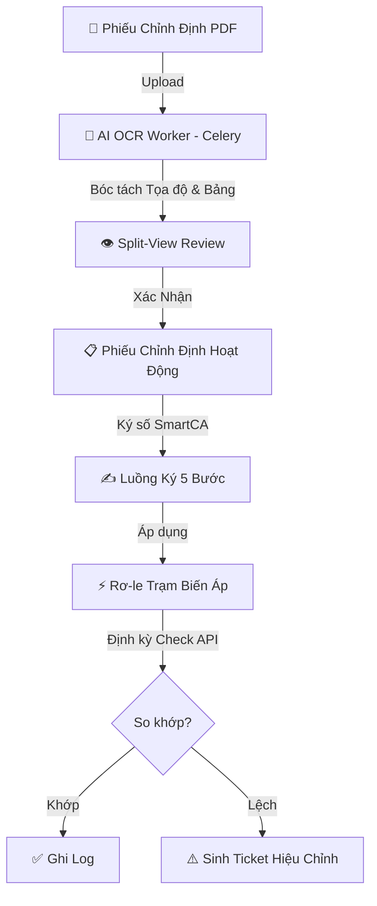
</details>

### 1. Quản Lý & AI OCR (Human-in-the-Loop)
* **Bóc tách tự động:** Nhận diện layout, bảng biểu, thông số kỹ thuật (dòng, áp, thời gian, chức năng 50/51, 87...).
* **Giao diện Split-View:** So sánh trực quan file PDF và biểu mẫu. Cảnh báo dữ liệu có độ tin cậy thấp.
* **Phiếu tạm thời (Temporary Setting):** Đặt thời hạn và tự động hoàn trả (revert) về cấu hình chuẩn.

### 2. Ký Số Đa Bước (EVN SmartCA)
* **Quy trình 5 bước:** `Điều độ` ➔ `Trưởng trạm` ➔ `Kỹ thuật viên` ➔ `Giám sát` ➔ `Lãnh đạo`.
* **Bảo mật:** Mã PIN / OTP giả lập, sinh mã băm SHA-256.
* **Stepper trực quan:** Trục tiến trình trạng thái thời gian thực.

### 3. Giám Sát & Quản Lý Hạ Tầng
* **Phân cấp dữ liệu:** Đơn vị ➔ Trạm Biến Áp ➔ Ngăn Lộ ➔ Thiết Bị / Rơ-le.
* **Tự động kiểm tra (Auto Check):** Cấu hình tần suất linh hoạt, so khớp thông số thực tế và định mức.
* **Xử lý sự cố:** Tự động phát hiện bất thường và sinh **Correction Ticket**.

---

## 🛠 Công Nghệ Sử Dụng

| Tầng Kiến Trúc | Công Nghệ / Thư Viện | Mục Đích |
|---|---|---|
| **Backend** | Python 3.12+, Django 6.x / 5.x | Xử lý nghiệp vụ chính, ORM, Bảo mật |
| **ASGI / Realtime** | Daphne, Django Channels 4.x | Hỗ trợ WebSockets, kết nối bất đồng bộ |
| **Task & Cache** | Celery 5.x, Redis 7 | Xử lý OCR, Job định kỳ, Caching |
| **Database** | PostgreSQL 15 | Cơ sở dữ liệu quan hệ, JSONField tối ưu |
| **Frontend** | HTMX, TailwindCSS, Vanilla JS | SPA-like siêu mượt, UI chuẩn chỉnh |
| **AI OCR** | PaddleOCR, VietOCR, OpenCV | Bóc tách PDF/Ảnh phiếu chỉnh định |
| **Deploy** | Docker, Docker Compose | Đóng gói môi trường, triển khai nhanh |

---

## 📁 Cấu Trúc Mã Nguồn

```text
electric/
├── core/                  # Core app: Auth, RBAC, WS Consumers, API Sync
├── stations/              # Trạm, Ngăn lộ, Rơ-le, Check log, Tickets
├── sheets/                # Phiếu Chỉnh Định, Ký số, OCR Job, Review UI
├── categories/            # Danh mục kỹ thuật (Đường dây, Công trình...)
├── rms_project/           # Cấu hình dự án Django (settings, celery, asgi)
├── OCR_PRJ/               # AI OCR On-premise (Pipeline bóc tách PDF)
├── templates/             # Giao diện HTML (Django Templates + HTMX)
├── static/                # CSS, JS, Assets
├── docs/                  # Tài liệu thiết kế chi tiết
└── docker-compose.yml     # Khởi chạy Docker đa dịch vụ
```

---

## 📦 Cài Đặt & Triển Khai

### 🐳 Cách 1: Triển Khai Nhanh Bằng Docker (Khuyên Dùng)

```bash
# 1. Clone mã nguồn
git clone https://github.com/xh1712006-debug/electric.git
cd electric

# 2. Tạo file cấu hình
cp .env.example .env

# 3. Khởi chạy toàn bộ hệ thống
docker compose up -d --build
```
> Truy cập hệ thống tại: **`http://localhost:9000`** (Bao gồm DB migrate, nạp dữ liệu mẫu và tạo admin).

### 💻 Cách 2: Cài Đặt Local Development (Chi tiết)

#### 1. Yêu cầu:
- Python 3.10 - 3.12, PostgreSQL 15+, Redis Server.

#### 2. Cài đặt môi trường Web:
```bash
python -m venv venv
# Windows: .\venv\Scripts\activate
# Linux/Mac: source venv/bin/activate
pip install -r requirements.txt
cp .env.example .env
```

#### 3. Cài đặt môi trường AI OCR:
```powershell
# Windows
powershell -NoProfile -ExecutionPolicy Bypass -File .\scripts\setup_ocr_env.ps1
```

#### 4. Khởi tạo Database & Dữ liệu mẫu:
```bash
python manage.py migrate
python manage.py seed_permissions
python seed_users_stations.py
```

#### 5. Khởi chạy Ứng dụng:
```bash
python run.py
```
> Lệnh trên sẽ chạy đồng thời: Django Server (Daphne), Celery Worker và Celery Beat. Truy cập: `http://localhost:8000`.

---

## 👥 Tài Khoản Thử Nghiệm Mặc Định

Sử dụng mật khẩu **`123456`** cho tất cả tài khoản bên dưới (trừ admin):

| Vai Trò | Tên Đăng Nhập | Nhiệm Vụ |
|---|---|---|
| **Admin** | `admin` (Pass: `admin`) | Toàn quyền, cấu hình hệ thống |
| **Điều độ viên** | `dispatcher_1` | Tạo phiếu, chạy OCR, phân phối |
| **Trưởng trạm** | `station_leader_1` | Tiếp nhận phiếu, phân công KTV |
| **Kỹ thuật viên** | `technician_1` | Cài đặt thông số rơ-le, ký xác nhận |
| **Giám sát viên** | `supervisor_1` | Giám sát, ký biên bản nghiệm thu |

---

## 🤖 Mô-đun AI OCR On-Premise

Hệ thống AI OCR được phát triển tại thư mục `OCR_PRJ/` hoạt động hoàn toàn offline:
- **Đặc tả:** Bóc tách Layout, trích xuất bảng thông số, tọa độ (Bounding Box) và độ tin cậy.
- **Tích hợp:** Gọi qua Celery Worker ➔ Subprocess API, trả về JSON.
- **An toàn (OT Compliance):** Không gửi dữ liệu ra Internet.

---

## 📚 Tài Liệu Kỹ Thuật

Tài liệu chi tiết được lưu trữ trong thư mục `docs/`:

* [Quản Lý Trạm & Thiết Bị](docs/features/01-station-management.md) | [Quy Trình Phiếu Chỉnh Định](docs/features/02-calibration-sheet.md) | [Cơ Chế Kiểm Tra Định Kỳ](docs/features/04-periodic-check.md)
* [Kiến Trúc Backend & API](docs/cores/02-backend.md) | [Thiết Kế Cơ Sở Dữ Liệu](docs/cores/01-database.md) | [Thiết Kế AI OCR](docs/features/05-ai-ocr.md)

---

<div align="center">
  <p>Được phát triển phục vụ công tác chuyển đổi số của Tập đoàn Điện lực Việt Nam (EVN).</p>
  <p><i>Mọi quyền được bảo lưu.</i></p>
</div>
````

## File: requirements.txt
````
Django>=5.0,<6.1
psycopg[binary]>=3.0
python-dotenv>=1.0
channels>=4.0
daphne>=4.0
openpyxl>=3.0
django-redis
celery>=5.3.0
django-celery-beat>=2.5.0
channels-redis>=4.2.0
djangorestframework>=3.14.0
djangorestframework-xml>=2.0.0
requests>=2.31.0
````
