This file is a merged representation of a subset of the codebase, containing specifically included files and files not matching ignore patterns, combined into a single document by Repomix.
The content has been processed where empty lines have been removed, line numbers have been added, content has been compressed (code blocks are separated by ⋮---- delimiter).

# File Summary

## Purpose
This file contains a packed representation of a subset of the repository's contents that is considered the most important context.
It is designed to be easily consumable by AI systems for analysis, code review,
or other automated processes.

## File Format
The content is organized as follows:
1. This summary section
2. Repository information
3. Directory structure
4. Repository files (if enabled)
5. Multiple file entries, each consisting of:
  a. A header with the file path (## File: path/to/file)
  b. The full contents of the file in a code block

## Usage Guidelines
- This file should be treated as read-only. Any changes should be made to the
  original repository files, not this packed version.
- When processing this file, use the file path to distinguish
  between different files in the repository.
- Be aware that this file may contain sensitive information. Handle it with
  the same level of security as you would the original repository.

## Notes
- Some files may have been excluded based on .gitignore rules and Repomix's configuration
- Binary files are not included in this packed representation. Please refer to the Repository Structure section for a complete list of file paths, including binary files
- Only files matching these patterns are included: README.md, PROJECT_REQUIREMENTS.md, docs/**/*.md, templates/**/*.html, static/**/*
- Files matching these patterns are excluded: OCR_PRJ/**, staticfiles/**, vendor/**, .git/**, .env, rendered.html, tmp_page.html, temp_base.html, repomix-output.*
- Files matching patterns in .gitignore are excluded
- Files matching default ignore patterns are excluded
- Empty lines have been removed from all files
- Line numbers have been added to the beginning of each line
- Content has been compressed - code blocks are separated by ⋮---- delimiter
- Files are sorted by Git change count (files with more changes are at the bottom)

# Directory Structure
````
docs/
  cores/
    01-database.md
    02-backend.md
    03-frontend.md
    04-security.md
    05-testing.md
    06-deployment.md
  features/
    01-station-management.md
    02-calibration-sheet.md
    03-digital-signature.md
    04-periodic-check.md
    05-ai-ocr.md
  mvt_design/
    MODELS_DESIGN.md
    REQUIREMENTS_MVT.md
    TEMPLATES_UI.md
    VIEWS_URLS_MAP.md
static/
  img/
    electricity_bg.png
templates/
  categories/
    partials/
      _detail_field.html
      category_form_modal.html
      category_list_partial.html
      category_row_partial.html
      line_detail_panel.html
      line_table.html
      location_detail_panel.html
      location_table.html
      project_detail_panel.html
      project_table.html
    asset_line_list.html
    asset_location_list.html
    asset_project_list.html
    category_dashboard.html
    category_list.html
  checks/
    partials/
      _item_row.html
    check_detail.html
    check_form.html
    check_list.html
  core/
    dashboard_a0.html
    dashboard_admin.html
    dashboard_dispatcher.html
    dashboard_station_leader.html
    dashboard_supervisor.html
    dashboard_technician.html
    dashboard.html
    manage_team.html
    profile.html
    role_matrix.html
    routed_relays.html
    system_config.html
    user_list.html
  partials/
    _sidebar.html
    pagination.html
  registration/
    login.html
  sheets/
    partials/
      _history_panel.html
      _ocr_data.html
      _signature_panel.html
      _status_badge.html
      _status_stepper.html
    api_extract_test.html
    bulk_create.html
    ocr_job_list.html
    sheet_detail.html
    sheet_form.html
    sheet_list.html
  stations/
    partials/
      _autocheck_results.html
      _autocheck_table.html
      _relay_parameters_modal.html
      _relay_row.html
      _schedule_config.html
      _station_tree_page.html
      _ticket_workflow.html
      bay_list.html
      relay_detail_modal.html
      relay_detail_not_found.html
      relay_list.html
      suggestions.html
    autocheck_dashboard.html
    relay_status.html
    station_list.html
  base.html
PROJECT_REQUIREMENTS.md
README.md
````

# Files

## File: docs/cores/01-database.md
````markdown
# Thiết kế Cơ sở Dữ liệu Hệ thống RMS (Database Design Specification)

Tài liệu này đặc tả toàn bộ kiến trúc cơ sở dữ liệu thực tế của dự án **Hệ thống Quản lý Phiếu Chỉnh định Rơ-le (RMS - Relay Management System)** trên nền tảng **PostgreSQL 15**.

---

## 1. Sơ đồ Thực thể Quan hệ (ERD - Entity Relationship Diagram)

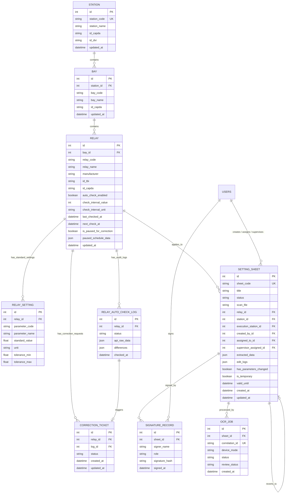

---

## 2. Đặc tả Chi tiết các Bảng Nghiệp vụ (Tables Specification)

### 2.1 Quản lý Lưới điện & Rơ-le (App: `stations`)

#### Bảng: `stations_station`
Lưu trữ thông tin Trạm Biến áp hoặc Nhà máy Điện thuộc lưới truyền tải/phân phối.
* `id` (PK, AutoField)
* `station_code` (VARCHAR(50), UNIQUE): Mã trạm EVN (ví dụ: `TBA_500_QN`, `TBA_220_VC`).
* `station_name` (VARCHAR(255)): Tên đầy đủ trạm (ví dụ: `Trạm 500kV Quảng Ninh`).
* `id_capda` (VARCHAR(50)): Mã cấp điện áp danh định (500kV, 220kV, 110kV...).
* `id_dvi` (VARCHAR(50)): Đơn vị quản lý (PTC1, PTC2, PC...).

#### Bảng: `stations_bay`
Lưu trữ thông tin Ngăn lộ (xuất tuyến đường dây, ngăn MBA, thanh cái, máy cắt liên lạc).
* `id` (PK, AutoField)
* `station_id` (FK $\rightarrow$ `stations_station`, ON DELETE CASCADE)
* `bay_code` (VARCHAR(50)): Mã ngăn lộ (ví dụ: `571`, `572`, `171`, `MC_Lien_Lac`).
* `bay_name` (VARCHAR(255)): Tên mô tả ngăn lộ.

#### Bảng: `stations_relay`
Lưu trữ thiết bị Rơ-le bảo vệ và điều khiển số thực tế tại trạm.
* `id` (PK, AutoField)
* `bay_id` (FK $\rightarrow$ `stations_bay`, ON DELETE CASCADE, nullable)
* `relay_code` (VARCHAR(50)): Số hiệu/Mã rơ-le theo sơ đồ nguyên lý (ví dụ: `F87R1`, `SEL-751`, `7SA87`).
* `relay_name` (VARCHAR(255)): Tên và chức năng rơ-le.
* `manufacturer` (VARCHAR(100)): Hãng sản xuất (SIEMENS, ABB, SEL, SCHNEIDER/MICOM, TOSHIBA, GE...).
* `id_tbi` (VARCHAR(100)): ID thiết bị theo phần mềm quản lý kỹ thuật EVN PMIS.
* `auto_check_enabled` (BOOLEAN, default=False, db_index=True): Cờ bật/tắt quét định kỳ.
* `is_paused_for_correction` (BOOLEAN, default=False, db_index=True): Cờ đánh dấu rơ-le đang có sai lệch thông số cần rà soát/chỉnh định lại.
* `paused_schedule_data` (JSONField): Lưu thông tin nguyên nhân tạm dừng, file PDF phát hiện sai lệch.

#### Bảng: `stations_relayautochecklog`
Nhật ký lịch sử đối chiếu thông số rơ-le (giữa Phiếu Chỉnh định và File PDF/API thực tế).
* `id` (PK, AutoField)
* `relay_id` (FK $\rightarrow$ `stations_relay`, ON DELETE CASCADE)
* `checked_at` (DATETIME, auto_now_add=True)
* `status` (VARCHAR(20)): `MATCH` (Trùng khớp 100%), `MISMATCH` (Có sai lệch), `API_ERROR`.
* `api_raw_data` (JSONField): Danh sách toàn bộ thông số đối chiếu kèm cờ `is_diff`, `db_value`, `value`.
* `differences` (JSONField): Danh sách các thông số bị phát hiện sai lệch.

#### Bảng: `stations_correctionticket`
Phiếu yêu cầu điều phối xử lý sai lệch xuống Trạm / Kỹ thuật viên hiện trường.
* `status`: `DISPATCHER` $\rightarrow$ `STATION` $\rightarrow$ `TECH` $\rightarrow$ `SUPERVISOR` $\rightarrow$ `ADMIN` $\rightarrow$ `RESOLVED`.

---

### 2.2 Quản lý Phiếu Chỉnh định & OCR (App: `sheets`)

#### Bảng: `sheets_settingsheet`
Phiếu Chỉnh định rơ-le bảo vệ - trung tâm dữ liệu kỹ thuật của hệ thống.
* `sheet_code` (VARCHAR(100), UNIQUE): Mã phiếu chính thức (ví dụ: `A0-01-2020/QN500`).
* `title` (VARCHAR(255)): Tiêu đề phiếu.
* `status` (VARCHAR(50)):
  * `DRAFT`: Bản nháp vừa tạo / đang OCR.
  * `ISSUED`: Đã phát hành, chờ rà soát.
  * `ROUTED_TO_STATION`: Đã chuyển về Trạm phụ trách.
  * `TRANSFERRED`: Đã giao cho Kỹ thuật viên hiện trường.
  * `RECEIVED`: Đang thực hiện cài đặt tại trạm.
  * `PENDING_ADMIN_APPROVAL`: Chờ Admin ký duyệt ban hành.
  * `COMPLETED`: Hoàn thành, có đủ chữ ký số.
* `scan_file` (FILE): Đường dẫn file scan / PDF phiếu gốc lưu tại `media/scans/`.
* `extracted_data` (JSONB): Mảng JSON lưu trữ toàn bộ các trị số chỉnh định bóc tách được (Mã thông số, tên, trị số, đơn vị, nhóm cài đặt, chức năng ANSI).
* `has_parameters_changed` (BOOLEAN): Cờ đánh dấu phiếu có thay đổi trị số so với phiên bản trước đó.
* `is_temporary` (BOOLEAN): Đánh dấu phiếu chỉnh định phương thức tạm thời.

#### Bảng: `sheets_signaturerecord`
Lưu trữ chữ ký số điện tử của các bên tham gia quy trình chỉnh định rơ-le.
* `sheet_id` (FK $\rightarrow$ `sheets_settingsheet`, ON DELETE CASCADE)
* `signer_name` (VARCHAR(100)): Họ tên người ký.
* `role` (VARCHAR(50)): Vai trò khi ký (Người lập, Điều độ viên, KTV rơ-le, Giám sát trạm).
* `signature_hash` (VARCHAR(256)): Chuỗi băm SHA-256 bảo đảm tính toàn vẹn của nội dung phiếu tại thời điểm ký.
* `signed_at` (DATETIME, auto_now_add=True).

---

## 3. Chiến lược Lưu trữ Dữ liệu Bán Cấu trúc (JSONB Strategy)

Trong hệ thống điện lực, mỗi dòng rơ-le (Siemens, ABB, SEL, MiCOM...) có số lượng và cấu trúc thông số hoàn toàn khác nhau (từ vài chục đến hàng trăm trị số). Do đó:
1. **Dữ liệu quan hệ cố định (RDBMS)**: Quản lý cây thực thể `Trạm` $\rightarrow$ `Ngăn lộ` $\rightarrow$ `Rơ-le` $\rightarrow$ `Phiếu chỉnh định` để đảm bảo tính toàn vẹn khóa ngoại (Foreign Keys) và tìm kiếm tốc độ cao với B-Tree index.
2. **Dữ liệu thông số linh hoạt (PostgreSQL JSONB)**:
   * Trường `extracted_data` trong `SettingSheet` và `api_raw_data` trong `RelayAutoCheckLog` lưu dạng mảng đối tượng:
     ```json
     [
       {
         "parameter_code": "50_1_I",
         "parameter_name": "Dòng cắt nhanh cấp 1",
         "value": "12.5",
         "unit": "A",
         "group_id": "Group 1",
         "is_diff": false
       }
     ]
     ```
   * Hỗ trợ truy vấn NoSQL trực tiếp trong PostgreSQL mà không cần tạo hàng trăm cột động trong cơ sở dữ liệu.
````

## File: docs/cores/02-backend.md
````markdown
# Thiết kế Kiến trúc Backend & Dịch vụ Hệ thống RMS (Backend Architecture)

Tài liệu này đặc tả kiến trúc backend, quy chuẩn mã nguồn, dịch vụ xử lý bất đồng bộ và chuẩn giao tiếp trong **Hệ thống Quản lý Phiếu Chỉnh định Rơ-le (RMS)**.

---

## 1. Công nghệ Sử dụng (Backend Stack)

* **Ngôn ngữ thực thi**: Python 3.12 (môi trường Docker Linux).
* **Framework Web chính**: Django 5.x theo mô hình kiến trúc **MVT (Model - View - Template)**.
* **ASGI Server (Asynchronous)**: `Daphne` (lắng nghe cổng 9000), xử lý đồng thời HTTP/1.1, HTTP/2 và WebSocket.
* **Thời gian thực (Realtime)**: `Django Channels 4.x` kết nối Redis Channel Layer.
* **Hàng đợi Tác vụ ngầm (Background Task Queue)**: `Celery 5.x` kết hợp `Celery Beat`.
* **Message Broker & Cache Layer**: `Redis 7.x (Alpine)` (cổng 6379).
* **Cơ sở dữ liệu chính**: `PostgreSQL 15 (Alpine)` (cổng 5440).
* **Thư viện xử lý PDF & Dữ liệu kỹ thuật**: `pypdf`, `openpyxl`, `numpy`.

---

## 2. Cấu trúc Thư mục Ứng dụng (Modular Django Architecture)

Mã nguồn được tổ chức thành các Django App chuyên biệt hóa theo từng phân vùng nghiệp vụ:

```text
📂 electricity-web
 ┣ 📂 rms_project            # Cấu hình lõi hệ thống Django
 ┃ ┣ 📜 asgi.py              # Khởi tạo ASGI routing (HTTP + WebSockets)
 ┃ ┣ 📜 celery.py            # Cấu hình Celery app & beat schedule
 ┃ ┣ 📜 settings.py          # Biến môi trường, database, cache, auth
 ┃ ┗ 📜 urls.py              # Root URL router
 ┣ 📂 stations               # App Quản lý Trạm, Ngăn lộ, Rơ-le & Trung tâm Đối chiếu
 ┃ ┣ 📜 models.py            # Station, Bay, Relay, RelaySetting, RelayAutoCheckLog, CorrectionTicket
 ┃ ┣ 📜 views.py             # Logic trạm, đối chiếu PDF (upload_relay_pdf_compare), modal thông số
 ┃ ┣ 📜 urls.py              # Endpoints: /stations/autochecks/, /relay/<id>/parameters/ ...
 ┃ ┣ 📜 tasks.py             # Celery task quét tự động theo lịch hẹn giờ
 ┃ ┗ 📜 api_mock.py          # Module mô phỏng/kết nối API thực địa rơ-le
 ┣ 📂 sheets                 # App Quản lý Phiếu Chỉnh định & Vòng đời Phê duyệt
 ┃ ┣ 📜 models.py            # SettingSheet, SignatureRecord, OcrJob
 ┃ ┣ 📜 views.py             # Luồng tạo phiếu, ký số, duyệt phiếu, xuất PDF
 ┃ ┣ 📜 tasks.py             # Celery pipeline xử lý tác vụ bóc tách OCR
 ┃ ┣ 📜 relay_matcher.py     # Bộ máy nhận diện Model rơ-le & Chức năng bảo vệ ANSI C37.2
 ┃ ┗ 📜 utils.py             # Hàm so sánh diff giữa các phiên bản phiếu
 ┣ 📂 categories             # App Danh mục Kỹ thuật Dùng chung
 ┃ ┣ 📜 models.py            # Hãng sản xuất (Manufacturer), Cấp điện áp, Loại rơ-le
 ┃ ┗ 📜 views.py             # CRUD danh mục hệ thống
 ┣ 📂 templates              # Giao diện Server-Driven UI (HTML + Tailwind + Alpine.js + HTMX)
 ┗ 📜 docker-compose.yml     # Quản lý 4 container (web, db, redis, celery)
```

---

## 3. Các Phân hệ Backend Cốt lõi

### 3.1 Bộ máy Nhận diện Rơ-le & Chức năng ANSI (`sheets/relay_matcher.py`)
Module cốt lõi tự động hóa phân loại rơ-le trên toàn hệ thống điện lực:
* **Chuẩn hóa chuỗi (Normalization)**: Tự động loại bỏ dấu tiếng Việt, xử lý đồng thời định dạng có gạch nối (`SEL-751`, `SEL-787`) và dạng viết liền EVN PMIS (`SEL751`, `SEL787_1`, `SEL487E_1`, `F87R-SEL787`).
* **Kho tra cứu Model (MODEL_REGISTRY)**:
  * **Siemens**: `7SJ86/85/82/64/62/61` (50/51, 67, BCU), `7SA87/86/82/6` (21, 87L), `7SD87/86/82/61/52` (87L), `7UT87/86/85/82/6` (87T, 87R, 64REF).
  * **ABB / Hitachi Energy**: `REF615/620/630`, `RET615/620/630`, `RED615/670`, `REL670`, `REC670`.
  * **Schweitzer Engineering Laboratories (SEL)**: `SEL-751/751A` (50/51, 67, BCU), `SEL-787/487E` (87T, 87R, 64REF), `SEL-411L` (87L, 21, BCU, 79, 25), `SEL-487B` (87B, 50BF).
  * **Schneider Electric / MiCOM**: `P122/123/127`, `P141..145`, `P441..443` (21), `P541..546` (87L), `P642..645` (87T).
* **Suy luận Hãng từ Phần mềm**: Tự động nhận diện hãng rơ-le nếu phiếu nhắc đến các công cụ cấu hình chuyên dụng (`DIGSI 5`, `PCM600`, `acSELerator QuickSet`, `MiCOM S1 Agile`, `EnerVista`).

### 3.2 Bộ máy Đối chiếu Dữ liệu PDF & Trị số Chuẩn (Diff Engine)
Nằm tại `stations/views.py:upload_relay_pdf_compare`:
1. Tiếp nhận file PDF từ kỹ sư hiện trường/đơn vị thí nghiệm.
2. Trích xuất text và bảng số liệu bằng `pypdf`.
3. Lấy dữ liệu chuẩn từ **Phiếu Chỉnh định mới nhất (`relay.active_sheet`)**.
4. So khớp từng thông số (theo mã, tên, giá trị, đơn vị).
5. Phân loại:
   * **`MATCH`**: Trùng khớp 100% $\rightarrow$ Rơ-le đạt chuẩn an toàn.
   * **`MISMATCH`**: Phát hiện sai lệch $\rightarrow$ Tự động đánh dấu `relay.is_paused_for_correction = True` và cung cấp nút bấm 1-chạm tạo `CorrectionTicket` chuyển về Trạm.

---

## 4. Chuẩn Giao tiếp API & HTMX (Server-Driven Communication)

Dự án ưu tiên phương thức **Server-Driven UI** bằng cách trả về các đoạn HTML Partial (`HTML Snippets`) để HTMX cập nhật trực tiếp vào DOM:

### 4.1 Quy tắc Phản hồi HTMX (HTMX Responses)
* **Trả về HTML Partial**: Ví dụ `render(request, 'stations/partials/_relay_row.html', {'relay': relay})`.
* **Điều khiển Client qua HTTP Header `HX-Trigger`**:
  ```python
  response["HX-Trigger"] = json.dumps({
      f"refreshRow-{relay.id}": "",  # Làm mới dòng rơ-le tương ứng
      "closeUploadModal": "",        # Đóng modal tải file
      "openResultModal": "",         # Mở modal hiển thị kết quả
      "notify": {                    # Bắn thông báo Toast
          "title": "Hoàn tất",
          "message": "Đã đối chiếu xong thông số.",
          "level": "success"
      }
  })
  ```

### 4.2 Kênh Thông báo Thời gian thực (WebSocket - Django Channels)
* **Kênh Thông báo Chung**: `/ws/notifications/` $\rightarrow$ Phát sóng khi có phiếu mới được duyệt, có đợt rà soát hoặc tác vụ bóc tách OCR hoàn tất.
* **Kênh Cập nhật Đối chiếu**: Group `autocheck_updates` $\rightarrow$ Tự động đẩy trạng thái rơ-le mới nhất đến màn hình Dashboard khi có tiến trình kiểm tra hoàn tất.
````

## File: docs/cores/03-frontend.md
````markdown
# Thiết kế Kiến trúc Frontend & Giao diện UI/UX (Frontend Architecture)

Tài liệu này đặc tả kiến trúc giao diện, chuẩn tương tác người dùng (UI/UX) và hệ thống thiết kế phía Client trong **Hệ thống Quản lý Phiếu Chỉnh định Rơ-le (RMS)**.

---

## 1. Công nghệ Sử dụng (Frontend Stack)

Hệ thống được xây dựng theo mô hình **Server-Driven UI** hiện đại, loại bỏ sự phức tạp cồng kềnh của SPA (Single Page Application) mà vẫn đảm bảo tốc độ phản hồi tức thời như ứng dụng desktop:

* **Engine Render Giao diện**: `Django Templates` kế thừa cấu trúc từ `templates/base.html`.
* **Giao tiếp AJAX & Cập nhật DOM**: `HTMX 1.9+` (tải và chèn các HTML Partials động không cần tải lại toàn bộ trang).
* **Quản lý Trạng thái Phía Client (Client Reactivity)**: `Alpine.js 3.x` (quản lý trạng thái đóng/mở Modal, Tabs, Tìm kiếm tức thì, Phân trang client-side).
* **CSS Framework & Styling**: `Tailwind CSS` (utility-first, tối ưu responsive cho cả Desktop, Tablet và Mobile).
* **Bộ Icon Kỹ thuật**: `Font Awesome 6 Pro / Free`.
* **Sơ đồ & Lưu đồ**: `Mermaid.js` và KaTeX cho công thức toán học điện lực.

---

## 2. Cấu trúc Thư mục Giao diện (`templates/`)

```text
📂 templates
 ┣ 📜 base.html                          # Layout khung ứng dụng gốc (Sidebar, Navbar, Modals)
 ┣ 📂 partials                           # Các phân mảnh dùng chung toàn hệ thống
 ┃ ┣ 📜 _sidebar.html                    # Thanh điều hướng trái phân tầng
 ┃ ┣ 📜 _header.html                     # Thanh tiêu đề, thông báo chuông, profile
 ┃ ┗ 📜 pagination.html                  # Phân trang động tích hợp HTMX
 ┣ 📂 sheets                             # Giao diện Phân hệ Phiếu Chỉnh định
 ┃ ┣ 📜 sheet_list.html                  # Danh sách phiếu theo bộ lọc trạng thái
 ┃ ┣ 📜 sheet_detail.html                # Chi tiết phiếu, Split-view đối chiếu bản scan
 ┃ ┗ 📂 partials                         # Bảng thông số, nhật ký sửa đổi, chữ ký số
 ┣ 📂 stations                           # Giao diện Quản lý Trạm & Đối chiếu Rơ-le
 ┃ ┣ 📜 station_list.html                # Cây cấu trúc Trạm -> Ngăn lộ -> Rơ-le
 ┃ ┣ 📜 autocheck_dashboard.html         # Trung tâm Đối chiếu Thông số Rơ-le
 ┃ ┗ 📂 partials
 ┃   ┣ 📜 _autocheck_table.html          # Bảng dữ liệu đối chiếu rơ-le
 ┃   ┣ 📜 _relay_row.html                # Một hàng rơ-le phản ứng nhanh với HTMX trigger
 ┃   ┣ 📜 _relay_parameters_modal.html   # Modal xem toàn bộ thông số rơ-le với tìm kiếm tức thì
 ┃   ┣ 📜 _autocheck_results.html        # Bảng so sánh 2 cột Side-by-side Diff
 ┃   ┗ 📜 relay_detail_modal.html        # Modal toàn diện (ANSI, định mức, lịch sử phiếu)
 ┗ 📂 categories                         # Giao diện Quản trị Danh mục Hệ thống
```

---

## 3. Các Nguyên tắc Thiết kế & Trải nghiệm (UI/UX Design System)

### 3.1 Bảng màu Chuẩn Công nghiệp Điện lực (Power Grid Color Palette)
* **Xanh Slate/Zinc (Chủ đạo)**: Tạo cảm giác tin cậy, vững chãi của hệ thống vận hành trạm điện.
* **Xanh dương EVN (`#005baa` / Tailwind Blue-600)**: Màu nhận diện chuẩn của Tập đoàn Điện lực Việt Nam.
* **Xanh ngọc / Teal (`teal-600`)**: Sử dụng cho các tác vụ nạp file PDF và xử lý dữ liệu thực địa.
* **Tím Indigo (`purple-600`)**: Sử dụng cho bảng trị số cài đặt rơ-le.
* **Mã màu Trạng thái Nghiệp vụ**:
  * 🟢 **Xanh lá (Emerald)**: Phiếu `COMPLETED`, Đối chiếu `Trùng khớp 100%`, Rơ-le đang vận hành an toàn.
  * 🔴 **Đỏ (Red/Rose)**: Rơ-le có `Sai lệch thông số`, Phiếu bị từ chối, Cảnh báo quá hạn.
  * 🟡 **Vàng/Cam (Amber)**: Phiếu `Chờ rà soát (ISSUED)`, Rơ-le đang tạm dừng chờ chỉnh định lại.
  * 🔵 **Xanh lam (Sky/Blue)**: Phiếu `Đang thực hiện (RECEIVED)`.

### 3.2 Hỗ trợ Đa Chế độ Sáng/Tối (Light & Dark Theme)
* Tự động phát hiện và đồng bộ trạng thái giao diện qua `localStorage.getItem('theme')`.
* Toàn bộ các component đều có lớp màu tương thích kép:
  `bg-white dark:bg-slate-800 text-slate-800 dark:text-slate-100 border-slate-200 dark:border-slate-700`.

---

## 4. Chuẩn Tương tác HTMX & Alpine.js trong Dự án

### 4.1 Quy tắc HTMX (Server-Driven Partial Swaps)
1. **Tìm kiếm & Lọc không giật trang**:
   ```html
   <form hx-get="" 
         hx-target="#autocheck-table-container" 
         hx-swap="outerHTML" 
         hx-indicator=".htmx-indicator" 
         hx-trigger="keyup delay:400ms from:input[name='q'], change from:select[name='status']">
   ```
2. **Cập nhật từng Hàng Rơ-le sau khi Thao tác (Single Row Refresh)**:
   Mỗi hàng `<tr>` lắng nghe sự kiện riêng để chỉ tải lại đúng hàng đó thay vì tải lại cả trang:
   ```html
   <tr id="relay-row-{{ relay.id }}" 
       hx-get="" 
       hx-trigger="refreshRow-{{ relay.id }} from:body" 
       hx-swap="outerHTML">
   ```
3. **Hiển thị Spinner khi xử lý ngầm**:
   Sử dụng class `.htmx-indicator` để hiển thị spinner mượt mà trong khi đang bóc tách file PDF hoặc gọi kiểm tra API.

### 4.2 Quy tắc Alpine.js (Client-side Reactivity)
1. **Quản lý Modal**:
   Dùng các hàm JavaScript toàn cục hoặc sự kiện `$dispatch` để đóng/mở modal mượt mà, không phụ thuộc vào thư viện JS bên thứ ba.
2. **Lọc và Tìm kiếm Cục bộ (Instant Filter)**:
   Ví dụ trong `_relay_parameters_modal.html` và `_autocheck_results.html`: Toàn bộ danh sách trị số được nạp vào Alpine.js `items` để người dùng gõ từ khóa tìm kiếm phản hồi trong **0 miligiây**.
````

## File: docs/cores/04-security.md
````markdown
# Thiết kế Xác thực & Bảo mật Hệ thống RMS (Security & Access Control)

Tài liệu này đặc tả kiến trúc bảo mật, cơ chế kiểm soát truy cập phân tầng (RBAC) và bảo vệ dữ liệu toàn vẹn trong **Hệ thống Quản lý Phiếu Chỉnh định Rơ-le (RMS)**.

---

## 1. Cơ chế Xác thực Người dùng (Authentication)

Vì đây là hệ thống quản lý thông số rơ-le vận hành lưới điện (hạ tầng trọng yếu quốc gia - Critical Infrastructure OT/IT):
* **Phương thức xác thực**: Sử dụng cơ chế **Django Session Authentication** bảo mật cao, kết hợp Session Store lưu tại PostgreSQL / Redis.
* **Bảo vệ Cookie**:
  * `sessionid` và `csrftoken` được cấu hình với các cờ `HttpOnly`, `SameSite=Lax` (hoặc `Strict`), ngăn chặn hoàn toàn nguy cơ rò rỉ qua tấn công XSS.
* **Bảo vệ Biểu mẫu (CSRF Protection)**:
  * Tất cả các HTTP Request làm thay đổi trạng thái (`POST`, `PUT`, `DELETE`) bắt buộc phải có CSRF Token hợp lệ (`` đối với Form hoặc header `X-CSRFToken` đối với các yêu cầu HTMX).

---

## 2. Ma trận Phân quyền Vai trò Nghiệp vụ EVN (RBAC Matrix)

Hệ thống triển khai phân quyền dựa trên `django.contrib.auth.models.Permission` kết hợp các nhóm quyền (Groups):

| Mã Quyền hạn (Permission Code) | Tên Quyền | A0 / A1 (Điều độ) | Đơn vị Quản lý Trạm | Kỹ thuật viên (KTV) | Giám sát Trạm | Quản trị viên (Admin) |
| :--- | :--- | :---: | :---: | :---: | :---: | :---: |
| `can_create_sheet` | Tạo phiếu mới & nạp scan | ✅ | ❌ | ❌ | ❌ | ✅ |
| `can_approve_sheet` | Rà soát & Duyệt ban hành | ✅ | ❌ | ❌ | ❌ | ✅ |
| `can_dispatch_sheet` | Điều phối / Giao việc KTV | ❌ | ✅ | ❌ | ❌ | ✅ |
| `can_execute_sheet` | Cài đặt rơ-le & ký xác nhận | ❌ | ❌ | ✅ | ❌ | ✅ |
| `can_supervise_sheet`| Nghiệm thu & ký giám sát | ❌ | ❌ | ❌ | ✅ | ✅ |
| `can_view_checks` | Xem & Đối chiếu thông số | ✅ | ✅ | ✅ | ✅ | ✅ |
| `can_manage_users` | Quản trị tài khoản & danh mục| ❌ | ❌ | ❌ | ❌ | ✅ |

### Cơ chế Kiểm tra Quyền ở Tầng Mã nguồn:
1. **Tại Views**:
   Sử dụng decorators `@login_required` và `@permission_required('sheets.can_approve_sheet')` hoặc `@user_passes_test(is_admin)`.
2. **Tại Giao diện (Templates)**:
   Ẩn/hiện nút bấm theo quyền của người dùng đăng nhập:
   ```html
   
       <button ...>Phê duyệt Phiếu</button>
   
   ```

---

## 3. Bảo vệ Tính Toàn vẹn Dữ liệu Kỹ thuật (Data Integrity & Digital Signature)

Thông số chỉnh định rơ-le liên quan trực tiếp đến an toàn lưới điện truyền tải (tránh nhảy máy cắt gây rã lưới). Do đó:
1. **Bảo vệ Trạng thái Hoàn thành (`COMPLETED`)**:
   Khi một phiếu đã chuyển sang trạng thái `COMPLETED` (đã có đủ chữ ký số xác nhận của KTV và Giám sát), phiếu sẽ bị **khóa cứng vĩnh viễn (Read-only)**. Không bất kỳ người dùng nào, kể cả Admin, được phép chỉnh sửa trực tiếp giá trị trong `extracted_data`. Nếu cần thay đổi, bắt buộc phải phát hành phiếu mới hoặc tạo phiếu rà soát.
2. **Ký số & Lưu trữ Chuỗi Băm (SHA-256 Hashing)**:
   Mỗi lần ký xác nhận (`SignatureRecord`), hệ thống tính toán chuỗi băm mật mã học (cryptographic hash):
   $$\text{SignatureHash} = \text{SHA256}(\text{SheetCode} + \text{Timestamp} + \text{Signer} + \text{CanonicalParameters})$$
   Chuỗi băm này được lưu trữ vĩnh viễn để đối chứng pháp lý trong trường hợp xảy ra sự cố điện lực cần kiểm tra nguyên nhân.
3. **Nhật ký Chỉnh sửa Không thể Xóa (`edit_logs`)**:
   Mọi thao tác chỉnh sửa từng thông số trên phiếu đều được tự động ghi vết vào trường `edit_logs` của phiếu: bao gồm *Ai sửa*, *Thời gian*, *Giá trị cũ* và *Giá trị mới*.

---

## 4. Bảo mật Môi trường Nội bộ (On-Premise OT Security)

* **Không gọi dịch vụ Cloud công cộng**: Toàn bộ quá trình bóc tách và đối chiếu dữ liệu được thực thi trong mạng nội bộ cô lập (On-premise / Intranet), tuân thủ tiêu chuẩn an toàn thông tin hệ thống SCADA/EMS của Tập đoàn Điện lực Việt Nam.
* **Tự động làm sạch dữ liệu đầu vào**: Chống tấn công SQL Injection thông qua ORM Parameterized Query và chống tấn công XSS thông qua cơ chế tự động escape HTML của Django Template Engine.
````

## File: docs/cores/05-testing.md
````markdown
# Đặc tả Kiểm thử Dự án Hệ thống RMS (Testing Specification)

Tài liệu này quy định chiến lược kiểm thử, cấu hình môi trường kiểm thử và các quy tắc viết ca kiểm thử (Test Cases) trong **Hệ thống Quản lý Phiếu Chỉnh định Rơ-le (RMS)**.

---

## 1. Chiến lược Kiểm thử Đa tầng (Testing Strategy)

Hệ thống được bảo đảm chất lượng thông qua 3 tầng kiểm thử chính:

1. **Kiểm thử Đơn vị (Unit Tests)**:
   * Kiểm tra bộ máy nhận diện model rơ-le và chức năng ANSI C37.2 (`sheets/relay_matcher.py`).
   * Kiểm tra hàm chuẩn hóa chuỗi tiếng Việt và định dạng tên EVN PMIS (có gạch nối và viết liền).
   * Kiểm tra logic tính toán chênh lệch giá trị và phát hiện sai lệch (Diff Engine).
2. **Kiểm thử Nghiệp vụ & Quyền hạn (Integration & RBAC Tests)**:
   * Kiểm tra vòng đời trạng thái phiếu (`DRAFT` $\rightarrow$ `ISSUED` $\rightarrow$ `ROUTED_TO_STATION` $\rightarrow$ `COMPLETED`).
   * Kiểm tra quyền hạn ký số và ngăn chặn chỉnh sửa khi phiếu đã `COMPLETED`.
   * Kiểm tra luồng tạo `CorrectionTicket` khi phát hiện sai lệch rơ-le.
3. **Kiểm thử Giao tiếp HTTP/HTMX (View & Endpoint Tests)**:
   * Kiểm tra các View trả về mã HTTP 200 và render đúng HTML partial.
   * Kiểm tra các header `HX-Trigger` phát tín hiệu làm mới giao diện phía client (`refreshRow-{id}`, `notify`...).
   * Kiểm tra luồng upload file PDF và đối chiếu dữ liệu.

---

## 2. Công cụ Sử dụng (Testing Stack)

* **Test Framework**: `django.test.TestCase` kết hợp `unittest`.
* **Giả lập Request**: `django.test.Client` và `RequestFactory`.
* **Cơ sở dữ liệu Kiểm thử**: PostgreSQL Test Database (sử dụng cờ `--keepdb` để tăng tốc độ chạy kiểm thử từ vài phút xuống dưới 30 giây).

---

## 3. Lệnh Thực thi Kiểm thử (Execution Commands)

Tất cả các lệnh kiểm thử được chạy trực tiếp trong container `rms_web` hoặc từ máy host:

```bash
# 1. Kiểm tra toàn bộ tính toàn vẹn hệ thống và cú pháp models
docker exec rms_web python manage.py check

# 2. Chạy toàn bộ bộ kiểm thử phân hệ Phiếu Chỉnh định (sheets)
docker exec rms_web python manage.py test sheets --keepdb

# 3. Chạy toàn bộ bộ kiểm thử phân hệ Trạm & Rơ-le (stations)
docker exec rms_web python manage.py test stations --keepdb

# 4. Chạy kiểm thử chi tiết một lớp kiểm thử cụ thể
docker exec rms_web python manage.py test sheets.tests.SheetWorkflowTests --keepdb -v 2
```

---

## 4. Cấu trúc Ca Kiểm thử Chuẩn (Standard TestCase Example)

Ví dụ ca kiểm thử luồng đối chiếu thông số rơ-le từ file PDF và phát hiện sai lệch:

```python
from django.test import TestCase, Client
from django.contrib.auth.models import User
from stations.models import Relay, RelayAutoCheckLog
from sheets.models import SettingSheet
import io

class RelaySettingAuditTests(TestCase):
    def setUp(self):
        self.user = User.objects.create_superuser('admin', 'admin@evn.vn', 'pass123')
        self.client = Client()
        self.client.force_login(self.user)
        self.relay = Relay.objects.create(relay_code='SEL-751', relay_name='Quá dòng ngăn 571')
        self.sheet = SettingSheet.objects.create(
            sheet_code='PCD-TEST-01',
            relay=self.relay,
            status='COMPLETED',
            extracted_data=[
                {'parameter_code': '50_1_I', 'parameter_name': 'Cắt nhanh', 'value': '12.5', 'unit': 'A'}
            ]
        )

    def test_upload_pdf_detects_mismatch(self):
        """Kiểm tra hệ thống phát hiện chính xác khi file PDF có thông số lệch so với phiếu"""
        dummy_pdf = io.BytesIO(b"%PDF-1.4...")
        dummy_pdf.name = "Bao_cao_thi_nghiem.pdf"

        response = self.client.post(
            f'/stations/relay/{self.relay.id}/upload_pdf_compare/',
            {'pdf_file': dummy_pdf}
        )
        self.assertEqual(response.status_code, 200)
        self.assertIn(f"refreshRow-{self.relay.id}", response.headers.get('HX-Trigger', ''))
        
        # Kiểm tra bản ghi log được tạo trong CSDL
        log = self.relay.auto_checks.first()
        self.assertIsNotNone(log)
        self.assertIn(log.status, ['MATCH', 'MISMATCH'])
```

---

## 5. Tiêu chuẩn Đạt chuẩn Kiểm thử (Quality Gates)

1. **100% Pass Rate**: Tuyệt đối không chấp nhận bất kỳ ca test nào bị lỗi (Failed/Error) trước khi bàn giao mã nguồn.
2. **Không để rò rỉ dữ liệu thử nghiệm**: Mọi bản ghi tạo ra trong quá trình test phải được dọn dẹp sạch sẽ sau khi kết thúc ca kiểm thử.
````

## File: docs/cores/06-deployment.md
````markdown
# Quy trình Triển khai & Vận hành Hệ thống RMS (Deployment & Operations Guide)

Tài liệu này đặc tả kiến trúc triển khai trên môi trường Docker, biến môi trường, quản lý volume và các quy trình bảo trì vận hành **Hệ thống Quản lý Phiếu Chỉnh định Rơ-le (RMS)**.

---

## 1. Kiến trúc Đóng gói Môi trường (Docker Compose Architecture)

Toàn bộ hệ thống được container hóa thông qua `docker-compose.yml` gồm 4 dịch vụ cốt lõi hoạt động độc lập và bảo đảm độ sẵn sàng cao:

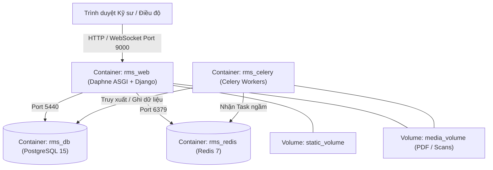

### Chi tiết 4 Dịch vụ (Services):
1. **`rms_db` (PostgreSQL 15 Alpine)**:
   * Cổng máy host: `5440` (chuyển tiếp tới 5440 trong container).
   * Lưu trữ dữ liệu quan hệ, dữ liệu JSONB và lịch sử kiểm tra rơ-le.
   * Dữ liệu được lưu bền vững (Persistent Volume) tại `postgres_data`.
2. **`rms_redis` (Redis Alpine)**:
   * Cổng máy host: `6379`.
   * Đóng vai trò Channel Layer cho WebSocket realtime và Message Broker cho Celery.
   * Dữ liệu được lưu tại `redis_data`.
3. **`rms_web` (Django 5 + Daphne ASGI)**:
   * Cổng dịch vụ web: `9000`.
   * Lệnh khởi chạy:
     `collectstatic` $\rightarrow$ `migrate` $\rightarrow$ `seed_permissions` $\rightarrow$ `daphne -b 0.0.0.0 -p 9000 rms_project.asgi:application`.
   * Mount thư mục mã nguồn máy host vào `/app` để phát triển và cập nhật trực tiếp.
4. **`rms_celery` (Celery Worker + Beat)**:
   * Chạy ngầm các tác vụ nặng: xử lý OCR đa luồng và quét tự động thông số rơ-le theo lịch hẹn giờ.

---

## 2. Quản lý Biến Môi trường (`.env`)

Tất cả các tham số nhạy cảm được quản lý tại tệp `.env` ở thư mục gốc của dự án:

| Tên biến (Key) | Mô tả (Description) | Ví dụ / Mặc định |
| :--- | :--- | :--- |
| `DEBUG` | Chế độ gỡ lỗi (False trên production) | `True` / `False` |
| `SECRET_KEY` | Khóa bí mật bảo vệ Session & CSRF Django | `django-insecure-rms-...` |
| `POSTGRES_DB` | Tên cơ sở dữ liệu PostgreSQL | `rms_db` |
| `POSTGRES_USER` | Tên tài khoản quản trị DB | `rms_user` |
| `POSTGRES_PASSWORD` | Mật khẩu truy cập DB | `secure_password_123` |
| `POSTGRES_HOST` | Địa chỉ máy chủ DB trong mạng Docker | `db` |
| `PGPORT` | Cổng kết nối PostgreSQL | `5440` |
| `REDIS_URL` | URL kết nối Redis Broker | `redis://redis:6379/0` |

---

## 3. Các Lệnh Vận hành Cơ bản (Operational Commands)

### 3.1 Khởi động và Khởi động lại Hệ thống:
```bash
# Khởi động toàn bộ cụm 4 dịch vụ ngầm
docker-compose up -d

# Khởi động lại dịch vụ Web khi có thay đổi mã nguồn Python
docker restart rms_web

# Khởi động lại dịch vụ Celery
docker restart rms_celery

# Xem trạng thái hoạt động của các container
docker ps
```

### 3.2 Kiểm tra Nhật ký Hoạt động (Logs Inspection):
```bash
# Xem log thời gian thực của máy chủ Web Daphne
docker logs -f --tail 100 rms_web

# Xem log tác vụ ngầm Celery
docker logs -f --tail 100 rms_celery

# Xem log cơ sở dữ liệu PostgreSQL
docker logs -f --tail 50 rms_db
```

### 3.3 Quản trị Cơ sở dữ liệu & Cập nhật Schema:
```bash
# Tạo migration mới khi có thay đổi models
docker exec rms_web python manage.py makemigrations

# Áp dụng migration vào DB
docker exec rms_web python manage.py migrate

# Gom tệp tĩnh mới vào thư mục staticfiles
docker exec rms_web python manage.py collectstatic --noinput

# Chạy lệnh kiểm tra tính hợp lệ hệ thống
docker exec rms_web python manage.py check
```

---

## 4. Sao lưu & Phục hồi Dữ liệu (Backup & Recovery)

```bash
# Sao lưu cơ sở dữ liệu ra tệp .sql trên máy host
docker exec -t rms_db pg_dump -U rms_user -p 5440 rms_db > backup_rms_$(date +%Y%m%d).sql

# Phục hồi dữ liệu từ file backup
docker exec -i rms_db psql -U rms_user -p 5440 rms_db < backup_rms_20261104.sql
```
````

## File: docs/features/01-station-management.md
````markdown
# Phân hệ Quản lý Trạm, Ngăn lộ & Rơ-le (Station Management)

> [!WARNING]
> Phân hệ này đã được dời sang Giai đoạn 5 (Module Tài sản) theo SRS mới nhất. Trong phiên bản MVP, hệ thống không quản lý danh mục thiết bị chi tiết mà lưu dưới dạng văn bản trong Phiếu chỉnh định. Tài liệu dưới đây mang tính chất tham khảo cho tương lai.

**App Django**: `apps/stations`
**User Stories liên quan**: `[US-STN-01]` đến `[US-STN-05]`

---

## 1. Tổng quan Nghiệp vụ

Phân hệ này cho phép **Công ty Truyền tải** (user chính) quản lý toàn bộ danh mục hạ tầng vật lý của lưới điện truyền tải, bao gồm 3 cấp độ:

```
Trạm Biến áp (Station)
 └── Ngăn lộ / Bay (Bay)
       └── Rơ-le Bảo vệ (Relay)
             └── Thông số Định mức (RelaySetting)
```

---

## 2. Luồng Nghiệp vụ Chi tiết

### 2.1 Tạo Dự án (Trạm Biến áp) từ File Cấu hình [US-STN-01]

Đây là **Figure 1** trong tài liệu UseCase gốc.

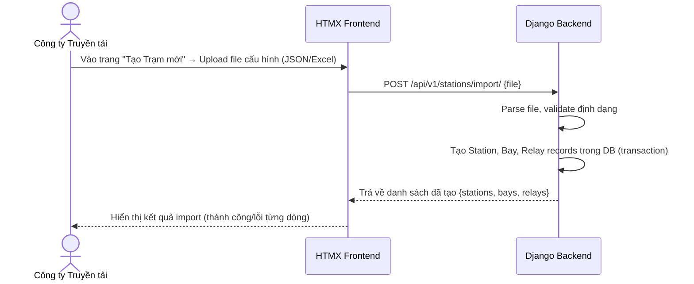

**Định dạng file cấu hình (JSON)**:
```json
{
  "station": {
    "code": "TBA_220KV_HOA_BINH",
    "name": "Trạm biến áp 220kV Hòa Bình",
    "location": "Tỉnh Hòa Bình",
    "voltage_level": "220kV"
  },
  "bays": [
    {
      "code": "BAY_AT1",
      "name": "Ngăn Máy biến áp AT1",
      "bay_type": "Máy biến áp",
      "relays": [
        {
          "code": "REL_AT1_87T",
          "name": "Rơ-le so lệch biến áp AT1",
          "manufacturer": "ABB",
          "model_number": "RET670",
          "serial_number": "SN-2024-001",
          "settings": [
            { "code": "ID_MIN", "name": "Dòng khởi động tối thiểu", "standard_value": 0.2, "unit": "A", "tolerance_min": 0.18, "tolerance_max": 0.22 },
            { "code": "TD_1", "name": "Thời gian tác động cấp 1", "standard_value": 0.0, "unit": "s", "tolerance_min": 0.0, "tolerance_max": 0.02 }
          ]
        }
      ]
    }
  ]
}
```

### 2.2 Quản lý Thủ công Trạm / Ngăn lộ / Rơ-le [US-STN-02..05]

- **Xem danh sách**: Bảng có tìm kiếm theo tên/mã, lọc theo cấp điện áp, phân trang 20 bản ghi/trang.
- **Tạo mới thủ công**: Form nhập từng trường, validation ngay trên FE (Django Forms / HTML5 Validation).
- **Chỉnh sửa**: Các trường có thể sửa (tên, địa điểm, trạng thái active). Không cho phép sửa mã (code) sau khi tạo.
- **Vô hiệu hóa**: Đặt `is_active = False`, không xóa vật lý. Các bản ghi con (bay, relay) không bị ảnh hưởng.

---

## 3. Business Rules (Quy tắc Nghiệp vụ)

| # | Quy tắc |
|---|---|
| BR-STN-01 | Mã trạm (`station_code`) phải là duy nhất trong toàn hệ thống. |
| BR-STN-02 | Không thể xóa trạm nếu còn ngăn lộ đang hoạt động. |
| BR-STN-03 | Không thể vô hiệu hóa rơ-le nếu đang có phiếu chỉnh định ở trạng thái DRAFT hoặc ISSUED. |
| BR-STN-04 | Giá trị `tolerance_min` phải luôn nhỏ hơn `tolerance_max` trong thông số định mức. |
| BR-STN-05 | Import file: Nếu `station_code` đã tồn tại, hệ thống hỏi xác nhận trước khi ghi đè. |

---

## 4. API Endpoints Chi tiết

### POST `/api/v1/stations/`
**Quyền**: `TRANSMISSION_COMPANY`

**Request Body**:
```json
{
  "station_code": "TBA_220KV_HA_NOI",
  "station_name": "Trạm biến áp 220kV Hà Nội",
  "location": "Quận Hoàng Mai, Hà Nội",
  "voltage_level": "220kV"
}
```

**Response (201)**:
```json
{
  "success": true,
  "message": "Tạo trạm biến áp thành công",
  "data": {
    "id": 5,
    "station_code": "TBA_220KV_HA_NOI",
    "station_name": "Trạm biến áp 220kV Hà Nội",
    "is_active": true,
    "bays_count": 0
  }
}
```

### POST `/api/v1/stations/import/`
**Quyền**: `TRANSMISSION_COMPANY`
**Content-Type**: `multipart/form-data`

**Form Fields**:
- `file`: File JSON hoặc Excel cấu hình trạm

**Response (200)**:
```json
{
  "success": true,
  "message": "Import hoàn tất",
  "data": {
    "created_stations": 1,
    "created_bays": 3,
    "created_relays": 8,
    "errors": []
  }
}
```

---

## 5. Giao diện (UI Specification)

### Màn hình Danh sách Trạm (`/stations`)
- **Header**: Tiêu đề "Quản lý Trạm Biến áp" + nút "Tạo mới" + nút "Import từ file"
- **Filter bar**: Tìm kiếm theo tên/mã trạm | Lọc theo cấp điện áp (110kV / 220kV / 500kV) | Trạng thái (Đang hoạt động / Vô hiệu hóa)
- **Bảng dữ liệu**: Mã trạm | Tên trạm | Địa điểm | Cấp điện áp | Số ngăn lộ | Trạng thái | Hành động

### Màn hình Chi tiết Trạm (`/stations/:id`)
- **Thông tin chung**: Card hiển thị các thông tin cơ bản của trạm
- **Tab "Ngăn lộ"**: Danh sách ngăn lộ dạng accordion. Click vào ngăn lộ để xem rơ-le bên trong
- **Tab "Lịch sử"**: Timeline các thay đổi thông tin trạm
````

## File: docs/features/02-calibration-sheet.md
````markdown
# Phân hệ Quản lý Phiếu Chỉnh định (Calibration Sheet)

**App Django**: `apps/calibration`
**User Stories liên quan**: `[US-SHEET-01]` đến `[US-SHEET-10]`

---

## 1. Tổng quan Nghiệp vụ

Phiếu chỉnh định là tài liệu kỹ thuật quan trọng nhất trong hệ thống, ghi nhận lệnh chỉnh định thông số rơ-le từ Công ty Truyền tải tới Đơn vị chỉnh định. Mỗi phiếu trải qua vòng đời trạng thái nghiêm ngặt.

---

## 2. Vòng đời Trạng thái Phiếu (Sheet Lifecycle)

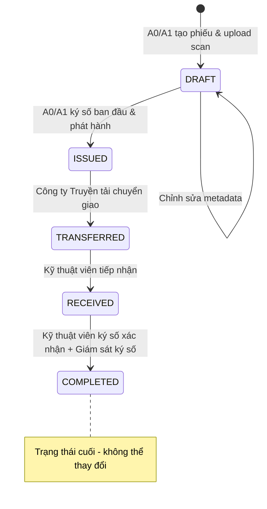

| Trạng thái | Mô tả | Người có thể hành động |
|---|---|---|
| `DRAFT` | Phiếu mới tạo, chưa phát hành | A0/A1 |
| `ISSUED` | Đã ký số ban đầu & phát hành | Công ty Truyền tải |
| `TRANSFERRED` | Đã chuyển giao cho Đơn vị chỉnh định | Kỹ thuật viên |
| `RECEIVED` | Kỹ thuật viên đã tiếp nhận phiếu | Kỹ thuật viên, Giám sát trạm |
| `COMPLETED` | Đã hoàn thành, có đủ chữ ký xác nhận | — (Chỉ xem) |

---

## 3. Luồng Nghiệp vụ Chi tiết

### 3.1 Import & Phát hành Phiếu [US-SHEET-01..03] — Figure 3

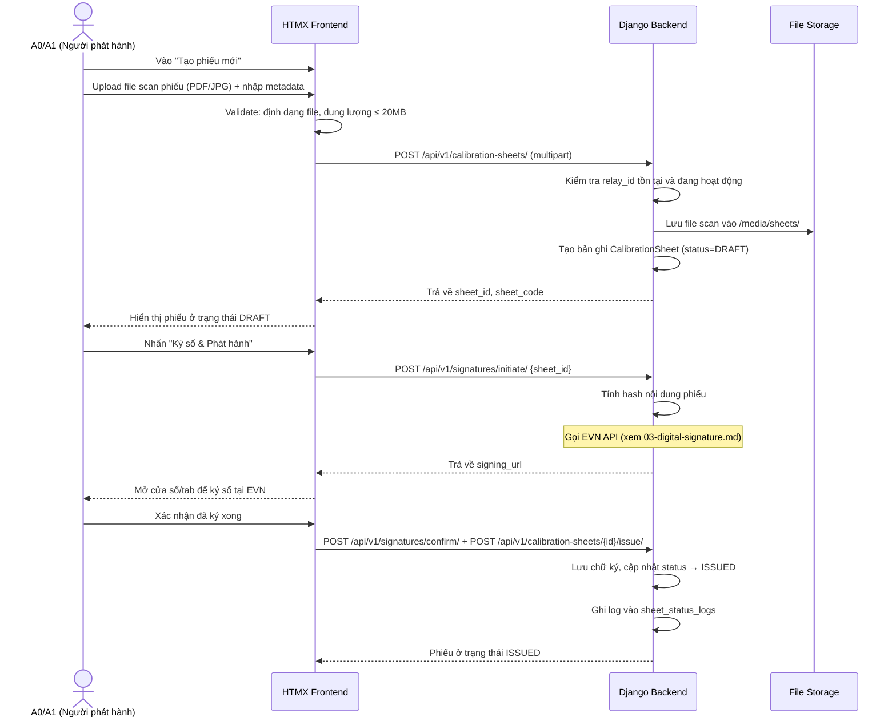

### 3.2 Chuyển giao Phiếu [US-SHEET-04] — Figure 4

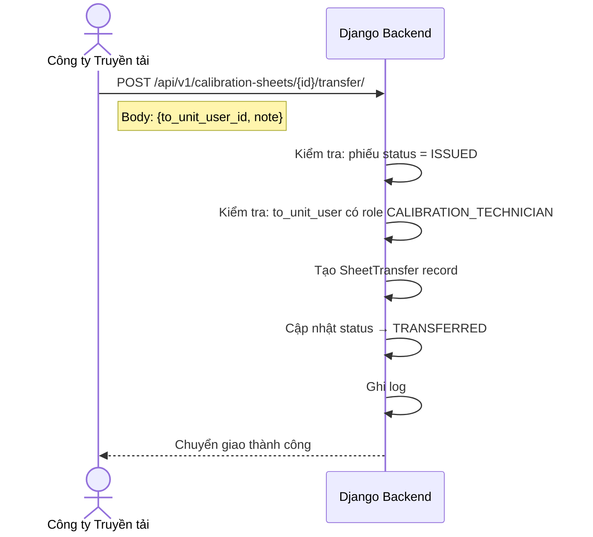

### 3.3 Tiếp nhận & Xác nhận Hoàn thành [US-SHEET-06..08] — Figure 5

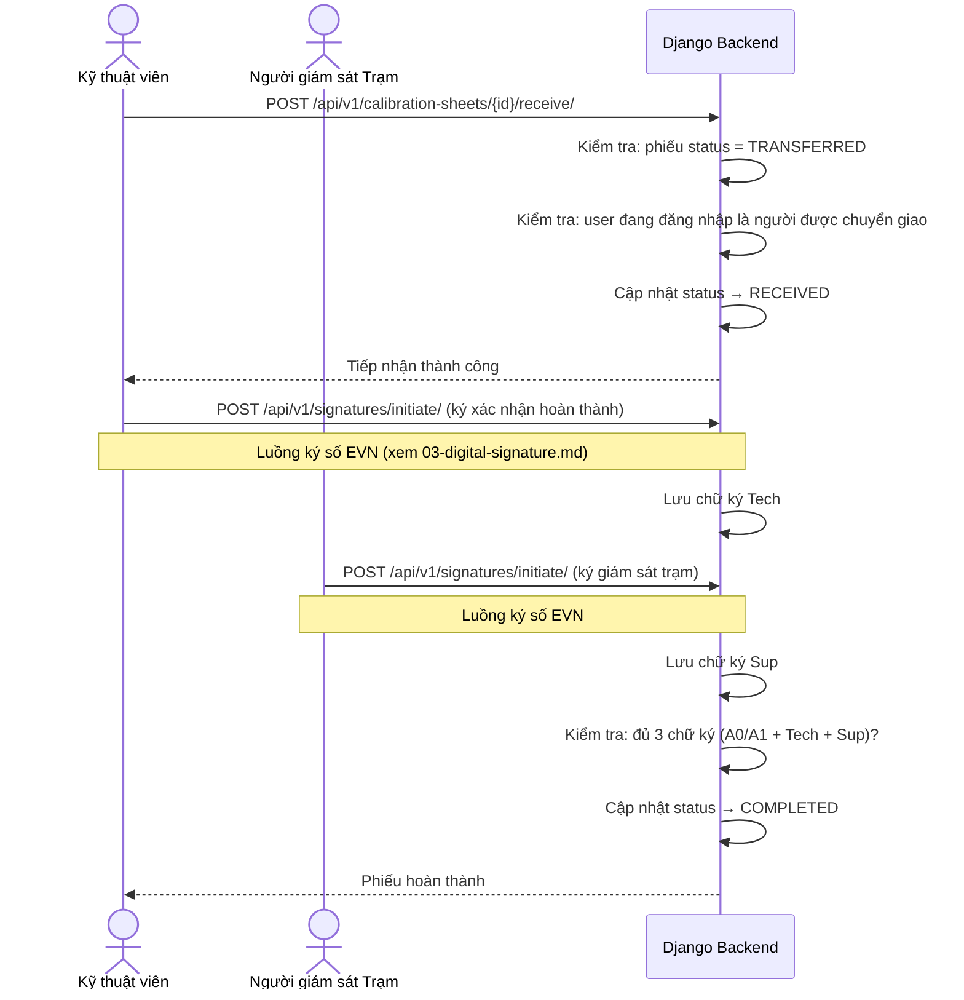

---

## 4. Business Rules (Quy tắc Nghiệp vụ)

| # | Quy tắc |
|---|---|
| BR-SHEET-01 | Phiếu chỉnh định **không bao giờ bị xóa vật lý** (`is_deleted` = True cho soft delete). |
| BR-SHEET-02 | Phiếu chỉ được phát hành (ISSUED) sau khi có **chữ ký số hợp lệ** của A0/A1. |
| BR-SHEET-03 | Phiếu chỉ được chuyển giao (TRANSFERRED) khi đang ở trạng thái ISSUED. |
| BR-SHEET-04 | Kỹ thuật viên chỉ có thể tiếp nhận phiếu được chuyển **đích danh cho họ**. |
| BR-SHEET-05 | Phiếu chỉ đạt COMPLETED khi có đủ **3 chữ ký số**: A0/A1 + Kỹ thuật viên + Giám sát trạm. |
| BR-SHEET-06 | Mã phiếu (`sheet_code`) tự động sinh theo format: `PHIEU-{YYYY}-{MM}-{SEQUENCE}`. |
| BR-SHEET-07 | Chỉ cho phép upload file: PDF, JPG, JPEG, PNG. Dung lượng tối đa: **20MB**. |

---

## 5. API Request/Response Chi tiết

### POST `/api/v1/calibration-sheets/`
**Content-Type**: `multipart/form-data`

| Field | Type | Bắt buộc | Mô tả |
|---|---|---|---|
| `relay_id` | integer | ✅ | ID rơ-le cần chỉnh định |
| `description` | string | ❌ | Mô tả nội dung phiếu |
| `scan_file` | file | ✅ | File bản scan phiếu |

**Response (201)**:
```json
{
  "success": true,
  "data": {
    "id": 42,
    "sheet_code": "PHIEU-2026-07-001",
    "status": "DRAFT",
    "relay": { "id": 5, "relay_code": "REL_AT1_87T", "relay_name": "Rơ-le so lệch AT1" },
    "scan_file_url": "/media/sheets/2026/07/scan_001.pdf",
    "issued_by": null,
    "issued_at": null,
    "created_at": "2026-07-11T16:30:00Z"
  }
}
```

### GET `/api/v1/calibration-sheets/` (với filter)

**Query Parameters**:
| Param | Mô tả | Ví dụ |
|---|---|---|
| `status` | Lọc theo trạng thái | `?status=ISSUED` |
| `station_id` | Lọc theo trạm | `?station_id=3` |
| `relay_id` | Lọc theo rơ-le | `?relay_id=5` |
| `date_from` | Từ ngày | `?date_from=2026-01-01` |
| `date_to` | Đến ngày | `?date_to=2026-12-31` |
| `search` | Tìm theo mã phiếu | `?search=PHIEU-2026` |
| `page` | Số trang | `?page=2` |

---

## 6. Giao diện (UI Specification)

### Màn hình Chi tiết Phiếu (`/calibration-sheets/:id`)

**Layout**: Chia 2 cột:
- **Cột trái (60%)**: Iframe/viewer hiển thị file scan phiếu
- **Cột phải (40%)**:
  - Thông tin metadata (Mã phiếu, Rơ-le, Ngày phát hành...)
  - **Panel "Trạng thái ký số"**: Hiển thị 3 ô ký số (A0/A1 | Kỹ thuật viên | Giám sát trạm) với badge màu: 🔴 Chưa ký / 🟡 Đang xử lý / 🟢 Đã ký hợp lệ
  - **Timeline lịch sử**: Các bước đã thực hiện theo thứ tự thời gian
  - **Nút hành động**: Hiển thị nút phù hợp với quyền và trạng thái phiếu hiện tại
````

## File: docs/features/03-digital-signature.md
````markdown
# Phân hệ Ký số Điện tử (Digital Signature — EVN Integration)

**App Django**: `apps/signatures`
**User Stories liên quan**: `[US-SIG-01]` đến `[US-SIG-04]`

---

## 1. Tổng quan Nghiệp vụ

Hệ thống RMS **không tự thực hiện ký số** mà ủy thác toàn bộ quá trình cho **Hệ thống Ký số của EVN** — một hệ thống bên ngoài cung cấp dịch vụ chữ ký số pháp lý cho toàn bộ Tập đoàn Điện lực Việt Nam.

Có **3 loại chữ ký** cần thu thập trên mỗi phiếu chỉnh định:
1. **Chữ ký A0/A1**: Xác nhận phiếu đã được soạn thảo và phát hành.
2. **Chữ ký Kỹ thuật viên**: Xác nhận đã hoàn thành công việc chỉnh định tại trạm.
3. **Chữ ký Giám sát trạm**: Xác nhận kỹ thuật viên đã đến trạm và thực hiện chỉnh định.

---

## 2. Luồng Ký số Chi tiết — Figure 5

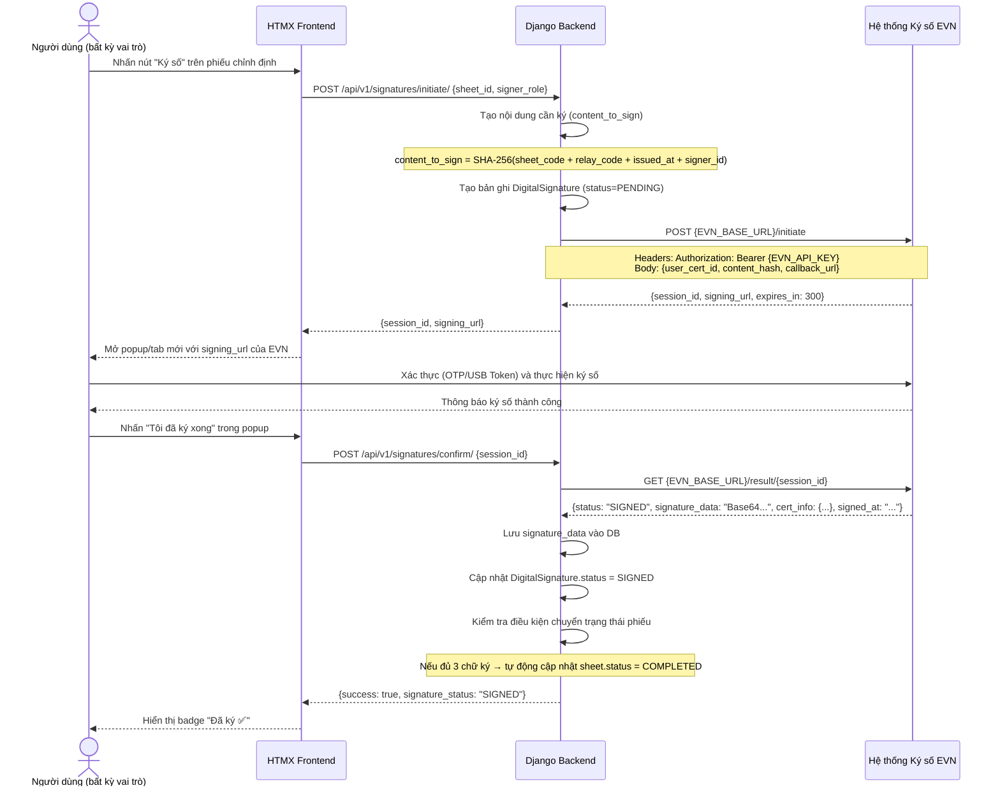

---

## 3. Service Layer: `EVNSignatureService`

```python
# apps/signatures/services.py

class EVNSignatureService:
    """
    Dịch vụ tích hợp với Hệ thống Ký số EVN.
    Đóng gói toàn bộ logic giao tiếp với API EVN bên ngoài.
    """

    def initiate_signing_session(self, user, sheet, signer_role: str) -> dict:
        """
        Khởi tạo phiên ký số với EVN.
        Trả về: {session_id, signing_url}
        Raises: EVNServiceUnavailableError nếu EVN API không phản hồi.
        """

    def get_signing_result(self, session_id: str) -> dict:
        """
        Lấy kết quả ký số từ EVN sau khi user hoàn thành.
        Trả về: {status, signature_data, cert_info, signed_at}
        Raises: EVNSessionExpiredError nếu session hết hạn (>5 phút).
        """

    def verify_signature(self, signature_id: int) -> bool:
        """
        Xác thực lại chữ ký số đã lưu với EVN.
        Trả về: True nếu hợp lệ, False nếu đã bị thu hồi/hết hiệu lực.
        """
```

---

## 4. Model: `DigitalSignature`

```python
# apps/signatures/models.py

class DigitalSignature(models.Model):
    # Phiếu chỉnh định được ký
    sheet = models.ForeignKey('calibration.CalibrationSheet', on_delete=models.PROTECT)

    # Người thực hiện ký
    signed_by = models.ForeignKey(settings.AUTH_USER_MODEL, on_delete=models.PROTECT)

    # Vai trò khi ký (A0_A1_ISSUER / CALIBRATION_TECHNICIAN / STATION_SUPERVISOR)
    signer_role = models.CharField(max_length=50)

    # Dữ liệu từ hệ thống EVN
    evn_session_id = models.CharField(max_length=200, unique=True)
    signature_data = models.TextField(null=True, blank=True)  # Base64 chữ ký
    certificate_info = models.JSONField(null=True, blank=True)  # Thông tin chứng thư

    # Trạng thái: PENDING / SIGNED / VERIFIED / INVALID
    signature_status = models.CharField(max_length=20, default='PENDING')

    signed_at = models.DateTimeField(null=True, blank=True)
    verified_at = models.DateTimeField(null=True, blank=True)
    created_at = models.DateTimeField(auto_now_add=True)

    class Meta:
        # Mỗi vai trò chỉ ký một lần trên mỗi phiếu
        unique_together = [('sheet', 'signer_role')]
```

---

## 5. Xử lý Lỗi (Error Handling)

| Tình huống | HTTP Status | error_code | Xử lý |
|---|---|---|---|
| EVN API không phản hồi (timeout) | 503 | `EVN_SERVICE_UNAVAILABLE` | Retry sau 30s, hiển thị thông báo |
| Phiên ký số hết hạn (>5 phút) | 400 | `EVN_SESSION_EXPIRED` | Người dùng phải khởi tạo lại |
| Chữ ký không hợp lệ (EVN từ chối) | 400 | `EVN_SIGNATURE_INVALID` | Log lỗi, không lưu vào DB |
| Người dùng đã ký (trùng vai trò) | 409 | `SIGNATURE_ALREADY_EXISTS` | Hiển thị chữ ký hiện tại |
| Người dùng không có chứng thư EVN | 403 | `EVN_CERT_NOT_FOUND` | Liên hệ Admin để đăng ký chứng thư |

---

## 6. API Endpoints

### POST `/api/v1/signatures/initiate/`
**Quyền**: Authenticated (vai trò phù hợp với phiếu)

**Request**:
```json
{
  "sheet_id": 42,
  "signer_role": "A0_A1_ISSUER"
}
```

**Response (200)**:
```json
{
  "success": true,
  "data": {
    "session_id": "EVN-SESSION-2026071100001",
    "signing_url": "https://sign.evn.com.vn/sign?session=EVN-SESSION-2026071100001",
    "expires_in": 300
  }
}
```

### POST `/api/v1/signatures/confirm/`

**Request**:
```json
{
  "session_id": "EVN-SESSION-2026071100001"
}
```

**Response (200)**:
```json
{
  "success": true,
  "data": {
    "signature_id": 15,
    "signer_role": "A0_A1_ISSUER",
    "signature_status": "SIGNED",
    "signed_at": "2026-07-11T10:00:00Z",
    "sheet_new_status": "ISSUED"
  }
}
```

---

## 7. Giao diện (UI Specification)

### Panel Trạng thái Ký số (trong màn hình Chi tiết Phiếu)

```
┌─────────────────────────────────────────┐
│  TRẠNG THÁI CHỮ KÝ SỐ                  │
├─────────────────────────────────────────┤
│  ✅ A0/A1 Phát hành                     │
│     Nguyễn Văn A • 11/07/2026 09:30    │
├─────────────────────────────────────────┤
│  ✅ Kỹ thuật viên                       │
│     Trần Văn B • 12/07/2026 14:00      │
├─────────────────────────────────────────┤
│  ⏳ Giám sát Trạm                       │
│     Chưa ký   [Nhấn để ký số →]        │
└─────────────────────────────────────────┘
```

- Badge `✅ Đã ký` màu xanh lá
- Badge `⏳ Chưa ký` màu vàng + nút "Ký số" (chỉ hiển thị với người có quyền ký)
- Badge `❌ Không hợp lệ` màu đỏ (khi xác thực lại thất bại)
````

## File: docs/features/04-periodic-check.md
````markdown
# Phân hệ Đối chiếu & Giám sát Thông số Rơ-le (Relay Setting Verification)

**App Django**: `stations`  
**Đường dẫn truy cập**: `/stations/autochecks/`  
**Tên hiển thị giao diện**: **Trung tâm Đối chiếu & Giám sát Thông số Rơ-le**

---

## 1. Tổng quan Nghiệp vụ

Trong quản lý kỹ thuật lưới điện của EVN (Điều độ A0/Ax, các Công ty Truyền tải điện PTC và Công ty Điện lực PC):
* Khi kỹ sư phương thức ban hành một **Phiếu Chỉnh định mới nhất** (trạng thái `COMPLETED`), các thông số trên phiếu là chuẩn mực quy định bắt buộc rơ-le phải tuân thủ.
* Trong thực tế vận hành, sau các đợt thí nghiệm định kỳ, nghiệm thu đóng điện hoặc phân tích sự cố: đơn vị công tác sẽ xuất ra **file báo cáo PDF** (từ các phần mềm rơ-le chuyên dụng như *Siemens DIGSI 4/5, ABB PCM600, SEL acSELerator QuickSet, Schneider MiCOM S1 Agile, GE EnerVista* hoặc *Biên bản thử nghiệm scan có chữ ký*).
* **Mục tiêu phân hệ**:
  1. Cho phép kỹ sư xem trực tiếp danh sách toàn bộ trị số cài đặt của rơ-le trên hệ thống.
  2. Bóc tách dữ liệu từ file PDF báo cáo thực tế và tự động đối chiếu với Phiếu Chỉnh định mới nhất đang có hiệu lực.
  3. Phát hiện chính xác các điểm sai lệch (Thông số nào sai? Quy định là bao nhiêu? Thực tế đang cài đặt là bao nhiêu?).
  4. Cung cấp nút bấm 1-chạm **"Tạo Phiếu yêu cầu Rà soát & Chỉnh định lại"** chuyển lệnh thẳng xuống Trạm / Kỹ thuật viên hiện trường để rà soát và nạp lại thông số chuẩn vào rơ-le.

---

## 2. Sơ đồ Luồng Nghiệp vụ (End-to-End Workflow)

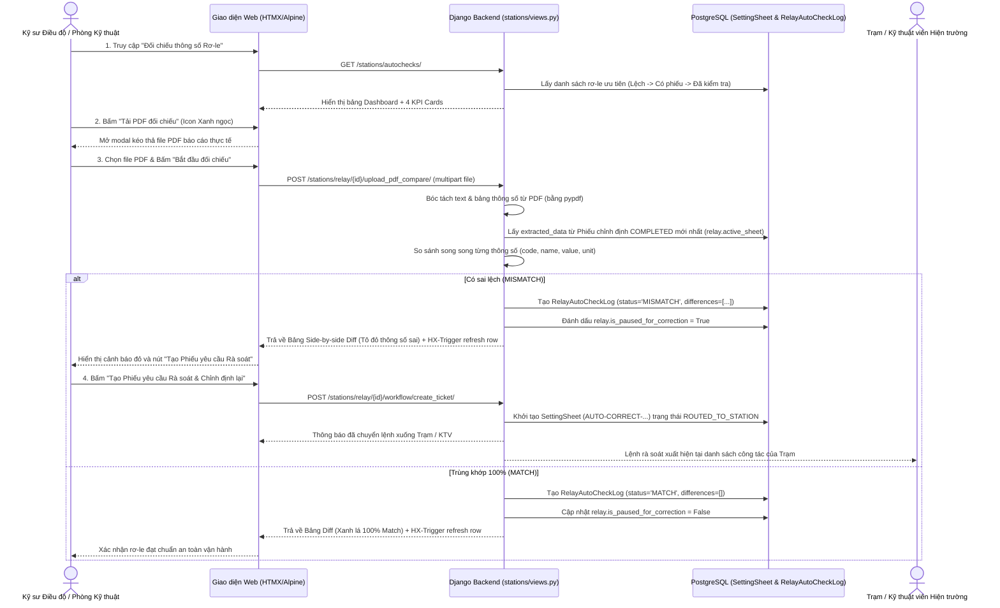

---

## 3. Các Thành phần Giao diện Cốt lõi

1. **Dashboard & 4 KPI Cards**:
   * **Tổng Rơ-le**: Quản lý toàn bộ 39.375 rơ-le trong hệ thống.
   * **Có Phiếu Chỉnh định**: Số lượng rơ-le đã được gán phiếu chính thức.
   * **Trùng khớp 100%**: Rơ-le đã đối chiếu và xác nhận khớp hoàn toàn với phiếu.
   * **Sai lệch (Cần rà soát)**: Rơ-le đang có sai lệch cần xử lý gấp.
2. **Modal Xem Thông số Rơ-le (`_relay_parameters_modal.html`)**:
   * Mở nhanh bằng nút tím `fa-sliders-h`.
   * Hiển thị toàn bộ trị số cài đặt kèm mã phiếu đang áp dụng.
   * Tích hợp ô tìm kiếm tức thì phản hồi ngay khi gõ từ khóa.
3. **Modal Nạp File PDF (`#upload-pdf-modal`)**:
   * Kéo thả file PDF báo cáo thử nghiệm/cài đặt.
   * Tự động nhận diện file và hiển thị tên file đính kèm.
4. **Modal Kết quả Đối chiếu Side-by-Side Diff (`_autocheck_results.html`)**:
   * Cột trái: Trị số Phiếu ban hành quy định (Màu xanh dương).
   * Cột phải: Trị số thực tế đọc từ file PDF (Tô đỏ nhạt nếu sai lệch).
   * Bộ lọc 3 chế độ: *Chỉ thông số sai lệch*, *Thông số trùng khớp*, *Tất cả*.
   * Nút điều phối: *"Tạo Phiếu yêu cầu Rà soát & Chỉnh định lại (Chuyển về Trạm)"*.

---

## 4. Các Quy tắc Nghiệp vụ (Business Rules)

| Mã Quy tắc | Nội dung Quy tắc |
| :--- | :--- |
| **BR-CHK-01** | Nguồn dữ liệu quy định chuẩn luôn ưu tiên lấy từ Phiếu Chỉnh định `COMPLETED` mới nhất của rơ-le (`relay.active_sheet`). Nếu chưa có phiếu `COMPLETED`, fallback lấy từ phiếu mới nhất hoặc `relay.settings`. |
| **BR-CHK-02** | Khi phát hiện bất kỳ thông số nào không trùng khớp giá trị số (numerical value) hoặc chuỗi cấu hình, hệ thống bắt buộc phải gán nhãn `MISMATCH` và lưu chi tiết vào mảng `differences`. |
| **BR-CHK-03** | Khi rơ-le rơi vào trạng thái `MISMATCH`, hệ thống tự động kích hoạt cờ `is_paused_for_correction = True` để hiển thị cảnh báo nhấp nháy trên Dashboard và tạm dừng các lịch quét tự động cho đến khi có xác nhận xử lý. |
| **BR-CHK-04** | Khi kỹ sư bấm *"Tạo Phiếu yêu cầu Rà soát"*, hệ thống tự động sinh một Phiếu Chỉnh định có tiền tố `AUTO-CORRECT-{Mã_Role}-{Thời_gian}` ở trạng thái `ROUTED_TO_STATION`, tự động đóng gói các trị số bị sai (`wrong_value`) và trị số đúng mục tiêu (`value`) để đơn vị dưới trạm biết chính xác điểm cần khắc phục. |
| **BR-CHK-05** | Sau khi rơ-le được nạp lại và đối chiếu đạt `MATCH` 100%, hệ thống tự động gỡ bỏ cờ cảnh báo `is_paused_for_correction = False` và khôi phục trạng thái vận hành an toàn. |

---

## 5. Quy chuẩn Đối soát Thông số Rơ-le Theo Hãng Sản xuất (11 Hệ sinh thái Chuyên sâu)

Hệ thống đối soát rơ-le ([stations/relay_specs.py](file:///d:/project/project-local/electric/electricity-web/stations/relay_specs.py)) được xây dựng theo chuẩn 5 tầng kỹ thuật cho toàn bộ các hãng có mặt trong cơ sở dữ liệu EVN:

### 1. Siemens SIPROTEC 5 & DIGSI 5
* **Dòng rơ-le**: `7SJ` (Quá dòng & Xuất tuyến), `7SA` (Khoảng cách ĐD), `7SD` (So lệch ĐD), `7SL` (So lệch + Khoảng cách), `7UT` (So lệch MBA), `7SS` (Thanh cái).
* **5 tầng**: Tỷ số biến CT/VT $\rightarrow$ Nhóm setting (`Setting Group 1..4`) $\rightarrow$ Kích hoạt hàm DIGSI (`FUNC_50_51`, `FUNC_67`) $\rightarrow$ Ngưỡng khởi động & Đặc tính (`IEC Normal Inverse`) $\rightarrow$ Khối liên kết logic `DIGSI CFC` & Đầu ra `BINARY_OUT_1`.

### 2. Schweitzer Engineering Laboratories (SEL) & acSELerator QuickSet SEL-5030
* **Dòng rơ-le**: `SEL-751/751A` (Xuất tuyến), `SEL-787/487E` (MBA), `SEL-411L` (Đường dây), `SEL-487B` (Thanh cái).
* **5 tầng**: `CTR`, `PTR`, `VNOM` $\rightarrow$ `ACTIVE_GROUP` $\rightarrow$ Cho phép chức năng (`E50P`, `E51P`, `E50G`, `E79`) $\rightarrow$ `50P1P`, `51P1P`, Time Dial $\rightarrow$ Phương trình `SELOGIC_TRIP` & Ánh xạ `OUT101_ASSIGN`.

### 3. ABB / Hitachi Energy & PCM600 (Protection and Control IED Manager)
* **Dòng rơ-le**: Relion Series: `REF615/620/630`, `RET670/650`, `RED670`, `REL670`, `REB670`, `REX640`.
* **5 tầng**: Tỷ số CT/VT $\rightarrow$ `Parameter Group` $\rightarrow$ Khối hàm Relion (`PHIPTOC1`, `EFIPTOC1`, `MPDIF`) $\rightarrow$ Ngưỡng khởi động `StartVal` & Trễ `OpDelay` $\rightarrow$ Mô hình ứng dụng `ACT (Application Configuration)` & Ma trận `Signal Matrix (SMT)`.

### 4. Toshiba (GR-Series: GR-TIEMS)
* **Dòng rơ-le**: `GRZ100/200` (Khoảng cách), `GRT100/200` (So lệch MBA), `GRD100/200` (Xuất tuyến), `GRB100/200` (Thanh cái), `GBU200` (BCU).
* **5 tầng**: Tỷ số CT/VT $\rightarrow$ `Active Setting Group` $\rightarrow$ `EN_MAIN_PROT`, `EN_DIF` $\rightarrow$ Trở kháng `Z1_REACH`, dòng khởi động `Idiff_START`, độ dốc `Slope 1/2` $\rightarrow$ Logic lập trình `GR_PLC_LOGIC` & Đầu ra `BO_TRIP_1`.

### 5. NARI / NR Electric (PCS-900 & RCS-900 Series)
* **Dòng rơ-le**: `PCS-9611S` (Xuất tuyến/F50), `PCS-931/RCS-931` (So lệch ĐD), `PCS-978/RCS-978` (So lệch MBA), `PCS-915` (Thanh cái), `PCS-9705S` (BCU).
* **5 tầng**: `Rated_Current_In`, `CT_Ratio` $\rightarrow$ `Active_Setting_Zone` $\rightarrow$ Từ điều khiển `Control_Word_Main` $\rightarrow$ Ngưỡng `I_DP1_Pickup`, `I_DP2_Pickup`, `Slope_K1/K2` $\rightarrow$ Ma trận logic `Logic_Trip_Matrix` & Tiếp điểm `Output_Relay_OUT1`.

### 6. GE / General Electric / Multilin (UR Series - EnerVista)
* **Dòng rơ-le**: `D60` (Khoảng cách), `L90` (So lệch ĐD), `T60` (So lệch MBA), `B30` (Thanh cái), `F650` (Feeder/BCU).
* **5 tầng**: `CT/VT Primary/Secondary` $\rightarrow$ `Active Setting Group` $\rightarrow$ `FUNCTION_50_51_ENABLE` $\rightarrow$ `IOC1_PICKUP`, `TOC1_PICKUP`, đường cong dốc $\rightarrow$ Phương trình `FlexLogic Equation` & Tiếp điểm `OUTPUT_CONTACT_TRIP1`.

### 7. Schneider / Alstom / Areva / MiCOM (S1 Agile & Sepam)
* **Dòng rơ-le**: `MiCOM P14x` (Xuất tuyến), `P44x` (Khoảng cách), `P54x` (So lệch ĐD), `P64x` (So lệch MBA), `P74x` (Thanh cái), `Sepam 80`.
* **5 tầng**: `Main_CT/VT` $\rightarrow$ `Active Group` $\rightarrow$ `I_Is1_Status`, `I_Is2_Status` $\rightarrow$ Trị số đặt `I> Current Set`, `t_Is1`, `Is2_Curve_Type` $\rightarrow$ Sơ đồ logic lập trình `PSL (Programmable Scheme Logic)` & Đầu ra `Relay_Output_RL1`.

### 8. A-Eberle (REG-D / REG-DA - WinREG)
* **Ứng dụng**: Rơ-le tự động điều chỉnh nấc phân áp dưới tải máy biến áp (AVR / OLTC ANSI 90).
* **5 tầng**: Điện áp đặt mục tiêu `VOLTAGE_SETPOINT_Uset`, Tỷ số VT/CT $\rightarrow$ Bộ thông số `Parameter Set 1` $\rightarrow$ Chế độ `AVR_AUTO_MODE`, bù sụt áp `LDC` $\rightarrow$ Dải nhạy cảm `Bandwidth_Bw`, ngưỡng khóa quá/kém áp, trễ đổi nấc `T1/T2` $\rightarrow$ Lệnh tăng/giảm nấc `OLTC_RAISE/LOWER_COMMAND`.

### 9. Bender (ISO685 / RCMS460)
* **Ứng dụng**: Thiết bị giám sát cách điện & rà soát chạm đất mạng điện 1 chiều DC trạm biến áp.
* **5 tầng**: Điện áp danh định `SYSTEM_VOLTAGE_Un` (220V DC) $\rightarrow$ Hồ sơ đo `Measurement Profile` $\rightarrow$ Giám sát chạm đất `EARTH_FAULT_MONITOR` $\rightarrow$ Ngưỡng cảnh báo cách điện Cấp 1 (`ALARM_1_THRESHOLD = 25 kOhm`) & Sự cố Cấp 2 (`ALARM_2 = 10 kOhm`) $\rightarrow$ Tiếp điểm cảnh báo SCADA `RELAY_K1/K2_ASSIGN`.

### 10. Protecta (EuroProt+ Series - EuroCAP)
* **Ứng dụng**: Rơ-le bảo vệ và tự động hóa trọn bộ ngăn lộ lưới điện phân phối/truyền tải.
* **5 tầng**: Định mức In/Un $\rightarrow$ `Active Group` $\rightarrow$ Cấu hình chức năng `TOC_51`, `IOC_50` $\rightarrow$ Ngưỡng dòng `I_Pickup_51`, `I_Instant_50`, thời gian trễ $\rightarrow$ Logic `Logic_Fast_Trip` & Tiếp điểm `Relay_Output_RO1`.

### 11. Arteche (Rơ-le Khóa Cắt F86 & Giám Sát Mạch Cắt F74)
* **Ứng dụng**: Rơ-le phụ trợ cơ điện tốc độ cao chuyên nhiệm chức năng cắt - khóa máy cắt và giám sát mạch cuộn cắt.
* **5 tầng**: Nguồn nuôi nhị thứ `RATED_AUX_VOLTAGE` (220V DC) $\rightarrow$ Chức năng `HIGH_SPEED_TRIP_F86` & `TCS_SUPERVISION_F74` $\rightarrow$ Điện áp tác động `>= 70% V_aux`, dòng đo lường `1.5 mA` $\rightarrow$ Thời gian tác động siêu tốc `< 10ms` (`OPERATING_TIME_F86 = 0.008s`) $\rightarrow$ Logic khóa liên động `LOCKOUT_INTERLOCK (BLOCK_CLOSE)` & Tiếp điểm công suất cao `4 NO + 4 NC`.

### 12. Vizimax (SynchroTeq - Đóng Cắt Đồng Pha Thông Minh ANSI 25)
* **Ứng dụng**: Bộ điều khiển đóng cắt đồng pha thông minh điểm 0 / đỉnh áp triệt tiêu dòng từ hóa đột biến (Inrush) và sốc điện áp đóng tụ bù.
* **5 tầng**: Điện áp/tần số hệ thống, thời gian thao tác máy cắt `CB_RATED_TIME` (45ms) $\rightarrow$ Kích hoạt `POW_SWITCHING`, bù trôi cơ khí theo nhiệt độ `TEMP_COMPENSATION`, học độ mài mòn tiếp điểm $\rightarrow$ Góc đóng mục tiêu MBA ($90^\circ/270^\circ$ đỉnh áp), góc đóng tụ bù ($0^\circ/180^\circ$ điểm 0), cửa sổ sai số pha cho phép ($\pm 0.5\text{ ms}$) $\rightarrow$ Bù thời gian truyền động cơ khí máy cắt, hệ số dốc bù nhiệt độ $\rightarrow$ Tiếp điểm cho phép đóng đồng pha `SYNCHROTEQ_READY_PERMISSIVE` & Báo lỗi sai lệch thời gian `ALARM_CB_TIMING_ERROR`.

### 13. MR - Maschinenfabrik Reinhausen (TAPCON / MSENSE)
* **Ứng dụng**: Bộ điều khiển tự động nấc phân áp dưới tải MBA & Hệ thống giám sát tiếp điểm buồng chân không OLTC.
* **5 tầng**: Tỷ số VT, số nấc tối đa (19/27 nấc), bước điện áp mỗi nấc (1.25%) $\rightarrow$ Tự động điều áp `TAPCON Auto`, thuật toán MBA song song triệt tiêu dòng tuần hoàn, giám sát mài mòn tiếp điểm $\rightarrow$ Điện áp đặt mục tiêu $U_{set}$ (110V), dải băng chết $\Delta U$ (1.5%), dòng tuần hoàn cực đại cho phép (0.15A) $\rightarrow$ Trễ chuyển nấc bước 1 ($T_1 = 30\text{s}$), trễ các nấc liên tiếp ($T_2 = 10\text{s}$), thời gian giám sát động cơ chạy nấc $\rightarrow$ Lệnh xuất xung tăng/giảm nấc (`RAISE/LOWER_PULSE`) & Cảnh báo kẹt nấc bộ chuyển đổi.

### 14. Messko / AKM / Hyoda (Đo Nhiệt Độ Dầu OTI & Cuộn Dây WTI MBA)
* **Ứng dụng**: Đồng hồ nhiệt độ và cảm biến Pt100 giám sát phát nóng MBA, điều khiển quạt giải nhiệt và bảo vệ quá nhiệt (ANSI 49).
* **5 tầng**: Cảm biến Pt100 RTD Class A, thang đo 0-160°C, gradient chênh nhiệt cuộn dây/dầu đỉnh (18°C) $\rightarrow$ Cho phép chạy quạt cấp 1/2, bảo vệ cắt nhiệt độ $\rightarrow$ Ngưỡng nhiệt chạy quạt 1 ($55^\circ\text{C}$), quạt 2 ($65^\circ\text{C}$), cảnh báo nhiệt dầu OTI ($85^\circ\text{C}$), cắt sự cố dầu OTI ($105^\circ\text{C}$), cảnh báo nhiệt cuộn dây WTI ($95^\circ\text{C}$), cắt sự cố WTI ($115^\circ\text{C}$) $\rightarrow$ Thời gian duy trì quạt chạy tối thiểu (180s), lọc rung tiếp điểm vi công tắc $\rightarrow$ Tiếp điểm cảnh báo SCADA & Tiếp điểm cắt sự cố gửi tới Rơ-le khóa 86.

### 15. EMB / Cedaspe / Comem (Bảo Vệ Hơi Buchholz & Van Xả Áp Lực PRD)
* **Ứng dụng**: Cụm phụ kiện an toàn cơ khí bảo vệ sự cố thùng máy biến áp và buồng dập hồ quang OLTC (ANSI 63B/PRD).
* **5 tầng**: Đường kính ống nối (DN80/50), môi chất dầu khoáng, kích thước họng van PRD (150mm) $\rightarrow$ Kích hoạt cảnh báo hơi (Phao trên), cắt sự cố dòng dầu (Phao dưới), cắt van xả áp PRD, cắt dòng dầu buồng nấc RS2001 $\rightarrow$ Thể tích khí tích tụ cảnh báo ($200\text{ cm}^3$), vận tốc dòng dầu tác động cắt ($1.0\text{ m/s}$), áp lực mở màng an toàn PRD ($55\text{ kPa} / 0.55\text{ bar}$), mức dầu cực tiểu bình phụ $\rightarrow$ Thời gian lọc tiếp điểm khí (1.0s), thời gian tác động cơ học cắt dòng dầu ($< 20\text{ ms}$) $\rightarrow$ Tiếp điểm cảnh báo khí SCADA & Tiếp điểm cắt tức thời kích hoạt Rơ-le 86 cô lập máy biến áp.

### 16. Qualitrol (Giám Sát Tích Hợp Online & DGA Máy Biến Áp)
* **Ứng dụng**: Hệ thống giám sát trực tuyến khí hòa tan trong dầu DGA, hành trình vi công tắc van xả áp và nhiệt độ điểm nóng Hotspot.
* **5 tầng**: Model 509ITM/Server-DGA, nguồn nuôi 220V, giao thức truyền thông IEC 61850 / Modbus TCP $\rightarrow$ Giám sát DGA trực tuyến, giám sát van PRD, mô hình toán nhiệt điểm nóng IEEE C57.91 $\rightarrow$ Ngưỡng cảnh báo khí $H_2$ (100 ppm), nguy cấp khí hồ quang $C_2H_2$ (5 ppm), cảnh báo quá áp thùng dầu (35 kPa), nhiệt độ điểm nóng cuộn dây ($110^\circ\text{C}$) $\rightarrow$ Khung thời gian theo dõi tốc độ sinh khí DGA (24h), bộ lọc chống xung nhiễu điện từ $\rightarrow$ Tiếp điểm cảnh báo khí DGA cao & Tiếp điểm liên động cắt bảo vệ an toàn thùng dầu.

### 17. Smitt (Rơ-le Khóa Cắt Master Trip Lockout ANSI 86)
* **Ứng dụng**: Rơ-le khóa đóng ngắt nhiều tiếp điểm chất lượng cao, tự giữ cơ học, chống đóng lặp lại khi sự cố chưa được kiểm tra giải trừ.
* **5 tầng**: Điện áp cuộn hút định mức (220V DC), cấu hình 8 NO + 8 NC Heavy Duty, phương thức giải trừ chốt Manual Hand Reset $\rightarrow$ Khóa cơ học tự giữ (86), giám sát tính liên tục mạch cắt TCS (ANSI 74) $\rightarrow$ Dòng kích hoạt cuộn hút ($\ge 1.5\text{A}$), dòng kiểm tra mạch cắt liên tục ($1.5\text{ mA}$) $\rightarrow$ Thời gian tác động lật chốt siêu tốc ($< 8\text{ ms}$), trễ xác nhận đứt mạch cắt $\rightarrow$ Tiếp điểm NO cắt đồng thời các máy cắt liên quan & Tiếp điểm NC ngắt hoàn toàn mạch đóng máy cắt.

### 18. Trench (Biến Dòng CT, Biến Áp VT/CVT & Cuộn Cản Bẫy Sóng Line Trap)
* **Ứng dụng**: Thiết bị đo lường cao thế và ghép nối tín hiệu tải ba truyền thông bảo vệ so lệch/khoảng cách đường dây.
* **5 tầng**: Dòng/áp sơ cấp định mức (1200A, 110kV), thứ cấp danh định (5A, 110V), tần số 50Hz $\rightarrow$ Cuộn đo lường 0.2S, cuộn bảo vệ 5P20, cuộn bảo vệ so lệch Class PX $\rightarrow$ Dung lượng tải phụ (30 VA), bội số dòng giới hạn ALF (20), điện áp điểm uốn $V_k$ (450V), dòng từ hóa cực đại $I_e$, điện trở nội cuộn thứ cấp $R_{ct}$ ($2.5\ \Omega$) $\rightarrow$ Dải tần số bẫy sóng Line Trap (50-500 kHz), hệ số quá độ ngắn mạch $K_{td}$ $\rightarrow$ Giám sát hở mạch nhị thứ CT & Khối trở kháng cao chặn tín hiệu cao tần không thoát ra trạm.

### 19. Sieyuan / Coelme / MESA (Máy Cắt SF6, Dao Cách Ly DS & Tiếp Địa ES)
* **Ứng dụng**: Thiết bị phân phối và đóng cắt cao thế ngoài trời và trong nhà (GIS/AIS), giám sát khí cách điện $SF_6$ và liên động đóng cắt an toàn.
* **5 tầng**: Cấp điện áp định mức (110kV/220kV/500kV), dòng định mức (2000A), khả năng chịu ngắn mạch (40kA/3s) $\rightarrow$ Giám sát mật độ áp lực khí $SF_6$ (ANSI 63G), giám sát nạp lò xo động cơ, logic khóa liên động cơ - điện (ANSI 3) $\rightarrow$ Áp lực $SF_6$ định mức ($0.60\text{ MPa}$), cảnh báo rò khí cấp 1 ($0.52\text{ MPa}$), khóa thao tác đóng cắt cấp 2 ($0.50\text{ MPa}$) $\rightarrow$ Thời gian thao tác đóng định mức (50ms), thời gian cắt định mức (25ms), thời gian nạp lại lò xo (12s), thời gian quay mở dao cách ly (8s) $\rightarrow$ Tiếp điểm khóa toàn bộ thao tác máy cắt khi mất khí $SF_6$, tiếp điểm phụ vị trí dao cách ly (89a/b) đưa vào liên động & Rơ-le chống nhấp nháy 52Y.

### 20. TBEA / Shenyang (SBW) / XD Xian / Hyundai / Mitsubishi (Máy Biến Áp Lực Cao Thế)
* **Ứng dụng**: Máy biến áp lực và kháng bù cao thế truyền tải (110kV/220kV/500kV).
* **5 tầng**: Công suất định mức các cuộn dây (63 MVA), tỷ số điện áp danh định (115/24 kV), tổ đấu dây bù pha ($YNd11$) $\rightarrow$ Tự động điều khiển hệ thống làm mát ONAN/ONAF, giám sát dòng chạm đất mạch từ, giám sát khí dầu DGA online $\rightarrow$ Điện áp ngắn mạch định mức $\%U_k$ (10.5%), tổn hao không tải $P_0$ (42 kW), tổn hao có tải $P_k$ (210 kW), dòng tiếp địa mạch từ cực đại cho phép (100 mA) $\rightarrow$ Thời gian suy giảm dòng từ hóa đóng máy Inrush (0.5s), hằng số quán tính nhiệt biến áp (120 min) $\rightarrow$ Tiếp điểm cảnh báo sự cố quạt/bơm làm mát & Tín hiệu sa thải/cắt khi quá tải nhiệt nguy hiểm.

### 21. Cooper (Tủ Điều Khiển Recloser Tự Đóng Lại Form 4/6)
* **Ứng dụng**: Máy cắt tự đóng lại xuất tuyến trung thế tích hợp rơ-le số thông minh trên lưới phân phối.
* **5 tầng**: Tỷ số CT pha (1000/1), CT đất (1000/1), điện áp định mức 22kV, hồ sơ chỉnh định $\rightarrow$ Cho phép chu trình tự đóng lại (ANSI 79), bảo vệ quá dòng chạm đất (50N/51N), thích nghi tải lạnh CLPU $\rightarrow$ Dòng khởi động cắt pha (400A), dòng khởi động cắt đất (80A), hệ số nhân dòng tải lạnh CLPU (2.0x) $\rightarrow$ Thời gian nghỉ lần 1 (2.0s), thời gian nghỉ lần 2 (15.0s), thời gian hoàn nguyên chu trình (30s) $\rightarrow$ Tiếp điểm khóa chết Recloser sau hết số lần đóng lại (Final Lockout) & Chế độ an toàn công tác đường dây Hot Line Tag.

### 22. Beckwith (Rơ-le Điều Áp M-2001D & Hòa Đồng Bộ M-0169)
* **Ứng dụng**: Rơ-le tự động điều chỉnh nấc máy biến áp và thiết bị kiểm tra hòa đồng bộ máy cắt (ANSI 90/25).
* **5 tầng**: Điện áp đầu vào VT danh định (120V), điện trở bù sụt áp đường dây LDC R (3V) & cảm kháng LDC X (6V) $\rightarrow$ Tự động bù sụt áp LDC, khóa đổi nấc khi có dòng công suất ngược (điện mặt trời/gió), kiểm tra hòa đồng bộ (ANSI 25) $\rightarrow$ Điện áp đặt trung tâm Bandcenter (120V), dải băng chết Bandwidth (2V), độ lệch áp hòa đồng bộ ($\Delta V \le 5\text{V}$), độ lệch tần số ($\Delta f \le 0.1\text{Hz}$), độ lệch góc pha ($\Delta \delta \le 15^\circ$) $\rightarrow$ Trễ đổi nấc bước 1 (30s), trễ các nấc liên tiếp (10s) $\rightarrow$ Xung lệnh tăng/giảm nấc (`PULSE_TAP_RAISE/LOWER`) & Tiếp điểm cho phép đóng máy cắt hòa đồng bộ `PERMISSIVE_SYNC_CLOSE`.
````

## File: docs/features/05-ai-ocr.md
````markdown
# Đặc tả Module AI OCR (Human-in-the-Loop)

Tài liệu này mô tả chi tiết kiến trúc, quy trình và yêu cầu kỹ thuật cho hệ thống AI bóc tách thông số (OCR) từ Phiếu chỉnh định dạng PDF/Image trong hệ thống **RMS**.

---

## 1. Mục tiêu Kiến trúc

1. **Bảo mật tuyệt đối (OT Compliance)**: Toàn bộ quá trình xử lý hình ảnh và bóc tách dữ liệu phải được thực hiện trên hạ tầng máy chủ nội bộ (On-premise). Tuyệt đối **không gửi** dữ liệu sang các dịch vụ Cloud bên ngoài (Google Cloud Vision, AWS Textract, etc.).
2. **Xử lý Bất đồng bộ (Asynchronous)**: Việc OCR tốn nhiều tài nguyên, không được chặn (block) request của người dùng khi upload file.
3. **Độ tin cậy dữ liệu**: Kết quả AI chỉ mang tính chất tham khảo (Draft). Bắt buộc phải có **sự đối chiếu và xác nhận của con người (Human-in-the-loop)** thông qua giao diện Split-view.

---

## 2. Các Thành phần Hệ thống

### 2.1 Backend / API (Django)
- Cung cấp API để nhận file PDF, lưu vào kho lưu trữ nội bộ.
- Sinh Task đẩy vào Message Broker.
- Cung cấp API cập nhật (PATCH) và chốt (POST) kết quả OCR sau khi người dùng review.

### 2.2 Task Queue & Message Broker (RabbitMQ)
- Quản lý hàng đợi các Task OCR (`ocr_jobs`).
- Hỗ trợ Retry có giới hạn khi Worker quá tải hoặc lỗi.

### 2.3 AI OCR Worker (Celery + Tesseract / PaddleOCR)
- Một service độc lập chạy ngầm.
- Xử lý convert PDF trang sang ảnh.
- Nhận diện ký tự, phân tích layout (bảng biểu).
- Trả kết quả JSON chứa: Text nguyên thủy, Key-Value đã bóc tách, Bounding Box (Toạ độ), Confidence Score.

---

## 3. Luồng Xử lý AI OCR (Workflow)

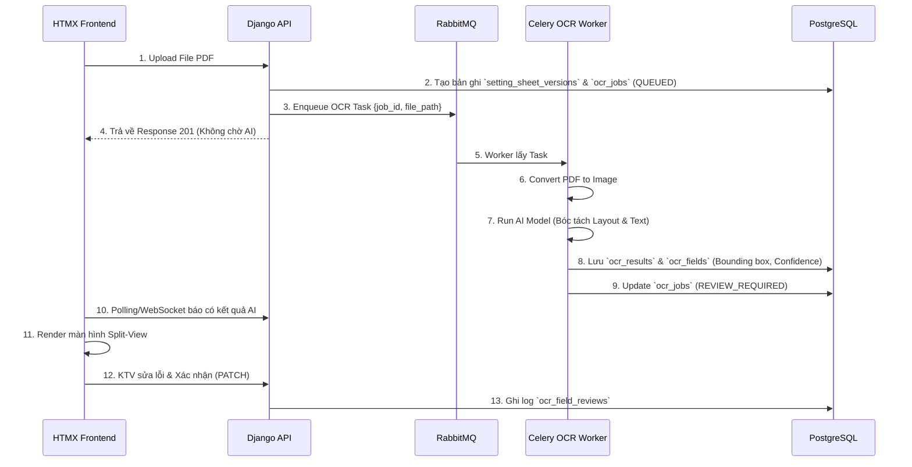

---

## 4. Giao diện Đối chiếu OCR (Split-View)

Màn hình Split-view là điểm tiếp xúc giữa con người và AI, yêu cầu thiết kế UX/UI tối ưu:

- **Khung bên trái (Trình xem PDF/Ảnh)**:
  - Phải hỗ trợ Zoom, cuộn trang.
  - Khi hover/click vào một thông số bên khung phải, hệ thống vẽ highlight (dựa trên bounding box) vào vị trí tương ứng trên ảnh.
- **Khung bên phải (Form dữ liệu)**:
  - Hiển thị danh sách các thông số AI đã bóc tách được.
  - Cảnh báo màu vàng (Warning) với những trường có Confidence Score < Ngưỡng (VD: < 80%).
  - Textbox có thể chỉnh sửa trực tiếp.
  - Mỗi khi sửa, người dùng được yêu cầu nhập "Lý do thay đổi" để lưu vết (Audit log).
- **Trạng thái chốt sổ**: Nút "Xác nhận toàn bộ dữ liệu" chỉ được phép bấm khi người dùng đã duyệt/xác nhận các trường dữ liệu quan trọng hoặc có Confidence thấp.

---

## 5. Xử lý Lỗi & Retry

- Lỗi không đọc được file (Corrupted PDF) → Cập nhật trạng thái `FAILED`, ghi rõ `error_message`, gửi thông báo cho người dùng.
- AI Worker crash / Timeout → RabbitMQ tự động đẩy lại Task (Max 3 retries).
- File quá dài (> 50 trang) → AI Worker có thể ngắt tác vụ, chuyển trạng thái về `FAILED_TOO_LARGE`, yêu cầu người dùng cắt nhỏ file.

---

## 6. Yêu cầu Huấn luyện (Future Scope)
Trong tương lai, để nâng cao độ chính xác:
- Có thể thu thập các mẫu phiếu đã được KTV đối chiếu (dữ liệu sạch) để huấn luyện lại mô hình (Fine-tuning PaddleOCR hoặc mô hình LayoutLM).
- Việc huấn luyện phải được thực hiện trên môi trường Sandbox chuyên dụng nội bộ, không dùng dữ liệu production chạy thẳng ra ngoài.
````

## File: docs/mvt_design/MODELS_DESIGN.md
````markdown
# Đặc tả Cơ sở Dữ liệu (Django + PostgreSQL)

**Database:** PostgreSQL 15+
**ORM:** Django ORM (PostgreSQL Backend)

Sử dụng mô hình CSDL quan hệ chuẩn (SQL) kết hợp với kiểu dữ liệu `JSONField` (JSONB) của PostgreSQL để xử lý các dữ liệu linh hoạt (như OCR) mà không cần phá vỡ cấu trúc của CSDL.

## 1. Khai báo Models
Sử dụng thư viện chuẩn `django.db.models`.

### 1.1 Quản lý Tổ chức & Phân quyền
Sử dụng Auth User mặc định của Django, mở rộng bằng Profile.

```python
from django.db import models
from django.contrib.auth.models import User

class Organization(models.Model):
    code = models.CharField(max_length=50, unique=True)
    name = models.CharField(max_length=255)
    org_type = models.CharField(max_length=50) # VTC, OPERATION, TRANSMISSION...
    parent = models.ForeignKey('self', on_delete=models.SET_NULL, null=True, blank=True)

class UserProfile(models.Model):
    user = models.OneToOneField(User, on_delete=models.CASCADE)
    organization = models.ForeignKey(Organization, on_delete=models.SET_NULL, null=True)
    phone_number = models.CharField(max_length=20, null=True, blank=True)
```

### 1.2 Trạm Biến áp & Rơ-le (Quan hệ 1-N)
Xây dựng quan hệ Trạm -> Ngăn lộ -> Rơ-le -> Cài đặt.

```python
class Station(models.Model):
    station_code = models.CharField(max_length=50, unique=True)
    station_name = models.CharField(max_length=200)
    location = models.CharField(max_length=255)

class Bay(models.Model):
    station = models.ForeignKey(Station, related_name='bays', on_delete=models.CASCADE)
    bay_code = models.CharField(max_length=50)
    bay_name = models.CharField(max_length=100)

class Relay(models.Model):
    bay = models.ForeignKey(Bay, related_name='relays', on_delete=models.CASCADE)
    relay_code = models.CharField(max_length=50)
    relay_name = models.CharField(max_length=100)
    manufacturer = models.CharField(max_length=100)

class RelaySetting(models.Model):
    relay = models.ForeignKey(Relay, related_name='settings', on_delete=models.CASCADE)
    parameter_code = models.CharField(max_length=50)
    parameter_name = models.CharField(max_length=100)
    standard_value = models.FloatField()
    unit = models.CharField(max_length=20)
    tolerance_min = models.FloatField()
    tolerance_max = models.FloatField()
```

### 1.3 Phiếu Chỉnh định & Lịch sử
Sử dụng `JSONField` của PostgreSQL cho dữ liệu không cấu trúc, và tạo bảng rời cho chữ ký số để đảm bảo tính chuẩn hóa 3NF.

```python
class SettingSheet(models.Model):
    sheet_code = models.CharField(max_length=100, unique=True)
    title = models.CharField(max_length=255)
    status = models.CharField(max_length=50) # DRAFT, PENDING_REVIEW, ASSIGNED, COMPLETED
    scan_file = models.FileField(upload_to='scans/')
    
    relay = models.ForeignKey(Relay, on_delete=models.SET_NULL, null=True)
    
    # OCR Data / Mock Data sử dụng JSONB của PostgreSQL
    extracted_data = models.JSONField(null=True, blank=True) 

class SignatureRecord(models.Model):
    sheet = models.ForeignKey(SettingSheet, related_name='signatures', on_delete=models.CASCADE)
    signer_name = models.CharField(max_length=100)
    role = models.CharField(max_length=50)
    signed_at = models.DateTimeField(auto_now_add=True)
    signature_hash = models.CharField(max_length=256)
```

### 1.4 Nhật ký Kiểm tra Định kỳ
```python
class PeriodicCheck(models.Model):
    relay = models.ForeignKey(Relay, on_delete=models.CASCADE)
    sheet = models.ForeignKey(SettingSheet, on_delete=models.CASCADE)
    scheduled_date = models.DateField()
    actual_check_date = models.DateField(null=True, blank=True)
    status = models.CharField(max_length=50)
    
class PeriodicCheckItem(models.Model):
    check = models.ForeignKey(PeriodicCheck, related_name='items', on_delete=models.CASCADE)
    parameter_code = models.CharField(max_length=50)
    measured_value = models.FloatField()
    deviation_percent = models.FloatField()
    is_within_tolerance = models.BooleanField()
```

## 2. Ưu điểm của Thiết kế này (PostgreSQL)
1. **Toàn vẹn Dữ liệu (ACID):** RDBMS như PostgreSQL đảm bảo tính nhất quán dữ liệu ở mức cao nhất, tránh mất mát thông tin quan trọng.
2. **Khả năng chứa dữ liệu động (extracted_data):** Tính năng `JSONField` (JSONB) của PostgreSQL cực kỳ tối ưu, cho phép lập chỉ mục (index) và truy vấn trên các trường bên trong file JSON (như kết quả OCR) mà không kém phần linh hoạt so với NoSQL.
3. **Mở rộng dễ dàng với ORM tiêu chuẩn:** Sử dụng 100% tính năng của Django ORM, dễ dàng viết các câu truy vấn phức tạp (Aggregation, Annotation), tích hợp tốt với các thư viện admin, form, và report của hệ sinh thái Django.
````

## File: docs/mvt_design/REQUIREMENTS_MVT.md
````markdown
# Đặc tả Yêu cầu Hệ thống (SRS)
**Dự án:** Hệ thống Quản lý Phiếu Chỉnh định Rơ-le (RMS)
**Kiến trúc:** Django (MVT) + PostgreSQL

## 1. Tổng quan Hệ thống
RMS là hệ thống web phục vụ quy trình lập phiếu, phê duyệt, chuyển giao và xác nhận hoàn thành công tác chỉnh định thông số bảo vệ rơ-le tại các trạm biến áp.
Hệ thống được thiết kế lại hoàn toàn theo kiến trúc **MVT của Django**, sử dụng **PostgreSQL làm cơ sở dữ liệu chính**.

## 2. Kiến trúc Công nghệ
- **Mô hình:** MVT (Model - View - Template)
- **Framework:** Django
- **Cơ sở dữ liệu:** PostgreSQL
- **Giao diện (Frontend):** Django Templates kết hợp TailwindCSS/Bootstrap (Sử dụng HTMX/Alpine.js cho tương tác AJAX động).
- **Tích hợp bên ngoài:** Hệ thống Ký số EVN (qua REST API).

## 3. Các Phân hệ Chức năng & Luồng Nghiệp vụ
### 3.1 Xác thực & Phân quyền (Auth & RBAC)
- Sử dụng Session Authentication mặc định của Django.
- **Vai trò:** A0/A1 (Phát hành), VTC/Vận hành/Điều độ (Rà soát), Kỹ thuật viên (Chỉnh định), Giám sát trạm (Xác nhận), Admin.
- Sử dụng `django.contrib.auth.models.Group` kết hợp custom model mở rộng.

### 3.2 Quản lý Trạm biến áp & Rơ-le
- CRUD thông tin Trạm biến áp (Station), Ngăn lộ (Bay), Rơ-le (Relay).
- **Upload File Cấu hình:** Người dùng upload JSON/Excel. Hệ thống xử lý và lưu vào các bảng quan hệ của PostgreSQL.

### 3.3 Quản lý Phiếu Chỉnh định (Sheet Lifecycle)
- **Khởi tạo & Upload:** A0/A1 chọn trạm, upload file PDF/JPG bản scan phiếu. Form hỗ trợ nhập metadata tạm thời (khi OCR chưa sẵn sàng) và lưu vào `JSONField` của PostgreSQL.
- **Phát hành (Ký số lần 1):** Click nút Ký số, Django View sẽ gọi API Ký số EVN và mở iframe cho A0/A1 thao tác. Xác nhận thành công sẽ chuyển trạng thái sang `PENDING_REVIEW`.
- **Rà soát Đa lớp:** VTC/Vận hành vào màn hình "Chờ rà soát", đối chiếu bản scan và thông số, chọn "Phê duyệt" hoặc "Từ chối". Phê duyệt xong chuyển thành `ASSIGNED_TO_SC`.
- **Chuyển giao:** Công ty Truyền tải gán KTV phụ trách.
- **Xác nhận hoàn thành (Ký số lần 2 & 3):** KTV chỉnh định xong, thực hiện Ký số. Sau đó Giám sát trạm ký xác nhận. Phiếu cập nhật thành `COMPLETED`.

### 3.4 Kiểm tra Định kỳ (Periodic Checks)
- Giao diện dạng bảng lưới (Grid) hiển thị các thông số tiêu chuẩn của Rơ-le.
- Người dùng nhập kết quả đo thực tế, nhấn "Lưu". Logic View tính toán sai lệch % và cảnh báo (ĐẠT / VƯỢT NGƯỠNG).

## 4. Giải pháp Kỹ thuật Lưu trữ với PostgreSQL
- **JSONB / Schemaless Data:** Các thông số `extracted_data` (từ OCR hoặc tự nhập) sẽ được lưu dưới dạng kiểu dữ liệu `JSONField` (JSONB) của PostgreSQL, kết hợp sức mạnh truy vấn NoSQL trong môi trường cơ sở dữ liệu quan hệ (RDBMS).
- **Tính toàn vẹn dữ liệu (Data Integrity):** PostgreSQL cung cấp các ràng buộc khóa ngoại (Foreign Keys) để đảm bảo tính toàn vẹn dữ liệu giữa các bảng như Trạm, Ngăn lộ, Rơ-le và Phiếu chỉnh định.
````

## File: docs/mvt_design/TEMPLATES_UI.md
````markdown
# Thiết kế Giao diện (Django Templates & UI)

Hệ thống theo kiến trúc MVT sẽ sử dụng bộ thư viện Frontend nhúng trực tiếp vào Django Templates.

## 1. Công nghệ Frontend
- **HTML/Template Engine:** Django Template Language (DTL)
- **CSS Framework:** TailwindCSS (via CDN hoặc pre-compiled) / Bootstrap 5.
- **Tương tác động (AJAX/DOM):** Sử dụng **HTMX** để thực hiện các thao tác Upload, Load dữ liệu không cần tải lại trang (Single Page App - like experience).
- **Icons:** FontAwesome / Heroicons.

## 2. Cấu trúc Thư mục Templates (`templates/`)

```text
templates/
│
├── base.html                  # Layout chính (Sidebar, Header, Footer)
├── auth/
│   ├── login.html             # Giao diện đăng nhập
│   └── password_reset.html    # Giao diện đổi mật khẩu
│
├── stations/
│   ├── station_list.html      # Bảng danh sách Trạm
│   ├── station_detail.html    # Chi tiết Trạm (Ngăn lộ, Rơ le)
│   └── import_form.html       # Form kéo thả file JSON/Excel
│
├── sheets/
│   ├── sheet_list.html        # Kanban board / Bảng danh sách Phiếu chỉnh định
│   ├── sheet_form.html        # Form tạo phiếu mới (Khu vực kéo thả file scan)
│   ├── sheet_detail.html      # Màn hình Split-View (Bên trái: PDF Viewer, Bên phải: Form Data)
│   ├── _sign_modal.html       # (Partial) Modal hiển thị trạng thái đang gọi API Ký số
│   └── sheet_review.html      # Màn hình dành cho VTC/Vận hành phê duyệt
│
└── checks/
    ├── check_list.html        # Lịch sử kiểm tra
    └── check_form.html        # Form dạng Lưới (Grid) để nhập dữ liệu đo đạc thực tế
```

## 3. Thiết kế Bố cục Chính (Layout - `base.html`)

Giao diện hỗ trợ Dark Mode, phong cách Sleek Design.

- **Sidebar (Trái - 250px):** 
  - Hiển thị logo EVN/RMS.
  - Menu điều hướng: Dashboard, Trạm Biến áp, Phiếu Chỉnh định, Biên bản Kiểm tra, Quản trị hệ thống.
- **Header (Trên):**
  - Thanh tìm kiếm toàn cục (Global Search).
  - Tên người dùng đang đăng nhập & Nút chuyển đổi Dark/Light mode.
  - Dropdown Đăng xuất.
- **Content Area (Giữa):** Hiển thị khối nội dung chính.

## 4. UI Đặc thù: Màn hình Chi tiết Phiếu Chỉnh định (Split-View)
Đây là màn hình quan trọng nhất của hệ thống, đòi hỏi UX tốt để rà soát.

Sử dụng cấu trúc Flexbox hoặc CSS Grid chia đôi màn hình:
- **Cột Trái (60%):** Nhúng thẻ `<iframe src="{{ sheet.scan_file.url }}">` hoặc thư viện PDF.js để render file scan trực tiếp trên trình duyệt.
- **Cột Phải (40%):** 
  - Phía trên: Hiển thị các Metadata của Phiếu (Mã phiếu, Trạm, Rơ-le, Người phát hành).
  - Giữa: Box Trạng thái Chữ ký (Hiển thị list user đã ký số). Nút **"Ký Số EVN"** to, rõ ràng.
  - Dưới: Nơi nhập liệu Mock Data/Form hoặc hiển thị `extracted_data` dạng JSON cho Kỹ thuật viên đối chiếu.

### 4.1 Tích hợp Ký số không Refresh trang bằng HTMX
```html
<!-- Nút ký số dùng htmx để post ngầm -->
<button hx-post="" 
        hx-target="#signature-status-box" 
        hx-swap="innerHTML"
        class="bg-blue-600 text-white px-4 py-2 rounded shadow">
    <i class="fas fa-file-signature"></i> Ký số & Phát hành
</button>

<div id="signature-status-box">
    <!-- Nơi hiển thị kết quả trả về từ View (ví dụ: Chữ ký thành công / Mở popup) -->
</div>
```

## 5. UI Đặc thù: Bảng nhập Liệu Định kỳ
- Tạo Table với Input ở mỗi dòng.
- Khi người dùng nhập số, sử dụng Alpine.js (chạy client-side) để tính toán màu sắc cảnh báo đỏ/xanh ngay lập tức trước khi bấm "Lưu".

```html
<tr x-data="{ measured: 0, standard: {{ item.standard_value }} }">
    <td>{{ item.parameter_name }}</td>
    <td>{{ item.standard_value }}</td>
    <td><input type="number" x-model="measured" name="measured_{{ item.code }}"></td>
    <td>
        <span x-text="Math.abs(measured - standard)" 
              :class="Math.abs(measured - standard) > 0.05 ? 'text-red-500' : 'text-green-500'">
        </span>
    </td>
</tr>
```
````

## File: docs/mvt_design/VIEWS_URLS_MAP.md
````markdown
# Thiết kế Routing và Views (MVT)

Thay vì thiết kế các API Endpoint trả về JSON (như DRF), hệ thống sẽ sử dụng các `urls.py` và `views.py` để lấy dữ liệu từ DB (thông qua Djongo ORM), gán vào Context và trả về mã HTML render từ Template.

## 1. Cấu trúc URL Định tuyến (`urls.py`)

| URL Pattern | Tên (Name) | Phương thức HTTP | Chức năng (Ý nghĩa) |
|---|---|---|---|
| `/` | `home` | GET | Trang Dashboard chính (Thống kê phiếu). |
| `/auth/login/` | `login` | GET, POST | Trang Đăng nhập hệ thống. |
| `/auth/logout/` | `logout` | POST | Đăng xuất. |
| `/stations/` | `station_list` | GET | Danh sách Trạm biến áp. |
| `/stations/<id>/` | `station_detail` | GET | Chi tiết Trạm (gồm danh sách Ngăn lộ, Rơ-le). |
| `/stations/import/` | `station_import` | GET, POST | Upload file JSON/Excel khởi tạo Cấu trúc Trạm. |
| `/sheets/` | `sheet_list` | GET | Danh sách Phiếu Chỉnh định. |
| `/sheets/new/` | `sheet_create` | GET, POST | Tạo phiếu mới & Upload file bản scan. |
| `/sheets/<id>/` | `sheet_detail` | GET | Xem chi tiết thông số phiếu & File PDF. |
| `/sheets/<id>/sign/` | `sheet_sign` | POST | Khởi tạo luồng Ký số EVN cho người dùng hiện tại. |
| `/sheets/<id>/review/` | `sheet_review` | GET, POST | VTC/Điều độ rà soát và phê duyệt phiếu. |
| `/sheets/<id>/transfer/`| `sheet_transfer`| POST | Chuyển giao phiếu cho Kỹ thuật viên (Giao việc). |
| `/checks/` | `check_list` | GET | Danh sách các biên bản kiểm tra định kỳ. |
| `/checks/new/<relay_id>/`| `check_create` | GET, POST | Form điền số liệu kiểm tra định kỳ rơ-le thực tế. |

## 2. Đặc tả Logic của Views (`views.py`)

Sử dụng kết hợp Class-Based Views (CBV) và Function-Based Views (FBV) theo chuẩn Django:

### 2.1 View Tạo Phiếu & Upload Bản Scan (`sheet_create`)
- **GET:** Trả về Template `sheets/sheet_form.html` kèm ModelForm của `SettingSheet`.
- **POST:** Nhận `scan_file` và `title`.
  - Validate file upload (đảm bảo là PDF/JPG hợp lệ, kích thước < 10MB).
  - Lưu vào MongoDB (file được lưu trên storage vật lý, đường dẫn lưu vào Mongo).
  - Trạng thái phiếu thiết lập ban đầu: `DRAFT`.
  - Redirect về `sheet_detail`.

### 2.2 View Khởi tạo Ký số (`sheet_sign`)
Đây là View thực hiện tích hợp API bên ngoài (Hệ thống Ký số EVN).
- **POST:** 
  1. Lấy `SettingSheet` từ Database.
  2. Hash nội dung file scan (`hash_sha256`).
  3. Gửi HTTP Request (bằng thư viện `requests`) sang `https://evn-sign-api/initiate/` kèm theo hash và User ID hiện tại.
  4. Lấy lại `session_id` và `signing_url` từ EVN.
  5. Trả về Template hoặc dùng HTMX trigger để mở `signing_url` dạng popup/iframe cho user ký.
  6. (Sau khi user ký xong) Hệ thống EVN callback hoặc View tự gọi lại EVN để lấy `signature_data` (Base64) -> Nhúng data vào `SettingSheet.signatures` (Mảng). Đổi trạng thái phiếu.

### 2.3 View Nhập liệu Kiểm tra Định kỳ (`check_create`)
Do MongoDB lưu toàn bộ thông số Rơ-le dạng Array trong DB, việc xuất form cực kỳ dễ dàng.
- **GET:** Lấy `Relay.settings`. Build một danh sách các field để render HTML dạng lưới (Grid/Table). 
- **POST:** Nhận cục `POST.dict()` từ Form.
  - Lặp qua danh sách thông số, so sánh `measured_value` với `standard_value` có sẵn trong Rơ-le (MongoDB Document).
  - Tính toán `deviation_percent = abs(do - chuan)/chuan * 100`.
  - Kiểm tra có nằm trong giới hạn (`tolerance_min` - `tolerance_max`) không.
  - Đóng gói toàn bộ kết quả vào một Array nhúng lưu vào Model `PeriodicCheck.items`.
  - Render ra template báo cáo (`checks/check_report.html`) cảnh báo Đỏ/Xanh.

## 3. Quản lý Permission tại Views
Sử dụng Mixins để chặn quyền truy cập (RBAC).

```python
from django.contrib.auth.mixins import UserPassesTestMixin
from django.views.generic import DetailView

class SheetReviewView(UserPassesTestMixin, DetailView):
    model = SettingSheet
    template_name = "sheets/sheet_review.html"

    # Chỉ VTC, Vận Hành, Điều độ mới được phép Rà soát
    def test_func(self):
        user = self.request.user
        return user.groups.filter(name__in=['VTC', 'OPERATION_UNIT', 'DISPATCHER']).exists()
```
````

## File: templates/categories/partials/_detail_field.html
````html

<div class="bg-slate-50 dark:bg-slate-800/50 rounded-lg p-2.5 border border-slate-100 dark:border-slate-700/50">
    <p class="text-[10px] text-slate-400 mb-0.5 uppercase tracking-wide font-medium">{{ label }}</p>
    <p class="text-sm font-medium text-slate-700 dark:text-slate-300">{{ value }}</p>
</div>

<div class="bg-slate-50 dark:bg-slate-800/50 rounded-lg p-2.5 border border-slate-100 dark:border-slate-700/50 opacity-50">
    <p class="text-[10px] text-slate-400 mb-0.5 uppercase tracking-wide font-medium">{{ label }}</p>
    <p class="text-sm text-slate-300 dark:text-slate-500">—</p>
</div>

````

## File: templates/categories/partials/category_form_modal.html
````html
<div id="category-modal" class="fixed inset-0 z-50 flex items-center justify-center bg-slate-900/50 backdrop-blur-sm" onclick="if(event.target === this) document.getElementById('category-modal').remove()">
    <div class="bg-white dark:bg-slate-800 border dark:border-slate-700 rounded-2xl shadow-2xl w-full max-w-2xl mx-4 overflow-hidden transform transition-all flex flex-col max-h-[90vh]">
        <!-- Header -->
        <div class="px-6 py-4 border-b border-slate-100 dark:border-slate-700 flex items-center justify-between bg-slate-50/50 dark:bg-slate-800/80 flex-shrink-0 transition-colors">
            <h3 class="text-lg font-bold text-slate-800 dark:text-white">
                Cập nhật {{ category_name }}Thêm mới {{ category_name }}
            </h3>
            <button type="button" onclick="document.getElementById('category-modal').remove()" class="text-slate-400 hover:text-slate-600 dark:hover:text-slate-200 transition-colors">
                <i class="fas fa-times text-lg"></i>
            </button>
        </div>
        <!-- Form -->
        <form id="category-edit-form"
              action="" 
              method="post"
              hx-boost="false"
              class="flex flex-col overflow-hidden">
            
            
            <input type="hidden" name="_original_updated_at" value="{{ original_updated_at }}">
            
            
            <div class="px-6 pt-4">
                <div class="bg-red-50 border border-red-200 text-red-600 px-4 py-3 rounded-lg text-sm flex items-start gap-3">
                    <i class="fas fa-exclamation-triangle mt-0.5"></i>
                    <div>
                        <strong class="block mb-1">Không thể lưu:</strong>
                        
                        <p>{{ error }}</p>
                        
                    </div>
                </div>
            </div>
            
            <div class="p-6 overflow-y-auto custom-scrollbar flex-1">
                <div class="grid grid-cols-1 md:grid-cols-2 gap-x-6 gap-y-4">
                    
                    <div>
                        <label for="{{ field.id_for_label }}" class="block text-xs font-bold text-slate-600 dark:text-slate-400 mb-1.5 uppercase tracking-wide">
                            {{ field.label }} <span class="text-red-500">*</span>
                        </label>
                        {{ field }}
                        
                        <p class="text-sm text-red-500 mt-1">{{ field.errors.0 }}</p>
                        
                    </div>
                    
                </div>
            </div>
            <!-- Actions -->
            <div class="px-6 py-4 border-t border-slate-100 dark:border-slate-700 bg-slate-50 dark:bg-slate-800/80 flex items-center justify-end gap-3 flex-shrink-0 transition-colors">
                <button type="button" onclick="document.getElementById('category-modal').remove()" class="px-4 py-2 text-sm font-medium text-slate-600 dark:text-slate-300 bg-white dark:bg-slate-700 border border-slate-300 dark:border-slate-600 rounded-lg hover:bg-slate-50 dark:hover:bg-slate-600 transition-colors focus:outline-none focus:ring-2 focus:ring-slate-200 dark:focus:ring-slate-600">
                    Hủy bỏ
                </button>
                <button type="submit" class="px-4 py-2 text-sm font-medium text-white bg-blue-600 rounded-lg hover:bg-blue-700 dark:hover:bg-blue-500 transition-colors shadow-lg shadow-blue-500/30 focus:outline-none focus:ring-2 focus:ring-blue-500">
                    <i class="fas fa-save mr-2"></i> Lưu lại
                </button>
            </div>
        </form>
    </div>
</div>
<script>
    (function() {
        var form = document.getElementById('category-edit-form');
        if (!form) return;
        form.addEventListener('submit', function(e) {
            e.preventDefault();
            var submitBtn = form.querySelector('button[type="submit"]');
            if (submitBtn) {
                submitBtn.disabled = true;
                submitBtn.innerHTML = '<i class="fas fa-spinner fa-spin mr-2"></i> Đang lưu...';
            }
            var formData = new FormData(form);
            var actionUrl = form.getAttribute('action');
            fetch(actionUrl, {
                method: 'POST',
                body: formData,
                headers: {
                    'X-Requested-With': 'XMLHttpRequest'
                }
            })
            .then(function(response) {
                if (response.status === 204 || response.status === 200 && response.headers.get('HX-Trigger')) {
                    // Success
                    var modal = document.getElementById('category-modal');
                    if (modal) modal.remove();
                    var urlParams = new URLSearchParams(window.location.search);
                    var detailId = urlParams.get('detail');
                    // Find the search/filter form to maintain search state for complex pages
                    var filterForm = document.querySelector('form[hx-target$="-table-container"]');
                    if (filterForm && window.htmx) {
                        // Append detailId to filterForm so the URL push retains it
                        if (detailId) {
                            var hiddenDetail = filterForm.querySelector('input[name="detail"]');
                            if (!hiddenDetail) {
                                hiddenDetail = document.createElement('input');
                                hiddenDetail.type = 'hidden';
                                hiddenDetail.name = 'detail';
                                filterForm.appendChild(hiddenDetail);
                            }
                            hiddenDetail.value = detailId;
                        }
                        htmx.trigger(filterForm, 'submit');
                        // Refresh detail panel via Alpine
                        if (detailId) {
                            var detailPanel = document.getElementById('detail-panel-content');
                            if (detailPanel) {
                                var xCtx = window.Alpine && window.Alpine.$data(detailPanel.closest('[x-data]'));
                                if (xCtx && xCtx.slideOpen) {
                                    xCtx.openDetail(detailId);
                                }
                            }
                        }
                    } else if (document.getElementById('category-list-container')) {
                        // Basic list without filter form
                        document.body.dispatchEvent(new Event('categoryListChanged'));
                    } else {
                        // Fallback: reload the page if no known list containers exist
                        window.location.reload();
                    }
                } else {
                    // Validation errors - reload modal with error HTML
                    return response.text().then(function(html) {
                        var container = document.getElementById('modal-container');
                        if (container) {
                            container.innerHTML = html;
                            // Re-execute scripts in new content
                            container.querySelectorAll('script').forEach(function(oldScript) {
                                var newScript = document.createElement('script');
                                newScript.textContent = oldScript.textContent;
                                oldScript.parentNode.replaceChild(newScript, oldScript);
                            });
                        }
                    });
                }
            })
            .catch(function(err) {
                console.error('Save error:', err);
                if (submitBtn) {
                    submitBtn.disabled = false;
                    submitBtn.innerHTML = '<i class="fas fa-save mr-2"></i> Lưu lại';
                }
            });
        });
    })();
</script>
````

## File: templates/categories/partials/category_list_partial.html
````html
<div id="category-list-container" hx-get="" hx-include="#search-input" hx-trigger="categoryListChanged from:body" hx-swap="outerHTML" hx-select="#category-list-container" class="relative">
<div class="overflow-x-auto">
    <table class="w-full text-sm text-left text-slate-600 dark:text-slate-300">
        <thead class="text-xs text-slate-500 dark:text-slate-400 uppercase bg-slate-50/80 dark:bg-slate-800/80 border-b border-slate-200 dark:border-slate-700">
            <tr>
                <th scope="col" class="px-6 py-4 font-semibold">Mã</th>
                <th scope="col" class="px-6 py-4 font-semibold">Tên</th>
                <th scope="col" class="px-6 py-4 font-semibold">Mô tả</th>
                <th scope="col" class="px-6 py-4 font-semibold">Ngày tạo</th>
                <th scope="col" class="px-6 py-4 font-semibold text-right">Thao tác</th>
            </tr>
        </thead>
        <tbody class="divide-y divide-slate-100 dark:divide-slate-700/50">
            
            <tr class="hover:bg-blue-50/50 dark:hover:bg-slate-700/50 transition-colors">
                <td class="px-6 py-3 font-medium text-slate-900 dark:text-slate-200 whitespace-nowrap">{{ item.code }}</td>
                <td class="px-6 py-3 font-semibold text-blue-600 dark:text-blue-400">{{ item.name }}</td>
                <td class="px-6 py-3 text-slate-600 dark:text-slate-400">{{ item.description|default:"-"|truncatechars:50 }}</td>
                <td class="px-6 py-3 text-slate-400 dark:text-slate-500">{{ item.created_at|date:"d/m/Y H:i" }}</td>
                <td class="px-6 py-3 text-right space-x-2">
                    <button type="button" onclick="openCategoryModal('')" class="text-slate-400 dark:text-slate-500 hover:text-blue-600 dark:hover:text-blue-400 transition-colors" title="Sửa">
                        <i class="fas fa-edit"></i>
                    </button>
                    <button hx-post="" hx-confirm="Bạn có chắc chắn muốn xóa {{ item.name }}?" class="text-slate-400 dark:text-slate-500 hover:text-red-600 dark:hover:text-red-400 transition-colors" title="Xóa">
                        <i class="fas fa-trash-alt"></i>
                    </button>
                </td>
            </tr>
            
            <tr>
                <td colspan="5" class="px-6 py-12 text-center text-slate-500 dark:text-slate-400">
                    <div class="flex flex-col items-center justify-center">
                        <i class="fas fa-inbox text-4xl text-slate-300 dark:text-slate-600 mb-3"></i>
                        <p class="font-medium">Chưa có dữ liệu nào.</p>
                    </div>
                </td>
            </tr>
            
        </tbody>
    </table>
</div>
<!-- Pagination -->

</div>
````

## File: templates/categories/partials/category_row_partial.html
````html
<tr id="category-row-{{ item.id }}" class="hover:bg-blue-50/50 dark:hover:bg-slate-700/50 transition-colors">
    <td class="px-6 py-3 font-medium text-slate-900 dark:text-slate-200 whitespace-nowrap">{{ item.code }}</td>
    <td class="px-6 py-3 font-semibold text-blue-600 dark:text-blue-400">{{ item.name }}</td>
    <td class="px-6 py-3 text-slate-600 dark:text-slate-400">{{ item.description|default:"-"|truncatechars:50 }}</td>
    <td class="px-6 py-3 text-slate-400 dark:text-slate-500">{{ item.created_at|date:"d/m/Y H:i" }}</td>
    <td class="px-6 py-3 text-right space-x-2">
        <button hx-get="" hx-target="#modal-container" hx-swap="innerHTML" class="text-slate-400 dark:text-slate-500 hover:text-blue-600 dark:hover:text-blue-400 transition-colors" title="Sửa">
            <i class="fas fa-edit"></i>
        </button>
        <button hx-post="" hx-confirm="Bạn có chắc chắn muốn xóa {{ item.name }}?" class="text-slate-400 dark:text-slate-500 hover:text-red-600 dark:hover:text-red-400 transition-colors" title="Xóa">
            <i class="fas fa-trash-alt"></i>
        </button>
    </td>
</tr>
````

## File: templates/categories/partials/line_detail_panel.html
````html


<div class="p-5 space-y-5">
    <!-- Name & Code -->
    <div class="bg-gradient-to-br from-sky-50 to-blue-50 dark:from-slate-700 dark:to-slate-700/80 rounded-xl p-4 border border-sky-100 dark:border-slate-600">
        <p class="text-xs font-semibold text-sky-500 dark:text-sky-400 uppercase tracking-wider mb-1">Mã Đường dây</p>
        <p class="text-lg font-bold text-slate-800 dark:text-slate-100 font-mono">{{ obj.code }}</p>
        <p class="text-sm text-slate-600 dark:text-slate-300 mt-1">{{ obj.name }}</p>
    </div>
    <!-- Section: Thông số kỹ thuật -->
    <div>
        <h4 class="text-xs font-bold text-slate-400 uppercase tracking-wider mb-3 flex items-center gap-2">
            <i class="fas fa-sliders text-slate-300"></i> Thông số kỹ thuật
        </h4>
        <div class="grid grid-cols-2 gap-2">
            
            
            
            
            
            
        </div>
    </div>
    <!-- Section: Kết nối lưới -->
    <div>
        <h4 class="text-xs font-bold text-slate-400 uppercase tracking-wider mb-3 flex items-center gap-2">
            <i class="fas fa-diagram-project text-slate-300"></i> Kết nối Lưới điện
        </h4>
        <div class="space-y-2">
            <div class="bg-slate-50 dark:bg-slate-800/50 rounded-lg p-3 border border-slate-100 dark:border-slate-700/50">
                <p class="text-xs text-slate-400 mb-1">TBA Cấp → Ngăn lộ Cấp</p>
                <p class="text-sm font-semibold text-slate-700 dark:text-slate-200">{{ obj.tba_cap|default:"—" }}</p>
                <p class="text-xs text-slate-500">{{ obj.nlo_cap|default:"—" }}</p>
            </div>
            <div class="flex justify-center"><i class="fas fa-arrow-down text-slate-300 dark:text-slate-600 text-xs"></i></div>
            <div class="bg-slate-50 dark:bg-slate-800/50 rounded-lg p-3 border border-slate-100 dark:border-slate-700/50">
                <p class="text-xs text-slate-400 mb-1">TBA Nhận → Ngăn lộ Nhận</p>
                <p class="text-sm font-semibold text-slate-700 dark:text-slate-200">{{ obj.tba_nhan|default:"—" }}</p>
                <p class="text-xs text-slate-500">{{ obj.nlo_nhan|default:"—" }}</p>
            </div>
        </div>
        <div class="grid grid-cols-2 gap-2 mt-2">
            
            
        </div>
    </div>
    <!-- Section: Quản lý -->
    <div>
        <h4 class="text-xs font-bold text-slate-400 uppercase tracking-wider mb-3 flex items-center gap-2">
            <i class="fas fa-building text-slate-300"></i> Thông tin Quản lý
        </h4>
        <div class="grid grid-cols-2 gap-2">
            
            
            
            
        </div>
    </div>
    <!-- Actions -->
    
    <div class="pt-2 border-t border-slate-100 flex gap-2">
        <button type="button" onclick="openCategoryModal('')" class="flex-1 flex items-center justify-center gap-2 py-2.5 bg-blue-600 hover:bg-blue-700 text-white rounded-lg text-sm font-semibold transition-colors">
            <i class="fas fa-pen text-xs"></i> Chỉnh sửa
        </button>
    </div>
    
</div>

````

## File: templates/categories/partials/line_table.html
````html

<!-- Advanced Table -->
<div id="line-table-container" class="bg-white dark:bg-slate-800 rounded-xl border border-slate-200 dark:border-slate-700 shadow-sm overflow-hidden relative transition-colors duration-200">
    <div class="overflow-x-auto">
        <table class="w-full text-sm">
            <thead>
                <tr class="bg-slate-50 dark:bg-slate-800/80 border-b border-slate-200 dark:border-slate-700 transition-colors">
                    <th class="sticky left-0 bg-slate-50 dark:bg-slate-800/95 z-10 text-left px-4 py-3 font-semibold text-slate-600 dark:text-slate-400 text-xs uppercase tracking-wide whitespace-nowrap border-r border-slate-200 dark:border-slate-700 min-w-[120px] transition-colors">Mã DZ</th>
                    <th class="sticky left-[120px] bg-slate-50 dark:bg-slate-800/95 z-10 text-left px-4 py-3 font-semibold text-slate-600 dark:text-slate-400 text-xs uppercase tracking-wide whitespace-nowrap border-r border-slate-200 dark:border-slate-700 min-w-[200px] transition-colors">Tên Đường dây</th>
                    <th class="text-left px-4 py-3 font-semibold text-slate-600 dark:text-slate-400 text-xs uppercase tracking-wide whitespace-nowrap">Cấp ĐA</th>
                    <th class="text-left px-4 py-3 font-semibold text-slate-600 dark:text-slate-400 text-xs uppercase tracking-wide whitespace-nowrap">TBA Cấp</th>
                    <th class="text-left px-4 py-3 font-semibold text-slate-600 dark:text-slate-400 text-xs uppercase tracking-wide whitespace-nowrap">TBA Nhận</th>
                    <th class="text-left px-4 py-3 font-semibold text-slate-600 dark:text-slate-400 text-xs uppercase tracking-wide whitespace-nowrap">Tổng CĐ (km)</th>
                    <th class="text-left px-4 py-3 font-semibold text-slate-600 dark:text-slate-400 text-xs uppercase tracking-wide whitespace-nowrap">Ngày VH</th>
                    <th class="text-left px-4 py-3 font-semibold text-slate-600 dark:text-slate-400 text-xs uppercase tracking-wide whitespace-nowrap">Sở hữu</th>
                    <th class="text-center px-4 py-3 font-semibold text-slate-600 dark:text-slate-400 text-xs uppercase tracking-wide whitespace-nowrap">Thao tác</th>
                </tr>
            </thead>
            <tbody class="divide-y divide-slate-100 dark:divide-slate-700/50">
                
                <tr class="hover:bg-sky-50/50 dark:hover:bg-slate-700/50 transition-colors cursor-pointer group"
                    :class="selectedId == {{ obj.pk }} ? 'bg-sky-50 dark:bg-slate-700 ring-1 ring-inset ring-sky-200 dark:ring-slate-600' : ''"
                    onclick="if (!event.target.closest('button, a')) { const xCtx = Alpine.$data(this.closest('[x-data]')); if(xCtx) xCtx.openDetail({{ obj.pk }}); }">
                    <td class="sticky left-0 bg-white dark:bg-slate-800 group-hover:bg-sky-50/50 dark:group-hover:bg-slate-700/50 z-10 px-4 py-3 border-r border-slate-100 dark:border-slate-700/50 font-mono text-xs font-semibold text-blue-700 dark:text-blue-400 whitespace-nowrap transition-colors"
                        :class="selectedId == {{ obj.pk }} ? '!bg-sky-50 dark:!bg-slate-700' : ''">
                        {{ obj.code }}
                    </td>
                    <td class="sticky left-[120px] bg-white dark:bg-slate-800 group-hover:bg-sky-50/50 dark:group-hover:bg-slate-700/50 z-10 px-4 py-3 border-r border-slate-100 dark:border-slate-700/50 font-medium text-slate-800 dark:text-slate-200 whitespace-nowrap max-w-[240px] truncate transition-colors"
                        :class="selectedId == {{ obj.pk }} ? '!bg-sky-50 dark:!bg-slate-700' : ''" title="{{ obj.name }}">
                        {{ obj.name }}
                    </td>
                    <td class="px-4 py-3 whitespace-nowrap">
                        
                        <span class="inline-flex items-center px-2 py-0.5 rounded-full text-xs font-semibold bg-blue-100 dark:bg-blue-900/30 text-blue-700 dark:text-blue-400">{{ obj.id_capda }}</span>
                        <span class="text-slate-300 dark:text-slate-600">—</span>
                    </td>
                    <td class="px-4 py-3 text-slate-600 dark:text-slate-400 text-xs whitespace-nowrap max-w-[160px] truncate" title="{{ obj.tba_cap }}">{{ obj.tba_cap|default:"—" }}</td>
                    <td class="px-4 py-3 text-slate-600 dark:text-slate-400 text-xs whitespace-nowrap max-w-[160px] truncate" title="{{ obj.tba_nhan }}">{{ obj.tba_nhan|default:"—" }}</td>
                    <td class="px-4 py-3 text-slate-700 dark:text-slate-300 whitespace-nowrap text-center">{{ obj.tong_cdai|default:"—" }}</td>
                    <td class="px-4 py-3 text-slate-500 dark:text-slate-500 text-xs whitespace-nowrap">
                        {{ obj.ngay_vh|date:"d/m/Y" }}—
                    </td>
                    <td class="px-4 py-3 text-slate-500 dark:text-slate-500 text-xs whitespace-nowrap">{{ obj.id_sohuu|default:"—" }}</td>
                    <td class="px-4 py-3 text-center">
                        <div class="flex items-center justify-center gap-1">
                            <button type="button" onclick="event.stopPropagation(); const xCtx = Alpine.$data(this.closest('[x-data]')); if(xCtx) xCtx.openDetail({{ obj.pk }});" class="w-7 h-7 flex items-center justify-center rounded text-slate-400 dark:text-slate-500 hover:text-blue-600 dark:hover:text-blue-400 hover:bg-blue-50 dark:hover:bg-blue-900/30 transition-colors" title="Xem chi tiết">
                                <i class="fas fa-eye text-xs"></i>
                            </button>
                            
                            <button type="button" onclick="event.stopPropagation(); openCategoryModal('')" class="w-7 h-7 flex items-center justify-center rounded text-slate-400 dark:text-slate-500 hover:text-amber-600 dark:hover:text-amber-400 hover:bg-amber-50 dark:hover:bg-amber-900/30 transition-colors" title="Chỉnh sửa">
                                <i class="fas fa-pen text-xs"></i>
                            </button>
                            
                        </div>
                    </td>
                </tr>
                
                <tr>
                    <td colspan="9" class="px-4 py-16 text-center">
                        <i class="fas fa-route text-4xl text-slate-300 dark:text-slate-600 mb-3 block"></i>
                        <p class="text-slate-500 dark:text-slate-400 font-medium">Chưa có dữ liệu Đường dây</p>
                        <p class="text-slate-400 dark:text-slate-500 text-xs mt-1">Hãy nhập dữ liệu từ hệ thống EVN hoặc thêm thủ công.</p>
                    </td>
                </tr>
                
            </tbody>
        </table>
    </div>
    <!-- Pagination -->
    
</div>
````

## File: templates/categories/partials/location_detail_panel.html
````html


<div class="p-5 space-y-5">
    <div class="bg-gradient-to-br from-rose-50 to-pink-50 dark:from-slate-700 dark:to-slate-700/80 rounded-xl p-4 border border-rose-100 dark:border-slate-600">
        <p class="text-xs font-semibold text-rose-500 dark:text-rose-400 uppercase tracking-wider mb-1">Mã Vị trí</p>
        <p class="text-lg font-bold text-slate-800 dark:text-slate-100 font-mono">{{ obj.code }}</p>
        <p class="text-sm text-slate-600 dark:text-slate-300 mt-1">{{ obj.name }}</p>
    </div>
    <div>
        <h4 class="text-xs font-bold text-slate-400 uppercase tracking-wider mb-3 flex items-center gap-2"><i class="fas fa-map-location-dot text-slate-300"></i> Vị trí địa lý</h4>
        <div class="grid grid-cols-2 gap-2">
            
            
            
            
            
            
        </div>
    </div>
    <div>
        <h4 class="text-xs font-bold text-slate-400 uppercase tracking-wider mb-3 flex items-center gap-2"><i class="fas fa-road text-slate-300"></i> Đường tiếp cận</h4>
        <div class="bg-slate-50 rounded-lg p-3 border border-slate-100 mb-2">
            <p class="text-xs text-slate-400 mb-1">Đường vào</p>
            <p class="text-sm text-slate-700">{{ obj.duong_vao|default:"—" }}</p>
        </div>
        <div class="bg-slate-50 rounded-lg p-3 border border-slate-100">
            <p class="text-xs text-slate-400 mb-1">Hành lang</p>
            <p class="text-sm text-slate-700">{{ obj.hanh_lang|default:"—" }}</p>
        </div>
    </div>
    <div>
        <h4 class="text-xs font-bold text-slate-400 uppercase tracking-wider mb-3 flex items-center gap-2"><i class="fas fa-building text-slate-300"></i> Liên kết</h4>
        <div class="grid grid-cols-2 gap-2">
            
            
            
            
            
            
        </div>
    </div>
    
    <div class="pt-2 border-t border-slate-100 flex gap-2">
        <button type="button" onclick="openCategoryModal('')" class="flex-1 flex items-center justify-center gap-2 py-2.5 bg-rose-600 hover:bg-rose-700 text-white rounded-lg text-sm font-semibold transition-colors">
            <i class="fas fa-pen text-xs"></i> Chỉnh sửa
        </button>
    </div>
    
</div>

````

## File: templates/categories/partials/location_table.html
````html

<!-- Advanced Table -->
<div id="location-table-container" class="bg-white dark:bg-slate-800 rounded-xl border border-slate-200 dark:border-slate-700 shadow-sm overflow-hidden transition-colors duration-200 relative">
    <div class="overflow-x-auto">
        <table class="w-full text-sm">
            <thead>
                <tr class="bg-slate-50 dark:bg-slate-800/80 border-b border-slate-200 dark:border-slate-700 transition-colors">
                    <th class="sticky left-0 bg-slate-50 dark:bg-slate-800/95 z-10 text-left px-4 py-3 font-semibold text-slate-600 dark:text-slate-400 text-xs uppercase tracking-wide whitespace-nowrap border-r border-slate-200 dark:border-slate-700 min-w-[130px]">Mã Vị trí</th>
                    <th class="sticky left-[130px] bg-slate-50 dark:bg-slate-800/95 z-10 text-left px-4 py-3 font-semibold text-slate-600 dark:text-slate-400 text-xs uppercase tracking-wide whitespace-nowrap border-r border-slate-200 dark:border-slate-700 min-w-[220px]">Tên Vị trí</th>
                    <th class="text-left px-4 py-3 font-semibold text-slate-600 dark:text-slate-400 text-xs uppercase tracking-wide whitespace-nowrap">Cấp ĐA</th>
                    <th class="text-left px-4 py-3 font-semibold text-slate-600 dark:text-slate-400 text-xs uppercase tracking-wide whitespace-nowrap">Khu vực</th>
                    <th class="text-left px-4 py-3 font-semibold text-slate-600 dark:text-slate-400 text-xs uppercase tracking-wide whitespace-nowrap">Khoảng néo</th>
                    <th class="text-left px-4 py-3 font-semibold text-slate-600 dark:text-slate-400 text-xs uppercase tracking-wide whitespace-nowrap">Khoảng cột</th>
                    <th class="text-left px-4 py-3 font-semibold text-slate-600 dark:text-slate-400 text-xs uppercase tracking-wide whitespace-nowrap">Công trình</th>
                    <th class="text-left px-4 py-3 font-semibold text-slate-600 dark:text-slate-400 text-xs uppercase tracking-wide whitespace-nowrap">Ngày VH</th>
                    <th class="text-center px-4 py-3 font-semibold text-slate-600 dark:text-slate-400 text-xs uppercase tracking-wide">Thao tác</th>
                </tr>
            </thead>
            <tbody class="divide-y divide-slate-100 dark:divide-slate-700/50">
                
                <tr class="hover:bg-rose-50/50 dark:hover:bg-slate-700/50 transition-colors cursor-pointer group"
                    :class="selectedId == {{ obj.pk }} ? 'bg-rose-50 dark:bg-slate-700 ring-1 ring-inset ring-rose-200 dark:ring-slate-600' : ''"
                    onclick="if (!event.target.closest('button, a')) { const xCtx = Alpine.$data(this.closest('[x-data]')); if(xCtx) xCtx.openDetail({{ obj.pk }}); }">
                    <td class="sticky left-0 bg-white dark:bg-slate-800 group-hover:bg-rose-50/40 dark:group-hover:bg-slate-700/50 z-10 px-4 py-3 border-r border-slate-100 dark:border-slate-700/50 font-mono text-xs font-semibold text-rose-700 dark:text-rose-400 whitespace-nowrap" :class="selectedId == {{ obj.pk }} ? '!bg-rose-50 dark:!bg-slate-700' : ''">{{ obj.code }}</td>
                    <td class="sticky left-[130px] bg-white dark:bg-slate-800 group-hover:bg-rose-50/40 dark:group-hover:bg-slate-700/50 z-10 px-4 py-3 border-r border-slate-100 dark:border-slate-700/50 font-medium text-slate-800 dark:text-slate-200 whitespace-nowrap max-w-[240px] truncate" :class="selectedId == {{ obj.pk }} ? '!bg-rose-50 dark:!bg-slate-700' : ''" title="{{ obj.name }}">{{ obj.name }}</td>
                    <td class="px-4 py-3 whitespace-nowrap"><span class="inline-flex items-center px-2 py-0.5 rounded-full text-xs font-semibold bg-blue-100 dark:bg-blue-900/30 text-blue-700 dark:text-blue-400">{{ obj.id_capda }}</span><span class="text-slate-300 dark:text-slate-600">—</span></td>
                    <td class="px-4 py-3 text-slate-600 dark:text-slate-400 text-xs whitespace-nowrap max-w-[140px] truncate">{{ obj.khu_vuc|default:"—" }}</td>
                    <td class="px-4 py-3 text-slate-600 dark:text-slate-400 text-xs text-center">{{ obj.khoang_neo|default:"—" }}</td>
                    <td class="px-4 py-3 text-slate-600 dark:text-slate-400 text-xs text-center">{{ obj.khoang_cot|default:"—" }}</td>
                    <td class="px-4 py-3 text-slate-500 dark:text-slate-500 text-xs whitespace-nowrap max-w-[160px] truncate">{{ obj.ten_ct|default:"—" }}</td>
                    <td class="px-4 py-3 text-slate-500 dark:text-slate-500 text-xs whitespace-nowrap">{{ obj.ngay_vh|date:"d/m/Y" }}—</td>
                    <td class="px-4 py-3 text-center">
                        <div class="flex items-center justify-center gap-1">
                            <button type="button" onclick="event.stopPropagation(); const xCtx = Alpine.$data(this.closest('[x-data]')); if(xCtx) xCtx.openDetail({{ obj.pk }});" class="w-7 h-7 flex items-center justify-center rounded text-slate-400 dark:text-slate-500 hover:text-rose-600 dark:hover:text-rose-400 hover:bg-rose-50 dark:hover:bg-rose-900/30 transition-colors"><i class="fas fa-eye text-xs"></i></button>
                            
                            <button type="button" onclick="event.stopPropagation(); openCategoryModal('')" class="w-7 h-7 flex items-center justify-center rounded text-slate-400 dark:text-slate-500 hover:text-amber-600 dark:hover:text-amber-400 hover:bg-amber-50 dark:hover:bg-amber-900/30 transition-colors" title="Chỉnh sửa">
                                <i class="fas fa-pen text-xs"></i>
                            </button>
                        </div>
                    </td>
                </tr>
                
                <tr><td colspan="9" class="px-4 py-16 text-center"><i class="fas fa-map-pin text-4xl text-slate-300 dark:text-slate-600 mb-3 block"></i><p class="text-slate-500 dark:text-slate-400 font-medium">Chưa có dữ liệu Vị trí</p></td></tr>
                
            </tbody>
        </table>
    </div>
    
</div>
````

## File: templates/categories/partials/project_detail_panel.html
````html


<div class="p-5 space-y-5">
    <div class="bg-gradient-to-br from-indigo-50 to-violet-50 dark:from-slate-700 dark:to-slate-700/80 rounded-xl p-4 border border-indigo-100 dark:border-slate-600">
        <p class="text-xs font-semibold text-indigo-500 dark:text-indigo-400 uppercase tracking-wider mb-1">Mã Công trình</p>
        <p class="text-lg font-bold text-slate-800 dark:text-slate-100 font-mono">{{ obj.code }}</p>
        <p class="text-sm text-slate-600 dark:text-slate-300 mt-1">{{ obj.name }}</p>
    </div>
    <div>
        <h4 class="text-xs font-bold text-slate-400 uppercase tracking-wider mb-3 flex items-center gap-2"><i class="fas fa-info-circle text-slate-300"></i> Thông tin chung</h4>
        <div class="grid grid-cols-2 gap-2">
            
            
            
            
        </div>
    </div>
    <div>
        <h4 class="text-xs font-bold text-slate-400 uppercase tracking-wider mb-3 flex items-center gap-2"><i class="fas fa-sitemap text-slate-300"></i> Phân cấp</h4>
        <div class="bg-slate-50 rounded-lg p-3 border border-slate-100 mb-2">
            <p class="text-xs text-slate-400 mb-1">Công trình cha</p>
            <p class="text-sm font-semibold text-slate-700">{{ obj.ten_ct_cha|default:"— (Công trình gốc)" }}</p>
            <p class="text-xs text-slate-400 font-mono">{{ obj.ma_ct_cha|default:"" }}</p>
        </div>
        <div class="grid grid-cols-2 gap-2">
            
            
        </div>
    </div>
    <div>
        <h4 class="text-xs font-bold text-slate-400 uppercase tracking-wider mb-3 flex items-center gap-2"><i class="fas fa-building text-slate-300"></i> Thông tin quản lý</h4>
        <div class="grid grid-cols-2 gap-2">
            
            
        </div>
    </div>
    
    <div class="pt-2 border-t border-slate-100 flex gap-2">
        <button type="button" onclick="openCategoryModal('')" class="flex-1 flex items-center justify-center gap-2 py-2.5 bg-indigo-600 hover:bg-indigo-700 text-white rounded-lg text-sm font-semibold transition-colors">
            <i class="fas fa-pen text-xs"></i> Chỉnh sửa
        </button>
    </div>
    
</div>

````

## File: templates/categories/partials/project_table.html
````html

<!-- Advanced Table -->
<div id="project-table-container" class="bg-white dark:bg-slate-800 rounded-xl border border-slate-200 dark:border-slate-700 shadow-sm overflow-hidden transition-colors duration-200 relative">
    <div class="overflow-x-auto">
        <table class="w-full text-sm">
            <thead>
                <tr class="bg-slate-50 dark:bg-slate-800/80 border-b border-slate-200 dark:border-slate-700 transition-colors">
                    <th class="sticky left-0 bg-slate-50 dark:bg-slate-800/95 z-10 text-left px-4 py-3 font-semibold text-slate-600 dark:text-slate-400 text-xs uppercase tracking-wide whitespace-nowrap border-r border-slate-200 dark:border-slate-700 min-w-[130px]">Mã CT</th>
                    <th class="sticky left-[130px] bg-slate-50 dark:bg-slate-800/95 z-10 text-left px-4 py-3 font-semibold text-slate-600 dark:text-slate-400 text-xs uppercase tracking-wide whitespace-nowrap border-r border-slate-200 dark:border-slate-700 min-w-[230px]">Tên Công trình</th>
                    <th class="text-left px-4 py-3 font-semibold text-slate-600 dark:text-slate-400 text-xs uppercase tracking-wide whitespace-nowrap">Cấp ĐA</th>
                    <th class="text-left px-4 py-3 font-semibold text-slate-600 dark:text-slate-400 text-xs uppercase tracking-wide whitespace-nowrap">Công trình cha</th>
                    <th class="text-left px-4 py-3 font-semibold text-slate-600 dark:text-slate-400 text-xs uppercase tracking-wide whitespace-nowrap">Năm XD</th>
                    <th class="text-left px-4 py-3 font-semibold text-slate-600 dark:text-slate-400 text-xs uppercase tracking-wide whitespace-nowrap">Ngày VH</th>
                    <th class="text-left px-4 py-3 font-semibold text-slate-600 dark:text-slate-400 text-xs uppercase tracking-wide whitespace-nowrap">Sở hữu</th>
                    <th class="text-center px-4 py-3 font-semibold text-slate-600 dark:text-slate-400 text-xs uppercase tracking-wide">Thao tác</th>
                </tr>
            </thead>
            <tbody class="divide-y divide-slate-100 dark:divide-slate-700/50">
                
                <tr class="hover:bg-indigo-50/50 dark:hover:bg-slate-700/50 transition-colors cursor-pointer group"
                    :class="selectedId == {{ obj.pk }} ? 'bg-indigo-50 dark:bg-slate-700 ring-1 ring-inset ring-indigo-200 dark:ring-slate-600' : ''"
                    onclick="if (!event.target.closest('button, a')) { const xCtx = Alpine.$data(this.closest('[x-data]')); if(xCtx) xCtx.openDetail({{ obj.pk }}); }">
                    <td class="sticky left-0 bg-white dark:bg-slate-800 group-hover:bg-indigo-50/40 dark:group-hover:bg-slate-700/50 z-10 px-4 py-3 border-r border-slate-100 dark:border-slate-700/50 font-mono text-xs font-semibold text-indigo-700 dark:text-indigo-400 whitespace-nowrap" :class="selectedId == {{ obj.pk }} ? '!bg-indigo-50 dark:!bg-slate-700' : ''">{{ obj.code }}</td>
                    <td class="sticky left-[130px] bg-white dark:bg-slate-800 group-hover:bg-indigo-50/40 dark:group-hover:bg-slate-700/50 z-10 px-4 py-3 border-r border-slate-100 dark:border-slate-700/50 font-medium text-slate-800 dark:text-slate-200 whitespace-nowrap max-w-[260px] truncate" :class="selectedId == {{ obj.pk }} ? '!bg-indigo-50 dark:!bg-slate-700' : ''" title="{{ obj.name }}">{{ obj.name }}</td>
                    <td class="px-4 py-3 whitespace-nowrap"><span class="inline-flex items-center px-2 py-0.5 rounded-full text-xs font-semibold bg-blue-100 dark:bg-blue-900/30 text-blue-700 dark:text-blue-400">{{ obj.id_capda }}</span><span class="text-slate-300 dark:text-slate-600">—</span></td>
                    <td class="px-4 py-3 text-slate-600 dark:text-slate-400 text-xs whitespace-nowrap max-w-[180px] truncate">{{ obj.ten_ct_cha|default:"—" }}</td>
                    <td class="px-4 py-3 text-slate-600 dark:text-slate-400 text-xs text-center">{{ obj.nam_xd|default:"—" }}</td>
                    <td class="px-4 py-3 text-slate-500 dark:text-slate-500 text-xs whitespace-nowrap">{{ obj.ngay_vh|date:"d/m/Y" }}—</td>
                    <td class="px-4 py-3 text-slate-500 dark:text-slate-500 text-xs">{{ obj.id_sohuu|default:"—" }}</td>
                    <td class="px-4 py-3 text-center">
                        <div class="flex items-center justify-center gap-1">
                            <button type="button" onclick="event.stopPropagation(); const xCtx = Alpine.$data(this.closest('[x-data]')); if(xCtx) xCtx.openDetail({{ obj.pk }});" class="w-7 h-7 flex items-center justify-center rounded text-slate-400 dark:text-slate-500 hover:text-indigo-600 dark:hover:text-indigo-400 hover:bg-indigo-50 dark:hover:bg-indigo-900/30 transition-colors"><i class="fas fa-eye text-xs"></i></button>
                            
                            <button type="button" onclick="event.stopPropagation(); openCategoryModal('')" class="w-7 h-7 flex items-center justify-center rounded text-slate-400 dark:text-slate-500 hover:text-amber-600 dark:hover:text-amber-400 hover:bg-amber-50 dark:hover:bg-amber-900/30 transition-colors" title="Chỉnh sửa">
                                <i class="fas fa-pen text-xs"></i>
                            </button>
                        </div>
                    </td>
                </tr>
                
                <tr><td colspan="8" class="px-4 py-16 text-center"><i class="fas fa-building-columns text-4xl text-slate-300 dark:text-slate-600 mb-3 block"></i><p class="text-slate-500 dark:text-slate-400 font-medium">Chưa có dữ liệu Công trình</p></td></tr>
                
            </tbody>
        </table>
    </div>
    
</div>
````

## File: templates/categories/asset_line_list.html
````html


Quản lý Đường dây | RMS
⚡ Danh mục Đường dây

<div x-data="{
    slideOpen: truefalse,
    selectedId: {{ detail_obj.pk }}null,
    openDetail(id) {
        const url = new URL(window.location.href);
        url.searchParams.set('detail', id);
        window.history.replaceState({}, '', url.toString());
        this.selectedId = id;
        fetch('?detail=' + id + '&_panel=1&_=' + Date.now())
            .then(r => r.text())
            .then(html => {
                document.getElementById('detail-panel-content').innerHTML = html;
                htmx.process(document.getElementById('detail-panel-content'));
            });
        this.slideOpen = true;
    },
    closeDetail() {
        this.slideOpen = false;
        this.selectedId = null;
        const url = new URL(window.location.href);
        url.searchParams.delete('detail');
        window.history.replaceState({}, '', url.toString());
    }
}" class="flex gap-0 h-full relative">
    <!-- ===== MAIN TABLE AREA ===== -->
    <div class="flex-1 min-w-0 transition-all duration-300" :class="slideOpen ? 'mr-[480px]' : ''">
        <!-- Page Header -->
        <div class="flex flex-col sm:flex-row sm:items-center justify-between mb-5 gap-3">
            <div>
                <h1 class="text-lg md:text-xl font-bold text-slate-800 dark:text-white">Đường dây</h1>
                <p class="text-sm text-slate-500 dark:text-slate-400 mt-0.5">
                    Tổng cộng <span class="font-semibold text-blue-600 dark:text-blue-400">{{ total_count }}</span> đường dây trong hệ thống
                </p>
            </div>
            
            <button type="button" onclick="openCategoryModal('')" 
                    class="inline-flex items-center gap-2 px-3 md:px-4 py-2 bg-blue-600 hover:bg-blue-700 text-white rounded-lg text-sm font-semibold transition-colors shadow-sm whitespace-nowrap">
                <i class="fas fa-plus text-xs"></i> Thêm Đường dây
            </button>
            
        </div>
        <!-- Filter Bar -->
        <form hx-get="" 
              hx-target="#line-table-container" 
              hx-select="#line-table-container" 
              hx-swap="outerHTML" 
              hx-push-url="true"
              hx-indicator="#loading-indicator"
              hx-trigger="input changed delay:500ms from:input[name='q'], change from:select, submit"
              class="bg-white dark:bg-slate-800 rounded-xl border border-slate-200 dark:border-slate-700 p-4 mb-4 flex flex-wrap gap-3 shadow-sm transition-colors duration-200">
            <div class="relative flex-1 min-w-[220px]">
                <i class="fas fa-search absolute left-3 top-1/2 -translate-y-1/2 text-slate-400 dark:text-slate-500 text-xs"></i>
                <input type="text" name="q" value="{{ q }}" placeholder="Tìm kiếm theo mã, tên đường dây..."
                       class="w-full pl-8 pr-3 py-2 text-sm bg-slate-50 dark:bg-slate-900 border border-slate-200 dark:border-slate-700 rounded-lg focus:border-blue-500 dark:focus:border-blue-500 focus:bg-white dark:focus:bg-slate-800 dark:text-slate-200 outline-none transition-colors">
            </div>
            <select name="capda" class="px-3 py-2 text-sm bg-slate-50 dark:bg-slate-900 border border-slate-200 dark:border-slate-700 dark:text-slate-200 rounded-lg focus:border-blue-500 outline-none min-w-[160px]">
                <option value="">-- Cấp điện áp --</option>
                
                <option value="{{ vl.code }}" selected>{{ vl.name }}</option>
                
            </select>
            <select name="ttvh" class="px-3 py-2 text-sm bg-slate-50 dark:bg-slate-900 border border-slate-200 dark:border-slate-700 dark:text-slate-200 rounded-lg focus:border-blue-500 outline-none min-w-[180px]">
                <option value="">-- Trạng thái vận hành --</option>
                
                <option value="{{ st.code }}" selected>{{ st.name }}</option>
                
            </select>
            <button type="submit" class="px-4 py-2 bg-blue-600 text-white rounded-lg text-sm font-semibold hover:bg-blue-700 transition-colors">
                <i class="fas fa-filter mr-1"></i> Lọc
            </button>
            
            <a href="" class="px-4 py-2 bg-slate-100 dark:bg-slate-700 text-slate-600 dark:text-slate-300 rounded-lg text-sm font-medium hover:bg-slate-200 dark:hover:bg-slate-600 transition-colors flex items-center gap-1">
                <i class="fas fa-xmark text-xs"></i> Xóa lọc
            </a>
            
            <div id="loading-indicator" class="htmx-indicator flex items-center text-blue-600 dark:text-blue-400 text-sm font-medium ml-2">
                <i class="fas fa-spinner fa-spin mr-2"></i> Đang tải...
            </div>
        </form>
        
    </div>
    <!-- ===== SLIDE-OVER PANEL ===== -->
    <!-- Mobile: full screen; Desktop: 480px panel -->
    <div class="fixed inset-0 sm:inset-auto sm:top-0 sm:right-0 sm:h-screen sm:w-[480px] bg-white dark:bg-slate-800 shadow-2xl border-l border-slate-200 dark:border-slate-700 z-40 flex flex-col transform transition-transform duration-300 ease-out translate-x-full"
         :class="slideOpen ? 'translate-x-0' : 'translate-x-full'"
         x-cloak>
        <!-- Panel Header -->
        <div class="flex items-center justify-between px-4 md:px-5 py-4 border-b border-slate-100 dark:border-slate-700 bg-slate-50 dark:bg-slate-800/80 flex-shrink-0">
            <div class="flex items-center gap-3">
                <div class="w-8 h-8 bg-sky-100 dark:bg-sky-900/30 rounded-lg flex items-center justify-center">
                    <i class="fas fa-route text-sky-600 dark:text-sky-400 text-sm"></i>
                </div>
                <div>
                    <h3 class="font-bold text-slate-800 dark:text-slate-200 text-sm">Chi tiết Đường dây</h3>
                    <p class="text-xs text-slate-400 dark:text-slate-500 mt-0.5">Thông tin đầy đủ từ hệ thống</p>
                </div>
            </div>
            <button @click="closeDetail()" class="w-8 h-8 flex items-center justify-center rounded-lg text-slate-400 dark:text-slate-500 hover:text-slate-700 dark:hover:text-slate-300 hover:bg-slate-200 dark:hover:bg-slate-700 transition-colors">
                <i class="fas fa-xmark"></i>
            </button>
        </div>
        <!-- Panel Content (HTMX loaded) -->
        <div class="flex-1 overflow-y-auto" id="detail-panel-content">
            
            
            
            <div class="flex flex-col items-center justify-center h-full text-slate-400 dark:text-slate-500">
                <i class="fas fa-hand-pointer text-4xl mb-3 opacity-40"></i>
                <p class="text-sm font-medium">Chọn một dòng để xem chi tiết</p>
            </div>
            
        </div>
    </div>
</div>

````

## File: templates/categories/asset_location_list.html
````html


Quản lý Vị trí | RMS
📍 Danh mục Vị trí / Cột điện

<div x-data="{
    slideOpen: truefalse,
    selectedId: {{ detail_obj.pk }}null,
    openDetail(id) {
        const url = new URL(window.location.href);
        url.searchParams.set('detail', id);
        window.history.replaceState({}, '', url.toString());
        this.selectedId = id;
        fetch('?detail=' + id + '&_panel=1&_=' + Date.now())
            .then(r => r.text())
            .then(html => {
                document.getElementById('detail-panel-content').innerHTML = html;
                htmx.process(document.getElementById('detail-panel-content'));
            });
        this.slideOpen = true;
    },
    closeDetail() {
        this.slideOpen = false; this.selectedId = null;
        const url = new URL(window.location.href);
        url.searchParams.delete('detail');
        window.history.replaceState({}, '', url.toString());
    }
}" class="flex gap-0 h-full relative">
    <div class="flex-1 min-w-0 transition-all duration-300" :class="slideOpen ? 'mr-[480px]' : ''">
        <div class="flex items-center justify-between mb-5">
            <div>
                <h1 class="text-xl font-bold text-slate-800 dark:text-white">Vị trí / Cột điện</h1>
                <p class="text-sm text-slate-500 dark:text-slate-400 mt-0.5">Tổng cộng <span class="font-semibold text-rose-600 dark:text-rose-400">{{ total_count }}</span> vị trí trong hệ thống</p>
            </div>
            
            <button type="button" onclick="openCategoryModal('')" 
                    class="inline-flex items-center gap-2 px-3 md:px-4 py-2 bg-blue-600 hover:bg-blue-700 text-white rounded-lg text-sm font-semibold transition-colors shadow-sm whitespace-nowrap">
                <i class="fas fa-plus text-xs"></i> Thêm Vị trí
            </button>
            
        </div>
        <!-- Filter Bar -->
        <form hx-get=""
              hx-target="#location-table-container"
              hx-select="#location-table-container"
              hx-swap="outerHTML"
              hx-push-url="true"
              hx-indicator="#loading-indicator"
              hx-trigger="input changed delay:500ms from:input[name='q'], change from:select, submit"
              class="bg-white dark:bg-slate-800 rounded-xl border border-slate-200 dark:border-slate-700 p-4 mb-4 flex flex-wrap gap-3 shadow-sm transition-colors duration-200">
            <div class="relative flex-1 min-w-[220px]">
                <i class="fas fa-search absolute left-3 top-1/2 -translate-y-1/2 text-slate-400 dark:text-slate-500 text-xs"></i>
                <input type="text" name="q" value="{{ q }}" placeholder="Tìm kiếm theo mã, tên vị trí..."
                       class="w-full pl-8 pr-3 py-2 text-sm bg-slate-50 dark:bg-slate-900 border border-slate-200 dark:border-slate-700 rounded-lg focus:border-rose-500 dark:focus:border-rose-500 focus:bg-white dark:focus:bg-slate-800 dark:text-slate-200 outline-none transition-colors">
            </div>
            <select name="capda" class="px-3 py-2 text-sm bg-slate-50 dark:bg-slate-900 border border-slate-200 dark:border-slate-700 dark:text-slate-200 rounded-lg focus:border-rose-500 outline-none min-w-[160px]">
                <option value="">-- Cấp điện áp --</option>
                <option value="{{ vl.code }}" selected>{{ vl.name }}</option>
            </select>
            <select name="ttvh" class="px-3 py-2 text-sm bg-slate-50 dark:bg-slate-900 border border-slate-200 dark:border-slate-700 dark:text-slate-200 rounded-lg outline-none min-w-[180px]">
                <option value="">-- Trạng thái vận hành --</option>
                <option value="{{ st.code }}" selected>{{ st.name }}</option>
            </select>
            <button type="submit" class="px-4 py-2 bg-rose-600 text-white rounded-lg text-sm font-semibold hover:bg-rose-700 transition-colors"><i class="fas fa-filter mr-1"></i> Lọc</button>
            
            <a href="" class="px-4 py-2 bg-slate-100 dark:bg-slate-700 text-slate-600 dark:text-slate-300 rounded-lg text-sm font-medium hover:bg-slate-200 dark:hover:bg-slate-600 transition-colors flex items-center gap-1"><i class="fas fa-xmark text-xs"></i> Xóa lọc</a>
            
            <div id="loading-indicator" class="htmx-indicator flex items-center text-rose-600 dark:text-rose-400 text-sm font-medium ml-2">
                <i class="fas fa-spinner fa-spin mr-2"></i> Đang tải...
            </div>
        </form>
        
    <!-- Slide-over Panel -->
    <div class="fixed inset-0 sm:inset-auto sm:top-0 sm:right-0 sm:h-screen sm:w-[480px] bg-white dark:bg-slate-800 shadow-2xl border-l border-slate-200 dark:border-slate-700 z-40 flex flex-col transform transition-transform duration-300 ease-out translate-x-full"
         :class="slideOpen ? 'translate-x-0' : 'translate-x-full'" x-cloak>
        <div class="flex items-center justify-between px-5 py-4 border-b border-slate-100 dark:border-slate-700 bg-slate-50 dark:bg-slate-800/80 flex-shrink-0">
            <div class="flex items-center gap-3">
                <div class="w-8 h-8 bg-rose-100 dark:bg-rose-900/30 rounded-lg flex items-center justify-center"><i class="fas fa-map-pin text-rose-600 dark:text-rose-400 text-sm"></i></div>
                <div><h3 class="font-bold text-slate-800 dark:text-slate-200 text-sm">Chi tiết Vị trí</h3><p class="text-xs text-slate-400 dark:text-slate-500 mt-0.5">Thông tin đầy đủ từ hệ thống</p></div>
            </div>
            <button @click="closeDetail()" class="w-8 h-8 flex items-center justify-center rounded-lg text-slate-400 dark:text-slate-500 hover:text-slate-700 dark:hover:text-slate-300 hover:bg-slate-200 dark:hover:bg-slate-700 transition-colors"><i class="fas fa-xmark"></i></button>
        </div>
        <div class="flex-1 overflow-y-auto" id="detail-panel-content">
            
            
            
            <div class="flex flex-col items-center justify-center h-full text-slate-400 dark:text-slate-500"><i class="fas fa-hand-pointer text-4xl mb-3 opacity-40"></i><p class="text-sm font-medium">Chọn một dòng để xem chi tiết</p></div>
            
        </div>
    </div>
</div>

````

## File: templates/categories/asset_project_list.html
````html


Quản lý Công trình | RMS
🏛️ Danh mục Công trình

<div x-data="{
    slideOpen: truefalse,
    selectedId: {{ detail_obj.pk }}null,
    openDetail(id) {
        const url = new URL(window.location.href);
        url.searchParams.set('detail', id);
        window.history.replaceState({}, '', url.toString());
        this.selectedId = id;
        fetch('?detail=' + id + '&_panel=1&_=' + Date.now())
            .then(r => r.text())
            .then(html => {
                document.getElementById('detail-panel-content').innerHTML = html;
                htmx.process(document.getElementById('detail-panel-content'));
            });
        this.slideOpen = true;
    },
    closeDetail() {
        this.slideOpen = false; this.selectedId = null;
        const url = new URL(window.location.href);
        url.searchParams.delete('detail');
        window.history.replaceState({}, '', url.toString());
    }
}" class="flex gap-0 h-full relative">
    <div class="flex-1 min-w-0 transition-all duration-300" :class="slideOpen ? 'mr-[480px]' : ''">
        <div class="flex items-center justify-between mb-5">
            <div>
                <h1 class="text-xl font-bold text-slate-800 dark:text-white">Công trình</h1>
                <p class="text-sm text-slate-500 dark:text-slate-400 mt-0.5">Tổng cộng <span class="font-semibold text-indigo-600 dark:text-indigo-400">{{ total_count }}</span> công trình trong hệ thống</p>
            </div>
            
            <button type="button" onclick="openCategoryModal('')" 
                    class="inline-flex items-center gap-2 px-3 md:px-4 py-2 bg-blue-600 hover:bg-blue-700 text-white rounded-lg text-sm font-semibold transition-colors shadow-sm whitespace-nowrap">
                <i class="fas fa-plus text-xs"></i> Thêm Công trình
            </button>
            
        </div>
        <form hx-get=""
              hx-target="#project-table-container"
              hx-select="#project-table-container"
              hx-swap="outerHTML"
              hx-push-url="true"
              hx-indicator="#loading-indicator"
              hx-trigger="input changed delay:500ms from:input[name='q'], change from:select, submit"
              class="bg-white dark:bg-slate-800 rounded-xl border border-slate-200 dark:border-slate-700 p-4 mb-4 flex flex-wrap gap-3 shadow-sm transition-colors duration-200">
            <div class="relative flex-1 min-w-[220px]">
                <i class="fas fa-search absolute left-3 top-1/2 -translate-y-1/2 text-slate-400 dark:text-slate-500 text-xs"></i>
                <input type="text" name="q" value="{{ q }}" placeholder="Tìm kiếm theo mã, tên công trình..."
                       class="w-full pl-8 pr-3 py-2 text-sm bg-slate-50 dark:bg-slate-900 border border-slate-200 dark:border-slate-700 rounded-lg focus:border-indigo-500 dark:focus:border-indigo-500 focus:bg-white dark:focus:bg-slate-800 dark:text-slate-200 outline-none transition-colors">
            </div>
            <select name="capda" class="px-3 py-2 text-sm bg-slate-50 dark:bg-slate-900 border border-slate-200 dark:border-slate-700 dark:text-slate-200 rounded-lg outline-none min-w-[160px]">
                <option value="">-- Cấp điện áp --</option>
                <option value="{{ vl.code }}" selected>{{ vl.name }}</option>
            </select>
            <select name="ttvh" class="px-3 py-2 text-sm bg-slate-50 dark:bg-slate-900 border border-slate-200 dark:border-slate-700 dark:text-slate-200 rounded-lg outline-none min-w-[180px]">
                <option value="">-- Trạng thái vận hành --</option>
                <option value="{{ st.code }}" selected>{{ st.name }}</option>
            </select>
            <button type="submit" class="px-4 py-2 bg-indigo-600 text-white rounded-lg text-sm font-semibold hover:bg-indigo-700 transition-colors"><i class="fas fa-filter mr-1"></i> Lọc</button>
            
            <a href="" class="px-4 py-2 bg-slate-100 dark:bg-slate-700 text-slate-600 dark:text-slate-300 rounded-lg text-sm font-medium hover:bg-slate-200 dark:hover:bg-slate-600 transition-colors flex items-center gap-1"><i class="fas fa-xmark text-xs"></i> Xóa lọc</a>
            
            <div id="loading-indicator" class="htmx-indicator flex items-center text-indigo-600 dark:text-indigo-400 text-sm font-medium ml-2">
                <i class="fas fa-spinner fa-spin mr-2"></i> Đang tải...
            </div>
        </form>
        
    </div>
    <!-- ===== SLIDE-OVER PANEL ===== -->
    <div class="fixed inset-0 sm:inset-auto sm:top-0 sm:right-0 sm:h-screen sm:w-[480px] bg-white dark:bg-slate-800 shadow-2xl border-l border-slate-200 dark:border-slate-700 z-40 flex flex-col transform transition-transform duration-300 ease-out translate-x-full"
         :class="slideOpen ? 'translate-x-0' : 'translate-x-full'" x-cloak>
        <div class="flex items-center justify-between px-5 py-4 border-b border-slate-100 dark:border-slate-700 bg-slate-50 dark:bg-slate-800/80 flex-shrink-0">
            <div class="flex items-center gap-3">
                <div class="w-8 h-8 bg-indigo-100 dark:bg-indigo-900/30 rounded-lg flex items-center justify-center"><i class="fas fa-building-columns text-indigo-600 dark:text-indigo-400 text-sm"></i></div>
                <div><h3 class="font-bold text-slate-800 dark:text-slate-200 text-sm">Chi tiết Công trình</h3><p class="text-xs text-slate-400 dark:text-slate-500 mt-0.5">Thông tin đầy đủ từ hệ thống</p></div>
            </div>
            <button @click="closeDetail()" class="w-8 h-8 flex items-center justify-center rounded-lg text-slate-400 dark:text-slate-500 hover:text-slate-700 dark:hover:text-slate-300 hover:bg-slate-200 dark:hover:bg-slate-700 transition-colors"><i class="fas fa-xmark"></i></button>
        </div>
        <div class="flex-1 overflow-y-auto" id="detail-panel-content">
            
            
            
            <div class="flex flex-col items-center justify-center h-full text-slate-400 dark:text-slate-500"><i class="fas fa-hand-pointer text-4xl mb-3 opacity-40"></i><p class="text-sm font-medium">Chọn một dòng để xem chi tiết</p></div>
            
        </div>
    </div>
</div>

````

## File: templates/categories/category_dashboard.html
````html


Từ điển Dữ liệu - EVN RMS
📚 Từ điển Dữ liệu

<div class="space-y-6">
    <!-- Header + Search -->
    <div class="flex items-center justify-between">
        <div>
            <h1 class="text-xl font-bold text-slate-800 dark:text-white">Từ điển Dữ liệu Hệ thống</h1>
            <p class="text-sm text-slate-500 dark:text-slate-400 mt-0.5">Các danh mục tham chiếu dùng chung trên toàn hệ thống</p>
        </div>
    </div>
    <!-- Section: Danh mục Tài sản Lưới điện -->
    <div>
        <p class="text-[11px] font-bold text-slate-400 dark:text-slate-500 uppercase tracking-widest mb-4 flex items-center gap-3">
            <span class="w-6 h-px bg-slate-300 dark:bg-slate-700 inline-block"></span>Tài sản & Thiết bị<span class="flex-1 h-px bg-slate-200 dark:bg-slate-700/50 inline-block"></span>
        </p>
        <div class="grid grid-cols-1 md:grid-cols-2 lg:grid-cols-3 xl:grid-cols-4 gap-5">
            
            
            <div class="bg-white dark:bg-slate-800/60 backdrop-blur-sm rounded-2xl border border-slate-200/80 dark:border-slate-700/60 p-5 hover:border-blue-300/60 dark:hover:border-blue-500/30 shadow-sm hover:shadow-lg hover:shadow-blue-500/5 dark:hover:shadow-blue-900/20 transition-all duration-300 group relative overflow-hidden flex flex-col h-full">
                <!-- Subtle gradient glow on hover -->
                <div class="absolute inset-0 bg-gradient-to-br from-blue-50/50 to-transparent dark:from-blue-900/10 opacity-0 group-hover:opacity-100 transition-opacity duration-300 pointer-events-none"></div>
                <div class="flex items-start justify-between mb-4 relative z-10">
                    <div class="w-11 h-11 rounded-xl bg-slate-50 dark:bg-slate-800 border border-slate-100 dark:border-slate-700 text-slate-500 dark:text-slate-400 group-hover:bg-blue-50 dark:group-hover:bg-blue-900/30 group-hover:border-blue-100 dark:group-hover:border-blue-800/50 group-hover:text-blue-600 dark:group-hover:text-blue-400 flex items-center justify-center transition-all duration-300">
                        <i class="fas fa-routemap-pinbuilding-columnsboltplugmicrochip text-lg transition-transform duration-300 group-hover:scale-110"></i>
                    </div>
                </div>
                <div class="flex-1 relative z-10 flex flex-col">
                    <h3 class="text-sm font-bold text-slate-700 dark:text-slate-200 mb-1 group-hover:text-blue-600 dark:group-hover:text-blue-400 transition-colors">{{ cat.name }}</h3>
                    <p class="text-[11px] text-slate-500 dark:text-slate-400 mb-5 font-medium line-clamp-1">Quản lý danh sách {{ cat.name|lower }}</p>
                    <div class="mt-auto pt-2 border-t border-slate-100 dark:border-slate-700/50">
                        <a href="" class="flex items-center justify-between w-full py-1.5 text-xs font-semibold text-slate-500 dark:text-slate-400 group-hover:text-blue-600 dark:group-hover:text-blue-400 transition-colors">
                            <span>Truy cập</span>
                            <i class="fas fa-arrow-right opacity-0 -translate-x-2 group-hover:opacity-100 group-hover:translate-x-0 transition-all duration-300"></i>
                        </a>
                    </div>
                </div>
            </div>
            
            
        </div>
    </div>
    <div class="h-2"></div>
    <!-- Section: Danh mục Từ điển -->
    <div>
        <p class="text-[11px] font-bold text-slate-400 dark:text-slate-500 uppercase tracking-widest mb-4 flex items-center gap-3">
            <span class="w-6 h-px bg-slate-300 dark:bg-slate-700 inline-block"></span>Danh mục Từ điển<span class="flex-1 h-px bg-slate-200 dark:bg-slate-700/50 inline-block"></span>
        </p>
        <div class="grid grid-cols-1 md:grid-cols-2 lg:grid-cols-3 xl:grid-cols-4 gap-5">
            
            
            <div class="bg-white dark:bg-slate-800/60 backdrop-blur-sm rounded-2xl border border-slate-200/80 dark:border-slate-700/60 p-5 hover:border-indigo-300/60 dark:hover:border-indigo-500/30 shadow-sm hover:shadow-lg hover:shadow-indigo-500/5 dark:hover:shadow-indigo-900/20 transition-all duration-300 group relative overflow-hidden flex flex-col h-full">
                <!-- Subtle gradient glow on hover -->
                <div class="absolute inset-0 bg-gradient-to-br from-indigo-50/50 to-transparent dark:from-indigo-900/10 opacity-0 group-hover:opacity-100 transition-opacity duration-300 pointer-events-none"></div>
                <div class="flex items-start justify-between mb-4 relative z-10">
                    <div class="w-11 h-11 rounded-xl bg-slate-50 dark:bg-slate-800 border border-slate-100 dark:border-slate-700 text-slate-500 dark:text-slate-400 group-hover:bg-indigo-50 dark:group-hover:bg-indigo-900/30 group-hover:border-indigo-100 dark:group-hover:border-indigo-800/50 group-hover:text-indigo-600 dark:group-hover:text-indigo-400 flex items-center justify-center transition-all duration-300">
                        <i class="fas fa-plug-circle-boltsitemapindustryflagshield-halvedwrenchcircle-checklist text-lg transition-transform duration-300 group-hover:scale-110"></i>
                    </div>
                </div>
                <div class="flex-1 relative z-10 flex flex-col">
                    <h3 class="text-sm font-bold text-slate-700 dark:text-slate-200 mb-1 group-hover:text-indigo-600 dark:group-hover:text-indigo-400 transition-colors">{{ cat.name }}</h3>
                    <p class="text-[11px] text-slate-500 dark:text-slate-400 mb-5 font-medium line-clamp-1">Thiết lập dữ liệu {{ cat.name|lower }}</p>
                    <div class="mt-auto pt-2 border-t border-slate-100 dark:border-slate-700/50">
                        <a href="" class="flex items-center justify-between w-full py-1.5 text-xs font-semibold text-slate-500 dark:text-slate-400 group-hover:text-indigo-600 dark:group-hover:text-indigo-400 transition-colors">
                            <span>Truy cập</span>
                            <i class="fas fa-arrow-right opacity-0 -translate-x-2 group-hover:opacity-100 group-hover:translate-x-0 transition-all duration-300"></i>
                        </a>
                    </div>
                </div>
            </div>
            
            
        </div>
    </div>
</div>

````

## File: templates/categories/category_list.html
````html

Quản lý {{ category_name }} - EVN RMS

<div class="flex items-center text-sm">
    <a href="" class="text-slate-500 hover:text-blue-600 transition-colors">Quản lý Danh mục</a>
    <i class="fas fa-chevron-right text-slate-400 text-[10px] mx-2"></i>
    <span class="text-slate-800 font-semibold">{{ category_name }}</span>
</div>


<div class="bg-white dark:bg-slate-800 rounded-xl shadow-sm border border-slate-200 dark:border-slate-700 overflow-hidden transition-colors duration-200">
    <!-- Toolbar -->
    <div class="p-4 border-b border-slate-200 dark:border-slate-700 bg-slate-50/50 dark:bg-slate-800/50 flex flex-col sm:flex-row gap-4 items-center justify-between">
        <form hx-get="" 
              hx-target="#category-list-container" 
              hx-select="#category-list-container"
              hx-swap="outerHTML"
              hx-trigger="keyup from:#search-input delay:500ms, search, submit" 
              hx-boost="false"
              hx-push-url="true"
              hx-indicator="#category-loading"
              onsubmit="event.preventDefault();"
              class="relative w-full sm:w-96 flex items-center">
            <i class="fas fa-search absolute left-3.5 top-1/2 -translate-y-1/2 text-slate-400 dark:text-slate-500"></i>
            <input type="search" id="search-input" name="q" value="{{ q }}" placeholder="Tìm kiếm theo mã hoặc tên..." 
                   class="w-full pl-10 pr-4 py-2 bg-white dark:bg-slate-900 border border-slate-300 dark:border-slate-600 rounded-lg text-sm text-slate-800 dark:text-slate-200 placeholder-slate-400 dark:placeholder-slate-500 focus:outline-none focus:ring-2 focus:ring-blue-500 focus:border-blue-500 transition-all shadow-sm">
            <!-- Loading indicator cho chức năng tìm kiếm & phân trang -->
            <div id="category-loading" class="htmx-indicator ml-3 text-blue-500">
                <i class="fas fa-spinner fa-spin"></i>
            </div>
        </form>
        <button type="button" onclick="openCategoryModal('')" class="w-full sm:w-auto inline-flex items-center justify-center px-4 py-2 bg-blue-600 hover:bg-blue-700 text-white text-sm font-semibold rounded-lg shadow-sm transition-colors">
            <i class="fas fa-plus mr-2"></i> Thêm mới
        </button>
    </div>
    <!-- Data Table -->
    
</div>
<!-- Modal Container -->
<div id="modal-container"></div>

````

## File: templates/checks/partials/_item_row.html
````html
<tr id="item-row-{{ item_dict.item.id }}" class="hover:bg-slate-50 transition-colors">
    <td class="px-4 py-3 border border-slate-200">
        <p class="text-sm font-semibold text-slate-800">{{ item_dict.setting.parameter_name }}</p>
        <p class="text-xs text-slate-500 font-mono">{{ item_dict.setting.parameter_code }}</p>
    </td>
    <td class="px-4 py-3 border border-slate-200 text-right font-mono text-sm">
        {{ item_dict.setting.standard_value }} <span class="text-slate-400">{{ item_dict.setting.unit }}</span>
    </td>
    <td class="px-4 py-3 border border-slate-200 text-center font-mono text-xs text-slate-600">
        [{{ item_dict.setting.tolerance_min }} - {{ item_dict.setting.tolerance_max }}]
    </td>
    <td class="px-4 py-3 border border-slate-200 text-center">
        
        <div class="relative w-32 mx-auto">
            <input type="number" step="0.001" value="{{ item_dict.item.measured_value|default:0 }}"
                   hx-post=""
                   hx-trigger="keyup changed delay:500ms, change"
                   hx-vals='{"item_id": "{{ item_dict.item.id }}"}'
                   hx-target="#item-row-{{ item_dict.item.id }}"
                   hx-swap="outerHTML"
                   name="measured_value"
                   class="w-full text-right pr-6 pl-2 py-1.5 border border-blue-300 rounded focus:border-blue-500 focus:ring-1 focus:ring-blue-500 outline-none text-sm font-mono shadow-inner bg-blue-50">
            <span class="absolute right-2 top-1/2 -translate-y-1/2 text-xs text-slate-400 font-mono">{{ item_dict.setting.unit }}</span>
            <i class="htmx-indicator fas fa-spinner fa-spin absolute -right-6 top-2 text-primary"></i>
        </div>
        
        <div class="font-mono text-sm">{{ item_dict.item.measured_value }} <span class="text-slate-400 text-xs">{{ item_dict.setting.unit }}</span></div>
        
    </td>
    <td class="px-4 py-3 border border-slate-200 text-center font-mono text-sm">
        
            <span class="text-red-600 font-boldtext-slate-700">
                {{ item_dict.item.deviation_percent|floatformat:2 }}%
            </span>
        
            <span class="text-slate-400">-</span>
        
    </td>
    <td class="px-4 py-3 border border-slate-200 text-center">
        
            
                <span class="inline-flex items-center px-2 py-1 rounded bg-green-100 text-green-700 text-xs font-bold w-24 justify-center">
                    <i class="fas fa-check mr-1"></i> Đạt
                </span>
            
                <span class="inline-flex items-center px-2 py-1 rounded bg-red-100 text-red-700 text-xs font-bold w-24 justify-center">
                    <i class="fas fa-exclamation-triangle mr-1"></i> Vượt
                </span>
            
        
            <span class="text-slate-300 text-xs">-</span>
        
    </td>
</tr>
````

## File: templates/checks/check_detail.html
````html

Đo đạc Kiểm tra Định kỳ | RMS

<div class="flex items-center gap-3">
    <button type="button" onclick="history.back()" class="text-slate-400 hover:text-primary transition-colors focus:outline-none" title="Quay lại"><i class="fas fa-arrow-left"></i></button>
    <span>Kiểm tra: {{ check.relay.relay_code }}</span>
    
        <span class="text-xs font-medium bg-blue-100 text-blue-800 px-2 py-0.5 rounded-full">Đang thực hiện</span>
    
        <span class="text-xs font-medium bg-emerald-100 text-emerald-800 px-2 py-0.5 rounded-full">Đã hoàn thành</span>
    
</div>


<div class="bg-white rounded-xl shadow-sm border border-slate-100 overflow-hidden">
    <div class="p-6 border-b border-slate-100 bg-slate-50 flex justify-between items-center">
        <div>
            <h2 class="text-lg font-semibold text-slate-800">Nhập kết quả Đo đạc Thực tế</h2>
            <p class="text-sm text-slate-500 mt-1">Dữ liệu sẽ tự động tính toán sai lệch ngay khi bạn nhập số.</p>
        </div>
        
        <form method="POST" action="">
            
            <button type="submit" class="px-5 py-2 bg-emerald-600 text-white rounded-lg text-sm font-medium hover:bg-emerald-700 transition-colors shadow-sm inline-flex items-center gap-2">
                <i class="fas fa-check-double"></i> Đóng Đợt Kiểm Tra
            </button>
        </form>
        
    </div>
    <div class="overflow-x-auto p-6">
        <table class="w-full text-left border-collapse border border-slate-200">
            <thead>
                <tr class="bg-slate-100 text-slate-700 text-sm">
                    <th class="px-4 py-3 border border-slate-200 font-semibold">Thông số</th>
                    <th class="px-4 py-3 border border-slate-200 font-semibold w-32 text-right">Giá trị chuẩn</th>
                    <th class="px-4 py-3 border border-slate-200 font-semibold w-40 text-center">Dung sai</th>
                    <th class="px-4 py-3 border border-slate-200 font-semibold w-48 text-center">Giá trị đo được</th>
                    <th class="px-4 py-3 border border-slate-200 font-semibold w-32 text-center">Sai lệch (%)</th>
                    <th class="px-4 py-3 border border-slate-200 font-semibold w-32 text-center">Kết quả</th>
                </tr>
            </thead>
            <tbody>
                
                    
                
                <tr>
                    <td colspan="6" class="px-6 py-8 text-center text-slate-500">
                        Không tìm thấy thông số nào cần đo cho Rơ-le này.
                    </td>
                </tr>
                
            </tbody>
        </table>
    </div>
</div>

````

## File: templates/checks/check_form.html
````html

Lên lịch Kiểm tra | RMS
Lên lịch Kiểm tra Rơ-le

<div class="max-w-2xl mx-auto bg-white rounded-xl shadow-sm border border-slate-100 overflow-hidden">
    <div class="p-6 border-b border-slate-100">
        <h2 class="text-lg font-semibold text-slate-800">Tạo Đợt kiểm tra mới</h2>
    </div>
    <form method="POST" action="" class="p-6 space-y-6">
        
        <div>
            <label class="block text-sm font-medium text-slate-700 mb-2">Chọn Rơ-le</label>
            <select name="relay_id" required class="w-full px-4 py-2 border border-slate-300 rounded-lg focus:ring-2 focus:ring-primary focus:border-primary outline-none transition-all bg-white">
                <option value="">-- Chọn Rơ-le cần kiểm tra --</option>
                
                    <option value="{{ relay.id }}">{{ relay.relay_code }} - {{ relay.relay_name }}</option>
                
            </select>
        </div>
        <div>
            <label class="block text-sm font-medium text-slate-700 mb-2">Ngày dự kiến thực hiện</label>
            <input type="date" name="scheduled_date" required class="w-full px-4 py-2 border border-slate-300 rounded-lg focus:ring-2 focus:ring-primary focus:border-primary outline-none transition-all">
        </div>
        <div class="flex justify-end gap-3 pt-4 border-t border-slate-100">
            <a href="" class="px-5 py-2 text-sm font-medium text-slate-600 bg-white border border-slate-300 rounded-lg hover:bg-slate-50 transition-colors">Hủy bỏ</a>
            <button type="submit" class="px-5 py-2 text-sm font-medium text-white bg-primary rounded-lg hover:bg-blue-700 transition-colors shadow-sm">Lên lịch</button>
        </div>
    </form>
</div>

````

## File: templates/checks/check_list.html
````html

Kiểm tra Định kỳ | RMS
Lịch Kiểm tra Định kỳ Rơ-le

<div class="bg-white dark:bg-slate-800 rounded-xl shadow-sm border border-slate-100 dark:border-slate-700 overflow-hidden transition-colors duration-200">
    <div class="p-6 border-b border-slate-100 dark:border-slate-700 flex flex-col md:flex-row md:items-center justify-between gap-4">
        <h2 class="text-lg font-semibold text-slate-800 dark:text-white">Danh sách Đợt Kiểm tra</h2>
        <a href="" class="px-4 py-2 bg-primary dark:bg-blue-600 text-white rounded-lg text-sm font-medium hover:bg-blue-700 dark:hover:bg-blue-700 transition-colors inline-flex items-center gap-2 shadow-sm">
            <i class="fas fa-calendar-plus"></i> Lên lịch mới
        </a>
    </div>
    <div class="overflow-x-auto">
        <table class="w-full text-left border-collapse">
            <thead>
                <tr class="bg-slate-50 dark:bg-slate-800/80 text-slate-500 dark:text-slate-400 text-xs uppercase tracking-wider border-b border-slate-200 dark:border-slate-700">
                    <th class="px-6 py-4 font-semibold">ID</th>
                    <th class="px-6 py-4 font-semibold">Rơ-le</th>
                    <th class="px-6 py-4 font-semibold">Ngày dự kiến</th>
                    <th class="px-6 py-4 font-semibold">Ngày thực hiện</th>
                    <th class="px-6 py-4 font-semibold">Trạng thái</th>
                    <th class="px-6 py-4 font-semibold text-right">Hành động</th>
                </tr>
            </thead>
            <tbody class="divide-y divide-slate-100 dark:divide-slate-700/50 text-sm">
                
                <tr class="hover:bg-slate-50 dark:hover:bg-slate-700/50 transition-colors">
                    <td class="px-6 py-4 font-medium text-slate-800 dark:text-slate-200">CHK-{{ check.id|stringformat:"04d" }}</td>
                    <td class="px-6 py-4 font-semibold text-primary dark:text-blue-400">{{ check.relay.relay_code }}</td>
                    <td class="px-6 py-4 text-slate-600 dark:text-slate-400">{{ check.scheduled_date|date:"d/m/Y" }}</td>
                    <td class="px-6 py-4 text-slate-600 dark:text-slate-400">{{ check.actual_check_date|date:"d/m/Y"|default:"-" }}</td>
                    <td class="px-6 py-4">
                        
                        <span class="inline-flex items-center px-2.5 py-1 rounded-full text-xs font-semibold bg-blue-100 dark:bg-blue-900/30 text-blue-800 dark:text-blue-400 border border-blue-200 dark:border-blue-800/50">Đã lên lịch</span>
                        
                        <span class="inline-flex items-center px-2.5 py-1 rounded-full text-xs font-semibold bg-emerald-100 dark:bg-emerald-900/30 text-emerald-800 dark:text-emerald-400 border border-emerald-200 dark:border-emerald-800/50">Đã hoàn thành</span>
                        
                    </td>
                    <td class="px-6 py-4 text-right">
                        <a href="" class="text-primary dark:text-blue-400 hover:text-blue-800 dark:hover:text-blue-300 font-semibold hover:underline">Chi tiết</a>
                    </td>
                </tr>
                
                <tr>
                    <td colspan="6" class="px-6 py-12 text-center text-slate-500 dark:text-slate-400">
                        <i class="fas fa-calendar-times text-4xl text-slate-300 dark:text-slate-600 mb-3 block"></i>
                        <p class="font-medium">Chưa có lịch kiểm tra nào.</p>
                    </td>
                </tr>
                
            </tbody>
        </table>
    </div>
</div>

````

## File: templates/core/dashboard_a0.html
````html

Không gian Khởi tạo & Quản lý Dữ liệu (A0/A1)

<div class="grid grid-cols-1 md:grid-cols-3 gap-6 mb-8">
    <div class="bg-gradient-to-r from-blue-500 to-blue-600 dark:from-blue-600 dark:to-blue-700 rounded-2xl p-6 shadow-sm border border-blue-600 dark:border-blue-800 text-white flex justify-between items-center transition-colors">
        <div><p class="text-blue-100 mb-1">Phiếu Đã Tạo Hôm Nay</p><h3 class="text-4xl font-black">{{ created_today }}</h3></div>
        <i class="fas fa-plus-circle text-5xl opacity-50"></i>
    </div>
    <div class="bg-white dark:bg-slate-800 rounded-2xl p-6 shadow-sm border border-slate-100 dark:border-slate-700 flex justify-between items-center transition-colors">
        <div><p class="text-slate-500 dark:text-slate-400 mb-1">Phiếu Đang Xử Lý Mạch</p><h3 class="text-4xl font-black text-amber-600 dark:text-amber-500">{{ total_active }}</h3></div>
        <i class="fas fa-sync text-5xl text-amber-100 dark:text-amber-900/30"></i>
    </div>
    <div class="bg-white dark:bg-slate-800 rounded-2xl p-6 shadow-sm border border-slate-100 dark:border-slate-700 flex justify-between items-center group cursor-pointer hover:border-blue-300 dark:hover:border-blue-500 transition-colors" onclick="window.location.href=''">
        <div><p class="text-slate-500 dark:text-slate-400 mb-1">Quản lý CSDL Trạm</p><h3 class="text-xl font-bold text-slate-800 dark:text-white">Truy cập ngay</h3></div>
        <i class="fas fa-database text-4xl text-slate-200 dark:text-slate-700 group-hover:text-blue-500 dark:group-hover:text-blue-400 transition-colors"></i>
    </div>
</div>
<div class="grid grid-cols-1 lg:grid-cols-3 gap-6">
    <div class="bg-white dark:bg-slate-800 rounded-2xl p-6 shadow-sm border border-slate-100 dark:border-slate-700 transition-colors">
        <h3 class="text-lg font-bold mb-4 text-slate-800 dark:text-white">Tỷ lệ Trạng thái Phiếu</h3>
        <canvas id="doughnutChart"></canvas>
    </div>
    <div class="lg:col-span-2 bg-white dark:bg-slate-800 rounded-2xl p-6 shadow-sm border border-slate-100 dark:border-slate-700 transition-colors">
        <h3 class="text-lg font-bold mb-4 text-blue-600 dark:text-blue-400"><i class="fas fa-list mr-2"></i>Phiếu Vừa Khởi Tạo</h3>
        <div class="overflow-x-auto">
            <table class="w-full text-left text-sm text-slate-600 dark:text-slate-300">
                <thead><tr class="border-b border-slate-200 dark:border-slate-700 text-slate-500 dark:text-slate-400"><th class="py-2">Mã Phiếu</th><th>Trạm</th><th>Ngày tạo</th><th>Thao tác</th></tr></thead>
                <tbody class="divide-y divide-slate-100 dark:divide-slate-700/50">
                    
                    <tr class="hover:bg-slate-50 dark:hover:bg-slate-700/50 transition-colors">
                        <td class="py-3 font-semibold text-blue-600 dark:text-blue-400">{{ sheet.sheet_code }}</td>
                        <td>{{ sheet.station.name|default:"-" }}</td>
                        <td class="text-slate-500 dark:text-slate-400">{{ sheet.created_at|date:"d/m/Y H:i" }}</td>
                        <td><a href="" class="px-3 py-1 bg-blue-100 dark:bg-blue-900/30 text-blue-700 dark:text-blue-400 rounded hover:bg-blue-200 dark:hover:bg-blue-800/50 transition-colors">Chi tiết</a></td>
                    </tr>
                    
                    <tr><td colspan="4" class="py-4 text-center text-slate-500 dark:text-slate-400">Chưa có phiếu nào được tạo.</td></tr>
                    
                </tbody>
            </table>
        </div>
    </div>
</div>
<script>
    new Chart(document.getElementById('doughnutChart'), {
        type: 'doughnut',
        data: {
            labels: ['Mới tạo (Chờ Rà soát)', 'Đã Hoàn Thành', 'Đang Thi Công'],
            datasets: [{ data: {{ doughnut_data|safe }}, backgroundColor: ['#f59e0b', '#10b981', '#3b82f6'] }]
        }
    });
</script>

````

## File: templates/core/dashboard_admin.html
````html

Tổng quan Hệ thống | RMS
Tổng quan Hệ thống

<!-- ===== ROW 1: KPI CARDS ===== -->
<div class="grid grid-cols-2 sm:grid-cols-3 lg:grid-cols-6 gap-3 md:gap-4 mb-6">
    <!-- Card 1 -->
    <div class="bg-white dark:bg-slate-800 rounded-2xl p-4 shadow-sm border border-slate-100 dark:border-slate-700 hover:shadow-md transition-shadow relative overflow-hidden group">
        <div class="absolute right-0 top-0 w-24 h-24 bg-gradient-to-br from-blue-500/10 to-transparent dark:from-blue-500/5 rounded-bl-full pointer-events-none"></div>
        <div class="flex items-start justify-between relative z-10">
            <div>
                <p class="text-slate-500 dark:text-slate-400 text-[10px] font-bold mb-1 uppercase tracking-wider">Tổng Phiếu</p>
                <h3 class="text-2xl font-black text-slate-800 dark:text-white leading-none">{{ total_sheets }}</h3>
            </div>
            <div class="w-10 h-10 rounded-xl bg-blue-50 dark:bg-blue-900/30 flex items-center justify-center text-blue-600 dark:text-blue-400 group-hover:scale-110 transition-transform">
                <i class="fas fa-file-alt text-lg"></i>
            </div>
        </div>
        <p class="text-slate-500 dark:text-slate-400 text-[11px] mt-3 relative z-10"><span class="text-blue-600 dark:text-blue-400 font-medium">chỉnh định</span> trong hệ thống</p>
    </div>
    <!-- Card 2 -->
    <div class="bg-white dark:bg-slate-800 rounded-2xl p-4 shadow-sm border border-slate-100 dark:border-slate-700 hover:shadow-md transition-shadow relative overflow-hidden group">
        <div class="absolute right-0 top-0 w-24 h-24 bg-gradient-to-br from-emerald-500/10 to-transparent dark:from-emerald-500/5 rounded-bl-full pointer-events-none"></div>
        <div class="flex items-start justify-between relative z-10">
            <div>
                <p class="text-slate-500 dark:text-slate-400 text-[10px] font-bold mb-1 uppercase tracking-wider">Tài Khoản</p>
                <h3 class="text-2xl font-black text-slate-800 dark:text-white leading-none">{{ total_users }}</h3>
            </div>
            <div class="w-10 h-10 rounded-xl bg-emerald-50 dark:bg-emerald-900/30 flex items-center justify-center text-emerald-600 dark:text-emerald-400 group-hover:scale-110 transition-transform">
                <i class="fas fa-users text-lg"></i>
            </div>
        </div>
        <p class="text-slate-500 dark:text-slate-400 text-[11px] mt-3 relative z-10"><span class="text-emerald-600 dark:text-emerald-400 font-medium">người dùng</span> đang hoạt động</p>
    </div>
    <!-- Card 3 -->
    <div class="bg-white dark:bg-slate-800 rounded-2xl p-4 shadow-sm border border-slate-100 dark:border-slate-700 hover:shadow-md transition-shadow relative overflow-hidden group">
        <div class="absolute right-0 top-0 w-24 h-24 bg-gradient-to-br from-amber-500/10 to-transparent dark:from-amber-500/5 rounded-bl-full pointer-events-none"></div>
        <div class="flex items-start justify-between relative z-10">
            <div>
                <p class="text-slate-500 dark:text-slate-400 text-[10px] font-bold mb-1 uppercase tracking-wider">Trạm điện</p>
                <h3 class="text-2xl font-black text-slate-800 dark:text-white leading-none">{{ total_stations }}</h3>
            </div>
            <div class="w-10 h-10 rounded-xl bg-amber-50 dark:bg-amber-900/30 flex items-center justify-center text-amber-600 dark:text-amber-400 group-hover:scale-110 transition-transform">
                <i class="fas fa-bolt text-lg"></i>
            </div>
        </div>
        <p class="text-slate-500 dark:text-slate-400 text-[11px] mt-3 relative z-10"><span class="text-amber-600 dark:text-amber-400 font-medium">trạm biến áp</span></p>
    </div>
    <!-- Card 4 -->
    <div class="bg-white dark:bg-slate-800 rounded-2xl p-4 shadow-sm border border-slate-100 dark:border-slate-700 hover:shadow-md transition-shadow relative overflow-hidden group">
        <div class="absolute right-0 top-0 w-24 h-24 bg-gradient-to-br from-violet-500/10 to-transparent dark:from-violet-500/5 rounded-bl-full pointer-events-none"></div>
        <div class="flex items-start justify-between relative z-10">
            <div>
                <p class="text-slate-500 dark:text-slate-400 text-[10px] font-bold mb-1 uppercase tracking-wider">Đường dây</p>
                <h3 class="text-2xl font-black text-slate-800 dark:text-white leading-none">{{ total_lines|default:"0" }}</h3>
            </div>
            <div class="w-10 h-10 rounded-xl bg-violet-50 dark:bg-violet-900/30 flex items-center justify-center text-violet-600 dark:text-violet-400 group-hover:scale-110 transition-transform">
                <i class="fas fa-route text-lg"></i>
            </div>
        </div>
        <p class="text-slate-500 dark:text-slate-400 text-[11px] mt-3 relative z-10"><span class="text-violet-600 dark:text-violet-400 font-medium">tuyến dây</span> truyền tải</p>
    </div>
    <!-- Card 5 -->
    <div class="bg-white dark:bg-slate-800 rounded-2xl p-4 shadow-sm border border-slate-100 dark:border-slate-700 hover:shadow-md transition-shadow relative overflow-hidden group">
        <div class="absolute right-0 top-0 w-24 h-24 bg-gradient-to-br from-rose-500/10 to-transparent dark:from-rose-500/5 rounded-bl-full pointer-events-none"></div>
        <div class="flex items-start justify-between relative z-10">
            <div>
                <p class="text-slate-500 dark:text-slate-400 text-[10px] font-bold mb-1 uppercase tracking-wider">Vị trí</p>
                <h3 class="text-2xl font-black text-slate-800 dark:text-white leading-none">{{ total_locations|default:"0" }}</h3>
            </div>
            <div class="w-10 h-10 rounded-xl bg-rose-50 dark:bg-rose-900/30 flex items-center justify-center text-rose-600 dark:text-rose-400 group-hover:scale-110 transition-transform">
                <i class="fas fa-map-pin text-lg"></i>
            </div>
        </div>
        <p class="text-slate-500 dark:text-slate-400 text-[11px] mt-3 relative z-10"><span class="text-rose-600 dark:text-rose-400 font-medium">cột điện / mốc</span></p>
    </div>
    <!-- Card 6 -->
    <div class="bg-white dark:bg-slate-800 rounded-2xl p-4 shadow-sm border border-slate-100 dark:border-slate-700 hover:shadow-md transition-shadow relative overflow-hidden group">
        <div class="absolute right-0 top-0 w-24 h-24 bg-gradient-to-br from-red-500/10 to-transparent dark:from-red-500/5 rounded-bl-full pointer-events-none"></div>
        <div class="flex items-start justify-between relative z-10">
            <div>
                <p class="text-slate-500 dark:text-slate-400 text-[10px] font-bold mb-1 uppercase tracking-wider">Chờ Duyệt</p>
                <h3 class="text-2xl font-black text-slate-800 dark:text-white leading-none">{{ PENDING_ADMIN_APPROVAL }}</h3>
            </div>
            <div class="w-10 h-10 rounded-xl bg-red-50 dark:bg-red-900/30 flex items-center justify-center text-red-600 dark:text-red-400 group-hover:scale-110 transition-transform">
                <i class="fas fa-stamp text-lg"></i>
            </div>
        </div>
        <p class="text-slate-500 dark:text-slate-400 text-[11px] mt-3 relative z-10"><span class="text-red-600 dark:text-red-400 font-medium">phiếu</span> chờ admin</p>
    </div>
</div>
<!-- ===== ROW 2: Charts ===== -->
<div class="grid grid-cols-1 lg:grid-cols-3 gap-6 mb-6">
    <!-- Area Chart (Lưu lượng) -->
    <div class="lg:col-span-2 bg-white dark:bg-slate-800 rounded-2xl p-6 shadow-sm border border-slate-100 dark:border-slate-700">
        <div class="flex flex-col sm:flex-row justify-between items-start sm:items-center mb-4 gap-3">
            <div>
                <h3 class="text-base font-bold text-slate-800 dark:text-white">{{ chart_title|default:"Lưu lượng tạo Phiếu" }}</h3>
                <p class="text-xs text-slate-400 dark:text-slate-500 mt-0.5">Thống kê phiếu chỉnh định theo thời gian</p>
            </div>
            <form id="chartFilterForm" method="GET" class="flex flex-wrap items-center gap-2">
                <select name="period" id="periodSelect"
                        class="text-xs border-slate-200 dark:border-slate-600 rounded-lg focus:ring-blue-500 focus:border-blue-500 py-1.5 bg-slate-50 dark:bg-slate-900 dark:text-slate-200 outline-none"
                        onchange="toggleCustomDates()">
                    <option value="7days" selected>7 Ngày qua</option>
                    <option value="this_month" selected>Tháng này</option>
                    <option value="this_year" selected>Năm nay</option>
                    <option value="custom" selected>Tùy chọn...</option>
                </select>
                <div id="customDateContainer" class="hidden flex items-center gap-2">
                    <input type="date" name="start_date" value="{{ start_date }}" class="text-xs border-slate-200 dark:border-slate-600 rounded-lg bg-slate-50 dark:bg-slate-900 dark:text-slate-200 focus:ring-blue-500 outline-none py-1.5">
                    <span class="text-slate-400 dark:text-slate-500 text-xs">–</span>
                    <input type="date" name="end_date" value="{{ end_date }}" class="text-xs border-slate-200 dark:border-slate-600 rounded-lg bg-slate-50 dark:bg-slate-900 dark:text-slate-200 focus:ring-blue-500 outline-none py-1.5">
                    <button type="submit" class="bg-blue-600 hover:bg-blue-700 dark:bg-blue-600 dark:hover:bg-blue-500 text-white px-3 py-1.5 rounded-lg text-xs font-medium">Lọc</button>
                </div>
            </form>
        </div>
        <div class="relative h-64 w-full mt-4">
            <canvas id="areaChart"></canvas>
        </div>
    </div>
    <!-- Doughnut Chart (Trạng thái) -->
    <div class="bg-white dark:bg-slate-800 rounded-2xl p-6 shadow-sm border border-slate-100 dark:border-slate-700">
        <h3 class="text-base font-bold text-slate-800 dark:text-white mb-1">Trạng thái Phiếu</h3>
        <p class="text-xs text-slate-400 dark:text-slate-500 mb-4">Tỷ lệ phiếu theo tiến độ xử lý</p>
        <div class="relative h-56 w-full flex items-center justify-center">
            <canvas id="statusChart"></canvas>
        </div>
    </div>
</div>
<!-- ===== ROW 3: Asset Status Cards & Activity ===== -->
<div class="grid grid-cols-1 md:grid-cols-2 lg:grid-cols-3 gap-6">
    <!-- Quick Links -->
    <div class="bg-white dark:bg-slate-800 rounded-2xl p-6 shadow-sm border border-slate-100 dark:border-slate-700">
        <h3 class="text-base font-bold text-slate-800 dark:text-white mb-4 flex items-center gap-2">
            <i class="fas fa-link text-slate-400 dark:text-slate-500 text-sm"></i> Truy cập Nhanh
        </h3>
        <div class="grid grid-cols-2 gap-2">
            <a href=""
               class="flex items-center gap-3 p-3 bg-amber-50/50 dark:bg-amber-900/10 hover:bg-amber-50 dark:hover:bg-amber-900/20 rounded-xl transition-colors border border-amber-100 dark:border-amber-900/30">
                <div class="w-8 h-8 rounded-lg bg-amber-100 dark:bg-amber-900/40 text-amber-600 dark:text-amber-500 flex items-center justify-center"><i class="fas fa-bolt w-4 text-center"></i></div>
                <span class="text-sm font-semibold text-slate-700 dark:text-slate-300">Trạm biến áp</span>
            </a>
            <a href=""
               class="flex items-center gap-3 p-3 bg-sky-50/50 dark:bg-sky-900/10 hover:bg-sky-50 dark:hover:bg-sky-900/20 rounded-xl transition-colors border border-sky-100 dark:border-sky-900/30">
                <div class="w-8 h-8 rounded-lg bg-sky-100 dark:bg-sky-900/40 text-sky-600 dark:text-sky-500 flex items-center justify-center"><i class="fas fa-route w-4 text-center"></i></div>
                <span class="text-sm font-semibold text-slate-700 dark:text-slate-300">Đường dây</span>
            </a>
            <a href=""
               class="flex items-center gap-3 p-3 bg-rose-50/50 dark:bg-rose-900/10 hover:bg-rose-50 dark:hover:bg-rose-900/20 rounded-xl transition-colors border border-rose-100 dark:border-rose-900/30">
                <div class="w-8 h-8 rounded-lg bg-rose-100 dark:bg-rose-900/40 text-rose-600 dark:text-rose-500 flex items-center justify-center"><i class="fas fa-map-pin w-4 text-center"></i></div>
                <span class="text-sm font-semibold text-slate-700 dark:text-slate-300">Vị trí / Cột</span>
            </a>
            <a href=""
               class="flex items-center gap-3 p-3 bg-indigo-50/50 dark:bg-indigo-900/10 hover:bg-indigo-50 dark:hover:bg-indigo-900/20 rounded-xl transition-colors border border-indigo-100 dark:border-indigo-900/30">
                <div class="w-8 h-8 rounded-lg bg-indigo-100 dark:bg-indigo-900/40 text-indigo-600 dark:text-indigo-500 flex items-center justify-center"><i class="fas fa-building-columns w-4 text-center"></i></div>
                <span class="text-sm font-semibold text-slate-700 dark:text-slate-300">Công trình</span>
            </a>
            <a href="?status=PENDING_ADMIN_APPROVAL"
               class="flex items-center gap-3 p-3 bg-violet-50/50 dark:bg-violet-900/10 hover:bg-violet-50 dark:hover:bg-violet-900/20 rounded-xl transition-colors border border-violet-100 dark:border-violet-900/30">
                <div class="w-8 h-8 rounded-lg bg-violet-100 dark:bg-violet-900/40 text-violet-600 dark:text-violet-500 flex items-center justify-center"><i class="fas fa-file-signature w-4 text-center"></i></div>
                <span class="text-sm font-semibold text-slate-700 dark:text-slate-300">Chờ phê duyệt</span>
            </a>
            <a href=""
               class="flex items-center gap-3 p-3 bg-blue-50/50 dark:bg-blue-900/10 hover:bg-blue-50 dark:hover:bg-blue-900/20 rounded-xl transition-colors border border-blue-100 dark:border-blue-900/30">
                <div class="w-8 h-8 rounded-lg bg-blue-100 dark:bg-blue-900/40 text-blue-600 dark:text-blue-500 flex items-center justify-center"><i class="fas fa-list-ul w-4 text-center"></i></div>
                <span class="text-sm font-semibold text-slate-700 dark:text-slate-300">Từ điển DL</span>
            </a>
        </div>
    </div>
    <!-- System Health -->
    <div class="bg-white dark:bg-slate-800 rounded-2xl p-6 shadow-sm border border-slate-100 dark:border-slate-700">
        <h3 class="text-base font-bold text-slate-800 dark:text-white mb-4 flex items-center gap-2">
            <i class="fas fa-heart-pulse text-emerald-500 text-sm"></i> Trạng thái Hệ thống
        </h3>
        <div class="space-y-3">
            <div class="flex items-center justify-between p-3 bg-slate-50 dark:bg-slate-900/50 rounded-xl">
                <span class="text-sm text-slate-600 dark:text-slate-300 flex items-center gap-2"><i class="fas fa-database text-slate-400 dark:text-slate-500 w-4"></i> Cơ sở dữ liệu</span>
                <span class="text-xs font-bold text-emerald-600 dark:text-emerald-400 bg-emerald-100 dark:bg-emerald-900/40 px-2 py-0.5 rounded-full flex items-center gap-1"><i class="fas fa-circle text-[8px]"></i> Online</span>
            </div>
            <div class="flex items-center justify-between p-3 bg-slate-50 dark:bg-slate-900/50 rounded-xl">
                <span class="text-sm text-slate-600 dark:text-slate-300 flex items-center gap-2"><i class="fas fa-plug-circle-bolt text-slate-400 dark:text-slate-500 w-4"></i> Phiếu Chờ duyệt</span>
                <span class="text-xs font-bold text-orange-600 dark:text-orange-400 bg-orange-100 dark:bg-orange-900/40text-emerald-600 dark:text-emerald-400 bg-emerald-100 dark:bg-emerald-900/40 px-2 py-0.5 rounded-full">{{ PENDING_ADMIN_APPROVAL }}</span>
            </div>
            <div class="flex items-center justify-between p-3 bg-slate-50 dark:bg-slate-900/50 rounded-xl">
                <span class="text-sm text-slate-600 dark:text-slate-300 flex items-center gap-2"><i class="fas fa-bolt text-slate-400 dark:text-slate-500 w-4"></i> Dữ liệu Trạm</span>
                <span class="text-xs font-bold text-blue-600 dark:text-blue-400 bg-blue-100 dark:bg-blue-900/40text-slate-500 dark:text-slate-400 bg-slate-200 dark:bg-slate-700 px-2 py-0.5 rounded-full">{{ total_stations }} trạm</span>
            </div>
            <div class="flex items-center justify-between p-3 bg-slate-50 dark:bg-slate-900/50 rounded-xl">
                <span class="text-sm text-slate-600 dark:text-slate-300 flex items-center gap-2"><i class="fas fa-route text-slate-400 dark:text-slate-500 w-4"></i> Dữ liệu Đường dây</span>
                <span class="text-xs font-bold text-blue-600 dark:text-blue-400 bg-blue-100 dark:bg-blue-900/40text-slate-500 dark:text-slate-400 bg-slate-200 dark:bg-slate-700 px-2 py-0.5 rounded-full">{{ total_lines|default:"0" }} đường dây</span>
            </div>
        </div>
    </div>
    <!-- Activity Feed -->
    <div class="bg-white dark:bg-slate-800 rounded-2xl p-6 shadow-sm border border-slate-100 dark:border-slate-700 h-full">
        <h3 class="text-base font-bold text-slate-800 dark:text-white mb-4 flex items-center gap-2">
            <i class="fas fa-activity text-blue-500 text-sm"></i> Hoạt động Hệ thống
        </h3>
        <div class="space-y-3">
            
            <div class="flex items-start gap-3">
                <div class="w-7 h-7 rounded-full bg-blue-50 dark:bg-blue-900/30 flex items-center justify-center text-blue-500 dark:text-blue-400 text-xs flex-shrink-0 mt-0.5">
                    <i class="fas fa-pen-nib"></i>
                </div>
                <div class="min-w-0">
                    <p class="text-sm font-semibold text-slate-700 dark:text-slate-200 truncate">{{ act.signer_name }}</p>
                    <p class="text-xs text-slate-500 dark:text-slate-400 truncate">Ký phiếu #{{ act.sheet.sheet_code }}</p>
                    <p class="text-[10px] font-medium text-slate-400 dark:text-slate-500 mt-0.5">{{ act.signed_at|timesince }} trước</p>
                </div>
            </div>
            
            <div class="text-center py-6 text-slate-300 dark:text-slate-600">
                <i class="fas fa-inbox text-3xl mb-2 block"></i>
                <p class="text-sm">Chưa có hoạt động</p>
            </div>
            
        </div>
    </div>
</div>
<script>
    function toggleCustomDates() {
        const period = document.getElementById('periodSelect').value;
        const customContainer = document.getElementById('customDateContainer');
        if (period === 'custom') {
            customContainer.classList.remove('hidden');
        } else {
            customContainer.classList.add('hidden');
            document.getElementById('chartFilterForm').submit();
        }
    }
    (function() {
        // 1. Area Chart (Lưu lượng tạo Phiếu)
        const areaChartEl = document.getElementById('areaChart');
        if (!areaChartEl) return;
        const ctxArea = areaChartEl.getContext('2d');
        // Create modern gradient for area chart
        const gradientArea = ctxArea.createLinearGradient(0, 0, 0, 300);
        gradientArea.addColorStop(0, 'rgba(59, 130, 246, 0.5)'); // Blue-500
        gradientArea.addColorStop(1, 'rgba(59, 130, 246, 0.0)');
        new Chart(ctxArea, {
            type: 'line',
            data: {
                labels: {{ chart_labels|safe|default:"[]" }},
                datasets: [{
                    label: 'Số phiếu mới',
                    data: {{ chart_data|safe|default:"[]" }},
                    borderColor: '#3b82f6', // Blue-500
                    backgroundColor: gradientArea,
                    borderWidth: 3,
                    pointBackgroundColor: '#ffffff',
                    pointBorderColor: '#3b82f6',
                    pointBorderWidth: 2,
                    pointRadius: 4,
                    pointHoverRadius: 6,
                    fill: true,
                    tension: 0.4 // Smooth bezier curves
                }]
            },
            options: {
                maintainAspectRatio: false,
                plugins: { 
                    legend: { display: false },
                    tooltip: {
                        backgroundColor: 'rgba(15, 23, 42, 0.9)',
                        titleColor: '#f8fafc',
                        bodyColor: '#cbd5e1',
                        padding: 12,
                        cornerRadius: 8,
                        displayColors: false,
                        callbacks: {
                            label: function(context) {
                                return context.parsed.y + ' phiếu';
                            }
                        }
                    }
                },
                scales: {
                    y: { 
                        beginAtZero: true, 
                        grid: { color: document.documentElement.classList.contains('dark') ? 'rgba(255,255,255,0.05)' : 'rgba(0,0,0,0.04)', drawBorder: false }, 
                        ticks: { precision: 0, color: document.documentElement.classList.contains('dark') ? '#94a3b8' : '#64748b', font: { family: 'Inter', size: 11 } }
                    },
                    x: { 
                        grid: { display: false, drawBorder: false },
                        ticks: { color: document.documentElement.classList.contains('dark') ? '#94a3b8' : '#64748b', font: { family: 'Inter', size: 11 } }
                    }
                },
                maintainAspectRatio: false
            }
        });
        // 2. Doughnut Chart (Trạng thái Phiếu)
        const ctxStatus = document.getElementById('statusChart');
        if (ctxStatus) {
            new Chart(ctxStatus.getContext('2d'), {
                type: 'doughnut',
                data: {
                    labels: {{ status_labels|safe|default:"[]" }},
                    datasets: [{
                        data: {{ status_data|safe|default:"[]" }},
                        backgroundColor: {{ status_colors|safe|default:"[]" }},
                        borderWidth: 0,
                        hoverOffset: 4
                    }]
                },
                options: {
                    maintainAspectRatio: false,
                    cutout: '75%', // Thin elegant ring
                    plugins: {
                        legend: {
                            position: 'bottom',
                            labels: {
                                color: document.documentElement.classList.contains('dark') ? '#94a3b8' : '#64748b',
                                usePointStyle: true,
                                padding: 15,
                                font: { size: 11, family: 'Inter' }
                            }
                        },
                        tooltip: {
                            backgroundColor: 'rgba(15, 23, 42, 0.9)',
                            titleColor: '#f8fafc',
                            bodyColor: '#cbd5e1',
                            padding: 10,
                            cornerRadius: 8,
                            callbacks: {
                                label: function(context) {
                                    return ' ' + context.label + ': ' + context.parsed + ' phiếu';
                                }
                            }
                        }
                    }
                }
            });
        }
    })();
</script>

````

## File: templates/core/dashboard_dispatcher.html
````html

Bàn làm việc Điều phối (Dispatcher)

<!-- Header Actions  -->
<div class="flex flex-col md:flex-row justify-between items-end mb-8 gap-4">
    <div>
        <h2 class="text-3xl font-black text-slate-800 dark:text-white tracking-tight">Trung tâm Điều phối</h2>
        <p class="text-slate-500 dark:text-slate-400 text-sm mt-1">Giám sát toàn cục và điều phối luồng công việc chỉnh định rơ-le.</p>
    </div>
    <div class="flex gap-3">
        <a href="" class="relative overflow-hidden group inline-flex items-center justify-center gap-2 px-6 py-3 bg-gradient-to-r from-blue-600 to-indigo-600 text-white font-bold rounded-xl shadow-[0_4px_15px_rgba(79,70,229,0.3)] hover:shadow-[0_8px_20px_rgba(79,70,229,0.4)] transition-all hover:-translate-y-0.5">
            <span class="relative z-10 flex items-center gap-2">
                <i class="fas fa-camera-retro"></i> Khởi tạo từ OCR
            </span>
            <div class="absolute inset-0 h-full w-full bg-gradient-to-r from-white/0 via-white/20 to-white/0 -translate-x-full group-hover:translate-x-full transition-transform duration-700 ease-in-out"></div>
        </a>
    </div>
</div>
<!-- Premium Stats Cards -->
<div class="grid grid-cols-1 md:grid-cols-3 gap-6 mb-8">
    <!-- Card 1: Chờ Rà soát -->
    <a href="?status=ISSUED" class="block relative overflow-hidden bg-white/90 dark:bg-slate-800/90 backdrop-blur-md border border-white dark:border-slate-700 rounded-2xl p-6 shadow-sm hover:shadow-lg transition-all duration-300 group animate-fade-in-up cursor-pointer">
        <div class="absolute -right-4 -top-4 w-28 h-28 bg-amber-500/10 rounded-full blur-2xl group-hover:bg-amber-500/20 transition-all duration-500"></div>
        <div class="flex justify-between items-center relative z-10">
            <div>
                <p class="text-[11px] font-black text-amber-600 dark:text-amber-500 uppercase tracking-widest mb-1">Cần Bạn Rà Soát</p>
                <h3 class="text-4xl font-black text-slate-800 dark:text-white">{{ issued_count }}</h3>
            </div>
            <div class="w-14 h-14 bg-gradient-to-br from-amber-400 to-orange-500 rounded-2xl flex items-center justify-center text-white text-2xl shadow-lg shadow-amber-500/30 transform group-hover:rotate-12 group-hover:scale-110 transition-all duration-300">
                <i class="fas fa-search-plus"></i>
            </div>
        </div>
        <div class="mt-4 flex justify-between items-center">
            <div class="flex items-center gap-2 text-[11px] font-bold text-amber-800 bg-amber-50 inline-flex px-3 py-1.5 rounded-lg border border-amber-100">
                Phiếu mới khởi tạo
            </div>
            <span class="text-[10px] font-bold text-amber-600 bg-amber-100/50 px-2 py-1 rounded-md opacity-0 group-hover:opacity-100 transition-opacity flex items-center gap-1">Xem <i class="fas fa-arrow-right"></i></span>
        </div>
    </a>
    <!-- Card 2: Đã chuyển về trạm -->
    <a href="?status=ROUTED_TO_STATION" class="block relative overflow-hidden bg-white/90 dark:bg-slate-800/90 backdrop-blur-md border border-white dark:border-slate-700 rounded-2xl p-6 shadow-sm hover:shadow-lg transition-all duration-300 group animate-fade-in-up cursor-pointer" style="animation-delay: 100ms;">
        <div class="absolute -right-4 -top-4 w-28 h-28 bg-blue-500/10 rounded-full blur-2xl group-hover:bg-blue-500/20 transition-all duration-500"></div>
        <div class="flex justify-between items-center relative z-10">
            <div>
                <p class="text-[11px] font-black text-blue-600 dark:text-blue-500 uppercase tracking-widest mb-1">Đã Giao Về Trạm</p>
                <h3 class="text-4xl font-black text-slate-800 dark:text-white">{{ routed_count }}</h3>
            </div>
            <div class="w-14 h-14 bg-gradient-to-br from-blue-400 to-indigo-500 rounded-2xl flex items-center justify-center text-white text-2xl shadow-lg shadow-blue-500/30 transform group-hover:rotate-12 group-hover:scale-110 transition-all duration-300">
                <i class="fas fa-paper-plane"></i>
            </div>
        </div>
        <div class="mt-4 flex justify-between items-center">
            <div class="flex items-center gap-2 text-[11px] font-bold text-blue-800 bg-blue-50 inline-flex px-3 py-1.5 rounded-lg border border-blue-100">
                Chờ Trưởng trạm phân công
            </div>
            <span class="text-[10px] font-bold text-blue-600 bg-blue-100/50 px-2 py-1 rounded-md opacity-0 group-hover:opacity-100 transition-opacity flex items-center gap-1">Xem <i class="fas fa-arrow-right"></i></span>
        </div>
    </a>
    <!-- Card 3: KTV đang thi công -->
    <a href="?status=TRANSFERRED,RECEIVED" class="block relative overflow-hidden bg-white/90 dark:bg-slate-800/90 backdrop-blur-md border border-white dark:border-slate-700 rounded-2xl p-6 shadow-sm hover:shadow-lg transition-all duration-300 group animate-fade-in-up cursor-pointer" style="animation-delay: 200ms;">
        <div class="absolute -right-4 -top-4 w-28 h-28 bg-emerald-500/10 rounded-full blur-2xl group-hover:bg-emerald-500/20 transition-all duration-500"></div>
        <div class="flex justify-between items-center relative z-10">
            <div>
                <p class="text-[11px] font-black text-emerald-600 dark:text-emerald-500 uppercase tracking-widest mb-1">KTV Đang Thi Công</p>
                <h3 class="text-4xl font-black text-slate-800 dark:text-white">{{ received_count }}</h3>
            </div>
            <div class="w-14 h-14 bg-gradient-to-br from-emerald-400 to-teal-500 rounded-2xl flex items-center justify-center text-white text-2xl shadow-lg shadow-emerald-500/30 transform group-hover:rotate-12 group-hover:scale-110 transition-all duration-300">
                <i class="fas fa-hard-hat"></i>
            </div>
        </div>
        <div class="mt-4 flex justify-between items-center">
            <div class="flex items-center gap-2 text-[11px] font-bold text-emerald-800 bg-emerald-50 inline-flex px-3 py-1.5 rounded-lg border border-emerald-100">
                <span class="relative flex h-2 w-2">
                    <span class="animate-ping absolute inline-flex h-full w-full rounded-full bg-emerald-400 opacity-75"></span>
                    <span class="relative inline-flex rounded-full h-2 w-2 bg-emerald-500"></span>
                </span>
                Đang thực hiện cấu hình
            </div>
            <span class="text-[10px] font-bold text-emerald-600 bg-emerald-100/50 px-2 py-1 rounded-md opacity-0 group-hover:opacity-100 transition-opacity flex items-center gap-1">Xem <i class="fas fa-arrow-right"></i></span>
        </div>
    </a>
</div>
<!-- ===== ROW 2: Charts ===== -->
<div class="grid grid-cols-1 lg:grid-cols-3 gap-6 mb-8">
    <!-- Area Chart (Lưu lượng) -->
    <div class="lg:col-span-2 bg-white dark:bg-slate-800 rounded-2xl p-6 shadow-sm border border-slate-100 dark:border-slate-700">
        <div class="flex flex-col sm:flex-row justify-between items-start sm:items-center mb-4 gap-3">
            <div>
                <h3 class="text-base font-bold text-slate-800 dark:text-white">{{ chart_title|default:"Lưu lượng tạo Phiếu (7 ngày qua)" }}</h3>
                <p class="text-xs text-slate-400 dark:text-slate-500 mt-0.5">Thống kê số lượng phiếu bạn đã khởi tạo</p>
            </div>
            <!-- Professional Popover Date Range Picker -->
            <div x-data="{ open: false }" class="relative z-20">
                <!-- Trigger Button -->
                <button @click="open = !open" type="button" class="inline-flex items-center gap-2 bg-white border border-slate-200 text-slate-700 text-sm rounded-lg hover:bg-slate-50 px-4 py-2.5 shadow-sm font-medium dark:bg-slate-700 dark:border-slate-600 dark:text-white dark:hover:bg-slate-600 transition-all focus:ring-2 focus:ring-blue-500 focus:outline-none">
                    <i class="far fa-calendar-alt text-blue-600 dark:text-blue-400"></i>
                    <span>
                        Tháng này
                        Tháng trước
                        Năm nay
                        Tùy chỉnh ngày...
                        7 ngày qua
                        
                    </span>
                    <i class="fas fa-chevron-down text-xs text-slate-400 ml-1 transition-transform duration-200" :class="open ? 'rotate-180' : ''"></i>
                </button>
                <!-- Popover Menu -->
                <div x-show="open" @click.outside="open = false" x-cloak 
                     x-transition:enter="transition ease-out duration-200"
                     x-transition:enter-start="opacity-0 translate-y-2 scale-95"
                     x-transition:enter-end="opacity-100 translate-y-0 scale-100"
                     x-transition:leave="transition ease-in duration-150"
                     x-transition:leave-start="opacity-100 translate-y-0 scale-100"
                     x-transition:leave-end="opacity-0 translate-y-2 scale-95"
                     class="absolute top-full right-0 mt-2 bg-white dark:bg-slate-800 border border-slate-200 dark:border-slate-700 rounded-xl shadow-xl z-50 w-[320px] overflow-hidden flex flex-col origin-top-right">
                    <!-- Presets (Quick Select) -->
                    <div class="flex flex-col p-2 bg-slate-50/80 dark:bg-slate-800/80 border-b border-slate-100 dark:border-slate-700">
                        <a href="?period=7days" class="px-3 py-2 text-sm text-slate-700 dark:text-slate-300 hover:bg-white dark:hover:bg-slate-700 hover:shadow-sm rounded-lg transition-all font-bold text-blue-600 dark:text-blue-400 bg-white dark:bg-slate-700 shadow-sm ring-1 ring-slate-200 dark:ring-slate-600">7 ngày qua</a>
                        <a href="?period=this_month" class="px-3 py-2 text-sm text-slate-700 dark:text-slate-300 hover:bg-white dark:hover:bg-slate-700 hover:shadow-sm rounded-lg transition-all font-bold text-blue-600 dark:text-blue-400 bg-white dark:bg-slate-700 shadow-sm ring-1 ring-slate-200 dark:ring-slate-600">Tháng này</a>
                        <a href="?period=last_month" class="px-3 py-2 text-sm text-slate-700 dark:text-slate-300 hover:bg-white dark:hover:bg-slate-700 hover:shadow-sm rounded-lg transition-all font-bold text-blue-600 dark:text-blue-400 bg-white dark:bg-slate-700 shadow-sm ring-1 ring-slate-200 dark:ring-slate-600">Tháng trước</a>
                        <a href="?period=this_year" class="px-3 py-2 text-sm text-slate-700 dark:text-slate-300 hover:bg-white dark:hover:bg-slate-700 hover:shadow-sm rounded-lg transition-all font-bold text-blue-600 dark:text-blue-400 bg-white dark:bg-slate-700 shadow-sm ring-1 ring-slate-200 dark:ring-slate-600">Năm nay</a>
                    </div>
                    <!-- Custom Range Form -->
                    <form method="GET" class="p-4 bg-white dark:bg-slate-800 flex flex-col gap-3">
                        <input type="hidden" name="period" value="custom">
                        <div class="text-[10px] font-bold text-slate-400 dark:text-slate-500 uppercase tracking-widest flex items-center gap-2">
                            <span>Tùy chỉnh ngày</span>
                            <div class="flex-1 h-px bg-slate-100 dark:bg-slate-700"></div>
                        </div>
                        <div class="grid grid-cols-2 gap-3">
                            <div>
                                <label class="text-[11px] font-semibold text-slate-600 dark:text-slate-300 mb-1 block">Từ ngày</label>
                                <input type="date" name="start_date" value="{{ start_date }}" required class="w-full bg-slate-50 dark:bg-slate-900 border border-slate-200 dark:border-slate-600 text-slate-700 dark:text-slate-300 text-sm rounded-lg p-2 focus:ring-blue-500 focus:border-blue-500 outline-none transition-colors">
                            </div>
                            <div>
                                <label class="text-[11px] font-semibold text-slate-600 dark:text-slate-300 mb-1 block">Đến ngày</label>
                                <input type="date" name="end_date" value="{{ end_date }}" required class="w-full bg-slate-50 dark:bg-slate-900 border border-slate-200 dark:border-slate-600 text-slate-700 dark:text-slate-300 text-sm rounded-lg p-2 focus:ring-blue-500 focus:border-blue-500 outline-none transition-colors">
                            </div>
                        </div>
                        <div class="flex gap-2 mt-2 pt-2">
                            <button type="button" @click="open = false" class="flex-1 bg-slate-100 hover:bg-slate-200 dark:bg-slate-700 dark:hover:bg-slate-600 text-slate-700 dark:text-slate-300 font-bold py-2 px-4 rounded-lg text-sm transition-colors">
                                Hủy
                            </button>
                            <button type="submit" class="flex-1 bg-blue-600 hover:bg-blue-700 text-white font-bold py-2 px-4 rounded-lg text-sm transition-colors shadow-[0_4px_12px_rgba(37,99,235,0.2)] hover:shadow-[0_4px_16px_rgba(37,99,235,0.3)]">
                                Áp dụng
                            </button>
                        </div>
                    </form>
                </div>
            </div>
        </div>
        <div class="relative h-64 w-full mt-4">
            <canvas id="areaChart"></canvas>
        </div>
    </div>
    <!-- Doughnut Chart (Trạng thái) -->
    <div class="bg-white dark:bg-slate-800 rounded-2xl p-6 shadow-sm border border-slate-100 dark:border-slate-700">
        <h3 class="text-base font-bold text-slate-800 dark:text-white mb-1">Trạng thái Phiếu</h3>
        <p class="text-xs text-slate-400 dark:text-slate-500 mb-4">Tỷ lệ phiếu theo tiến độ xử lý</p>
        <div class="relative h-56 w-full flex items-center justify-center">
            <canvas id="statusChart"></canvas>
        </div>
    </div>
</div>
<div class="grid grid-cols-1 lg:grid-cols-3 gap-6 mb-8">
    <!-- Task Tracker (Takes up 2/3 of space on lg screens) -->
    <div class="lg:col-span-2 bg-white dark:bg-slate-800 rounded-2xl shadow-sm border border-slate-100 dark:border-slate-700 overflow-hidden flex flex-col animate-fade-in-up transition-colors" style="animation-delay: 300ms;">
        <div class="px-6 py-5 border-b border-slate-100 dark:border-slate-700 flex justify-between items-center bg-slate-50/50 dark:bg-slate-800/50">
            <h3 class="text-lg font-bold text-slate-800 dark:text-white flex items-center gap-2">
                <i class="fas fa-tasks text-blue-500 dark:text-blue-400"></i> Bảng Theo Dõi Tiến Trình
            </h3>
            <a href="" class="text-xs font-bold text-blue-600 dark:text-blue-400 hover:text-blue-800 dark:hover:text-blue-300 transition-colors bg-blue-50 dark:bg-blue-900/30 px-3 py-1.5 rounded-lg hover:bg-blue-100 dark:hover:bg-blue-900/50">
                Xem tất cả <i class="fas fa-arrow-right ml-1"></i>
            </a>
        </div>
        <div class="overflow-x-auto">
            <table class="w-full text-left border-collapse">
                <thead>
                    <tr class="bg-white dark:bg-slate-800 border-b border-slate-100 dark:border-slate-700 text-slate-400 dark:text-slate-500 text-[10px] font-bold uppercase tracking-widest">
                        <th class="px-6 py-4 whitespace-nowrap">Mã Phiếu</th>
                        <th class="px-6 py-4">Trạm / Thiết bị</th>
                        <th class="px-6 py-4">Kỹ Thuật Viên</th>
                        <th class="px-6 py-4">Trạng thái</th>
                        <th class="px-6 py-4 text-right">Chi tiết</th>
                    </tr>
                </thead>
                <tbody class="divide-y divide-slate-50 dark:divide-slate-700/50 text-sm">
                    
                    <tr class="hover:bg-blue-50/30 dark:hover:bg-slate-700/50 transition-all duration-200 group relative z-10">
                        <td class="px-6 py-4 font-bold text-slate-800 dark:text-slate-200">
                            <a href="" class="hover:text-blue-600 dark:hover:text-blue-400 transition-colors">{{ sheet.sheet_code }}</a>
                            <div class="text-[10px] text-slate-400 dark:text-slate-500 font-medium mt-0.5"><i class="far fa-clock"></i> {{ sheet.created_at|date:"d/m H:i" }}</div>
                        </td>
                        <td class="px-6 py-4">
                            
                                <div class="font-medium text-slate-700 dark:text-slate-300">{{ sheet.relay.bay.station.station_code }}</div>
                                <div class="text-[11px] text-blue-600 dark:text-blue-400 font-bold bg-blue-50 dark:bg-blue-900/30 inline-block px-1.5 py-0.5 rounded mt-0.5">{{ sheet.relay.relay_code }}</div>
                            
                                <span class="text-slate-400 dark:text-slate-500 italic text-xs">Chưa gắn trạm</span>
                            
                        </td>
                        <td class="px-6 py-4">
                            
                                <div class="flex items-center gap-2">
                                    <div class="w-6 h-6 rounded-full bg-slate-200 dark:bg-slate-700 flex items-center justify-center text-[9px] font-bold text-slate-600 dark:text-slate-300">
                                        {{ sheet.assigned_to.first_name|default:sheet.assigned_to.username|make_list|first|upper }}
                                    </div>
                                    <span class="text-slate-700 dark:text-slate-300 font-medium text-xs">{{ sheet.assigned_to.first_name|default:sheet.assigned_to.username }}</span>
                                </div>
                            
                                <span class="text-[11px] font-bold text-slate-400 dark:text-slate-500 bg-slate-100 dark:bg-slate-800 px-2 py-1 rounded">Chưa phân công</span>
                            
                        </td>
                        <td class="px-6 py-4">
                            
                        </td>
                        <td class="px-6 py-4 text-right">
                            <a href="" class="inline-flex items-center justify-center w-8 h-8 rounded-full bg-white dark:bg-slate-800 text-slate-400 dark:text-slate-500 hover:text-blue-600 dark:hover:text-blue-400 hover:bg-blue-50 dark:hover:bg-blue-900/30 border border-slate-200 dark:border-slate-700 hover:border-blue-200 dark:hover:border-blue-800/50 shadow-sm transition-all duration-200 hover:-translate-y-0.5">
                                <i class="fas fa-chevron-right text-xs"></i>
                            </a>
                        </td>
                    </tr>
                    
                    <tr>
                        <td colspan="5" class="px-6 py-12 text-center text-slate-500 dark:text-slate-400">
                            <div class="inline-flex items-center justify-center w-12 h-12 rounded-full bg-slate-50 dark:bg-slate-800 text-slate-300 dark:text-slate-600 mb-3 text-xl">
                                <i class="fas fa-inbox"></i>
                            </div>
                            <p class="text-sm font-medium">Không có phiếu nào đang chờ xử lý.</p>
                        </td>
                    </tr>
                    
                </tbody>
            </table>
        </div>
    </div>
    <!-- System Activity Log (Takes up 1/3 of space on lg screens) -->
    <div class="lg:col-span-1 bg-slate-900 rounded-2xl p-6 shadow-lg flex flex-col relative overflow-hidden border border-slate-800 animate-fade-in-up" style="animation-delay: 400ms;">
        <div class="absolute top-0 right-0 w-48 h-48 bg-blue-500/10 rounded-full blur-3xl"></div>
        <div class="absolute bottom-0 left-0 w-48 h-48 bg-purple-500/10 rounded-full blur-3xl"></div>
        <div class="flex justify-between items-center mb-6 relative z-10">
            <h3 class="text-base font-bold text-white flex items-center gap-2"><i class="fas fa-bolt text-amber-400"></i> Dòng Sự Kiện (Chữ Ký)</h3>
        </div>
        <div class="space-y-4 flex-1 relative z-10 before:absolute before:inset-0 before:ml-[11px] before:h-full before:w-0.5 before:bg-gradient-to-b before:from-slate-700 before:to-transparent">
            
            <div class="relative flex items-start gap-3 group">
                <div class="flex items-center justify-center w-6 h-6 rounded-full border-2 border-slate-900 bg-slate-700 text-slate-300 shadow shrink-0 z-10 mt-1 group-hover:bg-blue-500 group-hover:text-white transition-colors">
                    <i class="fas fa-signature text-[10px]"></i>
                </div>
                <div class="flex-1 bg-slate-800/60 backdrop-blur-sm p-3 rounded-xl border border-slate-700/50 group-hover:border-blue-500/30 transition-colors">
                    <div class="flex justify-between items-start mb-1">
                        <span class="text-xs font-bold text-white">{{ act.signer_name }}</span>
                        <span class="text-[9px] text-slate-500 font-mono">{{ act.signed_at|date:"H:i d/m" }}</span>
                    </div>
                    <p class="text-[11px] text-slate-400 leading-tight">Đã ký xác nhận phiếu <a href="" class="text-blue-400 hover:text-blue-300 font-bold transition-colors">#{{ act.sheet.sheet_code }}</a></p>
                </div>
            </div>
            
            <div class="h-full flex flex-col items-center justify-center text-slate-500 py-10">
                <i class="fas fa-history text-3xl mb-3 opacity-30"></i>
                <p class="text-xs font-medium">Chưa có hoạt động nào.</p>
            </div>
            
        </div>
    </div>
</div>
<script>
    (function() {
        // 1. Area Chart (Lưu lượng tạo Phiếu)
        const ctxArea = document.getElementById('areaChart');
        if (ctxArea) {
            const ctx = ctxArea.getContext('2d');
            const gradientArea = ctx.createLinearGradient(0, 0, 0, 300);
            gradientArea.addColorStop(0, 'rgba(59, 130, 246, 0.5)'); // Blue-500
            gradientArea.addColorStop(1, 'rgba(59, 130, 246, 0.0)');
            new Chart(ctx, {
                type: 'line',
                data: {
                    labels: {{ chart_labels|safe|default:"[]" }},
                    datasets: [{
                        label: 'Số phiếu',
                        data: {{ chart_data|safe|default:"[]" }},
                        borderColor: '#3b82f6',
                        backgroundColor: gradientArea,
                        borderWidth: 3,
                        pointBackgroundColor: '#ffffff',
                        pointBorderColor: '#3b82f6',
                        pointBorderWidth: 2,
                        pointRadius: 4,
                        pointHoverRadius: 6,
                        fill: true,
                        tension: 0.4
                    }]
                },
                options: {
                    maintainAspectRatio: false,
                    plugins: { 
                        legend: { display: false },
                        tooltip: {
                            backgroundColor: 'rgba(15, 23, 42, 0.9)',
                            titleColor: '#f8fafc',
                            bodyColor: '#cbd5e1',
                            padding: 12,
                            cornerRadius: 8,
                            displayColors: false,
                            callbacks: {
                                label: function(context) { return context.parsed.y + ' phiếu'; }
                            }
                        }
                    },
                    scales: {
                        y: { 
                            beginAtZero: true, 
                            grid: { color: document.documentElement.classList.contains('dark') ? 'rgba(255,255,255,0.05)' : 'rgba(0,0,0,0.04)', drawBorder: false }, 
                            ticks: { precision: 0, color: document.documentElement.classList.contains('dark') ? '#94a3b8' : '#64748b', font: { family: 'Inter', size: 11 } }
                        },
                        x: { 
                            grid: { display: false, drawBorder: false },
                            ticks: { color: document.documentElement.classList.contains('dark') ? '#94a3b8' : '#64748b', font: { family: 'Inter', size: 11 } }
                        }
                    }
                }
            });
        }
        // 2. Doughnut Chart (Trạng thái Phiếu) - Upgraded
        const ctxStatus = document.getElementById('statusChart');
        if (ctxStatus) {
            new Chart(ctxStatus.getContext('2d'), {
                type: 'doughnut',
                data: {
                    labels: {{ status_labels|safe|default:"[]" }},
                    datasets: [{
                        data: {{ status_data|safe|default:"[]" }},
                        backgroundColor: {{ status_colors|safe|default:"[]" }},
                        borderWidth: 0,
                        hoverOffset: 6
                    }]
                },
                options: {
                    maintainAspectRatio: false,
                    cutout: '72%',
                    plugins: {
                        legend: {
                            position: 'bottom',
                            labels: {
                                color: document.documentElement.classList.contains('dark') ? '#94a3b8' : '#64748b',
                                usePointStyle: true,
                                padding: 15,
                                font: { size: 11, family: 'Inter', weight: '500' },
                                generateLabels: function(chart) {
                                    const data = chart.data;
                                    if (data.labels.length && data.datasets.length) {
                                        const dataset = data.datasets[0];
                                        const total = dataset.data.reduce((a, b) => a + b, 0);
                                        return data.labels.map((label, i) => {
                                            const value = dataset.data[i];
                                            const percent = total > 0 ? Math.round((value / total) * 100) : 0;
                                            // Append percentage to the legend label
                                            return {
                                                text: `${label} (${percent}%)`,
                                                fillStyle: dataset.backgroundColor[i],
                                                hidden: isNaN(dataset.data[i]) || chart.getDatasetMeta(0).data[i].hidden,
                                                index: i
                                            };
                                        });
                                    }
                                    return [];
                                }
                            }
                        },
                        tooltip: {
                            backgroundColor: 'rgba(15, 23, 42, 0.95)',
                            titleColor: '#f8fafc',
                            bodyColor: '#cbd5e1',
                            padding: 12,
                            cornerRadius: 8,
                            callbacks: {
                                label: function(context) {
                                    const total = context.dataset.data.reduce((a, b) => a + b, 0);
                                    const value = context.parsed;
                                    const percent = total > 0 ? Math.round((value / total) * 100) : 0;
                                    return ` ${context.label}: ${value} phiếu (${percent}%)`;
                                }
                            }
                        }
                    }
                }
            });
        }
    })();
</script>

````

## File: templates/core/dashboard_station_leader.html
````html

Dashboard | Trưởng nhóm Trạm

Dashboard Điều Hành - 

<span class="text-indigo-600 dark:text-indigo-400 font-extrabold ml-1">{{ my_station.station_code }} - {{ my_station.station_name }}</span>

<span class="text-rose-500 font-extrabold ml-1">Chưa được gán Trạm</span>



<div class="h-full flex flex-col gap-6 animate-fade-in-up">
    
    <div class="bg-rose-50/80 dark:bg-rose-900/20 border-l-4 border-rose-500 p-5 rounded-xl shadow-sm mb-4 flex items-center backdrop-blur-sm">
        <div class="flex-shrink-0 w-10 h-10 bg-rose-100 dark:bg-rose-800 rounded-full flex items-center justify-center">
            <i class="fas fa-exclamation-triangle text-rose-600 dark:text-rose-400"></i>
        </div>
        <div class="ml-4">
            <h3 class="text-sm font-bold text-rose-800 dark:text-rose-300">Chưa cấu hình Trạm</h3>
            <p class="text-sm text-rose-600 dark:text-rose-400 mt-1">Tài khoản của bạn chưa được gán vào một Trạm cụ thể. Vui lòng liên hệ Quản trị viên để được cập nhật thông tin.</p>
        </div>
    </div>
    
    <!-- Thống kê tổng quan (KPIs) -->
    <div class="grid grid-cols-1 sm:grid-cols-2 lg:grid-cols-4 gap-6">
        <!-- Card 1: Cần phân công -->
        <div class="relative bg-white dark:bg-slate-800 rounded-2xl p-6 shadow-sm border border-slate-100 dark:border-slate-700/60 overflow-hidden group hover:shadow-md transition-all duration-300">
            <div class="absolute top-0 right-0 w-32 h-32 bg-rose-500/5 dark:bg-rose-500/10 rounded-bl-full -mr-8 -mt-8 transition-transform group-hover:scale-110"></div>
            <div class="flex items-start justify-between relative z-10">
                <div>
                    <p class="text-slate-500 dark:text-slate-400 text-sm font-medium mb-2">Cần Phân Công (Mới)</p>
                    <div class="flex items-baseline gap-2">
                        <h3 class="text-4xl font-black text-slate-800 dark:text-white">{{ pending_assign }}</h3>
                        
                        <span class="flex h-3 w-3 relative">
                          <span class="animate-ping absolute inline-flex h-full w-full rounded-full bg-rose-400 opacity-75"></span>
                          <span class="relative inline-flex rounded-full h-3 w-3 bg-rose-500"></span>
                        </span>
                        
                    </div>
                </div>
                <div class="w-12 h-12 rounded-xl bg-rose-50 dark:bg-rose-500/10 flex items-center justify-center text-rose-500 dark:text-rose-400">
                    <i class="fas fa-user-plus text-xl"></i>
                </div>
            </div>
        </div>
        <!-- Card 2: Đang thực thi -->
        <div class="relative bg-white dark:bg-slate-800 rounded-2xl p-6 shadow-sm border border-slate-100 dark:border-slate-700/60 overflow-hidden group hover:shadow-md transition-all duration-300">
            <div class="absolute top-0 right-0 w-32 h-32 bg-blue-500/5 dark:bg-blue-500/10 rounded-bl-full -mr-8 -mt-8 transition-transform group-hover:scale-110"></div>
            <div class="flex items-start justify-between relative z-10">
                <div>
                    <p class="text-slate-500 dark:text-slate-400 text-sm font-medium mb-2">Đang Thực Thi</p>
                    <h3 class="text-4xl font-black text-slate-800 dark:text-white">{{ in_progress }}</h3>
                </div>
                <div class="w-12 h-12 rounded-xl bg-blue-50 dark:bg-blue-500/10 flex items-center justify-center text-blue-500 dark:text-blue-400">
                    <i class="fas fa-tools text-xl"></i>
                </div>
            </div>
        </div>
        <!-- Card 3: Chờ giám sát -->
        <div class="relative bg-white dark:bg-slate-800 rounded-2xl p-6 shadow-sm border border-slate-100 dark:border-slate-700/60 overflow-hidden group hover:shadow-md transition-all duration-300">
            <div class="absolute top-0 right-0 w-32 h-32 bg-amber-500/5 dark:bg-amber-500/10 rounded-bl-full -mr-8 -mt-8 transition-transform group-hover:scale-110"></div>
            <div class="flex items-start justify-between relative z-10">
                <div>
                    <p class="text-slate-500 dark:text-slate-400 text-sm font-medium mb-2">Chờ Admin Duyệt</p>
                    <h3 class="text-4xl font-black text-slate-800 dark:text-white">{{ PENDING_ADMIN_APPROVAL }}</h3>
                </div>
                <div class="w-12 h-12 rounded-xl bg-amber-50 dark:bg-amber-500/10 flex items-center justify-center text-amber-500 dark:text-amber-400">
                    <i class="fas fa-search text-xl"></i>
                </div>
            </div>
        </div>
        <!-- Card 4: Hoàn thành -->
        <div class="relative bg-white dark:bg-slate-800 rounded-2xl p-6 shadow-sm border border-slate-100 dark:border-slate-700/60 overflow-hidden group hover:shadow-md transition-all duration-300">
            <div class="absolute top-0 right-0 w-32 h-32 bg-emerald-500/5 dark:bg-emerald-500/10 rounded-bl-full -mr-8 -mt-8 transition-transform group-hover:scale-110"></div>
            <div class="flex items-start justify-between relative z-10">
                <div>
                    <p class="text-slate-500 dark:text-slate-400 text-sm font-medium mb-2">Đã Hoàn Thành</p>
                    <h3 class="text-4xl font-black text-slate-800 dark:text-white">{{ completed }}</h3>
                </div>
                <div class="w-12 h-12 rounded-xl bg-emerald-50 dark:bg-emerald-500/10 flex items-center justify-center text-emerald-500 dark:text-emerald-400">
                    <i class="fas fa-check-double text-xl"></i>
                </div>
            </div>
        </div>
    </div>
    <!-- Layout Biểu đồ (Charts) -->
    <div class="grid grid-cols-1 lg:grid-cols-2 gap-6">
        <!-- Biểu đồ khối lượng công việc KTV -->
        <div class="bg-white dark:bg-slate-800 rounded-2xl shadow-sm border border-slate-100 dark:border-slate-700/60 flex flex-col h-full transition-colors">
            <div class="px-6 py-5 border-b border-slate-100 dark:border-slate-700/60 bg-slate-50/50 dark:bg-slate-800/50 rounded-t-2xl flex flex-col sm:flex-row justify-between items-start sm:items-center gap-3">
                <h3 class="text-lg font-bold text-slate-800 dark:text-white flex items-center gap-2">
                    <i class="fas fa-chart-column text-indigo-500 dark:text-indigo-400"></i> {{ chart_title|default:"Số Lượng Phiếu (7 Ngày Qua)" }}
                </h3>
                <!-- Professional Popover Date Range Picker -->
                <div x-data="{ open: false }" class="relative z-20">
                    <!-- Trigger Button -->
                    <button @click="open = !open" type="button" class="inline-flex items-center gap-2 bg-white border border-slate-200 text-slate-700 text-sm rounded-lg hover:bg-slate-50 px-4 py-2 shadow-sm font-medium dark:bg-slate-700 dark:border-slate-600 dark:text-white dark:hover:bg-slate-600 transition-all focus:ring-2 focus:ring-indigo-500 focus:outline-none">
                        <i class="far fa-calendar-alt text-indigo-600 dark:text-indigo-400"></i>
                        <span>
                            Tháng này
                            Tháng trước
                            Năm nay
                            Tùy chỉnh ngày...
                            7 ngày qua
                            
                        </span>
                        <i class="fas fa-chevron-down text-xs text-slate-400 ml-1 transition-transform duration-200" :class="open ? 'rotate-180' : ''"></i>
                    </button>
                    <!-- Popover Menu -->
                    <div x-show="open" @click.outside="open = false" x-cloak 
                         x-transition:enter="transition ease-out duration-200"
                         x-transition:enter-start="opacity-0 translate-y-2 scale-95"
                         x-transition:enter-end="opacity-100 translate-y-0 scale-100"
                         x-transition:leave="transition ease-in duration-150"
                         x-transition:leave-start="opacity-100 translate-y-0 scale-100"
                         x-transition:leave-end="opacity-0 translate-y-2 scale-95"
                         class="absolute top-full right-0 mt-2 bg-white dark:bg-slate-800 border border-slate-200 dark:border-slate-700 rounded-xl shadow-xl z-50 w-[320px] overflow-hidden flex flex-col origin-top-right">
                        <!-- Presets (Quick Select) -->
                        <div class="flex flex-col p-2 bg-slate-50/80 dark:bg-slate-800/80 border-b border-slate-100 dark:border-slate-700">
                            <a href="?period=7days" class="px-3 py-2 text-sm text-slate-700 dark:text-slate-300 hover:bg-white dark:hover:bg-slate-700 hover:shadow-sm rounded-lg transition-all font-bold text-indigo-600 dark:text-indigo-400 bg-white dark:bg-slate-700 shadow-sm ring-1 ring-slate-200 dark:ring-slate-600">7 ngày qua</a>
                            <a href="?period=this_month" class="px-3 py-2 text-sm text-slate-700 dark:text-slate-300 hover:bg-white dark:hover:bg-slate-700 hover:shadow-sm rounded-lg transition-all font-bold text-indigo-600 dark:text-indigo-400 bg-white dark:bg-slate-700 shadow-sm ring-1 ring-slate-200 dark:ring-slate-600">Tháng này</a>
                            <a href="?period=last_month" class="px-3 py-2 text-sm text-slate-700 dark:text-slate-300 hover:bg-white dark:hover:bg-slate-700 hover:shadow-sm rounded-lg transition-all font-bold text-indigo-600 dark:text-indigo-400 bg-white dark:bg-slate-700 shadow-sm ring-1 ring-slate-200 dark:ring-slate-600">Tháng trước</a>
                            <a href="?period=this_year" class="px-3 py-2 text-sm text-slate-700 dark:text-slate-300 hover:bg-white dark:hover:bg-slate-700 hover:shadow-sm rounded-lg transition-all font-bold text-indigo-600 dark:text-indigo-400 bg-white dark:bg-slate-700 shadow-sm ring-1 ring-slate-200 dark:ring-slate-600">Năm nay</a>
                        </div>
                        <!-- Custom Range Form -->
                        <form method="GET" class="p-4 bg-white dark:bg-slate-800 flex flex-col gap-3">
                            <input type="hidden" name="period" value="custom">
                            <div class="text-[10px] font-bold text-slate-400 dark:text-slate-500 uppercase tracking-widest flex items-center gap-2">
                                <span>Tùy chỉnh ngày</span>
                                <div class="flex-1 h-px bg-slate-100 dark:bg-slate-700"></div>
                            </div>
                            <div class="grid grid-cols-2 gap-3">
                                <div>
                                    <label class="text-[11px] font-semibold text-slate-600 dark:text-slate-300 mb-1 block">Từ ngày</label>
                                    <input type="date" name="start_date" value="{{ start_date }}" required class="w-full bg-slate-50 dark:bg-slate-900 border border-slate-200 dark:border-slate-600 text-slate-700 dark:text-slate-300 text-sm rounded-lg p-2 focus:ring-indigo-500 focus:border-indigo-500 outline-none transition-colors">
                                </div>
                                <div>
                                    <label class="text-[11px] font-semibold text-slate-600 dark:text-slate-300 mb-1 block">Đến ngày</label>
                                    <input type="date" name="end_date" value="{{ end_date }}" required class="w-full bg-slate-50 dark:bg-slate-900 border border-slate-200 dark:border-slate-600 text-slate-700 dark:text-slate-300 text-sm rounded-lg p-2 focus:ring-indigo-500 focus:border-indigo-500 outline-none transition-colors">
                                </div>
                            </div>
                            <div class="flex gap-2 mt-2 pt-2">
                                <button type="button" @click="open = false" class="flex-1 bg-slate-100 hover:bg-slate-200 dark:bg-slate-700 dark:hover:bg-slate-600 text-slate-700 dark:text-slate-300 font-bold py-2 px-4 rounded-lg text-sm transition-colors">
                                    Hủy
                                </button>
                                <button type="submit" class="flex-1 bg-indigo-600 hover:bg-indigo-700 text-white font-bold py-2 px-4 rounded-lg text-sm transition-colors shadow-[0_4px_12px_rgba(79,70,229,0.2)] hover:shadow-[0_4px_16px_rgba(79,70,229,0.3)]">
                                    Áp dụng
                                </button>
                            </div>
                        </form>
                    </div>
                </div>
            </div>
            <div class="p-6 flex-grow flex items-center justify-center">
                <div class="relative h-64 w-full flex items-center justify-center">
                    <canvas id="techWorkloadChart"></canvas>
                </div>
            </div>
        </div>
        <!-- Biểu đồ phân bổ -->
        <div class="bg-white dark:bg-slate-800 rounded-2xl shadow-sm border border-slate-100 dark:border-slate-700/60 overflow-hidden flex flex-col h-full transition-colors">
            <div class="px-6 py-5 border-b border-slate-100 dark:border-slate-700/60 bg-slate-50/50 dark:bg-slate-800/50">
                <h3 class="text-lg font-bold text-slate-800 dark:text-white flex items-center gap-2">
                    <i class="fas fa-chart-pie text-emerald-500 dark:text-emerald-400"></i> Tổng Quan Trạng Thái
                </h3>
            </div>
            <div class="p-6 flex-grow flex items-center justify-center">
                <div class="relative h-64 w-full flex items-center justify-center">
                    <canvas id="stationChart"></canvas>
                </div>
            </div>
        </div>
    </div>
    <!-- Layout Danh sách & Nhân sự -->
    <div class="grid grid-cols-1 xl:grid-cols-3 gap-6">
        <!-- Cột trái (2/3): Bảng công việc -->
        <div class="xl:col-span-2 flex flex-col gap-6">
            <div class="bg-white dark:bg-slate-800 rounded-2xl shadow-sm border border-slate-100 dark:border-slate-700/60 overflow-hidden flex flex-col h-full">
                <div class="px-5 py-4 border-b border-slate-100 dark:border-slate-700/60 flex justify-between items-center bg-slate-50/50 dark:bg-slate-800/50">
                    <div>
                        <h3 class="text-lg font-bold text-slate-800 dark:text-white flex items-center gap-2">
                            <i class="fas fa-clipboard-list text-indigo-500 dark:text-indigo-400"></i> Danh sách Phiếu Cần Xử Lý
                        </h3>
                        <p class="text-xs text-slate-500 dark:text-slate-400 mt-1">Các phiếu chỉnh định mới nhất đang chờ thực hiện hoặc phân công</p>
                    </div>
                    <a href="" class="inline-flex items-center justify-center px-3 py-1.5 text-xs font-medium text-indigo-600 dark:text-indigo-400 bg-indigo-50 dark:bg-indigo-500/10 rounded-lg hover:bg-indigo-100 dark:hover:bg-indigo-500/20 transition-colors">
                        Xem tất cả <i class="fas fa-arrow-right ml-2 text-[10px]"></i>
                    </a>
                </div>
                <div class="overflow-x-auto">
                    <table class="w-full text-left border-collapse">
                        <thead>
                            <tr class="bg-slate-50/50 dark:bg-slate-800/50 border-b border-slate-100 dark:border-slate-700/60">
                                <th class="px-4 py-3 text-[11px] font-semibold text-slate-500 dark:text-slate-400 uppercase tracking-wider">Thông tin Phiếu</th>
                                <th class="px-4 py-3 text-[11px] font-semibold text-slate-500 dark:text-slate-400 uppercase tracking-wider">Thiết bị</th>
                                <th class="px-4 py-3 text-[11px] font-semibold text-slate-500 dark:text-slate-400 uppercase tracking-wider">Trạng thái</th>
                                <th class="px-4 py-3 text-[11px] font-semibold text-slate-500 dark:text-slate-400 uppercase tracking-wider">Kỹ thuật viên</th>
                                <th class="px-4 py-3 text-[11px] font-semibold text-slate-500 dark:text-slate-400 uppercase tracking-wider text-right">Thao tác</th>
                            </tr>
                        </thead>
                        <tbody class="divide-y divide-slate-100 dark:divide-slate-700/60">
                            
                            <tr class="group hover:bg-slate-50 dark:hover:bg-slate-700/30 transition-colors bg-indigo-50/30 dark:bg-indigo-900/10">
                                <td class="px-4 py-3 align-middle">
                                    <div class="flex items-center gap-2">
                                        <div class="w-8 h-8 rounded-lg flex items-center justify-center bg-rose-100 text-rose-600 dark:bg-rose-900/30 dark:text-rose-400bg-slate-100 text-slate-500 dark:bg-slate-700 dark:text-slate-400">
                                            <i class="fas fa-file-alt text-sm"></i>
                                        </div>
                                        <div>
                                            <div class="font-bold text-sm text-slate-800 dark:text-slate-200">{{ sheet.sheet_code }}</div>
                                        </div>
                                    </div>
                                </td>
                                <td class="px-4 py-3 align-middle">
                                    <div class="flex flex-col">
                                        
                                            <span class="text-sm font-semibold text-slate-700 dark:text-slate-300">{{ sheet.relay.relay_code }}</span>
                                            <span class="text-xs text-slate-500 dark:text-slate-400 mt-0.5">{{ sheet.relay.bay.bay_code }}</span>
                                        
                                            <span class="text-sm text-slate-400 dark:text-slate-500 italic">Chưa xác định</span>
                                        
                                    </div>
                                </td>
                                <td class="px-4 py-3 align-middle">
                                    
                                </td>
                                <td class="px-4 py-3 align-middle">
                                    
                                        <div class="flex items-center gap-2">
                                            <div class="w-7 h-7 rounded-full bg-gradient-to-br from-indigo-100 to-purple-100 dark:from-indigo-900/50 dark:to-purple-900/50 border border-white dark:border-slate-800 flex items-center justify-center text-xs font-bold text-indigo-700 dark:text-indigo-300 shadow-sm">
                                                {{ sheet.assigned_to.username|make_list|first|upper }}
                                            </div>
                                            <div class="flex flex-col">
                                                <span class="text-xs font-medium text-slate-700 dark:text-slate-300">{{ sheet.assigned_to.first_name|default:sheet.assigned_to.username }}</span>
                                            </div>
                                        </div>
                                    
                                        <span class="inline-flex items-center gap-1.5 px-2 py-0.5 rounded text-[11px] font-medium text-rose-700 dark:text-rose-400 bg-rose-50 dark:bg-rose-500/10 border border-rose-100 dark:border-rose-500/20">
                                            Chờ phân công
                                        </span>
                                    
                                </td>
                                <td class="px-4 py-3 align-middle text-right">
                                    <a href="" class="inline-flex items-center justify-center px-3 py-1.5 rounded-lg text-xs font-medium transition-all duration-200
                                        
                                            bg-indigo-600 hover:bg-indigo-700 text-white shadow-sm shadow-indigo-500/20 hover:shadow-md hover:-translate-y-0.5
                                        
                                            bg-white dark:bg-slate-800 border border-slate-200 dark:border-slate-700 text-slate-700 dark:text-slate-300 hover:bg-slate-50 dark:hover:bg-slate-700/50
                                        ">
                                        
                                        Giao Việc <i class="fas fa-chevron-right ml-1.5 text-[10px]"></i>
                                        
                                        Chi tiết
                                        
                                    </a>
                                </td>
                            </tr>
                            
                            <tr>
                                <td colspan="5" class="px-6 py-16 text-center">
                                    <div class="inline-flex items-center justify-center w-20 h-20 rounded-full bg-slate-50 dark:bg-slate-800/50 border border-slate-100 dark:border-slate-700/50 text-slate-400 dark:text-slate-500 mb-4 text-3xl shadow-sm">
                                        <i class="fas fa-check-circle"></i>
                                    </div>
                                    <h4 class="text-lg font-bold text-slate-800 dark:text-slate-200 mb-1">Không có phiếu chờ xử lý</h4>
                                    <p class="text-sm text-slate-500 dark:text-slate-400">Trạm hiện tại không có phiếu nào cần bạn tương tác.</p>
                                </td>
                            </tr>
                            
                        </tbody>
                    </table>
                </div>
            </div>
        </div>
        <!-- Cột phải (1/3): Nhân sự -->
        <div class="xl:col-span-1 flex flex-col gap-6">
            <!-- Tình trạng nhân sự -->
            <div class="bg-white dark:bg-slate-800 rounded-2xl shadow-sm border border-slate-100 dark:border-slate-700/60 overflow-hidden flex flex-col h-full transition-colors">
                <div class="px-6 py-5 border-b border-slate-100 dark:border-slate-700/60 bg-slate-50/50 dark:bg-slate-800/50">
                    <h3 class="text-lg font-bold text-slate-800 dark:text-white flex items-center gap-2">
                        <i class="fas fa-users text-blue-500 dark:text-blue-400"></i> Nhân Sự Tại Trạm
                    </h3>
                </div>
                <div class="p-4 space-y-3 overflow-y-auto flex-grow">
                    
                    <div class="flex items-center justify-between p-2.5 rounded-xl border border-slate-100 dark:border-slate-700/50 bg-white dark:bg-slate-800 hover:shadow-sm transition-shadow">
                        <div class="flex items-center gap-2.5">
                            <div class="relative">
                                <div class="w-8 h-8 rounded-full bg-gradient-to-br from-slate-100 to-slate-200 dark:from-slate-700 dark:to-slate-800 flex items-center justify-center font-bold text-xs text-slate-700 dark:text-slate-300 border border-slate-200 dark:border-slate-600 shadow-sm">
                                    {{ tech.first_name|make_list|first|upper|default:tech.username|make_list|first|upper }}
                                </div>
                                <!-- Trạng thái bận/rảnh -->
                                
                                <div class="absolute bottom-0 right-0 w-2.5 h-2.5 bg-emerald-500 border border-white dark:border-slate-800 rounded-full"></div>
                                
                                <div class="absolute bottom-0 right-0 w-2.5 h-2.5 bg-amber-500 border border-white dark:border-slate-800 rounded-full"></div>
                                
                            </div>
                            <div>
                                <div class="text-xs font-bold text-slate-800 dark:text-slate-200">{{ tech.first_name|default:tech.username }}</div>
                                <div class="text-[10px] text-slate-500 dark:text-slate-400 truncate w-32" title="{{ tech.email }}">{{ tech.email }}</div>
                            </div>
                        </div>
                        <div class="flex flex-col items-end">
                            
                            <span class="inline-flex items-center gap-1.5 px-2.5 py-1 rounded-md text-xs font-semibold text-emerald-700 dark:text-emerald-400 bg-emerald-50 dark:bg-emerald-500/10">
                                Sẵn sàng
                            </span>
                            
                            <span class="inline-flex items-center gap-1.5 px-2.5 py-1 rounded-md text-xs font-semibold text-amber-700 dark:text-amber-400 bg-amber-50 dark:bg-amber-500/10">
                                <i class="fas fa-spinner fa-spin text-[10px]"></i> {{ tech.active_tasks }} việc
                            </span>
                            
                        </div>
                    </div>
                    
                    <div class="text-center py-8">
                        <div class="inline-flex items-center justify-center w-12 h-12 rounded-full bg-slate-50 dark:bg-slate-800/50 text-slate-400 mb-3">
                            <i class="fas fa-user-slash text-xl"></i>
                        </div>
                        <p class="text-sm text-slate-500 dark:text-slate-400">Chưa có Kỹ thuật viên nào thuộc Trạm này.</p>
                    </div>
                    
                </div>
            </div>
        </div>
    </div>
</div>
<script>
    (function initStationChart() {
        // --- Shared Config ---
        const isDarkMode = document.documentElement.classList.contains('dark');
        const textColor = isDarkMode ? '#94a3b8' : '#64748b'; // slate-400 or slate-500
        const gridColor = isDarkMode ? '#334155' : '#e2e8f0'; // slate-700 or slate-200
        // --- 1. Doughnut Chart (Tổng Quan) ---
        const doughnutEl = document.getElementById('stationChart');
        if (doughnutEl) {
            let existingChart = Chart.getChart(doughnutEl);
            if (existingChart) existingChart.destroy();
            const dCtx = doughnutEl.getContext('2d');
            const dData = {{ doughnut_data|safe }};
            if (dData.reduce((a, b) => a + b, 0) === 0) {
                new Chart(dCtx, {
                    type: 'doughnut',
                    data: {
                        labels: ['Chưa có dữ liệu'],
                        datasets: [{ data: [1], backgroundColor: [isDarkMode ? '#334155' : '#f1f5f9'], borderWidth: 0 }]
                    },
                    options: { cutout: '80%', plugins: { tooltip: { enabled: false }, legend: { position: 'bottom', labels: { color: textColor, font: { family: "'Inter', sans-serif" } } } } }
                });
            } else {
                new Chart(dCtx, {
                    type: 'doughnut',
                    data: {
                        labels: ['Cần Phân Công', 'Đang Thực Thi', 'Chờ Duyệt', 'Đã Hoàn Thành'],
                        datasets: [{
                            data: dData,
                            backgroundColor: ['#f43f5e', '#3b82f6', '#f59e0b', '#10b981'],
                            borderWidth: 0,
                            hoverOffset: 6
                        }]
                    },
                    options: {
                        responsive: true, maintainAspectRatio: false, cutout: '75%',
                        plugins: {
                            legend: { position: 'bottom', labels: { usePointStyle: true, boxWidth: 8, padding: 20, color: textColor, font: { family: "'Inter', sans-serif", size: 12, weight: '500' } } },
                            tooltip: {
                                backgroundColor: isDarkMode ? 'rgba(15, 23, 42, 0.95)' : 'rgba(255, 255, 255, 0.95)',
                                titleColor: isDarkMode ? '#f8fafc' : '#0f172a', bodyColor: isDarkMode ? '#cbd5e1' : '#334155',
                                borderColor: isDarkMode ? '#334155' : '#e2e8f0', borderWidth: 1, padding: 12, boxPadding: 6, usePointStyle: true,
                                titleFont: { family: "'Inter', sans-serif", size: 13, weight: 'bold' }, bodyFont: { family: "'Inter', sans-serif", size: 13 }
                            }
                        }
                    }
                });
            }
        }
        // --- 2. Bar Chart (Tech Workload) ---
        const barChartEl = document.getElementById('techWorkloadChart');
        if (barChartEl) {
            let existingBarChart = Chart.getChart(barChartEl);
            if (existingBarChart) existingBarChart.destroy();
            const barCtx = barChartEl.getContext('2d');
            const techLabels = {{ tech_chart_labels|safe|default:"[]" }};
            const techData = {{ tech_chart_data|safe|default:"[]" }};
            if (Array.isArray(techLabels) && techLabels.length > 0) {
                // Tạo gradient chuyên nghiệp cho biểu đồ
                const gradient = barCtx.createLinearGradient(0, 0, 0, 300);
                gradient.addColorStop(0, 'rgba(99, 102, 241, 0.85)'); // indigo-500
                gradient.addColorStop(1, 'rgba(139, 92, 246, 0.6)'); // violet-500
                const hoverGradient = barCtx.createLinearGradient(0, 0, 0, 300);
                hoverGradient.addColorStop(0, 'rgba(79, 70, 229, 1)'); // indigo-600
                hoverGradient.addColorStop(1, 'rgba(124, 58, 237, 0.9)'); // violet-600
                new Chart(barCtx, {
                    type: 'bar',
                    data: {
                        labels: techLabels,
                        datasets: [{
                            label: 'Số phiếu mới',
                            data: techData,
                            backgroundColor: gradient,
                            hoverBackgroundColor: hoverGradient,
                            borderRadius: 6,
                            borderSkipped: false,
                            barPercentage: 0.55,
                            categoryPercentage: 0.8,
                        }]
                    },
                    options: {
                        responsive: true,
                        maintainAspectRatio: false,
                        interaction: {
                            mode: 'index',
                            intersect: false,
                        },
                        plugins: {
                            legend: { display: false },
                            tooltip: {
                                backgroundColor: isDarkMode ? 'rgba(15, 23, 42, 0.95)' : 'rgba(255, 255, 255, 0.95)',
                                titleColor: isDarkMode ? '#f8fafc' : '#0f172a',
                                bodyColor: isDarkMode ? '#cbd5e1' : '#334155',
                                borderColor: isDarkMode ? '#334155' : '#e2e8f0',
                                borderWidth: 1,
                                padding: 12,
                                boxPadding: 6,
                                usePointStyle: true,
                                titleFont: { family: "'Inter', sans-serif", size: 13, weight: 'bold' },
                                bodyFont: { family: "'Inter', sans-serif", size: 13 },
                                callbacks: {
                                    label: function(context) {
                                        return ' ' + context.dataset.label + ': ' + context.parsed.y;
                                    }
                                }
                            }
                        },
                        scales: {
                            x: {
                                grid: {
                                    display: false,
                                    drawBorder: false,
                                },
                                ticks: {
                                    color: textColor,
                                    font: { family: "'Inter', sans-serif", size: 12 },
                                    padding: 8
                                }
                            },
                            y: {
                                beginAtZero: true,
                                border: { display: false },
                                grid: {
                                    color: isDarkMode ? 'rgba(51, 65, 85, 0.5)' : 'rgba(226, 232, 240, 0.8)',
                                    drawTicks: false,
                                    borderDash: [5, 5] // Tạo đường lưới đứt đoạn
                                },
                                ticks: {
                                    color: textColor,
                                    font: { family: "'Inter', sans-serif", size: 12 },
                                    stepSize: 2,
                                    padding: 10
                                }
                            }
                        }
                    }
                });
            } else {
                new Chart(barCtx, {
                    type: 'bar',
                    data: {
                        labels: ['Không có dữ liệu'],
                        datasets: [{ data: [0], backgroundColor: '#e2e8f0' }]
                    },
                    options: {
                        responsive: true, maintainAspectRatio: false,
                        plugins: { legend: { display: false } },
                        scales: { y: { beginAtZero: true, ticks: { stepSize: 1 } } }
                    }
                });
            }
        }
    })();
</script>

````

## File: templates/core/dashboard_supervisor.html
````html

Dashboard | Giám sát viên

Dashboard Giám Sát - 

<span class="text-amber-600 font-bold ml-1">{{ my_station.station_code }} - {{ my_station.station_name }}</span>

<span class="text-red-500 font-bold ml-1">Chưa được gán Trạm</span>



<div class="min-h-full flex flex-col gap-6 pb-8 animate-fade-in-up">
    
    <div class="bg-red-50 border-l-4 border-red-500 p-4 rounded-xl shadow-sm mb-4">
        <div class="flex">
            <div class="flex-shrink-0"><i class="fas fa-exclamation-triangle text-red-500"></i></div>
            <div class="ml-3">
                <p class="text-sm text-red-700 font-medium">Tài khoản của bạn chưa được gán vào một Trạm cụ thể. Vui lòng liên hệ Quản trị viên để được cập nhật thông tin.</p>
            </div>
        </div>
    </div>
    
    <!-- PART 1: NEAT KPIs -->
    <div class="grid grid-cols-1 sm:grid-cols-2 lg:grid-cols-4 gap-4 md:gap-6">
        <!-- KPI 1 -->
        <div class="bg-white dark:bg-slate-800 rounded-2xl p-5 border border-slate-200 dark:border-slate-700 shadow-sm flex items-center justify-between group hover:border-amber-400 dark:hover:border-amber-500 transition-colors">
            <div>
                <p class="text-xs font-bold text-slate-500 dark:text-slate-400 uppercase tracking-wider mb-1">Cần Giám sát</p>
                <div class="flex items-baseline gap-2">
                    <h3 class="text-3xl font-black text-slate-800 dark:text-white">{{ pending_supervision }}</h3>
                    <span class="text-xs font-medium text-amber-500 flex items-center"><i class="fas fa-exclamation-circle mr-1"></i> Ưu tiên</span>
                </div>
            </div>
            <div class="w-12 h-12 rounded-full bg-amber-50 dark:bg-amber-900/20 text-amber-500 flex items-center justify-center text-xl group-hover:scale-110 transition-transform">
                <i class="fas fa-eye"></i>
            </div>
        </div>
        <!-- KPI 2 -->
        <div class="bg-white dark:bg-slate-800 rounded-2xl p-5 border border-slate-200 dark:border-slate-700 shadow-sm flex items-center justify-between group hover:border-orange-400 dark:hover:border-orange-500 transition-colors">
            <div>
                <p class="text-xs font-bold text-slate-500 dark:text-slate-400 uppercase tracking-wider mb-1">Chờ Phê duyệt</p>
                <div class="flex items-baseline gap-2">
                    <h3 class="text-3xl font-black text-slate-800 dark:text-white">{{ PENDING_ADMIN_APPROVAL }}</h3>
                    <span class="text-xs font-medium text-slate-400 dark:text-slate-500">phiếu</span>
                </div>
            </div>
            <div class="w-12 h-12 rounded-full bg-orange-50 dark:bg-orange-900/20 text-orange-500 flex items-center justify-center text-xl group-hover:scale-110 transition-transform">
                <i class="fas fa-clipboard-check"></i>
            </div>
        </div>
        <!-- KPI 3 -->
        <div class="bg-white dark:bg-slate-800 rounded-2xl p-5 border border-slate-200 dark:border-slate-700 shadow-sm flex items-center justify-between group hover:border-blue-400 dark:hover:border-blue-500 transition-colors">
            <div>
                <p class="text-xs font-bold text-slate-500 dark:text-slate-400 uppercase tracking-wider mb-1">Đã Hoàn thành</p>
                <div class="flex items-baseline gap-2">
                    <h3 class="text-3xl font-black text-slate-800 dark:text-white">{{ completed }}</h3>
                    <span class="text-xs font-medium text-emerald-500 flex items-center"><i class="fas fa-arrow-up mr-0.5"></i> 12%</span>
                </div>
            </div>
            <div class="w-12 h-12 rounded-full bg-blue-50 dark:bg-blue-900/20 text-blue-500 flex items-center justify-center text-xl group-hover:scale-110 transition-transform">
                <i class="fas fa-check-circle"></i>
            </div>
        </div>
        <!-- KPI 4 -->
        <div class="bg-white dark:bg-slate-800 rounded-2xl p-5 border border-slate-200 dark:border-slate-700 shadow-sm flex items-center justify-between group hover:border-indigo-400 dark:hover:border-indigo-500 transition-colors">
            <div>
                <p class="text-xs font-bold text-slate-500 dark:text-slate-400 uppercase tracking-wider mb-1">KTV Tại Trạm</p>
                <div class="flex items-baseline gap-2">
                    <h3 class="text-3xl font-black text-slate-800 dark:text-white">{{ active_techs }}</h3>
                    <span class="text-xs font-medium text-slate-400 dark:text-slate-500">nhân sự</span>
                </div>
            </div>
            <div class="w-12 h-12 rounded-full bg-indigo-50 dark:bg-indigo-900/20 text-indigo-500 flex items-center justify-center text-xl group-hover:scale-110 transition-transform">
                <i class="fas fa-users-cog"></i>
            </div>
        </div>
    </div>
    <!-- PART 2: ANALYTICS CHARTS -->
    <div class="grid grid-cols-1 lg:grid-cols-3 gap-6">
        <!-- Bar Chart -->
        <div class="lg:col-span-2 bg-white dark:bg-slate-800 rounded-2xl shadow-sm border border-slate-200 dark:border-slate-700 p-5 flex flex-col">
            <div class="flex justify-between items-center mb-4">
                <h3 class="text-sm font-bold text-slate-800 dark:text-white uppercase tracking-wider flex items-center gap-2">
                    <i class="fas fa-chart-column text-blue-500"></i> Năng suất Kỹ thuật viên (Tuần)
                </h3>
                <div class="text-xs font-medium bg-slate-100 dark:bg-slate-700 text-slate-600 dark:text-slate-300 px-2 py-1 rounded">Cập nhật lúc </div>
            </div>
            <div class="relative flex-1 min-h-[240px] w-full">
                <canvas id="techPerformanceChart"></canvas>
            </div>
        </div>
        <!-- Donut Chart -->
        <div class="bg-white dark:bg-slate-800 rounded-2xl shadow-sm border border-slate-200 dark:border-slate-700 p-5 flex flex-col">
            <h3 class="text-sm font-bold text-slate-800 dark:text-white uppercase tracking-wider mb-4 flex items-center gap-2">
                <i class="fas fa-chart-donut text-amber-500"></i> Tổng quan Trạm
            </h3>
            <div class="relative flex-1 min-h-[240px] w-full flex items-center justify-center">
                <canvas id="stationStatusChart"></canvas>
            </div>
        </div>
    </div>
    <!-- PART 3: TASK LIST -->
    <div class="bg-white dark:bg-slate-800 rounded-2xl shadow-sm border border-slate-200 dark:border-slate-700 overflow-hidden flex-1 flex flex-col">
        <div class="flex flex-col sm:flex-row sm:justify-between sm:items-center p-5 border-b border-slate-100 dark:border-slate-700 bg-slate-50/50 dark:bg-slate-800/50 gap-4">
            <div>
                <h3 class="text-base font-bold text-slate-800 dark:text-white flex items-center gap-2">
                    <i class="fas fa-list-check text-amber-500"></i> Danh sách công việc cần xử lý
                </h3>
                <p class="text-sm text-slate-500 dark:text-slate-400 mt-1">Hiển thị 5 phiếu mới nhất chờ bạn thao tác</p>
            </div>
            <a href="" class="text-xs font-bold text-amber-600 dark:text-amber-500 hover:text-amber-700 transition-colors flex items-center gap-1 bg-amber-50 dark:bg-amber-900/30 px-3 py-1.5 rounded-lg border border-amber-100 dark:border-amber-800/50">
                Xem tất cả <i class="fas fa-arrow-right ml-1"></i>
            </a>
        </div>
        <div class="overflow-x-auto">
            <table class="w-full text-left border-collapse">
                <thead>
                    <tr class="bg-white dark:bg-slate-800 border-b border-slate-200 dark:border-slate-700">
                        <th class="px-5 py-3 text-xs font-bold text-slate-400 dark:text-slate-500 uppercase tracking-wider">Mã Phiếu / Ngăn lộ</th>
                        <th class="px-5 py-3 text-xs font-bold text-slate-400 dark:text-slate-500 uppercase tracking-wider text-center">Trạng thái</th>
                        <th class="px-5 py-3 text-xs font-bold text-slate-400 dark:text-slate-500 uppercase tracking-wider text-center">Người thực hiện</th>
                        <th class="px-5 py-3 text-xs font-bold text-slate-400 dark:text-slate-500 uppercase tracking-wider text-center">Cập nhật lúc</th>
                        <th class="px-5 py-3 text-xs font-bold text-slate-400 dark:text-slate-500 uppercase tracking-wider text-right">Thao tác</th>
                    </tr>
                </thead>
                <tbody class="divide-y divide-slate-100 dark:divide-slate-700/50">
                    
                    <tr class="hover:bg-slate-50 dark:hover:bg-slate-700/30 transition-colors group">
                        <td class="px-5 py-3">
                            <div class="font-bold text-slate-800 dark:text-slate-200 text-sm group-hover:text-amber-600 transition-colors">{{ sheet.sheet_code }}</div>
                            <div class="text-xs text-slate-500 dark:text-slate-400 mt-0.5 flex items-center gap-1.5">
                                <i class="fas fa-microchip text-slate-300"></i>
                                
                                    {{ sheet.relay.bay.bay_code }} <i class="fas fa-angle-right text-slate-300 mx-0.5"></i> <span class="text-slate-600 dark:text-slate-300">{{ sheet.relay.relay_code }}</span>
                                
                                    <span class="italic">Chưa rõ thiết bị</span>
                                
                            </div>
                        </td>
                        <td class="px-5 py-3 text-center align-middle">
                            
                        </td>
                        <td class="px-5 py-3 text-center align-middle">
                            
                                <div class="flex items-center justify-center gap-2">
                                    <div class="w-6 h-6 rounded-full bg-slate-100 dark:bg-slate-700 flex items-center justify-center text-xs font-bold text-slate-600 dark:text-slate-300 border border-slate-200 dark:border-slate-600">
                                        {{ sheet.assigned_to.username|make_list|first|upper }}
                                    </div>
                                    <span class="text-sm font-medium text-slate-700 dark:text-slate-300">{{ sheet.assigned_to.first_name|default:sheet.assigned_to.username }}</span>
                                </div>
                            
                                <span class="text-slate-400 dark:text-slate-500 italic text-xs">Chưa có</span>
                            
                        </td>
                        <td class="px-5 py-3 text-center align-middle text-sm text-slate-500 dark:text-slate-400 font-medium">
                            {{ sheet.updated_at|date:"H:i d/m" }}
                        </td>
                        <td class="px-5 py-3 text-right align-middle">
                            <a href="" class="inline-flex items-center justify-center gap-1.5 px-3 py-1.5 rounded text-xs font-bold transition-all bg-amber-500 text-white hover:bg-amber-600 shadow-sm shadow-amber-500/20bg-slate-100 text-slate-600 hover:bg-slate-200 dark:bg-slate-700 dark:text-slate-300 dark:hover:bg-slate-600 border border-slate-200 dark:border-slate-600">
                                
                                Duyệt <i class="fas fa-check ml-0.5"></i>
                                
                                Chi tiết
                                
                            </a>
                        </td>
                    </tr>
                    
                    <tr>
                        <td colspan="5" class="px-5 py-10 text-center">
                            <div class="inline-flex items-center justify-center w-12 h-12 rounded-full bg-slate-50 dark:bg-slate-800 text-slate-300 dark:text-slate-600 mb-3 text-xl">
                                <i class="fas fa-check-circle"></i>
                            </div>
                            <h3 class="text-base font-bold text-slate-700 dark:text-slate-300">Đã xử lý hết công việc</h3>
                        </td>
                    </tr>
                    
                </tbody>
            </table>
        </div>
    </div>
</div>
<script>
    (function() {
        Chart.defaults.font.family = "'Inter', 'Segoe UI', sans-serif";
        Chart.defaults.color = document.documentElement.classList.contains('dark') ? '#94a3b8' : '#64748b';
        Chart.defaults.plugins.tooltip.backgroundColor = document.documentElement.classList.contains('dark') ? '#1e293b' : '#ffffff';
        Chart.defaults.plugins.tooltip.titleColor = document.documentElement.classList.contains('dark') ? '#ffffff' : '#0f172a';
        Chart.defaults.plugins.tooltip.bodyColor = document.documentElement.classList.contains('dark') ? '#cbd5e1' : '#475569';
        Chart.defaults.plugins.tooltip.borderColor = document.documentElement.classList.contains('dark') ? '#334155' : '#e2e8f0';
        Chart.defaults.plugins.tooltip.borderWidth = 1;
        // Chart 1: Station Overview (Doughnut)
        const ctxStatus = document.getElementById('stationStatusChart');
        if (ctxStatus && window.Chart) {
            new Chart(ctxStatus, {
                type: 'doughnut',
                data: {
                    labels: ['Cần Giám sát', 'Chờ Phê duyệt', 'Đã Hoàn thành'],
                    datasets: [{
                        data: [{{ pending_supervision|default:0 }}, {{ PENDING_ADMIN_APPROVAL|default:0 }}, {{ completed|default:0 }}],
                        backgroundColor: [
                            '#f59e0b', // amber-500
                            '#f97316', // orange-500
                            '#3b82f6'  // blue-500
                        ],
                        borderWidth: 0,
                        hoverOffset: 4
                    }]
                },
                options: {
                    responsive: true,
                    maintainAspectRatio: false,
                    cutout: '75%',
                    layout: { padding: 0 },
                    plugins: {
                        legend: {
                            position: 'bottom',
                            labels: {
                                padding: 20,
                                usePointStyle: true,
                                pointStyle: 'circle',
                                font: { size: 11, weight: '600' }
                            }
                        }
                    }
                }
            });
        }
        // Chart 2: Technician Performance (Dynamic data)
        const ctxTech = document.getElementById('techPerformanceChart');
        if (ctxTech && window.Chart) {
            new Chart(ctxTech, {
                type: 'line',
                data: {
                    labels: {{ tech_chart_labels|safe }},
                    datasets: {{ tech_chart_datasets|safe }}
                },
                options: {
                    responsive: true,
                    maintainAspectRatio: false,
                    interaction: {
                        mode: 'index',
                        intersect: false,
                    },
                    layout: { padding: { top: 10 } },
                    plugins: {
                        legend: { 
                            display: false
                        },
                        tooltip: {
                            padding: 12,
                            displayColors: false,
                        }
                    },
                    scales: {
                        y: {
                            beginAtZero: true,
                            ticks: { precision: 0, font: { size: 10 } },
                            border: { display: false },
                            grid: {
                                color: document.documentElement.classList.contains('dark') ? 'rgba(148, 163, 184, 0.05)' : 'rgba(148, 163, 184, 0.1)',
                            }
                        },
                        x: {
                            grid: { display: false },
                            border: { display: false },
                            ticks: { font: { size: 11 } }
                        }
                    }
                }
            });
        }
    })();
</script>

````

## File: templates/core/dashboard_technician.html
````html

Bàn làm việc | Kỹ thuật viên

Dashboard Kỹ Thuật Viên - 

<span class="text-indigo-600 font-bold ml-1">{{ my_station.station_code }} - {{ my_station.station_name }}</span>

<span class="text-red-500 font-bold ml-1">Chưa được phân bổ Trạm</span>



<div class="min-h-full flex flex-col gap-6 animate-fade-in-up pb-8">
    <!-- PART 1: KPI CARDS -->
    <div class="grid grid-cols-1 md:grid-cols-3 gap-6">
        <!-- Card 1: Chờ tiếp nhận -->
        <div class="relative overflow-hidden bg-gradient-to-br from-indigo-50/80 to-blue-100/80 dark:from-slate-800 dark:to-indigo-900/40 backdrop-blur-md rounded-2xl p-6 shadow-sm border border-white/60 dark:border-slate-700/50 group hover:shadow-lg transition-all duration-300 transform hover:-translate-y-1">
            <div class="absolute -right-4 -top-4 w-24 h-24 bg-indigo-500/10 rounded-full blur-xl group-hover:bg-indigo-500/20 transition-all duration-500"></div>
            <div class="flex justify-between items-center relative z-10">
                <div>
                    <p class="text-indigo-900/70 dark:text-indigo-300/80 text-sm font-bold uppercase tracking-wider mb-1">Chờ tiếp nhận</p>
                    <h3 class="text-4xl font-black text-indigo-700 dark:text-indigo-400">{{ new_sheets }}</h3>
                </div>
                <div class="w-14 h-14 bg-white/50 dark:bg-slate-700/50 rounded-2xl flex items-center justify-center text-2xl text-indigo-600 dark:text-indigo-400 shadow-inner">
                    <i class="fas fa-inbox"></i>
                </div>
            </div>
            <div class="mt-4 flex items-center gap-2 text-xs font-medium text-indigo-800 dark:text-indigo-300 bg-white/40 dark:bg-slate-700/50 inline-flex px-3 py-1.5 rounded-lg">
                Phiếu mới từ Trưởng nhóm
            </div>
        </div>
        <!-- Card 2: Đang thao tác -->
        <div class="relative overflow-hidden bg-gradient-to-br from-blue-50/80 to-cyan-100/80 dark:from-slate-800 dark:to-blue-900/40 backdrop-blur-md rounded-2xl p-6 shadow-sm border border-white/60 dark:border-slate-700/50 group hover:shadow-lg transition-all duration-300 transform hover:-translate-y-1">
            <div class="absolute -right-4 -top-4 w-24 h-24 bg-blue-500/10 rounded-full blur-xl group-hover:bg-blue-500/20 transition-all duration-500"></div>
            <div class="flex justify-between items-center relative z-10">
                <div>
                    <p class="text-blue-900/70 dark:text-blue-300/80 text-sm font-bold uppercase tracking-wider mb-1">Đang thao tác</p>
                    <h3 class="text-4xl font-black text-blue-700 dark:text-blue-400">{{ in_progress }}</h3>
                </div>
                <div class="w-14 h-14 bg-white/50 dark:bg-slate-700/50 rounded-2xl flex items-center justify-center text-2xl text-blue-600 dark:text-blue-400 shadow-inner">
                    <i class="fas fa-cog fa-spin"></i>
                </div>
            </div>
            <div class="mt-4 flex items-center gap-2 text-xs font-medium text-blue-800 dark:text-blue-300 bg-white/40 dark:bg-slate-700/50 inline-flex px-3 py-1.5 rounded-lg">
                Đang trong quá trình xử lý
            </div>
        </div>
        <!-- Card 3: Đã hoàn thành -->
        <div class="relative overflow-hidden bg-gradient-to-br from-emerald-50/80 to-green-100/80 dark:from-slate-800 dark:to-emerald-900/40 backdrop-blur-md rounded-2xl p-6 shadow-sm border border-white/60 dark:border-slate-700/50 group hover:shadow-lg transition-all duration-300 transform hover:-translate-y-1">
            <div class="absolute -right-4 -top-4 w-24 h-24 bg-emerald-500/10 rounded-full blur-xl group-hover:bg-emerald-500/20 transition-all duration-500"></div>
            <div class="flex justify-between items-center relative z-10">
                <div>
                    <p class="text-emerald-900/70 dark:text-emerald-300/80 text-sm font-bold uppercase tracking-wider mb-1">Đã hoàn thành</p>
                    <h3 class="text-4xl font-black text-emerald-700 dark:text-emerald-400">{{ completed }}</h3>
                </div>
                <div class="w-14 h-14 bg-white/50 dark:bg-slate-700/50 rounded-2xl flex items-center justify-center text-2xl text-emerald-600 dark:text-emerald-400 shadow-inner">
                    <i class="fas fa-check-double"></i>
                </div>
            </div>
            <div class="mt-4 flex items-center gap-2 text-xs font-medium text-emerald-800 dark:text-emerald-300 bg-white/40 dark:bg-slate-700/50 inline-flex px-3 py-1.5 rounded-lg">
                Chờ giám sát nghiệm thu
            </div>
        </div>
    </div>
    <!-- Warning if no station -->
    
    <div class="bg-red-50 border-l-4 border-red-500 p-4 rounded-xl shadow-sm">
        <div class="flex">
            <div class="flex-shrink-0"><i class="fas fa-exclamation-triangle text-red-500"></i></div>
            <div class="ml-3">
                <p class="text-sm text-red-700 font-medium">Tài khoản của bạn chưa được gán vào Trạm. Vui lòng liên hệ Giám sát hoặc Quản trị viên để được cấp quyền thao tác.</p>
            </div>
        </div>
    </div>
    
    <!-- PART 2: ANALYTICS & CHARTS -->
    <div class="grid grid-cols-1 lg:grid-cols-3 gap-6">
        <!-- Left: Productivity & Progress (Takes up 2/3) -->
        <div class="lg:col-span-2 bg-white dark:bg-slate-800 rounded-2xl shadow-sm border border-slate-200 dark:border-slate-700 overflow-hidden flex flex-col">
            <!-- Progress Bar Strip -->
            <div class="p-6 border-b border-slate-100 dark:border-slate-700/50 bg-slate-50/50 dark:bg-slate-800/50">
                <div class="flex justify-between items-end mb-2">
                    <div>
                        <h3 class="text-sm font-bold text-slate-800 dark:text-white uppercase tracking-wider flex items-center gap-2">
                            <i class="fas fa-tasks text-indigo-500"></i> Tiến độ hôm nay
                        </h3>
                    </div>
                    <span class="text-sm font-black text-emerald-500text-indigo-500text-slate-700 dark:text-slate-300">{{ progress_percent }}%</span>
                </div>
                <div class="h-3 w-full bg-slate-200 dark:bg-slate-700 rounded-full overflow-hidden relative">
                    <div class="absolute inset-y-0 left-0 rounded-full transition-all duration-1000 ease-out bg-emerald-500 shadow-[0_0_10px_rgba(16,185,129,0.5)]bg-gradient-to-r from-indigo-500 to-blue-500 shadow-[0_0_10px_rgba(99,102,241,0.5)]bg-slate-400" style="width: {{ progress_percent }}%"></div>
                </div>
                <p class="text-xs text-slate-500 mt-2 text-right">Hoàn thành {{ completed }}/{{ total_tasks }} phiếu được giao</p>
            </div>
            <!-- Bar Chart -->
            <div class="p-6 flex-1 flex flex-col">
                <h3 class="text-sm font-bold text-slate-800 dark:text-white uppercase tracking-wider mb-4 flex items-center gap-2">
                    <i class="fas fa-chart-bar text-blue-500"></i> Năng suất 7 ngày qua
                </h3>
                <div class="relative flex-1 min-h-[200px] w-full">
                    <canvas id="weeklyPerformanceChart"></canvas>
                </div>
            </div>
        </div>
        <!-- Right: Status Distribution (Takes up 1/3) -->
        <div class="bg-white dark:bg-slate-800 rounded-2xl shadow-sm border border-slate-200 dark:border-slate-700 p-6 flex flex-col">
            <h3 class="text-sm font-bold text-slate-800 dark:text-white uppercase tracking-wider mb-4 flex items-center gap-2">
                <i class="fas fa-chart-pie text-emerald-500"></i> Cơ cấu công việc
            </h3>
            <div class="relative flex-1 min-h-[220px] w-full flex items-center justify-center">
                <canvas id="taskStatusChart"></canvas>
            </div>
        </div>
    </div>
    <!-- PART 3: ACTION CENTER (TASK LIST) -->
    <div class="bg-white dark:bg-slate-800 rounded-2xl shadow-sm border border-slate-200 dark:border-slate-700 overflow-hidden flex flex-col">
        <div class="flex flex-col sm:flex-row sm:justify-between sm:items-center p-5 lg:px-6 border-b border-slate-100 dark:border-slate-700 bg-slate-50/50 dark:bg-slate-800/50 gap-4">
            <div>
                <h3 class="text-lg font-bold text-slate-800 dark:text-white flex items-center gap-2">
                    <i class="fas fa-list-alt text-indigo-500"></i> Bảng Công Việc Hiện Tại
                </h3>
                <p class="text-sm text-slate-500 dark:text-slate-400 mt-1">Hiển thị 5 phiếu mới nhất đang yêu cầu thao tác</p>
            </div>
            <a href="" class="text-sm font-bold text-indigo-600 dark:text-indigo-400 hover:text-indigo-800 transition-colors flex items-center gap-1 whitespace-nowrap bg-indigo-50 dark:bg-indigo-900/30 px-4 py-2 rounded-lg hover:bg-indigo-100 dark:hover:bg-indigo-900/50">
                Xem toàn bộ kho phiếu <i class="fas fa-arrow-right text-xs ml-1"></i>
            </a>
        </div>
        
            <div class="overflow-x-auto">
                <table class="w-full text-left border-collapse">
                    <thead>
                        <tr class="bg-slate-50 dark:bg-slate-800 border-b border-slate-200 dark:border-slate-700">
                            <th class="px-6 py-4 text-xs font-bold text-slate-500 dark:text-slate-400 uppercase tracking-wider">Mã Phiếu / Ngăn lộ</th>
                            <th class="px-6 py-4 text-xs font-bold text-slate-500 dark:text-slate-400 uppercase tracking-wider text-center">Trạng thái</th>
                            <th class="px-6 py-4 text-xs font-bold text-slate-500 dark:text-slate-400 uppercase tracking-wider text-center">Thời gian</th>
                            <th class="px-6 py-4 text-xs font-bold text-slate-500 dark:text-slate-400 uppercase tracking-wider text-right">Thao tác</th>
                        </tr>
                    </thead>
                    <tbody class="divide-y divide-slate-100 dark:divide-slate-700/50">
                        
                        <tr class="hover:bg-slate-50 dark:hover:bg-slate-700/30 transition-colors group">
                            <td class="px-6 py-4">
                                <div class="font-bold text-slate-800 dark:text-slate-200 text-sm md:text-base group-hover:text-indigo-600 transition-colors">{{ sheet.sheet_code }}</div>
                                <div class="text-xs text-slate-500 dark:text-slate-400 mt-1 font-medium flex items-center gap-1.5">
                                    <i class="fas fa-microchip text-slate-400"></i>
                                    
                                        {{ sheet.relay.bay.bay_code }} <i class="fas fa-caret-right text-slate-300 mx-0.5"></i> <span class="text-slate-700 dark:text-slate-300">{{ sheet.relay.relay_code }}</span>
                                    
                                        <span class="italic">Chưa rõ thiết bị</span>
                                    
                                </div>
                            </td>
                            <td class="px-6 py-4 text-center align-middle">
                                
                            </td>
                            <td class="px-6 py-4 text-center align-middle text-sm text-slate-500 dark:text-slate-400 font-medium">
                                {{ sheet.updated_at|date:"H:i d/m/Y" }}
                            </td>
                            <td class="px-6 py-4 text-right align-middle">
                                <a href="" class="inline-flex items-center justify-center gap-2 px-4 py-2 rounded-lg text-sm font-bold transition-all shadow-sm hover:shadow-md transform hover:-translate-y-0.5 bg-indigo-600 text-white hover:bg-indigo-700 shadow-indigo-500/30bg-blue-600 text-white hover:bg-blue-700 shadow-blue-500/30bg-slate-100 text-slate-700 hover:bg-slate-200 dark:bg-slate-700 dark:text-slate-200 dark:hover:bg-slate-600">
                                    
                                    Tiếp nhận <i class="fas fa-play"></i>
                                    
                                    Tiếp tục <i class="fas fa-arrow-right"></i>
                                    
                                    Chi tiết <i class="fas fa-external-link-alt"></i>
                                    
                                </a>
                            </td>
                        </tr>
                        
                    </tbody>
                </table>
            </div>
        
            <!-- Empty State -->
            <div class="p-12 text-center flex-1 flex flex-col justify-center items-center">
                <div class="w-24 h-24 bg-slate-50 dark:bg-slate-900/50 rounded-full flex items-center justify-center text-slate-300 dark:text-slate-600 mb-6">
                    <i class="fas fa-mug-hot text-4xl"></i>
                </div>
                <h3 class="text-xl font-bold text-slate-700 dark:text-slate-300 mb-2">Khu vực làm việc trống</h3>
                <p class="text-sm text-slate-500 dark:text-slate-400 max-w-md mx-auto leading-relaxed">Tuyệt vời! Bạn đã hoàn thành tất cả công việc. Hãy nghỉ ngơi hoặc chờ Trưởng nhóm phân công nhiệm vụ mới nhé.</p>
            </div>
        
    </div>
</div>
<script>
    document.addEventListener('DOMContentLoaded', function() {
        // Shared Chart Settings
        Chart.defaults.font.family = "'Inter', 'Segoe UI', sans-serif";
        Chart.defaults.color = document.documentElement.classList.contains('dark') ? '#94a3b8' : '#64748b';
        // Chart 1: Task Status (Doughnut)
        const ctxStatus = document.getElementById('taskStatusChart');
        if (ctxStatus && window.Chart) {
            new Chart(ctxStatus, {
                type: 'doughnut',
                data: {
                    labels: ['Chờ tiếp nhận', 'Đang thao tác', 'Đã xong'],
                    datasets: [{
                        data: [{{ new_sheets|default:0 }}, {{ in_progress|default:0 }}, {{ completed|default:0 }}],
                        backgroundColor: [
                            '#6366f1', // indigo-500
                            '#3b82f6', // blue-500
                            '#10b981'  // emerald-500
                        ],
                        borderWidth: 0,
                        hoverOffset: 6
                    }]
                },
                options: {
                    responsive: true,
                    maintainAspectRatio: false,
                    cutout: '75%',
                    layout: { padding: 10 },
                    plugins: {
                        legend: {
                            position: 'bottom',
                            labels: {
                                padding: 25,
                                usePointStyle: true,
                                pointStyle: 'circle',
                                font: { size: 12, weight: '500' }
                            }
                        },
                        tooltip: {
                            backgroundColor: 'rgba(15, 23, 42, 0.9)',
                            padding: 12,
                            titleFont: { size: 13 },
                            bodyFont: { size: 14, weight: 'bold' },
                            cornerRadius: 8,
                            displayColors: true,
                        }
                    }
                }
            });
        }
        // Chart 2: Weekly Performance (Mock data)
        const ctxWeekly = document.getElementById('weeklyPerformanceChart');
        if (ctxWeekly && window.Chart) {
            new Chart(ctxWeekly, {
                type: 'bar',
                data: {
                    labels: ['Thứ 2', 'Thứ 3', 'Thứ 4', 'Thứ 5', 'Thứ 6', 'Thứ 7', 'CN'],
                    datasets: [{
                        label: 'Phiếu hoàn thành',
                        data: [2, 5, 3, 7, 4, 1, 0], // MOCK DATA
                        backgroundColor: '#3b82f6', // blue-500
                        hoverBackgroundColor: '#2563eb', // blue-600
                        borderRadius: 6,
                        barThickness: 'flex',
                        maxBarThickness: 32
                    }]
                },
                options: {
                    responsive: true,
                    maintainAspectRatio: false,
                    layout: { padding: { top: 10 } },
                    plugins: {
                        legend: { display: false },
                        tooltip: {
                            backgroundColor: 'rgba(15, 23, 42, 0.9)',
                            padding: 12,
                            titleFont: { size: 13 },
                            bodyFont: { size: 14, weight: 'bold' },
                            cornerRadius: 8,
                            displayColors: false,
                        }
                    },
                    scales: {
                        y: {
                            beginAtZero: true,
                            ticks: { 
                                precision: 0,
                                padding: 10
                            },
                            border: { display: false },
                            grid: {
                                color: document.documentElement.classList.contains('dark') ? 'rgba(148, 163, 184, 0.1)' : 'rgba(148, 163, 184, 0.2)',
                                drawBorder: false,
                            }
                        },
                        x: {
                            grid: { display: false },
                            border: { display: false },
                            ticks: { font: { weight: '500' } }
                        }
                    }
                }
            });
        }
    });
</script>

````

## File: templates/core/dashboard.html
````html

Dashboard | RMS
Tổng quan Hệ thống RMS

<div class="grid grid-cols-1 md:grid-cols-2 lg:grid-cols-4 gap-6 mb-8">
    <!-- Card 1 -->
    <div class="bg-gradient-to-br from-white to-slate-50 dark:from-slate-800 dark:to-slate-800/80 rounded-2xl p-6 shadow-sm border border-slate-100/60 dark:border-slate-700 flex items-center justify-between hover:shadow-md hover:-translate-y-1 transition-all duration-300 group">
        <div>
            <p class="text-sm font-medium text-slate-500 dark:text-slate-400 mb-1 group-hover:text-blue-600 dark:group-hover:text-blue-400 transition-colors">Tổng số Phiếu</p>
            <h3 class="text-3xl font-black text-slate-800 dark:text-white tracking-tight">{{ total_sheets }}</h3>
        </div>
        <div class="w-14 h-14 bg-gradient-to-br from-blue-50 to-blue-100 dark:from-blue-900/40 dark:to-blue-900/20 text-blue-600 dark:text-blue-400 rounded-2xl flex items-center justify-center text-2xl shadow-inner group-hover:rotate-12 transition-transform">
            <i class="fas fa-file-alt"></i>
        </div>
    </div>
    <!-- Card 2 -->
    <div class="bg-gradient-to-br from-white to-slate-50 dark:from-slate-800 dark:to-slate-800/80 rounded-2xl p-6 shadow-sm border border-slate-100/60 dark:border-slate-700 flex items-center justify-between hover:shadow-md hover:-translate-y-1 transition-all duration-300 group">
        <div>
            <p class="text-sm font-medium text-slate-500 dark:text-slate-400 mb-1 group-hover:text-slate-700 dark:group-hover:text-slate-300 transition-colors">Phiếu Đang Soạn</p>
            <h3 class="text-3xl font-black text-slate-800 dark:text-white tracking-tight">{{ draft_sheets }}</h3>
        </div>
        <div class="w-14 h-14 bg-gradient-to-br from-slate-100 to-slate-200 dark:from-slate-700 dark:to-slate-600 text-slate-600 dark:text-slate-300 rounded-2xl flex items-center justify-center text-2xl shadow-inner group-hover:rotate-12 transition-transform">
            <i class="fas fa-pen-nib"></i>
        </div>
    </div>
    <!-- Card 3 -->
    <div class="bg-gradient-to-br from-white to-amber-50/30 dark:from-slate-800 dark:to-slate-800/80 rounded-2xl p-6 shadow-sm border border-slate-100/60 dark:border-slate-700 flex items-center justify-between hover:shadow-md hover:-translate-y-1 transition-all duration-300 group">
        <div>
            <p class="text-sm font-medium text-slate-500 dark:text-slate-400 mb-1 group-hover:text-amber-600 dark:group-hover:text-amber-400 transition-colors">Chờ Duyệt Ký số</p>
            <h3 class="text-3xl font-black text-slate-800 dark:text-white tracking-tight">{{ pending_review }}</h3>
        </div>
        <div class="w-14 h-14 bg-gradient-to-br from-amber-50 to-amber-100 dark:from-amber-900/40 dark:to-amber-900/20 text-amber-500 dark:text-amber-400 rounded-2xl flex items-center justify-center text-2xl shadow-inner group-hover:rotate-12 transition-transform">
            <i class="fas fa-clock"></i>
        </div>
    </div>
    <!-- Card 4 -->
    <div class="bg-gradient-to-br from-white to-emerald-50/30 dark:from-slate-800 dark:to-slate-800/80 rounded-2xl p-6 shadow-sm border border-slate-100/60 dark:border-slate-700 flex items-center justify-between hover:shadow-md hover:-translate-y-1 transition-all duration-300 group">
        <div>
            <p class="text-sm font-medium text-slate-500 dark:text-slate-400 mb-1 group-hover:text-emerald-600 dark:group-hover:text-emerald-400 transition-colors">Đã Hoàn Thành</p>
            <h3 class="text-3xl font-black text-slate-800 dark:text-white tracking-tight">{{ completed_sheets }}</h3>
        </div>
        <div class="w-14 h-14 bg-gradient-to-br from-emerald-50 to-emerald-100 dark:from-emerald-900/40 dark:to-emerald-900/20 text-emerald-500 dark:text-emerald-400 rounded-2xl flex items-center justify-center text-2xl shadow-inner group-hover:rotate-12 transition-transform">
            <i class="fas fa-check-circle"></i>
        </div>
    </div>
</div>
<div class="grid grid-cols-1 lg:grid-cols-3 gap-6 mb-8">
    <!-- Chart Section (Bar Chart) -->
    <div class="lg:col-span-2 bg-white dark:bg-slate-800 rounded-2xl p-6 shadow-sm border border-slate-100 dark:border-slate-700 transition-colors">
        <h3 class="text-lg font-bold text-slate-800 dark:text-white mb-6 flex items-center gap-2"><i class="fas fa-chart-bar text-evn-blue dark:text-blue-400"></i> Khối lượng Phiếu (7 ngày qua)</h3>
        <div class="h-72 w-full">
            <canvas id="barChart"></canvas>
        </div>
    </div>
    <!-- Chart Section (Doughnut Chart) -->
    <div class="bg-white dark:bg-slate-800 rounded-2xl p-6 shadow-sm border border-slate-100 dark:border-slate-700 transition-colors">
        <h3 class="text-lg font-bold text-slate-800 dark:text-white mb-6 flex items-center gap-2"><i class="fas fa-chart-pie text-evn-blue dark:text-blue-400"></i> Tỷ lệ Trạng thái Phiếu</h3>
        <div class="h-64 w-full flex items-center justify-center relative">
            <canvas id="pieChart"></canvas>
            <div class="absolute inset-0 flex flex-col items-center justify-center pointer-events-none mt-4">
                <span class="text-3xl font-black text-slate-800 dark:text-white">{{ total_sheets }}</span>
                <span class="text-xs text-slate-500 dark:text-slate-400 font-medium">TỔNG</span>
            </div>
        </div>
    </div>
</div>
<!-- Activity Section -->
<div class="bg-white dark:bg-slate-800 rounded-2xl p-6 shadow-sm border border-slate-100 dark:border-slate-700 transition-colors">
    <div class="flex items-center justify-between mb-6">
        <h3 class="text-lg font-bold text-slate-800 dark:text-white flex items-center gap-2"><i class="fas fa-history text-slate-400 dark:text-slate-500"></i> Hoạt động Ký số gần đây</h3>
        <a href="#" class="text-sm font-medium text-blue-600 dark:text-blue-400 hover:text-blue-800 dark:hover:text-blue-300 transition-colors">Xem tất cả &rarr;</a>
    </div>
    <div class="space-y-6">
        
        <div class="flex gap-4 group">
            <div class="mt-1 relative">
                <div class="w-2.5 h-2.5 rounded-full bg-blue-500 ring-blue-100 dark:ring-blue-900/50bg-emerald-500 ring-emerald-100 dark:ring-emerald-900/50bg-amber-500 ring-amber-100 dark:ring-amber-900/50 ring-4 z-10 relative"></div>
                
                <div class="absolute top-3 left-1/2 -ml-px w-0.5 h-12 bg-slate-100 dark:bg-slate-700"></div>
                
            </div>
            <div>
                <p class="text-sm text-slate-800 dark:text-slate-200 font-semibold group-hover:text-blue-600 dark:group-hover:text-blue-400 transition-colors">{{ act.role }} ký xác nhận Phiếu <a href="" class="text-blue-600 dark:text-blue-400 hover:underline">#{{ act.sheet.sheet_code }}</a></p>
                <p class="text-xs text-slate-500 dark:text-slate-400 mt-0.5"><i class="fas fa-user-edit mr-1 text-slate-400 dark:text-slate-500"></i>{{ act.signer_name }} đã đóng mộc điện tử thành công.</p>
                <p class="text-xs text-slate-400 dark:text-slate-500 mt-1.5 font-medium"><i class="far fa-clock mr-1"></i>{{ act.signed_at|timesince }} trước</p>
            </div>
        </div>
        
        <div class="text-center py-6 text-slate-500 dark:text-slate-400 text-sm italic">
            Chưa có hoạt động ký số nào trên hệ thống.
        </div>
        
    </div>
</div>
<script>
(function() {
    // Data from Django
    const labels = {{ chart_labels|safe }};
    const data = {{ chart_data|safe }};
    const doughnutData = {{ doughnut_data|safe }};
    // Bar Chart
    const barChartEl = document.getElementById('barChart');
    if (!barChartEl) return;
    const ctxBar = barChartEl.getContext('2d');
    new Chart(ctxBar, {
        type: 'bar',
        data: {
            labels: labels,
            datasets: [{
                label: 'Số lượng Phiếu tạo mới',
                data: data,
                backgroundColor: 'rgba(59, 130, 246, 0.85)', // Blue-500
                hoverBackgroundColor: 'rgba(37, 99, 235, 1)', // Blue-600
                borderRadius: 6,
                barThickness: 32,
            }]
        },
        options: {
            responsive: true,
            maintainAspectRatio: false,
            plugins: {
                legend: { display: false },
                tooltip: {
                    backgroundColor: 'rgba(15, 23, 42, 0.9)',
                    padding: 12,
                    titleFont: { size: 13, family: "'Inter', sans-serif" },
                    bodyFont: { size: 14, family: "'Inter', sans-serif", weight: 'bold' },
                    displayColors: false,
                    cornerRadius: 8,
                }
            },
            scales: {
                y: {
                    beginAtZero: true,
                    grid: { color: '#f1f5f9', drawBorder: false },
                    border: { display: false },
                    ticks: { precision: 0, color: '#64748b', padding: 10 }
                },
                x: {
                    grid: { display: false, drawBorder: false },
                    border: { display: false },
                    ticks: { color: '#64748b', padding: 10, font: { weight: '500' } }
                }
            },
            animation: { duration: 1000, easing: 'easeOutQuart' }
        }
    });
    // Doughnut Chart
    const pieChartEl = document.getElementById('pieChart');
    if (!pieChartEl) return;
    const ctxPie = pieChartEl.getContext('2d');
    new Chart(ctxPie, {
        type: 'doughnut',
        data: {
            labels: ['Bản nháp', 'Đang thực hiện', 'KTV Đã ký', 'Chờ Admin Duyệt', 'Đã Hoàn Thành'],
            datasets: [{
                data: doughnutData,
                backgroundColor: [
                    '#e2e8f0', // slate-200
                    '#c084fc', // purple-400
                    '#f59e0b', // amber-500
                    '#f97316', // orange-500
                    '#10b981'  // emerald-500
                ],
                borderWidth: 0,
                hoverOffset: 4
            }]
        },
        options: {
            responsive: true,
            maintainAspectRatio: false,
            cutout: '75%',
            plugins: {
                legend: { display: false },
                tooltip: {
                    backgroundColor: 'rgba(15, 23, 42, 0.9)',
                    padding: 12,
                    bodyFont: { size: 13, family: "'Inter', sans-serif" },
                    cornerRadius: 8,
                }
            },
            animation: { animateScale: true, animateRotate: true, duration: 1200 }
        }
    });
})();
</script>

````

## File: templates/core/manage_team.html
````html

Quản lý Đội ngũ | Trưởng nhóm Trạm
Quản lý Đội ngũ Trực ca - {{ my_station.station_code }}

<div class="flex flex-col gap-6 animate-fade-in-up" id="manage-team-content" x-data="{ 
    search: '', 
    activeTab: sessionStorage.getItem('team_tab') || 'technician', 
    expandedRows: JSON.parse(sessionStorage.getItem('team_rows') || '[]'), 
    expandedSupRows: JSON.parse(sessionStorage.getItem('team_sup_rows') || '[]'), 
    assignModalOpen: false, 
    selectedUserId: null, 
    selectedUserName: '', 
    isSupervisor: false 
}" x-effect="
    sessionStorage.setItem('team_tab', activeTab);
    sessionStorage.setItem('team_rows', JSON.stringify(expandedRows));
    sessionStorage.setItem('team_sup_rows', JSON.stringify(expandedSupRows));
">
    <!-- Quick Stats -->
    <div class="grid grid-cols-1 md:grid-cols-2 lg:grid-cols-4 gap-6">
        <div class="bg-white dark:bg-slate-800 rounded-2xl p-5 border border-slate-100 dark:border-slate-700/60 shadow-sm flex items-center justify-between">
            <div>
                <p class="text-xs text-slate-500 dark:text-slate-400 font-bold uppercase tracking-wider mb-1">Tổng Nhân Sự</p>
                <div class="flex items-end gap-2">
                    
                    <h3 class="text-3xl font-black text-slate-800 dark:text-white leading-none">{{ t_len|add:s_len }}</h3>
                    
                    <span class="text-sm font-semibold text-slate-500 mb-0.5">người</span>
                </div>
            </div>
            <div class="w-12 h-12 bg-blue-50 dark:bg-blue-900/30 rounded-xl flex items-center justify-center text-blue-500">
                <i class="fas fa-users text-xl"></i>
            </div>
        </div>
    </div>
    <!-- Tabs -->
    <div class="flex gap-4 border-b border-slate-200 dark:border-slate-700/60">
        <button @click="activeTab = 'technician'; search = ''" 
                :class="activeTab === 'technician' ? 'border-indigo-500 text-indigo-600 dark:text-indigo-400 font-bold' : 'border-transparent text-slate-500 hover:text-slate-700 dark:text-slate-400 dark:hover:text-slate-200 font-medium'" 
                class="pb-3 border-b-2 transition-colors text-sm flex items-center gap-2">
            <i class="fas fa-tools"></i> Kỹ thuật viên ({{ station_techs|length }})
        </button>
        <button @click="activeTab = 'supervisor'; search = ''" 
                :class="activeTab === 'supervisor' ? 'border-indigo-500 text-indigo-600 dark:text-indigo-400 font-bold' : 'border-transparent text-slate-500 hover:text-slate-700 dark:text-slate-400 dark:hover:text-slate-200 font-medium'" 
                class="pb-3 border-b-2 transition-colors text-sm flex items-center gap-2">
            <i class="fas fa-user-shield"></i> Giám sát viên ({{ station_supervisors|length }})
        </button>
    </div>
    <!-- Technician Table -->
    <div x-show="activeTab === 'technician'" x-transition:enter="transition ease-out duration-300" x-transition:enter-start="opacity-0 transform translate-y-2" x-transition:enter-end="opacity-100 transform translate-y-0" class="bg-white dark:bg-slate-800 rounded-2xl shadow-sm border border-slate-100 dark:border-slate-700/60 overflow-hidden">
        <div class="px-5 py-4 border-b border-slate-100 dark:border-slate-700/60 bg-slate-50/50 dark:bg-slate-800/50 flex flex-col sm:flex-row sm:justify-between sm:items-center gap-4">
            <h3 class="text-base font-bold text-slate-800 dark:text-white flex items-center gap-2">
                <i class="fas fa-tools text-indigo-500"></i> Quản lý Công việc Kỹ thuật viên
            </h3>
            <div class="relative w-full sm:w-72">
                <div class="absolute inset-y-0 left-0 pl-3 flex items-center pointer-events-none">
                    <i class="fas fa-search text-slate-400"></i>
                </div>
                <input type="text" x-model="search" placeholder="Tìm tên hoặc email KTV..." class="block w-full pl-9 pr-3 py-1.5 border border-slate-200 dark:border-slate-600 rounded-lg text-sm bg-white dark:bg-slate-700/50 text-slate-900 dark:text-white placeholder-slate-400 focus:outline-none focus:ring-2 focus:ring-indigo-500 focus:border-indigo-500 transition-colors shadow-sm">
            </div>
        </div>
        <div class="overflow-x-auto">
            <table class="w-full text-left border-collapse">
                <thead>
                    <tr class="bg-slate-50/50 dark:bg-slate-800/50 border-b border-slate-100 dark:border-slate-700/60">
                        <th class="px-5 py-3 text-xs font-semibold text-slate-500 dark:text-slate-400 uppercase tracking-wider">Kỹ thuật viên</th>
                        <th class="px-5 py-3 text-xs font-semibold text-slate-500 dark:text-slate-400 uppercase tracking-wider text-center">Trạng thái</th>
                        <th class="px-5 py-3 text-xs font-semibold text-slate-500 dark:text-slate-400 uppercase tracking-wider text-center">Đang thực thi</th>
                        <th class="px-5 py-3 text-xs font-semibold text-slate-500 dark:text-slate-400 uppercase tracking-wider text-right">Chi tiết công việc</th>
                    </tr>
                </thead>
                <tbody class="divide-y divide-slate-100 dark:divide-slate-700/60">
                    
                    <!-- Main Row -->
                    <tr x-show="search === '' || '{{ tech.first_name|default:tech.username|escapejs }} {{ tech.email|escapejs }}'.toLowerCase().includes(search.toLowerCase())"
                        class="hover:bg-slate-50/50 dark:hover:bg-slate-700/30 transition-colors cursor-pointer" @click="expandedRows.includes({{ tech.id }}) ? expandedRows = expandedRows.filter(i => i !== {{ tech.id }}) : expandedRows.push({{ tech.id }})">
                        <td class="px-5 py-4 align-middle">
                            <div class="flex items-center gap-3">
                                <div class="w-9 h-9 rounded-full bg-gradient-to-br from-indigo-100 to-blue-100 dark:from-indigo-900 dark:to-blue-900 text-indigo-700 dark:text-indigo-300 font-bold flex items-center justify-center border border-indigo-200 dark:border-indigo-700 text-sm">
                                    {{ tech.first_name|make_list|first|upper|default:tech.username|make_list|first|upper }}
                                </div>
                                <div>
                                    <h4 class="font-bold text-sm text-slate-800 dark:text-white">{{ tech.first_name|default:tech.username }}</h4>
                                    <p class="text-xs text-slate-500">{{ tech.email }}</p>
                                </div>
                            </div>
                        </td>
                        <td class="px-5 py-4 align-middle text-center">
                            
                            <span class="inline-flex items-center gap-1.5 px-2.5 py-1 rounded-md text-[11px] font-semibold bg-emerald-50 text-emerald-600 dark:bg-emerald-900/20 dark:text-emerald-400 border border-emerald-100 dark:border-emerald-800/50">
                                <span class="w-1.5 h-1.5 rounded-full bg-emerald-500"></span> Sẵn sàng
                            </span>
                            
                            <span class="inline-flex items-center gap-1.5 px-2.5 py-1 rounded-md text-[11px] font-semibold bg-amber-50 text-amber-600 dark:bg-amber-900/20 dark:text-amber-400 border border-amber-100 dark:border-amber-800/50">
                                <span class="w-1.5 h-1.5 rounded-full bg-amber-500 animate-pulse"></span> Đang bận
                            </span>
                            
                        </td>
                        <td class="px-5 py-4 align-middle text-center">
                            <span class="text-lg font-black text-amber-600 dark:text-amber-400text-slate-400">{{ tech.active_tasks|length }}</span>
                        </td>
                        <td class="px-5 py-4 align-middle text-right text-nowrap">
                            <button @click.stop="assignModalOpen = true; selectedUserId = {{ tech.id }}; selectedUserName = '{{ tech.first_name|default:tech.username|escapejs }}'; isSupervisor = false" class="mr-2 w-8 h-8 rounded-full bg-emerald-50 dark:bg-emerald-900/30 text-emerald-600 hover:bg-emerald-100 dark:hover:bg-emerald-900/50 transition-colors inline-flex items-center justify-center tooltip" title="Giao thêm việc">
                                <i class="fas fa-plus"></i>
                            </button>
                            <button class="w-8 h-8 rounded-full bg-slate-100 dark:bg-slate-700 text-slate-500 hover:bg-indigo-100 hover:text-indigo-600 dark:hover:bg-indigo-900/50 dark:hover:text-indigo-400 transition-colors inline-flex items-center justify-center">
                                <i class="fas fa-chevron-down transition-transform" :class="expandedRows.includes({{ tech.id }}) ? 'rotate-180' : ''"></i>
                            </button>
                        </td>
                    </tr>
                    <!-- Expanded Sub-row -->
                    <tr x-show="expandedRows.includes({{ tech.id }}) && (search === '' || '{{ tech.first_name|default:tech.username|escapejs }} {{ tech.email|escapejs }}'.toLowerCase().includes(search.toLowerCase()))" x-collapse>
                        <td colspan="4" class="p-0 bg-slate-50/80 dark:bg-slate-900/40 border-b border-slate-200 dark:border-slate-700">
                            <div class="px-16 py-5">
                                <h5 class="text-[11px] font-bold text-slate-500 uppercase tracking-wider mb-3 flex items-center gap-2">
                                    <i class="fas fa-tasks text-slate-400"></i> Các phiếu KTV đang thực thi
                                </h5>
                                <div class="grid grid-cols-1 lg:grid-cols-2 xl:grid-cols-3 gap-3">
                                    
                                    <div class="bg-white dark:bg-slate-800 p-3 rounded-xl border border-slate-200 dark:border-slate-700 flex flex-col justify-between shadow-sm">
                                        <div class="flex items-start gap-2.5 mb-3">
                                            <div class="w-7 h-7 rounded bg-indigo-50 dark:bg-indigo-900/30 flex items-center justify-center text-indigo-500 mt-0.5">
                                                <i class="fas fa-file-alt text-xs"></i>
                                            </div>
                                            <div class="flex-1 min-w-0">
                                                <a href="" class="text-sm font-bold text-slate-800 dark:text-slate-200 hover:text-indigo-600 transition-colors">{{ task.sheet_code }}</a>
                                                <p class="text-[10px] text-slate-500 mt-0.5">Thiết bị: <span class="font-medium text-slate-700 dark:text-slate-400">{{ task.relay.relay_code|default:"Chưa rõ" }}</span></p>
                                                <div class="mt-2.5 flex items-center justify-between">
                                                    
                                                    <span class="px-1.5 py-0.5 rounded text-[9px] font-bold bg-rose-50 text-rose-600 dark:bg-rose-900/30 border border-rose-100 dark:border-rose-800/50 uppercase tracking-wider"><i class="fas fa-exclamation-circle mr-0.5"></i> Mới giao</span>
                                                    
                                                    <span class="px-1.5 py-0.5 rounded text-[9px] font-bold bg-indigo-50 text-indigo-600 dark:bg-indigo-900/30 border border-indigo-100 dark:border-indigo-800/50 uppercase tracking-wider"><i class="fas fa-tools mr-0.5"></i> Đang xử lý</span>
                                                    
                                                    <span class="text-[9px] text-slate-400 font-medium"><i class="far fa-clock"></i> {{ task.updated_at|timesince }}</span>
                                                </div>
                                            </div>
                                        </div>
                                        <div class="flex gap-2">
                                            <a href="" class="flex-1 text-center py-1.5 px-2 bg-slate-100 hover:bg-slate-200 dark:bg-slate-700 dark:hover:bg-slate-600 text-slate-600 dark:text-slate-300 text-[11px] font-semibold rounded-lg transition-colors">
                                                Xem Phiếu
                                            </a>
                                            
                                            <a href="" class="flex-1 text-center py-1.5 px-2 border border-indigo-200 hover:bg-indigo-50 text-indigo-600 dark:border-indigo-500/30 dark:hover:bg-indigo-900/30 dark:text-indigo-400 text-[11px] font-semibold rounded-lg transition-colors tooltip" title="Đổi KTV khác">
                                                Đổi Người
                                            </a>
                                            
                                            <button disabled class="flex-1 text-center py-1.5 px-2 border border-slate-200 bg-slate-50 text-slate-400 dark:border-slate-700 dark:bg-slate-800/50 dark:text-slate-500 text-[11px] font-semibold rounded-lg cursor-not-allowed tooltip" title="KTV đã bắt đầu xử lý, không thể đổi người">
                                                Đổi Người
                                            </button>
                                            
                                        </div>
                                    </div>
                                    
                                    <div class="col-span-full py-4 text-center border-2 border-dashed border-slate-200 dark:border-slate-700 rounded-xl">
                                        <p class="text-sm text-slate-500 font-medium">Hiện tại không có công việc nào.</p>
                                    </div>
                                    
                                </div>
                            </div>
                        </td>
                    </tr>
                    
                    <tr>
                        <td colspan="4" class="py-12 text-center text-slate-500">
                            Chưa có Kỹ thuật viên nào trong Trạm.
                        </td>
                    </tr>
                    
                </tbody>
            </table>
        </div>
    </div>
    <!-- Supervisor Table -->
    <div x-show="activeTab === 'supervisor'" x-transition:enter="transition ease-out duration-300" x-transition:enter-start="opacity-0 transform translate-y-2" x-transition:enter-end="opacity-100 transform translate-y-0" class="bg-white dark:bg-slate-800 rounded-2xl shadow-sm border border-slate-100 dark:border-slate-700/60 overflow-hidden" style="display: none;">
        <div class="px-5 py-4 border-b border-slate-100 dark:border-slate-700/60 bg-slate-50/50 dark:bg-slate-800/50 flex flex-col sm:flex-row sm:justify-between sm:items-center gap-4">
            <h3 class="text-base font-bold text-slate-800 dark:text-white flex items-center gap-2">
                <i class="fas fa-user-shield text-indigo-500"></i> Quản lý Công việc Giám sát viên
            </h3>
            <div class="relative w-full sm:w-72">
                <div class="absolute inset-y-0 left-0 pl-3 flex items-center pointer-events-none">
                    <i class="fas fa-search text-slate-400"></i>
                </div>
                <input type="text" x-model="search" placeholder="Tìm tên hoặc email Giám sát..." class="block w-full pl-9 pr-3 py-1.5 border border-slate-200 dark:border-slate-600 rounded-lg text-sm bg-white dark:bg-slate-700/50 text-slate-900 dark:text-white placeholder-slate-400 focus:outline-none focus:ring-2 focus:ring-indigo-500 focus:border-indigo-500 transition-colors shadow-sm">
            </div>
        </div>
        <div class="overflow-x-auto">
            <table class="w-full text-left border-collapse">
                <thead>
                    <tr class="bg-slate-50/50 dark:bg-slate-800/50 border-b border-slate-100 dark:border-slate-700/60">
                        <th class="px-5 py-3 text-xs font-semibold text-slate-500 dark:text-slate-400 uppercase tracking-wider">Giám sát viên</th>
                        <th class="px-5 py-3 text-xs font-semibold text-slate-500 dark:text-slate-400 uppercase tracking-wider text-center">Trạng thái</th>
                        <th class="px-5 py-3 text-xs font-semibold text-slate-500 dark:text-slate-400 uppercase tracking-wider text-center">Đang theo dõi</th>
                        <th class="px-5 py-3 text-xs font-semibold text-slate-500 dark:text-slate-400 uppercase tracking-wider text-right">Chi tiết công việc</th>
                    </tr>
                </thead>
                <tbody class="divide-y divide-slate-100 dark:divide-slate-700/60">
                    
                    <!-- Main Row -->
                    <tr x-show="search === '' || '{{ sup.first_name|default:sup.username|escapejs }} {{ sup.email|escapejs }}'.toLowerCase().includes(search.toLowerCase())"
                        class="hover:bg-slate-50/50 dark:hover:bg-slate-700/30 transition-colors cursor-pointer" @click="expandedSupRows.includes({{ sup.id }}) ? expandedSupRows = expandedSupRows.filter(i => i !== {{ sup.id }}) : expandedSupRows.push({{ sup.id }})">
                        <td class="px-5 py-4 align-middle">
                            <div class="flex items-center gap-3">
                                <div class="w-9 h-9 rounded-full bg-gradient-to-br from-indigo-100 to-purple-100 dark:from-indigo-900 dark:to-purple-900 text-indigo-700 dark:text-indigo-300 font-bold flex items-center justify-center border border-indigo-200 dark:border-indigo-700 text-sm">
                                    {{ sup.first_name|make_list|first|upper|default:sup.username|make_list|first|upper }}
                                </div>
                                <div>
                                    <h4 class="font-bold text-sm text-slate-800 dark:text-white">{{ sup.first_name|default:sup.username }}</h4>
                                    <p class="text-xs text-slate-500">{{ sup.email }}</p>
                                </div>
                            </div>
                        </td>
                        <td class="px-5 py-4 align-middle text-center">
                            
                            <span class="inline-flex items-center gap-1.5 px-2.5 py-1 rounded-md text-[11px] font-semibold bg-emerald-50 text-emerald-600 dark:bg-emerald-900/20 dark:text-emerald-400 border border-emerald-100 dark:border-emerald-800/50">
                                <span class="w-1.5 h-1.5 rounded-full bg-emerald-500"></span> Sẵn sàng
                            </span>
                            
                            <span class="inline-flex items-center gap-1.5 px-2.5 py-1 rounded-md text-[11px] font-semibold bg-amber-50 text-amber-600 dark:bg-amber-900/20 dark:text-amber-400 border border-amber-100 dark:border-amber-800/50">
                                <span class="w-1.5 h-1.5 rounded-full bg-amber-500 animate-pulse"></span> Đang bận
                            </span>
                            
                        </td>
                        <td class="px-5 py-4 align-middle text-center">
                            <span class="text-lg font-black text-amber-600 dark:text-amber-400text-slate-400">{{ sup.active_tasks|length }}</span>
                        </td>
                        <td class="px-5 py-4 align-middle text-right text-nowrap">
                            <button @click.stop="assignModalOpen = true; selectedUserId = {{ sup.id }}; selectedUserName = '{{ sup.first_name|default:sup.username|escapejs }}'; isSupervisor = true" class="mr-2 w-8 h-8 rounded-full bg-indigo-50 dark:bg-indigo-900/30 text-indigo-600 hover:bg-indigo-100 dark:hover:bg-indigo-900/50 transition-colors inline-flex items-center justify-center tooltip" title="Giao thêm việc giám sát">
                                <i class="fas fa-plus"></i>
                            </button>
                            <button class="w-8 h-8 rounded-full bg-slate-100 dark:bg-slate-700 text-slate-500 hover:bg-indigo-100 hover:text-indigo-600 dark:hover:bg-indigo-900/50 dark:hover:text-indigo-400 transition-colors inline-flex items-center justify-center">
                                <i class="fas fa-chevron-down transition-transform" :class="expandedSupRows.includes({{ sup.id }}) ? 'rotate-180' : ''"></i>
                            </button>
                        </td>
                    </tr>
                    <!-- Expanded Sub-row -->
                    <tr x-show="expandedSupRows.includes({{ sup.id }}) && (search === '' || '{{ sup.first_name|default:sup.username|escapejs }} {{ sup.email|escapejs }}'.toLowerCase().includes(search.toLowerCase()))" x-collapse>
                        <td colspan="4" class="p-0 bg-slate-50/80 dark:bg-slate-900/40 border-b border-slate-200 dark:border-slate-700">
                            <div class="px-16 py-5">
                                <h5 class="text-[11px] font-bold text-slate-500 uppercase tracking-wider mb-3 flex items-center gap-2">
                                    <i class="fas fa-eye text-slate-400"></i> Các phiếu Giám sát đang theo dõi
                                </h5>
                                <div class="grid grid-cols-1 lg:grid-cols-2 xl:grid-cols-3 gap-3">
                                    
                                    <div class="bg-white dark:bg-slate-800 p-3 rounded-xl border border-slate-200 dark:border-slate-700 flex flex-col justify-between shadow-sm">
                                        <div class="flex items-start gap-2.5 mb-3">
                                            <div class="w-7 h-7 rounded bg-indigo-50 dark:bg-indigo-900/30 flex items-center justify-center text-indigo-500 mt-0.5">
                                                <i class="fas fa-file-alt text-xs"></i>
                                            </div>
                                            <div class="flex-1 min-w-0">
                                                <a href="" class="text-sm font-bold text-slate-800 dark:text-slate-200 hover:text-indigo-600 transition-colors">{{ task.sheet_code }}</a>
                                                <p class="text-[10px] text-slate-500 mt-0.5">Thiết bị: <span class="font-medium text-slate-700 dark:text-slate-400">{{ task.relay.relay_code|default:"Chưa rõ" }}</span></p>
                                                <div class="mt-2.5 flex items-center justify-between">
                                                    
                                                    <span class="px-1.5 py-0.5 rounded text-[9px] font-bold bg-slate-100 text-slate-600 dark:bg-slate-800 dark:text-slate-400 border border-slate-200 dark:border-slate-700 uppercase tracking-wider"><i class="fas fa-pause-circle mr-0.5"></i> Chờ KTV xử lý</span>
                                                    
                                                    <span class="px-1.5 py-0.5 rounded text-[9px] font-bold bg-indigo-50 text-indigo-600 dark:bg-indigo-900/30 border border-indigo-100 dark:border-indigo-800/50 uppercase tracking-wider"><i class="fas fa-spinner fa-spin mr-0.5"></i> KTV Đang xử lý</span>
                                                    
                                                    <span class="text-[9px] text-slate-400 font-medium"><i class="far fa-clock"></i> {{ task.updated_at|timesince }}</span>
                                                </div>
                                            </div>
                                        </div>
                                        <div class="flex gap-2">
                                            <a href="" class="flex-1 text-center py-1.5 px-2 bg-slate-100 hover:bg-slate-200 dark:bg-slate-700 dark:hover:bg-slate-600 text-slate-600 dark:text-slate-300 text-[11px] font-semibold rounded-lg transition-colors">
                                                Xem Phiếu
                                            </a>
                                            <a href="" class="flex-1 text-center py-1.5 px-2 border border-indigo-200 hover:bg-indigo-50 text-indigo-600 dark:border-indigo-500/30 dark:hover:bg-indigo-900/30 dark:text-indigo-400 text-[11px] font-semibold rounded-lg transition-colors tooltip" title="Đổi Giám sát khác">
                                                Đổi Giám Sát
                                            </a>
                                        </div>
                                    </div>
                                    
                                    <div class="col-span-full py-4 text-center border-2 border-dashed border-slate-200 dark:border-slate-700 rounded-xl">
                                        <p class="text-sm text-slate-500 font-medium">Hiện tại không theo dõi công việc nào.</p>
                                    </div>
                                    
                                </div>
                            </div>
                        </td>
                    </tr>
                    
                    <tr>
                        <td colspan="4" class="py-12 text-center text-slate-500">
                            Chưa có Giám sát viên nào trong Trạm.
                        </td>
                    </tr>
                    
                </tbody>
            </table>
        </div>
    </div>
    <!-- Assign Modal -->
    <template x-teleport="body">
        <div x-show="assignModalOpen" x-init="if (window.htmx) htmx.process($el)" class="fixed inset-0 z-[9999] flex items-center justify-center overflow-y-auto overflow-x-hidden bg-slate-900/60 backdrop-blur-sm" x-cloak>
        <div class="relative w-full max-w-2xl p-4 md:p-6 mx-auto" @click.away="assignModalOpen = false">
            <div class="bg-white dark:bg-slate-800 rounded-2xl shadow-2xl border border-slate-200 dark:border-slate-700 overflow-hidden transform transition-all"
                 x-show="assignModalOpen"
                 x-transition:enter="ease-out duration-300"
                 x-transition:enter-start="opacity-0 translate-y-4 sm:translate-y-0 sm:scale-95"
                 x-transition:enter-end="opacity-100 translate-y-0 sm:scale-100"
                 x-transition:leave="ease-in duration-200"
                 x-transition:leave-start="opacity-100 translate-y-0 sm:scale-100"
                 x-transition:leave-end="opacity-0 translate-y-4 sm:translate-y-0 sm:scale-95">
                <div class="px-6 py-4 border-b border-slate-200 dark:border-slate-700 bg-slate-50 dark:bg-slate-800/50 flex justify-between items-center">
                    <h3 class="text-lg font-bold text-slate-800 dark:text-white" x-show="!isSupervisor">
                        <i class="fas fa-clipboard-check text-emerald-500 mr-2"></i> Giao việc cho KTV <span class="text-indigo-600 dark:text-indigo-400" x-text="selectedUserName"></span>
                    </h3>
                    <h3 class="text-lg font-bold text-slate-800 dark:text-white" x-show="isSupervisor" style="display: none;">
                        <i class="fas fa-user-shield text-indigo-500 mr-2"></i> Phân công Giám sát cho <span class="text-indigo-600 dark:text-indigo-400" x-text="selectedUserName"></span>
                    </h3>
                    <button @click="assignModalOpen = false" class="text-slate-400 hover:text-slate-600 dark:hover:text-slate-200 transition-colors">
                        <i class="fas fa-times text-xl"></i>
                    </button>
                </div>
                <form hx-post="" 
                      hx-target="#manage-team-content" 
                      hx-select="#manage-team-content" 
                      hx-swap="outerHTML"
                      @submit="
                          let btn = $el.querySelector('button[type=submit]');
                          btn.innerHTML = '<i class=\'fas fa-spinner fa-spin\'></i> Đang xử lý...';
                          btn.disabled = true;
                      "
                      @htmx:after-request="
                          if($event.detail.successful) {
                              assignModalOpen = false;
                              let toast = document.createElement('div');
                              toast.className = 'fixed bottom-4 right-4 bg-emerald-600 text-white px-6 py-3 rounded-xl shadow-2xl z-[99999] flex items-center gap-3 font-medium transition-all duration-300 transform translate-y-0 opacity-100';
                              toast.innerHTML = '<i class=\'fas fa-check-circle text-xl\'></i> Đã phân công thành công!';
                              document.body.appendChild(toast);
                              setTimeout(() => { toast.classList.add('translate-y-4', 'opacity-0'); setTimeout(() => toast.remove(), 300); }, 3000);
                          }
                      ">
                    
                    <input type="hidden" name="tech_id" :value="selectedUserId" :disabled="isSupervisor">
                    <input type="hidden" name="sup_id" :value="selectedUserId" :disabled="!isSupervisor">
                    <div class="p-6 max-h-[60vh] overflow-y-auto">
                        <!-- List for Technicians -->
                        <div x-show="!isSupervisor">
                            
                            <p class="text-sm font-semibold text-slate-700 dark:text-slate-300 mb-4">Vui lòng chọn các phiếu chưa phân công để giao cho Kỹ thuật viên này:</p>
                            <div class="grid grid-cols-1 sm:grid-cols-2 gap-3">
                                
                                <label class="flex items-start gap-3 p-3 border border-slate-200 dark:border-slate-700 rounded-xl hover:bg-slate-50 dark:hover:bg-slate-700/30 cursor-pointer transition-colors has-[:checked]:border-indigo-500 has-[:checked]:bg-indigo-50 dark:has-[:checked]:bg-indigo-900/20 shadow-sm">
                                    <div class="flex-shrink-0 mt-0.5">
                                        <input type="checkbox" name="sheet_ids" value="{{ sheet.id }}" class="w-4 h-4 text-indigo-600 border-slate-300 rounded focus:ring-indigo-500 bg-white">
                                    </div>
                                    <div class="flex-1 min-w-0">
                                        <p class="text-sm font-bold text-slate-800 dark:text-slate-200">{{ sheet.sheet_code }}</p>
                                        <p class="text-[11px] text-slate-500 mt-1 line-clamp-1">Thiết bị: {{ sheet.relay.relay_code|default:"Chưa rõ" }}</p>
                                        <p class="text-[11px] text-slate-400">Ngăn: {{ sheet.relay.bay.bay_code|default:"-" }}</p>
                                    </div>
                                </label>
                                
                            </div>
                            
                            <div class="text-center py-16 px-4">
                                <div class="relative w-24 h-24 mx-auto mb-6">
                                    <div class="absolute inset-0 bg-emerald-100 dark:bg-emerald-900/40 rounded-full animate-ping opacity-75" style="animation-duration: 3s;"></div>
                                    <div class="relative w-full h-full bg-gradient-to-tr from-emerald-400 to-emerald-300 rounded-full shadow-lg shadow-emerald-500/30 flex items-center justify-center">
                                        <i class="fas fa-check text-4xl text-white"></i>
                                    </div>
                                </div>
                                <h4 class="text-xl font-black text-slate-800 dark:text-white mb-2">Trạm đã sạch việc!</h4>
                                <p class="text-sm text-slate-500 dark:text-slate-400 max-w-sm mx-auto">Tuyệt vời, hiện tại không còn phiếu nào tồn đọng chờ phân công. Bạn có thể theo dõi tiến độ công việc hiện tại của KTV.</p>
                            </div>
                            
                        </div>
                        <!-- List for Supervisors -->
                        <div x-show="isSupervisor" style="display: none;">
                            
                            <p class="text-sm font-semibold text-slate-700 dark:text-slate-300 mb-4">Vui lòng chọn các phiếu để giao Giám sát viên này theo dõi:</p>
                            <div class="grid grid-cols-1 sm:grid-cols-2 gap-3">
                                
                                <label class="flex items-start gap-3 p-3 border border-slate-200 dark:border-slate-700 rounded-xl hover:bg-indigo-50 dark:hover:bg-indigo-900/20 cursor-pointer transition-colors has-[:checked]:border-indigo-500 has-[:checked]:bg-indigo-50 dark:has-[:checked]:bg-indigo-900/30 shadow-sm">
                                    <div class="flex-shrink-0 mt-0.5">
                                        <input type="checkbox" name="sheet_ids" value="{{ sheet.id }}" class="w-4 h-4 text-indigo-600 border-slate-300 rounded focus:ring-indigo-500 bg-white">
                                    </div>
                                    <div class="flex-1 min-w-0">
                                        <p class="text-sm font-bold text-slate-800 dark:text-slate-200">{{ sheet.sheet_code }}</p>
                                        <div class="mt-1 flex items-center gap-2">
                                            <span class="px-1.5 py-0.5 rounded text-[9px] font-bold bg-slate-100 text-slate-600 dark:bg-slate-700 dark:text-slate-400 border border-slate-200 dark:border-slate-600">{{ sheet.get_status_display }}</span>
                                            <span class="text-[10px] text-slate-500">KTV: {{ sheet.assigned_to.first_name|default:"Chưa có" }}</span>
                                        </div>
                                    </div>
                                </label>
                                
                            </div>
                            
                            <div class="text-center py-16 px-4">
                                <div class="relative w-24 h-24 mx-auto mb-6">
                                    <div class="absolute inset-0 bg-indigo-100 dark:bg-indigo-900/40 rounded-full animate-ping opacity-75" style="animation-duration: 3s;"></div>
                                    <div class="relative w-full h-full bg-gradient-to-tr from-indigo-400 to-indigo-300 rounded-full shadow-lg shadow-indigo-500/30 flex items-center justify-center">
                                        <i class="fas fa-shield-alt text-4xl text-white"></i>
                                    </div>
                                </div>
                                <h4 class="text-xl font-black text-slate-800 dark:text-white mb-2">Tất cả đều đã có giám sát!</h4>
                                <p class="text-sm text-slate-500 dark:text-slate-400 max-w-sm mx-auto">Mọi công việc hiện tại trong trạm đều đã được phân công Giám sát viên phụ trách.</p>
                            </div>
                            
                        </div>
                    </div>
                    <div class="px-6 py-4 border-t border-slate-200 dark:border-slate-700 bg-slate-50 dark:bg-slate-800/50 flex justify-end gap-3">
                        <button type="button" @click="assignModalOpen = false" class="px-4 py-2 bg-white dark:bg-slate-800 border border-slate-300 dark:border-slate-600 rounded-lg text-sm font-medium text-slate-700 dark:text-slate-300 hover:bg-slate-50 dark:hover:bg-slate-700 transition-colors">
                            Hủy bỏ
                        </button>
                        <div x-show="!isSupervisor">
                            
                            <button type="submit" class="px-4 py-2 bg-indigo-600 hover:bg-indigo-700 text-white rounded-lg text-sm font-bold shadow-md shadow-indigo-500/20 transition-colors flex items-center gap-2">
                                <i class="fas fa-save"></i> Xác nhận Giao việc
                            </button>
                            
                        </div>
                        <div x-show="isSupervisor" style="display: none;">
                            
                            <button type="submit" class="px-4 py-2 bg-indigo-600 hover:bg-indigo-700 text-white rounded-lg text-sm font-bold shadow-md shadow-indigo-500/20 transition-colors flex items-center gap-2">
                                <i class="fas fa-user-shield"></i> Xác nhận Phân công Giám sát
                            </button>
                            
                        </div>
                    </div>
                </form>
            </div>
        </div>
    </template>
</div>

````

## File: templates/core/profile.html
````html

Thông tin tài khoản

<div class="max-w-4xl mx-auto py-6">
    <!-- Profile Header Card -->
    <div class="bg-white dark:bg-slate-800 rounded-2xl shadow-sm border border-slate-200 dark:border-slate-700 overflow-hidden mb-6 relative">
        <div class="h-32 bg-gradient-to-r from-brand-600 to-indigo-700"></div>
        <div class="px-8 pb-8 relative">
            <div class="flex flex-col md:flex-row items-start md:items-end gap-6 -mt-12">
                <div class="w-24 h-24 rounded-2xl bg-white dark:bg-slate-800 p-1.5 shadow-lg relative">
                    <div class="w-full h-full rounded-xl bg-gradient-to-br from-blue-500 to-indigo-600 flex items-center justify-center text-white font-bold text-4xl uppercase">
                        {{ user.username|make_list|first }}
                    </div>
                    
                    <div class="absolute bottom-1.5 right-1.5 w-4 h-4 bg-emerald-500 border-2 border-white rounded-full" title="Đang hoạt động"></div>
                    
                </div>
                <div class="flex-1 pb-1">
                    <h1 class="text-2xl font-bold text-slate-800 dark:text-white">{{ user.first_name|default:user.username }}</h1>
                    <p class="text-slate-500 dark:text-slate-400 text-sm mt-0.5">@{{ user.username }}</p>
                </div>
                <div class="pb-2 w-full md:w-auto">
                    <button class="w-full md:w-auto px-5 py-2.5 bg-brand-50 dark:bg-brand-900/30 text-brand-700 dark:text-brand-400 hover:bg-brand-100 dark:hover:bg-brand-900/50 font-semibold text-sm rounded-xl transition-colors border border-brand-200 dark:border-brand-800/50">
                        <i class="fas fa-key mr-2"></i> Đổi mật khẩu
                    </button>
                </div>
            </div>
        </div>
    </div>
    <div class="grid grid-cols-1 md:grid-cols-3 gap-6">
        <!-- Left Col: Details -->
        <div class="md:col-span-2 space-y-6">
            <div class="bg-white dark:bg-slate-800 rounded-2xl shadow-sm border border-slate-200 dark:border-slate-700 p-6">
                <h2 class="text-base font-bold text-slate-800 dark:text-white mb-5 flex items-center gap-2">
                    <i class="fas fa-id-card text-brand-500"></i> Thông tin cơ bản
                </h2>
                <div class="space-y-4">
                    <div class="grid grid-cols-1 sm:grid-cols-3 gap-1 sm:gap-4 border-b border-slate-100 dark:border-slate-700 pb-4">
                        <div class="text-sm font-medium text-slate-500 dark:text-slate-400">Họ và tên</div>
                        <div class="text-sm font-semibold text-slate-800 dark:text-slate-200 sm:col-span-2">{{ user.first_name|default:"Chưa cập nhật" }}</div>
                    </div>
                    <div class="grid grid-cols-1 sm:grid-cols-3 gap-1 sm:gap-4 border-b border-slate-100 dark:border-slate-700 pb-4">
                        <div class="text-sm font-medium text-slate-500 dark:text-slate-400">Email</div>
                        <div class="text-sm font-semibold text-slate-800 dark:text-slate-200 sm:col-span-2">{{ user.email|default:"Chưa cập nhật" }}</div>
                    </div>
                    <div class="grid grid-cols-1 sm:grid-cols-3 gap-1 sm:gap-4 border-b border-slate-100 dark:border-slate-700 pb-4">
                        <div class="text-sm font-medium text-slate-500 dark:text-slate-400">Trạng thái</div>
                        <div class="text-sm font-semibold sm:col-span-2">
                            
                            <span class="inline-flex items-center gap-1.5 px-2.5 py-1 rounded-md bg-emerald-50 dark:bg-emerald-900/30 text-emerald-700 dark:text-emerald-400 text-xs font-semibold border border-emerald-200 dark:border-emerald-800/50">
                                <span class="w-1.5 h-1.5 rounded-full bg-emerald-500"></span> Đang hoạt động
                            </span>
                            
                            <span class="inline-flex items-center gap-1.5 px-2.5 py-1 rounded-md bg-rose-50 dark:bg-rose-900/30 text-rose-700 dark:text-rose-400 text-xs font-semibold border border-rose-200 dark:border-rose-800/50">
                                <span class="w-1.5 h-1.5 rounded-full bg-rose-500"></span> Bị khóa
                            </span>
                            
                        </div>
                    </div>
                    <div class="grid grid-cols-1 sm:grid-cols-3 gap-1 sm:gap-4 pt-1">
                        <div class="text-sm font-medium text-slate-500 dark:text-slate-400">Ngày tham gia</div>
                        <div class="text-sm font-semibold text-slate-800 dark:text-slate-200 sm:col-span-2">{{ user.date_joined|date:"d/m/Y H:i" }}</div>
                    </div>
                </div>
            </div>
        </div>
        <!-- Right Col: Roles & Permissions -->
        <div class="space-y-6">
            <div class="bg-white dark:bg-slate-800 rounded-2xl shadow-sm border border-slate-200 dark:border-slate-700 p-6">
                <h2 class="text-base font-bold text-slate-800 dark:text-white mb-5 flex items-center gap-2">
                    <i class="fas fa-shield-halved text-brand-500"></i> Vai trò & Đơn vị
                </h2>
                <div class="space-y-5">
                    <div>
                        <div class="text-xs font-bold text-slate-400 dark:text-slate-500 uppercase tracking-wider mb-2">Vai trò Hệ thống</div>
                        <div class="flex flex-wrap gap-2">
                            
                            <span class="inline-flex items-center gap-1.5 px-3 py-1.5 rounded-lg bg-purple-50 dark:bg-purple-900/30 text-purple-700 dark:text-purple-400 text-xs font-bold border border-purple-200 dark:border-purple-800/50">
                                <i class="fas fa-crown text-purple-500"></i> Quản trị tối cao
                            </span>
                            
                            
                            <span class="inline-flex items-center px-3 py-1.5 rounded-lg bg-blue-50 dark:bg-blue-900/30 text-blue-700 dark:text-blue-400 text-xs font-bold border border-blue-200 dark:border-blue-800/50">
                                {{ group.name }}
                            </span>
                            
                                
                                <span class="text-sm text-slate-500 dark:text-slate-400 italic">Chưa được cấp vai trò nào.</span>
                                
                            
                        </div>
                    </div>
                    <div>
                        <div class="text-xs font-bold text-slate-400 dark:text-slate-500 uppercase tracking-wider mb-2">Đơn vị / Trạm Công tác</div>
                        
                        <div class="flex items-center gap-3 p-3 bg-slate-50 dark:bg-slate-900/50 rounded-xl border border-slate-200 dark:border-slate-700">
                            <div class="w-10 h-10 rounded-lg bg-white dark:bg-slate-800 border border-slate-200 dark:border-slate-700 flex items-center justify-center flex-shrink-0 text-slate-400 dark:text-slate-500">
                                <i class="fas fa-building"></i>
                            </div>
                            <div>
                                <div class="text-sm font-bold text-slate-800 dark:text-slate-200">{{ user.userprofile.station.station_name }}</div>
                                <div class="text-xs font-medium text-slate-500 dark:text-slate-400 mt-0.5">Mã: {{ user.userprofile.station.station_code }}</div>
                            </div>
                        </div>
                        
                        <div class="text-sm text-slate-500 dark:text-slate-400 italic p-3 bg-slate-50 dark:bg-slate-900/50 rounded-xl border border-slate-200 dark:border-slate-700 text-center">
                            Không thuộc Trạm công tác nào.
                        </div>
                        
                    </div>
                </div>
            </div>
        </div>
    </div>
</div>

````

## File: templates/core/role_matrix.html
````html

Quản trị Hệ thống | Ma trận Phân quyền
Ma trận Phân quyền Động

<div class="h-full flex flex-col">
    <!-- Top Bar -->
    <div class="bg-white dark:bg-slate-800 rounded-xl shadow-sm border border-slate-100 dark:border-slate-700 p-4 mb-6 flex justify-between items-center transition-colors">
        <div>
            <h2 class="text-lg font-bold text-slate-800 dark:text-white">Cấu hình Vai trò & Quyền hạn (Role Matrix)</h2>
            <p class="text-sm text-slate-500 dark:text-slate-400 mt-1">Check vào các ô để tự động cấp quyền tương ứng cho các nhóm vai trò. Hệ thống sẽ lưu tự động.</p>
        </div>
        <div class="flex gap-3">
            <a href="" class="px-4 py-2 bg-slate-100 dark:bg-slate-700 text-slate-700 dark:text-slate-300 rounded-lg text-sm font-medium hover:bg-slate-200 dark:hover:bg-slate-600 transition-colors shadow-sm inline-flex items-center gap-2">
                <i class="fas fa-users"></i> Quản lý Tài khoản
            </a>
        </div>
    </div>
    <!-- Matrix Table -->
    <div class="bg-white dark:bg-slate-800 rounded-xl shadow-sm border border-slate-100 dark:border-slate-700 overflow-hidden flex-1 flex flex-col p-4 relative transition-colors">
        <div class="overflow-x-auto">
            <table class="w-full text-left border-collapse border border-slate-200 dark:border-slate-700 shadow-sm rounded-lg overflow-hidden">
                <thead>
                    <tr class="bg-slate-100 dark:bg-slate-800/80 border-b border-slate-300 dark:border-slate-700">
                        <th class="px-4 py-4 text-xs font-bold tracking-wider text-slate-600 dark:text-slate-400 uppercase border-r border-slate-300 dark:border-slate-700 w-64">
                            Quyền hạn \ Nhóm Vai trò
                        </th>
                        
                        <th class="px-3 py-4 text-xs font-bold tracking-wider text-slate-700 dark:text-slate-300 text-center uppercase border-r border-slate-200 dark:border-slate-700 hover:bg-slate-200 dark:hover:bg-slate-700/50 transition-colors align-top min-w-[140px]">
                            <div class="flex flex-col items-center gap-2">
                                <span class="px-3 py-1.5 rounded bg-white dark:bg-slate-900 border border-slate-200 dark:border-slate-700 shadow-sm text-evn-blue dark:text-blue-400 whitespace-nowrap text-[13px]">
                                    <i class="fas fa-user-shield mr-1 text-slate-400 dark:text-slate-500"></i> {{ group.vi_name }}
                                </span>
                            </div>
                        </th>
                        
                    </tr>
                </thead>
                <tbody class="divide-y divide-slate-200 dark:divide-slate-700">
                    
                    <tr class="hover:bg-slate-50 dark:hover:bg-slate-700/50 transition-colors group">
                        <td class="px-4 py-3 font-semibold text-sm text-slate-800 dark:text-slate-300 border-r border-slate-200 dark:border-slate-700 bg-slate-50 dark:bg-slate-800/50 group-hover:bg-slate-100 dark:group-hover:bg-slate-700 transition-colors">
                            <i class="fas fa-key text-slate-400 dark:text-slate-500 mr-2 text-xs"></i> {{ perm.vi_name }}
                        </td>
                        
                        <td class="px-3 py-3 text-center border-r border-slate-200 dark:border-slate-700 relative group-hover:bg-blue-50/40 dark:group-hover:bg-slate-700/80 transition-colors">
                            <div class="flex justify-center items-center relative">
                                <input type="checkbox" 
                                    name="action"
                                    value="add"
                                    hx-post=""
                                    hx-trigger="change"
                                    hx-vals='{"group_id": {{ group.id }}, "perm_id": {{ perm.id }}}'
                                    hx-target="#indicator-{{ group.id }}-{{ perm.id }}"
                                    class="w-5 h-5 text-evn-blue dark:text-blue-500 bg-white dark:bg-slate-900 border-slate-300 dark:border-slate-600 rounded focus:ring-evn-blue dark:focus:ring-blue-500 focus:ring-2 cursor-pointer transition-all shadow-sm"
                                    checked
                                >
                                <div id="indicator-{{ group.id }}-{{ perm.id }}" class="absolute -right-2 -top-2 opacity-100 transition-opacity duration-500 text-xs text-green-500 font-bold z-10">
                                </div>
                            </div>
                        </td>
                        
                    </tr>
                    
                </tbody>
            </table>
        </div>
    </div>
</div>

````

## File: templates/core/routed_relays.html
````html

Danh sách Rơ-le Đã Duyệt Về Trạm

<div class="mb-8">
    <h2 class="text-3xl font-black text-slate-800 dark:text-white tracking-tight">Danh sách Rơ-le Đã Duyệt</h2>
    <p class="text-slate-500 dark:text-slate-400 text-sm mt-1">Quản lý và tra cứu toàn bộ các Rơ-le đã có phiếu chỉnh định được Quản trị viên (Admin) phê duyệt ban hành chính thức (hiển thị phiếu hoàn tất mới nhất của mỗi rơ-le).</p>
</div>
<!-- List View -->
<div class="bg-white dark:bg-slate-800 rounded-2xl shadow-sm border border-slate-200 dark:border-slate-700 overflow-hidden">
    <div class="px-6 py-4 border-b border-slate-100 dark:border-slate-700 flex justify-between items-center bg-slate-50 dark:bg-slate-800/80">
        <h3 class="text-lg font-bold text-slate-800 dark:text-slate-200">
            Tổng cộng: <span class="text-blue-600 dark:text-blue-400">{{ sheets.paginator.count }}</span> Rơ-le
        </h3>
    </div>
    <div class="overflow-x-auto">
        <table class="w-full text-left border-collapse">
            <thead>
                <tr class="bg-white dark:bg-slate-800 border-b border-slate-200 dark:border-slate-700 text-slate-400 dark:text-slate-500 text-xs font-bold uppercase tracking-widest">
                    <th class="px-6 py-4 whitespace-nowrap">Rơ-le / Trạm</th>
                    <th class="px-6 py-4">Mã Phiếu Mới Nhất</th>
                    <th class="px-6 py-4">Trạng thái Phiếu</th>
                    <th class="px-6 py-4">Thời gian Duyệt (Tạo)</th>
                    <th class="px-6 py-4 text-right">Chi tiết Phiếu</th>
                </tr>
            </thead>
            <tbody class="divide-y divide-slate-100 dark:divide-slate-700/50 text-sm">
                
                <tr class="hover:bg-blue-50/50 dark:hover:bg-slate-700/50 transition-colors duration-200">
                    <!-- Relay Info -->
                    <td class="px-6 py-4">
                        <div class="font-black text-slate-800 dark:text-slate-200 text-base mb-1 flex items-center gap-2">
                            <i class="fas fa-server text-blue-500"></i> {{ sheet.relay.relay_code }}
                        </div>
                        <div class="text-[11px] font-bold text-slate-500 dark:text-slate-400 uppercase tracking-wider">
                            <i class="fas fa-building mr-1"></i> {{ sheet.relay.bay.station.station_name|default:"Không xác định" }}
                        </div>
                    </td>
                    <!-- Sheet Code -->
                    <td class="px-6 py-4 font-bold text-blue-700 dark:text-blue-400">
                        <a href="" class="hover:underline">{{ sheet.sheet_code }}</a>
                    </td>
                    <!-- Status -->
                    <td class="px-6 py-4">
                        
                    </td>
                    <!-- Date -->
                    <td class="px-6 py-4">
                        <div class="text-slate-700 dark:text-slate-300 font-medium">
                            {{ sheet.created_at|date:"d/m/Y" }}
                        </div>
                        <div class="text-[11px] text-slate-400 dark:text-slate-500 font-mono mt-0.5">
                            {{ sheet.created_at|date:"H:i:s" }}
                        </div>
                    </td>
                    <!-- Action -->
                    <td class="px-6 py-4 text-right">
                        <a href="" class="inline-flex items-center justify-center gap-2 px-4 py-2 rounded-lg bg-white dark:bg-slate-900 border border-slate-200 dark:border-slate-700 text-slate-600 dark:text-slate-300 font-bold hover:text-blue-600 dark:hover:text-blue-400 hover:border-blue-300 dark:hover:border-blue-700 hover:bg-blue-50 dark:hover:bg-blue-900/30 hover:shadow-sm transition-all text-xs">
                            Xem Phiếu <i class="fas fa-arrow-right"></i>
                        </a>
                    </td>
                </tr>
                
                <tr>
                    <td colspan="5" class="px-6 py-16 text-center">
                        <div class="inline-flex items-center justify-center w-20 h-20 rounded-full bg-slate-50 dark:bg-slate-800 text-slate-300 dark:text-slate-600 mb-4 text-3xl">
                            <i class="fas fa-box-open"></i>
                        </div>
                        <h3 class="text-lg font-bold text-slate-700 dark:text-slate-300 mb-1">Không có dữ liệu</h3>
                        <p class="text-sm text-slate-500 dark:text-slate-400">Chưa có rơ-le nào được Admin duyệt ban hành hoàn tất.</p>
                    </td>
                </tr>
                
            </tbody>
        </table>
    </div>
    <!-- Pagination -->
    
</div>

````

## File: templates/core/system_config.html
````html


Cấu hình Hệ thống - EVN RMS

<span class="text-slate-800 font-semibold">Cấu hình Hệ thống (API)</span>


<div class="bg-white dark:bg-slate-800 rounded-xl shadow-sm border border-slate-200 dark:border-slate-700 overflow-hidden transition-colors duration-200" 
     x-data="{ 
         editingId: null, 
         editKey: '',
         editValue: '', 
         editDescription: '',
         editAuthHeader: '',
         editAutoSync: false,
         editSyncInterval: 1440,
         editUpdatedAt: '',
         syncValue: 1,
         syncUnit: 1440,
         createOpen: false,
         bulkOpen: false,
         searchQuery: '',
         activeCategory: 'all',
         get categories() {
             return [
                 { id: 'all', name: 'Tất cả API' },
                 { id: 'thietbi', name: '🔌 Thiết bị (Relay)' },
                 { id: 'tram', name: '🏭 Trạm & Ngăn lộ' },
                 { id: 'danhmuc', name: '📋 Danh mục chung' },
                 { id: 'khac', name: '📦 Khác' }
             ];
         },
         getCategoryForKey(key) {
             key = key.toUpperCase();
             if (key.includes('THIET_BI') || key.includes('ROLE') || key.includes('RLE')) return 'thietbi';
             if (key.includes('TRAM') || key.includes('NGAN_LO') || key.includes('DUONG_DAY') || key.includes('VITRI')) return 'tram';
             if (key.includes('DANH_MUC')) return 'danhmuc';
             return 'khac';
         },
         matchesFilter(key, desc) {
             let matchesSearch = true;
             if (this.searchQuery) {
                 let q = this.searchQuery.toLowerCase();
                 matchesSearch = key.toLowerCase().includes(q) || (desc && desc.toLowerCase().includes(q));
             }
             let matchesCat = true;
             if (this.activeCategory !== 'all') {
                 matchesCat = this.getCategoryForKey(key) === this.activeCategory;
             }
             return matchesSearch && matchesCat;
         },
         setEdit(id, key, val, desc, auth, autoSync, syncInterval, updatedAt) {
             this.editingId = id;
             this.editKey = key;
             this.editValue = val;
             this.editDescription = desc;
             this.editAuthHeader = auth;
             this.editAutoSync = autoSync === 'True' || autoSync === true;
             this.editUpdatedAt = updatedAt;
             let interval = parseInt(syncInterval) || 1440;
             this.editSyncInterval = interval;
             if (interval >= 525600 && interval % 525600 === 0) {
                 this.syncUnit = 525600;
                 this.syncValue = interval / 525600;
             } else if (interval >= 43200 && interval % 43200 === 0) {
                 this.syncUnit = 43200;
                 this.syncValue = interval / 43200;
             } else if (interval >= 1440 && interval % 1440 === 0) {
                 this.syncUnit = 1440;
                 this.syncValue = interval / 1440;
             } else if (interval >= 60 && interval % 60 === 0) {
                 this.syncUnit = 60;
                 this.syncValue = interval / 60;
             } else {
                 this.syncUnit = 1;
                 this.syncValue = interval;
             }
             setTimeout(() => {
                 const form = document.getElementById('editConfigForm');
                 if(form) {
                     form.setAttribute('hx-target', '#config-row-' + id);
                     form.setAttribute('hx-swap', 'outerHTML');
                     htmx.process(form);
                 }
             }, 50);
         }
     }"
     @open-edit.window="setEdit($event.detail.id, $event.detail.key, $event.detail.value, $event.detail.description, $event.detail.auth_header, $event.detail.auto_sync, $event.detail.sync_interval, $event.detail.updated_at)">
    <div class="p-6 border-b border-slate-200 dark:border-slate-700 bg-slate-50/50 dark:bg-slate-800/50 flex flex-col md:flex-row justify-between items-start md:items-center gap-4">
        <div>
            <h2 class="text-lg font-bold text-slate-800 dark:text-white mb-1">Quản lý Endpoint API</h2>
            <p class="text-sm text-slate-500 dark:text-slate-400">Danh sách các API động. Sắp xếp theo nhóm để dễ quản lý.</p>
        </div>
        <div class="flex flex-wrap gap-2 flex-shrink-0 w-full md:w-auto justify-end">
            <button x-data="{
                syncing: false,
                async syncAll() {
                    if(this.syncing) return;
                    if(!confirm('Bạn có muốn đồng bộ lại toàn bộ dữ liệu theo trình tự chuẩn (từ đơn vị, danh mục đến thiết bị) không? Quá trình này có thể mất vài phút.')) return;
                    this.syncing = true;
                    // Lấy tất cả các nút đồng bộ theo thứ tự đang hiển thị trên giao diện
                    // (Giao diện đã được backend sort theo thứ tự ưu tiên)
                    const rows = document.querySelectorAll('button[hx-post]');
                    const syncBtns = Array.from(rows).filter(btn => btn.getAttribute('title') === 'Đồng bộ ngay');
                    for(let btn of syncBtns) {
                        btn.scrollIntoView({behavior: 'smooth', block: 'center'});
                        try {
                            htmx.trigger(btn, 'click');
                            // Chờ 3 giây giữa mỗi API để không dội bom server và cho phép server xử lý vòng lặp
                            await new Promise(r => setTimeout(r, 3000));
                        } catch(e) {}
                    }
                    this.syncing = false;
                    alert('Đã gửi lệnh đồng bộ cho tất cả các API! Hãy kiểm tra thông báo kết quả ở từng dòng.');
                }
            }" @click="syncAll()" class="flex-1 md:flex-none px-4 py-2.5 bg-emerald-50 dark:bg-emerald-900/30 text-emerald-700 dark:text-emerald-400 border border-emerald-300 dark:border-emerald-700/50 rounded-lg hover:bg-emerald-100 dark:hover:bg-emerald-800/50 shadow-sm flex justify-center items-center font-bold text-sm transition-all duration-200">
                <i class="fas fa-magic mr-2" :class="syncing ? 'fa-spin' : ''"></i> Đồng bộ Thông minh Tất cả
            </button>
            <button @click="bulkOpen = true" class="flex-1 md:flex-none px-4 py-2.5 bg-white dark:bg-slate-700 text-slate-700 dark:text-slate-200 border border-slate-300 dark:border-slate-600 rounded-lg hover:bg-slate-50 dark:hover:bg-slate-600 shadow-sm flex justify-center items-center font-semibold text-sm transition-all duration-200">
                <i class="fas fa-layer-group mr-2"></i> Thêm Hàng loạt
            </button>
            <button @click="createOpen = true" class="flex-1 md:flex-none px-4 py-2.5 bg-gradient-to-r from-blue-600 to-indigo-600 text-white rounded-lg hover:from-blue-700 hover:to-indigo-700 shadow-md flex justify-center items-center font-semibold text-sm transition-all duration-200 hover:shadow-lg hover:-translate-y-0.5">
                <i class="fas fa-plus mr-2"></i> Thêm API Mới
            </button>
        </div>
    </div>
    <!-- Bộ lọc & Tìm kiếm -->
    <div class="px-6 py-4 bg-white dark:bg-slate-800 border-b border-slate-100 dark:border-slate-700/60 flex flex-col xl:flex-row justify-between gap-4">
        <!-- Search -->
        <form hx-get="" 
              hx-target="#api-table-container" 
              hx-select="#api-table-container"
              hx-swap="outerHTML"
              hx-trigger="input changed delay:500ms from:input[name='q'], submit"
              class="relative w-full xl:w-96 flex-shrink-0 flex items-center">
            <div class="absolute inset-y-0 left-0 flex items-center pl-3 pointer-events-none">
                <i class="fas fa-search text-slate-400"></i>
            </div>
            <input type="text" name="q" value="{{ request.GET.q }}" class="bg-slate-50 border border-slate-300 text-slate-900 text-sm rounded-xl focus:ring-blue-500 focus:border-blue-500 block w-full pl-10 pr-10 p-2.5 dark:bg-slate-900 dark:border-slate-700 dark:placeholder-slate-500 dark:text-white transition-colors" placeholder="Tìm theo mã API hoặc mô tả...">
            <div class="htmx-indicator absolute right-3 text-blue-500">
                <i class="fas fa-spinner fa-spin"></i>
            </div>
        </form>
        <!-- Category Filter -->
        <div class="flex items-center gap-2 overflow-x-auto pb-2 xl:pb-0 hide-scrollbar w-full">
            <template x-for="cat in categories" :key="cat.id">
                <button @click="activeCategory = cat.id"
                        :class="activeCategory === cat.id ? 'bg-blue-100 text-blue-700 border-blue-200 dark:bg-blue-900/60 dark:text-blue-300 dark:border-blue-700/50 shadow-sm' : 'bg-white text-slate-600 border-slate-200 hover:bg-slate-50 dark:bg-slate-800 dark:text-slate-400 dark:border-slate-700 dark:hover:bg-slate-700'"
                        class="px-4 py-2 text-sm font-semibold rounded-xl border whitespace-nowrap transition-all duration-200 flex items-center"
                        x-text="cat.name">
                </button>
            </template>
        </div>
    </div>
    <div id="api-table-container" class="overflow-x-auto relative">
        <table class="w-full text-sm text-left text-slate-600 dark:text-slate-300">
            <thead class="text-xs text-slate-500 dark:text-slate-400 uppercase bg-slate-50 dark:bg-slate-800/80 border-b border-slate-200 dark:border-slate-700">
                <tr>
                    <th scope="col" class="px-6 py-4 font-semibold w-1/4">Mã cấu hình</th>
                    <th scope="col" class="px-6 py-4 font-semibold w-2/5">Mô tả & Trạng thái</th>
                    <th scope="col" class="px-6 py-4 font-semibold">Tự động đồng bộ</th>
                    <th scope="col" class="px-6 py-4 font-semibold text-right min-w-[150px]">Thao tác</th>
                </tr>
            </thead>
            <tbody class="divide-y divide-slate-100 dark:divide-slate-700/50">
                
                {{ config.rendered_row|safe }}
                
        </table>
    </div>
    <!-- Edit Modal -->
    <div x-show="editingId !== null" style="display: none;" class="fixed inset-0 z-50 flex items-center justify-center bg-slate-900/50 backdrop-blur-sm" x-transition>
        <div class="bg-white dark:bg-slate-800 rounded-2xl shadow-2xl w-full max-w-lg mx-4 overflow-hidden border border-slate-200 dark:border-slate-700" @click.away="editingId = null">
            <div class="px-6 py-4 border-b border-slate-100 dark:border-slate-700 flex items-center justify-between bg-slate-50/50 dark:bg-slate-800/50">
                <h3 class="text-lg font-bold text-slate-800 dark:text-white">Sửa cấu hình</h3>
                <button @click="editingId = null" class="text-slate-400 dark:text-slate-500 hover:text-slate-600 dark:hover:text-slate-300 transition-colors">
                    <i class="fas fa-times text-lg"></i>
                </button>
            </div>
            <form id="editConfigForm" hx-post="" 
                  class="p-6 space-y-4"
                  @keydown.enter.prevent="$event.target.tagName !== 'TEXTAREA' && document.querySelector('#editConfigForm button[type=submit]').click()"
                  @submit="setTimeout(() => { editingId = null; }, 100)">
                
                <input type="hidden" name="config_id" x-model="editingId">
                <input type="hidden" name="_original_updated_at" x-model="editUpdatedAt">
                <div>
                    <label class="block text-sm font-semibold text-slate-700 dark:text-slate-300 mb-1">Mã cấu hình</label>
                    <input type="text" name="key" x-model="editKey" required class="w-full rounded-xl border-slate-300 dark:border-slate-600 bg-slate-50 dark:bg-slate-900/50 text-slate-900 dark:text-slate-200 focus:border-blue-500 focus:ring-blue-500 text-sm font-mono uppercase shadow-sm transition-colors">
                </div>
                <div>
                    <label class="block text-sm font-semibold text-slate-700 dark:text-slate-300 mb-1">Giá trị mới (URL)</label>
                    <textarea name="value" x-model="editValue" required rows="3" class="w-full rounded-xl border-slate-300 dark:border-slate-600 bg-white dark:bg-slate-900 text-slate-900 dark:text-slate-200 focus:border-blue-500 focus:ring-blue-500 text-sm font-mono shadow-sm transition-colors resize-y leading-relaxed"></textarea>
                    <p class="mt-1.5 text-[11px] text-slate-500 dark:text-slate-400"><i class="fas fa-lightbulb text-amber-500 mr-1"></i> <b>Mẹo thông minh:</b> Sử dụng <code class="px-1.5 py-0.5 bg-slate-100 dark:bg-slate-800 rounded text-blue-600 dark:text-blue-400 border border-slate-200 dark:border-slate-700 font-semibold">{{DONVI}}</code> ở cuối URL để hệ thống tự động đồng bộ toàn bộ 37 Đơn vị cùng lúc.</p>
                </div>
                <div>
                    <label class="block text-sm font-semibold text-slate-700 dark:text-slate-300 mb-1">Mô tả</label>
                    <input type="text" name="description" x-model="editDescription" class="w-full rounded-xl border-slate-300 dark:border-slate-600 bg-white dark:bg-slate-900 text-slate-900 dark:text-slate-200 focus:border-blue-500 focus:ring-blue-500 text-sm shadow-sm transition-colors">
                </div>
                <div>
                    <label class="block text-sm font-semibold text-slate-700 dark:text-slate-300 mb-1">Header/Token xác thực</label>
                    <input type="text" name="auth_header" x-model="editAuthHeader" placeholder="VD: Bearer eyJhbGciOiJIUzI1..." class="w-full rounded-xl border-slate-300 dark:border-slate-600 bg-white dark:bg-slate-900 focus:border-blue-500 focus:ring-blue-500 text-sm font-mono text-emerald-600 dark:text-emerald-400 shadow-sm transition-colors">
                </div>
                <div class="p-5 bg-blue-50/50 dark:bg-blue-900/20 rounded-xl border border-blue-100 dark:border-blue-800/30 mt-4 space-y-4 shadow-inner">
                    <h4 class="text-sm font-bold text-blue-800 dark:text-blue-400 mb-2 pb-2 flex items-center gap-2">
                        <div class="bg-blue-100 dark:bg-blue-900/50 p-1.5 rounded-lg text-blue-600 dark:text-blue-400"><i class="fas fa-robot"></i></div>
                        Cấu hình Tự động Đồng bộ
                    </h4>
                    <div class="flex items-center mb-4">
                        <label class="flex items-center cursor-pointer group">
                            <div class="relative">
                                <input type="checkbox" name="auto_sync_enabled" x-model="editAutoSync" class="sr-only">
                                <div class="block w-11 h-6 rounded-full transition-colors duration-300 shadow-inner" :class="editAutoSync ? 'bg-blue-600 dark:bg-blue-500' : 'bg-slate-300 dark:bg-slate-600'"></div>
                                <div class="dot absolute left-1 top-1 bg-white w-4 h-4 rounded-full transition-transform duration-300 shadow" :class="editAutoSync ? 'transform translate-x-5' : ''"></div>
                            </div>
                            <div class="ml-3 text-sm font-semibold transition-colors duration-300" :class="editAutoSync ? 'text-blue-700 dark:text-blue-400' : 'text-slate-600 dark:text-slate-400'">Kích hoạt Tự động đồng bộ ngầm</div>
                        </label>
                    </div>
                    <div class="mt-2 p-4 bg-white dark:bg-slate-800 rounded-lg border border-blue-100 dark:border-slate-700 shadow-sm" :class="editAutoSync ? '' : 'opacity-70'">
                        <label class="block text-xs font-bold text-slate-500 dark:text-slate-400 uppercase tracking-wider mb-2">Chu kỳ đồng bộ</label>
                        <div class="flex flex-col sm:flex-row items-start sm:items-center gap-3">
                            <input type="hidden" name="sync_interval_minutes" :value="syncValue * syncUnit">
                            <div class="flex items-center w-full sm:w-auto">
                                <input type="number" x-model="syncValue" min="1" :disabled="!editAutoSync" class="w-full sm:w-24 rounded-l-lg border-slate-300 dark:border-slate-600 bg-white dark:bg-slate-900 text-slate-900 dark:text-slate-200 focus:border-blue-500 focus:ring-blue-500 text-sm font-medium text-center z-10 disabled:bg-slate-50 dark:disabled:bg-slate-800 disabled:text-slate-700 dark:disabled:text-slate-500 disabled:border-slate-200 dark:disabled:border-slate-700 transition-colors">
                                <select x-model="syncUnit" :disabled="!editAutoSync" class="rounded-r-lg border-l-0 border-slate-300 dark:border-slate-600 bg-slate-50 dark:bg-slate-800 text-slate-700 dark:text-slate-300 focus:border-blue-500 focus:ring-blue-500 text-sm font-medium hover:bg-slate-100 dark:hover:bg-slate-700 cursor-pointer transition-colors disabled:bg-slate-50 dark:disabled:bg-slate-800 disabled:text-slate-700 dark:disabled:text-slate-500 disabled:border-slate-200 dark:disabled:border-slate-700 disabled:cursor-not-allowed">
                                    <option value="1">Phút</option>
                                    <option value="60">Giờ</option>
                                    <option value="1440">Ngày</option>
                                    <option value="43200">Tháng</option>
                                    <option value="525600">Năm</option>
                                </select>
                            </div>
                            <span class="text-xs text-slate-400 italic">Hệ thống sẽ chạy ngầm sau mỗi <span x-text="syncValue"></span> <span x-text="syncUnit == 1 ? 'phút' : syncUnit == 60 ? 'giờ' : syncUnit == 1440 ? 'ngày' : syncUnit == 43200 ? 'tháng' : 'năm'"></span>.</span>
                        </div>
                    </div>
                </div>
                <div class="pt-4 flex justify-end gap-3">
                    <button type="button" @click="editingId = null" class="px-4 py-2 text-sm font-medium text-slate-600 dark:text-slate-300 bg-white dark:bg-slate-800 border border-slate-300 dark:border-slate-600 rounded-lg hover:bg-slate-50 dark:hover:bg-slate-700">Hủy</button>
                    <button type="submit" class="px-4 py-2 text-sm font-medium text-white bg-blue-600 rounded-lg hover:bg-blue-700 shadow-lg shadow-blue-500/30">
                        <i class="fas fa-save mr-2"></i> Lưu lại
                    </button>
                </div>
            </form>
        </div>
    </div>
    <!-- Create Modal -->
    <div x-show="createOpen" style="display: none;" class="fixed inset-0 z-50 flex items-center justify-center bg-slate-900/50 backdrop-blur-sm" x-transition>
        <div class="bg-white dark:bg-slate-800 rounded-2xl shadow-2xl w-full max-w-lg mx-4 overflow-hidden border border-slate-200 dark:border-slate-700" @click.away="createOpen = false">
            <div class="px-6 py-4 border-b border-slate-100 dark:border-slate-700 flex items-center justify-between bg-slate-50/50 dark:bg-slate-800/50">
                <h3 class="text-lg font-bold text-slate-800 dark:text-white">Thêm cấu hình API mới</h3>
                <button @click="createOpen = false" class="text-slate-400 dark:text-slate-500 hover:text-slate-600 dark:hover:text-slate-300 transition-colors">
                    <i class="fas fa-times text-lg"></i>
                </button>
            </div>
            <form id="createConfigForm" action="" method="POST" class="p-6 space-y-4"
                  @keydown.enter.prevent="$event.target.tagName !== 'TEXTAREA' && document.querySelector('#createConfigForm button[type=submit]').click()">
                
                <div>
                    <label class="block text-sm font-semibold text-slate-700 dark:text-slate-300 mb-1">Mã cấu hình (Key)</label>
                    <input type="text" name="key" placeholder="(Tự động tạo nếu bỏ trống)" class="w-full rounded-xl border-slate-300 dark:border-slate-600 bg-white dark:bg-slate-900 text-slate-900 dark:text-slate-200 focus:border-blue-500 focus:ring-blue-500 text-sm font-mono uppercase shadow-sm transition-colors">
                </div>
                <div>
                    <label class="block text-sm font-semibold text-slate-700 dark:text-slate-300 mb-1">Đường dẫn API (Value)</label>
                    <textarea name="value" required rows="3" placeholder="http://pmis.npt.com.vn/...&DONVI={{DONVI}}" class="w-full rounded-xl border-slate-300 dark:border-slate-600 bg-white dark:bg-slate-900 text-slate-900 dark:text-slate-200 focus:border-blue-500 focus:ring-blue-500 text-sm font-mono shadow-sm transition-colors resize-y leading-relaxed"></textarea>
                    <p class="mt-1.5 text-[11px] text-slate-500 dark:text-slate-400"><i class="fas fa-lightbulb text-amber-500 mr-1"></i> <b>Mẹo thông minh:</b> Đặt tham số <code class="px-1.5 py-0.5 bg-slate-100 dark:bg-slate-800 rounded text-blue-600 dark:text-blue-400 border border-slate-200 dark:border-slate-700 font-semibold">{{DONVI}}</code> ở cuối URL để lấy dữ liệu toàn bộ các đơn vị cùng lúc.</p>
                </div>
                <div>
                    <label class="block text-sm font-semibold text-slate-700 dark:text-slate-300 mb-1">Mô tả</label>
                    <input type="text" name="description" placeholder="(Không bắt buộc)" class="w-full rounded-xl border-slate-300 dark:border-slate-600 bg-white dark:bg-slate-900 text-slate-900 dark:text-slate-200 focus:border-blue-500 focus:ring-blue-500 text-sm shadow-sm transition-colors">
                </div>
                <div>
                    <label class="block text-sm font-semibold text-slate-700 dark:text-slate-300 mb-1">Header/Token xác thực</label>
                    <input type="text" name="auth_header" placeholder="VD: Bearer eyJhbGciOiJIUzI1..." class="w-full rounded-xl border-slate-300 dark:border-slate-600 bg-white dark:bg-slate-900 focus:border-blue-500 focus:ring-blue-500 text-sm font-mono text-emerald-600 dark:text-emerald-400 shadow-sm transition-colors">
                </div>
                <div class="pt-4 flex justify-end gap-3">
                    <button type="button" @click="createOpen = false" class="px-4 py-2 text-sm font-medium text-slate-600 dark:text-slate-300 bg-white dark:bg-slate-800 border border-slate-300 dark:border-slate-600 rounded-lg hover:bg-slate-50 dark:hover:bg-slate-700">Hủy</button>
                    <button type="submit" class="px-4 py-2 text-sm font-medium text-white bg-blue-600 rounded-lg hover:bg-blue-700 shadow-lg shadow-blue-500/30">
                        <i class="fas fa-plus mr-2"></i> Thêm mới
                    </button>
                </div>
            </form>
        </div>
    </div>
    <!-- Bulk Create Modal -->
    <div x-show="bulkOpen" style="display: none;" class="fixed inset-0 z-50 flex items-center justify-center bg-slate-900/50 backdrop-blur-sm" x-transition>
        <div class="bg-white dark:bg-slate-800 rounded-2xl shadow-2xl w-full max-w-xl mx-4 overflow-hidden border border-slate-200 dark:border-slate-700" @click.away="bulkOpen = false">
            <div class="px-6 py-4 border-b border-slate-100 dark:border-slate-700 flex items-center justify-between bg-emerald-50/50 dark:bg-emerald-900/20">
                <h3 class="text-lg font-bold text-emerald-800 dark:text-emerald-400">Thêm API Hàng loạt</h3>
                <button @click="bulkOpen = false" class="text-slate-400 dark:text-slate-500 hover:text-slate-600 dark:hover:text-slate-300 transition-colors">
                    <i class="fas fa-times text-lg"></i>
                </button>
            </div>
            <form action="" method="POST" class="p-6 space-y-4">
                
                <div>
                    <label class="block text-sm font-semibold text-slate-700 dark:text-slate-300 mb-1">Danh sách đường dẫn (Mỗi URL một dòng)</label>
                    <p class="text-xs text-slate-500 dark:text-slate-400 mb-2">Hệ thống sẽ tự động tạo mã ngẫu nhiên cho từng URL.</p>
                    <textarea name="urls" required rows="8" placeholder="http://api1.example.com&#10;http://api2.example.com" class="w-full rounded-lg border-slate-300 dark:border-slate-600 bg-white dark:bg-slate-900 text-slate-900 dark:text-slate-200 focus:border-emerald-500 focus:ring-emerald-500 text-sm font-mono whitespace-pre"></textarea>
                </div>
                <div class="pt-4 flex justify-end gap-3">
                    <button type="button" @click="bulkOpen = false" class="px-4 py-2 text-sm font-medium text-slate-600 dark:text-slate-300 bg-white dark:bg-slate-800 border border-slate-300 dark:border-slate-600 rounded-lg hover:bg-slate-50 dark:hover:bg-slate-700">Hủy</button>
                    <button type="submit" class="px-4 py-2 text-sm font-medium text-white bg-emerald-600 rounded-lg hover:bg-emerald-700 shadow-lg shadow-emerald-500/30">
                        <i class="fas fa-layer-group mr-2"></i> Thêm hàng loạt
                    </button>
                </div>
            </form>
        </div>
    </div>
</div>
<script>
    function openEditModal(id, key, val, desc, auth, autoSync, syncInterval, updatedAt) {
        window.dispatchEvent(new CustomEvent('open-edit', { detail: { id: id, key: key, value: val, description: desc, auth_header: auth, auto_sync: autoSync, sync_interval: syncInterval, updated_at: updatedAt } }));
    }
    document.body.addEventListener('htmx:afterRequest', function(evt) {
        if (evt.detail.successful) {
            if (evt.detail.elt.hasAttribute('hx-post') && evt.detail.elt.id === 'editConfigForm') {
                window.dispatchEvent(new CustomEvent('ws-message', {
                    detail: { title: "Cập nhật thành công", message: "Cấu hình hệ thống đã được lưu.", level: "success" }
                }));
            }
        }
    });
</script>

````

## File: templates/core/user_list.html
````html

Quản trị Hệ thống | Danh sách Tài khoản
Danh sách Tài khoản Hệ thống

<link href="https://cdn.jsdelivr.net/npm/tom-select@2.2.2/dist/css/tom-select.css" rel="stylesheet">
<script src="https://cdn.jsdelivr.net/npm/tom-select@2.2.2/dist/js/tom-select.complete.min.js"></script>
<style>
    /* Custom TomSelect styles to match Tailwind in User form */
    .ts-control { border-radius: 0.5rem; border-color: #e2e8f0; padding: 0.5rem 0.75rem; font-size: 0.875rem; background-color: #f8fafc; }
    .ts-control.focus { border-color: #3b82f6; box-shadow: 0 0 0 2px rgba(59, 130, 246, 0.2); background-color: #ffffff; }
    /* Dark mode for TomSelect */
    html.dark .ts-wrapper .ts-control { border-color: rgba(51, 65, 85, 1); background-color: rgba(30, 41, 59, 0.5); color: #e2e8f0; }
    html.dark .ts-wrapper.focus .ts-control, html.dark .ts-control.focus { border-color: #3b82f6; background-color: rgba(15, 23, 42, 1); }
    html.dark .ts-wrapper .ts-control > input, html.dark .ts-control > input { color: #e2e8f0; }
    html.dark .ts-dropdown { background-color: #1e293b; border-color: #334155; color: #e2e8f0; }
    html.dark .ts-dropdown .option { color: #cbd5e1; }
    html.dark .ts-dropdown .active { background-color: #334155; color: #ffffff; }
</style>
<div class="h-full flex flex-col" x-data="{ 
    showModal: false,
    showGlobalEditModal: false,
    editUserId: '',
    editUsername: '',
    editFirstName: '',
    editEmail: '',
    editOriginalUpdatedAt: '',
    editGroup: '',
    editGroupName: '',
    editStationId: '',
    openEdit(id, username, firstName, email, updatedAt, groupId, groupName, stationId) {
        this.editUserId = id;
        this.editUsername = username;
        this.editFirstName = firstName;
        this.editEmail = email;
        this.editOriginalUpdatedAt = updatedAt;
        this.editGroup = groupId;
        this.editGroupName = groupName;
        this.editStationId = stationId;
        const urlTemplate = '';
        document.getElementById('globalEditForm').action = urlTemplate.replace('0', id);
        this.showGlobalEditModal = true;
        if (this.$refs.globalStationSelect && this.$refs.globalStationSelect.tomselect) {
            this.$refs.globalStationSelect.tomselect.setValue(stationId);
        }
    }
}">
    <!-- Top Bar -->
    <div class="bg-white dark:bg-slate-800 rounded-xl shadow-sm border border-slate-100 dark:border-slate-700 p-4 mb-6 flex flex-col sm:flex-row gap-3 sm:justify-between sm:items-center transition-colors duration-200">
        <div class="min-w-0">
            <h2 class="text-base md:text-lg font-bold text-slate-800 dark:text-white">Quản lý Tài khoản (Users)</h2>
            <p class="text-sm text-slate-500 dark:text-slate-400 mt-0.5 hidden sm:block">Danh sách tất cả các tài khoản truy cập vào hệ thống RMS.</p>
        </div>
        <div class="flex gap-2 flex-wrap">
            <!-- Search form -->
            <form hx-get="" hx-target="#user-table-container" hx-select="#user-table-container" hx-swap="outerHTML" hx-indicator=".htmx-indicator" hx-trigger="input changed delay:500ms from:input[name='search'], submit" class="relative flex items-center flex-1 sm:flex-none">
                <input type="text" name="search" value="{{ request.GET.search }}" placeholder="Tìm tài khoản..." class="pl-9 pr-10 py-2 border border-slate-300 dark:border-slate-600 rounded-lg text-sm focus:ring-2 focus:ring-blue-500 focus:border-blue-500 outline-none w-full sm:w-52 bg-white dark:bg-slate-900 dark:text-slate-200 shadow-sm transition-colors">
                <i class="fas fa-search absolute left-3 text-slate-400 dark:text-slate-500"></i>
                <button type="submit" class="absolute right-1 w-8 h-8 flex items-center justify-center text-slate-400 dark:text-slate-500 hover:text-blue-600 dark:hover:text-blue-400 bg-white dark:bg-slate-900 rounded-md transition-colors">
                    <i class="fas fa-arrow-right"></i>
                </button>
            </form>
            <button @click="showModal = true" class="flex-shrink-0 px-3 md:px-4 py-2 bg-blue-600 text-white rounded-lg text-sm font-medium hover:bg-blue-700 transition-colors shadow-sm inline-flex items-center gap-2">
                <i class="fas fa-plus"></i> <span class="hidden sm:inline">Tạo Tài khoản</span><span class="sm:hidden">Tạo mới</span>
            </button>
        </div>
    </div>
    <style>
        .htmx-indicator {
            opacity: 0 !important;
            pointer-events: none !important;
            transition: opacity 0.2s ease-in-out;
        }
        .htmx-request.htmx-indicator {
            opacity: 1 !important;
            pointer-events: auto !important;
        }
    </style>
    <!-- User Table -->
    <div id="user-table-container" class="bg-white dark:bg-slate-800 rounded-xl shadow-sm border border-slate-100 dark:border-slate-700 overflow-hidden flex-1 flex flex-col transition-colors duration-200 relative">
        <!-- Indicator for HTMX loading -->
        <div class="htmx-indicator absolute inset-0 bg-white/60 dark:bg-slate-900/60 backdrop-blur-[2px] z-20 flex items-center justify-center">
            <div class="text-blue-600 flex flex-col items-center">
                <i class="fas fa-circle-notch animate-spin text-4xl mb-2"></i>
                <span class="font-medium text-sm">Đang tải...</span>
            </div>
        </div>
        <div class="overflow-x-auto">
            <table class="w-full text-left border-collapse">
                <thead>
                    <tr class="bg-slate-50 dark:bg-slate-800/80 border-b border-slate-200 dark:border-slate-700 transition-colors">
                        <th class="px-6 py-4 text-xs font-semibold tracking-wider text-slate-500 dark:text-slate-400 uppercase whitespace-nowrap">Tài khoản</th>
                        <th class="px-6 py-4 text-xs font-semibold tracking-wider text-slate-500 dark:text-slate-400 uppercase whitespace-nowrap">Họ Tên</th>
                        <th class="px-6 py-4 text-xs font-semibold tracking-wider text-slate-500 dark:text-slate-400 uppercase whitespace-nowrap">Nhóm / Vai trò</th>
                        <th class="px-6 py-4 text-xs font-semibold tracking-wider text-slate-500 dark:text-slate-400 uppercase whitespace-nowrap">Ngày tạo</th>
                        <th class="px-6 py-4 text-xs font-semibold tracking-wider text-slate-500 dark:text-slate-400 uppercase whitespace-nowrap">Trạng thái</th>
                        <th class="px-6 py-4 text-xs font-semibold tracking-wider text-slate-500 dark:text-slate-400 uppercase text-right whitespace-nowrap w-32">Thao tác</th>
                    </tr>
                </thead>
                <tbody class="divide-y divide-slate-100 dark:divide-slate-700/50">
                    
                    <tr class="hover:bg-slate-50 dark:hover:bg-slate-700/50 transition-colors">
                        <td class="px-6 py-4">
                            <div class="flex items-center gap-3">
                                <div class="w-8 h-8 rounded-full bg-slate-200 dark:bg-slate-700 flex items-center justify-center text-slate-600 dark:text-slate-300 font-bold uppercase text-xs">
                                    {{ u.username|make_list|first }}
                                </div>
                                <div class="font-medium text-slate-800 dark:text-slate-200">{{ u.username }}</div>
                            </div>
                        </td>
                        <td class="px-6 py-4 text-sm text-slate-600 dark:text-slate-400">
                            {{ u.first_name|default:"-" }}
                        </td>
                        <td class="px-6 py-4">
                            <div class="flex gap-1 flex-wrap">
                                
                                <span class="px-2 py-1 bg-red-100 dark:bg-red-900/30 text-red-700 dark:text-red-400 text-xs font-medium rounded border border-red-200 dark:border-red-800/50">Quản trị tối cao</span>
                                
                                
                                <span class="px-2 py-1 bg-blue-50 dark:bg-blue-900/30 text-blue-700 dark:text-blue-400 text-xs font-medium rounded border border-blue-200 dark:border-blue-800/50">{{ group.vi_name }}</span>
                                
                                <span class="text-xs text-slate-400 dark:text-slate-500 italic">Chưa phân nhóm</span>
                                
                            </div>
                        </td>
                        <td class="px-6 py-4 text-sm text-slate-500 dark:text-slate-400">
                            {{ u.date_joined|date:"d/m/Y" }}
                        </td>
                        <td class="px-6 py-4">
                            
                            <span class="inline-flex items-center gap-1.5 px-2 py-1 bg-green-50 dark:bg-green-900/30 text-green-700 dark:text-green-400 text-xs font-medium rounded border border-green-200 dark:border-green-800/50"><span class="w-1.5 h-1.5 rounded-full bg-green-500 dark:bg-green-400"></span> Hoạt động</span>
                            
                            <span class="inline-flex items-center gap-1.5 px-2 py-1 bg-slate-100 dark:bg-slate-700 text-slate-500 dark:text-slate-400 text-xs font-medium rounded border border-slate-200 dark:border-slate-600"><span class="w-1.5 h-1.5 rounded-full bg-slate-400 dark:bg-slate-500"></span> Đã khóa</span>
                            
                        </td>
                        <td class="px-6 py-4 text-right whitespace-nowrap w-32">
                            <div class="flex items-center justify-end gap-1">
                                <button type="button" @click="openEdit('{{ u.id }}', '{{ u.username|escapejs }}', '{{ u.first_name|escapejs }}', '{{ u.email|escapejs }}', '{{ u.userprofile.updated_at.timestamp|default_if_none:'' }}', '{{ u.groups.first.id|default:'' }}', '{{ u.groups.first.name|default:'' }}', '{{ u.userprofile.station_id|default:'' }}')" class="w-8 h-8 inline-flex items-center justify-center rounded text-slate-400 dark:text-slate-500 hover:text-blue-600 dark:hover:text-blue-400 hover:bg-blue-50 dark:hover:bg-blue-900/30 transition-colors" title="Chỉnh sửa"><i class="fas fa-edit"></i></button>
                                
                                <form method="post" action="" class="inline" hx-boost="false">
                                    
                                    <button type="submit" class="w-8 h-8 inline-flex items-center justify-center rounded text-slate-400 dark:text-slate-500 hover:text-red-500 dark:hover:text-red-400 hover:bg-red-50 dark:hover:bg-red-900/30hover:text-green-500 dark:hover:text-green-400 hover:bg-green-50 dark:hover:bg-green-900/30 transition-colors" title="Khóa tài khoảnMở khóa tài khoản">
                                        <i class="fas fa-banfa-check-circle"></i>
                                    </button>
                                </form>
                                
                            </div>
                        </td>
                    </tr>
                    
                </tbody>
            </table>
        </div>
        <!-- Pagination -->
        <div class="px-6 py-4 border-t border-slate-100 dark:border-slate-700 flex items-center justify-between">
            <span class="text-sm text-slate-500 dark:text-slate-400">
                Hiển thị trang {{ users.number }} / {{ users.paginator.num_pages }}
            </span>
            <div class="flex gap-1">
                
                <a href="?page={{ users.previous_page_number }}&search={{ request.GET.search|urlencode }}" class="px-3 py-1 border border-slate-300 dark:border-slate-600 rounded text-sm text-slate-600 dark:text-slate-400 hover:bg-slate-50 dark:hover:bg-slate-700 transition-colors">&laquo; Trước</a>
                
                
                    
                    <span class="px-3 py-1 bg-blue-600 text-white rounded text-sm font-bold shadow-sm">{{ i }}</span>
                    
                    <a href="?page={{ i }}&search={{ request.GET.search|urlencode }}" class="px-3 py-1 border border-slate-300 dark:border-slate-600 rounded text-sm text-slate-600 dark:text-slate-400 hover:bg-slate-50 dark:hover:bg-slate-700 transition-colors">{{ i }}</a>
                    
                
                
                <a href="?page={{ users.next_page_number }}&search={{ request.GET.search|urlencode }}" class="px-3 py-1 border border-slate-300 dark:border-slate-600 rounded text-sm text-slate-600 dark:text-slate-400 hover:bg-slate-50 dark:hover:bg-slate-700 transition-colors">Sau &raquo;</a>
                
            </div>
        </div>
    </div>
    <!-- Create User Modal -->
    <div x-show="showModal"
         x-transition:enter="transition ease-out duration-200"
         x-transition:enter-start="opacity-0"
         x-transition:enter-end="opacity-100"
         x-transition:leave="transition ease-in duration-150"
         x-transition:leave-start="opacity-100"
         x-transition:leave-end="opacity-0"
         class="fixed inset-0 z-50 overflow-y-auto" style="display: none;">
        <div class="flex items-center justify-center min-h-screen px-4 pt-4 pb-20 text-center sm:block sm:p-0">
            <div @click="showModal = false" class="fixed inset-0 bg-slate-900/75 backdrop-blur-sm"></div>
            <span class="hidden sm:inline-block sm:align-middle sm:h-screen" aria-hidden="true">&#8203;</span>
            <div
                x-transition:enter="transition ease-out duration-250"
                x-transition:enter-start="opacity-0 translate-y-4 scale-95"
                x-transition:enter-end="opacity-100 translate-y-0 scale-100"
                x-transition:leave="transition ease-in duration-150"
                x-transition:leave-start="opacity-100 translate-y-0 scale-100"
                x-transition:leave-end="opacity-0 translate-y-2 scale-95"
                class="inline-block align-bottom bg-white dark:bg-slate-800 rounded-xl text-left overflow-hidden shadow-2xl transform sm:my-8 sm:align-middle w-full max-w-lg border border-slate-200 dark:border-slate-700 relative">
                <form method="post" action="" hx-boost="false">
                    
                    <div class="bg-white dark:bg-slate-800 px-6 pt-6 pb-6" x-data="{ selectedGroupName: '' }">
                        <div class="flex items-center justify-between mb-5">
                            <h3 class="text-lg font-bold text-slate-800 dark:text-white">Tạo Tài khoản mới</h3>
                            <button type="button" @click="showModal = false" class="text-slate-400 hover:text-slate-600 dark:hover:text-slate-300"><i class="fas fa-times"></i></button>
                        </div>
                        <div class="space-y-4">
                            <div>
                                <label class="block text-sm font-medium text-slate-700 dark:text-slate-300 mb-1">Tên đăng nhập *</label>
                                <input type="text" name="username" required class="w-full px-3 py-2 border border-slate-300 dark:border-slate-600 rounded-lg focus:ring-2 focus:ring-blue-500 focus:border-blue-500 outline-none transition-colors bg-white dark:bg-slate-900 dark:text-slate-200">
                            </div>
                            <div>
                                <label class="block text-sm font-medium text-slate-700 dark:text-slate-300 mb-1">Mật khẩu *</label>
                                <input type="password" name="password" required class="w-full px-3 py-2 border border-slate-300 dark:border-slate-600 rounded-lg focus:ring-2 focus:ring-blue-500 focus:border-blue-500 outline-none transition-colors bg-white dark:bg-slate-900 dark:text-slate-200">
                            </div>
                            <div>
                                <label class="block text-sm font-medium text-slate-700 dark:text-slate-300 mb-1">Họ Tên</label>
                                <input type="text" name="first_name" class="w-full px-3 py-2 border border-slate-300 dark:border-slate-600 rounded-lg focus:ring-2 focus:ring-blue-500 focus:border-blue-500 outline-none transition-colors bg-white dark:bg-slate-900 dark:text-slate-200">
                            </div>
                            <div>
                                <label class="block text-sm font-medium text-slate-700 dark:text-slate-300 mb-1">Email</label>
                                <input type="email" name="email" class="w-full px-3 py-2 border border-slate-300 dark:border-slate-600 rounded-lg focus:ring-2 focus:ring-blue-500 focus:border-blue-500 outline-none transition-colors bg-white dark:bg-slate-900 dark:text-slate-200">
                            </div>
                            <div>
                                <label class="block text-sm font-medium text-slate-700 dark:text-slate-300 mb-1">Phân quyền (Nhóm) *</label>
                                <select name="group" required @change="selectedGroupName = $event.target.options[$event.target.selectedIndex].dataset.name" class="w-full px-3 py-2 border border-slate-300 dark:border-slate-600 rounded-lg focus:ring-2 focus:ring-blue-500 focus:border-blue-500 outline-none transition-colors bg-white dark:bg-slate-900 dark:text-slate-200">
                                    <option value="" data-name="">-- Chọn Nhóm --</option>
                                    
                                    <option value="{{ g.id }}" data-name="{{ g.name }}">{{ g.vi_name }}</option>
                                    
                                </select>
                            </div>
                            <div
                                x-show="['TECHNICIAN', 'SUPERVISOR', 'STATION_LEADER'].includes(selectedGroupName)"
                                x-transition:enter="transition ease-out duration-200"
                                x-transition:enter-start="opacity-0 -translate-y-2"
                                x-transition:enter-end="opacity-100 translate-y-0"
                                x-transition:leave="transition ease-in duration-100"
                                x-transition:leave-start="opacity-100 translate-y-0"
                                x-transition:leave-end="opacity-0 -translate-y-2"
                                style="display: none;">
                                <label class="block text-sm font-bold text-teal-700 dark:text-teal-400 mb-1"><i class="fas fa-building mr-1"></i> Trạm trực thuộc *</label>
                                <div wire:ignore>
                                    <select name="station_id" :required="['TECHNICIAN', 'SUPERVISOR', 'STATION_LEADER'].includes(selectedGroupName)" x-init="$nextTick(() => { new TomSelect($el, {create: false}) })" placeholder="-- Tìm kiếm Trạm --" class="w-full text-sm">
                                        <option value="">-- Tìm kiếm Trạm --</option>
                                    
                                    <option value="{{ s.id }}">{{ s.station_code }} - {{ s.station_name }}</option>
                                    
                                    </select>
                                </div>
                                <p class="text-xs text-teal-600 dark:text-teal-500 mt-1">Tài khoản này sẽ được gắn cố định với Trạm đã chọn.</p>
                            </div>
                        </div>
</div>
                    <div class="bg-slate-50 dark:bg-slate-700/50 px-6 py-4 flex justify-end gap-3 border-t border-slate-100 dark:border-slate-700">
                        <button type="button" @click="showModal = false" class="px-4 py-2 bg-white dark:bg-slate-800 text-slate-700 dark:text-slate-300 border border-slate-300 dark:border-slate-600 rounded-lg text-sm font-medium hover:bg-slate-50 dark:hover:bg-slate-700 transition-colors shadow-sm">
                            Hủy
                        </button>
                        <button type="submit" class="px-4 py-2 bg-blue-600 text-white rounded-lg text-sm font-medium hover:bg-blue-700 transition-colors shadow-sm">
                            Tạo mới
                        </button>
                    </div>
                </form>
            </div>
        </div>
    </div>
    <!-- Global Edit User Modal -->
    <div x-show="showGlobalEditModal"
         x-transition:enter="transition ease-out duration-200"
         x-transition:enter-start="opacity-0"
         x-transition:enter-end="opacity-100"
         x-transition:leave="transition ease-in duration-150"
         x-transition:leave-start="opacity-100"
         x-transition:leave-end="opacity-0"
         class="fixed inset-0 z-50 overflow-y-auto" style="display: none;">
        <div class="flex items-center justify-center min-h-screen px-4 pt-4 pb-20 text-center sm:block sm:p-0">
            <div @click="showGlobalEditModal = false" class="fixed inset-0 bg-slate-900/75 backdrop-blur-sm"></div>
            <span class="hidden sm:inline-block sm:align-middle sm:h-screen" aria-hidden="true">&#8203;</span>
            <div
                x-transition:enter="transition ease-out duration-250"
                x-transition:enter-start="opacity-0 translate-y-4 scale-95"
                x-transition:enter-end="opacity-100 translate-y-0 scale-100"
                x-transition:leave="transition ease-in duration-150"
                x-transition:leave-start="opacity-100 translate-y-0 scale-100"
                x-transition:leave-end="opacity-0 translate-y-2 scale-95"
                class="inline-block align-bottom bg-white dark:bg-slate-800 rounded-xl text-left overflow-hidden shadow-2xl transform sm:my-8 sm:align-middle w-full max-w-lg border border-slate-200 dark:border-slate-700 relative">
                <form method="post" id="globalEditForm" hx-boost="false">
                    
                    <input type="hidden" name="_original_updated_at" x-model="editOriginalUpdatedAt">
                    <div class="bg-white dark:bg-slate-800 px-6 pt-6 pb-6">
                        <div class="flex items-center justify-between mb-5">
                            <h3 class="text-lg font-bold text-slate-800 dark:text-white" x-text="`Chỉnh sửa Tài khoản: ${editUsername}`"></h3>
                            <button type="button" @click="showGlobalEditModal = false" class="text-slate-400 hover:text-slate-600 dark:hover:text-slate-300"><i class="fas fa-times"></i></button>
                        </div>
                        <div class="space-y-4">
                            <div>
                                <label class="block text-sm font-medium text-slate-700 dark:text-slate-300 mb-1">Mật khẩu mới (Để trống nếu không đổi)</label>
                                <input type="password" name="password" class="w-full px-3 py-2 border border-slate-300 dark:border-slate-600 rounded-lg focus:ring-2 focus:ring-blue-500 focus:border-blue-500 outline-none transition-colors bg-white dark:bg-slate-900 dark:text-slate-200">
                            </div>
                            <div>
                                <label class="block text-sm font-medium text-slate-700 dark:text-slate-300 mb-1">Họ Tên</label>
                                <input type="text" name="first_name" x-model="editFirstName" class="w-full px-3 py-2 border border-slate-300 dark:border-slate-600 rounded-lg focus:ring-2 focus:ring-blue-500 focus:border-blue-500 outline-none transition-colors bg-white dark:bg-slate-900 dark:text-slate-200">
                            </div>
                            <div>
                                <label class="block text-sm font-medium text-slate-700 dark:text-slate-300 mb-1">Email</label>
                                <input type="email" name="email" x-model="editEmail" class="w-full px-3 py-2 border border-slate-300 dark:border-slate-600 rounded-lg focus:ring-2 focus:ring-blue-500 focus:border-blue-500 outline-none transition-colors bg-white dark:bg-slate-900 dark:text-slate-200">
                            </div>
                            <div>
                                <label class="block text-sm font-medium text-slate-700 dark:text-slate-300 mb-1">Phân quyền (Nhóm)</label>
                                <select name="group" required x-model="editGroup" @change="editGroupName = $event.target.options[$event.target.selectedIndex].dataset.name" class="w-full px-3 py-2 border border-slate-300 dark:border-slate-600 rounded-lg focus:ring-2 focus:ring-blue-500 focus:border-blue-500 outline-none transition-colors bg-white dark:bg-slate-900 dark:text-slate-200">
                                    <option value="" data-name="">-- Chọn Nhóm --</option>
                                    
                                    <option value="{{ g.id }}" data-name="{{ g.name }}">{{ g.vi_name }}</option>
                                    
                                </select>
                            </div>
                            <div
                                x-show="['TECHNICIAN', 'SUPERVISOR', 'STATION_LEADER'].includes(editGroupName)"
                                x-transition:enter="transition ease-out duration-200"
                                x-transition:enter-start="opacity-0 -translate-y-2"
                                x-transition:enter-end="opacity-100 translate-y-0"
                                x-transition:leave="transition ease-in duration-100"
                                x-transition:leave-start="opacity-100 translate-y-0"
                                x-transition:leave-end="opacity-0 -translate-y-2"
                                style="display: none;">
                                <label class="block text-sm font-bold text-teal-700 dark:text-teal-400 mb-1"><i class="fas fa-building mr-1"></i> Trạm trực thuộc</label>
                                <div wire:ignore>
                                    <select x-ref="globalStationSelect" name="station_id" :required="['TECHNICIAN', 'SUPERVISOR', 'STATION_LEADER'].includes(editGroupName)" x-init="$nextTick(() => { new TomSelect($el, {create: false}) })" placeholder="-- Tìm kiếm Trạm --" class="w-full text-sm">
                                        <option value="">-- Tìm kiếm Trạm --</option>
                                    
                                    <option value="{{ s.id }}">{{ s.station_code }} - {{ s.station_name }}</option>
                                    
                                    </select>
                                </div>
                                <p class="text-xs text-teal-600 dark:text-teal-500 mt-1">Gắn người dùng này vào Trạm cụ thể.</p>
                            </div>
                        </div>
                    </div>
                    <div class="bg-slate-50 dark:bg-slate-700/50 px-6 py-4 flex justify-end gap-3 border-t border-slate-100 dark:border-slate-700">
                        <button type="button" @click="showGlobalEditModal = false" class="px-4 py-2 bg-white dark:bg-slate-800 text-slate-700 dark:text-slate-300 border border-slate-300 dark:border-slate-600 rounded-lg text-sm font-medium hover:bg-slate-50 dark:hover:bg-slate-700 transition-colors shadow-sm">
                            Hủy
                        </button>
                        <button type="submit" class="px-4 py-2 bg-blue-600 text-white rounded-lg text-sm font-medium hover:bg-blue-700 transition-colors shadow-sm">
                            Lưu thay đổi
                        </button>
                    </div>
                </form>
            </div>
        </div>
    </div>
</div>

````

## File: templates/partials/_sidebar.html
````html
<!-- ===== SIDEBAR ===== -->

<style>
    /* Smoother sidebar nav item transitions */
    .nav-item, .nav-item-child {
        transition: all 0.25s cubic-bezier(0.4, 0, 0.2, 1);
    }
    .nav-item:active, .nav-item-child:active {
        transform: scale(0.97);
    }
    /* Chevron rotation */
    .nav-chevron {
        transition: transform 0.3s cubic-bezier(0.34, 1.56, 0.64, 1);
    }
</style>
<aside id="sidebar" class="flex flex-col h-full bg-white dark:bg-slate-900/95 backdrop-blur-xl border-r border-slate-200 dark:border-slate-800/80 shadow-[4px_0_24px_rgba(0,0,0,0.02)] dark:shadow-[4px_0_24px_rgba(0,0,0,0.2)]">
    <!-- Logo -->
    <a href="" class="h-16 flex items-center px-5 border-b border-slate-200 dark:border-slate-800/80 transition-colors flex-shrink-0 relative overflow-hidden group">
        <div class="absolute inset-0 bg-gradient-to-r from-blue-500/5 to-transparent dark:from-blue-500/10 pointer-events-none"></div>
        <div class="flex items-center gap-3 relative z-10">
            <div class="w-9 h-9 rounded-xl bg-gradient-to-br from-blue-600 to-indigo-700 flex items-center justify-center shadow-lg shadow-blue-500/40 border border-white/10 group-hover:scale-105 transition-transform duration-300">
                <i class="fas fa-bolt text-white text-base"></i>
            </div>
            <div>
                <p class="text-slate-900 dark:text-white font-black transition-colors text-[15px] tracking-wide leading-none group-hover:text-blue-600 dark:group-hover:text-blue-400">EVN <span class="text-blue-600 dark:text-blue-400">RMS</span></p>
                <p class="text-slate-500 dark:text-slate-400 text-[10px] font-medium transition-colors leading-tight mt-0.5">Relay Management System</p>
            </div>
        </div>
        <!-- Close button (mobile only) -->
        <button onclick="event.preventDefault(); closeSidebar()" class="ml-auto lg:hidden w-8 h-8 flex items-center justify-center text-slate-500 hover:text-slate-800 dark:hover:text-white transition-colors rounded-lg hover:bg-slate-100 dark:hover:bg-white/10 z-10 relative">
            <i class="fas fa-times text-sm"></i>
        </button>
    </a>
    <!-- Navigation -->
    <nav class="flex-1 overflow-y-auto px-4 py-5 space-y-1.5" id="sidebar-nav">
        
        
        
        
        
        
        
        
        <p class="nav-section-label mt-1">Bàn làm việc</p>
        <a href="{{ url_dashboard }}" class="nav-item active" onclick="closeSidebar()">
            <div class="flex items-center gap-3 w-full">
                <i class="fas fa-desktop nav-icon mt-1"></i>
                <div class="flex flex-col flex-1 min-w-0">
                    <span class="font-bold text-[10px] text-blue-600 dark:text-blue-400 uppercase tracking-widest mb-0.5 opacity-80">Vai trò của bạn</span>
                    <span class="text-sm font-semibold truncate leading-tight">
                        
                            Trung tâm Lãnh đạo
                        
                            Trung tâm Điều độ
                        
                            Trung tâm Giám sát
                        
                            Trung tâm Kỹ thuật
                        
                            Trung tâm Hệ thống
                        
                    </span>
                </div>
            </div>
        </a>
        <div class="h-4"></div>
        <p class="nav-section-label">Quản lý Vận hành</p>
        
        <a href="{{ url_dashboard }}" class="nav-item active" onclick="closeSidebar()">
            <div class="flex items-center gap-3 w-full">
                <i class="fas fa-home nav-icon text-slate-500"></i>
                <span class="truncate">Trang chủ Tổng quan</span>
            </div>
        </a>
        <div class="h-1"></div>
        
        
        <div x-data="{ open: localStorage.getItem('menu-approve') === null ? true : localStorage.getItem('menu-approve') === 'true' }" x-init="$watch('open', val => localStorage.setItem('menu-approve', val))" class="mb-1.5">
            <button @click="open = !open" class="nav-item w-full text-left">
                <div class="flex items-center gap-3">
                    <i class="fas fa-gavel nav-icon text-amber-500"></i>
                    <span>Nghiệp vụ Phê duyệt</span>
                </div>
                <i class="fas fa-chevron-down text-[10px] nav-chevron" :class="{'rotate-180': open}"></i>
            </button>
            <div x-show="open" x-cloak x-collapse.duration.300ms id="nav-menu-approve">
                <div class="nav-tree">
                    <a href="{{ url_sheets }}?status=PENDING_ADMIN_APPROVAL" class="nav-item-child active" onclick="closeSidebar()">
                        <span>Chờ Duyệt Ban hành</span>
                        
                        <span id="badge-pending-admin" class="ml-auto flex items-center justify-center min-w-[20px] h-5 px-1.5 rounded-full bg-gradient-to-r from-emerald-500 to-emerald-400 text-[10px] font-bold text-white shadow-[0_0_10px_rgba(16,185,129,0.5)] animate-pulse border border-emerald-300/30">{{ badges.pending_admin }}</span>
                        
                        <span id="badge-pending-admin" style="display:none;" class="ml-auto flex items-center justify-center min-w-[20px] h-5 px-1.5 rounded-full bg-gradient-to-r from-emerald-500 to-emerald-400 text-[10px] font-bold text-white shadow-[0_0_10px_rgba(16,185,129,0.5)] animate-pulse border border-emerald-300/30">0</span>
                        
                    </a>
                    <a href="{{ url_sheets }}?status=COMPLETED" class="nav-item-child active" onclick="closeSidebar()">
                        <span>Hồ sơ Đã Ban hành</span>
                    </a>
                </div>
            </div>
            <script>if(localStorage.getItem('menu-approve') !== 'false') document.getElementById('nav-menu-approve').removeAttribute('x-cloak');</script>
        </div>
        
        
        
        <p class="nav-section-label mt-4 mb-2">Điều phối</p>
        
        <div class="space-y-1">
            
            <a href="" class="nav-item active" onclick="closeSidebar()">
                <div class="flex items-center gap-3 w-full">
                    <i class="fas fa-cloud-arrow-up nav-icon text-slate-500"></i>
                    <span class="truncate">Tải Lên Phiếu Mới</span>
                </div>
            </a>
            <a href="" class="nav-item active" onclick="closeSidebar()">
                <div class="flex items-center gap-3 w-full">
                    <i class="fas fa-wand-magic-sparkles nav-icon text-slate-500"></i>
                    <span class="truncate">Tiến Độ Xử Lý AI</span>
                </div>
            </a>
            
            
            
            <a href="{{ url_sheets }}?status=ISSUED" class="nav-item active" onclick="closeSidebar()">
                <div class="flex items-center gap-3 w-full">
                    <i class="fas fa-magnifying-glass-chart nav-icon text-slate-500"></i>
                    <span class="truncate">Chờ Rà Soát (OCR)</span>
                    
                    <span id="badge-issued" class="ml-auto flex items-center justify-center min-w-[20px] h-5 px-1.5 rounded-full bg-gradient-to-r from-emerald-500 to-emerald-400 text-[10px] font-bold text-white shadow-[0_0_10px_rgba(16,185,129,0.5)] animate-pulse border border-emerald-300/30">{{ badges.issued }}</span>
                    
                    <span id="badge-issued" style="display:none;" class="ml-auto flex items-center justify-center min-w-[20px] h-5 px-1.5 rounded-full bg-gradient-to-r from-emerald-500 to-emerald-400 text-[10px] font-bold text-white shadow-[0_0_10px_rgba(16,185,129,0.5)] animate-pulse border border-emerald-300/30">0</span>
                    
                </div>
            </a>
            
            <a href="{{ url_sheets }}?status=ROUTED_TO_STATION" class="nav-item active" onclick="closeSidebar()">
                <div class="flex items-center gap-3 w-full">
                    <i class="fas fa-paper-plane nav-icon text-slate-500"></i>
                    <span class="truncate">Đã Chuyển Về Trạm</span>
                    
                    <span class="ml-auto flex items-center justify-center min-w-[20px] h-5 px-1.5 rounded-full bg-gradient-to-r from-amber-500 to-amber-400 text-[10px] font-bold text-white shadow-[0_0_10px_rgba(245,158,11,0.5)] animate-pulse border border-amber-300/30">{{ badges.routed }}</span>
                    
                </div>
            </a>
            <a href="{{ url_sheets }}?status=TRANSFERRED,RECEIVED" class="nav-item active" onclick="closeSidebar()">
                <div class="flex items-center gap-3 w-full">
                    <i class="fas fa-hard-hat nav-icon text-slate-500"></i>
                    <span class="truncate">Hiện Trường Thi Công</span>
                    
                    <span class="ml-auto flex items-center justify-center min-w-[20px] h-5 px-1.5 rounded-full bg-gradient-to-r from-blue-500 to-blue-400 text-[10px] font-bold text-white shadow-[0_0_10px_rgba(59,130,246,0.5)] animate-pulse border border-blue-300/30">{{ badges.station_in_progress }}</span>
                    
                </div>
            </a>
            <a href="{{ url_sheets }}?status=COMPLETED" class="nav-item active" onclick="closeSidebar()">
                <div class="flex items-center gap-3 w-full">
                    <i class="fas fa-folder-check nav-icon text-slate-500"></i>
                    <span class="truncate">Hồ Sơ Đã Ban Hành</span>
                </div>
            </a>
            <a href="" class="nav-item active" onclick="closeSidebar()">
                <div class="flex items-center gap-3 w-full">
                    <i class="fas fa-microchip nav-icon text-slate-500"></i>
                    <span class="truncate">Hồ Sơ Rơ-le Vận Hành</span>
                </div>
            </a>
            <a href="{{ url_updated_sheets }}" class="nav-item active" onclick="closeSidebar()">
                <div class="flex items-center gap-3 w-full">
                    <i class="fas fa-triangle-exclamation nav-icon text-slate-500"></i>
                    <span class="truncate">Cảnh Báo Lệch Thông Số</span>
                    
                    <span class="ml-auto flex items-center justify-center min-w-[20px] h-5 px-1.5 rounded-full bg-gradient-to-r from-rose-500 to-red-500 text-[10px] font-bold text-white shadow-[0_0_10px_rgba(244,63,94,0.5)] animate-pulse border border-rose-300/30">{{ badges.changed }}</span>
                    
                </div>
            </a>
            
            <a href="{{ url_stations }}" class="nav-item active" onclick="closeSidebar()">
                <div class="flex items-center gap-3 w-full">
                    <i class="fas fa-charging-station nav-icon text-slate-500"></i>
                    <span class="truncate">Tra Cứu Trạm Biến Áp</span>
                </div>
            </a>
            
            
            <a href="" class="nav-item active" onclick="closeSidebar()">
                <div class="flex items-center gap-3 w-full">
                    <i class="fas fa-users-cog nav-icon text-slate-500"></i>
                    <span class="truncate">Quản lý Đội ngũ</span>
                </div>
            </a>
            
            
        </div>
        
        
        
        <p class="nav-section-label mt-4 mb-2">Thi công & Giám sát</p>
        
        <div class="space-y-1">
            
            <a href="{{ url_my_sheets }}?status=TRANSFERRED" class="nav-item active" onclick="closeSidebar()">
                <div class="flex items-center gap-3 w-full">
                    <i class="fas fa-inbox nav-icon text-slate-500"></i>
                    <span class="truncate">Tiếp Nhận Công Việc</span>
                    
                    <span class="ml-auto flex items-center justify-center min-w-[20px] h-5 px-1.5 rounded-full bg-gradient-to-r from-emerald-500 to-emerald-400 text-[10px] font-bold text-white shadow-[0_0_10px_rgba(16,185,129,0.5)] animate-pulse border border-emerald-300/30">{{ badges.transferred }}</span>
                    
                </div>
            </a>
            <a href="{{ url_my_sheets }}?status=RECEIVED" class="nav-item active" onclick="closeSidebar()">
                <div class="flex items-center gap-3 w-full">
                    <i class="fas fa-tools nav-icon text-slate-500"></i>
                    <span class="truncate">Đang Thi Công & Ký</span>
                    
                    <span class="ml-auto flex items-center justify-center min-w-[20px] h-5 px-1.5 rounded-full bg-gradient-to-r from-amber-500 to-amber-400 text-[10px] font-bold text-white shadow-[0_0_10px_rgba(245,158,11,0.5)] animate-pulse border border-amber-300/30">{{ badges.technician_received }}</span>
                    
                </div>
            </a>
            
            
            <a href="{{ url_my_sheets }}?status=TRANSFERRED" class="nav-item active" onclick="closeSidebar()">
                <div class="flex items-center gap-3 w-full">
                    <i class="fas fa-eye nav-icon text-slate-500"></i>
                    <span class="truncate">Phiếu KTV Sắp Làm</span>
                    
                    <span class="ml-auto flex items-center justify-center min-w-[20px] h-5 px-1.5 rounded-full bg-gradient-to-r from-blue-500 to-blue-400 text-[10px] font-bold text-white shadow-[0_0_10px_rgba(59,130,246,0.5)] animate-pulse border border-blue-300/30">{{ badges.supervisor_transferred }}</span>
                    
                </div>
            </a>
            <a href="{{ url_my_sheets }}?status=RECEIVED" class="nav-item active" onclick="closeSidebar()">
                <div class="flex items-center gap-3 w-full">
                    <i class="fas fa-check-double nav-icon text-slate-500"></i>
                    <span class="truncate">Ký Nghiệm Thu</span>
                    
                    <span class="ml-auto flex items-center justify-center min-w-[20px] h-5 px-1.5 rounded-full bg-gradient-to-r from-emerald-500 to-emerald-400 text-[10px] font-bold text-white shadow-[0_0_10px_rgba(16,185,129,0.5)] animate-pulse border border-emerald-300/30">{{ badges.supervisor_received }}</span>
                    
                </div>
            </a>
            
            <a href="{{ url_my_sheets }}?status=COMPLETED" class="nav-item active" onclick="closeSidebar()">
                <div class="flex items-center gap-3 w-full">
                    <i class="fas fa-history nav-icon text-slate-500"></i>
                    <span class="truncate">Lịch sử Thi Công</span>
                </div>
            </a>
        </div>
        
        
        <div x-data="{ open: localStorage.getItem('menu-asset') === null ? true : localStorage.getItem('menu-asset') === 'true' }" x-init="$watch('open', val => localStorage.setItem('menu-asset', val))" class="mb-1.5">
            <button @click="open = !open" class="nav-item w-full text-left">
                <div class="flex items-center gap-3">
                    <i class="fas fa-charging-station nav-icon text-teal-500"></i>
                    <span>Tài sản lưới điện</span>
                </div>
                <i class="fas fa-chevron-down text-[10px] nav-chevron" :class="{'rotate-180': open}"></i>
            </button>
            <div x-show="open" x-cloak x-collapse.duration.300ms id="nav-menu-asset">
                <div class="nav-tree">
                    <a href="{{ url_stations }}" class="nav-item-child active" onclick="closeSidebar()">
                        <span>Trạm biến áp</span>
                    </a>
                    
                    <a href="{{ url_lines }}" class="nav-item-child active" onclick="closeSidebar()">
                        <span>Đường dây</span>
                    </a>
                    
                    <a href="{{ url_locations }}" class="nav-item-child active" onclick="closeSidebar()">
                        <span>Vị trí / Cột điện</span>
                    </a>
                    
                    <a href="{{ url_projects }}" class="nav-item-child active" onclick="closeSidebar()">
                        <span>Công trình</span>
                    </a>
                </div>
            </div>
            <script>if(localStorage.getItem('menu-asset') !== 'false') document.getElementById('nav-menu-asset').removeAttribute('x-cloak');</script>
        </div>
        <div x-data="{ open: localStorage.getItem('menu-device') === null ? true : localStorage.getItem('menu-device') === 'true' }" x-init="$watch('open', val => localStorage.setItem('menu-device', val))" class="mb-1.5">
            <button @click="open = !open" class="nav-item w-full text-left">
                <div class="flex items-center gap-3">
                    <i class="fas fa-cogs nav-icon text-slate-500 dark:text-slate-400"></i>
                    <span>Thiết bị & Chỉnh định</span>
                </div>
                <i class="fas fa-chevron-down text-[10px] nav-chevron" :class="{'rotate-180': open}"></i>
            </button>
            <div x-show="open" x-cloak x-collapse.duration.300ms id="nav-menu-device">
                <div class="nav-tree">
                    <a href="{{ url_sheets }}" class="nav-item-child active" onclick="closeSidebar()">
                        <span>Danh sách Phiếu Chỉnh định</span>
                    </a>
                    
                    <a href="{{ url_autocheck }}" class="nav-item-child active" onclick="closeSidebar()">
                        <span>Đối chiếu thông số Rơ-le</span>
                    </a>
                </div>
            </div>
            <script>if(localStorage.getItem('menu-device') !== 'false') document.getElementById('nav-menu-device').removeAttribute('x-cloak');</script>
        </div>
        
        
        <div x-data="{ open: localStorage.getItem('menu-admin') === 'true' }" x-init="$watch('open', val => localStorage.setItem('menu-admin', val))" class="mb-1.5">
            <button @click="open = !open" class="nav-item w-full text-left">
                <div class="flex items-center gap-3">
                    <i class="fas fa-shield-alt nav-icon text-red-500"></i>
                    <span>Quản trị Hệ thống</span>
                </div>
                <i class="fas fa-chevron-down text-[10px] nav-chevron" :class="{'rotate-180': open}"></i>
            </button>
            <div x-show="open" x-cloak x-collapse.duration.300ms id="nav-menu-admin">
                <div class="nav-tree">
                    
                    <a href="{{ url_categories }}" class="nav-item-child active" onclick="closeSidebar()">
                        <span>Danh mục Hệ thống</span>
                    </a>
                    <a href="{{ url_users }}" class="nav-item-child active" onclick="closeSidebar()">
                        <span>Danh sách Tài khoản</span>
                    </a>
                    <a href="{{ url_roles }}" class="nav-item-child active" onclick="closeSidebar()">
                        <span>Ma trận Phân quyền</span>
                    </a>
                    
                    <a href="{{ url_system_config }}" class="nav-item-child active" onclick="closeSidebar()">
                        <span>Cấu hình API</span>
                    </a>
                </div>
            </div>
            <script>if(localStorage.getItem('menu-admin') === 'true') document.getElementById('nav-menu-admin').removeAttribute('x-cloak');</script>
        </div>
        
    </nav>
    <!-- User profile block -->
    <div class="border-t border-slate-200 dark:border-slate-800/80 p-4 bg-slate-50/50 dark:bg-slate-900/50 flex-shrink-0" x-data="{ open: false }">
        
        <div class="relative">
            <div x-show="open"
                 @click.away="open = false"
                 x-cloak
                 x-transition:enter="transition ease-out duration-200"
                 x-transition:enter-start="opacity-0 translate-y-4 scale-95"
                 x-transition:enter-end="opacity-100 translate-y-0 scale-100"
                 x-transition:leave="transition ease-in duration-150"
                 x-transition:leave-start="opacity-100 translate-y-0 scale-100"
                 x-transition:leave-end="opacity-0 translate-y-4 scale-95"
                 class="absolute bottom-[calc(100%+12px)] left-0 w-full bg-white/95 dark:bg-slate-800/95 backdrop-blur-md border border-slate-200/80 dark:border-slate-700/80 transition-colors rounded-2xl shadow-[0_8px_30px_rgb(0,0,0,0.12)] dark:shadow-[0_8px_30px_rgb(0,0,0,0.4)] overflow-hidden py-1.5 z-50">
                <a href="" class="flex items-center gap-3 px-4 py-3 text-sm font-medium text-slate-600 dark:text-slate-300 hover:text-blue-600 dark:hover:text-blue-400 hover:bg-slate-100/50 dark:hover:bg-white/5 transition-colors group">
                    <div class="w-7 h-7 rounded-lg bg-slate-100 dark:bg-slate-700/50 flex items-center justify-center group-hover:bg-blue-100 dark:group-hover:bg-blue-900/30 transition-colors">
                        <i class="fas fa-user-cog text-slate-500 group-hover:text-blue-600 dark:group-hover:text-blue-400 transition-colors"></i>
                    </div>
                    <span>Tài khoản & Cài đặt</span>
                </a>
                <div class="h-px bg-slate-200 dark:bg-slate-700/80 my-1 mx-3 transition-colors"></div>
                <form method="post" action="" hx-boost="false">
                    
                    <button type="submit" class="w-full flex items-center gap-3 px-4 py-3 text-sm font-medium text-red-500 hover:text-red-600 dark:hover:text-red-400 hover:bg-red-50 dark:hover:bg-red-500/10 transition-colors text-left group">
                        <div class="w-7 h-7 rounded-lg bg-red-50 dark:bg-red-500/10 flex items-center justify-center group-hover:bg-red-100 dark:group-hover:bg-red-500/20 transition-colors">
                            <i class="fas fa-arrow-right-from-bracket text-red-500 dark:text-red-400"></i>
                        </div>
                        <span>Đăng xuất</span>
                    </button>
                </form>
            </div>
            <!-- Profile Trigger Button -->
            <button @click="open = !open" class="w-full flex items-center gap-3 p-2.5 rounded-2xl bg-white dark:bg-slate-800 border border-slate-200/80 dark:border-slate-700/80 hover:border-blue-300 dark:hover:border-blue-500/50 hover:shadow-lg hover:shadow-blue-500/10 dark:hover:shadow-blue-900/20 text-left group transition-all duration-300 relative overflow-hidden">
                <div class="w-10 h-10 rounded-xl bg-gradient-to-br from-blue-500 to-indigo-600 flex items-center justify-center text-white font-bold text-sm uppercase flex-shrink-0 shadow-md shadow-blue-500/30 group-hover:scale-105 transition-transform duration-300 z-10">
                    {{ user.username|make_list|first }}
                </div>
                <div class="flex-1 min-w-0 z-10">
                    <p class="text-[14px] font-bold text-slate-700 dark:text-slate-200 truncate leading-tight group-hover:text-blue-600 dark:group-hover:text-blue-400 transition-colors">{{ user.first_name|default:user.username }}</p>
                    <p class="text-[11px] font-semibold text-slate-500 dark:text-slate-400 truncate leading-tight mt-0.5">
                        Quản trị tối cao
                        {{ group.name }}, 
                    </p>
                </div>
                <div class="w-6 h-6 flex items-center justify-center rounded-full bg-slate-100 dark:bg-slate-700 group-hover:bg-blue-100 dark:group-hover:bg-blue-900/40 transition-colors z-10">
                    <i class="fas fa-chevron-up text-[10px] text-slate-500 dark:text-slate-400 group-hover:text-blue-600 dark:group-hover:text-blue-400 transition-transform duration-300" :class="{'rotate-180': open}"></i>
                </div>
            </button>
        </div>
        
        <a href="" class="block w-full py-3 text-sm text-center text-white bg-gradient-to-r from-blue-600 to-indigo-600 hover:from-blue-500 hover:to-indigo-500 rounded-xl transition-all duration-300 font-bold shadow-lg shadow-blue-500/30 hover:shadow-blue-500/50 hover:-translate-y-0.5">
            <i class="fas fa-arrow-right-to-bracket mr-2"></i>Đăng nhập hệ thống
        </a>
        
    </div>
</aside>
<!-- Sidebar Scroll Preservation (Inline to prevent flicker and clamping) -->
<script>
    (function() {
        var nav = document.getElementById('sidebar-nav');
        if (!nav) return;
        // Restore scroll immediately (before Alpine or HTMX can reset it)
        var scrollPos = localStorage.getItem('sidebar-scroll');
        if (scrollPos !== null) nav.scrollTop = parseInt(scrollPos, 10);
        // Attach scroll-save listener only once
        if (!window._sidebarScrollListenerAttached) {
            window._sidebarScrollListenerAttached = true;
            document.addEventListener('scroll', function() {
                var n = document.getElementById('sidebar-nav');
                if (n) localStorage.setItem('sidebar-scroll', n.scrollTop);
            }, { passive: true, capture: true });
            nav.addEventListener('scroll', function() {
                localStorage.setItem('sidebar-scroll', nav.scrollTop);
            }, { passive: true });
        }
    })();
    // Update active state in sidebar when HTMX swaps main content
    function updateSidebarActiveState() {
        let path = window.location.pathname;
        let search = window.location.search;
        let fullUrl = path + search;
        let links = document.querySelectorAll('#sidebar-nav a.nav-item, #sidebar-nav a.nav-item-child');
        links.forEach(el => el.classList.remove('active'));
        let bestMatch = null;
        let bestMatchLength = 0;
        links.forEach(link => {
            let href = link.getAttribute('href');
            if (!href || href === '#') return;
            if (href === fullUrl) {
                bestMatch = link;
                bestMatchLength = href.length;
            } else if (!bestMatch || bestMatchLength < href.length) {
                // If it's an exact path match when there's no query param
                if (search === '' && href === path) {
                    bestMatch = link;
                    bestMatchLength = href.length;
                } 
                // Special case for categories UI which highlights the dashboard link
                else if (path.includes('/categories/ui/') && href.includes('/categories/dashboard/')) {
                    bestMatch = link;
                    bestMatchLength = href.length;
                }
            }
        });
        // Nếu đang ở trang detail của phiếu và không match được tab nào
        // thì dùng lại menu trước đó đã click để highlight
        if (!bestMatch && path.match(/^\/sheets\/\d+\/$/)) {
            let lastMenu = sessionStorage.getItem('last_active_sidebar_menu');
            if (lastMenu) {
                links.forEach(link => {
                    if (link.getAttribute('href') === lastMenu) {
                        bestMatch = link;
                    }
                });
            }
            // Fallback bằng server context nếu vẫn không thấy (trường hợp mở tab mới)
            if (!bestMatch) {
                let status = "{{ sheet.status|default:'' }}";
                if (status) {
                    links.forEach(link => {
                        let href = link.getAttribute('href');
                        if (href && href.includes('status=') && href.includes(status)) {
                            if (!bestMatch) bestMatch = link;
                        }
                    });
                }
            }
            // Nếu vẫn không có (hoặc fallback kia ra một menu bị ẩn), luôn bôi sáng "Danh sách Phiếu"
            if (!bestMatch) {
                links.forEach(link => {
                    if (link.getAttribute('href') === '/sheets/') {
                        bestMatch = link;
                    }
                });
            }
        }
        // Cứu cánh cuối cùng cho các trang detail khác (không phải phiếu)
        if (!bestMatch) {
            links.forEach(link => {
                let href = link.getAttribute('href');
                if (href && href !== '#' && !href.startsWith('/sheets/') && !href.startsWith('/my-sheets/')) {
                    let hrefPath = href.split('?')[0];
                    if (hrefPath.length > 1 && path.startsWith(hrefPath)) {
                        if (!bestMatch || bestMatch.getAttribute('href').length < href.length) {
                            bestMatch = link;
                        }
                    }
                }
            });
        }
        if (bestMatch) {
            bestMatch.classList.add('active');
            // Tự động mở menu cha (nếu đang bị đóng bởi Alpine)
            let parentMenu = bestMatch.closest('.nav-tree');
            if (parentMenu) {
                let container = parentMenu.closest('[x-data]');
                if (container) {
                    // Cố gắng trigger Alpine để mở menu
                    try {
                        let alpineData = container.__x;
                        if (alpineData && alpineData.$data) alpineData.$data.open = true;
                    } catch(e) {}
                }
            }
            // Ghi nhớ menu nếu không phải đang ở trang detail
            if (!path.match(/^\/sheets\/\d+\/$/)) {
                sessionStorage.setItem('last_active_sidebar_menu', bestMatch.getAttribute('href'));
            }
        }
    }
    // Gắn event để lưu lại khi click trực tiếp (phòng khi không phải navigate bằng HTMX)
    document.querySelectorAll('#sidebar-nav a.nav-item, #sidebar-nav a.nav-item-child').forEach(link => {
        link.addEventListener('click', function(e) {
            let href = this.getAttribute('href');
            if (href && href !== '#') {
                sessionStorage.setItem('last_active_sidebar_menu', href);
            }
        });
    });
    document.body.addEventListener('htmx:pushedIntoHistory', updateSidebarActiveState);
    document.body.addEventListener('htmx:replacedInHistory', updateSidebarActiveState);
    document.body.addEventListener('htmx:afterSettle', function(e) {
        // Chỉ chạy nếu target là vùng main content để tránh gọi nhiều lần
        if (e.target && e.target.id === 'main-content-area') {
            setTimeout(updateSidebarActiveState, 10);
        } else if (e.detail && e.detail.elt && e.detail.elt.tagName === 'BODY') {
            setTimeout(updateSidebarActiveState, 10);
        } else {
            // Vẫn chạy dự phòng nếu không rõ target
            setTimeout(updateSidebarActiveState, 50);
        }
    });
    window.addEventListener('popstate', function() { setTimeout(updateSidebarActiveState, 50); });
    // Gọi thử 1 lần khi load (bên cạnh việc server render class active)
    document.addEventListener('DOMContentLoaded', function() {
        updateSidebarActiveState();
    });
</script>
````

## File: templates/partials/pagination.html
````html


<div class="p-4 border-t border-slate-200 dark:border-slate-700 bg-white dark:bg-slate-800/50 flex items-center justify-between transition-colors duration-200 rounded-b-xl">
    <span class="text-sm text-slate-500 dark:text-slate-400">
        Đang xem <span class="font-semibold text-slate-900 dark:text-slate-200">{{ page_obj.start_index }}</span> đến <span class="font-semibold text-slate-900 dark:text-slate-200">{{ page_obj.end_index }}</span> trong tổng số <span class="font-semibold text-slate-900 dark:text-slate-200">{{ page_obj.paginator.count }}</span> mục
    </span>
    <div class="flex items-center space-x-1">
        
        <a href="?"
           hx-get="?" hx-target="{{ hx_target }}" hx-select="{{ hx_select }}{{ hx_target }}" hx-swap="{{ hx_swap }}outerHTML"
           hx-indicator="{{ hx_indicator }}"
           hx-push-url="true"
           class="px-3 py-1 text-sm border border-slate-300 dark:border-slate-600 rounded hover:bg-slate-50 dark:hover:bg-slate-700 text-slate-600 dark:text-slate-300 transition-colors">
            Trước
        </a>
        
        
            
            <span class="px-3 py-1 text-sm bg-blue-600 text-white rounded font-medium shadow-sm cursor-default">{{ num }}</span>
            
            <a href="?"
               hx-get="?" hx-target="{{ hx_target }}" hx-select="{{ hx_select }}{{ hx_target }}" hx-swap="{{ hx_swap }}outerHTML"
               hx-indicator="{{ hx_indicator }}"
               hx-push-url="true"
               class="px-3 py-1 text-sm border border-slate-300 dark:border-slate-600 rounded hover:bg-slate-50 dark:hover:bg-slate-700 text-slate-600 dark:text-slate-300 transition-colors">{{ num }}</a>
            
        
        
        <a href="?"
           hx-get="?" hx-target="{{ hx_target }}" hx-select="{{ hx_select }}{{ hx_target }}" hx-swap="{{ hx_swap }}outerHTML"
           hx-indicator="{{ hx_indicator }}"
           hx-push-url="true"
           class="px-3 py-1 text-sm border border-slate-300 dark:border-slate-600 rounded hover:bg-slate-50 dark:hover:bg-slate-700 text-slate-600 dark:text-slate-300 transition-colors">
            Sau
        </a>
        
    </div>
</div>

````

## File: templates/registration/login.html
````html
<!DOCTYPE html>

<html lang="vi">
<head>
    <meta charset="UTF-8">
    <meta name="viewport" content="width=device-width, initial-scale=1.0, maximum-scale=1.0">
    <title>Đăng nhập | RMS EVN</title>
    <!-- TailwindCSS via CDN -->
    <script src="https://cdn.tailwindcss.com"></script>
    <link rel="stylesheet" href="https://cdnjs.cloudflare.com/ajax/libs/font-awesome/6.5.0/css/all.min.css">
    <link href="https://fonts.googleapis.com/css2?family=Outfit:wght@300;400;500;600;700;800&family=Inter:wght@300;400;500;600;700&display=swap" rel="stylesheet">
    <script>
        tailwind.config = {
            darkMode: 'class',
            theme: {
                extend: {
                    fontFamily: {
                        sans: ['Inter', 'sans-serif'],
                        outfit: ['Outfit', 'sans-serif'],
                    },
                    colors: {
                        brand: {
                            50: '#eff6ff', 100: '#dbeafe', 500: '#3b82f6', 600: '#2563eb', 700: '#1d4ed8', 900: '#1e3a8a',
                        },
                        glass: {
                            dark: 'rgba(15, 23, 42, 0.7)',
                            border: 'rgba(255, 255, 255, 0.1)',
                        }
                    },
                    animation: {
                        'fade-in': 'fadeIn 1s ease-out forwards',
                        'slide-up': 'slideUp 0.8s cubic-bezier(0.16, 1, 0.3, 1) forwards',
                    },
                    keyframes: {
                        fadeIn: {
                            '0%': { opacity: '0' },
                            '100%': { opacity: '1' },
                        },
                        slideUp: {
                            '0%': { opacity: '0', transform: 'translateY(20px)' },
                            '100%': { opacity: '1', transform: 'translateY(0)' },
                        }
                    }
                }
            }
        }
    </script>
    <style>
        body { 
            -webkit-font-smoothing: antialiased; 
            background-color: #0f172a; /* Fallback dark */
        }
        .input-field { transition: all 0.3s ease; }
        .input-field:focus-within {
            transform: translateY(-2px);
            box-shadow: 0 8px 24px rgba(59, 130, 246, 0.2);
        }
        .glass-panel {
            background: rgba(15, 23, 42, 0.85);
            backdrop-filter: blur(20px);
            -webkit-backdrop-filter: blur(20px);
            border-left: 1px solid rgba(255, 255, 255, 0.05);
        }
    </style>
</head>
<body class="h-screen w-full flex flex-col lg:flex-row overflow-hidden bg-slate-950 text-slate-200">
    <!-- LEFT PANE: Background Image -->
    <div class="hidden lg:flex w-[55%] relative items-center justify-center overflow-hidden">
        <!-- Background Image -->
        
        <!-- Gradient Overlays for depth -->
        <div class="absolute inset-0 bg-gradient-to-r from-slate-950/80 via-slate-900/40 to-slate-900/10 z-10"></div>
        <div class="absolute inset-0 bg-gradient-to-t from-brand-900/80 via-transparent to-transparent z-10"></div>
        <!-- Content on Image -->
        <div class="relative z-20 p-16 w-full max-w-2xl animate-slide-up" style="animation-delay: 0.2s;">
            <div class="flex items-center gap-4 mb-8">
                <div class="w-14 h-14 rounded-2xl bg-gradient-to-br from-brand-500 to-indigo-600 flex items-center justify-center shadow-lg shadow-brand-500/30 border border-white/20">
                    <i class="fas fa-bolt text-white text-2xl"></i>
                </div>
                <div>
                    <h2 class="text-3xl font-outfit font-extrabold tracking-widest text-white drop-shadow-md">RMS EVN</h2>
                    <p class="text-brand-300 text-sm font-semibold tracking-wider uppercase">Relay Management System</p>
                </div>
            </div>
            <h1 class="text-5xl font-outfit font-bold text-white leading-[1.2] mb-6 drop-shadow-lg">
                Quản lý rơ le <br>
                <span class="text-transparent bg-clip-text bg-gradient-to-r from-brand-400 to-cyan-300">Thông minh & An toàn</span>
            </h1>
            <p class="text-lg text-slate-300/90 leading-relaxed max-w-xl font-light border-l-4 border-brand-500 pl-4">
                Nền tảng chuyển đổi số toàn diện hỗ trợ điều hành, giám sát và quản lý Phiếu chỉnh định rơ-le cho Tập đoàn Điện lực Việt Nam.
            </p>
        </div>
    </div>
    <!-- RIGHT PANE: Login Form -->
    <div class="w-full lg:w-[45%] h-full flex flex-col justify-center px-6 sm:px-12 lg:px-20 xl:px-28 py-10 relative z-30 glass-panel shadow-2xl">
        <!-- Mobile Header (Hidden on Desktop) -->
        <div class="lg:hidden flex items-center justify-center gap-3 mb-12 animate-fade-in">
            <div class="w-12 h-12 rounded-xl bg-gradient-to-br from-brand-500 to-indigo-600 flex items-center justify-center shadow-lg shadow-brand-500/30 border border-white/10">
                <i class="fas fa-bolt text-white text-xl"></i>
            </div>
            <div>
                <h2 class="text-2xl font-outfit font-extrabold tracking-widest text-white">RMS EVN</h2>
            </div>
        </div>
        <div class="w-full max-w-md mx-auto animate-slide-up" style="animation-delay: 0.3s;">
            <div class="mb-10 text-center lg:text-left">
                <h2 class="text-3xl font-outfit font-bold text-white mb-3">Đăng nhập hệ thống</h2>
                <p class="text-slate-400 text-sm font-medium">Vui lòng sử dụng tài khoản được cấp quyền để truy cập.</p>
            </div>
            
            <div class="bg-red-500/10 border border-red-500/30 text-red-400 px-5 py-4 rounded-2xl mb-8 text-sm flex items-start gap-3 backdrop-blur-md animate-fade-in">
                <i class="fas fa-exclamation-triangle mt-0.5"></i>
                <p>Tên đăng nhập hoặc mật khẩu không chính xác.</p>
            </div>
            
            <form method="post" action="?next={{ request.GET.next }}" class="space-y-6">
                
                <input type="hidden" name="next" value="{{ request.GET.next }}">
                <div class="space-y-2">
                    <label class="block text-sm font-semibold text-slate-300">Tên đăng nhập</label>
                    <div class="relative input-field">
                        <div class="absolute inset-y-0 left-0 pl-4 flex items-center pointer-events-none">
                            <i class="fas fa-user text-slate-500"></i>
                        </div>
                        <input type="text" name="username" id="username" required autofocus
                            class="w-full pl-11 pr-4 py-3.5 bg-slate-900/50 border border-slate-700/80 rounded-2xl text-white focus:bg-slate-800 focus:outline-none focus:ring-2 focus:ring-brand-500/50 focus:border-brand-500 transition-all placeholder:text-slate-600 shadow-inner" 
                            placeholder="Nhập tên đăng nhập">
                    </div>
                </div>
                <div class="space-y-2">
                    <div class="flex justify-between items-center">
                        <label class="block text-sm font-semibold text-slate-300">Mật khẩu</label>
                    </div>
                    <div class="relative input-field">
                        <div class="absolute inset-y-0 left-0 pl-4 flex items-center pointer-events-none">
                            <i class="fas fa-lock text-slate-500"></i>
                        </div>
                        <input type="password" name="password" id="password" required
                            class="w-full pl-11 pr-4 py-3.5 bg-slate-900/50 border border-slate-700/80 rounded-2xl text-white focus:bg-slate-800 focus:outline-none focus:ring-2 focus:ring-brand-500/50 focus:border-brand-500 transition-all placeholder:text-slate-600 shadow-inner" 
                            placeholder="••••••••">
                    </div>
                </div>
                <div class="flex items-center justify-between pt-2">
                    <label class="flex items-center cursor-pointer group">
                        <div class="relative flex items-center">
                            <input type="checkbox" name="remember-me" class="peer sr-only">
                            <div class="w-5 h-5 border-2 border-slate-600 bg-slate-800/50 rounded peer-checked:bg-brand-600 peer-checked:border-brand-600 transition-all flex items-center justify-center">
                                <i class="fas fa-check text-white text-xs opacity-0 peer-checked:opacity-100 scale-50 peer-checked:scale-100 transition-transform"></i>
                            </div>
                        </div>
                        <span class="ml-3 text-sm text-slate-400 font-medium group-hover:text-slate-200 transition-colors">Ghi nhớ đăng nhập</span>
                    </label>
                    <a href="#" class="text-sm font-medium text-brand-400 hover:text-brand-300 transition-colors">Quên mật khẩu?</a>
                </div>
                <button type="submit" class="w-full bg-gradient-to-r from-brand-600 to-indigo-600 hover:from-brand-500 hover:to-indigo-500 text-white font-bold py-4 rounded-2xl mt-4 flex items-center justify-center gap-3 shadow-[0_8px_20px_rgba(37,99,235,0.25)] hover:shadow-[0_12px_25px_rgba(37,99,235,0.4)] transition-all hover:-translate-y-1">
                    <span>Đăng nhập hệ thống</span>
                    <i class="fas fa-arrow-right text-sm"></i>
                </button>
            </form>
            <!-- Quick Login for Demo -->
            <div class="mt-12 border-t border-slate-700/50 pt-8 animate-slide-up" style="animation-delay: 0.5s;">
                <div class="mb-5 flex items-center gap-3">
                    <div class="h-px bg-slate-700/50 flex-1"></div>
                    <span class="text-[10px] font-bold text-slate-500 uppercase tracking-widest">Đăng nhập nhanh (Test Data)</span>
                    <div class="h-px bg-slate-700/50 flex-1"></div>
                </div>
                <div class="flex flex-col gap-4 bg-slate-900/40 p-5 rounded-2xl border border-slate-700/50">
                    <div class="flex gap-3">
                        <select id="quickRole" class="flex-1 px-4 py-2.5 rounded-xl border border-slate-700 bg-slate-800/80 text-slate-300 text-sm focus:ring-2 focus:ring-brand-500 outline-none">
                            <option value="admin">Quản trị viên</option>
                            <option value="dispatcher">Điều phối viên</option>
                            <option value="station">Trưởng nhóm Trạm</option>
                            <option value="technician">Kỹ thuật viên</option>
                            <option value="supervisor">Giám sát Trạm</option>
                        </select>
                        <input type="number" id="quickId" min="1" max="45" value="1" class="w-20 px-4 py-2.5 rounded-xl border border-slate-700 bg-slate-800/80 text-slate-300 text-sm text-center focus:ring-2 focus:ring-brand-500 outline-none font-mono" placeholder="ID">
                    </div>
                    <button type="button" onclick="executeQuickLogin()" class="w-full py-3 bg-slate-800 hover:bg-slate-700 text-slate-300 hover:text-white border border-slate-600 hover:border-slate-500 text-sm font-semibold rounded-xl transition-all flex justify-center items-center gap-2">
                        <i class="fas fa-bolt text-brand-400"></i> Đăng nhập tài khoản Test
                    </button>
                </div>
            </div>
            <!-- Footer -->
            <div class="mt-8 text-center lg:hidden">
                <p class="text-xs text-slate-500">&copy; 2026 EVN RMS. Hệ thống nội bộ.</p>
            </div>
        </div>
    </div>
    <!-- Mobile Background Overlay (visible only on small screens) -->
    <div class="lg:hidden absolute inset-0 z-0">
        
        <div class="absolute inset-0 bg-slate-950/80"></div>
    </div>
    <script>
        function executeQuickLogin() {
            const role = document.getElementById('quickRole').value;
            const idInput = document.getElementById('quickId').value;
            let id = parseInt(idInput);
            if(isNaN(id) || id < 1) id = 1;
            if(id > 45) id = 45;
            const paddedId = id.toString().padStart(3, '0');
            const username = `${role}_${paddedId}`;
            document.getElementById('username').value = username;
            document.getElementById('password').value = '123456';
            document.getElementById('username').classList.add('ring-2', 'ring-brand-500', 'bg-brand-900/30');
            document.getElementById('password').classList.add('ring-2', 'ring-brand-500', 'bg-brand-900/30');
            setTimeout(() => {
                document.forms[0].submit();
            }, 300);
        }
    </script>
</body>
</html>
````

## File: templates/sheets/partials/_history_panel.html
````html
<!-- Tab History -->
<div x-show="activeTab === 'history'" class="absolute inset-0 overflow-y-auto p-5 bg-slate-50 dark:bg-slate-800/50" style="display: none;" x-cloak>
    <div class="max-w-3xl mx-auto">
        <div class="flex items-center gap-3 mb-6 p-4 bg-white dark:bg-slate-900 rounded-xl shadow-sm border border-slate-200 dark:border-slate-700">
            <div class="w-10 h-10 bg-indigo-100 dark:bg-indigo-900/50 text-indigo-600 dark:text-indigo-400 rounded-lg flex items-center justify-center shrink-0">
                <i class="fas fa-history text-lg"></i>
            </div>
            <div>
                <h3 class="text-base font-bold text-slate-800 dark:text-slate-200">Nhật ký Hoạt động</h3>
                <p class="text-xs text-slate-500 dark:text-slate-400">Theo dõi toàn bộ vòng đời và lịch sử chỉnh sửa của Phiếu</p>
            </div>
        </div>
        <div class="relative pl-6 md:pl-0 space-y-6 before:absolute before:inset-0 before:ml-[1.4rem] before:-translate-x-px md:before:mx-auto md:before:translate-x-0 before:h-full before:w-0.5 before:bg-gradient-to-b before:from-transparent before:via-slate-200 dark:before:via-slate-700 before:to-transparent">
            
            <div class="relative flex items-center justify-between md:justify-normal md:flex-row-reverse group is-active">
                <!-- Icon -->
                <div class="flex items-center justify-center w-10 h-10 rounded-full border-4 border-slate-50 dark:border-slate-800/50 {{ log.bg_class }} {{ log.color_class }} shadow-sm shrink-0 md:order-1 md:group-even:-translate-x-1/2 md:group-odd:translate-x-1/2 z-10 transition-transform duration-300 hover:scale-110">
                    <i class="fas {{ log.icon }} text-sm"></i>
                </div>
                <!-- Content -->
                <div class="w-[calc(100%-3.5rem)] md:w-[calc(50%-3rem)] p-4 rounded-xl border bg-white dark:bg-slate-900 shadow-sm hover:shadow-md transition-shadow {{ log.border_class }}">
                    <div class="flex items-center justify-between mb-2">
                        <span class="text-xs font-bold text-slate-500 dark:text-slate-400"><i class="far fa-clock mr-1"></i>{{ log.time|date:"d/m/Y H:i" }}</span>
                        <span class="text-[10px] uppercase font-bold px-2 py-0.5 rounded {{ log.bg_class }} {{ log.color_class }}">{{ log.user_name }}</span>
                    </div>
                    <h4 class="text-sm font-semibold text-slate-800 dark:text-slate-200 leading-snug">{{ log.action|safe }}</h4>
                </div>
            </div>
            
            <div class="text-center py-10">
                <i class="fas fa-wind text-4xl text-slate-300 mb-3"></i>
                <p class="text-slate-500 text-sm">Chưa có nhật ký hoạt động nào.</p>
            </div>
            
        </div>
    </div>
</div>
````

## File: templates/sheets/partials/_ocr_data.html
````html

````

## File: templates/sheets/partials/_signature_panel.html
````html

<!-- TRẠNG THÁI CHỮ KÝ SỐ -->
<div class="bg-white dark:bg-slate-900 rounded-xl shadow-sm border border-slate-100 dark:border-slate-700 p-6 mb-6" id="signature-panel">
    <h3 class="text-sm font-semibold text-slate-800 dark:text-slate-200 mb-6 uppercase tracking-wide">Quy trình Ký số & Phê duyệt</h3>
    <div x-data="{ 
            openModal: false, 
            sessionUrl: '', 
            currentRole: '',
            pin: '',
            signState: 'input', // input, loading, success
            pinError: false,
            initiateSign(role) {
                fetch('', {
                    method: 'POST',
                    headers: { 'X-CSRFToken': '{{ csrf_token }}', 'Content-Type': 'application/x-www-form-urlencoded' },
                    body: 'role=' + role
                })
                .then(response => response.json())
                .then(data => {
                    if(data.success) {
                        this.sessionUrl = data.signing_url;
                        this.currentRole = data.role;
                        this.pin = '';
                        this.signState = 'input';
                        this.pinError = false;
                        this.openModal = true;
                    }
                });
            },
            verifyPin() {
                if (this.pin === '123456') {
                    this.pinError = false;
                    this.signState = 'loading';
                    setTimeout(() => {
                        this.signState = 'success';
                        setTimeout(() => {
                            this.$refs.signForm.requestSubmit();
                        }, 1000);
                    }, 2000); // fake loading 2s
                } else {
                    this.pinError = true;
                    this.pin = '';
                }
            }
        }">
        <!-- Timeline / Stepper -->
        <div class="relative pl-6 space-y-8 before:absolute before:inset-0 before:ml-[1.4rem] before:-translate-x-px md:before:mx-auto md:before:translate-x-0 before:h-full before:w-0.5 before:bg-gradient-to-b before:from-transparent before:via-slate-200 before:to-transparent">
            <!-- 0. Role Dispatcher -->
            <div class="relative flex items-center justify-between md:justify-normal md:even:flex-row-reverse group is-active">
                <div class="flex items-center justify-center w-8 h-8 rounded-full border-4 border-white dark:border-slate-900 bg-slate-200 dark:bg-slate-700 text-slate-500 dark:text-slate-400 shadow shrink-0 md:order-1 md:group-odd:-translate-x-1/2 md:group-even:translate-x-1/2 z-10 bg-teal-500 dark:bg-teal-600 text-white dark:text-white border-teal-100 dark:border-teal-900">
                    <i class="fas fa-paper-plane text-xs"></i>
                </div>
                <div class="w-[calc(100%-3rem)] md:w-[calc(50%-2.5rem)] p-4 rounded-xl border shadow-sm border-teal-200 dark:border-teal-800 bg-teal-50/50 dark:bg-teal-900/20border-slate-200 dark:border-slate-700 bg-white dark:bg-slate-800/50">
                    <div class="flex items-center justify-between mb-1">
                        <h4 class="font-bold text-slate-800 dark:text-slate-200 text-sm">0. Điều phối viên (Duyệt lệnh)</h4>
                    </div>
                    
                        <p class="text-xs text-teal-700 dark:text-teal-400 mt-2 font-medium"><i class="fas fa-check-circle mr-1"></i>Người duyệt: {{ dispatcher_sig.signer_name }}</p>
                        <p class="text-xs text-slate-500 dark:text-slate-400 mt-1"><i class="far fa-clock mr-1"></i>{{ dispatcher_sig.signed_at|date:"d/m/Y H:i" }}</p>
                        <p class="text-[10px] text-slate-400 dark:text-slate-500 font-mono mt-1 break-all bg-white dark:bg-slate-900 px-2 py-1 rounded border border-slate-100 dark:border-slate-700">Hash: {{ dispatcher_sig.signature_hash }}</p>
                    
                        <p class="text-xs text-slate-500 dark:text-slate-400 mt-2"><i class="fas fa-hourglass-half mr-1"></i>Chưa duyệt chuyển trạm.</p>
                    
                </div>
            </div>
            <!-- 1. Role Technician -->
            <div class="relative flex items-center justify-between md:justify-normal md:odd:flex-row-reverse group is-active">
                <div class="flex items-center justify-center w-8 h-8 rounded-full border-4 border-white dark:border-slate-900 bg-slate-200 dark:bg-slate-700 text-slate-500 dark:text-slate-400 shadow shrink-0 md:order-1 md:group-odd:-translate-x-1/2 md:group-even:translate-x-1/2 z-10 bg-green-500 dark:bg-green-600 text-white dark:text-white border-green-100 dark:border-green-900">
                    <i class="fas fa-wrench text-xs"></i>
                </div>
                <div class="w-[calc(100%-3rem)] md:w-[calc(50%-2.5rem)] p-4 rounded-xl border shadow-sm border-green-200 dark:border-green-800 bg-green-50/50 dark:bg-green-900/20border-slate-200 dark:border-slate-700 bg-white dark:bg-slate-800/50">
                    <div class="flex items-center justify-between mb-1">
                        <h4 class="font-bold text-slate-800 dark:text-slate-200 text-sm">1. Kỹ thuật viên (Thực hiện)</h4>
                        
                        <button @click="initiateSign('TECHNICIAN')" class="px-3 py-1 text-xs font-semibold bg-amber-500 text-white rounded hover:bg-amber-600 transition-colors shadow-sm">Ký số</button>
                        
                    </div>
                    
                        <p class="text-xs text-green-700 dark:text-green-400 mt-2 font-medium"><i class="fas fa-check-circle mr-1"></i>Đã ký: {{ tech_sig.signer_name }}</p>
                        <p class="text-xs text-slate-500 dark:text-slate-400 mt-1"><i class="far fa-clock mr-1"></i>{{ tech_sig.signed_at|date:"d/m/Y H:i" }}</p>
                        <p class="text-[10px] text-slate-400 dark:text-slate-500 font-mono mt-1 break-all bg-white dark:bg-slate-900 px-2 py-1 rounded border border-slate-100 dark:border-slate-700">Hash: {{ tech_sig.signature_hash }}</p>
                    
                        <p class="text-xs text-slate-500 dark:text-slate-400 mt-2"><i class="fas fa-hourglass-half mr-1"></i>Đang chờ thao tác và ký số xác nhận.</p>
                    
                </div>
            </div>
            <!-- 2. Role Supervisor -->
            <div class="relative flex items-center justify-between md:justify-normal md:odd:flex-row-reverse group is-active">
                <div class="flex items-center justify-center w-8 h-8 rounded-full border-4 border-white dark:border-slate-900 bg-slate-200 dark:bg-slate-700 text-slate-500 dark:text-slate-400 shadow shrink-0 md:order-1 md:group-odd:-translate-x-1/2 md:group-even:translate-x-1/2 z-10 bg-green-500 dark:bg-green-600 text-white dark:text-white border-green-100 dark:border-green-900">
                    <i class="fas fa-eye text-xs"></i>
                </div>
                <div class="w-[calc(100%-3rem)] md:w-[calc(50%-2.5rem)] p-4 rounded-xl border shadow-sm border-green-200 dark:border-green-800 bg-green-50/50 dark:bg-green-900/20border-slate-200 dark:border-slate-700 bg-white dark:bg-slate-800/50" x-data="{ reviewedKtvData: false }">
                    <div class="flex items-center justify-between mb-1">
                        <h4 class="font-bold text-slate-800 dark:text-slate-200 text-sm">2. Giám sát trạm (Xác nhận)</h4>
                        
                        <button @click="initiateSign('SUPERVISOR')" :disabled="!reviewedKtvData" :class="reviewedKtvData ? 'bg-emerald-600 hover:bg-emerald-700' : 'bg-slate-300 cursor-not-allowed'" class="px-3 py-1 text-xs font-semibold text-white rounded transition-colors shadow-sm">Ký số</button>
                        
                    </div>
                    
                    <div class="mt-3 p-3 bg-slate-50 dark:bg-slate-900/50 border border-slate-200 dark:border-slate-700 rounded-lg">
                        <label class="flex items-start gap-2 cursor-pointer">
                            <input type="checkbox" x-model="reviewedKtvData" class="mt-1 w-4 h-4 text-emerald-600 border-slate-300 dark:border-slate-600 rounded focus:ring-emerald-500 dark:bg-slate-800">
                            <span class="text-xs text-slate-700 dark:text-slate-300">Tôi đã rà soát lại thông số KTV vừa nhập trên màn hình "Dữ liệu OCR" và xác nhận đúng với thực tế thi công tại trạm.</span>
                        </label>
                    </div>
                    
                    
                        <p class="text-xs text-green-700 dark:text-green-400 mt-2 font-medium"><i class="fas fa-check-circle mr-1"></i>Đã ký: {{ sup_sig.signer_name }}</p>
                        <p class="text-xs text-slate-500 dark:text-slate-400 mt-1"><i class="far fa-clock mr-1"></i>{{ sup_sig.signed_at|date:"d/m/Y H:i" }}</p>
                        <p class="text-[10px] text-slate-400 dark:text-slate-500 font-mono mt-1 break-all bg-white dark:bg-slate-900 px-2 py-1 rounded border border-slate-100 dark:border-slate-700">Hash: {{ sup_sig.signature_hash }}</p>
                    
                        <p class="text-xs text-slate-500 dark:text-slate-400 mt-2"><i class="fas fa-lock text-slate-300 dark:text-slate-500 mr-1"></i>Chờ Kỹ thuật viên hoàn tất trước.</p>
                    
                </div>
            </div>
            <!-- 3. Role Admin -->
            <div class="relative flex items-center justify-between md:justify-normal md:odd:flex-row-reverse group is-active">
                <div class="flex items-center justify-center w-8 h-8 rounded-full border-4 border-white dark:border-slate-900 bg-slate-200 dark:bg-slate-700 text-slate-500 dark:text-slate-400 shadow shrink-0 md:order-1 md:group-odd:-translate-x-1/2 md:group-even:translate-x-1/2 z-10 bg-blue-500 dark:bg-blue-600 text-white dark:text-white border-blue-100 dark:border-blue-900">
                    <i class="fas fa-building text-xs"></i>
                </div>
                <div class="w-[calc(100%-3rem)] md:w-[calc(50%-2.5rem)] p-4 rounded-xl border shadow-sm border-blue-200 dark:border-blue-800 bg-blue-50/50 dark:bg-blue-900/20border-slate-200 dark:border-slate-700 bg-white dark:bg-slate-800/50">
                    <div class="flex items-center justify-between mb-1">
                        <h4 class="font-bold text-slate-800 dark:text-slate-200 text-sm">3. Quản trị viên (Duyệt ban hành)</h4>
                        
                        <button @click="initiateSign('ADMIN')" class="px-3 py-1 text-xs font-semibold bg-blue-600 text-white rounded hover:bg-blue-700 transition-colors shadow-sm">Ký số</button>
                        
                    </div>
                    
                        <p class="text-xs text-blue-700 dark:text-blue-400 mt-2 font-medium"><i class="fas fa-check-circle mr-1"></i>Đã phê chuẩn: {{ admin_sig.signer_name }}</p>
                        <p class="text-xs text-slate-500 dark:text-slate-400 mt-1"><i class="far fa-clock mr-1"></i>{{ admin_sig.signed_at|date:"d/m/Y H:i" }}</p>
                        <p class="text-[10px] text-slate-400 dark:text-slate-500 font-mono mt-1 break-all bg-white dark:bg-slate-900 px-2 py-1 rounded border border-slate-100 dark:border-slate-700">Hash: {{ admin_sig.signature_hash }}</p>
                    
                        
                        <p class="text-xs text-slate-500 dark:text-slate-400 mt-2"><i class="fas fa-pen text-slate-400 dark:text-slate-500 mr-1"></i>Đang chờ Quản trị viên (ADMIN) ký duyệt ban hành.</p>
                        
                        <p class="text-xs text-slate-500 dark:text-slate-400 mt-2"><i class="fas fa-lock text-slate-300 dark:text-slate-500 mr-1"></i>Chờ Giám sát trạm ký xác nhận trước.</p>
                        
                    
                </div>
            </div>
        </div>
        <!-- SmartCA Mockup Modal -->
        <div x-show="openModal" class="fixed inset-0 z-50 overflow-y-auto flex items-center justify-center bg-slate-900/60 backdrop-blur-sm" style="display: none;" x-cloak>
            <div @click.away="if(signState==='input') openModal = false" class="bg-white rounded-2xl shadow-2xl w-full max-w-sm overflow-hidden transform transition-all relative">
                <!-- Header -->
                <div class="bg-gradient-to-r from-red-600 to-red-700 px-6 py-4 flex items-center justify-between">
                    <div class="flex items-center gap-2">
                        <div class="w-8 h-8 bg-white rounded flex items-center justify-center">
                            <i class="fas fa-bolt text-red-600 text-lg"></i>
                        </div>
                        <h3 class="text-white font-bold text-lg">EVN SmartCA</h3>
                    </div>
                    <button x-show="signState==='input'" @click="openModal = false" class="text-white/80 hover:text-white"><i class="fas fa-times"></i></button>
                </div>
                <!-- Body -->
                <div class="p-6 bg-white dark:bg-slate-900">
                    <!-- State: Input PIN -->
                    <div x-show="signState === 'input'" class="text-center">
                        <p class="text-slate-600 dark:text-slate-300 text-sm mb-4">Vui lòng nhập mã PIN ký số để xác nhận thao tác của bạn.<br><span class="text-red-600 dark:text-red-400 font-bold text-xs bg-red-50 dark:bg-red-900/30 px-2 py-1 rounded inline-block mt-2">(Mã PIN Test: 123456)</span></p>
                        <div class="flex justify-center gap-2 mb-2">
                            <!-- fake pin input visualization -->
                            <input type="password" x-model="pin" @keyup.enter="verifyPin" maxlength="6" class="tracking-[1em] text-center w-full text-2xl font-mono border-b-2 border-slate-300 dark:border-slate-600 focus:border-red-600 dark:focus:border-red-500 outline-none pb-1 bg-transparent dark:text-slate-100" placeholder="••••••">
                        </div>
                        <p x-show="pinError" class="text-xs text-red-500 mt-2 font-medium" style="display: none;">Mã PIN không đúng. Vui lòng thử lại (Gợi ý: 123456).</p>
                        <button @click="verifyPin" class="mt-6 w-full py-3 bg-red-600 hover:bg-red-700 text-white rounded-xl font-bold uppercase tracking-wide transition-colors shadow-lg shadow-red-200 dark:shadow-red-900/20">
                            Xác thực
                        </button>
                        <p class="text-xs text-slate-400 mt-4"><i class="fas fa-shield-alt mr-1"></i> Chứng thư số được bảo mật bởi EVN CA</p>
                    </div>
                    <!-- State: Loading / Hashing -->
                    <div x-show="signState === 'loading'" class="text-center py-6" style="display: none;">
                        <div class="relative w-16 h-16 mx-auto mb-4">
                            <div class="absolute inset-0 border-4 border-slate-100 rounded-full"></div>
                            <div class="absolute inset-0 border-4 border-red-600 rounded-full border-t-transparent animate-spin"></div>
                            <i class="fas fa-fingerprint absolute inset-0 flex items-center justify-center text-xl text-red-600"></i>
                        </div>
                        <h4 class="font-bold text-slate-800">Đang ký số văn bản...</h4>
                        <p class="text-xs text-slate-500 mt-2">Đang khởi tạo mã Hash SHA-256...</p>
                        <div class="w-full bg-slate-100 h-1.5 mt-4 rounded-full overflow-hidden">
                            <div class="bg-red-600 h-full w-full animate-[progress_2s_ease-in-out]"></div>
                        </div>
                    </div>
                    <!-- State: Success -->
                    <div x-show="signState === 'success'" class="text-center py-6" style="display: none;">
                        <div class="w-16 h-16 mx-auto mb-4 text-green-500 flex items-center justify-center">
                            <svg class="checkmark animate-[scale-in_0.3s_ease-out_forwards]" xmlns="http://www.w3.org/2000/svg" viewBox="0 0 52 52">
                                <circle class="checkmark__circle animate-[stroke_0.6s_cubic-bezier(0.65,0,0.45,1)_forwards]" cx="26" cy="26" r="25" fill="none" stroke="currentColor" stroke-width="4" stroke-miterlimit="10"/>
                                <path class="checkmark__check animate-[stroke_0.3s_cubic-bezier(0.65,0,0.45,1)_0.6s_forwards]" fill="none" stroke="currentColor" stroke-width="4" stroke-dasharray="48" stroke-dashoffset="48" d="M14.1 27.2l7.1 7.2 16.7-16.8"/>
                            </svg>
                        </div>
                        <style>
                            @keyframes stroke { 100% { stroke-dashoffset: 0; } }
                            @keyframes scale-in { 0% { transform: scale(0); } 100% { transform: scale(1); } }
                            .checkmark__circle { stroke-dasharray: 166; stroke-dashoffset: 166; }
                            .checkmark__check { transform-origin: 50% 50%; }
                        </style>
                        <h4 class="font-bold text-slate-800 text-lg">Ký số Thành công!</h4>
                        <p class="text-xs text-slate-500 mt-2">Văn bản đã được gắn chứng thư số hợp lệ.</p>
                    </div>
                    <!-- Hidden Form for HTMX Submission -->
                    <form x-ref="signForm" hx-post="" 
                          hx-target="#signature-panel" 
                          hx-swap="outerHTML"
                          @submit.prevent
                          @htmx:after-request="if($event.detail.successful) { openModal = false; }">
                        
                        <input type="hidden" name="role" x-model="currentRole">
                    </form>
                </div>
            </div>
        </div>
    </div>
</div>

<div class="hidden" id="django-messages-data" hx-swap-oob="true">
    
    <span data-level="{{ message.tags }}" data-text="{{ message }}"></span>
    
</div>

<div id="header-status-badge" hx-swap-oob="true">
    
</div>

<script>
    (function() {
        var badge = document.getElementById('badge-pending-admin');
        if (badge) {
            var count = parseInt(badge.innerText || '0', 10);
            if (count > 0) {
                count--;
                badge.innerText = count;
                if (count === 0) {
                    badge.style.display = 'none';
                }
            }
        }
    })();
</script>

````

## File: templates/sheets/partials/_status_badge.html
````html

<span class="inline-flex items-center px-2.5 py-0.5 rounded-full text-xs font-medium bg-slate-100 text-slate-800">
    <i class="fas fa-edit mr-1.5 text-slate-400"></i> Nháp
</span>

<span class="inline-flex items-center px-2.5 py-0.5 rounded-full text-xs font-medium bg-blue-100 text-blue-800">
    <i class="fas fa-paper-plane mr-1.5 text-blue-400"></i> Chờ Rà soát
</span>

<span class="inline-flex items-center px-2.5 py-0.5 rounded-full text-xs font-medium bg-indigo-100 text-indigo-800">
    <i class="fas fa-check-double mr-1.5 text-indigo-400"></i> Chờ Phân phối
</span>

<span class="inline-flex items-center px-2.5 py-0.5 rounded-full text-xs font-medium bg-teal-100 text-teal-800">
    <i class="fas fa-route mr-1.5 text-teal-500"></i> Đã chuyển về Trạm
</span>

<span class="inline-flex items-center px-2.5 py-0.5 rounded-full text-xs font-medium bg-purple-100 text-purple-800">
    <i class="fas fa-truck mr-1.5 text-purple-400"></i> Đã giao KTV
</span>

<span class="inline-flex items-center px-2.5 py-0.5 rounded-full text-xs font-medium bg-amber-100 text-amber-800">
    <i class="fas fa-tools mr-1.5 text-amber-400"></i> Đang thực hiện
</span>

<span class="inline-flex items-center px-2.5 py-0.5 rounded-full text-xs font-medium bg-emerald-100 text-emerald-800">
    <i class="fas fa-check-circle mr-1.5 text-emerald-400"></i> Hoàn thành
</span>

<span class="inline-flex items-center px-2.5 py-0.5 rounded-full text-xs font-medium bg-orange-100 text-orange-800">
    <i class="fas fa-user-shield mr-1.5 text-orange-400"></i> Chờ Duyệt Ban hành
</span>

<span class="inline-flex items-center px-2.5 py-0.5 rounded-full text-xs font-medium bg-slate-100 text-slate-800">
    {{ sheet.get_status_display }}
</span>

````

## File: templates/sheets/partials/_status_stepper.html
````html
<div class="hidden lg:flex items-center ml-4 text-[10px] font-bold uppercase tracking-wider bg-white rounded-full p-1.5 shadow-sm border border-slate-200 overflow-x-auto dark:bg-slate-800 dark:border-slate-700">
    <!-- Step 1: DRAFT -->
    <div class="flex shrink-0 whitespace-nowrap items-center px-3 py-1.5 rounded-full transition-all duration-300 bg-blue-50 text-blue-700 ring-1 ring-blue-500/30 shadow-sm animate-pulse dark:bg-blue-900/30 dark:text-blue-400 dark:ring-blue-500/50bg-emerald-50 text-emerald-700 dark:bg-emerald-900/20 dark:text-emerald-400">
        <i class="fas fa-check-circle mr-1.5 text-emerald-500"></i>
        Tạo Mới
    </div>
    <!-- Connector 1 -->
    <div class="w-4 h-1 mx-1 rounded-full transition-colors duration-500 bg-emerald-400 shadow-[0_0_8px_rgba(52,211,153,0.6)]bg-slate-200 dark:bg-slate-600"></div>
    <!-- Step 2: ISSUED -->
    <div class="flex shrink-0 whitespace-nowrap items-center px-3 py-1.5 rounded-full transition-all duration-300 bg-blue-50 text-blue-700 ring-1 ring-blue-500/30 shadow-sm animate-pulse dark:bg-blue-900/30 dark:text-blue-400 dark:ring-blue-500/50bg-emerald-50 text-emerald-700 dark:bg-emerald-900/20 dark:text-emerald-400text-slate-400 dark:text-slate-500">
        <i class="fas fa-check-circle mr-1.5 text-emerald-500"></i>
        Chờ Điều Phối
    </div>
    <!-- Connector 2 -->
    <div class="w-4 h-1 mx-1 rounded-full transition-colors duration-500 bg-emerald-400 shadow-[0_0_8px_rgba(52,211,153,0.6)]bg-slate-200 dark:bg-slate-600"></div>
    <!-- Step 3: ROUTED_TO_STATION -->
    <div class="flex shrink-0 whitespace-nowrap items-center px-3 py-1.5 rounded-full transition-all duration-300 bg-blue-50 text-blue-700 ring-1 ring-blue-500/30 shadow-sm animate-pulse dark:bg-blue-900/30 dark:text-blue-400 dark:ring-blue-500/50bg-emerald-50 text-emerald-700 dark:bg-emerald-900/20 dark:text-emerald-400text-slate-400 dark:text-slate-500">
        <i class="fas fa-check-circle mr-1.5 text-emerald-500"></i>
        Đã Về Trạm
    </div>
    <!-- Connector 3 -->
    <div class="w-4 h-1 mx-1 rounded-full transition-colors duration-500 bg-emerald-400 shadow-[0_0_8px_rgba(52,211,153,0.6)]bg-slate-200 dark:bg-slate-600"></div>
    <!-- Step 4: TRANSFERRED -->
    <div class="flex shrink-0 whitespace-nowrap items-center px-3 py-1.5 rounded-full transition-all duration-300 bg-blue-50 text-blue-700 ring-1 ring-blue-500/30 shadow-sm animate-pulse dark:bg-blue-900/30 dark:text-blue-400 dark:ring-blue-500/50bg-emerald-50 text-emerald-700 dark:bg-emerald-900/20 dark:text-emerald-400text-slate-400 dark:text-slate-500">
        <i class="fas fa-check-circle mr-1.5 text-emerald-500"></i>
        Đã Giao KTV
    </div>
    <!-- Connector 4 -->
    <div class="w-4 h-1 mx-1 rounded-full transition-colors duration-500 bg-emerald-400 shadow-[0_0_8px_rgba(52,211,153,0.6)]bg-slate-200 dark:bg-slate-600"></div>
    <!-- Step 5: RECEIVED -->
    <div class="flex shrink-0 whitespace-nowrap items-center px-3 py-1.5 rounded-full transition-all duration-300 bg-blue-50 text-blue-700 ring-1 ring-blue-500/30 shadow-sm animate-pulse dark:bg-blue-900/30 dark:text-blue-400 dark:ring-blue-500/50bg-emerald-50 text-emerald-700 dark:bg-emerald-900/20 dark:text-emerald-400text-slate-400 dark:text-slate-500">
        <i class="fas fa-check-circle mr-1.5 text-emerald-500"></i>
        Đang Thực Hiện
    </div>
    <!-- Connector 5 -->
    <div class="w-4 h-1 mx-1 rounded-full transition-colors duration-500 bg-emerald-400 shadow-[0_0_8px_rgba(52,211,153,0.6)]bg-slate-200 dark:bg-slate-600"></div>
    <!-- Step 6: COMPLETED -->
    <div class="flex shrink-0 whitespace-nowrap items-center px-3 py-1.5 rounded-full transition-all duration-300 bg-emerald-100 text-emerald-800 ring-1 ring-emerald-500/50 shadow-sm dark:bg-emerald-900/40 dark:text-emerald-300text-slate-400 dark:text-slate-500">
        Hoàn Thành
    </div>
</div>
````

## File: templates/sheets/api_extract_test.html
````html


Trích Xuất Qua API (Test) | EVN RMS

    <div class="flex items-center gap-3">
        <i class="fas fa-microchip text-purple-500 text-xl"></i>
        <span>Trích Xuất Qua API (Test)</span>
    </div>


<div class="max-w-6xl mx-auto space-y-6" x-data="apiExtractApp()">
    <!-- Info Banner -->
    <div class="bg-purple-50 border-l-4 border-purple-500 p-4 rounded-r-lg flex items-start gap-3">
        <i class="fas fa-info-circle text-purple-500 mt-1"></i>
        <div class="text-sm text-purple-900 leading-relaxed">
            <strong class="block mb-1">Kiểm thử API Trích xuất (Mock API):</strong>
            Tính năng này cho phép tải file lên và gọi trực tiếp (động) một Mock API để đọc thông tin từ file. Khác với "Trích xuất Hàng loạt" chạy ngầm, tính năng này trả về dữ liệu trực tiếp dưới dạng JSON trên màn hình để kiểm tra trước.
        </div>
    </div>
    <div class="grid grid-cols-1 lg:grid-cols-2 gap-6">
        <!-- Form Card (Left side) -->
        <div class="page-card p-6 h-fit">
            <h2 class="text-lg font-bold text-slate-800 border-b pb-3 mb-6">Tải lên Bản scan</h2>
            <form @submit.prevent="submitTask" class="space-y-5">
                <!-- API URL Input -->
                <div class="space-y-1.5">
                    <label class="block text-sm font-semibold text-slate-700">Đường dẫn API (Tùy chọn)</label>
                    <input type="url" x-model="apiUrl" placeholder="Nhập API URL thật (VD: http://192.168.1.10:5000/ocr)" 
                           class="w-full px-4 py-2.5 bg-slate-50 border border-slate-200 rounded-lg focus:outline-none focus:ring-2 focus:ring-purple-500/50 focus:border-purple-500 transition-colors text-sm">
                    <p class="text-xs text-slate-500">Nếu để trống, hệ thống sẽ trả về dữ liệu Mock (giả lập) để thử nghiệm giao diện.</p>
                </div>
                <div class="h-64 flex justify-center items-center px-6 pt-5 pb-6 border-2 border-dashed rounded-2xl transition-all relative overflow-hidden group"
                     @dragover.prevent="isDragging = true" 
                     @dragleave.prevent="isDragging = false" 
                     @drop.prevent="handleDrop($event)"
                     :class="isDragging ? 'border-purple-500 bg-purple-50' : 'border-slate-300 bg-slate-50'"
                     x-show="files.length === 0">
                    <div class="space-y-3 text-center transition-transform group-hover:scale-105 pointer-events-none">
                        <div class="w-16 h-16 mx-auto bg-white rounded-full shadow-sm flex items-center justify-center transition-transform">
                            <i class="fas fa-cloud-upload-alt text-2xl text-purple-600"></i>
                        </div>
                        <div class="flex flex-col text-sm text-slate-600 justify-center">
                            <div><span class="font-bold text-purple-600">Tải file lên</span> hoặc kéo thả vào đây</div>
                            <div class="text-xs text-slate-500 mt-1">Hỗ trợ PDF, PNG, JPG (Có thể chọn nhiều file)</div>
                        </div>
                    </div>
                    <input x-ref="fileInput" @change="handleFiles($event.target.files)" type="file" multiple accept=".pdf,image/*" class="absolute inset-0 w-full h-full opacity-0 cursor-pointer">
                </div>
                <!-- Header when files are selected -->
                <div x-show="files.length > 0" class="flex justify-between items-center bg-slate-100 px-4 py-3 rounded-lg" x-cloak>
                    <div class="font-bold text-slate-700">
                        Đã chọn <span class="text-purple-600" x-text="files.length"></span> file
                    </div>
                    <button type="button" @click="clearFiles()" class="text-sm font-semibold text-slate-500 hover:text-red-500 transition-colors" :disabled="loading">
                        <i class="fas fa-trash-alt mr-1"></i> Làm lại
                    </button>
                </div>
                <!-- List of selected files -->
                <div x-show="files.length > 0" x-cloak class="max-h-[300px] overflow-y-auto border border-slate-200 rounded-lg bg-white shadow-inner p-2 space-y-1">
                    <template x-for="(file, index) in files" :key="index">
                        <div class="flex items-center justify-between text-sm py-2 px-3 border rounded bg-slate-50 border-slate-100">
                            <div class="flex items-center gap-3 truncate">
                                <i class="far fa-file-alt text-slate-400"></i>
                                <span class="truncate font-medium text-slate-700" x-text="file.name"></span>
                            </div>
                            <button type="button" @click="removeFile(index)" class="text-slate-400 hover:text-red-500 p-1 transition-colors" :disabled="loading">
                                <i class="fas fa-times"></i>
                            </button>
                        </div>
                    </template>
                </div>
                <!-- Actions -->
                <div class="pt-4 flex flex-col gap-3 border-t">
                    <button type="submit" :disabled="loading || files.length === 0"
                            class="w-full px-5 py-3 text-sm font-semibold text-white bg-purple-600 hover:bg-purple-700 rounded-lg transition-colors flex items-center justify-center gap-2 shadow-lg shadow-purple-500/30 disabled:opacity-50 disabled:cursor-not-allowed">
                        <i class="fas fa-spinner animate-spin" x-show="loading" x-cloak></i>
                        <i class="fas fa-bolt" x-show="!loading"></i>
                        <span x-text="loading ? 'Đang gọi API & Đọc thông tin...' : 'Gửi Yêu Cầu Trích Xuất'"></span>
                    </button>
                    <!-- Link back to bulk create -->
                    <a href="" class="w-full px-5 py-2 text-sm font-semibold text-slate-600 bg-slate-100 hover:bg-slate-200 rounded-lg transition-colors flex items-center justify-center gap-2 text-center" :class="{'opacity-50 pointer-events-none': loading}">
                        <i class="fas fa-layer-group"></i>
                        Quay lại trang Trích Xuất Hàng Loạt
                    </a>
                </div>
            </form>
        </div>
        <!-- Results Card (Right side) -->
        <div class="page-card p-6 flex flex-col h-full lg:h-auto min-h-[500px]">
            <div class="flex justify-between items-center border-b pb-3 mb-4">
                <h2 class="text-lg font-bold text-slate-800">Kết quả Trả về từ API (JSON)</h2>
                <span x-show="resultData" class="px-2.5 py-1 bg-green-100 text-green-700 text-xs font-bold rounded-full animate-pulse" x-cloak>
                    <i class="fas fa-check-circle mr-1"></i> Đã trích xuất
                </span>
            </div>
            <div class="flex-1 bg-slate-900 rounded-lg p-4 overflow-auto text-sm text-green-400 font-mono relative shadow-inner">
                <div x-show="!resultData && !loading" class="absolute inset-0 flex items-center justify-center text-slate-500" x-cloak>
                    <div class="text-center">
                        <i class="fas fa-code text-4xl mb-3 opacity-30"></i>
                        <p>Dữ liệu JSON từ API sẽ hiển thị ở đây</p>
                    </div>
                </div>
                <div x-show="loading" class="absolute inset-0 flex flex-col items-center justify-center text-purple-400 bg-slate-900/80 z-10 rounded-lg" x-cloak>
                    <i class="fas fa-circle-notch fa-spin text-4xl mb-4"></i>
                    <p class="animate-pulse font-sans font-semibold">Đang mô phỏng độ trễ API...</p>
                </div>
                <pre x-show="resultData" x-text="resultData" class="whitespace-pre-wrap break-all" x-cloak></pre>
            </div>
        </div>
    </div>
</div>
<script>
    document.addEventListener('alpine:init', () => {
        Alpine.data('apiExtractApp', () => ({
            isDragging: false,
            files: [],
            apiUrl: '',
            loading: false,
            resultData: null,
            handleDrop(event) {
                this.isDragging = false;
                if(!this.loading) {
                    this.handleFiles(event.dataTransfer.files);
                }
            },
            handleFiles(fileList) {
                for (let i = 0; i < fileList.length; i++) {
                    this.files.push({
                        fileObj: fileList[i],
                        name: fileList[i].name
                    });
                }
                this.$refs.fileInput.value = '';
            },
            removeFile(index) {
                this.files.splice(index, 1);
            },
            clearFiles() {
                this.files = [];
                this.resultData = null;
            },
            async submitTask() {
                if(this.loading || this.files.length === 0) return;
                this.loading = true;
                this.resultData = null;
                const formData = new FormData();
                if (this.apiUrl.trim() !== '') {
                    formData.append('api_url', this.apiUrl.trim());
                }
                for (let i = 0; i < this.files.length; i++) {
                    formData.append('scan_files', this.files[i].fileObj);
                }
                try {
                    const response = await fetch("", {
                        method: 'POST',
                        headers: {
                            'X-CSRFToken': '{{ csrf_token }}'
                        },
                        body: formData
                    });
                    const result = await response.json();
                    if(response.ok) {
                        // Pretty print JSON
                        this.resultData = JSON.stringify(result, null, 4);
                        window.dispatchEvent(new CustomEvent('notify', {
                            detail: { title: 'Thành công', message: result.message, type: 'success'}
                        }));
                    } else {
                        this.resultData = JSON.stringify(result, null, 4);
                        window.dispatchEvent(new CustomEvent('notify', {
                            detail: { title: 'Lỗi', message: result.error || "Đã xảy ra lỗi.", type: 'error'}
                        }));
                    }
                } catch(e) {
                    console.error(e);
                    this.resultData = JSON.stringify({error: "Không thể kết nối đến API"}, null, 4);
                    window.dispatchEvent(new CustomEvent('notify', {
                        detail: { title: 'Lỗi mạng', message: "Không thể kết nối đến máy chủ.", type: 'error'}
                    }));
                } finally {
                    this.loading = false;
                }
            }
        }));
    });
</script>

````

## File: templates/sheets/bulk_create.html
````html


Trích Xuất Dữ Liệu Hàng Loạt (Test) | EVN RMS

    <div class="flex items-center gap-3">
        <i class="fas fa-layer-group text-blue-500 text-xl"></i>
        <span>Trích Xuất Dữ Liệu Hàng Loạt (Test)</span>
    </div>


<div class="max-w-4xl mx-auto space-y-6" x-data="bulkCreateApp()" @ws-message.window="handleWsMessage($event.detail)">
    <!-- Info Banner -->
    <div class="bg-blue-50 border-l-4 border-blue-500 p-4 rounded-r-lg flex items-start gap-3">
        <i class="fas fa-info-circle text-blue-500 mt-1"></i>
        <div class="text-sm text-blue-900 leading-relaxed w-full flex justify-between items-center">
            <div>
                <strong class="block mb-1">Xử lý hàng loạt file (Background Task):</strong>
                Hệ thống cho phép bạn kéo thả nhiều file PDF/Ảnh cùng lúc. Tiến trình sẽ tạo phiếu tự động, chọn ngẫu nhiên Trạm và Rơ-le (do đây là chế độ test), sau đó chạy ngầm OCR cho tất cả các file.
            </div>
            <a href="" class="shrink-0 ml-4 px-4 py-2 bg-blue-100 hover:bg-blue-200 text-blue-700 font-semibold rounded-lg transition-colors flex items-center gap-2">
                <i class="fas fa-microchip"></i>
                Thử Mock API
            </a>
        </div>
    </div>
    <!-- Form Card -->
    <div class="page-card p-6">
        <h2 class="text-lg font-bold text-slate-800 border-b pb-3 mb-6">Tải lên Bản scan</h2>
        <form @submit.prevent="submitTask" class="space-y-5">
            <div class="h-64 flex justify-center items-center px-6 pt-5 pb-6 border-2 border-dashed rounded-2xl transition-all relative overflow-hidden group"
                 @dragover.prevent="isDragging = true" 
                 @dragleave.prevent="isDragging = false" 
                 @drop.prevent="handleDrop($event)"
                 :class="isDragging ? 'border-blue-500 bg-blue-50' : 'border-slate-300 bg-slate-50'"
                 x-show="!isProcessing && files.length === 0">
                <div class="space-y-3 text-center transition-transform group-hover:scale-105 pointer-events-none">
                    <div class="w-16 h-16 mx-auto bg-white rounded-full shadow-sm flex items-center justify-center transition-transform">
                        <i class="fas fa-cloud-upload-alt text-2xl text-blue-600"></i>
                    </div>
                    <div class="flex flex-col text-sm text-slate-600 justify-center">
                        <div><span class="font-bold text-blue-600">Tải file lên</span> hoặc kéo thả nhiều file vào đây</div>
                        <div class="text-xs text-slate-500 mt-1">Hỗ trợ PDF, PNG, JPG (Giữ phím Ctrl/Shift để chọn nhiều file)</div>
                    </div>
                </div>
                <input x-ref="fileInput" @change="handleFiles($event.target.files)" type="file" multiple accept=".pdf,image/*" class="absolute inset-0 w-full h-full opacity-0 cursor-pointer">
            </div>
            <!-- Header when files are selected or processing -->
            <div x-show="files.length > 0" class="flex justify-between items-center bg-slate-100 px-4 py-3 rounded-lg">
                <div class="font-bold text-slate-700" x-show="!isProcessing">
                    Đã chọn <span class="text-blue-600" x-text="files.length"></span> file
                </div>
                <div class="font-bold text-slate-700" x-show="isProcessing">
                    Tiến độ xử lý: <span class="text-blue-600 text-lg" x-text="processedCount"></span><span class="text-slate-500">/<span x-text="totalCount"></span></span>
                </div>
                <button type="button" @click="clearFiles()" x-show="!isProcessing" class="text-sm font-semibold text-slate-500 hover:text-red-500 transition-colors">
                    <i class="fas fa-trash-alt mr-1"></i> Xóa tất cả
                </button>
            </div>
            <!-- List of selected files -->
            <div x-show="files.length > 0" x-cloak class="min-h-[256px] max-h-[500px] overflow-y-auto border border-slate-200 rounded-lg bg-white shadow-inner p-2 space-y-1">
                <template x-for="(file, index) in files" :key="index">
                    <div class="flex items-center justify-between text-sm py-2 px-3 border rounded transition-colors"
                         :class="{
                             'bg-slate-50 border-slate-100': file.status === 'pending',
                             'bg-blue-50 border-blue-200': file.status === 'processing',
                             'bg-emerald-50 border-emerald-200': file.status === 'success',
                             'bg-red-50 border-red-200': file.status === 'failed'
                         }">
                        <div class="flex items-center gap-3 truncate">
                            <!-- Status Icons -->
                            <i class="fas fa-circle-notch animate-spin text-blue-500" x-show="file.status === 'processing'"></i>
                            <i class="fas fa-check-circle text-emerald-500" x-show="file.status === 'success'"></i>
                            <i class="fas fa-times-circle text-red-500" x-show="file.status === 'failed'"></i>
                            <i class="far fa-circle text-slate-300" x-show="file.status === 'pending'"></i>
                            <span class="truncate font-medium" 
                                  :class="{
                                      'text-slate-700': file.status === 'pending',
                                      'text-blue-700': file.status === 'processing',
                                      'text-emerald-700': file.status === 'success',
                                      'text-red-700': file.status === 'failed'
                                  }" x-text="file.name"></span>
                        </div>
                        <button type="button" @click="removeFile(index)" x-show="!isProcessing" class="text-slate-400 hover:text-red-500 p-1 transition-colors">
                            <i class="fas fa-times"></i>
                        </button>
                        <span x-show="isProcessing && file.status !== 'pending'" class="text-xs font-semibold px-2 py-1 rounded"
                              :class="{
                                  'bg-blue-100 text-blue-700': file.status === 'processing',
                                  'bg-emerald-100 text-emerald-700': file.status === 'success',
                                  'bg-red-100 text-red-700': file.status === 'failed'
                              }" x-text="file.status === 'processing' ? 'Đang xử lý' : file.status === 'success' ? 'Hoàn thành' : 'Thất bại'">
                        </span>
                    </div>
                </template>
            </div>
            <!-- Actions -->
            <div class="pt-4 flex items-center justify-end gap-3 border-t">
                <a href="" class="px-5 py-2.5 text-sm font-semibold text-slate-600 bg-slate-100 hover:bg-slate-200 rounded-lg transition-colors" :class="{'opacity-50 pointer-events-none': isProcessing}">
                    Hủy bỏ
                </a>
                <button type="submit" :disabled="loading || isProcessing || files.length === 0"
                        class="px-5 py-2.5 text-sm font-semibold text-white bg-blue-600 hover:bg-blue-700 rounded-lg transition-colors flex items-center gap-2 shadow-lg shadow-blue-500/30 disabled:opacity-50 disabled:cursor-not-allowed">
                    <i class="fas fa-spinner animate-spin" x-show="loading || isProcessing" x-cloak></i>
                    <i class="fas fa-rocket" x-show="!loading && !isProcessing"></i>
                    <span x-text="isProcessing ? 'Đang xử lý ngầm...' : loading ? 'Đang tải lên...' : 'Bắt đầu Trích Xuất Hàng Loạt'"></span>
                </button>
            </div>
        </form>
    </div>
    <!-- Status Display -->
    <div x-show="serverMessage" x-transition x-cloak class="bg-emerald-50 border border-emerald-200 p-4 rounded-xl flex items-start gap-3">
        <div class="w-8 h-8 rounded-full bg-emerald-100 flex items-center justify-center flex-shrink-0">
            <i class="fas fa-check text-emerald-600"></i>
        </div>
        <div>
            <h4 class="font-bold text-emerald-800 text-sm">Đã đưa vào hàng đợi</h4>
            <p class="text-sm text-emerald-700 mt-0.5" x-text="serverMessage"></p>
            <p class="text-xs text-emerald-600 font-semibold mt-2">
                <i class="fas fa-eye mr-1"></i> Bạn có thể tắt trang này, hoặc giữ trang để xem tiến độ trực tiếp.
            </p>
        </div>
    </div>
    <!-- Recent Sheets List -->
    <div id="recent-sheets-container">
    
    <div class="page-card p-6 mt-6">
        <div class="flex justify-between items-center border-b pb-3 mb-4">
            <h2 class="text-lg font-bold text-slate-800">Phiếu vừa tải lên (24h qua)</h2>
            <span class="text-xs font-semibold px-2 py-1 bg-slate-100 text-slate-600 rounded">Tổng số: {{ total_recent }}</span>
        </div>
        <div class="overflow-x-auto">
            <table class="w-full text-left border-collapse">
                <thead>
                    <tr class="bg-slate-50 text-slate-500 text-xs uppercase font-semibold border-b border-slate-200">
                        <th class="px-4 py-3">Mã phiếu</th>
                        <th class="px-4 py-3">Tên file</th>
                        <th class="px-4 py-3">Trạm & Rơ-le</th>
                        <th class="px-4 py-3">Thời gian</th>
                        <th class="px-4 py-3 text-right">Trạng thái</th>
                    </tr>
                </thead>
                <tbody class="text-sm divide-y divide-slate-100">
                    
                    <tr class="hover:bg-slate-50 transition-colors">
                        <td class="px-4 py-3 font-semibold text-blue-600">
                            <a href="" class="hover:underline">{{ sheet.sheet_code }}</a>
                        </td>
                        <td class="px-4 py-3 text-slate-700 max-w-[200px] truncate" title="{{ sheet.title }}">
                            {{ sheet.title }}
                        </td>
                        <td class="px-4 py-3">
                            <div class="text-slate-800 font-medium">{{ sheet.station.name|default:"Trạm ngẫu nhiên" }}</div>
                            <div class="text-xs text-slate-500">{{ sheet.relay.name|default:"Rơ-le ngẫu nhiên" }}</div>
                        </td>
                        <td class="px-4 py-3 text-slate-500 text-xs">
                            {{ sheet.created_at|date:"H:i d/m/Y" }}
                        </td>
                        <td class="px-4 py-3 text-right">
                            
                            <span class="inline-flex items-center gap-1.5 px-2.5 py-1 rounded-full text-xs font-semibold bg-slate-100 text-slate-600">
                                <i class="far fa-clock"></i> Đang chờ
                            </span>
                            
                            <span class="inline-flex items-center gap-1.5 px-2.5 py-1 rounded-full text-xs font-semibold bg-emerald-100 text-emerald-700">
                                <i class="fas fa-check-circle"></i> Đã xử lý
                            </span>
                            
                            <span class="inline-flex items-center gap-1.5 px-2.5 py-1 rounded-full text-xs font-semibold bg-blue-100 text-blue-700">
                                <i class="fas fa-circle"></i> {{ sheet.get_status_display }}
                            </span>
                            
                        </td>
                    </tr>
                    
                </tbody>
            </table>
        </div>
        <!-- Pagination Controls -->
        
    </div>
    
    </div>
</div>
<script>
    function generateUUID() {
        return 'xxxxxxxx-xxxx-4xxx-yxxx-xxxxxxxxxxxx'.replace(/[xy]/g, function(c) {
            var r = Math.random() * 16 | 0, v = c == 'x' ? r : (r & 0x3 | 0x8);
            return v.toString(16);
        });
    }
    document.addEventListener('alpine:init', () => {
        Alpine.data('bulkCreateApp', () => ({
            isDragging: false,
            files: [],
            loading: false,
            isProcessing: false,
            processedCount: 0,
            totalCount: 0,
            serverMessage: '',
            handleDrop(event) {
                this.isDragging = false;
                if(!this.isProcessing) {
                    this.handleFiles(event.dataTransfer.files);
                }
            },
            handleFiles(fileList) {
                for (let i = 0; i < fileList.length; i++) {
                    this.files.push({
                        fileObj: fileList[i],
                        name: fileList[i].name,
                        status: 'pending' // pending, processing, success, failed
                    });
                }
                this.$refs.fileInput.value = '';
                this.totalCount = this.files.length;
            },
            removeFile(index) {
                this.files.splice(index, 1);
                this.totalCount = this.files.length;
            },
            clearFiles() {
                this.files = [];
                this.totalCount = 0;
            },
            handleWsMessage(data) {
                if(data.event_type === 'bulk_progress') {
                    // Update progress counter
                    if(data.status === 'success' || data.status === 'failed') {
                        this.processedCount = data.processed_count;
                    }
                    // Update file status in list
                    const index = this.files.findIndex(f => f.name === data.file_name && (f.status === 'pending' || f.status === 'processing'));
                    if(index !== -1) {
                        this.files[index].status = data.status;
                    }
                    if(data.status === 'success') {
                        // Live update the recent sheets table using socket event trigger after EACH file finishes
                        fetch(window.location.href)
                            .then(res => res.text())
                            .then(html => {
                                const doc = new DOMParser().parseFromString(html, 'text/html');
                                const newContainer = doc.getElementById('recent-sheets-container');
                                if(newContainer) {
                                    document.getElementById('recent-sheets-container').innerHTML = newContainer.innerHTML;
                                }
                            });
                    }
                    if(this.processedCount >= this.totalCount && this.totalCount > 0) {
                        // Finished all
                        this.serverMessage = 'Hoàn tất trích xuất ' + this.totalCount + ' file.';
                        this.isProcessing = false;
                        setTimeout(() => {
                            this.clearFiles();
                        }, 1500);
                    }
                }
            },
            async submitTask() {
                if(this.loading || this.files.length === 0 || this.isProcessing) return;
                this.loading = true;
                this.serverMessage = '';
                const idempotencyKey = 'bulk_' + generateUUID();
                const formData = new FormData();
                formData.append('idempotency_key', idempotencyKey);
                for (let i = 0; i < this.files.length; i++) {
                    formData.append('scan_files', this.files[i].fileObj);
                }
                try {
                    const response = await fetch("", {
                        method: 'POST',
                        headers: {
                            'X-CSRFToken': '{{ csrf_token }}'
                        },
                        body: formData
                    });
                    const result = await response.json();
                    if(response.ok) {
                        this.serverMessage = result.message;
                        this.isProcessing = true;
                        this.loading = false;
                        // Live update table immediately after upload so new files appear as Pending
                        fetch(window.location.href)
                            .then(res => res.text())
                            .then(html => {
                                const doc = new DOMParser().parseFromString(html, 'text/html');
                                const newContainer = doc.getElementById('recent-sheets-container');
                                if(newContainer) {
                                    document.getElementById('recent-sheets-container').innerHTML = newContainer.innerHTML;
                                }
                            });
                    } else {
                        window.dispatchEvent(new CustomEvent('notify', {
                            detail: { title: 'Lỗi', message: result.error || result.message || "Đã xảy ra lỗi hệ thống.", type: 'error'}
                        }));
                        this.loading = false;
                    }
                } catch(e) {
                    console.error(e);
                    window.dispatchEvent(new CustomEvent('notify', {
                        detail: { title: 'Lỗi', message: "Không thể kết nối đến máy chủ.", type: 'error'}
                    }));
                    this.loading = false;
                }
            }
        }));
    });
</script>

````

## File: templates/sheets/ocr_job_list.html
````html


Tiến độ Trích xuất OCR | RMS EVN
{{ list_title|default:"Tiến độ Trích xuất OCR" }}

<!-- ==================== ALPINE.JS REACTIVE COMPONENT ==================== -->
<script id="ocr-jobs-data" type="application/json">{{ jobs_json|safe }}</script>
<script id="ocr-pagination-data" type="application/json">{{ pagination_json|safe|default:'{"current_page":1, "total_pages":1, "has_next":false, "has_previous":false, "total_items":0}' }}</script>
<script id="ocr-stats-data" type="application/json">{ "total": {{ total_count|default:0 }}, "failed": {{ failed_count|default:0 }}, "processing": {{ processing_count|default:0 }}, "success": {{ success_count|default:0 }} }</script>
<div x-data="getOcrProgressManager(
    JSON.parse(document.getElementById('ocr-jobs-data').textContent),
    JSON.parse(document.getElementById('ocr-pagination-data').textContent),
    JSON.parse(document.getElementById('ocr-stats-data').textContent)
)" x-init="init()" class="space-y-6 max-w-[1600px] mx-auto pb-12">
    <!-- Bỏ Header Title & GPU Warning theo yêu cầu để giao diện gọn gàng hơn -->
    <!-- ==================== KPI STATS CARDS (INTERACTIVE FILTERS) ==================== -->
    <div class="grid grid-cols-2 lg:grid-cols-4 gap-4 md:gap-6">
        <!-- Card 1: Tổng số Job -->
        <button type="button" @click="setStatusFilter('ALL')" 
                class="group relative overflow-hidden p-5 md:p-6 rounded-[2rem] transition-all duration-300 text-left shadow-lg hover:shadow-xl active:scale-95 cursor-pointer border backdrop-blur-xl"
                :class="statusFilter === 'ALL' ? 'bg-indigo-600/90 border-indigo-400 text-white shadow-indigo-500/30' : 'bg-white/80 dark:bg-slate-800/80 border-white/40 dark:border-slate-700 hover:bg-white dark:hover:bg-slate-800'">
            <!-- Glassmorphism decorative blobs -->
            <div class="absolute -right-6 -top-6 w-24 h-24 bg-gradient-to-br from-indigo-400/20 to-purple-400/20 rounded-full blur-2xl group-hover:bg-indigo-400/30 transition-all duration-500"></div>
            <div class="relative z-10 flex items-center justify-between mb-3">
                <span class="text-[13px] font-bold uppercase tracking-wider opacity-80">Tổng số Job</span>
                <div class="w-12 h-12 rounded-2xl flex items-center justify-center text-lg transition-transform duration-300 group-hover:rotate-12 group-hover:scale-110 shadow-inner"
                     :class="statusFilter === 'ALL' ? 'bg-white/20 text-white' : 'bg-gradient-to-br from-indigo-100 to-indigo-50 dark:from-indigo-900/40 dark:to-indigo-800/20 text-indigo-600 dark:text-indigo-400'">
                    <i class="fas fa-layer-group"></i>
                </div>
            </div>
            <div class="relative z-10 text-3xl md:text-4xl font-black tracking-tight mb-1" x-text="stats.total"></div>
            <div class="relative z-10 text-[11px] font-medium mt-2 flex items-center justify-between opacity-70">
                <span>Toàn bộ hệ thống</span>
                <i class="fas fa-filter text-[10px]" x-show="statusFilter === 'ALL'" x-cloak></i>
            </div>
        </button>
        <!-- Card 2: Thành công -->
        <button type="button" @click="setStatusFilter('SUCCESS')" 
                class="group relative overflow-hidden p-5 md:p-6 rounded-[2rem] transition-all duration-300 text-left shadow-lg hover:shadow-xl active:scale-95 cursor-pointer border backdrop-blur-xl"
                :class="statusFilter === 'SUCCESS' ? 'bg-emerald-500/90 border-emerald-400 text-white shadow-emerald-500/30' : 'bg-white/80 dark:bg-slate-800/80 border-white/40 dark:border-slate-700 hover:bg-white dark:hover:bg-slate-800'">
            <div class="absolute -right-6 -top-6 w-24 h-24 bg-gradient-to-br from-emerald-400/20 to-teal-400/20 rounded-full blur-2xl group-hover:bg-emerald-400/30 transition-all duration-500"></div>
            <div class="relative z-10 flex items-center justify-between mb-3">
                <span class="text-[13px] font-bold uppercase tracking-wider" :class="statusFilter === 'SUCCESS' ? 'opacity-80' : 'text-emerald-600 dark:text-emerald-400'">Thành công</span>
                <div class="w-12 h-12 rounded-2xl flex items-center justify-center text-lg transition-transform duration-300 group-hover:rotate-12 group-hover:scale-110 shadow-inner"
                     :class="statusFilter === 'SUCCESS' ? 'bg-white/20 text-white' : 'bg-gradient-to-br from-emerald-100 to-emerald-50 dark:from-emerald-900/40 dark:to-emerald-800/20 text-emerald-600 dark:text-emerald-400'">
                    <i class="fas fa-circle-check"></i>
                </div>
            </div>
            <div class="relative z-10 text-3xl md:text-4xl font-black tracking-tight mb-1" :class="statusFilter === 'SUCCESS' ? 'text-white' : 'text-emerald-700 dark:text-emerald-400'" x-text="stats.success"></div>
            <div class="relative z-10 text-[11px] font-medium mt-2 flex items-center justify-between" :class="statusFilter === 'SUCCESS' ? 'opacity-70' : 'text-emerald-600/70 dark:text-emerald-400/70'">
                <span>Đã vào Chờ rà soát</span>
                <i class="fas fa-filter text-[10px]" x-show="statusFilter === 'SUCCESS'" x-cloak></i>
            </div>
        </button>
        <!-- Card 3: Đang trích xuất -->
        <button type="button" @click="setStatusFilter('PROCESSING')" 
                class="group relative overflow-hidden p-5 md:p-6 rounded-[2rem] transition-all duration-300 text-left shadow-lg hover:shadow-xl active:scale-95 cursor-pointer border backdrop-blur-xl"
                :class="statusFilter === 'PROCESSING' ? 'bg-sky-500/90 border-sky-400 text-white shadow-sky-500/30' : 'bg-white/80 dark:bg-slate-800/80 border-white/40 dark:border-slate-700 hover:bg-white dark:hover:bg-slate-800'">
            <div class="absolute -right-6 -top-6 w-24 h-24 bg-gradient-to-br from-sky-400/20 to-blue-400/20 rounded-full blur-2xl group-hover:bg-sky-400/30 transition-all duration-500"></div>
            <div class="relative z-10 flex items-center justify-between mb-3">
                <span class="text-[13px] font-bold uppercase tracking-wider" :class="statusFilter === 'PROCESSING' ? 'opacity-80' : 'text-sky-600 dark:text-sky-400'">Đang trích xuất</span>
                <div class="w-12 h-12 rounded-2xl flex items-center justify-center text-lg transition-transform duration-300 group-hover:scale-110 shadow-inner"
                     :class="statusFilter === 'PROCESSING' ? 'bg-white/20 text-white' : 'bg-gradient-to-br from-sky-100 to-sky-50 dark:from-sky-900/40 dark:to-sky-800/20 text-sky-600 dark:text-sky-400'">
                    <i class="fas fa-spinner" :class="stats.processing > 0 ? 'fa-spin' : ''"></i>
                </div>
            </div>
            <div class="relative z-10 text-3xl md:text-4xl font-black tracking-tight mb-1" :class="statusFilter === 'PROCESSING' ? 'text-white' : 'text-sky-700 dark:text-sky-400'" x-text="stats.processing"></div>
            <div class="relative z-10 text-[11px] font-medium mt-2 flex items-center justify-between" :class="statusFilter === 'PROCESSING' ? 'opacity-70' : 'text-sky-600/70 dark:text-sky-400/70'">
                <span>Hàng chờ hệ thống</span>
                <i class="fas fa-filter text-[10px]" x-show="statusFilter === 'PROCESSING'" x-cloak></i>
            </div>
        </button>
        <!-- Card 4: Thất bại -->
        <button type="button" @click="setStatusFilter('FAILED')" 
                class="group relative overflow-hidden p-5 md:p-6 rounded-[2rem] transition-all duration-300 text-left shadow-lg hover:shadow-xl active:scale-95 cursor-pointer border backdrop-blur-xl"
                :class="statusFilter === 'FAILED' ? 'bg-rose-500/90 border-rose-400 text-white shadow-rose-500/30' : 'bg-white/80 dark:bg-slate-800/80 border-white/40 dark:border-slate-700 hover:bg-white dark:hover:bg-slate-800'">
            <div class="absolute -right-6 -top-6 w-24 h-24 bg-gradient-to-br from-rose-400/20 to-red-400/20 rounded-full blur-2xl group-hover:bg-rose-400/30 transition-all duration-500"></div>
            <div class="relative z-10 flex items-center justify-between mb-3">
                <span class="text-[13px] font-bold uppercase tracking-wider" :class="statusFilter === 'FAILED' ? 'opacity-80' : 'text-rose-600 dark:text-rose-400'">Cần xử lý lại</span>
                <div class="w-12 h-12 rounded-2xl flex items-center justify-center text-lg transition-transform duration-300 group-hover:rotate-12 group-hover:scale-110 shadow-inner"
                     :class="statusFilter === 'FAILED' ? 'bg-white/20 text-white' : 'bg-gradient-to-br from-rose-100 to-rose-50 dark:from-rose-900/40 dark:to-rose-800/20 text-rose-600 dark:text-rose-400'">
                    <i class="fas fa-triangle-exclamation" :class="stats.failed > 0 ? 'animate-pulse' : ''"></i>
                </div>
            </div>
            <div class="relative z-10 text-3xl md:text-4xl font-black tracking-tight mb-1" :class="statusFilter === 'FAILED' ? 'text-white' : 'text-rose-700 dark:text-rose-400'" x-text="stats.failed"></div>
            <div class="relative z-10 text-[11px] font-medium mt-2 flex items-center justify-between" :class="statusFilter === 'FAILED' ? 'opacity-70' : 'text-rose-600/70 dark:text-rose-400/70'">
                <span>Bấm để lọc phiếu lỗi</span>
                <i class="fas fa-filter text-[10px]" x-show="statusFilter === 'FAILED'" x-cloak></i>
            </div>
        </button>
    </div>
    <!-- ==================== MAIN TABLE CARD WITH SMART FILTERS ==================== -->
    <div class="bg-white/90 dark:bg-slate-800/90 backdrop-blur-xl rounded-[2rem] shadow-xl shadow-slate-200/50 dark:shadow-none border border-slate-100/50 dark:border-slate-700/50 overflow-hidden relative transition-colors mt-8">
        <!-- Filter & Search Toolbar -->
        <div class="p-5 md:px-6 md:py-5 border-b border-slate-100 dark:border-slate-700 bg-slate-50/50 dark:bg-slate-800/50 flex flex-col xl:flex-row xl:items-center justify-between gap-4 transition-colors">
            <!-- Filter Tabs -->
            <div class="flex flex-wrap items-center gap-2 pb-1 md:pb-0">
                <button type="button" @click="setStatusFilter('ALL')"
                        class="px-4 py-2 rounded-full text-[13px] font-bold transition-all whitespace-nowrap cursor-pointer shadow-sm hover:shadow-md active:scale-95"
                        :class="statusFilter === 'ALL' ? 'bg-slate-800 dark:bg-slate-200 text-white dark:text-slate-900' : 'bg-white dark:bg-slate-800 text-slate-600 dark:text-slate-300 hover:bg-slate-50 dark:hover:bg-slate-700 border border-slate-200 dark:border-slate-600'">
                    Tất cả (<span x-text="stats.total"></span>)
                </button>
                <button type="button" @click="setStatusFilter('PROCESSING')"
                        class="px-4 py-2 rounded-full text-[13px] font-bold transition-all whitespace-nowrap cursor-pointer shadow-sm hover:shadow-md active:scale-95 flex items-center gap-2"
                        :class="statusFilter === 'PROCESSING' ? 'bg-sky-500 text-white shadow-sky-500/40' : 'bg-white dark:bg-slate-800 text-slate-600 dark:text-slate-300 hover:bg-sky-50 dark:hover:bg-slate-700 border border-slate-200 dark:border-slate-600'">
                    <i class="fas fa-spinner" :class="stats.processing > 0 ? 'fa-spin' : ''"></i>
                    <span>Đang xử lý (<span x-text="stats.processing"></span>)</span>
                </button>
                <button type="button" @click="setStatusFilter('SUCCESS')"
                        class="px-4 py-2 rounded-full text-[13px] font-bold transition-all whitespace-nowrap cursor-pointer shadow-sm hover:shadow-md active:scale-95 flex items-center gap-2"
                        :class="statusFilter === 'SUCCESS' ? 'bg-emerald-500 text-white shadow-emerald-500/40' : 'bg-white dark:bg-slate-800 text-slate-600 dark:text-slate-300 hover:bg-emerald-50 dark:hover:bg-slate-700 border border-slate-200 dark:border-slate-600'">
                    <i class="fas fa-check-double"></i>
                    <span>Thành công (<span x-text="stats.success"></span>)</span>
                </button>
                <button type="button" @click="setStatusFilter('FAILED')"
                        class="px-4 py-2 rounded-full text-[13px] font-bold transition-all whitespace-nowrap cursor-pointer shadow-sm hover:shadow-md active:scale-95 flex items-center gap-2"
                        :class="statusFilter === 'FAILED' ? 'bg-rose-500 text-white shadow-rose-500/40' : 'bg-white dark:bg-slate-800 text-slate-600 dark:text-slate-300 hover:bg-rose-50 dark:hover:bg-slate-700 border border-slate-200 dark:border-slate-600'">
                    <i class="fas fa-triangle-exclamation"></i>
                    <span>Thất bại (<span x-text="stats.failed"></span>)</span>
                </button>
                <!-- Actions Controls moved here -->
                <div class="w-px h-6 bg-slate-200/80 dark:bg-slate-700 mx-2 hidden sm:block"></div>
                <!-- BUGS FIXED: Changed template x-if to div x-show x-cloak to prevent DOM duplication by Alpine+HTMX -->
                <div x-show="stats.failed > 0 || stats.processing > 0" x-cloak style="display: none;">
                    <div class="relative inline-block text-left" x-data="{ open: false }" @click.away="open = false" @keydown.escape.window="open = false">
                        <div class="flex">
                            <button type="button" @click="retryAll()" :disabled="retryingAll"
                                    class="inline-flex items-center justify-center gap-2 px-4 py-2 bg-gradient-to-r from-amber-500 to-orange-500 hover:from-amber-600 hover:to-orange-600 text-white font-bold rounded-l-full shadow-md shadow-amber-500/30 transition-all text-[13px] disabled:opacity-50 border-r border-amber-600/30 active:scale-95 origin-right cursor-pointer"
                                    title="Thử lại toàn bộ file thất bại">
                                <i class="fas" :class="retryingAll ? 'fa-circle-notch fa-spin' : 'fa-rotate-right'"></i> 
                                <span class="hidden xl:inline">Chạy lại Lỗi</span>
                            </button>
                            <button type="button" @click="open = !open" :disabled="retryingAll"
                                    class="inline-flex items-center justify-center px-3 py-2 bg-gradient-to-r from-orange-500 to-orange-500 hover:from-orange-600 text-white font-bold rounded-r-full shadow-md shadow-amber-500/30 transition-all text-[13px] disabled:opacity-50 cursor-pointer active:scale-95 origin-left">
                                <i class="fas fa-chevron-down text-[10px] transition-transform duration-300" :class="{'rotate-180': open}"></i>
                            </button>
                        </div>
                        <div x-show="open" style="display: none;"
                             x-transition:enter="transition ease-out duration-200"
                             x-transition:enter-start="transform opacity-0 scale-95 translate-y-2"
                             x-transition:enter-end="transform opacity-100 scale-100 translate-y-0"
                             x-transition:leave="transition ease-in duration-150"
                             x-transition:leave-start="transform opacity-100 scale-100 translate-y-0"
                             x-transition:leave-end="transform opacity-0 scale-95 translate-y-2"
                             class="absolute right-0 z-50 mt-2 w-48 origin-top-right rounded-2xl bg-white/90 backdrop-blur-xl shadow-2xl ring-1 ring-slate-900/5 focus:outline-none overflow-hidden border border-slate-100">
                            <div class="p-1.5">
                                <button type="button" @click="retryAll('CPU'); open = false" 
                                        class="w-full text-left inline-flex items-center gap-2.5 px-3.5 py-2.5 text-[13px] font-bold rounded-xl hover:bg-slate-50 text-slate-700 transition-colors cursor-pointer">
                                    <i class="fas fa-microchip w-4 text-center text-slate-400"></i>
                                    Chạy lại bằng CPU
                                </button>
                            </div>
                        </div>
                    </div>
                </div>
                <button type="button" @click="fetchLatestData(true)" :disabled="isSyncing"
                        class="inline-flex items-center justify-center gap-2 px-4 py-2 bg-slate-100 dark:bg-slate-700 hover:bg-slate-200 dark:hover:bg-slate-600 text-slate-700 dark:text-slate-200 font-bold rounded-full transition-all text-[13px] shadow-sm hover:shadow-md cursor-pointer active:scale-95"
                        title="Làm mới dữ liệu">
                    <i class="fas fa-arrows-rotate" :class="isSyncing ? 'fa-spin text-indigo-600' : 'text-slate-500'"></i>
                    <span class="hidden sm:inline">Làm mới</span>
                </button>
                <a href="" class="inline-flex items-center justify-center gap-2 px-4 py-2 bg-gradient-to-r from-indigo-600 to-blue-600 hover:from-indigo-700 hover:to-blue-700 text-white font-bold rounded-full shadow-md shadow-indigo-500/30 transition-all text-[13px] shrink-0 cursor-pointer active:scale-95">
                    <i class="fas fa-plus"></i>
                    <span>Tải Lên Mới</span>
                </a>
            </div>
            <!-- Search Box -->
            <div class="flex items-center gap-2 w-full xl:w-auto mt-3 xl:mt-0">
                <div class="relative w-full xl:w-64 group">
                    <div class="absolute inset-y-0 left-0 pl-3.5 flex items-center pointer-events-none">
                        <i class="fas fa-search text-slate-400 group-focus-within:text-indigo-500 transition-colors"></i>
                    </div>
                    <input type="text" x-model="searchQuery" @input="onSearchInput()"
                           class="block w-full pl-10 pr-10 py-2.5 text-[13px] bg-white dark:bg-slate-900 border border-slate-200 dark:border-slate-700 rounded-full focus:ring-2 focus:ring-indigo-500/20 focus:border-indigo-500 transition-all shadow-sm group-hover:shadow-md dark:text-white placeholder-slate-400" 
                           placeholder="Tìm theo mã phiếu, file...">
                    <button type="button" x-show="searchQuery" @click="searchQuery = ''" class="absolute right-3 top-1/2 -translate-y-1/2 text-slate-400 hover:text-slate-600 dark:hover:text-slate-200 text-sm p-1 cursor-pointer transition-colors" x-cloak>
                        <i class="fas fa-times-circle"></i>
                    </button>
                </div>
                <!-- Device Filter Selector -->
                <select x-model="deviceFilter" @change="applyFilter()" class="bg-white dark:bg-slate-800 border border-slate-200 dark:border-slate-600 text-slate-700 dark:text-slate-200 text-xs rounded-xl px-2.5 py-2 focus:outline-none focus:border-blue-500 font-medium">
                    <option value="ALL">Mọi cấu hình</option>
                    <option value="CPU">Chỉ CPU</option>
                    <option value="GPU">Chỉ GPU</option>
                </select>
            </div>
        </div>
        <!-- Sync Indicator Bar -->
        <div class="px-5 py-2.5 bg-slate-50/40 dark:bg-slate-800/40 border-b border-slate-100 dark:border-slate-700 flex items-center justify-between text-xs text-slate-500 dark:text-slate-400">
            <div class="flex items-center gap-2">
                <span class="w-2 h-2 rounded-full bg-emerald-500"></span>
                <span>Tự động cập nhật không tải lại • Bấm vào dòng để mở trực tiếp phiếu đã duyệt</span>
            </div>
            <div class="flex items-center gap-2">
                <span>Trang <strong class="text-slate-800 dark:text-slate-200" x-text="pagination.current_page"></strong>/<span x-text="pagination.total_pages"></span> • <span x-text="pagination.total_items"></span> tiến trình</span>
                <span x-show="lastUpdatedTime" class="text-slate-400 dark:text-slate-500 hidden sm:inline">• Cập nhật: <span x-text="lastUpdatedTime"></span></span>
            </div>
        </div>
        <!-- Progress Table -->
        <div class="overflow-x-auto -webkit-overflow-scrolling-touch min-h-[460px] relative">
            <!-- Loading Overlay for Pagination/Filtering -->
            <div x-show="isSyncing" class="absolute inset-0 z-10 flex items-center justify-center pointer-events-none" x-cloak>
                <div class="px-5 py-3 rounded-2xl bg-white/90 dark:bg-slate-800/90 shadow-xl backdrop-blur-sm border border-slate-200 dark:border-slate-700 flex items-center gap-3 transition-transform duration-300 transform scale-100 opacity-100" 
                     x-transition:enter="ease-out duration-200" 
                     x-transition:enter-start="opacity-0 scale-95"
                     x-transition:enter-end="opacity-100 scale-100"
                     x-transition:leave="ease-in duration-100"
                     x-transition:leave-start="opacity-100 scale-100"
                     x-transition:leave-end="opacity-0 scale-95">
                    <i class="fas fa-circle-notch fa-spin text-2xl text-indigo-500"></i>
                    <span class="font-bold text-slate-700 dark:text-slate-200 text-sm">Đang tải dữ liệu...</span>
                </div>
            </div>
            <table class="w-full text-left border-collapse" :class="{'opacity-50 pointer-events-none transition-opacity duration-200': isSyncing}">
                <thead>
                    <tr class="bg-slate-50/90 dark:bg-slate-800/90 border-b border-slate-100 dark:border-slate-700 text-slate-400 dark:text-slate-500 text-[11px] font-black uppercase tracking-wider">
                        <th class="px-6 py-3.5 whitespace-nowrap">Tài liệu Gốc</th>
                        <th class="px-6 py-3.5 whitespace-nowrap">Tài nguyên</th>
                        <th class="px-6 py-3.5 whitespace-nowrap">Thời gian Tạo</th>
                        <th class="px-6 py-3.5 whitespace-nowrap">Trạng thái Xử lý</th>
                        <th class="px-6 py-3.5 whitespace-nowrap">Trạng thái Phiếu</th>
                        <th class="px-6 py-3.5 whitespace-nowrap text-left">Thao tác</th>
                    </tr>
                </thead>
                <tbody class="divide-y divide-slate-100 dark:divide-slate-700 text-sm relative">
                    <!-- Alpine x-for for Real-time Reactive Rows -->
                    <template x-for="job in jobs" :key="job.id">
                        <tr @click="handleRowClick(job, $event)"
                            class="transition-all duration-200 relative group select-none"
                            :title="(job.status === 'SUCCESS' || job.status === 'SUCCESS_WITH_WARNINGS') ? 'Bấm vào dòng để mở phiếu' : (job.status === 'FAILED' ? 'Bấm vào để xem chi tiết lỗi' : 'Đang xử lý OCR, vui lòng đợi...')"
                            :class="{
                                'cursor-pointer hover:bg-slate-50/80 dark:hover:bg-slate-700/60 active:scale-[0.999]': (job.status === 'SUCCESS' || job.status === 'SUCCESS_WITH_WARNINGS') && highlightedJobId !== job.id,
                                'cursor-pointer bg-rose-50/30 dark:bg-rose-900/10 hover:bg-rose-50/80 dark:hover:bg-rose-900/30': job.status === 'FAILED' && highlightedJobId !== job.id,
                                'cursor-not-allowed hover:bg-slate-50/40 dark:hover:bg-slate-800/40': (job.status === 'PENDING' || job.status === 'PROCESSING') && highlightedJobId !== job.id,
                                'bg-blue-50/70 dark:bg-blue-900/20 ring-2 ring-blue-400/60 dark:ring-blue-500/40 ring-inset': highlightedJobId === job.id,
                                'opacity-50 hover:opacity-100': ['ROUTED_TO_STATION','TRANSFERRED','RECEIVED','PENDING_ADMIN_APPROVAL','COMPLETED'].includes(job.sheet_status) && highlightedJobId !== job.id
                            }">
                            <!-- Tài liệu Gốc -->
                            <td class="px-6 py-3.5">
                                <div class="flex items-center gap-3">
                                    <div class="w-9 h-9 rounded-xl bg-red-50 dark:bg-red-900/30 text-red-500 dark:text-red-400 border border-red-100 dark:border-red-800/50 flex items-center justify-center shrink-0 shadow-sm group-hover:scale-105 transition-transform">
                                        <i class="fas fa-file-pdf text-base"></i>
                                    </div>
                                    <div class="min-w-0 max-w-[280px] md:max-w-md">
                                        <p class="font-bold truncate text-xs md:text-sm transition-colors"
                                           :class="(job.status === 'SUCCESS' || job.status === 'SUCCESS_WITH_WARNINGS') ? 'text-slate-800 dark:text-slate-200 group-hover:text-indigo-600 dark:group-hover:text-indigo-400' : 'text-slate-700 dark:text-slate-300'"
                                           :title="job.sheet_title || ('Phiếu ' + job.sheet_code)"
                                           x-text="job.sheet_title || ('Phiếu ' + job.sheet_code)">
                                        </p>
                                        <div class="flex items-center gap-2 text-slate-400 dark:text-slate-500 text-[11px] mt-0.5 font-medium">
                                            <span class="flex items-center gap-1.5">
                                                <i class="far fa-user text-[10px]"></i>
                                                <span x-text="job.created_by"></span>
                                            </span>
                                        </div>
                                    </div>
                                </div>
                            </td>
                            <!-- 3. Cấu hình (CPU / GPU) -->
                            <td class="px-6 py-3.5 whitespace-nowrap">
                                <span x-show="job.device_mode === 'GPU'" x-cloak
                                      class="inline-flex items-center gap-1.5 px-3 py-1 rounded-full text-[11px] font-bold bg-gradient-to-r from-purple-500/10 to-indigo-500/10 text-purple-700 dark:text-purple-400 border border-purple-200/80 dark:border-purple-800/50 shadow-sm" title="Chế độ xử lý GPU CUDA">
                                    <i class="fas fa-bolt text-[10px] text-purple-600 dark:text-purple-400"></i> GPU CUDA
                                </span>
                                <span x-show="job.device_mode !== 'GPU'" x-cloak
                                      class="inline-flex items-center gap-1.5 px-3 py-1 rounded-full text-[11px] font-semibold bg-slate-100 dark:bg-slate-700 text-slate-600 dark:text-slate-300 border border-slate-200/70 dark:border-slate-600 shadow-sm" title="Chế độ xử lý CPU">
                                    <i class="fas fa-microchip text-[11px] text-slate-500 dark:text-slate-400"></i> CPU
                                </span>
                            </td>
                            <!-- 4. Thời gian -->
                            <td class="px-6 py-3.5 whitespace-nowrap">
                                <div class="flex flex-col text-xs">
                                    <span class="text-slate-700 dark:text-slate-300 font-bold" x-text="job.created_at_date"></span>
                                    <span class="text-slate-500 dark:text-slate-400 text-[11px] flex items-center gap-1 mt-0.5 font-medium">
                                        <i class="far fa-clock text-[10px]"></i>
                                        <span x-text="job.created_at_time"></span>
                                    </span>
                                </div>
                            </td>
                            <!-- 5. Trạng thái & Tiến trình Bóc tách (Live progress badge) -->
                            <td class="px-6 py-3.5 whitespace-nowrap">
                                <!-- PENDING -->
                                <div x-show="job.status === 'PENDING'" x-cloak class="flex items-center gap-2">
                                    <span class="inline-flex items-center gap-1.5 px-3.5 py-1.5 rounded-full text-xs font-semibold bg-slate-100 dark:bg-slate-700/50 text-slate-600 dark:text-slate-300 border border-slate-200/80 dark:border-slate-600 shadow-sm">
                                        <i class="fas fa-hourglass-half text-slate-400 dark:text-slate-500 text-[11px] animate-pulse"></i>
                                        <span x-text="job.stage_text || 'Đang chờ hàng đợi...'"></span>
                                    </span>
                                </div>
                                <!-- PROCESSING -->
                                <div x-show="job.status === 'PROCESSING'" x-cloak class="flex flex-col gap-1.5 min-w-[150px] max-w-xs">
                                    <span class="inline-flex items-center gap-2 px-3.5 py-1.5 rounded-full text-xs font-bold bg-blue-50 dark:bg-blue-900/30 text-blue-700 dark:text-blue-400 border border-blue-200/90 dark:border-blue-800/50 shadow-sm w-fit relative overflow-hidden">
                                        <div class="absolute inset-0 bg-gradient-to-r from-transparent via-white/40 to-transparent -translate-x-full animate-[shimmer_2s_infinite]"></div>
                                        <i class="fas fa-spinner fa-spin text-blue-600 dark:text-blue-500 text-[12px] relative z-10"></i>
                                        <span class="relative z-10" x-text="(job.stage_text && job.stage_text.match(/Trang \d+(\/\d+)?/i)) ? job.stage_text.match(/Trang \d+(\/\d+)?/i)[0] : 'Đang bóc tách...'"></span>
                                    </span>
                                </div>
                                <!-- SUCCESS -->
                                <div x-show="job.status === 'SUCCESS' || job.status === 'SUCCESS_WITH_WARNINGS'" x-cloak class="flex flex-col gap-1.5">
                                    <span class="inline-flex items-center gap-1.5 px-3.5 py-1.5 rounded-full text-xs font-bold bg-emerald-50 dark:bg-emerald-900/30 text-emerald-700 dark:text-emerald-400 border border-emerald-200 dark:border-emerald-800/50 shadow-sm w-fit">
                                        <i class="fas fa-circle-check text-emerald-600 dark:text-emerald-500 text-[12px]"></i>
                                        <span>Đã hoàn thành 100% ✓</span>
                                    </span>
                                    <span class="text-[11px] text-emerald-600 dark:text-emerald-500 font-semibold ml-1 flex items-center gap-1.5">
                                        <span class="w-1.5 h-1.5 rounded-full bg-emerald-500 animate-pulse"></span>
                                        <span>Đã vào Phiếu Chờ Rà Soát</span>
                                    </span>
                                </div>
                                <!-- FAILED -->
                                <div x-show="job.status === 'FAILED'" x-cloak class="flex flex-col gap-1.5">
                                    <button type="button" @click.stop="viewError(job.sheet_title, job.error_code, job.error_stage, job.error_detail, job.id, job.device_mode)" 
                                            class="inline-flex items-center gap-1.5 px-3.5 py-1.5 rounded-full text-[11px] font-bold bg-rose-50 dark:bg-rose-900/30 text-rose-700 dark:text-rose-400 border border-rose-200/80 dark:border-rose-800/50 hover:bg-rose-100 dark:hover:bg-rose-900/50 hover:shadow-md transition-all cursor-pointer shadow-sm w-fit active:scale-95" 
                                            title="Bấm để xem chi tiết nguyên nhân lỗi">
                                        <i class="fas fa-triangle-exclamation text-rose-500 dark:text-rose-400 text-[11px]"></i>
                                        <span>Bóc tách thất bại</span>
                                        <i class="fas fa-arrow-right ml-0.5 text-[9px] text-rose-400 dark:text-rose-500 group-hover:translate-x-0.5 transition-transform"></i>
                                    </button>
                                    <span class="text-[11px] text-rose-500/80 dark:text-rose-400/80 font-medium ml-1 truncate max-w-[200px]" x-text="job.error_detail ? (job.error_detail.substring(0, 35) + '...') : 'Bấm để xem chi tiết'"></span>
                                </div>
                            </td>
                            <!-- 5b. Trạng thái Phiếu -->
                            <td class="px-6 py-3.5 whitespace-nowrap">
                                <span x-show="job.sheet_status === 'DRAFT'" x-cloak class="inline-flex items-center gap-1.5 px-2.5 py-1 rounded-full text-[10px] font-bold bg-slate-100 dark:bg-slate-700 text-slate-500 dark:text-slate-400 border border-slate-200 dark:border-slate-600"><i class="fas fa-pencil text-[9px]"></i> Nháp</span>
                                <span x-show="job.sheet_status === 'ISSUED'" x-cloak class="inline-flex items-center gap-1.5 px-2.5 py-1 rounded-full text-[10px] font-bold bg-amber-50 dark:bg-amber-900/30 text-amber-700 dark:text-amber-400 border border-amber-200 dark:border-amber-800"><i class="fas fa-hourglass-half text-[9px]"></i> Chờ Rà soát</span>
                                <span x-show="job.sheet_status === 'ROUTED_TO_STATION'" x-cloak class="inline-flex items-center gap-1.5 px-2.5 py-1 rounded-full text-[10px] font-bold bg-teal-50 dark:bg-teal-900/30 text-teal-700 dark:text-teal-400 border border-teal-200 dark:border-teal-800"><i class="fas fa-paper-plane text-[9px]"></i> Đã về Trạm</span>
                                <span x-show="job.sheet_status === 'TRANSFERRED'" x-cloak class="inline-flex items-center gap-1.5 px-2.5 py-1 rounded-full text-[10px] font-bold bg-purple-50 dark:bg-purple-900/30 text-purple-700 dark:text-purple-400 border border-purple-200 dark:border-purple-800"><i class="fas fa-user-hard-hat text-[9px]"></i> Đã giao KTV</span>
                                <span x-show="job.sheet_status === 'RECEIVED'" x-cloak class="inline-flex items-center gap-1.5 px-2.5 py-1 rounded-full text-[10px] font-bold bg-blue-50 dark:bg-blue-900/30 text-blue-700 dark:text-blue-400 border border-blue-200 dark:border-blue-800"><i class="fas fa-wrench text-[9px]"></i> Đang TH</span>
                                <span x-show="job.sheet_status === 'PENDING_ADMIN_APPROVAL'" x-cloak class="inline-flex items-center gap-1.5 px-2.5 py-1 rounded-full text-[10px] font-bold bg-orange-50 dark:bg-orange-900/30 text-orange-700 dark:text-orange-400 border border-orange-200 dark:border-orange-800"><i class="fas fa-stamp text-[9px]"></i> Chờ Ban hành</span>
                                <span x-show="job.sheet_status === 'COMPLETED'" x-cloak class="inline-flex items-center gap-1.5 px-2.5 py-1 rounded-full text-[10px] font-bold bg-emerald-50 dark:bg-emerald-900/30 text-emerald-700 dark:text-emerald-400 border border-emerald-200 dark:border-emerald-800"><i class="fas fa-circle-check text-[9px]"></i> Hoàn thành</span>
                            </td>
                            <!-- 6. Thao tác -->
                            <td class="px-6 py-3.5 text-left whitespace-nowrap">
                                <div class="inline-flex items-center justify-start gap-2">
                                    <!-- Khi THÀNH CÔNG: Micro badge Xem / Duyệt -->
                                    <div x-show="job.status === 'SUCCESS' || job.status === 'SUCCESS_WITH_WARNINGS'" x-cloak class="flex items-center gap-2">
                                        <span class="inline-flex items-center gap-1 px-2.5 py-1 rounded-lg bg-indigo-50/80 dark:bg-indigo-900/30 text-indigo-600 dark:text-indigo-400 border border-indigo-200/60 dark:border-indigo-800/40 font-bold text-[11px] shadow-sm group-hover:bg-indigo-600 group-hover:text-white dark:group-hover:bg-indigo-600 dark:group-hover:text-white group-hover:border-indigo-600 transition-all duration-200">
                                            <span>Xem</span>
                                            <i class="fas fa-arrow-right text-[9px] group-hover:translate-x-0.5 transition-transform"></i>
                                        </span>
                                    </div>
                                    <!-- Khi ĐANG XỬ LÝ / CHỜ: Trạng thái chờ không thể click -->
                                    <div x-show="job.status === 'PROCESSING' || job.status === 'PENDING'" x-cloak class="flex items-center gap-1.5 text-slate-400 dark:text-slate-500 text-[11px] font-medium">
                                        <i class="fas fa-spinner fa-spin text-sky-500 text-[10px]" x-show="job.status === 'PROCESSING'"></i>
                                        <i class="fas fa-hourglass-half text-slate-400 text-[10px]" x-show="job.status === 'PENDING'"></i>
                                        <span x-text="job.status === 'PROCESSING' ? 'Đang chạy' : 'Đang chờ'"></span>
                                    </div>
                                    <!-- Khi THẤT BẠI: Nút Chạy lại phiếu -->
                                    <div x-show="job.status === 'FAILED'" x-cloak class="flex items-center gap-1.5" @click.stop>
                                        <button type="button" @click="retryJob(job.id)" :disabled="retryingJobId === job.id"
                                                class="inline-flex items-center gap-1 px-2.5 py-1 rounded-lg bg-amber-50 dark:bg-amber-900/30 hover:bg-amber-600 hover:text-white text-amber-700 dark:text-amber-400 border border-amber-200/80 dark:border-amber-800/50 hover:border-amber-600 dark:hover:border-amber-600 font-bold text-[11px] shadow-sm hover:shadow transition-all duration-200 cursor-pointer disabled:opacity-50 active:scale-95"
                                                title="Thử chạy lại bóc tách phiếu này">
                                            <i class="fas" :class="retryingJobId === job.id ? 'fa-circle-notch fa-spin' : 'fa-rotate-right text-[10px]'"></i>
                                            <span x-text="retryingJobId === job.id ? 'Đang gửi...' : 'Chạy lại'"></span>
                                        </button>
                                        <button type="button" @click="viewError(job.sheet_title, job.error_code, job.error_stage, job.error_detail, job.id, job.device_mode)" 
                                                class="inline-flex items-center justify-center w-6 h-6 rounded-lg bg-slate-50 hover:bg-rose-100 hover:text-rose-600 hover:border-rose-200 text-slate-500 dark:bg-slate-800 dark:hover:bg-slate-700 dark:text-slate-400 border border-slate-200 dark:border-slate-700 transition-all cursor-pointer shadow-sm hover:shadow active:scale-95"
                                                title="Chi tiết lỗi">
                                            <i class="fas fa-circle-info text-[10px]"></i>
                                        </button>
                                    </div>
                                </div>
                            </td>
                        </tr>
                    </template>
                    <!-- Empty State -->
                    <tr x-show="jobs.length === 0" x-cloak>
                        <td colspan="6" class="px-6 py-20 text-center">
                            <div class="flex flex-col items-center justify-center max-w-sm mx-auto">
                                <div class="w-20 h-20 bg-slate-50 dark:bg-slate-800/50 border border-slate-100 dark:border-slate-700/50 rounded-[2rem] flex items-center justify-center mb-5 text-slate-300 dark:text-slate-600 shadow-inner">
                                    <i class="fas fa-filter-circle-xmark text-3xl"></i>
                                </div>
                                <h3 class="text-lg font-black text-slate-800 dark:text-slate-200 mb-2">Không tìm thấy tiến trình</h3>
                                <p class="text-slate-500 dark:text-slate-400 text-[13px] mb-6 text-center font-medium leading-relaxed">Hãy thử thay đổi từ khóa tìm kiếm hoặc chọn bộ lọc trạng thái khác ở bên trên.</p>
                                <button type="button" @click="resetFilters()" class="inline-flex items-center gap-2 px-5 py-2.5 bg-white dark:bg-slate-800 border border-slate-200 dark:border-slate-700 hover:border-slate-300 dark:hover:border-slate-600 hover:shadow-md text-slate-700 dark:text-slate-300 text-[13px] font-bold rounded-full transition-all cursor-pointer active:scale-95">
                                    <i class="fas fa-rotate-left"></i> Xóa tất cả bộ lọc
                                </button>
                            </div>
                        </td>
                    </tr>
                </tbody>
            </table>
        </div>
        <!-- Pagination UI -->
        <div class="p-5 border-t border-slate-100 dark:border-slate-700 bg-slate-50/50 dark:bg-slate-800/50 flex flex-col md:flex-row items-center justify-between gap-4 transition-colors">
            <div class="text-[13px] text-slate-500 dark:text-slate-400 font-medium">
                Đang xem trang <span class="font-bold text-slate-800 dark:text-slate-200" x-text="pagination.current_page"></span> / <span class="font-bold text-slate-800 dark:text-slate-200" x-text="pagination.total_pages"></span>
            </div>
            <div class="flex items-center gap-1.5" x-show="pagination.total_pages > 1" x-cloak>
                <button type="button" 
                        @click="goToPage(pagination.current_page - 1)" 
                        :disabled="!pagination.has_previous"
                        class="px-4 py-2 text-[13px] font-bold rounded-full border bg-white dark:bg-slate-800 text-slate-600 dark:text-slate-300 transition-all cursor-pointer disabled:opacity-50 disabled:cursor-not-allowed hover:bg-slate-50 dark:hover:bg-slate-700 shadow-sm hover:shadow-md active:scale-95"
                        :class="!pagination.has_previous ? 'border-slate-100 dark:border-slate-700 shadow-none' : 'border-slate-200 dark:border-slate-600'">
                    <i class="fas fa-chevron-left mr-1.5 text-[10px]"></i> Trước
                </button>
                <template x-for="page in Array.from({length: pagination.total_pages}, (_, i) => i + 1)">
                    <button type="button"
                            x-show="page === 1 || page === pagination.total_pages || Math.abs(page - pagination.current_page) <= 2"
                            @click="goToPage(page)"
                            class="w-9 h-9 flex items-center justify-center text-[13px] font-bold rounded-full transition-all cursor-pointer active:scale-95"
                            :class="page === pagination.current_page ? 'bg-indigo-600 text-white shadow-md shadow-indigo-500/30' : 'bg-white dark:bg-slate-800 border border-slate-200 dark:border-slate-600 text-slate-600 dark:text-slate-300 hover:bg-slate-50 dark:hover:bg-slate-700 shadow-sm'">
                        <span x-text="page"></span>
                    </button>
                </template>
                <button type="button" 
                        @click="goToPage(pagination.current_page + 1)" 
                        :disabled="!pagination.has_next"
                        class="px-4 py-2 text-[13px] font-bold rounded-full border bg-white dark:bg-slate-800 text-slate-600 dark:text-slate-300 transition-all cursor-pointer disabled:opacity-50 disabled:cursor-not-allowed hover:bg-slate-50 dark:hover:bg-slate-700 shadow-sm hover:shadow-md active:scale-95"
                        :class="!pagination.has_next ? 'border-slate-100 dark:border-slate-700 shadow-none' : 'border-slate-200 dark:border-slate-600'">
                    Sau <i class="fas fa-chevron-right ml-1.5 text-[10px]"></i>
                </button>
            </div>
        </div>
    </div>
    <!-- ==================== MODAL XEM CHI TIẾT LỖI ==================== -->
    <div x-show="showErrorModal" style="display: none;" class="fixed inset-0 z-50 flex items-center justify-center p-4 sm:p-6" x-cloak>
        <div x-show="showErrorModal" x-transition.opacity class="fixed inset-0 bg-slate-900/60 backdrop-blur-sm" @click="showErrorModal = false"></div>
        <div x-show="showErrorModal" x-transition.scale.origin.center class="relative bg-white dark:bg-slate-800 rounded-3xl shadow-2xl w-full max-w-lg overflow-hidden border border-slate-100 dark:border-slate-700 z-10 flex flex-col max-h-[90vh] transition-colors">
            <div class="p-5 border-b border-slate-100 dark:border-slate-700 bg-rose-50/70 dark:bg-rose-900/20 flex justify-between items-center shrink-0 transition-colors">
                <div class="flex items-center gap-3">
                    <div class="w-10 h-10 rounded-2xl bg-rose-100 dark:bg-rose-900/50 text-rose-600 dark:text-rose-400 flex items-center justify-center text-base font-bold">
                        <i class="fas fa-triangle-exclamation"></i>
                    </div>
                    <div>
                        <h3 class="font-bold text-slate-800 dark:text-white text-base">Chi tiết Sự cố Trích xuất</h3>
                        <p class="text-slate-500 dark:text-slate-400 text-xs truncate max-w-xs" x-text="errorData.title"></p>
                    </div>
                </div>
                <button @click="showErrorModal = false" class="text-slate-400 dark:text-slate-500 hover:text-slate-600 dark:hover:text-slate-300 transition-colors p-1.5 rounded-xl hover:bg-rose-100/50 dark:hover:bg-rose-900/30 cursor-pointer">
                    <i class="fas fa-times text-base"></i>
                </button>
            </div>
            <div class="p-6 space-y-4 overflow-y-auto">
                <div class="grid grid-cols-2 gap-3">
                    <div class="p-3.5 rounded-2xl bg-slate-50 dark:bg-slate-800/50 border border-slate-100 dark:border-slate-700 transition-colors">
                        <div class="text-[11px] font-bold text-slate-400 dark:text-slate-500 uppercase tracking-wider">Mã lỗi</div>
                        <div class="text-xs font-bold text-rose-600 dark:text-rose-400 font-mono mt-1 truncate" x-text="errorData.code"></div>
                    </div>
                    <div class="p-3.5 rounded-2xl bg-slate-50 dark:bg-slate-800/50 border border-slate-100 dark:border-slate-700 transition-colors">
                        <div class="text-[11px] font-bold text-slate-400 dark:text-slate-500 uppercase tracking-wider">Giai đoạn lỗi</div>
                        <div class="text-xs font-bold text-slate-700 dark:text-slate-300 mt-1 truncate" x-text="errorData.stage"></div>
                    </div>
                </div>
                <div>
                    <label class="block text-xs font-bold text-slate-500 dark:text-slate-400 uppercase tracking-wider mb-1.5">Thông báo chi tiết từ Hệ thống AI</label>
                    <div class="p-4 rounded-2xl bg-slate-900 text-slate-200 text-xs font-mono leading-relaxed whitespace-pre-wrap max-h-48 overflow-y-auto border border-slate-800 dark:border-slate-700 selection:bg-rose-500" x-text="errorData.detail"></div>
                </div>
                <!-- Gợi ý thông minh khi lỗi GPU -->
                <div x-show="errorData.deviceMode === 'GPU' || (errorData.detail && (errorData.detail.includes('GPU') || errorData.detail.includes('CUDA')))" x-cloak
                     class="p-4 rounded-2xl bg-gradient-to-r from-purple-50 to-indigo-50 dark:from-purple-900/20 dark:to-indigo-900/20 border border-purple-200/80 dark:border-purple-800/50 text-purple-900 dark:text-purple-300 text-[13px] leading-relaxed flex items-start gap-3.5 transition-colors shadow-sm">
                    <i class="fas fa-bolt text-purple-600 dark:text-purple-400 text-lg mt-0.5 shrink-0 animate-pulse"></i>
                    <div>
                        <p class="font-black text-[14px]">Máy chủ không hỗ trợ GPU NVIDIA hoặc thiếu driver CUDA!</p>
                        <p class="mt-1 text-purple-700/80 dark:text-purple-400/80 font-medium">Bạn có thể bấm ngay nút <strong>"Chạy lại (CPU)"</strong> bên dưới để hệ thống tự động chuyển sang chế độ CPU chuẩn và bóc tách phiếu bình thường.</p>
                    </div>
                </div>
                <!-- Gợi ý thông thường -->
                <div x-show="!(errorData.deviceMode === 'GPU' || (errorData.detail && (errorData.detail.includes('GPU') || errorData.detail.includes('CUDA'))))" x-cloak
                     class="p-4 rounded-2xl bg-gradient-to-r from-amber-50 to-orange-50 dark:from-amber-900/20 dark:to-orange-900/20 border border-amber-200/80 dark:border-amber-800/50 text-amber-900 dark:text-amber-300 text-[13px] leading-relaxed flex items-start gap-3.5 transition-colors shadow-sm">
                    <i class="fas fa-lightbulb text-amber-500 dark:text-amber-400 text-lg mt-0.5 shrink-0 animate-pulse"></i>
                    <span class="font-medium">Gợi ý: Nếu ảnh mờ hoặc mạng gián đoạn, bạn có thể bấm <strong>"Trích xuất lại ngay"</strong> để yêu cầu AI phân tích lại file.</span>
                </div>
            </div>
            <div class="p-5 border-t border-slate-100 dark:border-slate-700 bg-slate-50/70 dark:bg-slate-800/80 flex justify-end gap-3 shrink-0 transition-colors">
                <button @click="showErrorModal = false" class="px-5 py-2.5 bg-white dark:bg-slate-800 border border-slate-200 dark:border-slate-700 hover:bg-slate-50 dark:hover:bg-slate-700 text-slate-700 dark:text-slate-300 rounded-full transition-colors font-bold text-[13px] cursor-pointer shadow-sm hover:shadow-md active:scale-95">
                    Đóng
                </button>
                <button x-show="errorData.deviceMode === 'GPU' || (errorData.detail && (errorData.detail.includes('GPU') || errorData.detail.includes('CUDA')))" x-cloak
                        @click="showErrorModal = false; retryJob(errorData.jobId, 'CPU')" 
                        class="px-5 py-2.5 bg-gradient-to-r from-indigo-600 to-blue-600 hover:from-indigo-700 hover:to-blue-700 text-white rounded-full shadow-md shadow-indigo-500/30 transition-all font-bold text-[13px] cursor-pointer flex items-center gap-2 active:scale-95">
                    <i class="fas fa-microchip"></i> Chạy lại (CPU)
                </button>
                <button x-show="!(errorData.deviceMode === 'GPU' || (errorData.detail && (errorData.detail.includes('GPU') || errorData.detail.includes('CUDA'))))" x-cloak
                        @click="showErrorModal = false; retryJob(errorData.jobId)" 
                        class="px-5 py-2.5 bg-gradient-to-r from-amber-500 to-orange-500 hover:from-amber-600 hover:to-orange-600 text-white rounded-full shadow-md shadow-amber-500/30 transition-all font-bold text-[13px] cursor-pointer flex items-center gap-2 active:scale-95">
                    <i class="fas fa-rotate-right"></i> Trích xuất lại ngay
                </button>
            </div>
        </div>
    </div>
    <!-- ==================== MODAL XEM JSON ==================== -->
    <div x-show="showModal" style="display: none;" class="fixed inset-0 z-50 flex items-center justify-center p-4 sm:p-6" x-cloak>
        <div x-show="showModal" x-transition.opacity class="fixed inset-0 bg-slate-900/60 backdrop-blur-sm" @click="showModal = false"></div>
        <div x-show="showModal" x-transition.scale.origin.bottom class="relative bg-slate-900 text-slate-300 rounded-3xl shadow-2xl w-full max-w-4xl max-h-[85vh] flex flex-col overflow-hidden border border-slate-800 z-10">
            <div class="p-4 border-b border-slate-800 bg-slate-900 flex justify-between items-center shrink-0">
                <h3 class="font-bold text-emerald-400 flex items-center gap-2 text-sm">
                    <i class="fas fa-terminal"></i> Dữ liệu trích xuất JSON (OcrResult)
                </h3>
                <button @click="showModal = false" class="text-slate-400 hover:text-white transition-colors p-1.5 rounded-xl hover:bg-slate-800 cursor-pointer">
                    <i class="fas fa-times text-base"></i>
                </button>
            </div>
            <div class="p-0 overflow-y-auto flex-1 bg-[#18181b] relative">
                <div x-show="isLoading" class="absolute inset-0 flex items-center justify-center bg-[#18181b]/80 z-10">
                    <i class="fas fa-circle-notch fa-spin text-3xl text-emerald-500"></i>
                </div>
                <pre class="p-4 text-xs font-mono leading-relaxed text-emerald-300 whitespace-pre-wrap break-words" x-text="jsonData"></pre>
            </div>
            <div class="p-4 border-t border-slate-800 bg-slate-900 flex justify-end gap-3 shrink-0">
                <button @click="copyJson()" class="px-4 py-2 bg-slate-800 hover:bg-slate-700 text-slate-300 rounded-xl transition-colors font-semibold text-xs flex items-center gap-2 border border-slate-700 cursor-pointer">
                    <i class="fas" :class="copiedJson ? 'fa-check text-emerald-400' : 'fa-copy'"></i>
                    <span x-text="copiedJson ? 'Đã chép!' : 'Sao chép JSON'"></span>
                </button>
                <button @click="showModal = false" class="px-4 py-2 bg-emerald-600 hover:bg-emerald-500 text-white rounded-xl transition-colors font-semibold text-xs shadow-lg shadow-emerald-900/50 cursor-pointer">
                    Đóng
                </button>
            </div>
        </div>
    </div>
</div>

````

## File: templates/sheets/sheet_detail.html
````html


Chi tiết Phiếu {{ sheet.sheet_code }} | RMS

<div class="flex items-center gap-3">
    <button type="button" onclick="history.back()" class="text-slate-400 hover:text-primary transition-colors focus:outline-none" title="Quay lại"><i class="fas fa-arrow-left"></i></button>
    <span>Phiếu: {{ sheet.sheet_code }}</span>
    <div id="header-status-badge">
        
    </div>
</div>


<!-- Compact Inline Stepper -->
<div id="header-status-stepper" class="hidden lg:block mr-2">
    
</div>
<div class="hidden sm:flex items-center text-xs text-slate-500 font-medium bg-slate-100/80 px-3 py-1.5 rounded-lg border border-slate-200/60 shadow-inner mr-2 dark:text-slate-400 dark:bg-slate-800/80" title="Thời gian trích xuất phiếu">
    <i class="far fa-clock mr-1.5 text-blue-500"></i> Trích xuất: {{ sheet.created_at|date:"H:i d/m/Y" }}
</div>


<style>
    /* Allow main content to scroll if it gets taller */
    #main-content {
        display: flex;
        flex-direction: column;
        padding-bottom: 0 !important;
    }
</style>
<style>
    /* Custom TomSelect styles to match Tailwind */
    .ts-control { border-radius: 0.5rem; border-color: #e2e8f0; padding: 0.625rem 1rem; font-size: 1rem; background-color: #f8fafc; }
    .ts-control.focus { border-color: #3b82f6; box-shadow: 0 0 0 2px rgba(59, 130, 246, 0.2); background-color: #ffffff; }
    /* TomSelect Clear Button & Item Editing */
    .plugin-clear_button .clear-button {
        font-size: 1.15rem !important;
        color: #94a3b8 !important;
        right: 10px !important;
        display: flex;
        align-items: center;
        justify-content: center;
        width: 22px;
        height: 22px;
        border-radius: 9999px;
        transition: all 0.15s ease;
        cursor: pointer;
        user-select: none;
    }
    .plugin-clear_button .clear-button:hover {
        color: #ef4444 !important;
        background-color: rgba(239, 68, 68, 0.12) !important;
    }
    .ts-wrapper .ts-control .item {
        cursor: text;
    }
    /* Dark mode for TomSelect */
    html.dark .ts-wrapper .ts-control { border-color: rgba(51, 65, 85, 1) !important; background-color: rgba(30, 41, 59, 0.5) !important; color: #e2e8f0 !important; }
    html.dark .ts-wrapper.focus .ts-control, html.dark .ts-control.focus { border-color: #3b82f6 !important; background-color: rgba(15, 23, 42, 1) !important; }
    html.dark .ts-wrapper .ts-control > input, html.dark .ts-control > input { color: #e2e8f0 !important; }
    html.dark .ts-wrapper .ts-control .item { color: #e2e8f0 !important; background-color: transparent !important; }
    html.dark .plugin-clear_button .clear-button { color: #64748b !important; }
    html.dark .plugin-clear_button .clear-button:hover { color: #f87171 !important; background-color: rgba(248, 113, 113, 0.2) !important; }
    html.dark .ts-dropdown { background-color: #1e293b !important; border-color: #334155 !important; color: #e2e8f0 !important; }
    html.dark .ts-dropdown .option { color: #cbd5e1 !important; }
    html.dark .ts-dropdown .active { background-color: #334155 !important; color: #ffffff !important; }
</style>
<script>
    window.STATIONS_DATA = {{ stations_json|safe|default:"[]" }};
    window.BAYS_DATA = {{ bays_json|safe|default:"[]" }};
    window.RELAYS_DATA = {{ relays_json|safe|default:"[]" }};
    window.PAGE1_FIELDS = {{ page1_fields_json|safe|default:"{}" }};
    // Initial data from server
    window.currentStationId = "{{ current_station_id|default:'' }}";
    window.currentRelayId = "{{ current_relay_id|default:'' }}";
    window.currentRelayBayId = "{{ current_relay_bay_id|default:'' }}";
    window.currentRelayText = "{{ sheet.relay_text|default:''|escapejs }}";
    function getEffectiveRelayId() {
        // 1. Direct TomSelect instance
        if (window.metadataFormInstance && window.metadataFormInstance.tsRelay) {
            const v = window.metadataFormInstance.tsRelay.getValue();
            if (v) return v;
        }
        if (window.tsRelay) {
            const v = window.tsRelay.getValue();
            if (v) return v;
        }
        // 2. Select element
        const sel = document.getElementById('relaySelect');
        if (sel && sel.value) return sel.value;
        // 3. TomSelect UI selected item
        const tsWrapper = sel ? sel.closest('.ts-wrapper') : document.querySelector('#relaySelect')?.closest('.ts-wrapper');
        if (tsWrapper) {
            const item = tsWrapper.querySelector('.item');
            if (item) {
                const dataVal = item.getAttribute('data-value');
                if (dataVal) return dataVal;
                const text = item.textContent.trim();
                if (window.RELAYS_DATA && window.RELAYS_DATA.length) {
                    const match = window.RELAYS_DATA.find(r => 
                        (r.relay_code && text.includes(r.relay_code)) ||
                        (r.relay_name && text.includes(r.relay_name)) ||
                        (r.id == text)
                    );
                    if (match) return match.id;
                }
                if (text) return text;
            }
        }
        // 4. Alpine metadataForm instance selectedRelay
        if (window.metadataFormInstance && window.metadataFormInstance.selectedRelay) {
            return window.metadataFormInstance.selectedRelay;
        }
        // 5. Server currentRelayId
        if (window.currentRelayId) return window.currentRelayId;
        // 6. Extracted OCR relay name
        if (window.PAGE1_FIELDS && window.PAGE1_FIELDS['relay_name']) {
            return window.PAGE1_FIELDS['relay_name'];
        }
        return null;
    }
    window.openRelayGlobalModal = function(relayId) {
        if (!relayId) {
            relayId = getEffectiveRelayId();
        }
        if (!relayId) {
            alert('Vui lòng chọn hoặc tìm kiếm Rơ-le trước để xem thông tin CSDL đối chiếu.');
            return;
        }
        const modal = document.getElementById('relayDetailModal');
        if (modal) {
            modal.classList.remove('hidden');
            modal.style.setProperty('display', 'flex', 'important');
        }
        // Also notify Alpine if available
        const root = document.getElementById('sheetDetailRoot');
        if (root && window.Alpine) {
            try { Alpine.$data(root).showRelayDetailModal = true; } catch(e) {}
        }
        window.dispatchEvent(new CustomEvent('open-relay-modal', { detail: { relayId: relayId } }));
        const target = document.getElementById('relay-detail-modal-body');
        if (target) {
            target.innerHTML = `
                <div class="bg-white dark:bg-slate-900 rounded-2xl p-12 text-center text-slate-400 border border-slate-200 dark:border-slate-800 shadow-2xl">
                    <i class="fas fa-circle-notch fa-spin text-4xl text-blue-500 mb-3"></i>
                    <p class="text-sm font-semibold text-slate-700 dark:text-slate-300">Đang truy vấn CSDL thiết bị & đối chiếu phiếu...</p>
                    <p class="text-xs text-slate-400 mt-1">Đang liên kết dữ liệu trạm, ngăn lộ, máy biến áp và bản scan</p>
                </div>
            `;
        }
        const url = `/stations/htmx/relay/${encodeURIComponent(relayId)}/detail/?sheet_id={{ sheet.id }}`;
        fetch(url)
            .then(res => {
                if (!res.ok) throw new Error('HTTP ' + res.status);
                return res.text();
            })
            .then(html => {
                if (target) {
                    target.innerHTML = html;
                    if (window.Alpine) {
                        try { Alpine.initTree(target); } catch(e) {}
                    }
                }
            })
            .catch(err => {
                console.error('[EVN RMS] Error loading relay modal:', err);
                if (target) {
                    target.innerHTML = `
                        <div class="bg-white dark:bg-slate-900 rounded-2xl p-8 text-center text-red-500 border border-red-200 dark:border-red-800 shadow-2xl">
                            <i class="fas fa-circle-exclamation text-3xl mb-2 text-rose-500"></i>
                            <p class="text-sm font-bold">Không thể tải thông tin đối chiếu</p>
                            <p class="text-xs text-slate-500 mt-1">${err.message}</p>
                            <button type="button" onclick="window.closeRelayGlobalModal()" class="mt-4 px-4 py-1.5 bg-slate-200 dark:bg-slate-700 rounded-lg text-xs font-semibold text-slate-700 dark:text-slate-200">Đóng</button>
                        </div>
                    `;
                }
            });
    };
    window.closeRelayGlobalModal = function() {
        const modal = document.getElementById('relayDetailModal');
        if (modal) {
            modal.classList.add('hidden');
            modal.style.setProperty('display', 'none', 'important');
        }
        const root = document.getElementById('sheetDetailRoot');
        if (root && window.Alpine) {
            try { Alpine.$data(root).showRelayDetailModal = false; } catch(e) {}
        }
        window.dispatchEvent(new CustomEvent('close-relay-modal'));
    };
    document.addEventListener('DOMContentLoaded', function() {
        const modal = document.getElementById('relayDetailModal');
        if (modal) {
            modal.addEventListener('click', function(e) {
                if (e.target === modal) {
                    window.closeRelayGlobalModal();
                }
            });
        }
        document.addEventListener('keydown', function(e) {
            if (e.key === 'Escape') {
                const modal = document.getElementById('relayDetailModal');
                if (modal && modal.style.display !== 'none' && !modal.classList.contains('hidden')) {
                    window.closeRelayGlobalModal();
                }
            }
        });
    });
    // Register with Alpine
    if (window.Alpine) {
        Alpine.data('metadataForm', () => window.metadataForm());
    } else {
        document.addEventListener('alpine:init', () => {
            Alpine.data('metadataForm', () => window.metadataForm());
        });
    }
    window.metadataForm = function() {
        const ocrStationRaw = String(window.PAGE1_FIELDS['Trạm'] || window.PAGE1_FIELDS['station'] || '');
        const ocrEquipRaw = String(window.PAGE1_FIELDS['Thiết Bị Được Bảo Vệ'] || window.PAGE1_FIELDS['protected_equipment'] || '');
        const ocrBreakerRaw = String(window.PAGE1_FIELDS['Máy Cắt'] || window.PAGE1_FIELDS['circuit_breaker'] || '');
        const ocrBayRaw = `${ocrEquipRaw} ${ocrBreakerRaw}`.trim();
        const ocrRelayRaw = String(window.PAGE1_FIELDS['Tên Rơ-le'] || window.PAGE1_FIELDS['relay_name'] || '');
        return {
            stations: window.STATIONS_DATA,
            bays: window.BAYS_DATA,
            relays: window.RELAYS_DATA,
            selectedStation: window.currentStationId,
            selectedBay: window.currentRelayBayId,
            selectedRelay: window.currentRelayId,
            // Chế độ Nhập tay tự do vs Chọn từ CSDL
            isCustomRelayMode: Boolean(window.currentRelayText && !window.currentRelayId),
            customRelayText: window.currentRelayText || '',
            ocrStationRaw: ocrStationRaw,
            ocrBayRaw: ocrBayRaw,
            ocrRelayRaw: ocrRelayRaw,
            tsStation: null,
            tsBay: null,
            tsRelay: null,
            autoSuggestMessage: '',
            isOcrRunning: truefalse,
            openRelayModal(relayId) {
                const rVal = relayId || (this.tsRelay ? this.tsRelay.getValue() : null) || this.selectedRelay;
                window.openRelayGlobalModal(rVal);
            },
            toggleRelayMode() {
                this.isCustomRelayMode = !this.isCustomRelayMode;
                if (this.isCustomRelayMode) {
                    // Chuyển sang nhập tay: nạp text hiện tại nếu ô đang trống
                    if (!this.customRelayText.trim()) {
                        if (this.tsRelay && this.tsRelay.items.length > 0) {
                            const itemVal = this.tsRelay.items[0];
                            const opt = this.tsRelay.options[itemVal];
                            this.customRelayText = opt ? (opt.display_name || opt.relay_name || opt.relay_code) : String(itemVal);
                        } else if (this.ocrRelayRaw) {
                            this.customRelayText = this.ocrRelayRaw;
                        }
                    }
                    this.$nextTick(() => {
                        if (this.$refs.customRelayInput) {
                            this.$refs.customRelayInput.focus();
                        }
                    });
                } else {
                    // Chuyển sang CSDL: nạp text vào tìm kiếm của TomSelect
                    if (this.tsRelay && this.customRelayText.trim()) {
                        this.tsRelay.setTextboxValue(this.customRelayText);
                        this.tsRelay.refreshOptions(false);
                    }
                }
            },
            resetToOcr() {
                this.autoSuggestMessage = '';
                this.runAutoSuggest(true);
                if (this.isCustomRelayMode) {
                    this.customRelayText = this.ocrRelayRaw;
                }
                if (typeof showToast === 'function') {
                    showToast('Đã khôi phục các thông số gợi ý từ OCR bản scan', 'info');
                }
            },
            init() {
                window.metadataFormInstance = this;
                // Initialize TomSelects
                this.$nextTick(() => {
                    this.initTomSelects();
                    // Determine auto-suggest if ANY of the main fields are missing
                    if (!this.selectedStation || !this.selectedBay || !this.selectedRelay) {
                        this.runAutoSuggest();
                    }
                });
                // Auto-reload when Pipeline 1 completes to show newly extracted metadata
                window.addEventListener('ws-message', (e) => {
                    const data = e.detail;
                    if (data && (data.event_type === 'ocr_update' || data.type === 'ocr_event')) {
                        const job = data.job;
                        if (job && job.sheet_id == {{ sheet.id }}) {
                            if (job.stage_text && job.stage_text.includes('Hoàn thành thông tin chung')) {
                                if (!this.selectedStation && !this.selectedRelay) {
                                    if (window.showToast) showToast('AI đã trích xuất xong thông tin chung. Đang tải lại...', 'success');
                                    setTimeout(() => window.location.reload(), 1500);
                                }
                            }
                            // Also reload when completely done if no data is shown yet
                            if (job.status === 'SUCCESS' && (!this.selectedStation && !this.selectedRelay)) {
                                setTimeout(() => window.location.reload(), 1500);
                            }
                        }
                    }
                });
            },
            async runAutoSuggest(force = false) {
                let suggestedStationId = null;
                let suggestedBayId = null;
                let suggestedRelayId = null;
                let msg = [];
                const ocrStationRaw = String(window.PAGE1_FIELDS['Trạm'] || window.PAGE1_FIELDS['station'] || '');
                const ocrEquipRaw = String(window.PAGE1_FIELDS['Thiết Bị Được Bảo Vệ'] || window.PAGE1_FIELDS['protected_equipment'] || '');
                const ocrBreakerRaw = String(window.PAGE1_FIELDS['Máy Cắt'] || window.PAGE1_FIELDS['circuit_breaker'] || '');
                const ocrBayRaw = `${ocrEquipRaw} ${ocrBreakerRaw}`.trim();
                const ocrRelayRaw = String(window.PAGE1_FIELDS['Tên Rơ-le'] || window.PAGE1_FIELDS['relay_name'] || '');
                const ocrSerialRaw = String(window.PAGE1_FIELDS['Số Hiệu Rơ-le'] || window.PAGE1_FIELDS['relay_serial'] || '');
                const ocrCircuitRaw = String(window.PAGE1_FIELDS['Mạch Bảo Vệ'] || window.PAGE1_FIELDS['Tủ Bảo Vệ'] || window.PAGE1_FIELDS['protection_circuit'] || window.PAGE1_FIELDS['protection_cabinet'] || '');
                const ocrProtTypeRaw = String(window.PAGE1_FIELDS['Kiểu Bảo Vệ'] || window.PAGE1_FIELDS['protection_type'] || '');
                const ocrMfrRaw = String(window.PAGE1_FIELDS['Nhà Chế Tạo'] || window.PAGE1_FIELDS['manufacturer'] || '');
                if (!ocrStationRaw.trim() && !ocrBayRaw.trim() && !ocrRelayRaw.trim()) return;
                // Hàm chuẩn hóa tiếng Việt
                const normalizeText = (str) => {
                    return String(str || '')
                        .normalize("NFD")
                        .replace(/[\u0300-\u036f]/g, "")
                        .replace(/đ/g, "d").replace(/Đ/g, "D")
                        .toLowerCase()
                        .replace(/[^a-z0-9\s]/g, ' ')
                        .replace(/\s+/g, ' ')
                        .trim();
                };
                let foundStation = (!force && this.selectedStation) ? this.stations.find(s => s.id == this.selectedStation) : null;
                let foundBay = (!force && this.selectedBay) ? this.bays.find(b => b.id == this.selectedBay) : null;
                let foundRelay = (!force && this.selectedRelay) ? this.relays.find(r => r.id == this.selectedRelay) : null;
                // Hàm đếm số từ trùng khớp (Token Intersection)
                const getMatchScore = (source, target, removePattern = null) => {
                    if (!source || !target) return 0;
                    let normSource = normalizeText(source);
                    let normTarget = normalizeText(target);
                    if (removePattern) {
                        normSource = normSource.replace(removePattern, '').trim();
                        normTarget = normTarget.replace(removePattern, '').trim();
                    }
                    if (normSource === normTarget) return 100;
                    if (normTarget.includes(normSource) || normSource.includes(normTarget)) return 50;
                    const srcTokens = normSource.split(/\s+/).filter(w => w.length > 0);
                    const tgtTokens = normTarget.split(/\s+/).filter(w => w.length > 0);
                    if (srcTokens.length === 0 || tgtTokens.length === 0) return 0;
                    let matches = 0;
                    for (const s of srcTokens) {
                        if (tgtTokens.includes(s)) matches++;
                        else {
                            for (const t of tgtTokens) {
                                if ((s.length >= 3 && t.length >= 3) && (t.includes(s) || s.includes(t))) {
                                    matches += 0.5;
                                    break;
                                }
                            }
                        }
                    }
                    return (matches / Math.max(srcTokens.length, tgtTokens.length)) * 10;
                };
                // --- BƯỚC 1: TÌM TRẠM ---
                if (!foundStation && ocrStationRaw) {
                    let maxScore = 0;
                    for (const s of this.stations) {
                        const score = getMatchScore(ocrStationRaw, s.station_name, /tram\s*(bien ap|220\s*kv|110\s*kv|500\s*kv|kv)?\s*|\b[e]\d+(\.\d+)?\b/gi);
                        let bonus = 0;
                        if (ocrStationRaw.includes('500') && s.station_name.includes('500')) bonus = 20;
                        else if (ocrStationRaw.includes('220') && s.station_name.includes('220')) bonus = 20;
                        else if (ocrStationRaw.includes('110') && s.station_name.includes('110')) bonus = 20;
                        else if (ocrStationRaw.includes('22') && s.station_name.includes('22')) bonus = 10;
                        if (score + bonus > maxScore) {
                            maxScore = score + bonus;
                            foundStation = s;
                        }
                    }
                    if (maxScore < 5) foundStation = null;
                }
                if (foundStation) {
                    msg.push(`Trạm: <b class="text-green-700">${foundStation.station_name}</b> <i class="fas fa-check-circle text-green-500"></i>`);
                    if (!this.selectedStation) suggestedStationId = foundStation.id;
                } else if (ocrStationRaw) {
                    msg.push(`Trạm: <b class="text-orange-600">${ocrStationRaw}</b> <i class="fas fa-exclamation-circle text-orange-500" title="Không có trong CSDL"></i>`);
                }
                // --- BƯỚC 2: TÌM NGĂN LỘ (chỉ tìm trong Trạm đã chọn) ---
                if (!foundBay && ocrBayRaw) {
                    let maxScore = 0;
                    const searchBays = foundStation ? this.bays.filter(b => b.station_id == foundStation.id) : this.bays;
                    for (const b of searchBays) {
                        const score = getMatchScore(ocrBayRaw, b.bay_name, /ngan\s*(lo)?\s*|may\s*cat\s*|khang\s*/g);
                        if (score > maxScore) {
                            maxScore = score;
                            foundBay = b;
                        }
                    }
                    if (maxScore < 1) foundBay = null;
                }
                if (foundBay) {
                    msg.push(`Ngăn: <b class="text-green-700">${foundBay.bay_name}</b> <i class="fas fa-check-circle text-green-500"></i>`);
                    if (!this.selectedBay) suggestedBayId = foundBay.id;
                    if (!foundStation) {
                        foundStation = this.stations.find(s => s.id == foundBay.station_id);
                        if (foundStation) {
                            suggestedStationId = foundStation.id;
                            msg.unshift(`Trạm: <b class="text-green-700">${foundStation.station_name}</b> <i class="fas fa-check-circle text-green-500"></i>`);
                        }
                    }
                } else if (ocrBayRaw) {
                    msg.push(`Ngăn: <b class="text-orange-600">${ocrBayRaw}</b> <i class="fas fa-exclamation-circle text-orange-500" title="Không có trong CSDL"></i>`);
                }
                // Đảm bảo nạp đầy đủ danh sách Rơ-le của Trạm trước khi chấm điểm Rơ-le
                const targetStationForRelays = foundStation ? foundStation.id : (this.selectedStation || suggestedStationId);
                if (targetStationForRelays && (!this.relays || this.relays.length === 0)) {
                    try {
                        const res = await fetch(`/stations/api/station/${targetStationForRelays}/relays/`);
                        if (res.ok) {
                            this.relays = await res.json();
                        }
                    } catch(err) {
                        console.warn('Could not load station relays in autoSuggest:', err);
                    }
                }
                // --- BƯỚC 3: NHẬN DIỆN RƠ-LE ĐA TẦNG THÔNG MINH (MULTI-LAYER RELAY MATCHER) ---
                if (!foundRelay && (ocrRelayRaw || ocrBayRaw || ocrProtTypeRaw)) {
                    const MODEL_REGISTRY = {
                        // Siemens SIPROTEC 5 (DIGSI 5) & SIPROTEC 4 (DIGSI 4)
                        '7sj86': { fns: ['50/51', '67', 'bcu'], mfr: 'siemens' },
                        '7sj85': { fns: ['50/51', '67', 'bcu'], mfr: 'siemens' },
                        '7sj82': { fns: ['50/51', '67', 'bcu'], mfr: 'siemens' },
                        '7sj64': { fns: ['50/51', '67', 'bcu'], mfr: 'siemens' },
                        '7sj62': { fns: ['50/51', '67', 'bcu'], mfr: 'siemens' },
                        '7sj': { fns: ['50/51', '67', 'bcu'], mfr: 'siemens' },
                        '7sa87': { fns: ['21', '87l'], mfr: 'siemens' },
                        '7sa86': { fns: ['21', '87l'], mfr: 'siemens' },
                        '7sa82': { fns: ['21'], mfr: 'siemens' },
                        '7sa6': { fns: ['21', '87l'], mfr: 'siemens' },
                        '7sa52': { fns: ['21', '87l'], mfr: 'siemens' },
                        '7sa': { fns: ['21', '87l'], mfr: 'siemens' },
                        '7sd87': { fns: ['87l', '21'], mfr: 'siemens' },
                        '7sd86': { fns: ['87l', '21'], mfr: 'siemens' },
                        '7sd82': { fns: ['87l'], mfr: 'siemens' },
                        '7sd61': { fns: ['87l'], mfr: 'siemens' },
                        '7sd52': { fns: ['87l', '21'], mfr: 'siemens' },
                        '7sd': { fns: ['87l', '21'], mfr: 'siemens' },
                        '7sl87': { fns: ['87l', '21'], mfr: 'siemens' },
                        '7sl86': { fns: ['87l', '21'], mfr: 'siemens' },
                        '7sl82': { fns: ['87l', '21'], mfr: 'siemens' },
                        '7sl': { fns: ['87l', '21'], mfr: 'siemens' },
                        '7ut87': { fns: ['87t', '87r', '64ref'], mfr: 'siemens' },
                        '7ut86': { fns: ['87t', '87r', '64ref'], mfr: 'siemens' },
                        '7ut85': { fns: ['87t', '87r', '64ref'], mfr: 'siemens' },
                        '7ut82': { fns: ['87t', '64ref'], mfr: 'siemens' },
                        '7ut63': { fns: ['87t', '87r', '64ref'], mfr: 'siemens' },
                        '7ut61': { fns: ['87t', '64ref'], mfr: 'siemens' },
                        '7ut': { fns: ['87r', '87t', '64ref'], mfr: 'siemens' },
                        '7ss85': { fns: ['87b'], mfr: 'siemens' },
                        '7ss52': { fns: ['87b'], mfr: 'siemens' },
                        '7ss': { fns: ['87b'], mfr: 'siemens' },
                        '7vk87': { fns: ['50bf', '79', 'bcu'], mfr: 'siemens' },
                        '7vk61': { fns: ['50bf', '79'], mfr: 'siemens' },
                        '7vk': { fns: ['50bf', '79', 'bcu'], mfr: 'siemens' },
                        '7vh60': { fns: ['64ref'], mfr: 'siemens' },
                        '7vh': { fns: ['64ref'], mfr: 'siemens' },
                        '7um62': { fns: ['87g', '40', '64g'], mfr: 'siemens' },
                        '7um': { fns: ['87g'], mfr: 'siemens' },
                        '7rw': { fns: ['81', '27/59'], mfr: 'siemens' },
                        'sel-387': { fns: ['87t', '87r'], mfr: 'sel' },
                        'sel-487e': { fns: ['87t', '87r'], mfr: 'sel' },
                        'sel-587': { fns: ['87t', '87r'], mfr: 'sel' },
                        'sel-487b': { fns: ['87b'], mfr: 'sel' },
                        'sel-411l': { fns: ['87l'], mfr: 'sel' },
                        'sel-421': { fns: ['21', '87l'], mfr: 'sel' },
                        'sel-351': { fns: ['50/51', 'bcu'], mfr: 'sel' },
                        // Schweitzer Engineering Laboratories (SEL)
                        'sel-751a': { fns: ['50/51', '67', 'bcu'], mfr: 'sel' },
                        'sel-751': { fns: ['50/51', '67', 'bcu'], mfr: 'sel' },
                        'sel-351': { fns: ['50/51', '67', 'bcu'], mfr: 'sel' },
                        'sel-451': { fns: ['50/51', '67', 'bcu'], mfr: 'sel' },
                        'sel-551': { fns: ['50/51'], mfr: 'sel' },
                        'sel-501': { fns: ['50/51'], mfr: 'sel' },
                        'sel-751': { fns: ['50/51', 'bcu'], mfr: 'sel' },
                        'sel-451': { fns: ['50/51', 'bcu'], mfr: 'sel' },
                        'sel-787': { fns: ['87t', '87r'], mfr: 'sel' },
                        'sel-787': { fns: ['87t', '87r', '64ref', '50/51'], mfr: 'sel' },
                        'sel-487e': { fns: ['87t', '87r', '64ref', '50/51'], mfr: 'sel' },
                        'sel-387': { fns: ['87t', '87r', '64ref'], mfr: 'sel' },
                        'sel-587': { fns: ['87t', '87r'], mfr: 'sel' },
                        'sel-411l': { fns: ['87l', '21', 'bcu', '79', '25'], mfr: 'sel' },
                        'sel-311l': { fns: ['87l', '21'], mfr: 'sel' },
                        'sel-421': { fns: ['21', '87l', 'bcu'], mfr: 'sel' },
                        'sel-311c': { fns: ['21'], mfr: 'sel' },
                        'sel-487b': { fns: ['87b', '50bf'], mfr: 'sel' },
                        // ABB / Hitachi Energy (Relion Series: 615, 620, 630 & REX & 670/650)
                        'ref615': { fns: ['50/51', '67', 'bcu'], mfr: 'abb' },
                        'ref620': { fns: ['50/51', '67', 'bcu'], mfr: 'abb' },
                        'ref630': { fns: ['50/51', '67', 'bcu'], mfr: 'abb' },
                        'ret615': { fns: ['87t', '64ref'], mfr: 'abb' },
                        'ret620': { fns: ['87t', '64ref'], mfr: 'abb' },
                        'ret630': { fns: ['87t', '87r', '64ref'], mfr: 'abb' },
                        'rem615': { fns: ['49', '50/51'], mfr: 'abb' },
                        'rem620': { fns: ['49', '50/51'], mfr: 'abb' },
                        'rem630': { fns: ['49', '50/51'], mfr: 'abb' },
                        'red615': { fns: ['87l'], mfr: 'abb' },
                        'reg615': { fns: ['87g', '40', '64g'], mfr: 'abb' },
                        'reg620': { fns: ['87g', '40', '64g'], mfr: 'abb' },
                        'reg630': { fns: ['87g', '40', '64g'], mfr: 'abb' },
                        'rex640': { fns: ['87t', '87l', '50/51', 'bcu'], mfr: 'abb' },
                        'rex615': { fns: ['50/51', '67', 'bcu'], mfr: 'abb' },
                        'rex521': { fns: ['50/51', '67'], mfr: 'abb' },
                        'rel670': { fns: ['21', '87l'], mfr: 'abb' },
                        'rel650': { fns: ['21'], mfr: 'abb' },
                        'red670': { fns: ['87l', '21'], mfr: 'abb' },
                        'red650': { fns: ['87l'], mfr: 'abb' },
                        'ret670': { fns: ['87t', '87r', '64ref'], mfr: 'abb' },
                        'ret650': { fns: ['87t', '64ref'], mfr: 'abb' },
                        'reb670': { fns: ['87b'], mfr: 'abb' },
                        'reb500': { fns: ['87b'], mfr: 'abb' },
                        'rec670': { fns: ['bcu'], mfr: 'abb' },
                        'rec650': { fns: ['bcu'], mfr: 'abb' },
                        'reg670': { fns: ['87g', '40', '64g'], mfr: 'abb' },
                        'ret': { fns: ['87t', '87r', '64ref'], mfr: 'abb' },
                        'rel': { fns: ['21'], mfr: 'abb' },
                        'red': { fns: ['87l'], mfr: 'abb' },
                        'rec': { fns: ['bcu'], mfr: 'abb' },
                        'reb': { fns: ['87b'], mfr: 'abb' },
                        'ref': { fns: ['50/51', '67'], mfr: 'abb' },
                        'rem': { fns: ['49', '50/51'], mfr: 'abb' },
                        'reg': { fns: ['87g'], mfr: 'abb' },
                        'vc100': { fns: ['90'], mfr: 'abb' },
                        // MiCOM (Schneider / Alstom / AREVA)
                        'p122': { fns: ['50/51', '67'], mfr: 'micom' },
                        'p123': { fns: ['50/51', '67'], mfr: 'micom' },
                        'p127': { fns: ['50/51', '67'], mfr: 'micom' },
                        'p12': { fns: ['50/51', '67'], mfr: 'micom' },
                        'p141': { fns: ['50/51', '67', 'bcu'], mfr: 'micom' },
                        'p142': { fns: ['50/51', '67', 'bcu'], mfr: 'micom' },
                        'p143': { fns: ['50/51', '67', 'bcu'], mfr: 'micom' },
                        'p145': { fns: ['50/51', '67', 'bcu'], mfr: 'micom' },
                        'p14': { fns: ['50/51', '67', 'bcu'], mfr: 'micom' },
                        'p241': { fns: ['49', '50/51'], mfr: 'micom' },
                        'p242': { fns: ['49', '50/51'], mfr: 'micom' },
                        'p243': { fns: ['49', '50/51'], mfr: 'micom' },
                        'p24': { fns: ['49', '50/51'], mfr: 'micom' },
                        'p342': { fns: ['87g', '40'], mfr: 'micom' },
                        'p343': { fns: ['87g', '40', '64g'], mfr: 'micom' },
                        'p344': { fns: ['87g', '40', '64g'], mfr: 'micom' },
                        'p345': { fns: ['87g', '40', '64g'], mfr: 'micom' },
                        'p34': { fns: ['87g', '40', '64g'], mfr: 'micom' },
                        'p441': { fns: ['21', '87l'], mfr: 'micom' },
                        'p442': { fns: ['21', '87l'], mfr: 'micom' },
                        'p443': { fns: ['21', '87l'], mfr: 'micom' },
                        'p44': { fns: ['21', '87l'], mfr: 'micom' },
                        'p541': { fns: ['87l'], mfr: 'micom' },
                        'p542': { fns: ['87l'], mfr: 'micom' },
                        'p543': { fns: ['87l', '21'], mfr: 'micom' },
                        'p544': { fns: ['87l', '21'], mfr: 'micom' },
                        'p545': { fns: ['87l', '21'], mfr: 'micom' },
                        'p546': { fns: ['87l', '21'], mfr: 'micom' },
                        'p54': { fns: ['87l', '21'], mfr: 'micom' },
                        'p642': { fns: ['87t', '64ref'], mfr: 'micom' },
                        'p643': { fns: ['87t', '87r', '64ref'], mfr: 'micom' },
                        'p645': { fns: ['87t', '87r', '64ref'], mfr: 'micom' },
                        'p64': { fns: ['87t', '87r', '64ref'], mfr: 'micom' },
                        'p740': { fns: ['87b'], mfr: 'micom' },
                        'p741': { fns: ['87b'], mfr: 'micom' },
                        'p742': { fns: ['87b'], mfr: 'micom' },
                        'p743': { fns: ['87b'], mfr: 'micom' },
                        'p746': { fns: ['87b'], mfr: 'micom' },
                        'p74': { fns: ['87b'], mfr: 'micom' },
                        'p841': { fns: ['bcu', '79', '25'], mfr: 'micom' },
                        'p84': { fns: ['bcu', '79', '25'], mfr: 'micom' },
                        'mcag': { fns: ['64ref'], mfr: 'micom' },
                        't60': { fns: ['87t', '87r'], mfr: 'ge' },
                        'l90': { fns: ['87l'], mfr: 'ge' },
                        'd60': { fns: ['21'], mfr: 'ge' },
                        'b90': { fns: ['87b'], mfr: 'ge' },
                        'tapcon': { fns: ['90'], mfr: 'mr' },
                        'reg-d': { fns: ['90'], mfr: 'a.eberle' },
                        'm-2001': { fns: ['90'], mfr: 'beckwith' },
                        'rcs-978': { fns: ['87t', '87r'], mfr: 'nari' },
                        'pcs-978': { fns: ['87t', '87r'], mfr: 'nari' },
                        'rcs-931': { fns: ['87l', '21'], mfr: 'nari' },
                        'pcs-931': { fns: ['87l', '21'], mfr: 'nari' },
                        'rcs-902': { fns: ['21'], mfr: 'nari' },
                        'pcs-902': { fns: ['21'], mfr: 'nari' },
                        'rcs-915': { fns: ['87b'], mfr: 'nari' },
                        'pcs-915': { fns: ['87b'], mfr: 'nari' },
                        'pcs-9611': { fns: ['bcu', '50/51', '67'], mfr: 'nari' },
                        'pcs-921': { fns: ['50/51', '50bf', '67'], mfr: 'nari' },
                        'rcs-921': { fns: ['50/51', '50bf', '67'], mfr: 'nari' }
                    };
                    const RELAY_FUNCTION_KEYWORDS = {
                        '87l': ['87l', 'f87l', 'so lech dz', 'so lech duong day', 'so lech quang', 'so lech dd', 'so lech'],
                        '21': ['f21', 'khoang cach', '21 21n', '21n'],
                        '87t': ['87t', 'f87t', 'so lech mba', 'so lech may bien ap', 'so lech bien ap', 'so lech t1', 'so lech t2', 'so lech at1', 'so lech at2'],
                        '87r': ['87r', 'f87r', 'so lech khang', 'so lech cuon khang'],
                        '87b': ['87b', 'f87b', 'so lech thanh cai', 'so lech thanh dan'],
                        '50/51': ['f50', 'f51', '50 51', '50n', '51n', '50n 51n', 'qua dong', 'qua dong cham dat', 'cat nhanh', '67', '67n', 'f67'],
                        '67': ['67', '67n', 'f67', 'qua dong co huong', 'qua dong'],
                        '64ref': ['64ref', '64 ref', 'f64ref', 'f64', '64r', 'cham dat han che', 'cham dat gioi han', 'ref', 'so lech cham dat han che', 'restricted earth fault'],
                        '90': ['90', 'f90', 'dieu chinh dien ap', 'tu dong dieu chinh dien ap', 'dieu ap', 'avr', 'oltc', 'nap phan ap', 'dieu ap duoi tai', 'tapcon', 'reg d', 'regda'],
                        '49': ['49', 'f49', 'qua nhiet', 'dong co', 'nhiet do'],
                        '87g': ['87g', 'f87g', 'so lech may phat', 'so lech mf'],
                        '40': ['40', 'f40', 'mat kich tu'],
                        '64g': ['64g', 'f64g', 'cham dat stato'],
                        '50bf': ['50bf', 'f50bf', 'hu hong may cat'],
                        '79': ['tu dong dong lai', 'tdl', 'f79', 'autoreclose', 'ar', 'dong lai', 'tđl'],
                        '25': ['kiem tra hoa dong bo', 'f25', 'synchrocheck', 'hoa dong bo'],
                        'bcu': ['bcu', 'dieu khien ngan', 'dieu khien', 'bay control']
                    };
                    const MANUFACTURER_ALIASES = {
                        'nari': ['nari', 'nr', 'nr electric', 'nam thuy'],
                        'nr electric': ['nari', 'nr', 'nr electric', 'nam thuy'],
                        'siemens': ['siemens', 'siemens ag', 'siprotec', 'digsi', 'digsi 4', 'digsi 5', 'sigra'],
                        'digsi': ['siemens', 'siemens ag', 'siprotec', 'digsi', 'digsi 4', 'digsi 5', 'sigra'],
                        'siprotec': ['siemens', 'siemens ag', 'siprotec', 'digsi', 'digsi 4', 'digsi 5', 'sigra'],
                        'sigra': ['siemens', 'siemens ag', 'siprotec', 'digsi', 'sigra'],
                        'abb': ['abb', 'hitachi', 'hitachi energy', 'relion', 'pcm600'],
                        'hitachi': ['abb', 'hitachi', 'hitachi energy', 'relion', 'pcm600'],
                        'hitachi energy': ['abb', 'hitachi', 'hitachi energy', 'relion', 'pcm600'],
                        'relion': ['abb', 'hitachi', 'hitachi energy', 'relion', 'pcm600'],
                        'pcm600': ['abb', 'hitachi', 'hitachi energy', 'relion', 'pcm600'],
                        'schneider': ['schneider', 'alstom', 'areva', 'micom', 's1 agile', 'easergy'],
                        'alstom': ['schneider', 'alstom', 'areva', 'micom'],
                        'areva': ['schneider', 'alstom', 'areva', 'micom'],
                        'micom': ['micom', 'schneider', 'alstom', 'areva', 's1 agile', 'easergy'],
                        'sel': ['sel', 'schweitzer', 'acselerator'],
                        'sel': ['sel', 'schweitzer', 'schweitzer engineering', 'acselerator', 'quickset', 'sel-5030', 'synchrowave', 'sel-5601'],
                        'schweitzer': ['sel', 'schweitzer', 'schweitzer engineering', 'acselerator', 'quickset', 'sel-5030', 'synchrowave'],
                        'quickset': ['sel', 'schweitzer', 'acselerator', 'quickset', 'sel-5030'],
                        'acselerator': ['sel', 'schweitzer', 'acselerator', 'quickset', 'sel-5030'],
                        'synchrowave': ['sel', 'schweitzer', 'synchrowave', 'sel-5601'],
                        'ge': ['ge', 'general electric', 'multilin', 'enervista'],
                        'mr': ['mr', 'reinhausen', 'maschinenfabrik reinhausen']
                    };
                    const AUXILIARY_KEYWORDS = [
                        'ro le hoi', 'van ap luc', 'van cat nhanh', 'van ', 'dong ho nhiet do', 'dong ho muc dau',
                        'dong ho', 'ap luc', 'muc dau', 'nhiet do', 'lua chon thoi diem',
                        'bo chi thi', 'parameter setting', 'application configuration', 'signal matrix', 'disturbance handling', 'connectivity package',
                        'cfc', 'sigra', 'continuous function chart', 'single line editor', 'display editor', 'system configurator',
                        'selogic', 'quickset', 'synchrowave', 'graphical logic editor', 'terminal'
                    ];
                    let targetCircuit = null;
                    const normCircuit = normalizeText(`${ocrCircuitRaw} ${window.PAGE1_FIELDS['Mục Đích Ban Hành / Chỉnh Định'] || ''} ${window.PAGE1_FIELDS['Tiêu Đề Phiếu'] || ''}`);
                    if (/\b(mach 1|bo 1|bao ve 1|main 1|circuit 1|wr1|wr4|m1)\b/.test(normCircuit) || normCircuit.includes('mach 1') || normCircuit.includes('bo 1') || normCircuit.includes('wr4') || normCircuit.includes('wr1')) {
                        targetCircuit = 1;
                    } else if (/\b(mach 2|bo 2|bao ve 2|main 2|circuit 2|wr2|wr5|m2)\b/.test(normCircuit) || normCircuit.includes('mach 2') || normCircuit.includes('bo 2') || normCircuit.includes('wr5') || normCircuit.includes('wr2')) {
                        targetCircuit = 2;
                    }
                    const normRelay = normalizeText(`${ocrRelayRaw} ${ocrSerialRaw}`);
                    const normRelayCompact = normRelay.replace(/\s+/g, '');
                    const normProt = normalizeText(ocrProtTypeRaw);
                    const normEquip = normalizeText(ocrBayRaw);
                    const normMfr = normalizeText(ocrMfrRaw);
                    const ocrSoftwareRaw = String(window.PAGE1_FIELDS['Phần mềm'] || window.PAGE1_FIELDS['software'] || '');
                    const normSoftware = normalizeText(ocrSoftwareRaw);
                    let detectedMfr = normMfr;
                    const modelFunctions = new Set();
                    for (const [prefix, info] of Object.entries(MODEL_REGISTRY)) {
                        const cleanPrefix = prefix.replace(/\s+/g, '');
                        if (normRelay.includes(prefix) || normRelayCompact.includes(cleanPrefix)) {
                            if (!detectedMfr) detectedMfr = info.mfr;
                            info.fns.forEach(f => modelFunctions.add(f));
                            break;
                        }
                    }
                    // Suy diễn Hãng từ Phần mềm cấu hình nếu chưa có hãng
                    if (!detectedMfr) {
                        if (normSoftware.includes('pcm600')) detectedMfr = 'abb';
                        else if (normSoftware.includes('digsi') || normSoftware.includes('sigra')) detectedMfr = 'siemens';
                        else if (normSoftware.includes('s1 agile') || normSoftware.includes('easergy') || normSoftware.includes('micom s1')) detectedMfr = 'micom';
                        else if (normSoftware.includes('acselerator')) detectedMfr = 'sel';
                        else if (normSoftware.includes('acselerator') || normSoftware.includes('quickset') || normSoftware.includes('synchrowave') || normSoftware.includes('sel 5030') || normSoftware.includes('sel 5601')) detectedMfr = 'sel';
                        else if (normSoftware.includes('enervista')) detectedMfr = 'ge';
                    }
                    // Phân tách Chức năng CHÍNH vs PHỤ
                    const primaryText = normalizeText(ocrProtTypeRaw.split('(')[0].split('kèm')[0].split('kem')[0]);
                    const primaryFunctions = new Set();
                    const secondaryFunctions = new Set(modelFunctions);
                    for (const [fnCode, keywords] of Object.entries(RELAY_FUNCTION_KEYWORDS)) {
                        for (const kw of keywords) {
                            if (primaryText.includes(kw)) {
                                primaryFunctions.add(fnCode);
                                break;
                            } else if (normProt.includes(kw)) {
                                secondaryFunctions.add(fnCode);
                                break;
                            }
                        }
                    }
                    if (normEquip.includes('khang') || /\bkh\d{3}\b/.test(normEquip)) {
                        if (modelFunctions.has('87r') || primaryText.includes('so lech')) primaryFunctions.add('87r');
                    } else if (normEquip.includes('mba') || normEquip.includes('bien ap') || /\bat\d\b/.test(normEquip)) {
                        if (modelFunctions.has('87t') || primaryText.includes('so lech')) primaryFunctions.add('87t');
                    } else if (normEquip.includes('duong day') || /\b(57\d|27\d|17\d)\b/.test(normEquip)) {
                        if (primaryText.includes('so lech')) primaryFunctions.add('87l');
                        else if (primaryText.includes('khoang cach')) primaryFunctions.add('21');
                    }
                    if (primaryFunctions.size === 0 && secondaryFunctions.size > 0) {
                        secondaryFunctions.forEach(f => primaryFunctions.add(f));
                    }
                    // Hàm đánh giá tập ứng viên rơ-le
                    const evaluateRelays = (relayList) => {
                        let topCand = null;
                        let topScore = -999;
                        let topReasons = [];
                        for (const r of relayList) {
                            const rName = normalizeText(r.relay_name || '');
                            const rCode = normalizeText(r.relay_code || '');
                            const rMfr = normalizeText(r.manufacturer || '');
                            const combinedR = `${rCode} ${rName}`;
                            // Loại trừ triệt để các thiết bị không phải rơ-le bảo vệ (Dao cách ly, Biến điện áp TU, Biến dòng TI, v.v.)
                            const isNonRelay = (
                                rCode.includes('_dcl_') || rCode.includes('_tu_') || rCode.includes('_ti_') ||
                                rCode.startsWith('ptc1_dcl_') || rCode.startsWith('ptc1_tu_') || rCode.startsWith('ptc1_ti_') ||
                                rName.includes('dao cach ly') || rName.includes('bien dien ap') || rName.includes('bien dong') ||
                                rName.includes('pha 3 pha') || /^\d+-\d+/.test(rName) ||
                                AUXILIARY_KEYWORDS.some(aux => rName.includes(aux) || rCode.includes(aux))
                            );
                            if (isNonRelay) {
                                continue;
                            }
                            let score = 0;
                            let reasons = [];
                            const rawModelClean = normalizeText(ocrRelayRaw);
                            if (rawModelClean && (rName.includes(rawModelClean) || rCode.includes(rawModelClean))) {
                                score += 80;
                                reasons.push(`Model ${ocrRelayRaw}`);
                            }
                            // So khớp Chức năng CHÍNH trên tên rơ-le (+60đ)
                            const matchedPrimary = [];
                            for (const fn of primaryFunctions) {
                                const keywords = RELAY_FUNCTION_KEYWORDS[fn] || [fn];
                                for (const kw of keywords) {
                                    const isShort = kw.length <= 3 || /^\d+$/.test(kw);
                                    const matched = isShort ? (new RegExp(`\\b(?:f)?${kw}\\b`).test(rName)) : (rName.includes(kw) || rName.includes(`f${kw}`));
                                    if (matched) {
                                        matchedPrimary.push(fn.toUpperCase());
                                        break;
                                    }
                                }
                            }
                            if (matchedPrimary.length > 0) {
                                score += 60 * matchedPrimary.length;
                                reasons.push(`Chính: ${matchedPrimary.join('/')}`);
                            } else {
                                // Chức năng PHỤ (+15đ)
                                const matchedSecondary = [];
                                for (const fn of secondaryFunctions) {
                                    const keywords = RELAY_FUNCTION_KEYWORDS[fn] || [fn];
                                    for (const kw of keywords) {
                                        const isShort = kw.length <= 3 || /^\d+$/.test(kw);
                                        const matched = isShort ? (new RegExp(`\\b(?:f)?${kw}\\b`).test(rName)) : (rName.includes(kw) || rName.includes(`f${kw}`));
                                        if (matched) {
                                            matchedSecondary.push(fn.toUpperCase());
                                            break;
                                        }
                                    }
                                }
                                if (matchedSecondary.length > 0) {
                                    score += 15 * matchedSecondary.length;
                                    reasons.push(`Phụ: ${matchedSecondary.join('/')}`);
                                }
                            }
                            // Mạch bảo vệ (F50-1/F50-2, F87...1/F87...2, F21-1/F21-2, Mạch 1/2)
                            if (targetCircuit) {
                                const targetStr = String(targetCircuit);
                                const oppStr = targetCircuit === 1 ? '2' : '1';
                                const targetRegex = new RegExp(`(?:f)?(?:87[rtl]?|50|51|21)[\\-_ \\.]*${targetStr}\\b|mach\\s*${targetStr}\\b|bo\\s*${targetStr}\\b`);
                                const oppRegex = new RegExp(`(?:f)?(?:87[rtl]?|50|51|21)[\\-_ \\.]*${oppStr}\\b|mach\\s*${oppStr}\\b|bo\\s*${oppStr}\\b`);
                                if (targetRegex.test(combinedR)) {
                                    score += 30;
                                    reasons.push(`Mạch ${targetCircuit}`);
                                } else if (oppRegex.test(combinedR)) {
                                    score -= 40;
                                }
                            }
                            // Hãng SX
                            if (detectedMfr && rMfr) {
                                const aliases = MANUFACTURER_ALIASES[detectedMfr] || [detectedMfr];
                                if (aliases.some(a => rMfr.includes(a)) || detectedMfr.includes(rMfr)) {
                                    score += 20;
                                    reasons.push(r.manufacturer || 'Hãng SX');
                                } else {
                                    const knownMfrs = ['siemens', 'abb', 'hitachi', 'schneider', 'alstom', 'areva', 'sel', 'ge', 'nari'];
                                    if (knownMfrs.some(m => rMfr.includes(m)) && knownMfrs.some(m => detectedMfr.includes(m))) {
                                        score -= 50;
                                        reasons.push(`Lệch Hãng (${r.manufacturer})`);
                                    }
                                }
                            }
                            // Xung đột Dòng Model
                            if (normRelay) {
                                for (const [prefix, info] of Object.entries(MODEL_REGISTRY)) {
                                    if (normRelay.includes(prefix) || prefix.includes(normRelay)) continue;
                                    if (rName.includes(prefix)) {
                                        score -= 50;
                                        reasons.push(`Lệch Model (${r.relay_name})`);
                                        break;
                                    }
                                }
                            }
                            // Khớp Ngăn Lộ / Máy Cắt (+40đ, lệch trừ 60đ)
                            const bayObj = this.bays.find(b => b.id == r.bay_id);
                            const bayNameNorm = bayObj ? normalizeText(bayObj.bay_name) : '';
                            const breakerNorm = normalizeText(ocrBreakerRaw);
                            const equipNorm = normalizeText(ocrEquipRaw);
                            if (bayNameNorm) {
                                if (breakerNorm && (bayNameNorm.includes(breakerNorm) || new RegExp(`\\b${breakerNorm}\\b`).test(bayNameNorm))) {
                                    score += 40;
                                    reasons.push(`Ngăn MC ${ocrBreakerRaw}`);
                                } else if (equipNorm) {
                                    const equipTokens = equipNorm.split(/\s+/).filter(tok => (tok.length >= 3 && /^\d+$/.test(tok)) || /^[a-z]+\d+$/.test(tok));
                                    let matchedEquip = false;
                                    for (const tok of equipTokens) {
                                        if (bayNameNorm.includes(tok) || new RegExp(`\\b${tok}\\b`).test(bayNameNorm)) {
                                            score += 40;
                                            reasons.push(`Ngăn ${tok.toUpperCase()}`);
                                            matchedEquip = true;
                                            break;
                                        }
                                    }
                                    if (!matchedEquip && (breakerNorm || equipTokens.length > 0)) {
                                        score -= 60;
                                        reasons.push(`Lệch Ngăn (${bayObj.bay_name})`);
                                    }
                                } else if (breakerNorm) {
                                    score -= 60;
                                    reasons.push(`Lệch Ngăn (${bayObj.bay_name})`);
                                }
                            }
                            const fallbackScore = getMatchScore(ocrRelayRaw, r.relay_name || '') + getMatchScore(ocrRelayRaw, r.relay_code || '');
                            score += fallbackScore;
                            if (score > topScore) {
                                topScore = score;
                                topCand = r;
                                topReasons = reasons;
                            }
                        }
                        return { candidate: topCand, score: topScore, reasons: topReasons };
                    };
                    // Bước 3.1: Thử tìm trong Ngăn lộ đã xác định
                    let searchRelays = foundBay ? this.relays.filter(r => r.bay_id == foundBay.id) : [];
                    let evalResult = evaluateRelays(searchRelays);
                    // Bước 3.2: FALLBACK TOÀN TRẠM CHỈ KHI PHIẾU CHƯA XÁC ĐỊNH ĐƯỢC NGĂN LỘ
                    // Nếu phiếu đã ghi rõ Ngăn lộ (foundBay), TUYỆT ĐỐI KHÔNG tự động chuyển sang ngăn lộ khác!
                    if ((!evalResult.candidate || evalResult.score < 30) && !foundBay) {
                        const stationRelays = foundStation ? this.relays.filter(r => {
                            const bay = this.bays.find(b => b.id == r.bay_id);
                            return bay && bay.station_id == foundStation.id;
                        }) : this.relays;
                        const stationEval = evaluateRelays(stationRelays);
                        if (stationEval.candidate && stationEval.score >= 30) {
                            evalResult = stationEval;
                            foundBay = this.bays.find(b => b.id == evalResult.candidate.bay_id);
                            if (foundBay) {
                                suggestedBayId = foundBay.id;
                                const bayIdx = msg.findIndex(m => m.startsWith('Ngăn:'));
                                const bayHtml = `Ngăn: <b class="text-green-700">${foundBay.bay_name}</b> <i class="fas fa-check-circle text-green-500"></i>`;
                                if (bayIdx >= 0) msg[bayIdx] = bayHtml;
                                else msg.push(bayHtml);
                            }
                        }
                    }
                    if (evalResult.candidate && evalResult.score >= 30) {
                        foundRelay = evalResult.candidate;
                        const badgeReason = evalResult.reasons.length ? `<span class="text-xs bg-green-100 text-green-800 dark:bg-green-900/30 dark:text-green-300 px-2 py-0.5 rounded-full font-medium ml-1">${evalResult.reasons.join(' • ')}</span>` : '';
                        msg.push(`Rơ-le: <b class="text-green-700">${foundRelay.relay_name || foundRelay.relay_code}</b> ${badgeReason} <button type="button" onclick="window.openRelayGlobalModal(${foundRelay.id})" class="ml-1 text-[11px] text-blue-600 dark:text-blue-400 hover:underline inline-flex items-center gap-0.5 cursor-pointer font-bold bg-white dark:bg-slate-800 px-1.5 py-0.5 rounded border border-blue-200 dark:border-blue-700 shadow-sm"><i class="fas fa-info-circle text-blue-500"></i> Xem CSDL</button> <i class="fas fa-check-circle text-green-500"></i>`);
                        if (!this.selectedRelay) suggestedRelayId = foundRelay.id;
                    } else if (ocrRelayRaw) {
                        const bayContextMsg = foundBay ? ` trong Ngăn ${foundBay.bay_name}` : '';
                        msg.push(`Rơ-le: <b class="text-orange-600">${ocrRelayRaw}</b> <i class="fas fa-exclamation-circle text-orange-500" title="Không có${bayContextMsg} trong CSDL"></i> <span class="text-xs text-orange-600 font-semibold">(Không có${bayContextMsg} trong CSDL)</span>`);
                    }
                }
                // Cập nhật State & TomSelects
                if (suggestedStationId && (!this.selectedStation || force)) {
                    this.selectedStation = suggestedStationId;
                    if (this.tsStation) this.tsStation.setValue(suggestedStationId, true);
                    if (this.tsBay) {
                        this.tsBay.clearOptions();
                        this.tsBay.addOptions(this.filteredBays);
                    }
                }
                if (suggestedBayId && (!this.selectedBay || force)) {
                    this.selectedBay = suggestedBayId;
                    if (this.tsBay) {
                        this.tsBay.setValue(suggestedBayId, true);
                    }
                }
                if (this.tsRelay) {
                    this.tsRelay.clearOptions();
                    this.tsRelay.addOptions(this.filteredRelays.map(r => ({...r, display_name: r.relay_code + ' - ' + r.relay_name + (r.manufacturer ? ' [' + r.manufacturer + ']' : '')})));
                }
                if (suggestedRelayId && (!this.selectedRelay || force)) {
                    this.selectedRelay = suggestedRelayId;
                    this.isCustomRelayMode = false;
                    if (this.tsRelay) {
                        this.tsRelay.setValue(suggestedRelayId, true);
                    }
                } else if (force && ocrRelayRaw) {
                    this.isCustomRelayMode = true;
                    this.customRelayText = ocrRelayRaw;
                    this.selectedRelay = '';
                    if (this.tsRelay) this.tsRelay.clear();
                }
                this.autoSuggestMessage = msg.length ? msg.join(' <span class="text-slate-300 mx-2">|</span> ') : '';
                console.log('runAutoSuggest finished.', {
                    ocrStationRaw, ocrBayRaw, ocrRelayRaw,
                    msg, autoSuggestMessage: this.autoSuggestMessage
                });
            },
            initTomSelects() {
                const commonPlugins = ['restore_on_backspace', 'clear_button'];
                // Helper: Hỗ trợ nhấp đúp hoặc click trực tiếp để chuyển thành ô nhập text sửa từng ký tự
                const enableClickToEdit = (ts) => {
                    if (!ts || !ts.control) return;
                    ts.control.addEventListener('dblclick', (e) => {
                        const item = e.target.closest('.item');
                        if (item && ts.items.length > 0) {
                            const val = ts.items[0];
                            const opt = ts.options[val];
                            const text = opt ? (opt[ts.settings.labelField] || item.textContent) : item.textContent;
                            ts.removeItem(val);
                            ts.setTextboxValue(text);
                            if (ts.control_input) {
                                ts.control_input.focus();
                                ts.control_input.setSelectionRange(text.length, text.length);
                            }
                        }
                    });
                };
                // 1. Station
                this.tsStation = new TomSelect(this.$refs.stationSelect, {
                    plugins: commonPlugins,
                    valueField: 'id',
                    labelField: 'station_name',
                    searchField: 'station_name',
                    options: this.stations,
                    items: this.selectedStation ? [this.selectedStation] : [],
                    onChange: (value) => {
                        this.selectedStation = value;
                        this.onStationChange();
                    }
                });
                enableClickToEdit(this.tsStation);
                // 2. Bay
                this.tsBay = new TomSelect(this.$refs.baySelect, {
                    plugins: commonPlugins,
                    valueField: 'id',
                    labelField: 'bay_name',
                    searchField: 'bay_name',
                    options: this.filteredBays,
                    items: this.selectedBay ? [this.selectedBay] : [],
                    onChange: (value) => {
                        this.selectedBay = value;
                        if (value) {
                            const bayObj = this.bays.find(b => b.id == value);
                            if (bayObj && this.selectedStation != bayObj.station_id) {
                                this.selectedStation = bayObj.station_id;
                                if (this.tsStation) this.tsStation.setValue(bayObj.station_id, true);
                                if (this.tsBay) {
                                    this.tsBay.clearOptions();
                                    this.tsBay.addOptions(this.filteredBays);
                                    this.tsBay.setValue(value, true);
                                }
                            }
                        }
                        this.onBayChange();
                    }
                });
                enableClickToEdit(this.tsBay);
                // 3. Relay
                let initialRelayOptions = this.filteredRelays.map(r => ({...r, display_name: r.relay_code + ' - ' + r.relay_name + (r.manufacturer ? ' [' + r.manufacturer + ']' : '')}));
                let initialRelayItems = [];
                if (this.selectedRelay) {
                    const existsInFiltered = this.filteredRelays.find(r => r.id == this.selectedRelay);
                    if (existsInFiltered) {
                        initialRelayItems = [this.selectedRelay];
                    } else if (!/^\d+$/.test(String(this.selectedRelay).trim())) {
                        initialRelayOptions.push({id: this.selectedRelay, relay_code: this.selectedRelay, relay_name: '', display_name: this.selectedRelay});
                        initialRelayItems = [this.selectedRelay];
                    } else {
                        // ID số từ trạm khác hoặc không hợp lệ -> reset để auto-suggest tìm đúng rơ-le trong trạm
                        this.selectedRelay = '';
                    }
                }
                this.tsRelay = new TomSelect(this.$refs.relaySelect, {
                    plugins: commonPlugins,
                    valueField: 'id',
                    labelField: 'display_name',
                    searchField: ['display_name', 'relay_code', 'relay_name', 'manufacturer'],
                    create: true, // Allow custom text for Relay if not found in DB
                    options: initialRelayOptions,
                    items: initialRelayItems,
                    onChange: (value) => {
                        this.selectedRelay = value;
                        if (value) {
                            const relayObj = this.relays.find(r => r.id == value);
                            if (relayObj) {
                                const bayObj = this.bays.find(b => b.id == relayObj.bay_id);
                                if (bayObj) {
                                    let stationChanged = false;
                                    if (this.selectedStation != bayObj.station_id) {
                                        this.selectedStation = bayObj.station_id;
                                        stationChanged = true;
                                        if (this.tsStation) this.tsStation.setValue(bayObj.station_id, true);
                                    }
                                    if (this.selectedBay != bayObj.id || stationChanged) {
                                        this.selectedBay = bayObj.id;
                                        if (this.tsBay) {
                                            this.tsBay.clearOptions();
                                            this.tsBay.addOptions(this.filteredBays);
                                            this.tsBay.setValue(bayObj.id, true);
                                        }
                                    }
                                    // Update Relay options to match the new filtered list but keep value
                                    if (this.tsRelay) {
                                        this.tsRelay.clearOptions();
                                        const newRelayOptions = this.filteredRelays.map(r => ({...r, display_name: r.relay_code + ' - ' + r.relay_name + (r.manufacturer ? ' [' + r.manufacturer + ']' : '')})).concat(
                                            (value && !this.filteredRelays.find(r => r.id == value)) ? 
                                            [{id: value, relay_code: value, relay_name: '', display_name: value}] : []
                                        );
                                        this.tsRelay.addOptions(newRelayOptions);
                                        this.tsRelay.setValue(value, true);
                                    }
                                }
                            }
                        }
                    }
                });
                enableClickToEdit(this.tsRelay);
            },
            get filteredBays() {
                if (!this.selectedStation) return this.bays;
                return this.bays.filter(b => b.station_id == this.selectedStation);
            },
            get filteredRelays() {
                if (this.selectedBay) {
                    return this.relays.filter(r => r.bay_id == this.selectedBay);
                }
                if (this.selectedStation) {
                    const validBayIds = this.filteredBays.map(b => b.id);
                    return this.relays.filter(r => validBayIds.includes(r.bay_id));
                }
                return this.relays;
            },
            onStationChange() {
                this.selectedBay = '';
                this.selectedRelay = '';
                if (this.selectedStation) {
                    fetch(`/stations/api/station/${this.selectedStation}/relays/`)
                        .then(res => res.json())
                        .then(data => {
                            this.relays = data;
                            if (this.tsRelay) {
                                this.tsRelay.clearOptions();
                                this.tsRelay.addOptions(this.filteredRelays.map(r => ({...r, display_name: r.relay_code + ' - ' + r.relay_name + (r.manufacturer ? ' [' + r.manufacturer + ']' : '')})));
                                this.tsRelay.clear();
                            }
                        })
                        .catch(err => console.warn('Could not fetch station relays:', err));
                }
                if (this.tsBay) {
                    this.tsBay.clearOptions();
                    this.tsBay.addOptions(this.filteredBays);
                    this.tsBay.clear();
                }
                if (this.tsRelay) {
                    this.tsRelay.clearOptions();
                    this.tsRelay.addOptions(this.filteredRelays.map(r => ({...r, display_name: r.relay_code + ' - ' + r.relay_name + (r.manufacturer ? ' [' + r.manufacturer + ']' : '')})));
                    this.tsRelay.clear();
                }
            },
            onBayChange() {
                this.selectedRelay = '';
                if (this.tsRelay) {
                    this.tsRelay.clearOptions();
                    this.tsRelay.addOptions(this.filteredRelays.map(r => ({...r, display_name: r.relay_code + ' - ' + r.relay_name + (r.manufacturer ? ' [' + r.manufacturer + ']' : '')})));
                    this.tsRelay.clear();
                }
            }
        }
    }
</script>
<div id="sheetDetailRoot" 
     class="flex-1 flex flex-col gap-4 min-h-[700px] h-full" 
     hx-boost="false" 
     x-data="{ showRelayDetailModal: false, activeRelayId: null }"
     @open-relay-modal.window="showRelayDetailModal = true; if ($event.detail && $event.detail.relayId) activeRelayId = $event.detail.relayId;"
     @close-relay-modal.window="showRelayDetailModal = false;">
    <div class="flex-1 flex flex-col lg:flex-row gap-6 overflow-hidden">
    
    <!-- Left Column: Document Viewer (Split View 40%) -->
    <div class="w-full lg:w-2/5 bg-slate-800 rounded-xl shadow-sm border border-slate-700 overflow-hidden flex flex-col h-full shrink-0 relative">
        <div class="h-12 bg-slate-900 flex items-center justify-between px-4 border-b border-slate-700 shrink-0 relative z-10">
            <span class="text-slate-300 text-sm font-medium"><i class="fas fa-file-pdf text-red-400 mr-2"></i> Bản scan gốc</span>
            <div class="flex gap-2">
                <button onclick="zoomOutPdf()" type="button" class="w-8 h-8 rounded hover:bg-slate-700 text-slate-400 transition-colors" title="Thu nhỏ"><i class="fas fa-search-minus"></i></button>
                <span id="pdfZoomStatus" class="text-slate-400 text-xs flex items-center min-w-[40px] justify-center">100%</span>
                <button onclick="zoomInPdf()" type="button" class="w-8 h-8 rounded hover:bg-slate-700 text-slate-400 transition-colors" title="Phóng to"><i class="fas fa-search-plus"></i></button>
            </div>
        </div>
        <div class="flex-1 relative bg-slate-800 overflow-hidden">
            
                
                    <!-- Thay thế iframe bằng div cuộn cho PDF.js -->
                    <div id="pdfScrollContainer" class="absolute inset-0 overflow-auto p-4 custom-scrollbar flex flex-col gap-4 scroll-smooth">
                        <div id="pdfLoadingIndicator" class="text-white text-sm flex flex-col items-center justify-center h-full my-auto">
                            <i class="fas fa-spinner fa-spin text-3xl mb-3 text-blue-400"></i>
                            <p>Đang tải tài liệu PDF...</p>
                        </div>
                        <!-- Thẻ <canvas> cho từng trang sẽ được JS chèn vào đây -->
                    </div>
                
                    <div class="w-full h-full p-4 overflow-auto">
                        
                    </div>
                
            
                <div class="flex flex-col items-center justify-center h-full text-slate-500 p-4 dark:text-slate-400">
                    <i class="fas fa-file-image text-4xl mb-3 opacity-50"></i>
                    <p>Không có file đính kèm</p>
                </div>
            
        </div>
    </div>
    
    <!-- Right Column: Metadata & Form -->
    <div class="w-full lg:w-3/5 flex flex-col h-full overflow-hidden" x-data="{ activeTab: 'processocr' }" x-init="$watch('activeTab', value => localStorage.setItem('activeTab_sheet_{{ sheet.pk }}', value))">
        <!-- Tabs Header -->
        <div class="flex space-x-1 bg-slate-200/50 p-1 rounded-lg mb-4 shrink-0 dark:bg-slate-800/50">
            <button @click="activeTab = 'ocr'" :class="activeTab === 'ocr' ? 'bg-white text-blue-600 shadow-sm dark:bg-slate-700 dark:text-blue-400' : 'text-slate-500 hover:text-slate-700 dark:text-slate-400 dark:hover:text-slate-200 dark:hover:text-slate-300'" class="flex-1 py-2 px-3 rounded-md text-sm font-medium transition-all duration-200">
                
                <i class="fas fa-database mr-1"></i> Dữ liệu Hệ thống
                
                <i class="fas fa-magic mr-1"></i> Dữ liệu OCR
                
            </button>
            <button @click="activeTab = 'process'" :class="activeTab === 'process' ? 'bg-white text-blue-600 shadow-sm dark:bg-slate-700 dark:text-blue-400' : 'text-slate-500 hover:text-slate-700 dark:text-slate-400 dark:hover:text-slate-200 dark:hover:text-slate-300'" class="flex-1 py-2 px-3 rounded-md text-sm font-medium transition-all duration-200">
                <i class="fas fa-tasks mr-1"></i> Xử lý & Ký số
            </button>
            <button @click="activeTab = 'compare'" :class="activeTab === 'compare' ? 'bg-white text-blue-600 shadow-sm dark:bg-slate-700 dark:text-blue-400' : 'text-slate-500 hover:text-slate-700 dark:text-slate-400 dark:hover:text-slate-200 dark:hover:text-slate-300'" class="flex-1 py-2 px-3 rounded-md text-sm font-medium transition-all duration-200 flex items-center justify-center">
                <i class="fas fa-exchange-alt mr-1"></i> So sánh
                
                <span class="ml-1.5 bg-red-500 text-white text-[10px] font-bold px-1.5 py-0.5 rounded-full shadow-sm">{{ total_diff_count }}</span>
                
            </button>
            
            <button @click="activeTab = 'autocheck'" :class="activeTab === 'autocheck' ? 'bg-white text-blue-600 shadow-sm dark:bg-slate-700 dark:text-blue-400' : 'text-slate-500 hover:text-slate-700 dark:text-slate-400 dark:hover:text-slate-200 dark:hover:text-slate-300'" class="flex-1 py-2 px-3 rounded-md text-sm font-medium transition-all duration-200">
                <i class="fas fa-satellite-dish mr-1"></i> Đối chiếu API
            </button>
            
            <button @click="activeTab = 'history'" :class="activeTab === 'history' ? 'bg-white text-blue-600 shadow-sm dark:bg-slate-700 dark:text-blue-400' : 'text-slate-500 hover:text-slate-700 dark:text-slate-400 dark:hover:text-slate-200 dark:hover:text-slate-300'" class="flex-1 py-2 px-3 rounded-md text-sm font-medium transition-all duration-200">
                <i class="fas fa-history mr-1"></i> Nhật ký
            </button>
        </div>
        <div class="flex-1 flex flex-col min-h-0 bg-white rounded-2xl shadow-sm border border-slate-200 overflow-hidden relative dark:bg-slate-900 dark:border-slate-700">
            <!-- Tab Process (Signatures & Dispatch) -->
            <div x-show="activeTab === 'process'" class="absolute inset-0 overflow-y-auto p-5 space-y-6 bg-slate-50/50 dark:bg-slate-800/50" style="display: none;" x-cloak>
                <!-- Signature Panel -->
        
        <!-- Actions Panel (for transferring/receiving) -->
        
        <div id="assignment-card" class="bg-white rounded-xl shadow-sm border border-slate-200 p-6 dark:bg-slate-900 dark:border-slate-700">
            <h3 class="text-sm font-semibold text-slate-800 mb-4 uppercase tracking-wide dark:text-slate-200">Điều phối & Xử lý</h3>
            <div class="space-y-4">
                <!-- Hiển thị người đang được giao việc -->
                <div class="flex flex-col gap-2 p-3 bg-slate-50 rounded border border-slate-100 dark:bg-slate-800/50 dark:border-slate-700/50">
                    <div class="flex items-center justify-between">
                        <span class="text-xs text-slate-500 font-medium uppercase tracking-wider dark:text-slate-400">KTV Thi Công:</span>
                        <span class="text-sm font-bold text-evn-blue">
                            
                                <i class="fas fa-user-hard-hat mr-1"></i> {{ sheet.assigned_to.first_name|default:sheet.assigned_to.username }}
                            
                                <span class="text-slate-400 italic">Chưa giao KTV</span>
                            
                        </span>
                    </div>
                    <div class="flex items-center justify-between pt-2 border-t border-slate-200 dark:border-slate-700">
                        <span class="text-xs text-slate-500 font-medium uppercase tracking-wider dark:text-slate-400">Giám sát Trạm:</span>
                        <span class="text-sm font-bold text-amber-600">
                            
                                <i class="fas fa-user-shield mr-1"></i> {{ sheet.supervisor_assigned.first_name|default:sheet.supervisor_assigned.username }}
                            
                                <span class="text-slate-400 italic">Chưa giao Giám sát</span>
                            
                        </span>
                    </div>
                </div>
                <!-- Nút thao tác theo Role -->
                <div class="flex flex-col gap-3 mt-2">
                    
                    <!-- Điều phối viên duyệt và chuyển về Trạm -->
                    
                    <div class="relative overflow-hidden p-5 bg-gradient-to-br from-red-50/80 to-rose-100/80 dark:from-slate-800/80 dark:to-slate-800/80 backdrop-blur-md border border-white/60 dark:border-slate-700/60 rounded-2xl shadow-[0_8px_30px_rgb(0,0,0,0.04)]">
                        <p class="text-xs font-black text-red-900 dark:text-red-400 mb-2 uppercase tracking-widest flex items-center"><i class="fas fa-exclamation-triangle mr-2 text-red-600 dark:text-red-400 text-lg"></i> Thiếu Thông Tin Cốt Lõi</p>
                        <p class="text-xs text-red-700 mb-4 dark:text-red-300">Bạn cần xác nhận Trạm đích và Rơ-le ở phần "Dữ liệu OCR" trước khi có thể duyệt phiếu này về Trạm.</p>
                        <button disabled type="button" class="w-full relative px-4 py-3 bg-slate-300/50 text-slate-500 text-sm font-bold rounded-xl cursor-not-allowed flex justify-center items-center gap-2 dark:bg-slate-700/50 dark:text-slate-400">
                            <span class="relative z-10 flex items-center gap-2">Duyệt và Chuyển Về Trạm <i class="fas fa-ban"></i></span>
                        </button>
                    </div>
                    
                    <div x-data="{ confirmRoute: false }" class="relative overflow-hidden p-5 bg-gradient-to-br from-blue-50/80 to-indigo-100/80 dark:from-slate-800/80 dark:to-slate-800/80 backdrop-blur-md border border-white/60 dark:border-slate-700/60 rounded-2xl shadow-[0_8px_30px_rgb(0,0,0,0.04)] group transition-all duration-300 hover:shadow-[0_8px_30px_rgb(0,0,0,0.08)]">
                        <div class="absolute -right-4 -top-4 w-24 h-24 bg-blue-500/10 rounded-full blur-2xl group-hover:bg-blue-500/20 transition-all duration-500"></div>
                        <p class="text-xs font-black text-blue-900 dark:text-blue-400 mb-4 uppercase tracking-widest flex items-center"><i class="fas fa-route mr-2 text-blue-600 dark:text-blue-400 text-lg"></i> Chuyển Phiếu Về Trạm</p>
                        <div x-show="!confirmRoute" x-transition.opacity.duration.300ms>
                            <p class="text-sm text-slate-600 mb-4 relative z-10 dark:text-slate-400">Phiếu đã được rà soát. Bạn có chắc chắn muốn duyệt và chuyển phiếu này về Trạm để thực hiện không?</p>
                            <button @click="confirmRoute = true" type="button" class="w-full relative px-4 py-3 bg-gradient-to-r from-blue-600 to-indigo-600 text-white text-sm font-bold rounded-xl shadow-lg shadow-blue-500/30 hover:shadow-blue-500/50 hover:-translate-y-0.5 transition-all duration-300 flex justify-center items-center gap-2 overflow-hidden">
                                <span class="relative z-10 flex items-center gap-2">Duyệt và Chuyển Về Trạm <i class="fas fa-paper-plane group-hover:translate-x-1 transition-transform"></i></span>
                                <div class="absolute inset-0 bg-white/20 translate-y-full hover:translate-y-0 transition-transform duration-300"></div>
                            </button>
                        </div>
                        <div x-show="confirmRoute" x-transition.opacity.duration.300ms style="display: none;" class="bg-white/90 dark:bg-slate-900/90 p-4 rounded-xl border border-blue-100 dark:border-slate-700 shadow-inner relative z-10">
                            <p class="text-sm font-semibold text-slate-700 mb-3 text-center dark:text-slate-300">Giao nhiệm vụ thi công?</p>
                            <form hx-post="" hx-target="#assignment-card" hx-select="#assignment-card" hx-select-oob="#signature-panel,#header-status-stepper,#header-status-badge" hx-swap="outerHTML">
                                
                                <input type="hidden" name="_original_updated_at" value="{{ sheet.updated_at.timestamp }}">
                                <div class="mb-4 text-left">
                                    <label class="block text-xs font-semibold text-slate-600 mb-1 dark:text-slate-400">Đơn vị / Đội thi công nhận lệnh:</label>
                                    <select name="execution_station_id" class="w-full text-sm border-slate-300 rounded-lg shadow-sm focus:ring-blue-500 focus:border-blue-500 dark:bg-slate-800 dark:border-slate-600 dark:text-white">
                                        
                                            <option value="{{ st.id }}" selected>Đội Trạm {{ st.station_name }}</option>
                                        
                                    </select>
                                    <p class="text-[10px] text-slate-500 mt-1 italic">Mặc định giao cho Đội của Trạm đích. Có thể chọn Đội khác để hỗ trợ thi công chéo.</p>
                                </div>
                                <div class="flex gap-2">
                                    <button @click="confirmRoute = false" type="button" class="flex-1 px-3 py-2 bg-slate-100 hover:bg-slate-200 text-slate-700 text-sm font-semibold rounded-lg transition-colors dark:bg-slate-800 dark:hover:bg-slate-700 dark:text-slate-300">Hủy</button>
                                    <button type="submit" class="flex-1 px-3 py-2 bg-blue-600 hover:bg-blue-700 text-white text-sm font-bold rounded-lg shadow-md transition-colors flex justify-center items-center gap-2">
                                        Xác nhận <i class="fas fa-check"></i>
                                    </button>
                                </div>
                            </form>
                        </div>
                    </div>
                    
                    
                    
                    <!-- Trưởng nhóm giao việc cho KTV & Giám sát thuộc Trạm -->
                    <div x-data="{ isTemporary: false, confirmAssign: false }" class="relative overflow-hidden p-5 bg-gradient-to-br from-emerald-50/80 to-teal-100/80 dark:from-slate-800/80 dark:to-slate-800/80 backdrop-blur-md border border-white/60 dark:border-slate-700/60 rounded-2xl shadow-[0_8px_30px_rgb(0,0,0,0.04)] group transition-all duration-300 hover:shadow-[0_8px_30px_rgb(0,0,0,0.08)]">
                        <div class="absolute -right-4 -top-4 w-24 h-24 bg-emerald-500/10 rounded-full blur-2xl group-hover:bg-emerald-500/20 transition-all duration-500"></div>
                        <p class="text-xs font-black text-emerald-900 dark:text-emerald-400 mb-4 uppercase tracking-widest flex items-center"><i class="fas fa-users-cog mr-2 text-emerald-600 dark:text-emerald-400 text-lg"></i> Phân Công Đội Thi Công</p>
                        <form hx-post="" hx-target="#assignment-card" hx-select="#assignment-card" hx-select-oob="#signature-panel,#header-status-stepper,#header-status-badge" hx-swap="outerHTML" class="flex flex-col gap-4 relative z-10" id="assignForm">
                            
                            <input type="hidden" name="_original_updated_at" value="{{ sheet.updated_at.timestamp }}">
                            <input type="hidden" name="status" value="TRANSFERRED">
                            <div class="space-y-3">
                                <div class="relative group/select">
                                    <div class="absolute inset-y-0 left-0 pl-3 flex items-center pointer-events-none">
                                        <i class="fas fa-user-hard-hat text-emerald-500 group-focus-within/select:text-emerald-700 transition-colors"></i>
                                    </div>
                                    <select name="assignee_id" class="w-full text-sm border-slate-200 rounded-xl focus:ring-2 focus:ring-emerald-500 focus:border-emerald-500 pl-10 pr-3 py-3 bg-white/90 shadow-sm appearance-none cursor-pointer hover:border-emerald-300 transition-colors dark:border-slate-700 dark:bg-slate-800 dark:text-slate-200" required>
                                        <option value="">-- Chọn Kỹ thuật viên --</option>
                                        
                                        <option value="{{ user.id }}">{{ user.first_name|default:user.username }}</option>
                                        
                                    </select>
                                    <div class="absolute inset-y-0 right-0 pr-3 flex items-center pointer-events-none">
                                        <i class="fas fa-chevron-down text-slate-400 text-xs"></i>
                                    </div>
                                </div>
                                <div class="relative group/select">
                                    <div class="absolute inset-y-0 left-0 pl-3 flex items-center pointer-events-none">
                                        <i class="fas fa-user-shield text-emerald-500 group-focus-within/select:text-emerald-700 transition-colors"></i>
                                    </div>
                                    <select name="supervisor_id" class="w-full text-sm border-slate-200 rounded-xl focus:ring-2 focus:ring-emerald-500 focus:border-emerald-500 pl-10 pr-3 py-3 bg-white/90 shadow-sm appearance-none cursor-pointer hover:border-emerald-300 transition-colors dark:border-slate-700 dark:bg-slate-800 dark:text-slate-200" required>
                                        <option value="">-- Chọn Giám sát Trạm --</option>
                                        
                                        <option value="{{ user.id }}">{{ user.first_name|default:user.username }}</option>
                                        
                                    </select>
                                    <div class="absolute inset-y-0 right-0 pr-3 flex items-center pointer-events-none">
                                        <i class="fas fa-chevron-down text-slate-400 text-xs"></i>
                                    </div>
                                </div>
                            </div>
                            <div x-show="!confirmAssign" x-transition.opacity.duration.300ms class="mt-2">
                                <button @click="confirmAssign = true" type="button" class="w-full relative px-4 py-3 bg-gradient-to-r from-emerald-600 to-teal-600 text-white text-sm font-bold rounded-xl shadow-lg shadow-emerald-500/30 hover:shadow-emerald-500/50 hover:-translate-y-0.5 transition-all duration-300 flex justify-center items-center gap-2 overflow-hidden">
                                    <span class="relative z-10 flex items-center gap-2">Giao Việc Ngay <i class="fas fa-paper-plane group-hover:translate-x-1 transition-transform"></i></span>
                                    <div class="absolute inset-0 bg-white/20 translate-y-full hover:translate-y-0 transition-transform duration-300"></div>
                                </button>
                            </div>
                            <div x-show="confirmAssign" x-transition.opacity.duration.300ms style="display: none;" class="mt-2 bg-white/90 dark:bg-slate-900/90 p-4 rounded-xl border border-emerald-100 dark:border-slate-700 shadow-inner">
                                <p class="text-sm font-semibold text-slate-700 mb-3 text-center dark:text-slate-300">Xác nhận phân công công việc?</p>
                                <div class="flex gap-2">
                                    <button @click="confirmAssign = false" type="button" class="flex-1 px-3 py-2 bg-slate-100 hover:bg-slate-200 text-slate-700 text-sm font-semibold rounded-lg transition-colors dark:bg-slate-800 dark:hover:bg-slate-700 dark:text-slate-300">Xem lại</button>
                                    <button type="submit" class="flex-1 px-3 py-2 bg-emerald-600 hover:bg-emerald-700 text-white text-sm font-bold rounded-lg shadow-md transition-colors flex justify-center items-center gap-2">
                                        Xác nhận <i class="fas fa-check"></i>
                                    </button>
                                </div>
                            </div>
                        </form>
                    </div>
                    
                    
                    <!-- KTV xác nhận tiếp nhận -->
                    <div class="p-3 bg-amber-50 dark:bg-slate-800/50 border border-amber-100 dark:border-slate-700 rounded-lg">
                        <p class="text-xs font-semibold text-amber-800 dark:text-amber-400 mb-2 uppercase tracking-wide">3. Tiếp nhận Công việc</p>
                        <button hx-post="" hx-vals='{"status": "RECEIVED"}' hx-target="#assignment-card" hx-select="#assignment-card" hx-select-oob="#signature-panel,#header-status-stepper,#header-status-badge" hx-swap="outerHTML" class="px-4 py-2 bg-amber-500 text-white text-sm font-medium rounded shadow-sm hover:bg-amber-600 transition-colors w-full">
                            <i class="fas fa-hand-holding mr-1"></i> Xác nhận Tiếp nhận Phiếu
                        </button>
                    </div>
                    
                </div>
            </div>
        </div>
        
            </div>
            <!-- Tab OCR -->
            <div x-show="activeTab === 'ocr'" class="absolute inset-0 flex flex-col bg-slate-50 dark:bg-slate-800/50" x-data="{ searchQuery: '' }" style="display: none;" x-cloak>
                <!-- Relay Parameters Header / AI OCR & Page Navigation -->
                <div class="px-4 py-2.5 border-b border-slate-200 bg-white flex flex-col gap-2 shrink-0 shadow-xs z-10 relative dark:border-slate-700 dark:bg-slate-900">
                    <!-- Hàng 1: Tiêu đề & Nút Lưu Chính (Không bao giờ bị chèn ép / lấp) -->
                    <div class="flex items-center justify-between gap-3 min-w-0">
                        <div class="flex items-center gap-2 min-w-0">
                            <h3 class="text-sm font-extrabold text-slate-800 truncate dark:text-slate-100 flex items-center gap-1.5">
                                <i class="fas fa-sliders-h text-blue-600 shrink-0"></i> 
                                <span class="truncate">Thông số Kỹ thuật & Cài đặt</span>
                            </h3>
                            
                            <div class="flex items-center gap-1.5 shrink-0">
                                <span class="px-2 py-0.5 rounded-full text-[11px] font-bold bg-blue-50 text-blue-700 border border-blue-200 dark:bg-blue-900/50 dark:text-blue-300 dark:border-blue-800 font-mono" title="Số lượng thông số cài đặt kỹ thuật">
                                    <i class="fas fa-sliders-h text-[10px] mr-0.5"></i> {{ tech_count }}{{ display_data|length }} thông số
                                </span>
                                
                                <span class="px-2 py-0.5 rounded-full text-[11px] font-bold bg-purple-50 text-purple-700 border border-purple-200 dark:bg-purple-900/50 dark:text-purple-300 dark:border-purple-800 font-mono" title="Số lần ban hành và sửa đổi">
                                    <i class="fas fa-history text-[10px] mr-0.5"></i> {{ history_count }} lịch sử
                                </span>
                                
                            </div>
                            
                        </div>
                        <div class="flex items-center gap-2 shrink-0">
                            
                            <span class="text-[11px] text-green-700 font-semibold px-2 py-1 bg-green-50 rounded-md border border-green-200 hidden sm:inline-flex items-center gap-1">
                                <i class="fas fa-check-circle text-green-600"></i> Dữ liệu RMS
                            </span>
                            
                            <span class="text-[11px] text-blue-700 font-semibold px-2 py-1 bg-blue-50 rounded-md border border-blue-200 hidden sm:inline-flex items-center gap-1">
                                <i class="fas fa-microchip text-blue-600"></i> AI OCR
                            </span>
                            
                            
                            <form method="POST" action="" class="inline-block m-0" onsubmit="return confirm('Bạn có chắc chắn muốn đẩy phiếu {{ sheet.sheet_code }} vào hàng đợi để chạy lại AI OCR toàn bộ không?\n\nLưu ý: Quá trình OCR sẽ bóc tách lại Thông tin chung Trang 1 và Bảng thông số Trang 3+.');">
                                
                                <button type="submit" 
                                        class="px-2.5 py-1.5 bg-gradient-to-r from-amber-500 to-orange-600 hover:from-amber-600 hover:to-orange-700 text-white text-xs font-semibold rounded-lg shadow-sm hover:shadow transition-all flex items-center gap-1.5 cursor-pointer shrink-0"
                                        title="Đẩy phiếu vào hàng đợi Celery để chạy lại nhận diện và bóc tách AI OCR">
                                    <i class="fas fa-sync-alt text-[11px]"></i> <span>Chạy Lại OCR</span>
                                </button>
                            </form>
                            
                            
                            <button type="submit" 
                                    form="ocrForm" 
                                    class="px-4 py-1.5 bg-gradient-to-r from-blue-600 to-indigo-600 hover:from-blue-700 hover:to-indigo-700 text-white text-xs font-bold rounded-lg shadow hover:shadow-md transition-all flex items-center gap-1.5 whitespace-nowrap cursor-pointer shrink-0 transform hover:-translate-y-0.5 active:translate-y-0"
                                    title="Lưu lại toàn bộ thông tin chung (Trạm, Rơ-le, Mã phiếu) và các thông số cài đặt đã chỉnh sửa">
                                <i class="fas fa-save text-xs"></i> <span>Lưu Toàn Bộ Phiếu</span>
                            </button>
                            
                            <div class="text-xs font-medium text-slate-500 italic whitespace-nowrap dark:text-slate-400 shrink-0"><i class="fas fa-lock mr-1"></i> Đã khóa</div>
                            
                        </div>
                    </div>
                    <!-- Hàng 2: Tìm kiếm & Điều hướng trang & Nhóm chức năng -->
                    <div class="flex items-center gap-2.5 pt-1.5 border-t border-slate-100 dark:border-slate-800 min-w-0 flex-wrap">
                        <!-- Ô tìm kiếm thông số -->
                        <div class="relative w-36 sm:w-48 shrink-0">
                            <input type="text" 
                                   x-model="searchQuery" 
                                   placeholder="Tìm mã hoặc tên..." 
                                   class="w-full pl-7 pr-6 py-1 text-xs border border-slate-200 rounded-lg focus:ring-1 focus:ring-blue-500 focus:border-blue-500 bg-slate-50 dark:border-slate-700 dark:bg-slate-800/60 dark:text-slate-200 transition-all placeholder:text-slate-400">
                            <i class="fas fa-search absolute left-2.5 top-1/2 -translate-y-1/2 text-slate-400 text-[10px]"></i>
                            <button x-show="searchQuery" @click="searchQuery = ''" class="absolute right-2 top-1/2 -translate-y-1/2 text-slate-400 hover:text-slate-600 cursor-pointer">
                                <i class="fas fa-times-circle text-[11px]"></i>
                            </button>
                        </div>
                        
                        <!-- Menu nhảy nhanh tới Nhóm / Phân đoạn chức năng -->
                        <div class="relative shrink-0 max-w-[220px]">
                            <select onchange="if(this.value){ window.scrollToOcrSection(this.value); this.value=''; }"
                                    class="w-full text-xs font-bold py-1 px-2 border border-indigo-200 dark:border-indigo-800/80 rounded-lg bg-indigo-50/70 dark:bg-indigo-950/50 text-indigo-700 dark:text-indigo-300 hover:bg-indigo-100 hover:border-indigo-300 focus:ring-1 focus:ring-indigo-500 cursor-pointer transition-all shadow-2xs truncate">
                                <option value="" class="bg-white dark:bg-slate-900 text-slate-700 dark:text-slate-300">📂 Nhóm chức năng ({{ section_groups|length }})...</option>
                                
                                <option value="{{ grp|slugify }}" class="bg-white dark:bg-slate-900 text-slate-800 dark:text-slate-200 font-semibold">• {{ grp }}</option>
                                
                            </select>
                        </div>
                        
                        
                        <!-- Thanh chuyển nhanh giữa các trang PDF / Data -->
                        <div class="flex items-center gap-1.5 overflow-x-auto py-0.5 custom-scrollbar min-w-0 flex-1">
                            <span class="text-[11px] font-bold text-slate-400 dark:text-slate-500 whitespace-nowrap mr-0.5 flex items-center gap-1 shrink-0">
                                <i class="fas fa-compass text-blue-500 text-[11px]"></i> Trang:
                            </span>
                            <button type="button" onclick="scrollToOcrPage(1)" class="px-2 py-0.5 text-xs font-semibold rounded-md border border-slate-200 dark:border-slate-700 bg-slate-50 dark:bg-slate-800 text-slate-700 dark:text-slate-300 hover:bg-blue-50 hover:border-blue-300 hover:text-blue-700 transition-all flex items-center gap-1 shrink-0 cursor-pointer">
                                <i class="fas fa-file-alt text-slate-400 text-[9px]"></i> 1 <span class="text-[10px] text-slate-400 font-normal">(TT Chung)</span>
                            </button>
                            
                            <button type="button" onclick="scrollToOcrPage({{ page_num }})" class="px-2 py-0.5 text-xs font-semibold rounded-md border border-slate-200 dark:border-slate-700 bg-slate-50 dark:bg-slate-800 text-slate-700 dark:text-slate-300 hover:bg-blue-50 hover:border-blue-300 hover:text-blue-700 transition-all flex items-center gap-1 shrink-0 cursor-pointer">
                                <span>Trang {{ page_num }}</span>
                                <span class="text-[10px] font-bold px-1.5 py-0.2 rounded-full bg-purple-100 dark:bg-purple-900/50 text-purple-700 dark:text-purple-300bg-blue-100/80 dark:bg-blue-900/50 text-blue-700 dark:text-blue-300 font-mono">
                                    Lịch sử: {{ count }}
                                </span>
                            </button>
                            
                        </div>
                        
                    </div>
                </div>
    <div id="ocrDataScrollContainer" class="flex-1 overflow-y-auto p-5 space-y-6 scroll-smooth relative custom-scrollbar bg-slate-50 dark:bg-slate-800/50">
        <form id="ocrForm" method="POST" action="">
            
            <input type="hidden" name="_original_updated_at" value="{{ sheet.updated_at.timestamp }}">
            <!-- Metadata Panel -->
            <div class="bg-white rounded-xl shadow-sm border border-slate-200 overflow-hidden mx-1 mb-6 ocr-data-row dark:bg-slate-900 dark:border-slate-700" data-page="1">
                <!-- TRANG 1 HEADER -->
                <div class="bg-blue-50 border-b border-blue-100 p-2 text-center sticky top-0 z-30 shadow-sm ocr-page-group" data-page="1">
                    <span class="text-xs font-black text-blue-800 uppercase tracking-widest"><i class="fas fa-file-alt mr-1"></i> THÔNG TIN CHUNG TỪ BẢN GỐC</span>
                </div>
                <div class="px-5 py-3 border-b border-slate-100 bg-gradient-to-r from-slate-50 via-blue-50/20 to-slate-50 flex items-center justify-between dark:border-slate-700/50 dark:bg-slate-800/50">
                    <div class="flex items-center gap-2">
                        <span class="w-1.5 h-4 rounded-full bg-blue-600"></span>
                        <h3 class="text-sm font-bold text-slate-800 dark:text-slate-200 flex items-center gap-2">
                            <i class="fas fa-info-circle text-blue-500"></i> Thông tin Chung (Mã phiếu, Trạm, Rơ-le)
                        </h3>
                    </div>
                    <div class="flex items-center gap-1.5 text-xs text-slate-400 dark:text-slate-500 font-medium">
                        <i class="fas fa-check-circle text-emerald-500 text-xs"></i>
                        <span>Đồng bộ tự động với nút Lưu chính</span>
                    </div>
                </div>
            <div class="p-5">
                
                <!-- Khung chỉnh sửa Metadata (Đồng bộ với ocrForm) -->
                <div id="infoForm" x-data="metadataForm()" class="space-y-4 relative">
                    <!-- Loading Overlay when OCR is running -->
                    <div x-show="isOcrRunning" x-transition.opacity class="absolute inset-0 z-50 bg-white/80 dark:bg-slate-900/80 backdrop-blur-sm flex flex-col items-center justify-center rounded-xl">
                        <div class="bg-white dark:bg-slate-800 p-5 rounded-2xl shadow-xl border border-slate-200 dark:border-slate-700 flex flex-col items-center max-w-[300px] text-center transform scale-100 animate-[scale-in_0.3s_ease-out]">
                            <div class="relative mb-4">
                                <i class="fas fa-robot text-4xl text-blue-500 animate-pulse"></i>
                                <div class="absolute -bottom-1 -right-1 bg-blue-500 text-white text-[10px] w-5 h-5 rounded-full flex items-center justify-center shadow-lg border-2 border-white animate-spin">
                                    <i class="fas fa-sync-alt"></i>
                                </div>
                            </div>
                            <h4 class="font-bold text-slate-800 dark:text-slate-200 text-base mb-1">AI Đang Đọc Phiếu...</h4>
                            <p class="text-xs text-slate-500 dark:text-slate-400 leading-relaxed">Hệ thống đang tự động trích xuất thông tin Trạm và Rơ-le để điền tự động. Vui lòng đợi trong giây lát.</p>
                            <div class="w-full bg-slate-100 rounded-full h-1.5 dark:bg-slate-700 overflow-hidden mt-4">
                                <div class="bg-blue-500 h-1.5 rounded-full relative w-full origin-left animate-[pulse_1.5s_ease-in-out_infinite]"></div>
                            </div>
                        </div>
                    </div>
                    <div x-show="autoSuggestMessage" x-cloak x-transition class="mb-5 p-3.5 bg-indigo-50 dark:bg-indigo-900/30 border border-indigo-100 dark:border-indigo-800/50 rounded-xl flex items-start gap-3 shadow-sm">
                        <div class="bg-indigo-100 dark:bg-indigo-800/50 text-indigo-600 dark:text-indigo-400 w-8 h-8 rounded-full flex items-center justify-center shrink-0 mt-0.5">
                            <i class="fas fa-robot"></i>
                        </div>
                        <div class="w-full">
                            <p class="text-sm text-indigo-900 dark:text-indigo-300 font-bold mb-1">AI đã trích xuất các thông tin sau:</p>
                            <p class="text-[13px] text-indigo-700 dark:text-indigo-200 leading-relaxed" x-html="autoSuggestMessage"></p>
                        </div>
                    </div>
                    <div class="grid grid-cols-1 md:grid-cols-2 gap-4">
                        <div class="group">
                            <label class="block text-sm font-semibold text-slate-700 mb-1 dark:text-slate-300">Mã Phiếu <span class="text-red-500">*</span></label>
                            <input type="text" name="sheet_code" value="{{ sheet.sheet_code }}" required class="w-full px-4 py-2.5 text-base bg-slate-50 border border-slate-200 rounded-lg focus:bg-white focus:ring-2 focus:ring-primary/20 focus:border-primary outline-none transition-all dark:bg-slate-800/50 dark:border-slate-700 dark:focus:bg-slate-900 dark:text-slate-200">
                        </div>
                        <div class="group">
                            <label class="block text-sm font-semibold text-slate-700 mb-1 dark:text-slate-300">Tiêu đề</label>
                            <input type="text" name="title" value="{{ sheet.title|default:'' }}" class="w-full px-4 py-2.5 text-base bg-slate-50 border border-slate-200 rounded-lg focus:bg-white focus:ring-2 focus:ring-primary/20 focus:border-primary outline-none transition-all dark:bg-slate-800/50 dark:border-slate-700 dark:focus:bg-slate-900 dark:text-slate-200">
                        </div>
                        <div class="group relative" wire:ignore>
                            <label class="block text-sm font-semibold text-slate-700 mb-1 dark:text-slate-300">Trạm đích <span class="text-red-500">*</span></label>
                            <select id="stationSelect" name="station_id" required x-ref="stationSelect" placeholder="-- Tìm kiếm Trạm đích --" class="w-full px-4 py-2.5 text-base bg-slate-50 border border-slate-200 rounded-lg outline-none transition-all dark:bg-slate-800/50 dark:border-slate-700 dark:text-slate-200">
                                <option value="">-- Tìm kiếm Trạm đích --</option>
                            </select>
                        </div>
                        <div class="group relative" wire:ignore>
                            <label class="block text-sm font-semibold text-slate-700 mb-1 dark:text-slate-300">Ngăn lộ</label>
                            <select id="baySelect" x-ref="baySelect" placeholder="-- Tìm kiếm Ngăn lộ --" class="w-full px-4 py-2.5 text-base bg-slate-50 border border-slate-200 rounded-lg outline-none transition-all dark:bg-slate-800/50 dark:border-slate-700 dark:text-slate-200">
                                <option value="">-- Tìm kiếm Ngăn lộ --</option>
                            </select>
                            <!-- Hidden input because TomSelect doesn't submit if it doesn't have name (but we don't need to submit bay) -->
                        </div>
                        <div class="group md:col-span-2 relative">
                            <div class="flex items-center justify-between mb-1.5 flex-wrap gap-2">
                                <div class="flex items-center gap-2">
                                    <label class="block text-sm font-semibold text-slate-700 dark:text-slate-300">Rơ-le <span class="text-red-500">*</span></label>
                                    <!-- Badge trạng thái CSDL vs Nhập ngoài -->
                                    <span x-show="!isCustomRelayMode && selectedRelay" x-cloak class="inline-flex items-center gap-1 px-2 py-0.5 rounded text-[11px] font-semibold bg-emerald-50 text-emerald-700 border border-emerald-200 dark:bg-emerald-950/50 dark:text-emerald-300 dark:border-emerald-800">
                                        <i class="fas fa-check-circle text-emerald-500 text-[10px]"></i> Khớp CSDL
                                    </span>
                                    <span x-show="isCustomRelayMode && customRelayText.trim()" x-cloak class="inline-flex items-center gap-1 px-2 py-0.5 rounded text-[11px] font-semibold bg-amber-50 text-amber-700 border border-amber-200 dark:bg-amber-950/50 dark:text-amber-300 dark:border-amber-800">
                                        <i class="fas fa-edit text-amber-500 text-[10px]"></i> Nhập ngoài CSDL
                                    </span>
                                </div>
                                <div class="flex items-center gap-2">
                                    <!-- Nút Hoàn tác OCR -->
                                    <button type="button"
                                            @click="resetToOcr()"
                                            class="text-xs font-medium text-amber-700 dark:text-amber-400 hover:text-amber-900 dark:hover:text-amber-300 flex items-center gap-1 cursor-pointer bg-amber-50 dark:bg-amber-950/60 px-2 py-1 rounded-lg border border-amber-200 dark:border-amber-800 shadow-sm transition-all hover:bg-amber-100 dark:hover:bg-amber-900/60 hover:shadow"
                                            title="Khôi phục lại gợi ý OCR ban đầu từ bản scan">
                                        <i class="fas fa-undo-alt text-amber-500 text-[10px]"></i> Hoàn tác OCR
                                    </button>
                                    <!-- Nút Chuyển chế độ: CSDL vs Nhập tay -->
                                    <button type="button"
                                            @click="toggleRelayMode()"
                                            class="text-xs font-medium flex items-center gap-1.5 cursor-pointer px-2.5 py-1 rounded-lg border shadow-sm transition-all"
                                            :class="isCustomRelayMode ? 'text-indigo-700 dark:text-indigo-300 bg-indigo-50 dark:bg-indigo-950/60 border-indigo-200 dark:border-indigo-800 hover:bg-indigo-100 dark:hover:bg-indigo-900/60' : 'text-slate-700 dark:text-slate-300 bg-slate-100 dark:bg-slate-800 border-slate-300 dark:border-slate-700 hover:bg-slate-200 dark:hover:bg-slate-700'"
                                            :title="isCustomRelayMode ? 'Chuyển sang chế độ chọn từ CSDL' : 'Chuyển sang chế độ nhập text tự do'">
                                        <i :class="isCustomRelayMode ? 'fas fa-database text-indigo-500' : 'fas fa-keyboard text-slate-500'"></i>
                                        <span x-text="isCustomRelayMode ? 'Chọn từ CSDL' : 'Nhập tay tự do'"></span>
                                    </button>
                                    <!-- Nút Xem CSDL đối chiếu -->
                                    <button type="button"
                                            id="btnViewRelayComparison"
                                            onclick="window.openRelayGlobalModal()"
                                            @click="window.openRelayGlobalModal()"
                                            class="text-xs font-bold text-blue-600 dark:text-blue-400 hover:text-blue-800 dark:hover:text-blue-300 flex items-center gap-1.5 cursor-pointer bg-blue-50 dark:bg-blue-950/60 px-2.5 py-1 rounded-lg border border-blue-200 dark:border-blue-800 shadow-sm transition-all hover:bg-blue-100 dark:hover:bg-blue-900/60 hover:shadow">
                                        <i class="fas fa-search-plus text-blue-500"></i> Đối chiếu CSDL
                                    </button>
                                </div>
                            </div>
                            <!-- Dropdown CSDL (TomSelect) -->
                            <div x-show="!isCustomRelayMode">
                                <select id="relaySelect" name="relay_id" :disabled="isCustomRelayMode" :required="!isCustomRelayMode" x-ref="relaySelect" placeholder="-- Tìm kiếm Rơ-le trong CSDL --" class="w-full px-4 py-2.5 text-base bg-slate-50 border border-slate-200 rounded-lg outline-none transition-all dark:bg-slate-800/50 dark:border-slate-700 dark:text-slate-200">
                                    <option value="">-- Tìm kiếm Rơ-le --</option>
                                </select>
                            </div>
                            <!-- Nhập tay tự do -->
                            <div x-show="isCustomRelayMode" x-cloak class="relative">
                                <input type="text"
                                       name="relay_id"
                                       x-ref="customRelayInput"
                                       x-model="customRelayText"
                                       :disabled="!isCustomRelayMode"
                                       :required="isCustomRelayMode"
                                       placeholder="Nhập tên/mã rơ-le theo bản scan (ví dụ: NPT.TB.769903 - BCU)..."
                                       class="w-full px-4 py-2.5 pr-10 text-base bg-slate-50 border border-slate-200 rounded-lg focus:bg-white focus:ring-2 focus:ring-primary/20 focus:border-primary outline-none transition-all dark:bg-slate-800/50 dark:border-slate-700 dark:focus:bg-slate-900 dark:text-slate-200">
                                <button type="button"
                                        x-show="customRelayText"
                                        @click="customRelayText = ''"
                                        class="absolute right-3 top-1/2 -translate-y-1/2 text-slate-400 hover:text-red-500 w-6 h-6 flex items-center justify-center rounded-full hover:bg-red-50 dark:hover:bg-red-950/30 transition-colors"
                                        title="Xóa trắng">
                                    ✕
                                </button>
                            </div>
                        </div>
                    </div>
                    <div class="mt-3.5 py-2 px-3 bg-blue-50/70 dark:bg-blue-950/40 border border-blue-200/60 dark:border-blue-900/50 rounded-lg flex items-center justify-between gap-3 text-xs text-blue-700 dark:text-blue-300">
                        <div class="flex items-center gap-2">
                            <i class="fas fa-lightbulb text-amber-500 text-sm flex-shrink-0"></i>
                            <span><b>Mẹo chỉnh sửa:</b> Bấm <b>Backspace</b> hoặc <b>nhấp đúp chuột</b> để sửa từng ký tự. Chuyển sang <b>Nhập tay tự do</b> nếu rơ-le chưa có trong CSDL. Bấm <b>✕</b> để xóa nhanh.</span>
                        </div>
                    </div>
                </div>
                
                <!-- Hiển thị dạng read-only -->
                <div class="space-y-3">
                    <div class="flex justify-between border-b border-slate-50 pb-2 dark:border-slate-800/50">
                        <span class="text-sm text-slate-500 dark:text-slate-400">Mã Phiếu:</span>
                        <span class="text-sm font-medium text-slate-800 text-right dark:text-slate-200">{{ sheet.sheet_code }}</span>
                    </div>
                    <div class="flex justify-between border-b border-slate-50 pb-2 dark:border-slate-800/50">
                        <span class="text-sm text-slate-500 dark:text-slate-400">Tiêu đề:</span>
                        <span class="text-sm font-medium text-slate-800 text-right dark:text-slate-200">{{ sheet.title }}</span>
                    </div>
                    <div class="flex justify-between border-b border-slate-50 pb-2 dark:border-slate-800/50">
                        <span class="text-sm text-slate-500 dark:text-slate-400">Trạm đích:</span>
                        <span class="text-sm font-medium text-slate-800 text-right dark:text-slate-200">{{ sheet.station.station_name }}-</span>
                    </div>
                    <div class="flex justify-between border-b border-slate-50 pb-2 dark:border-slate-800/50">
                        <span class="text-sm text-slate-500 dark:text-slate-400">Rơ-le:</span>
                        <span class="text-sm font-medium text-slate-800 text-right dark:text-slate-200 flex items-center gap-2 justify-end">
                            
                                <b class="text-blue-600 dark:text-blue-400">{{ sheet.relay.relay_name }}</b> <span class="text-xs text-slate-500 dark:text-slate-400">({{ sheet.relay.relay_code }} • {{ sheet.relay.manufacturer }})</span>
                                <button type="button"
                                        hx-get=""
                                        hx-target="#relay-detail-modal-body"
                                        @click="showRelayDetailModal = true"
                                        class="inline-flex items-center gap-1 text-[11px] font-semibold text-blue-600 dark:text-blue-400 bg-blue-50 dark:bg-blue-900/30 hover:bg-blue-600 hover:text-white px-2 py-0.5 rounded transition-colors border border-blue-200 dark:border-blue-700"
                                        title="Bấm để xem thông tin thiết bị trong CSDL đối chiếu với bản scan">
                                    <i class="fas fa-info-circle text-[10px]"></i> Đối chiếu CSDL
                                </button>
                            
                                {{ sheet.relay_text }}
                            
                                -
                            
                        </span>
                    </div>
                    <div class="flex justify-between border-b border-slate-50 pb-2 dark:border-slate-800/50">
                        <span class="text-sm text-slate-500 dark:text-slate-400">Người tạo:</span>
                        <span class="text-sm font-medium text-slate-800 text-right dark:text-slate-200">
                            {{ sheet.created_by.first_name|default:sheet.created_by.username }}<span class="text-slate-400 italic">System</span>
                        </span>
                    </div>
                    
                    <div class="flex justify-between border-b border-slate-50 pb-2 dark:border-slate-800/50">
                        <span class="text-sm text-slate-500 dark:text-slate-400">Kỹ thuật viên:</span>
                        <span class="text-sm font-medium text-slate-800 text-right dark:text-slate-200">
                            {{ sheet.assigned_to.first_name|default:sheet.assigned_to.username }}
                            
                                <i class="fas fa-check-circle text-green-500 ml-1" title="Đã hoàn thành và Ký số"></i>
                            
                        </span>
                    </div>
                    
                    
                    <div class="flex justify-between border-b border-slate-50 pb-2 dark:border-slate-800/50">
                        <span class="text-sm text-slate-500 dark:text-slate-400">Giám sát viên:</span>
                        <span class="text-sm font-medium text-slate-800 text-right dark:text-slate-200">
                            {{ sheet.supervisor_assigned.first_name|default:sheet.supervisor_assigned.username }}
                            
                                <i class="fas fa-check-circle text-green-500 ml-1" title="Đã hoàn thành và Ký số"></i>
                            
                        </span>
                    </div>
                    
                </div>
                
            </div>
                
                <!-- OCR Metadata Details (Merged into Trang 1) -->
                <div class="p-5 border-t border-slate-200 bg-slate-50/50 flex items-center justify-between dark:border-slate-700 dark:bg-slate-800/50">
                    <div class="flex items-center gap-2">
                        <i class="fas fa-file-invoice text-indigo-500"></i>
                        <h3 class="text-sm font-semibold text-slate-800 dark:text-slate-200">Dữ liệu Bóc tách OCR (Trang 1)</h3>
                    </div>
                    
                    <form method="POST" action="" class="inline-block m-0" onsubmit="return confirm('Bạn có chắc chắn muốn đẩy phiếu {{ sheet.sheet_code }} vào hàng đợi chạy lại OCR không?');">
                        
                        <button type="submit" class="px-2.5 py-1 text-xs font-semibold text-indigo-700 hover:text-indigo-900 bg-indigo-50 hover:bg-indigo-100 dark:bg-indigo-900/40 dark:text-indigo-300 rounded border border-indigo-200 dark:border-indigo-700 flex items-center gap-1.5 shadow-sm hover:shadow transition-all cursor-pointer">
                            <i class="fas fa-redo-alt text-[10px]"></i> Chạy lại OCR phiếu này
                        </button>
                    </form>
                    
                </div>
                <div class="p-5 bg-white dark:bg-slate-900">
                    <div class="grid grid-cols-1 md:grid-cols-2 gap-x-6 gap-y-4">
                        
                            
                            <div class="flex flex-col border-b border-slate-50 pb-2 dark:border-slate-800/50">
                                <span class="text-xs text-slate-500 uppercase tracking-wider mb-1 dark:text-slate-400">{{ key }}</span>
                                <div class="flex items-center justify-between">
                                    <span class="text-sm font-medium text-slate-800 break-words dark:text-slate-200">{{ field.value }}</span>
                                    
                                        
                                            <span class="px-1.5 py-0.5 rounded text-[10px] font-bold bg-green-100 text-green-700" title="Độ tin cậy: {{ field.confidence.score }}%">High</span>
                                        
                                            <span class="px-1.5 py-0.5 rounded text-[10px] font-bold bg-amber-100 text-amber-700" title="Độ tin cậy: {{ field.confidence.score }}%">Med</span>
                                        
                                            <span class="px-1.5 py-0.5 rounded text-[10px] font-bold bg-red-100 text-red-700" title="Độ tin cậy: {{ field.confidence.score }}%">Low</span>
                                        
                                    
                                </div>
                            </div>
                            
                        
                    </div>
                </div>
                
            </div>
                
                    
                    <!-- Yêu cầu gán Relay trước -->
                    <div class="flex flex-col items-center justify-center p-8 text-center bg-white border border-slate-200 rounded-xl mt-6 shadow-sm dark:bg-slate-900 dark:border-slate-700">
                        <div class="w-20 h-20 bg-blue-100 text-blue-600 rounded-full flex items-center justify-center text-3xl mb-6 shadow-inner relative">
                            <i class="fas fa-microchip"></i>
                            <div class="absolute -right-1 -bottom-1 bg-green-500 text-white text-xs w-6 h-6 rounded-full flex items-center justify-center border-2 border-slate-50 dark:border-slate-800/50"><i class="fas fa-check"></i></div>
                        </div>
                        <h2 class="text-xl font-bold text-slate-800 mb-3 dark:text-slate-200">AI đã đọc xong Bản PDF!</h2>
                        <p class="text-slate-500 mb-8 max-w-md text-sm leading-relaxed dark:text-slate-400">Hệ thống đã nhận diện được các thông số thô từ file. Để chuẩn hóa và hiển thị thành bảng kỹ thuật chính xác, vui lòng chọn <b>Trạm</b>, <b>Rơ-le</b> ở phía trên và bấm nút <b class="text-blue-600">Lưu Toàn Bộ Phiếu</b> để hệ thống bắt đầu xử lý.</p>
                    </div>
                    
                    <div class="flex flex-col mt-4 border border-slate-200 dark:border-slate-700 rounded-xl overflow-hidden shadow-xs">
                        <!-- Vùng chứa dữ liệu bảng thông số kỹ thuật -->
                        <div class="space-y-4">
                            <!-- Bảng thông số kỹ thuật chuẩn hóa cao cấp -->
                            <div class="bg-white rounded-xl border border-slate-200 shadow-xs overflow-hidden dark:bg-slate-900 dark:border-slate-800">
                                <!-- Sticky Table Column Header -->
                                <div class="grid grid-cols-12 gap-2 px-3 py-2 bg-slate-100 dark:bg-slate-800/90 border-b border-slate-200 dark:border-slate-700/80 text-[11px] font-bold text-slate-600 dark:text-slate-300 uppercase tracking-wider sticky top-0 z-20 shadow-xs backdrop-blur-xs">
                                    <div class="col-span-6 flex items-center gap-1.5">
                                        <i class="fas fa-sliders-h text-blue-500 text-[10px]"></i> Danh mục Thông số Kỹ thuật & Cài đặt (Settings)
                                    </div>
                                    <div class="col-span-6 text-right flex items-center justify-end gap-1.5 pr-8">
                                        <i class="fas fa-bolt text-amber-500 text-[10px]"></i> 
                                        
                                        Dữ liệu Hệ thống (RMS)
                                        
                                        Giá trị Cài đặt (Thiết kế)
                                        
                                    </div>
                                </div>
                                <!-- Table Body -->
                                <div class="divide-y divide-slate-100 dark:divide-slate-800/60">
                                    
                                    
                                    
                                    <!-- ==================== BANNER TRANG LỊCH SỬ BAN HÀNH PHIẾU ==================== -->
                                    <div class="bg-gradient-to-r from-purple-800 via-indigo-900 to-slate-900 text-white px-3.5 py-1.5 flex items-center justify-between sticky top-[33px] z-15 shadow-sm ocr-page-group border-b border-purple-500/30" data-page="{{ item.page_number|default:1 }}">
                                        <div class="flex items-center gap-2">
                                            <i class="fas fa-history text-purple-300 text-xs"></i>
                                            <span class="text-xs font-black uppercase tracking-wider">TRANG {{ item.page_number|default:"Chưa phân trang" }} - THỐNG KÊ LỊCH SỬ BAN HÀNH PHIẾU</span>
                                        </div>
                                        <div class="flex items-center gap-2">
                                            <span class="text-[9px] font-bold text-purple-200 bg-purple-500/20 border border-purple-400/30 px-2.5 py-0.5 rounded-full flex items-center gap-1 shadow-2xs">
                                                <i class="fas fa-file-contract text-[8px]"></i> Lịch sử Chỉnh định & Sửa đổi
                                            </span>
                                            <span class="text-[10px] font-semibold text-purple-100 bg-white/15 px-2 py-0.5 rounded-full">
                                                Bản quét trang {{ item.page_number|default:1 }}
                                            </span>
                                        </div>
                                    </div>
                                    <!-- Subheader cho Bảng Lịch sử Ban hành -->
                                    <div class="grid grid-cols-12 gap-2 px-3 py-1.5 bg-purple-50/80 dark:bg-purple-950/50 border-b border-purple-200/90 dark:border-purple-800 text-[10px] font-bold text-purple-900 dark:text-purple-300 uppercase tracking-wider sticky top-[64px] z-14 backdrop-blur-xs">
                                        <div class="col-span-1 text-center"><i class="fas fa-list-ol mr-1"></i> STT</div>
                                        <div class="col-span-3"><i class="fas fa-file-invoice mr-1 text-purple-600"></i> Số phiếu ban hành</div>
                                        <div class="col-span-7"><i class="fas fa-pen-fancy mr-1 text-purple-600"></i> Nội dung sửa đổi / Mục đích hiệu chỉnh</div>
                                        <div class="col-span-1 text-right pr-2">Thao tác</div>
                                    </div>
                                    
                                    <!-- ==================== BANNER TRANG THÔNG SỐ CÀI ĐẶT ==================== -->
                                    <div class="bg-gradient-to-r from-slate-900 via-amber-950 to-indigo-950from-slate-800 via-teal-900 to-indigo-900from-blue-700 via-indigo-700 to-blue-800 text-white px-3.5 py-1.5 flex items-center justify-between sticky top-[33px] z-15 shadow-sm ocr-page-group" data-page="{{ item.page_number|default:1 }}">
                                        <div class="flex items-center gap-2">
                                            <i class="fas fa-network-wired text-amber-300fas fa-table-cells text-emerald-300fas fa-file-invoice text-blue-200 text-xs"></i>
                                            <span class="text-xs font-black uppercase tracking-wider">TRANG {{ item.page_number|default:"Chưa phân trang" }}</span>
                                        </div>
                                        <div class="flex items-center gap-2">
                                            
                                            <span class="text-[9px] font-bold text-amber-200 bg-amber-950/70 border border-amber-400/40 px-2 py-0.5 rounded-full flex items-center gap-1 shadow-2xs">
                                                <i class="fas fa-network-wired text-[8px]"></i> Ma trận Cấu hình Đầu ra Rơ-le (Binary Outputs Matrix)
                                            </span>
                                            
                                            <span class="text-[9px] font-bold text-emerald-200 bg-emerald-950/60 border border-emerald-400/40 px-2 py-0.5 rounded-full flex items-center gap-1 shadow-2xs">
                                                <i class="fas fa-table text-[8px]"></i> Bảng Thông số Cài đặt (STT & Setting Title)
                                            </span>
                                            
                                            <span class="text-[9px] font-bold text-blue-100 bg-blue-900/50 border border-blue-400/30 px-2 py-0.5 rounded-full flex items-center gap-1 shadow-2xs">
                                                <i class="fas fa-hashtag text-[8px]"></i> Bảng Định chỉ số (Có mã cài đặt)
                                            </span>
                                            
                                            <span class="text-[9px] font-bold text-amber-200 bg-amber-900/50 border border-amber-400/30 px-2 py-0.5 rounded-full flex items-center gap-1 shadow-2xs">
                                                <i class="fas fa-sliders-h text-[8px]"></i> Chế độ Biểu thức Cài đặt (Không dùng mã số)
                                            </span>
                                            
                                            <span class="text-[10px] font-semibold text-white/90 bg-white/15 px-2 py-0.5 rounded-full">
                                                Bản quét trang {{ item.page_number|default:1 }}
                                            </span>
                                        </div>
                                    </div>
                                    <!-- Adaptive Subheader for this Page -->
                                    <div class="grid grid-cols-12 gap-2 px-3 py-1 bg-slate-100/90 dark:bg-slate-800/70 border-b border-slate-200 dark:border-slate-700 text-[10px] font-bold text-slate-500 dark:text-slate-400 uppercase tracking-wider sticky top-[64px] z-14 backdrop-blur-xs">
                                        
                                        <div class="col-span-2 flex items-center gap-1.5"><i class="fas fa-plug text-amber-500 text-[9px]"></i> Tiếp điểm (BO)</div>
                                        <div class="col-span-2 flex items-center gap-1.5"><i class="fas fa-hashtag text-blue-500 text-[9px]"></i> Mã tín hiệu (No.)</div>
                                        <div class="col-span-2 flex items-center gap-1.5"><i class="fas fa-layer-group text-indigo-500 text-[9px]"></i> Phân nhóm (Group)</div>
                                        <div class="col-span-4 flex items-center gap-1.5"><i class="fas fa-bell text-rose-500 text-[9px]"></i> Chức năng tác động (Information)</div>
                                        <div class="col-span-1 text-center flex items-center justify-center gap-1"><i class="fas fa-sign-out-alt text-emerald-500 text-[9px]"></i> Loại</div>
                                        <div class="col-span-1 text-right flex items-center justify-end gap-1 pr-2"><i class="fas fa-toggle-on text-purple-500 text-[9px]"></i> Cấu hình</div>
                                        
                                        <div class="col-span-1 text-center flex items-center justify-center gap-1"><i class="fas fa-list-ol text-emerald-600 dark:text-emerald-400 text-[9px]"></i> STT</div>
                                        <div class="col-span-6 flex items-center gap-1.5"><i class="fas fa-sliders-h text-blue-500 text-[9px]"></i> Tên thông số cài đặt (Setting Title)</div>
                                        <div class="col-span-4 text-right flex items-center justify-end gap-1.5 pr-6"><i class="fas fa-bolt text-amber-500 text-[9px]"></i> Giá trị thiết kế & Đơn vị</div>
                                        <div class="col-span-1 text-right pr-2">Thao tác</div>
                                        
                                        <div class="col-span-2 flex items-center gap-1.5"><i class="fas fa-hashtag text-blue-500 text-[9px]"></i> Mã cài đặt</div>
                                        <div class="col-span-6 flex items-center gap-1.5"><i class="fas fa-sliders-h text-blue-500 text-[9px]"></i> Tên thông số cài đặt (Settings)</div>
                                        <div class="col-span-4 text-right flex items-center justify-end gap-1.5 pr-8"><i class="fas fa-bolt text-amber-500 text-[9px]"></i> Giá trị thiết kế</div>
                                        
                                        <div class="col-span-6 flex items-center gap-1.5"><i class="fas fa-sliders-h text-blue-500 text-[9px]"></i> Tên thông số kỹ thuật & Diễn giải song ngữ</div>
                                        <div class="col-span-6 text-right flex items-center justify-end gap-1.5 pr-8"><i class="fas fa-bolt text-amber-500 text-[9px]"></i> Giá trị cài đặt & Biểu thức cuộn dây</div>
                                        
                                    </div>
                                    
                                    
                                    
                                    <!-- Technical Functional Section Divider -->
                                    <div class="px-3.5 py-1.5 bg-gradient-to-r from-slate-100 via-indigo-50/70 to-slate-100 dark:from-slate-800 dark:via-indigo-950/40 dark:to-slate-800 border-y border-indigo-100 dark:border-indigo-900/50 flex items-center justify-between transition-all duration-300"
                                         id="group_{{ item.section_divider|slugify }}">
                                        <div class="flex items-center gap-2">
                                            <span class="w-1.5 h-3.5 rounded-full bg-indigo-600 dark:bg-indigo-400 shadow-xs"></span>
                                            <span class="text-xs font-bold text-indigo-950 dark:text-indigo-200 tracking-wide flex items-center gap-1.5">
                                                <i class="fas fa-layer-group text-indigo-500 text-xs"></i>
                                                {{ item.section_divider }}
                                            </span>
                                        </div>
                                        <span class="text-[9px] font-bold text-indigo-600 dark:text-indigo-400 uppercase tracking-widest bg-indigo-100/70 dark:bg-indigo-900/40 px-2 py-0.5 rounded shadow-2xs">PHÂN ĐOẠN CHỨC NĂNG</span>
                                    </div>
                                    
                                    
                                    <!-- ==================== BỐ CỤC DÒNG LỊCH SỬ BAN HÀNH (4 CỘT) ==================== -->
                                    <div class="grid grid-cols-12 gap-2 px-3 py-2.5 items-center hover:bg-purple-50/50 dark:hover:bg-purple-950/20 transition-colors ocr-data-row border-b border-slate-100 dark:border-slate-800/60 last:border-0 odd:bg-white even:bg-slate-50/30 dark:odd:bg-slate-900 dark:even:bg-slate-800/10 group"
                                         data-page="{{ item.page_number|default:1 }}"
                                         data-code="{{ item.clean_code|default:item.parameter_code|default:''|escapejs }}"
                                         data-name="{{ item.clean_name|default:item.parameter_name|default:''|escapejs }}"
                                         data-section="{{ item.section_divider|default:''|escapejs }}"
                                         x-show="searchQuery === '' || $el.dataset.code.toLowerCase().includes(searchQuery.toLowerCase()) || $el.dataset.name.toLowerCase().includes(searchQuery.toLowerCase()) || ($el.dataset.section && $el.dataset.section.toLowerCase().includes(searchQuery.toLowerCase()))">
                                        <!-- Cột 1: STT (col-span-1) -->
                                        <div class="col-span-1 flex items-center justify-center">
                                            <span class="w-6 h-6 rounded-full bg-purple-100 dark:bg-purple-900/60 text-purple-700 dark:text-purple-300 font-bold text-xs flex items-center justify-center font-mono shadow-2xs border border-purple-200 dark:border-purple-800">
                                                {{ item.clean_code|default:forloop.counter }}
                                            </span>
                                            <input type="hidden" name="ocr_code_{{ item.original_index|default:forloop.counter0 }}" value="{{ item.clean_code|default:forloop.counter }}">
                                        </div>
                                        <!-- Cột 2: Số phiếu ban hành (col-span-3) -->
                                        <div class="col-span-3 pr-2">
                                            <div class="flex items-center gap-1.5 bg-slate-50 dark:bg-slate-800/80 px-2.5 py-1.5 rounded-lg border border-slate-200 dark:border-slate-700 shadow-2xs group-hover:border-purple-300 transition-colors">
                                                <i class="fas fa-file-alt text-purple-600 dark:text-purple-400 text-xs shrink-0"></i>
                                                
                                                    <input type="text"
                                                           name="ocr_name_{{ item.original_index|default:forloop.counter0 }}"
                                                           value="{{ item.clean_name|default:item.parameter_name|default:'' }}"
                                                           placeholder="Số phiếu..."
                                                           title="Số hiệu phiếu ban hành"
                                                           class="w-full text-xs font-mono font-bold text-purple-900 dark:text-purple-200 bg-transparent focus:outline-none">
                                                
                                                    <span class="text-xs font-mono font-bold text-purple-900 dark:text-purple-200 truncate">
                                                        {{ item.clean_name|default:item.parameter_name }}
                                                    </span>
                                                
                                            </div>
                                        </div>
                                        <!-- Cột 3: Nội dung sửa đổi (col-span-7) -->
                                        <div class="col-span-7 pr-2">
                                            
                                                <textarea name="ocr_value_{{ item.original_index|default:forloop.counter0 }}"
                                                          rows="2"
                                                          placeholder="Nội dung sửa đổi / mục đích chỉnh định..."
                                                          title="Nội dung sửa đổi"
                                                          class="w-full text-xs font-medium text-slate-800 dark:text-slate-200 bg-slate-50 dark:bg-slate-800/70 hover:bg-white focus:bg-white dark:hover:bg-slate-800 dark:focus:bg-slate-800 border border-slate-200 dark:border-slate-700 hover:border-purple-300 focus:border-purple-500 focus:ring-1 focus:ring-purple-500 p-2 rounded-lg transition-all resize-y leading-relaxed">{{ item.clean_value|default:item.value|default:'' }}</textarea>
                                            
                                                <div class="text-xs text-slate-700 dark:text-slate-300 leading-relaxed px-1">
                                                    {{ item.clean_value|default:item.value }}
                                                </div>
                                            
                                        </div>
                                        <!-- Cột 4: Thao tác (col-span-1) -->
                                        <div class="col-span-1 flex items-center justify-end pr-1">
                                            <input type="hidden" name="ocr_delete_{{ item.original_index|default:forloop.counter0 }}" value="0" class="row-delete-flag">
                                            
                                            <button type="button" 
                                                    onclick="toggleDeleteRow(this)"
                                                    class="w-7 h-7 flex items-center justify-center rounded-lg text-slate-300 hover:text-red-600 hover:bg-red-50 dark:hover:bg-red-950/40 dark:hover:text-red-400 transition-colors cursor-pointer" 
                                                    title="Xóa bản ghi lịch sử này">
                                                <i class="fas fa-trash-alt text-xs"></i>
                                            </button>
                                            
                                        </div>
                                    </div>
                                    
                                    <!-- ==================== DATA ROW THÔNG SỐ KỸ THUẬT ==================== -->
                                    <div class="grid grid-cols-12 gap-2 px-3 py-2 items-center hover:bg-blue-50/60 dark:hover:bg-blue-950/30 transition-colors ocr-data-row border-b border-slate-100 dark:border-slate-800/60 last:border-0 odd:bg-white even:bg-slate-50/40 dark:odd:bg-slate-900 dark:even:bg-slate-800/20 group"
                                         data-page="{{ item.page_number|default:1 }}"
                                         data-code="{{ item.clean_code|default:item.parameter_code|default:''|escapejs }}"
                                         data-name="{{ item.clean_name|default:item.parameter_name|default:''|escapejs }}"
                                         data-section="{{ item.section_divider|default:''|escapejs }}"
                                         x-show="searchQuery === '' || $el.dataset.code.toLowerCase().includes(searchQuery.toLowerCase()) || $el.dataset.name.toLowerCase().includes(searchQuery.toLowerCase()) || ($el.dataset.section && $el.dataset.section.toLowerCase().includes(searchQuery.toLowerCase()))">
                                        
                                        <!-- ==================== BỐ CỤC 6 CỘT MA TRẬN TIẾP ĐIỂM ĐẦU RA (BO Matrix) ==================== -->
                                        <!-- Cột 1: Tiếp điểm Đầu ra (BO) (2 cols) -->
                                        <div class="col-span-2 flex items-center gap-1">
                                            
                                                <input type="text"
                                                       name="ocr_code_{{ item.original_index|default:forloop.counter0 }}"
                                                       value="{{ item.clean_code|default:item.bo_contact|default:'' }}"
                                                       placeholder="BO..."
                                                       title="Tiếp điểm đầu ra (Bấm để chỉnh sửa)"
                                                       class="w-full font-mono text-xs font-bold text-amber-800 dark:text-amber-300 bg-amber-50/80 hover:bg-white focus:bg-white dark:bg-amber-950/50 dark:hover:bg-slate-800 dark:focus:bg-slate-800 border border-amber-300/80 hover:border-amber-500 focus:border-amber-500 focus:ring-1 focus:ring-amber-500 px-2 py-1 rounded shadow-2xs transition-all text-center">
                                            
                                                <span class="font-mono text-xs font-bold text-amber-800 bg-amber-50/90 dark:text-amber-300 dark:bg-amber-950/60 px-2 py-1 rounded border border-amber-200/80 dark:border-amber-800 shadow-2xs text-center w-full">
                                                    {{ item.clean_code|default:item.bo_contact|default:"---" }}
                                                </span>
                                            
                                        </div>
                                        <!-- Cột 2: Mã tín hiệu No. (2 cols) -->
                                        <div class="col-span-2 flex items-center">
                                            
                                                <input type="text"
                                                       name="ocr_name_{{ item.original_index|default:forloop.counter0 }}"
                                                       value="{{ item.clean_func_no|default:item.clean_name|default:'' }}"
                                                       placeholder="Mã No..."
                                                       title="Mã tín hiệu chức năng (No.)"
                                                       class="w-full font-mono text-xs font-bold text-blue-700 dark:text-blue-300 bg-blue-50/70 hover:bg-white focus:bg-white dark:bg-blue-950/50 dark:hover:bg-slate-800 dark:focus:bg-slate-800 border border-blue-200 hover:border-blue-400 focus:border-blue-500 focus:ring-1 focus:ring-blue-500 px-2 py-1 rounded shadow-2xs transition-all text-center">
                                            
                                                <span class="font-mono text-xs font-bold text-blue-700 bg-blue-50/90 dark:text-blue-300 dark:bg-blue-950/60 px-2 py-1 rounded border border-blue-200/80 dark:border-blue-800 shadow-2xs text-center w-full">
                                                    {{ item.clean_func_no|default:item.clean_name|default:"---" }}
                                                </span>
                                            
                                        </div>
                                        <!-- Cột 3: Phân nhóm Group (2 cols) -->
                                        <div class="col-span-2 flex items-center">
                                            
                                                <input type="text"
                                                       name="ocr_group_{{ item.original_index|default:forloop.counter0 }}"
                                                       value="{{ item.clean_group|default:'' }}"
                                                       placeholder="Group..."
                                                       title="Phân nhóm chức năng (Group)"
                                                       class="w-full text-xs font-semibold text-indigo-900 dark:text-indigo-200 bg-indigo-50/60 hover:bg-white focus:bg-white dark:bg-indigo-950/40 dark:hover:bg-slate-800 dark:focus:bg-slate-800 border border-indigo-200 hover:border-indigo-400 focus:border-indigo-500 focus:ring-1 focus:ring-indigo-500 px-2 py-1 rounded shadow-2xs transition-all truncate">
                                            
                                                <span class="text-xs font-semibold text-indigo-900 bg-indigo-50/70 dark:text-indigo-200 dark:bg-indigo-950/50 px-2 py-1 rounded border border-indigo-200/70 dark:border-indigo-800 truncate w-full">
                                                    {{ item.clean_group|default:"---" }}
                                                </span>
                                            
                                        </div>
                                        <!-- Cột 4: Chức năng tác động Information (4 cols) -->
                                        <div class="col-span-4 flex items-center pr-1">
                                            
                                                <input type="text"
                                                       name="ocr_value_{{ item.original_index|default:forloop.counter0 }}"
                                                       value="{{ item.clean_info|default:item.clean_value|default:'' }}"
                                                       placeholder="Chức năng..."
                                                       title="Tên chức năng tác động (Information)"
                                                       class="w-full text-xs font-medium text-slate-900 dark:text-slate-100 bg-slate-50 hover:bg-white focus:bg-white dark:bg-slate-800/80 dark:hover:bg-slate-800 dark:focus:bg-slate-800 border border-slate-200 hover:border-slate-400 focus:border-rose-500 focus:ring-1 focus:ring-rose-500 px-2 py-1 rounded shadow-2xs transition-all truncate focus:whitespace-normal">
                                            
                                                <div class="text-xs font-medium text-slate-800 dark:text-slate-200 leading-snug px-1 truncate w-full" title="{{ item.clean_info|default:item.clean_value }}">
                                                    {{ item.clean_info|default:item.clean_value }}
                                                </div>
                                            
                                        </div>
                                        <!-- Cột 5: Loại Type (1 col) -->
                                        <div class="col-span-1 flex items-center justify-center">
                                            
                                                <input type="text"
                                                       name="ocr_type_{{ item.original_index|default:forloop.counter0 }}"
                                                       value="{{ item.clean_type|default:'OUT' }}"
                                                       placeholder="OUT"
                                                       title="Loại tín hiệu (Type)"
                                                       class="w-full font-mono text-xs font-bold text-emerald-700 dark:text-emerald-300 bg-emerald-50/70 hover:bg-white focus:bg-white dark:bg-emerald-950/50 dark:hover:bg-slate-800 dark:focus:bg-slate-800 border border-emerald-200 hover:border-emerald-400 focus:border-emerald-500 focus:ring-1 focus:ring-emerald-500 py-1 rounded text-center">
                                            
                                                <span class="font-mono text-xs font-bold text-emerald-700 bg-emerald-50/80 dark:text-emerald-300 dark:bg-emerald-950/60 px-1 py-0.5 rounded border border-emerald-200/70 text-center w-full">
                                                    {{ item.clean_type|default:"OUT" }}
                                                </span>
                                            
                                        </div>
                                        <!-- Cột 6: Cấu hình Config (1 col) -->
                                        <div class="col-span-1 flex items-center justify-end gap-1 pr-1">
                                            <input type="hidden" name="ocr_delete_{{ item.original_index|default:forloop.counter0 }}" value="0" class="row-delete-flag">
                                            
                                                <input type="text"
                                                       name="ocr_cfg_{{ item.original_index|default:forloop.counter0 }}"
                                                       value="{{ item.clean_cfg|default:'U' }}"
                                                       placeholder="U"
                                                       title="Cấu hình ngõ ra (U: Unlatched / L: Latched)"
                                                       class="w-7 font-mono text-xs font-bold text-purple-700 dark:text-purple-300 bg-purple-50/70 hover:bg-white focus:bg-white dark:bg-purple-950/50 dark:hover:bg-slate-800 dark:focus:bg-slate-800 border border-purple-200 hover:border-purple-400 focus:border-purple-500 focus:ring-1 focus:ring-purple-500 py-1 rounded text-center">
                                                <button type="button" 
                                                        onclick="toggleDeleteRow(this)"
                                                        class="w-6 h-6 flex items-center justify-center rounded text-slate-300 hover:text-red-600 hover:bg-red-50 dark:hover:bg-red-950/40 dark:hover:text-red-400 transition-colors cursor-pointer shrink-0" 
                                                        title="Xóa dòng này">
                                                    <i class="fas fa-trash-alt text-[10px]"></i>
                                                </button>
                                            
                                                <span class="font-mono text-xs font-bold text-purple-700 bg-purple-50/80 dark:text-purple-300 dark:bg-purple-950/60 px-1.5 py-0.5 rounded border border-purple-200/70 text-center">
                                                    {{ item.clean_cfg|default:"U" }}
                                                </span>
                                            
                                        </div>
                                        
                                        <!-- ==================== BỐ CỤC 3 CỘT (Cho trang có mã số - Siemens/ABB) ==================== -->
                                        <!-- Cột 1: Mã thông số (2 cols - Có thể chỉnh sửa) -->
                                        <div class="col-span-2 flex items-center gap-1 overflow-hidden">
                                            
                                                <input type="text"
                                                       name="ocr_code_{{ item.original_index|default:forloop.counter0 }}"
                                                       value="{{ item.clean_code|default:item.parameter_code|default:'' }}"
                                                       placeholder="Mã..."
                                                       title="Bấm để chỉnh sửa mã thông số"
                                                       class="w-full font-mono text-xs font-bold text-blue-700 dark:text-blue-300 bg-blue-50/70 hover:bg-white focus:bg-white dark:bg-blue-950/50 dark:hover:bg-slate-800 dark:focus:bg-slate-800 border border-blue-200/80 hover:border-blue-400 focus:border-blue-500 focus:ring-1 focus:ring-blue-500 px-1.5 py-0.5 rounded shadow-2xs transition-all text-center">
                                            
                                                <span class="font-mono text-xs font-bold text-blue-700 bg-blue-50/90 dark:text-blue-300 dark:bg-blue-950/60 px-2 py-0.5 rounded border border-blue-200/80 dark:border-blue-800 shadow-2xs shrink-0 text-center w-full">
                                                    {{ item.clean_code|default:item.parameter_code|default:"---" }}
                                                </span>
                                            
                                            
                                                <span class="text-[9px] font-bold px-1 rounded shrink-0 text-green-600 bg-green-50 dark:bg-green-950/40text-amber-600 bg-amber-50 dark:bg-amber-950/40" title="Độ tin cậy OCR: {{ item.confidence }}%">
                                                    {{ item.confidence }}%
                                                </span>
                                            
                                        </div>
                                        <!-- Cột 2: Tên thông số cài đặt (6 cols - Có thể chỉnh sửa) -->
                                        <div class="col-span-6 pr-1">
                                            
                                                <input type="text"
                                                       name="ocr_name_{{ item.original_index|default:forloop.counter0 }}"
                                                       value="{{ item.clean_name|default:item.parameter_name|default:'' }}"
                                                       placeholder="Tên thông số..."
                                                       title="{{ item.clean_name|default:item.parameter_name }} (Bấm để chỉnh sửa)"
                                                       class="w-full text-xs font-medium text-slate-800 dark:text-slate-100 bg-transparent hover:bg-white focus:bg-white dark:hover:bg-slate-800 dark:focus:bg-slate-800 border border-transparent hover:border-slate-300 dark:hover:border-slate-600 focus:border-blue-500 focus:ring-1 focus:ring-blue-500 px-2 py-1 rounded transition-all truncate focus:whitespace-normal">
                                            
                                                <div class="text-xs font-medium text-slate-800 dark:text-slate-200 leading-snug line-clamp-2 px-1" title="{{ item.clean_name|default:item.parameter_name }}">
                                                    {{ item.clean_name|default:item.parameter_name }}
                                                </div>
                                            
                                            
                                                <div class="text-[10px] text-slate-400 dark:text-slate-500 mt-0.5 truncate px-1" title="{{ item.clean_desc|default:item.description }}">
                                                    {{ item.clean_desc|default:item.description }}
                                                </div>
                                            
                                        </div>
                                        <!-- Cột 3: Giá trị cài đặt & Thao tác Xóa (4 cols) -->
                                        <div class="col-span-4 flex items-center gap-1.5 justify-end">
                                            <input type="hidden" name="ocr_delete_{{ item.original_index|default:forloop.counter0 }}" value="0" class="row-delete-flag">
                                            <div class="flex flex-col items-end gap-0.5 flex-1 min-w-0">
                                                <div class="flex items-center bg-slate-50 dark:bg-slate-800/80 px-2 py-1 rounded-md w-full border border-slate-200 dark:border-slate-700 focus-within:border-blue-500 focus-within:ring-1 focus-within:ring-blue-500 transition-all shadow-2xs group-hover:border-slate-300 dark:group-hover:border-slate-600">
                                                    
                                                        <input type="text" 
                                                               name="ocr_value_{{ item.original_index|default:forloop.counter0 }}" 
                                                               value="{{ item.clean_value|default:item.value|default:'' }}" 
                                                               placeholder="---" 
                                                               title="Chỉnh sửa giá trị"
                                                               class="w-full text-xs font-mono font-bold bg-transparent text-right focus:outline-none text-slate-900 dark:text-slate-100 pr-1">
                                                    
                                                        <span class="w-full text-xs font-mono font-bold text-right text-slate-900 dark:text-slate-100 pr-1">
                                                            {{ item.clean_value|default:item.value|default:"---" }}
                                                        </span>
                                                    
                                                    
                                                        <span class="text-[11px] font-mono text-slate-500 dark:text-slate-400 font-semibold shrink-0 pl-1 border-l border-slate-200 dark:border-slate-700">
                                                            {{ item.clean_unit|default:item.unit }}
                                                        </span>
                                                    
                                                </div>
                                                
                                                    <span class="text-[9px] text-amber-700 bg-amber-50 dark:bg-amber-950/40 dark:text-amber-300 px-1 py-0.2 rounded border border-amber-200 dark:border-amber-800 font-mono">
                                                        <i class="fas fa-history text-[8px] mr-0.5"></i> OCR: {{ item.original_value }}
                                                    </span>
                                                
                                            </div>
                                            
                                            <button type="button" 
                                                    onclick="toggleDeleteRow(this)"
                                                    class="w-6 h-6 flex items-center justify-center rounded text-slate-300 hover:text-red-600 hover:bg-red-50 dark:hover:bg-red-950/40 dark:hover:text-red-400 transition-colors cursor-pointer shrink-0" 
                                                    title="Xóa dòng này">
                                                <i class="fas fa-trash-alt text-[11px]"></i>
                                            </button>
                                            
                                        </div>
                                        
                                        <!-- ==================== BỐ CỤC 4 CỘT DẠNG BẢNG CHUẨN (NARI / EVN Standard) ==================== -->
                                        <!-- Cột 1: STT (col-span-1) -->
                                        <div class="col-span-1 flex items-center justify-center">
                                            <span class="w-6 h-6 rounded-md bg-emerald-50 dark:bg-emerald-950/60 text-emerald-700 dark:text-emerald-300 font-bold text-xs flex items-center justify-center font-mono shadow-2xs border border-emerald-200 dark:border-emerald-800">
                                                {{ item.clean_code|default:forloop.counter }}
                                            </span>
                                            <input type="hidden" name="ocr_code_{{ item.original_index|default:forloop.counter0 }}" value="{{ item.clean_code|default:forloop.counter }}">
                                        </div>
                                        <!-- Cột 2: Tên thông số cài đặt (Setting Title) (col-span-6) -->
                                        <div class="col-span-6 pr-2">
                                            
                                                <input type="text"
                                                       name="ocr_name_{{ item.original_index|default:forloop.counter0 }}"
                                                       value="{{ item.clean_name|default:item.parameter_name|default:'' }}"
                                                       placeholder="Setting Title..."
                                                       title="{{ item.clean_name|default:item.parameter_name }} (Bấm để chỉnh sửa)"
                                                       class="w-full text-xs font-mono font-bold text-slate-800 dark:text-slate-100 bg-transparent hover:bg-white focus:bg-white dark:hover:bg-slate-800 dark:focus:bg-slate-800 border border-transparent hover:border-slate-300 dark:hover:border-slate-600 focus:border-emerald-500 focus:ring-1 focus:ring-emerald-500 px-2 py-1 rounded transition-all truncate focus:whitespace-normal">
                                            
                                                <div class="text-xs font-mono font-bold text-slate-800 dark:text-slate-200 leading-snug px-1 truncate" title="{{ item.clean_name|default:item.parameter_name }}">
                                                    {{ item.clean_name|default:item.parameter_name }}
                                                </div>
                                            
                                            
                                                <div class="flex items-center gap-1.5 mt-0.5 px-1 flex-wrap">
                                                    
                                                    <span class="inline-flex items-center gap-1 px-1.5 py-0.2 rounded text-[10px] bg-slate-100 dark:bg-slate-800 text-slate-600 dark:text-slate-300 font-mono border border-slate-200/80 dark:border-slate-700" title="Dải giá trị cho phép">
                                                        <i class="fas fa-arrows-left-right text-[8px] text-blue-500"></i> Dải: {{ item.clean_range }}
                                                    </span>
                                                    
                                                    
                                                    <span class="text-[10px] text-slate-400 dark:text-slate-500 italic">
                                                        {{ item.clean_desc }}
                                                    </span>
                                                    
                                                </div>
                                            
                                        </div>
                                        <!-- Cột 3: Giá trị cài đặt & Đơn vị (col-span-4) -->
                                        <div class="col-span-4 flex items-center justify-end pr-2">
                                            <div class="flex items-center bg-slate-50 dark:bg-slate-800/80 px-2.5 py-1 rounded-lg w-full border border-slate-200 dark:border-slate-700 focus-within:border-emerald-500 focus-within:ring-1 focus-within:ring-emerald-500 transition-all shadow-2xs group-hover:border-slate-300 dark:group-hover:border-slate-600">
                                                
                                                    <input type="text" 
                                                           name="ocr_value_{{ item.original_index|default:forloop.counter0 }}" 
                                                           value="{{ item.clean_value|default:item.value|default:'' }}" 
                                                           placeholder="---" 
                                                           title="Chỉnh sửa giá trị"
                                                           class="w-full text-xs font-mono font-bold bg-transparent text-right focus:outline-none text-emerald-700 dark:text-emerald-400 pr-1.5">
                                                
                                                    <span class="w-full text-xs font-mono font-bold text-right text-emerald-700 dark:text-emerald-400 pr-1.5">
                                                        {{ item.clean_value|default:item.value|default:"---" }}
                                                    </span>
                                                
                                                
                                                    <span class="text-[11px] font-mono text-emerald-800 dark:text-emerald-300 font-bold shrink-0 pl-1.5 border-l border-slate-200 dark:border-slate-700 bg-emerald-50/60 dark:bg-emerald-950/40 px-1 rounded">
                                                        {{ item.clean_unit }}
                                                    </span>
                                                
                                            </div>
                                        </div>
                                        <!-- Cột 4: Thao tác Xóa (col-span-1) -->
                                        <div class="col-span-1 flex items-center justify-end pr-1">
                                            <input type="hidden" name="ocr_delete_{{ item.original_index|default:forloop.counter0 }}" value="0" class="row-delete-flag">
                                            
                                            <button type="button" 
                                                    onclick="toggleDeleteRow(this)"
                                                    class="w-7 h-7 flex items-center justify-center rounded-lg text-slate-300 hover:text-red-600 hover:bg-red-50 dark:hover:bg-red-950/40 dark:hover:text-red-400 transition-colors cursor-pointer shrink-0" 
                                                    title="Xóa dòng này">
                                                <i class="fas fa-trash-alt text-xs"></i>
                                            </button>
                                            
                                        </div>
                                        
                                        <!-- ==================== BỐ CỤC 2 CỘT TỰ THÍCH ỨNG (Cho trang không có mã số - SEL / So lệch) ==================== -->
                                        <!-- Hidden empty input for ocr_code để form submit đồng nhất -->
                                        <input type="hidden" name="ocr_code_{{ item.original_index|default:forloop.counter0 }}" value="">
                                        <!-- Cột 1: Tên thông số kỹ thuật & Diễn giải song ngữ (6 cols) -->
                                        <div class="col-span-6 pr-2">
                                            
                                                <input type="text"
                                                       name="ocr_name_{{ item.original_index|default:forloop.counter0 }}"
                                                       value="{{ item.clean_name|default:item.parameter_name|default:'' }}"
                                                       placeholder="Tên thông số..."
                                                       title="{{ item.clean_name|default:item.parameter_name }} (Bấm để chỉnh sửa)"
                                                       class="w-full text-xs font-bold text-slate-900 dark:text-slate-100 bg-transparent hover:bg-white focus:bg-white dark:hover:bg-slate-800 dark:focus:bg-slate-800 border border-transparent hover:border-slate-300 dark:hover:border-slate-600 focus:border-blue-500 focus:ring-1 focus:ring-blue-500 px-2 py-1 rounded transition-all truncate focus:whitespace-normal">
                                            
                                                <div class="text-xs font-bold text-slate-900 dark:text-slate-100 leading-snug px-1" title="{{ item.clean_name|default:item.parameter_name }}">
                                                    {{ item.clean_name|default:item.parameter_name }}
                                                </div>
                                            
                                            
                                                <div class="flex items-center gap-1.5 text-[11px] text-slate-500 dark:text-slate-400 font-medium px-2 mt-0.5">
                                                    <span class="inline-flex items-center gap-1 px-1.5 py-0.5 rounded text-[10px] bg-slate-100 dark:bg-slate-800/80 text-slate-600 dark:text-slate-300 border border-slate-200/80 dark:border-slate-700/80" title="Diễn giải tiếng Việt">
                                                        <i class="fas fa-language text-blue-500 text-[10px]"></i>
                                                        {{ item.clean_desc|default:item.description }}
                                                    </span>
                                                </div>
                                            
                                        </div>
                                        <!-- Cột 2: Giá trị cài đặt & Thẻ Chip Biến số (6 cols) -->
                                        <div class="col-span-6 flex items-center gap-2 justify-end">
                                            <input type="hidden" name="ocr_delete_{{ item.original_index|default:forloop.counter0 }}" value="0" class="row-delete-flag">
                                            
                                                
                                                    <input type="hidden" name="ocr_delete_{{ m_idx }}" value="1">
                                                
                                            
                                            <div class="flex flex-col items-end gap-1.5 flex-1 min-w-0">
                                                <!-- Sub-values Chip Badges nếu có -->
                                                
                                                <div class="flex flex-wrap items-center justify-end gap-1 w-full">
                                                    
                                                    <span class="inline-flex items-center gap-1 px-1.5 py-0.5 rounded text-[10px] font-mono font-bold border shadow-2xs bg-emerald-50 text-emerald-700 border-emerald-200 dark:bg-emerald-950/40 dark:text-emerald-300 dark:border-emerald-800bg-slate-100 text-slate-600 border-slate-200 dark:bg-slate-800 dark:text-slate-400 dark:border-slate-700bg-blue-50 text-blue-700 border-blue-200 dark:bg-blue-950/40 dark:text-blue-300 dark:border-blue-800">
                                                        <span class="text-slate-400 font-normal">{{ sub.k }}:</span> {{ sub.v }}
                                                        <span class="text-[9px] font-normal text-slate-400">({{ sub.note }})</span>
                                                    </span>
                                                    
                                                </div>
                                                
                                                <!-- Input Giá trị có thể chỉnh sửa -->
                                                <div class="flex items-center bg-slate-50 dark:bg-slate-800/80 px-2 py-1 rounded-md w-full border border-slate-200 dark:border-slate-700 focus-within:border-blue-500 focus-within:ring-1 focus-within:ring-blue-500 transition-all shadow-2xs group-hover:border-slate-300 dark:group-hover:border-slate-600">
                                                    
                                                        <input type="text" 
                                                               name="ocr_value_{{ item.original_index|default:forloop.counter0 }}" 
                                                               value="{{ item.clean_value|default:item.value|default:'' }}" 
                                                               placeholder="---" 
                                                               title="Chỉnh sửa toàn bộ giá trị"
                                                               class="w-full text-xs font-mono font-bold bg-transparent text-right focus:outline-none text-slate-900 dark:text-slate-100 pr-1">
                                                    
                                                        <span class="w-full text-xs font-mono font-bold text-right text-slate-900 dark:text-slate-100 pr-1">
                                                            {{ item.clean_value|default:item.value|default:"---" }}
                                                        </span>
                                                    
                                                    
                                                        <span class="text-[11px] font-mono text-slate-500 dark:text-slate-400 font-semibold shrink-0 pl-1 border-l border-slate-200 dark:border-slate-700">
                                                            {{ item.clean_unit|default:item.unit }}
                                                        </span>
                                                    
                                                </div>
                                            </div>
                                            
                                            <!-- Nút xóa dòng rác (🗑️) -->
                                            <button type="button" 
                                                    onclick="toggleDeleteRow(this)"
                                                    class="w-6 h-6 flex items-center justify-center rounded text-slate-300 hover:text-red-600 hover:bg-red-50 dark:hover:bg-red-950/40 dark:hover:text-red-400 transition-colors cursor-pointer shrink-0" 
                                                    title="Xóa dòng này">
                                                <i class="fas fa-trash-alt text-[11px]"></i>
                                            </button>
                                            
                                        </div>
                                        
                                    </div>
                                    
                                    
                                    <!-- Operator / Matrix Footnote Callout -->
                                    <div class="m-3 p-3.5 rounded-xl bg-amber-50/90 dark:bg-amber-950/40 border border-amber-200/90 dark:border-amber-800/70 flex items-start gap-3 shadow-xs">
                                        <div class="w-8 h-8 rounded-lg bg-amber-100 dark:bg-amber-900/60 text-amber-600 dark:text-amber-400 flex items-center justify-center shrink-0 text-sm border border-amber-200/80">
                                            <i class="fas fa-sticky-note"></i>
                                        </div>
                                        <div class="flex-1 min-w-0">
                                            <div class="text-[11px] font-bold uppercase tracking-wider text-amber-800 dark:text-amber-300 flex items-center gap-1.5">
                                                <i class="fas fa-info-circle text-amber-500 text-[10px]"></i> Ghi chú cấu hình & chỉnh định tiếp điểm đầu ra
                                            </div>
                                            <div class="text-xs text-amber-950 dark:text-amber-200 font-medium mt-1 leading-relaxed">{{ item.page_note }}</div>
                                        </div>
                                    </div>
                                    
                                    
                                </div>
                            </div>
                            <div class="text-xs text-slate-400 text-center mt-2 italic pb-2">* Kỹ thuật viên (KTV) tuân thủ cài đặt rơ-le theo đúng thông số Giá trị (Thiết kế) trên.</div>
                            
                            <!-- Action Bar Lưu dưới đáy bảng -->
                            <div class="mt-3 p-3 bg-white dark:bg-slate-900 border border-slate-200 dark:border-slate-700 rounded-xl shadow-xs flex items-center justify-between gap-3">
                                <div class="text-xs text-slate-500 dark:text-slate-400 flex items-center gap-1.5">
                                    <i class="fas fa-shield-alt text-blue-500"></i>
                                    <span>Đã hoàn thành rà soát các thông số kỹ thuật rơ-le.</span>
                                </div>
                                <button type="submit" 
                                        class="px-4 py-2 bg-gradient-to-r from-blue-600 to-indigo-600 hover:from-blue-700 hover:to-indigo-700 text-white text-xs font-bold rounded-lg shadow hover:shadow-md transition-all flex items-center gap-2 cursor-pointer shrink-0">
                                    <i class="fas fa-save"></i> <span>Lưu Toàn Bộ Phiếu</span>
                                </button>
                            </div>
                            
                        </div>
                        </div>
                    
                </form>
                
                    <!-- Show mock OCR button -->
                    <div class="flex flex-col items-center justify-center pt-10 pb-10 mt-6 bg-white border border-slate-200 rounded-xl shadow-sm dark:bg-slate-900 dark:border-slate-700" 
                         x-data="{ 
                             loading: truefalse, 
                             stage: '{{ sheet.ocr_jobs.last.stage_text|escapejs }}',
                             error: '{{ sheet.ocr_jobs.last.error_message|escapejs }}',
                             init() {
                                 window.addEventListener('ws-message', (e) => {
                                     const data = e.detail;
                                     if (data && (data.event_type === 'ocr_update' || data.type === 'ocr_event')) {
                                         if (String(data.sheet_id) === '{{ sheet.pk }}') {
                                             this.loading = true;
                                             this.error = '';
                                             this.stage = data.stage_text || 'Đang xử lý...';
                                             if (data.status === 'SUCCESS' || data.status === 'SUCCESS_WITH_WARNINGS') {
                                                 this.stage = 'Hoàn thành! Đang tải lại trang...';
                                                 setTimeout(() => window.location.reload(), 1000);
                                             } else if (data.status === 'FAILED') {
                                                 this.loading = false;
                                                 this.error = data.error_message || 'Lỗi bóc tách';
                                             }
                                         }
                                     }
                                 });
                             }
                         }">
                        <div class="relative mb-6">
                            <i class="fas fa-robot text-5xl text-slate-300 transition-colors duration-300" :class="loading ? 'text-blue-500' : ''"></i>
                            <div x-show="loading" class="absolute -bottom-2 -right-2 bg-blue-500 text-white text-xs w-6 h-6 rounded-full flex items-center justify-center shadow-lg border-2 border-white animate-spin">
                                <i class="fas fa-sync-alt"></i>
                            </div>
                        </div>
                        <p class="text-slate-500 text-sm mb-4 text-center dark:text-slate-400" x-show="!loading && !error">
                            Phiếu chưa được chạy bóc tách dữ liệu.<br>Bấm nút bên dưới để tiến hành quét AI OCR.
                        </p>
                        <!-- Lỗi -->
                        <div x-show="error" class="bg-red-50 text-red-600 p-3 rounded-lg text-sm mb-4 max-w-md text-center border border-red-100" style="display: none;">
                            <i class="fas fa-exclamation-triangle mr-1"></i> <span x-text="error"></span>
                        </div>
                        <!-- Trạng thái Loading -->
                        <div x-show="loading" class="w-full max-w-sm mb-6" style="display: none;">
                            <p class="text-blue-600 text-sm mb-2 text-center font-semibold" x-text="stage || 'Đang chuẩn bị dữ liệu...'"></p>
                            <div class="w-full bg-slate-100 rounded-full h-1.5 dark:bg-slate-800 overflow-hidden">
                                <div class="bg-blue-500 h-1.5 rounded-full relative w-full origin-left animate-[pulse_1.5s_ease-in-out_infinite]"></div>
                            </div>
                            <p class="text-xs text-slate-400 text-center mt-3 animate-pulse">Quá trình này diễn ra hoàn toàn tự động...</p>
                        </div>
                        
                            
                            <form x-show="!loading" method="POST" action="" @submit="loading = true; stage = 'Đang xếp hàng...'">
                                
                                <button type="submit" class="px-5 py-2.5 bg-blue-600 text-white rounded-lg text-sm font-medium hover:bg-blue-700 transition-colors shadow-sm shadow-blue-500/30 inline-flex items-center gap-2">
                                    <i class="fas fa-magic"></i> 
                                    <span>Chạy AI OCR Ngay</span>
                                </button>
                            </form>
                            
                            <p x-show="!loading" class="text-sm text-slate-500 font-medium italic dark:text-slate-400" style="display: none;"><i class="fas fa-lock mr-1"></i> Phiếu đã duyệt. Dữ liệu đã bị khóa.</p>
                            
                        
                        <p class="text-sm text-red-500 font-medium">Bạn không có quyền chạy AI OCR. Vui lòng liên hệ Admin.</p>
                        
                    </div>
                
        <!-- History Timeline Deleted -->
    </div> <!-- End ocrDataScrollContainer -->
    <!-- Sticky Footer removed (Button moved to header) -->
</div> <!-- CLOSE OCR TAB -->
            <!-- Tab Compare (Differences) -->
            <div x-show="activeTab === 'compare'" class="absolute inset-0 overflow-y-auto bg-slate-50/50 dark:bg-slate-800/50" style="display: none;">
                <div class="p-0">
                    <div class="p-5 border-b border-slate-200 bg-white sticky top-0 z-10 shadow-sm flex justify-between items-center dark:border-slate-700 dark:bg-slate-900">
                        <h3 class="text-sm font-semibold text-slate-800 dark:text-slate-200">Kết quả So sánh Thông số</h3>
                        
                            <a href="" class="text-xs text-blue-600 hover:underline" target="_blank">
                                <i class="fas fa-external-link-alt mr-1"></i> Xem phiếu cũ: {{ previous_sheet.sheet_code }}
                            </a>
                        
                    </div>
                    <div class="p-4 space-y-3">
                        
                            <div class="flex flex-col items-center justify-center py-12 text-slate-500 dark:text-slate-400">
                                <i class="fas fa-info-circle text-4xl mb-3 text-blue-300"></i>
                                <p class="text-sm">Đây là phiếu đầu tiên của Rơ-le này.</p>
                                <p class="text-sm">Không có phiếu cũ để so sánh.</p>
                            </div>
                        
                            <div class="flex flex-col items-center justify-center py-12 text-slate-500 dark:text-slate-400">
                                <i class="fas fa-check-circle text-4xl mb-3 text-green-400"></i>
                                <p class="text-sm text-green-700 font-medium">Hoàn toàn giống nhau!</p>
                                <p class="text-xs">Không phát hiện sự thay đổi nào so với phiếu gần nhất ({{ previous_sheet.sheet_code }}).</p>
                            </div>
                        
                            <!-- Summary Cards -->
                            <div class="grid grid-cols-3 gap-3 mb-4">
                                <div class="bg-gradient-to-br from-amber-50 to-orange-50 border border-amber-200 rounded-lg p-3 shadow-sm flex items-center justify-between">
                                    <div>
                                        <p class="text-[10px] text-amber-600 font-bold uppercase tracking-wider">Thông số Thay đổi</p>
                                        <p class="text-2xl font-black text-amber-700">{{ changed_count }}</p>
                                    </div>
                                    <div class="w-10 h-10 rounded-full bg-amber-100 flex items-center justify-center text-amber-500 text-lg shadow-inner">
                                        <i class="fas fa-edit"></i>
                                    </div>
                                </div>
                                <div class="bg-gradient-to-br from-green-50 to-emerald-50 border border-green-200 rounded-lg p-3 shadow-sm flex items-center justify-between">
                                    <div>
                                        <p class="text-[10px] text-green-600 font-bold uppercase tracking-wider">Thêm mới</p>
                                        <p class="text-2xl font-black text-green-700">{{ added_count }}</p>
                                    </div>
                                    <div class="w-10 h-10 rounded-full bg-green-100 flex items-center justify-center text-green-500 text-lg shadow-inner">
                                        <i class="fas fa-plus"></i>
                                    </div>
                                </div>
                                <div class="bg-gradient-to-br from-red-50 to-rose-50 border border-red-200 rounded-lg p-3 shadow-sm flex items-center justify-between">
                                    <div>
                                        <p class="text-[10px] text-red-600 font-bold uppercase tracking-wider">Bị Xóa Bỏ</p>
                                        <p class="text-2xl font-black text-red-700">{{ removed_count }}</p>
                                    </div>
                                    <div class="w-10 h-10 rounded-full bg-red-100 flex items-center justify-center text-red-500 text-lg shadow-inner">
                                        <i class="fas fa-trash-alt"></i>
                                    </div>
                                </div>
                            </div>
                            <div class="overflow-x-auto rounded-lg border border-slate-200 shadow-sm dark:border-slate-700">
                                <table class="w-full text-left border-collapse bg-white dark:bg-slate-900">
                                    <thead>
                                        <tr class="bg-slate-100 border-b border-slate-200 dark:bg-slate-800 dark:border-slate-700">
                                            <th class="py-3 px-4 text-xs font-bold text-slate-600 uppercase tracking-wide w-1/3 dark:text-slate-400">Thông số</th>
                                            <th class="py-3 px-4 text-xs font-bold text-slate-600 uppercase tracking-wide text-center w-1/4 dark:text-slate-400">Trạng thái</th>
                                            <th class="py-3 px-4 text-xs font-bold text-slate-600 uppercase tracking-wide text-center dark:text-slate-400">Thay đổi Giá trị</th>
                                        </tr>
                                    </thead>
                                    <tbody class="text-sm">
                                        
                                        <tr class="border-b border-slate-100 last:border-0 hover:bg-slate-50 transition-colors dark:border-slate-700/50 dark:hover:bg-slate-800">
                                            <td class="py-3 px-4 border-r border-slate-50 dark:border-slate-800/50">
                                                <div class="font-bold text-slate-800 text-[15px] dark:text-slate-200">{{ diff.code }}</div>
                                                <div class="text-xs text-slate-500 mt-0.5 dark:text-slate-400">{{ diff.name }}</div>
                                            </td>
                                            <td class="py-3 px-4 text-center border-r border-slate-50 dark:border-slate-800/50">
                                                
                                                    <span class="inline-flex items-center px-2.5 py-1 rounded-full text-[10px] font-bold bg-green-100 text-green-700 uppercase border border-green-200"><i class="fas fa-plus mr-1"></i> Thêm mới</span>
                                                
                                                    <span class="inline-flex items-center px-2.5 py-1 rounded-full text-[10px] font-bold bg-red-100 text-red-700 uppercase border border-red-200"><i class="fas fa-minus mr-1"></i> Đã xóa</span>
                                                
                                                    <span class="inline-flex items-center px-2.5 py-1 rounded-full text-[10px] font-bold bg-amber-100 text-amber-700 uppercase border border-amber-200"><i class="fas fa-exchange-alt mr-1"></i> Thay đổi</span>
                                                
                                            </td>
                                            <td class="py-3 px-4 text-center">
                                                
                                                    <span class="inline-flex items-center text-green-600 font-bold bg-green-50 px-3 py-1.5 rounded-lg border border-green-100">
                                                        <i class="fas fa-arrow-right mr-2 text-green-400 opacity-50"></i> {{ diff.new_value }} <span class="text-xs text-slate-400 ml-1.5 font-normal">{{ diff.unit }}</span>
                                                    </span>
                                                
                                                    <span class="inline-flex items-center text-red-600 font-bold line-through decoration-red-300 bg-red-50 px-3 py-1.5 rounded-lg border border-red-100">
                                                        {{ diff.old_value }} <span class="text-xs text-slate-400 ml-1.5 font-normal">{{ diff.unit }}</span> <i class="fas fa-times ml-2 text-red-400 opacity-50 no-underline"></i>
                                                    </span>
                                                
                                                    <div class="inline-flex flex-col items-center bg-slate-50 px-4 py-2 rounded-lg border border-slate-200 shadow-sm dark:bg-slate-800/50 dark:border-slate-700">
                                                        <div class="flex items-center gap-3">
                                                            <span class="text-slate-500 line-through decoration-slate-400 decoration-2 dark:text-slate-400">{{ diff.old_value }}</span>
                                                            <i class="fas fa-arrow-right text-amber-500 animate-pulse"></i>
                                                            <span class="text-blue-700 font-black text-base">{{ diff.new_value }}</span>
                                                            <span class="text-xs text-slate-500 font-medium dark:text-slate-400">{{ diff.unit }}</span>
                                                        </div>
                                                        
                                                        <div class="flex items-center justify-between w-full mt-1.5 pt-1.5 border-t border-slate-200/60 px-1">
                                                            <span class="text-[9px] font-bold text-slate-400 uppercase tracking-wider bg-slate-100 px-1.5 py-0.5 rounded dark:bg-slate-800">Thiết bị</span>
                                                            <span class="text-[9px] font-bold text-blue-500 uppercase tracking-wider bg-blue-50 px-1.5 py-0.5 rounded border border-blue-100">Hệ thống</span>
                                                        </div>
                                                        
                                                    </div>
                                                
                                            </td>
                                        </tr>
                                        
                                    </tbody>
                                </table>
                            </div>
                        
                    </div>
                </div>
            </div>
            
            <!-- Tab AutoCheck -->
            <div x-show="activeTab === 'autocheck'" class="absolute inset-0 overflow-y-auto p-5 space-y-6 bg-slate-50/50 dark:bg-slate-800/50" style="display: none;">
                
                <div class="flex flex-col md:flex-row gap-4 mb-4">
                    <div class="flex-1 bg-white p-4 rounded-xl shadow-sm border border-slate-200 dark:bg-slate-900 dark:border-slate-700" id="schedule-config-container">
                        
                    </div>
                    <div class="md:w-1/3 bg-white p-4 rounded-xl shadow-sm border border-slate-200 flex flex-col justify-center items-center text-center dark:bg-slate-900 dark:border-slate-700">
                        <h3 class="font-bold text-slate-800 mb-2 dark:text-slate-200">Chạy kiểm tra thủ công</h3>
                        <button class="bg-indigo-600 hover:bg-indigo-700 text-white px-4 py-2 rounded-lg shadow-sm text-sm font-semibold transition-colors flex items-center gap-2"
                                hx-post=""
                                hx-target="#autocheck-results"
                                hx-swap="innerHTML">
                            <i class="fas fa-satellite-dish"></i> Kiểm tra ngay
                        </button>
                    </div>
                </div>
                <div id="autocheck-results">
                    
                </div>
                
                <div class="flex flex-col items-center justify-center p-10 bg-white rounded-xl border border-slate-200 text-slate-500 dark:bg-slate-900 dark:border-slate-700 dark:text-slate-400">
                    <i class="fas fa-exclamation-triangle text-4xl mb-4 text-amber-500"></i>
                    <p class="font-semibold text-lg">Phiếu chưa được gắn với Rơ-le nào</p>
                    <p class="text-sm mt-2 text-center max-w-md">Chức năng Kiểm tra định kỳ (AutoCheck) chỉ khả dụng khi Phiếu chỉnh định đã được liên kết với một Rơ-le cụ thể.</p>
                </div>
                
            </div>
            
            
        </div>
    <!-- Modal Xem Chi Tiết & Đối Chiếu Rơ-le -->
    <div id="relayDetailModal"
         class="fixed inset-0 z-[100] hidden items-center justify-center bg-slate-950/75 backdrop-blur-md p-2 sm:p-4 md:p-6" 
         style="display:none;">
        <div class="w-full max-w-5xl max-h-[92vh] overflow-hidden transition-all transform scale-100 flex flex-col shadow-2xl relative"
             onclick="event.stopPropagation()">
            <div id="relay-detail-modal-body" class="w-full h-full overflow-hidden flex flex-col">
                <div class="bg-white dark:bg-slate-900 rounded-2xl p-12 text-center text-slate-400 border border-slate-200 dark:border-slate-800 shadow-2xl">
                    <i class="fas fa-circle-notch fa-spin text-4xl text-blue-500 mb-3"></i>
                    <p class="text-sm font-semibold text-slate-700 dark:text-slate-300">Đang truy vấn CSDL thiết bị & đối chiếu phiếu...</p>
                    <p class="text-xs text-slate-400 mt-1">Đang liên kết dữ liệu trạm, ngăn lộ, máy biến áp và bản scan</p>
                </div>
            </div>
        </div>
    </div>
</div>
<script>
    (function() {
        pdfjsLib.GlobalWorkerOptions.workerSrc = 'https://cdnjs.cloudflare.com/ajax/libs/pdf.js/3.11.174/pdf.worker.min.js';
        let pdfDoc = null;
        let pdfScale = 1.2;
        let isSyncing = false;
    let syncTimeout = null;
    const pdfScrollContainer = document.getElementById('pdfScrollContainer');
    const ocrDataScrollContainer = document.getElementById('ocrDataScrollContainer');
    const pdfLoadingIndicator = document.getElementById('pdfLoadingIndicator');
    const pdfZoomStatus = document.getElementById('pdfZoomStatus');
    
    const pdfUrl = '{{ sheet.scan_file.url }}';
    fetch(pdfUrl)
        .then(res => {
            if (!res.ok) throw new Error('HTTP ' + res.status);
            return res.arrayBuffer();
        })
        .then(buffer => {
            return pdfjsLib.getDocument({
                data: buffer,
                disableRange: true,
                disableStream: true,
                disableAutoFetch: true
            }).promise;
        })
        .then(pdf => {
            pdfDoc = pdf;
            if(pdfLoadingIndicator) pdfLoadingIndicator.style.display = 'none';
        // Auto-calculate scale to fit container width
        pdf.getPage(1).then(page => {
            setTimeout(() => {
                let containerWidth = pdfScrollContainer.clientWidth;
                if (containerWidth <= 0) containerWidth = 600; // Fallback width
                const unscaledViewport = page.getViewport({ scale: 1.0 });
                pdfScale = (containerWidth - 40) / unscaledViewport.width;
                if (pdfScale <= 0) pdfScale = 1.0;
                renderAllPages();
            }, 100);
        });
    }).catch(err => {
        console.error('Error loading PDF:', err);
        if(pdfLoadingIndicator) pdfLoadingIndicator.innerHTML = '<p class="text-red-500 font-bold">Lỗi tải PDF</p>';
    });
    function renderAllPages() {
        if (!pdfDoc) return;
        pdfScrollContainer.innerHTML = '';
        if(pdfZoomStatus) pdfZoomStatus.innerText = Math.round(pdfScale * 100) + '%';
        for (let i = 1; i <= pdfDoc.numPages; i++) {
            const pageWrapper = document.createElement('div');
            pageWrapper.className = 'pdf-page-wrapper bg-white shadow-md mb-4 relative flex-shrink-0 mx-auto w-max';
            pageWrapper.dataset.page = i;
            const pageLabel = document.createElement('div');
            pageLabel.className = 'absolute top-0 left-0 bg-blue-600 text-white text-xs px-2 py-1 font-bold rounded-br z-10 opacity-80 shadow-sm';
            pageLabel.innerText = 'Trang ' + i;
            pageWrapper.appendChild(pageLabel);
            const canvas = document.createElement('canvas');
            pageWrapper.appendChild(canvas);
            pdfScrollContainer.appendChild(pageWrapper);
            pdfDoc.getPage(i).then(page => {
                const viewport = page.getViewport({ scale: pdfScale });
                canvas.height = viewport.height;
                canvas.width = viewport.width;
                const renderContext = {
                    canvasContext: canvas.getContext('2d'),
                    viewport: viewport
                };
                page.render(renderContext);
            });
        }
    }
    window.zoomInPdf = function() {
        if(pdfScale < 3.0) { pdfScale += 0.2; renderAllPages(); }
    }
    window.zoomOutPdf = function() {
        if(pdfScale > 0.6) { pdfScale -= 0.2; renderAllPages(); }
    }
    // Manual Ctrl + Wheel zooming logic
    let wheelZoomTimeout = null;
    if (pdfScrollContainer) {
        pdfScrollContainer.addEventListener('wheel', function(e) {
            if (e.ctrlKey) {
                e.preventDefault(); // Prevent native browser zoom
                // Calculate zoom change based on wheel delta
                // Standard mouse wheel delta is typically 100.
                const zoomChange = e.deltaY * -0.0015; 
                pdfScale = Math.min(Math.max(0.6, pdfScale + zoomChange), 4.0);
                if(pdfZoomStatus) pdfZoomStatus.innerText = Math.round(pdfScale * 100) + '%';
                // Debounce the heavy rendering to avoid lag during fast scrolling/pinching
                clearTimeout(wheelZoomTimeout);
                wheelZoomTimeout = setTimeout(() => {
                    renderAllPages();
                }, 150);
            }
        }, { passive: false });
    }
    // Synchronization Logic
    if (pdfScrollContainer && ocrDataScrollContainer) {
        let activeScrollContainer = null;
        let lastPdfScrollTop = pdfScrollContainer.scrollTop;
        let lastOcrScrollTop = ocrDataScrollContainer.scrollTop;
        let currentSyncPage = 1;
        const setActiveContainer = (type) => { activeScrollContainer = type; };
        pdfScrollContainer.addEventListener('mouseenter', () => setActiveContainer('pdf'));
        ocrDataScrollContainer.addEventListener('mouseenter', () => setActiveContainer('ocr'));
        pdfScrollContainer.addEventListener('touchstart', () => setActiveContainer('pdf'));
        ocrDataScrollContainer.addEventListener('touchstart', () => setActiveContainer('ocr'));
        function getEagerSyncPage(container, rowSelector, isScrollingDown) {
            const elements = container.querySelectorAll(rowSelector);
            const containerRect = container.getBoundingClientRect();
            const visiblePages = new Set();
            const topMargin = containerRect.top + 30; // 30px buffer
            const bottomMargin = containerRect.bottom - 30;
            elements.forEach(el => {
                const rect = el.getBoundingClientRect();
                if (rect.bottom > topMargin && rect.top < bottomMargin) {
                    const pageNum = parseInt(el.dataset.page);
                    if (!isNaN(pageNum)) visiblePages.add(pageNum);
                }
            });
            if (visiblePages.size === 0) return currentSyncPage;
            const pages = Array.from(visiblePages);
            const maxVisible = Math.max(...pages);
            const minVisible = Math.min(...pages);
            if (isScrollingDown) {
                if (maxVisible > currentSyncPage) currentSyncPage = maxVisible;
                else if (!visiblePages.has(currentSyncPage)) currentSyncPage = maxVisible;
            } else {
                if (minVisible < currentSyncPage) currentSyncPage = minVisible;
                else if (!visiblePages.has(currentSyncPage)) currentSyncPage = minVisible;
            }
            return currentSyncPage;
        }
        pdfScrollContainer.addEventListener('scroll', () => {
            if (activeScrollContainer !== 'pdf') return;
            const currentScroll = pdfScrollContainer.scrollTop;
            const delta = currentScroll - lastPdfScrollTop;
            if (Math.abs(delta) < 5) return; // ignore tiny wiggles
            const isScrollingDown = delta > 0;
            lastPdfScrollTop = currentScroll;
            clearTimeout(syncTimeout);
            syncTimeout = setTimeout(() => {
                const targetPageNum = getEagerSyncPage(pdfScrollContainer, '.pdf-page-wrapper', isScrollingDown);
                const targetOcrGroup = ocrDataScrollContainer.querySelector(`.ocr-page-group[data-page="${targetPageNum}"]`);
                if (targetOcrGroup) {
                    const containerRect = ocrDataScrollContainer.getBoundingClientRect();
                    const targetRect = targetOcrGroup.getBoundingClientRect();
                    const scrollTop = ocrDataScrollContainer.scrollTop + (targetRect.top - containerRect.top) - 10;
                    ocrDataScrollContainer.scrollTo({ top: Math.max(0, scrollTop), behavior: 'smooth' });
                }
            }, 30);
        });
        ocrDataScrollContainer.addEventListener('scroll', () => {
            if (activeScrollContainer !== 'ocr') return;
            const currentScroll = ocrDataScrollContainer.scrollTop;
            const delta = currentScroll - lastOcrScrollTop;
            if (Math.abs(delta) < 5) return;
            const isScrollingDown = delta > 0;
            lastOcrScrollTop = currentScroll;
            clearTimeout(syncTimeout);
            syncTimeout = setTimeout(() => {
                const targetPageNum = getEagerSyncPage(ocrDataScrollContainer, '.ocr-data-row', isScrollingDown);
                const targetPdfPage = pdfScrollContainer.querySelector(`.pdf-page-wrapper[data-page="${targetPageNum}"]`);
                if (targetPdfPage) {
                    const containerRect = pdfScrollContainer.getBoundingClientRect();
                    const targetRect = targetPdfPage.getBoundingClientRect();
                    const scrollTop = pdfScrollContainer.scrollTop + (targetRect.top - containerRect.top) - 20;
                    pdfScrollContainer.scrollTo({ top: Math.max(0, scrollTop), behavior: 'smooth' });
                }
            }, 30);
        });
    }
    
    window.scrollToOcrPage = function(pageNum) {
        const ocrContainer = document.getElementById('ocrDataScrollContainer');
        if (ocrContainer) {
            let target = null;
            if (pageNum === 1) {
                target = ocrContainer.querySelector('.ocr-data-row[data-page="1"]') || ocrContainer.querySelector('.ocr-page-group[data-page="1"]');
            } else {
                target = ocrContainer.querySelector(`.ocr-page-group[data-page="${pageNum}"]`);
            }
            if (target) {
                const cRect = ocrContainer.getBoundingClientRect();
                const tRect = target.getBoundingClientRect();
                const scrollTop = ocrContainer.scrollTop + (tRect.top - cRect.top) - 10;
                ocrContainer.scrollTo({ top: Math.max(0, scrollTop), behavior: 'smooth' });
            }
        }
        const pdfContainer = document.getElementById('pdfScrollContainer');
        if (pdfContainer) {
            const targetPdf = pdfContainer.querySelector(`.pdf-page-wrapper[data-page="${pageNum}"]`);
            if (targetPdf) {
                const pRect = pdfContainer.getBoundingClientRect();
                const ptRect = targetPdf.getBoundingClientRect();
                const pScrollTop = pdfContainer.scrollTop + (ptRect.top - pRect.top) - 20;
                pdfContainer.scrollTo({ top: Math.max(0, pScrollTop), behavior: 'smooth' });
            }
        }
    };
    window.scrollToOcrSection = function(slug) {
        const ocrContainer = document.getElementById('ocrDataScrollContainer');
        if (!ocrContainer) return;
        const target = document.getElementById('group_' + slug);
        if (target) {
            const cRect = ocrContainer.getBoundingClientRect();
            const tRect = target.getBoundingClientRect();
            const scrollTop = ocrContainer.scrollTop + (tRect.top - cRect.top) - 10;
            ocrContainer.scrollTo({ top: Math.max(0, scrollTop), behavior: 'smooth' });
            target.classList.add('ring-2', 'ring-indigo-500', 'ring-offset-2');
            setTimeout(() => target.classList.remove('ring-2', 'ring-indigo-500', 'ring-offset-2'), 2500);
        }
    };
    window.toggleDeleteRow = function(btn) {
        const row = btn.closest('.ocr-data-row');
        if (!row) return;
        const deleteFlag = row.querySelector('.row-delete-flag');
        if (!deleteFlag) return;
        if (deleteFlag.value === '1') {
            // Hoàn tác xóa (Khôi phục)
            deleteFlag.value = '0';
            row.classList.remove('opacity-30', 'bg-red-50/50', 'dark:bg-red-950/30', 'line-through');
            row.querySelectorAll('input').forEach(input => {
                if (!input.classList.contains('row-delete-flag')) input.removeAttribute('readonly');
            });
            btn.innerHTML = '<i class="fas fa-trash-alt text-[11px]"></i>';
            btn.className = 'w-6 h-6 flex items-center justify-center rounded text-slate-300 hover:text-red-600 hover:bg-red-50 dark:hover:bg-red-950/40 dark:hover:text-red-400 transition-colors cursor-pointer shrink-0';
            btn.title = 'Xóa dòng rác này';
        } else {
            // Đánh dấu xóa dòng
            deleteFlag.value = '1';
            row.classList.add('opacity-30', 'bg-red-50/50', 'dark:bg-red-950/30');
            row.querySelectorAll('input').forEach(input => {
                if (!input.classList.contains('row-delete-flag')) input.setAttribute('readonly', true);
            });
            btn.innerHTML = '<i class="fas fa-undo text-[11px]"></i>';
            btn.className = 'w-6 h-6 flex items-center justify-center rounded text-red-600 bg-red-100 dark:bg-red-900/60 dark:text-red-300 transition-colors cursor-pointer shrink-0';
            btn.title = 'Khôi phục dòng này';
        }
    };
    })();
// [Fixed] x-data='metadataForm()' is now declared directly on #infoForm with scripts loaded in advance.
    
    // Tự động tải lại trang khi OCR chạy nền hoàn tất
    console.log("OCR data is empty. Polling for updates...");
    window.checkOCRStatus = setInterval(() => {
        fetch(window.location.href)
            .then(res => res.text())
            .then(html => {
                const match = html.match(/const PAGE1_FIELDS = ({.*});/);
                if (match && match[1] && match[1] !== '{}' && match[1] !== 'null') {
                    console.log("OCR data found! Reloading...");
                    clearInterval(window.checkOCRStatus);
                    window.location.reload();
                }
            })
            .catch(err => console.error("Polling error:", err));
    }, 3000);
    
</script>

````

## File: templates/sheets/sheet_form.html
````html


Trích xuất Dữ liệu | RMS
Trích xuất Dữ liệu Phiếu

<div class="max-w-5xl mx-auto py-8 px-4 sm:px-6">
    <div class="bg-white dark:bg-slate-800 rounded-2xl shadow-sm border border-slate-200 dark:border-slate-700 overflow-hidden transition-colors">
        <!-- Header -->
        <div class="px-8 py-6 border-b border-slate-100 dark:border-slate-700 bg-gradient-to-r from-slate-50 to-white dark:from-slate-800 dark:to-slate-700/50 flex items-center justify-between transition-colors">
            <div>
                <h2 class="text-xl font-bold text-slate-800 dark:text-white flex items-center gap-2.5">
                    <span class="w-9 h-9 rounded-xl bg-blue-100 dark:bg-blue-900/40 text-primary dark:text-blue-400 flex items-center justify-center text-base shadow-sm">
                        <i class="fas fa-file-invoice"></i>
                    </span>
                    Trích xuất Thông tin Phiếu Hàng loạt
                </h2>
                <p class="text-sm text-slate-500 dark:text-slate-400 mt-1">
                    Kéo thả linh hoạt từng file đơn lẻ hoặc <strong>nguyên cây thư mục</strong> — Hệ thống tự động bóc tách toàn bộ file scan và hiển thị rõ nguồn gốc thư mục để bạn dễ quản lý.
                </p>
            </div>
        </div>
        <!-- Alpine Component -->
        <form @submit.prevent="submitForm" enctype="multipart/form-data" class="p-6 sm:p-8 space-y-8" hx-boost="false"
              x-data="{ 
                  isDragging: false, 
                  isScanning: false,
                  scanMessage: '',
                  files: [], 
                  skippedCount: 0,
                  skippedExts: [],
                  lastImportSummary: '',
                  searchQuery: '',
                  viewMode: 'folder', // 'folder' | 'flat'
                  collapsedFolders: {},
                  deviceMode: 'CPU',
                  isUploading: false,
                  uploadedCount: 0,
                  currentUploadingTitle: '',
                  validExtensions: ['.pdf', '.png', '.jpg', '.jpeg', '.webp', '.tiff', '.tif', '.bmp'],
                  formatSize(bytes) {
                      if (!bytes || bytes === 0) return '0 B';
                      const k = 1024;
                      const sizes = ['B', 'KB', 'MB', 'GB'];
                      const i = Math.floor(Math.log(bytes) / Math.log(k));
                      return (bytes / Math.pow(k, i)).toFixed(i === 0 ? 0 : 1) + ' ' + sizes[i];
                  },
                  isValidScan(filename) {
                      if (!filename) return false;
                      const lower = filename.toLowerCase();
                      if (lower.startsWith('.') || lower.startsWith('~$') || lower === 'thumbs.db' || lower === 'desktop.ini') {
                          return false;
                      }
                      return this.validExtensions.some(ext => lower.endsWith(ext));
                  },
                  wrapItem(nativeFile, relativePath) {
                      const cleanRel = (relativePath || nativeFile.webkitRelativePath || nativeFile.name || '').replace(/^[\\\/]+/, '');
                      const parts = cleanRel.split(/[\\\/]+/).filter(Boolean);
                      let folderName = 'File đơn lẻ';
                      let folderPath = '';
                      let subPath = '';
                      if (parts.length > 1) {
                          folderName = parts[0];
                          folderPath = parts.slice(0, -1).join(' / ');
                          if (parts.length > 2) {
                              subPath = parts.slice(1, -1).join(' / ');
                          }
                      }
                      return {
                          id: Math.random().toString(36).substring(2, 9) + Date.now().toString(36),
                          file: nativeFile,
                          name: nativeFile.name,
                          size: nativeFile.size || 0,
                          formattedSize: this.formatSize(nativeFile.size || 0),
                          relativePath: cleanRel,
                          folderName: folderName,
                          folderPath: folderPath,
                          subPath: subPath,
                          displayPath: folderPath ? `${folderPath} / ${nativeFile.name}` : nativeFile.name,
                          isPdf: nativeFile.name.toLowerCase().endsWith('.pdf')
                      };
                  },
                  appendRawItems(itemList) {
                      let addedCount = 0;
                      let localSkipped = 0;
                      const skippedExtSet = new Set(this.skippedExts);
                      for (const raw of itemList) {
                          const fileObj = raw.file || raw;
                          const relPath = raw.relPath || fileObj.webkitRelativePath || fileObj.name;
                          if (!this.isValidScan(fileObj.name)) {
                              localSkipped++;
                              const extMatch = fileObj.name.match(/\.[a-zA-Z0-9]+$/);
                              if (extMatch) skippedExtSet.add(extMatch[0].toLowerCase());
                              continue;
                          }
                          // Kiểm tra trùng lặp
                          const isDup = this.files.some(f => 
                              f.name === fileObj.name && 
                              f.size === fileObj.size && 
                              f.relativePath === relPath
                          );
                          if (!isDup) {
                              this.files.push(this.wrapItem(fileObj, relPath));
                              addedCount++;
                          }
                      }
                      this.skippedCount += localSkipped;
                      this.skippedExts = Array.from(skippedExtSet);
                      if (addedCount > 0) {
                          this.lastImportSummary = `Đã tiếp nhận thành công ${addedCount} file scan.`;
                      }
                      return addedCount;
                  },
                  async handleDrop(e) {
                      this.isDragging = false;
                      const dt = e.dataTransfer;
                      if (!dt) return;
                      // QUAN TRỌNG: Lấy entries đồng bộ ngay lập tức trước khi event loop giải phóng items
                      const entries = [];
                      if (dt.items && dt.items.length > 0) {
                          for (let i = 0; i < dt.items.length; i++) {
                              const it = dt.items[i];
                              try {
                                  if (typeof it.webkitGetAsEntry === 'function') {
                                      const entry = it.webkitGetAsEntry();
                                      if (entry) entries.push(entry);
                                  }
                              } catch (err) {
                                  console.warn('Lỗi lấy webkitGetAsEntry:', err);
                              }
                          }
                      }
                      const rawFiles = Array.from(dt.files || []);
                      if (entries.length === 0 && rawFiles.length === 0) return;
                      this.isScanning = true;
                      this.scanMessage = 'Đang quét và bóc tách các file bên trong thư mục...';
                      const collected = [];
                      // Duyệt đệ quy cây thư mục
                      if (entries.length > 0) {
                          const readAllEntries = (dirReader) => {
                              return new Promise((resolve) => {
                                  const batchResult = [];
                                  const readNextBatch = () => {
                                      dirReader.readEntries((batch) => {
                                          if (!batch || batch.length === 0) {
                                              resolve(batchResult);
                                          } else {
                                              batchResult.push(...batch);
                                              readNextBatch();
                                          }
                                      }, (err) => {
                                          console.warn('Lỗi đọc thư mục:', err);
                                          resolve(batchResult);
                                      });
                                  };
                                  readNextBatch();
                              });
                          };
                          const traverse = async (entry, currentPath = '') => {
                              if (entry.isFile) {
                                  return new Promise((resolve) => {
                                      entry.file((f) => {
                                          const relPath = currentPath ? `${currentPath}/${f.name}` : f.name;
                                          resolve([{ file: f, relPath: relPath }]);
                                      }, (err) => {
                                          console.warn('Lỗi đọc file entry:', err);
                                          resolve([]);
                                      });
                                  });
                              } else if (entry.isDirectory) {
                                  const reader = entry.createReader();
                                  const newPath = currentPath ? `${currentPath}/${entry.name}` : entry.name;
                                  try {
                                      const childEntries = await readAllEntries(reader);
                                      const childPromises = childEntries.map(child => traverse(child, newPath));
                                      const nested = await Promise.all(childPromises);
                                      return nested.flat();
                                  } catch (err) {
                                      console.warn('Lỗi duyệt thư mục con:', err);
                                      return [];
                                  }
                              }
                              return [];
                          };
                          const rootTraversals = entries.map(entry => traverse(entry, ''));
                          const results = await Promise.all(rootTraversals);
                          for (const list of results) {
                              collected.push(...list);
                          }
                      } else {
                          // Fallback nếu trình duyệt không hỗ trợ webkitGetAsEntry
                          for (const rf of rawFiles) {
                              collected.push({ file: rf, relPath: rf.name });
                          }
                      }
                      const added = this.appendRawItems(collected);
                      this.isScanning = false;
                      if (added === 0 && collected.length === 0) {
                          alert('Thư mục được chọn không có file hoặc trình duyệt chưa cấp quyền đọc thư mục này.');
                      } else if (added === 0 && this.skippedCount > 0) {
                          alert('Không tìm thấy file scan hợp lệ trong thư mục (chỉ hỗ trợ file PDF và các định dạng hình ảnh).');
                      }
                  },
                  handleFileInput(e) {
                      const files = Array.from(e.target.files || []);
                      if (files.length > 0) {
                          this.appendRawItems(files.map(f => ({ file: f, relPath: f.name })));
                      }
                      e.target.value = '';
                  },
                  handleFolderInput(e) {
                      const files = Array.from(e.target.files || []);
                      if (files.length > 0) {
                          this.appendRawItems(files.map(f => ({ 
                              file: f, 
                              relPath: f.webkitRelativePath || f.name 
                          })));
                      }
                      e.target.value = '';
                  },
                  removeFile(id) {
                      this.files = this.files.filter(f => f.id !== id);
                  },
                  removeFolder(folderName) {
                      this.files = this.files.filter(f => f.folderName !== folderName);
                  },
                  clearAll() {
                      this.files = [];
                      this.skippedCount = 0;
                      this.skippedExts = [];
                      this.searchQuery = '';
                      this.lastImportSummary = '';
                  },
                  toggleFolder(folderName) {
                      this.collapsedFolders[folderName] = !this.collapsedFolders[folderName];
                  },
                  get totalSizeFormatted() {
                      const totalBytes = this.files.reduce((acc, f) => acc + (f.size || 0), 0);
                      return this.formatSize(totalBytes);
                  },
                  get uniqueFolderCount() {
                      const folders = new Set();
                      this.files.forEach(f => {
                          if (f.folderName && f.folderName !== 'File đơn lẻ') {
                              folders.add(f.folderName);
                          }
                      });
                      return folders.size;
                  },
                  get groupedFolders() {
                      const query = this.searchQuery.trim().toLowerCase();
                      const groups = {};
                      this.files.forEach(item => {
                          if (query) {
                              const matchName = item.name.toLowerCase().includes(query);
                              const matchFolder = item.folderName.toLowerCase().includes(query);
                              const matchPath = item.displayPath.toLowerCase().includes(query);
                              if (!matchName && !matchFolder && !matchPath) return;
                          }
                          const key = item.folderName || 'File đơn lẻ';
                          if (!groups[key]) {
                              groups[key] = {
                                  name: key,
                                  isLoose: key === 'File đơn lẻ',
                                  files: [],
                                  totalSize: 0
                              };
                          }
                          groups[key].files.push(item);
                          groups[key].totalSize += item.size;
                      });
                      return Object.values(groups).sort((a, b) => {
                          if (a.isLoose) return 1;
                          if (b.isLoose) return -1;
                          return a.name.localeCompare(b.name);
                      });
                  },
                  get filteredFlatFiles() {
                      const query = this.searchQuery.trim().toLowerCase();
                      if (!query) return this.files;
                      return this.files.filter(item => {
                          return item.name.toLowerCase().includes(query) ||
                                 item.folderName.toLowerCase().includes(query) ||
                                 item.displayPath.toLowerCase().includes(query);
                      });
                  },
                  async submitForm() {
                      if (this.files.length === 0) return;
                      this.isUploading = true;
                      this.uploadedCount = 0;
                      this.currentUploadingTitle = '';
                      const csrfInput = document.querySelector('[name=csrfmiddlewaretoken]');
                      const csrfToken = csrfInput ? csrfInput.value : '';
                      for (let i = 0; i < this.files.length; i++) {
                          const item = this.files[i];
                          this.currentUploadingTitle = item.displayPath || item.name;
                          const formData = new FormData();
                          formData.append('csrfmiddlewaretoken', csrfToken);
                          formData.append('scan_files', item.file);
                          formData.append('file_title', item.displayPath || item.name);
                          formData.append('relative_path', item.relativePath || '');
                          formData.append('device_mode', this.deviceMode);
                          try {
                              await fetch('/sheets/create/', {
                                  method: 'POST',
                                  body: formData,
                                  headers: {
                                      'X-Requested-With': 'XMLHttpRequest'
                                  }
                              });
                              this.uploadedCount++;
                          } catch (err) {
                              console.error('Lỗi tải file:', err);
                          }
                      }
                      window.location.href = '/sheets/ocr-progress/';
                  }
              }">
            
            
            <div class="bg-red-50 dark:bg-red-900/30 border border-red-100 dark:border-red-800 text-red-600 dark:text-red-400 p-4 rounded-xl text-sm flex items-start gap-3 transition-colors" x-show="!isUploading">
                <i class="fas fa-exclamation-circle mt-0.5"></i>
                <div class="space-y-1">
                
                    <p>{{ message }}</p>
                
                </div>
            </div>
            
            <!-- Trạng thái Đang Upload (Progress bar & animated spinner) -->
            <div x-show="isUploading" class="bg-blue-50/80 dark:bg-blue-950/40 border border-blue-200 dark:border-blue-800/60 rounded-2xl p-8 sm:p-10 text-center space-y-5 transition-colors shadow-sm" style="display: none;">
                <div class="w-16 h-16 mx-auto bg-white dark:bg-slate-800 rounded-2xl shadow-md border border-blue-100 dark:border-blue-900 flex items-center justify-center">
                    <i class="fas fa-cloud-arrow-up text-3xl text-primary dark:text-blue-400 animate-bounce"></i>
                </div>
                <div>
                    <h3 class="text-xl font-bold text-slate-800 dark:text-white">Đang đẩy file lên hàng chờ OCR...</h3>
                    <p class="text-sm text-slate-600 dark:text-slate-300 mt-1.5 flex items-center justify-center gap-2">
                        <span>Tiến trình:</span>
                        <span class="font-bold text-primary dark:text-blue-400 text-base" x-text="uploadedCount"></span>
                        <span>/</span>
                        <span class="font-bold text-slate-700 dark:text-slate-200 text-base" x-text="files.length"></span>
                        <span>file</span>
                        <span class="text-xs text-slate-400 font-semibold" x-text="'(' + Math.round((uploadedCount / (files.length || 1)) * 100) + '%)'"></span>
                    </p>
                    <div class="mt-2 text-xs text-slate-500 dark:text-slate-400 truncate max-w-md mx-auto italic" x-show="currentUploadingTitle">
                        <i class="fas fa-spinner fa-spin mr-1 text-primary"></i> <span x-text="currentUploadingTitle"></span>
                    </div>
                </div>
                <div class="w-full max-w-lg mx-auto bg-slate-200 dark:bg-slate-700 rounded-full h-3 overflow-hidden shadow-inner">
                    <div class="bg-gradient-to-r from-blue-600 to-indigo-600 dark:from-blue-500 dark:to-indigo-500 h-3 rounded-full transition-all duration-300" 
                         :style="`width: ${(uploadedCount / (files.length || 1)) * 100}%`"></div>
                </div>
                <p class="text-xs text-slate-400 dark:text-slate-500">
                    <i class="fas fa-shield-halved mr-1"></i>Hệ thống đang tiếp nhận và khởi tạo tiến trình xử lý song song ngầm. Vui lòng không đóng tab này.
                </p>
            </div>
            <!-- Vùng Kéo thả / Chọn Thư mục & File (Ẩn khi đang upload) -->
            <div x-show="!isUploading" class="space-y-6">
                <!-- TRƯỜNG HỢP 1: CHƯA CÓ FILE (DROPZONE LỚN CHÍNH) -->
                <div x-show="files.length === 0"
                     class="relative border-2 border-dashed rounded-2xl transition-all duration-200 group overflow-hidden cursor-pointer"
                     @click="if ($event.target.closest('button')) return; $refs.fileInput.click()"
                     @dragover.prevent="isDragging = true" 
                     @dragenter.prevent="isDragging = true"
                     @dragleave.prevent="if (!$el.contains($event.relatedTarget)) isDragging = false" 
                     @drop.prevent="handleDrop($event)"
                     :class="isDragging ? 'border-primary ring-4 ring-primary/10 bg-blue-50/70 dark:bg-blue-950/30 dark:border-blue-500' : 'border-slate-300 dark:border-slate-600 bg-slate-50/60 dark:bg-slate-800/40 hover:border-primary/50 dark:hover:border-primary/50 hover:bg-slate-50 dark:hover:bg-slate-800/60'">
                    <!-- Overlay trạng thái đang quét thư mục -->
                    <div x-show="isScanning" class="absolute inset-0 z-20 bg-white/90 dark:bg-slate-800/90 backdrop-blur-xs flex flex-col items-center justify-center gap-3 transition-opacity" style="display: none;">
                        <i class="fas fa-circle-notch fa-spin text-3xl text-primary dark:text-blue-400"></i>
                        <p class="text-sm font-semibold text-slate-700 dark:text-slate-200" x-text="scanMessage"></p>
                    </div>
                    <div class="py-12 px-6 text-center space-y-4">
                        <!-- Icon chuyển đổi thư mục -> file -->
                        <div class="w-20 h-20 mx-auto rounded-2xl bg-white dark:bg-slate-700 shadow-sm border border-slate-200/80 dark:border-slate-600 flex items-center justify-center transition-transform group-hover:scale-105 duration-200"
                             :class="isDragging ? 'scale-110 shadow-lg border-primary' : ''">
                            <div class="flex items-center gap-2 text-2xl text-primary dark:text-blue-400">
                                <i class="fas fa-folder-open text-amber-500"></i>
                                <i class="fas fa-arrow-right text-xs text-slate-400"></i>
                                <i class="fas fa-file-pdf text-rose-500"></i>
                            </div>
                        </div>
                        <!-- Tiêu đề & Hướng dẫn -->
                        <div class="space-y-1.5 max-w-lg mx-auto">
                            <h3 class="text-base sm:text-lg font-bold text-slate-800 dark:text-white">
                                Kéo thả <span class="text-amber-500 underline decoration-amber-400/50 underline-offset-4">cả thư mục</span> hoặc các file vào đây
                            </h3>
                            <p class="text-xs sm:text-sm text-slate-500 dark:text-slate-400 leading-relaxed">
                                Thả trực tiếp thư mục scan từ máy tính, hệ thống sẽ tự động quét đệ quy các thư mục con, bóc tách toàn bộ file scan ra ngoài và hiển thị rõ nguồn gốc thư mục.
                            </p>
                        </div>
                        <!-- Nút bấm chọn File & Thư mục -->
                        <div class="flex flex-wrap items-center justify-center gap-3 pt-2">
                            <!-- Nút chọn file lẻ -->
                            <button type="button" 
                                    @click.stop="$refs.fileInput.click()" 
                                    class="px-5 py-2.5 text-xs sm:text-sm font-semibold rounded-xl bg-white dark:bg-slate-700 hover:bg-slate-100 dark:hover:bg-slate-600 text-slate-700 dark:text-slate-200 border border-slate-300 dark:border-slate-600 shadow-sm transition-all flex items-center gap-2 hover:border-slate-400">
                                <i class="fas fa-file-circle-plus text-primary dark:text-blue-400"></i>
                                Chọn File từ Máy tính
                            </button>
                            <!-- Nút chọn thư mục (webkitdirectory) -->
                            <button type="button" 
                                    @click.stop="$refs.folderInput.click()" 
                                    class="px-5 py-2.5 text-xs sm:text-sm font-semibold rounded-xl bg-gradient-to-r from-amber-500 to-amber-600 hover:from-amber-600 hover:to-amber-700 text-white shadow-sm hover:shadow-md transition-all flex items-center gap-2">
                                <i class="fas fa-folder-plus text-white"></i>
                                Chọn Thư mục (Folder)
                            </button>
                        </div>
                        <p class="text-[11px] text-slate-400 dark:text-slate-500">
                            Hỗ trợ: PDF, JPG, PNG, WEBP, TIFF, BMP • Tự động lọc định dạng không hỗ trợ
                        </p>
                    </div>
                </div>
                <!-- TRƯỜNG HỢP 2: ĐÃ CÓ FILE (DROPZONE THU GỌN ĐỂ THẢ THÊM) -->
                <div x-show="files.length > 0" 
                     class="border-2 border-dashed rounded-xl p-3.5 transition-all flex items-center justify-between gap-3 cursor-pointer"
                     :class="isDragging ? 'border-primary ring-2 ring-primary/20 bg-blue-50 dark:bg-blue-950/40' : 'border-slate-300 dark:border-slate-600 bg-slate-50/50 dark:bg-slate-800/40 hover:border-primary/60'"
                     @dragover.prevent="isDragging = true" 
                     @dragenter.prevent="isDragging = true"
                     @dragleave.prevent="if (!$el.contains($event.relatedTarget)) isDragging = false" 
                     @drop.prevent="handleDrop($event)">
                    <div class="flex items-center gap-3 text-xs sm:text-sm">
                        <div class="w-8 h-8 rounded-lg bg-blue-100 dark:bg-blue-900/40 text-primary dark:text-blue-400 flex items-center justify-center shrink-0">
                            <i class="fas fa-cloud-arrow-up text-sm"></i>
                        </div>
                        <div>
                            <span class="font-bold text-slate-800 dark:text-slate-200">Kéo thả thêm file hoặc thư mục khác vào đây</span>
                            <span class="hidden sm:inline text-slate-400 dark:text-slate-500 text-xs ml-1">(để bổ sung vào hàng chờ)</span>
                        </div>
                    </div>
                    <div class="flex items-center gap-2 shrink-0">
                        <button type="button" 
                                @click.stop="$refs.fileInput.click()" 
                                class="px-3 py-1.5 text-xs font-semibold rounded-lg bg-white dark:bg-slate-700 hover:bg-slate-100 dark:hover:bg-slate-600 text-slate-700 dark:text-slate-200 border border-slate-200 dark:border-slate-600 shadow-2xs transition-colors flex items-center gap-1.5">
                            <i class="fas fa-plus text-primary text-[10px]"></i> File
                        </button>
                        <button type="button" 
                                @click.stop="$refs.folderInput.click()" 
                                class="px-3 py-1.5 text-xs font-semibold rounded-lg bg-amber-500 hover:bg-amber-600 text-white shadow-2xs transition-colors flex items-center gap-1.5">
                            <i class="fas fa-folder-plus text-[11px]"></i> Thư mục
                        </button>
                    </div>
                </div>
                <!-- Hidden Inputs -->
                <input x-ref="fileInput" 
                       @change="handleFileInput($event)" 
                       type="file" 
                       multiple 
                       accept=".pdf,image/*" 
                       class="hidden">
                <input x-ref="folderInput" 
                       @change="handleFolderInput($event)" 
                       type="file" 
                       webkitdirectory 
                       directory 
                       multiple 
                       class="hidden">
                <!-- Thông báo nếu có file bị bỏ qua do không đúng định dạng scan -->
                <div x-show="skippedCount > 0" class="flex items-center justify-between p-3.5 bg-amber-50 dark:bg-amber-900/20 border border-amber-200 dark:border-amber-800/40 rounded-xl text-amber-800 dark:text-amber-300 text-xs transition-colors" style="display: none;">
                    <div class="flex items-center gap-2.5">
                        <i class="fas fa-filter text-amber-500 text-sm"></i>
                        <span>
                            Đã tự động lọc và bỏ qua <strong><span x-text="skippedCount"></span></strong> file không phải bản scan 
                            <span x-show="skippedExts.length > 0">(<span x-text="skippedExts.join(', ')"></span>)</span>. 
                            Hệ thống chỉ nạp các file PDF và hình ảnh scan để phục vụ OCR.
                        </span>
                    </div>
                    <button type="button" @click="skippedCount = 0; skippedExts = []" class="text-amber-600 dark:text-amber-400 hover:underline text-[11px] font-medium ml-2">
                        Đã hiểu
                    </button>
                </div>
                <!-- ==================== KHU VỰC QUẢN LÝ NGUỒN GỐC THƯ MỤC & FILE ==================== -->
                <div x-show="files.length > 0" class="space-y-4" style="display: none;">
                    <!-- Thanh thống kê & thao tác nhanh -->
                    <div class="bg-slate-100/70 dark:bg-slate-700/40 border border-slate-200 dark:border-slate-700 rounded-2xl p-4 flex flex-col md:flex-row md:items-center justify-between gap-3 transition-colors">
                        <!-- Stats badges -->
                        <div class="flex flex-wrap items-center gap-2 text-xs">
                            <span class="inline-flex items-center gap-1.5 px-3 py-1.5 rounded-lg bg-white dark:bg-slate-800 text-amber-600 dark:text-amber-400 font-bold border border-slate-200 dark:border-slate-600 shadow-2xs">
                                <i class="fas fa-folder-tree"></i>
                                <span x-text="uniqueFolderCount"></span> Thư mục nguồn
                            </span>
                            <span class="inline-flex items-center gap-1.5 px-3 py-1.5 rounded-lg bg-white dark:bg-slate-800 text-primary dark:text-blue-400 font-bold border border-slate-200 dark:border-slate-600 shadow-2xs">
                                <i class="fas fa-file-circle-check"></i>
                                <span x-text="files.length"></span> File scan hợp lệ
                            </span>
                            <span class="inline-flex items-center gap-1.5 px-3 py-1.5 rounded-lg bg-white dark:bg-slate-800 text-slate-600 dark:text-slate-300 font-medium border border-slate-200 dark:border-slate-600 shadow-2xs">
                                <i class="fas fa-database text-slate-400"></i>
                                <span x-text="totalSizeFormatted"></span>
                            </span>
                        </div>
                        <!-- Chế độ xem & Hành động -->
                        <div class="flex items-center flex-wrap gap-2 justify-end">
                            <!-- View mode switch -->
                            <div class="inline-flex bg-slate-200/80 dark:bg-slate-800 p-0.5 rounded-xl border border-slate-300/80 dark:border-slate-600 text-xs font-semibold">
                                <button type="button" 
                                        @click="viewMode = 'folder'" 
                                        class="px-2.5 py-1 rounded-lg transition-all flex items-center gap-1.5"
                                        :class="viewMode === 'folder' ? 'bg-white dark:bg-slate-700 text-slate-800 dark:text-white shadow-2xs' : 'text-slate-500 dark:text-slate-400 hover:text-slate-700'">
                                    <i class="fas fa-folder text-amber-500 text-[11px]"></i> Theo thư mục
                                </button>
                                <button type="button" 
                                        @click="viewMode = 'flat'" 
                                        class="px-2.5 py-1 rounded-lg transition-all flex items-center gap-1.5"
                                        :class="viewMode === 'flat' ? 'bg-white dark:bg-slate-700 text-slate-800 dark:text-white shadow-2xs' : 'text-slate-500 dark:text-slate-400 hover:text-slate-700'">
                                    <i class="fas fa-list text-slate-400 text-[11px]"></i> Tất cả file
                                </button>
                            </div>
                            <!-- Xóa tất cả -->
                            <button type="button" @click="clearAll()" class="px-3 py-1.5 text-xs font-semibold rounded-lg bg-rose-50 dark:bg-rose-950/40 hover:bg-rose-100 dark:hover:bg-rose-900/50 text-rose-600 dark:text-rose-400 border border-rose-200 dark:border-rose-800/60 shadow-2xs transition-colors flex items-center gap-1">
                                <i class="fas fa-trash-alt text-[10px]"></i> Xóa tất cả
                            </button>
                        </div>
                    </div>
                    <!-- Ô tìm kiếm nhanh file / thư mục khi danh sách nhiều -->
                    <div x-show="files.length > 3" class="relative">
                        <i class="fas fa-search absolute left-3.5 top-1/2 -translate-y-1/2 text-slate-400 text-xs"></i>
                        <input type="text" 
                               x-model="searchQuery" 
                               placeholder="Tìm kiếm file hoặc tên thư mục nguồn..." 
                               class="w-full pl-9 pr-8 py-2 text-xs rounded-xl bg-slate-50 dark:bg-slate-900/60 border border-slate-200 dark:border-slate-700 text-slate-800 dark:text-slate-200 focus:outline-none focus:ring-2 focus:ring-primary/20 focus:border-primary">
                        <button type="button" x-show="searchQuery" @click="searchQuery = ''" class="absolute right-3 top-1/2 -translate-y-1/2 text-slate-400 hover:text-slate-600 text-xs">
                            <i class="fas fa-times-circle"></i>
                        </button>
                    </div>
                    <!-- ================= CHẾ ĐỘ 1: THEO THƯ MỤC NGUỒN (FOLDER PROVENANCE VIEW) ================= -->
                    <div x-show="viewMode === 'folder'" class="space-y-4">
                        <template x-for="group in groupedFolders" :key="group.name">
                            <div class="border border-slate-200 dark:border-slate-700 bg-white dark:bg-slate-800 rounded-2xl overflow-hidden shadow-xs transition-all hover:border-slate-300 dark:hover:border-slate-600">
                                <!-- Folder Source Header Card -->
                                <div class="px-5 py-4 bg-gradient-to-r from-slate-50 to-white dark:from-slate-800 dark:to-slate-800 flex flex-col sm:flex-row sm:items-center justify-between gap-3 border-b border-slate-100 dark:border-slate-700 select-none">
                                    <div class="flex items-center gap-3.5 min-w-0 cursor-pointer" @click="toggleFolder(group.name)">
                                        <!-- Folder Icon -->
                                        <div class="w-10 h-10 rounded-xl flex items-center justify-center shrink-0 shadow-2xs"
                                             :class="group.isLoose ? 'bg-slate-100 dark:bg-slate-700 text-slate-600 dark:text-slate-300' : 'bg-amber-100 dark:bg-amber-900/40 text-amber-600 dark:text-amber-400 border border-amber-200/60 dark:border-amber-700/50'">
                                            <i :class="group.isLoose ? 'fas fa-file-lines text-lg' : 'fas fa-folder-open text-lg'"></i>
                                        </div>
                                        <div class="min-w-0">
                                            <div class="flex items-center gap-2 flex-wrap">
                                                <span class="text-[10px] uppercase font-extrabold tracking-wider px-2 py-0.5 rounded border"
                                                      :class="group.isLoose ? 'bg-slate-200 dark:bg-slate-700 text-slate-700 dark:text-slate-200 border-slate-300 dark:border-slate-600' : 'bg-amber-100 dark:bg-amber-950/80 text-amber-800 dark:text-amber-300 border-amber-300 dark:border-amber-700/60'">
                                                    <span x-text="group.isLoose ? 'File nạp trực tiếp' : 'Thư mục nguồn'"></span>
                                                </span>
                                                <h4 class="text-sm sm:text-base font-bold text-slate-800 dark:text-white truncate" x-text="group.name"></h4>
                                            </div>
                                            <!-- Chi tiết nguồn gốc -->
                                            <div class="flex items-center gap-2 mt-1.5 text-xs text-slate-500 dark:text-slate-400">
                                                <span x-show="!group.isLoose" class="flex items-center gap-1.5">
                                                    <i class="fas fa-folder-tree text-amber-500"></i>
                                                    <span>Đường dẫn gốc:</span>
                                                    <code class="px-2 py-0.5 rounded-md bg-slate-200 dark:bg-slate-900 text-slate-800 dark:text-amber-400 font-mono text-[11px] font-bold border border-slate-300 dark:border-slate-700 shadow-inner" x-text="group.name + '/'"></code>
                                                </span>
                                                <span x-show="group.isLoose">
                                                    <i class="fas fa-arrow-up-from-bracket mr-1 text-slate-400"></i>Các file scan tải lên lẻ, không thuộc thư mục nào
                                                </span>
                                            </div>
                                        </div>
                                    </div>
                                    <!-- Thống kê & Thao tác của Folder Card -->
                                    <div class="flex items-center gap-2 self-end sm:self-center shrink-0">
                                        <span class="inline-flex items-center gap-1.5 px-3 py-1 rounded-full text-xs font-bold bg-blue-100 dark:bg-blue-950/80 text-blue-800 dark:text-blue-300 border border-blue-200 dark:border-blue-800">
                                            <i class="fas fa-file-pdf text-[11px] text-red-500"></i>
                                            <span x-text="group.files.length"></span> file scan • <span x-text="formatSize(group.totalSize)"></span>
                                        </span>
                                        <button type="button" 
                                                @click.stop="toggleFolder(group.name)"
                                                class="w-8 h-8 flex items-center justify-center text-slate-400 hover:text-slate-600 dark:hover:text-slate-200 rounded-lg hover:bg-slate-100 dark:hover:bg-slate-700 transition-colors"
                                                :title="collapsedFolders[group.name] ? 'Mở rộng' : 'Thu gọn'">
                                            <i class="fas text-xs transition-transform duration-200" :class="collapsedFolders[group.name] ? 'fa-chevron-down' : 'fa-chevron-up'"></i>
                                        </button>
                                        <button type="button" 
                                                @click.stop="removeFolder(group.name)" 
                                                class="px-2.5 py-1 text-xs font-medium text-rose-600 hover:text-rose-700 dark:text-rose-400 hover:bg-rose-50 dark:hover:bg-rose-950/40 rounded-lg transition-colors flex items-center gap-1.5 border border-rose-200 dark:border-rose-800/60"
                                                :title="'Xóa toàn bộ file trong ' + group.name">
                                            <i class="fas fa-trash-can text-[11px]"></i>
                                            <span class="hidden sm:inline">Xóa thư mục</span>
                                        </button>
                                    </div>
                                </div>
                                <!-- Danh sách File bên trong Thư mục nguồn -->
                                <div x-show="!collapsedFolders[group.name]" class="p-3 sm:p-4 bg-slate-50/30 dark:bg-slate-800/30 divide-y divide-slate-100 dark:divide-slate-700/60">
                                    <template x-for="item in group.files" :key="item.id">
                                        <div class="py-2.5 px-3 rounded-xl hover:bg-white dark:hover:bg-slate-700/60 transition-colors flex items-center justify-between gap-3 text-xs">
                                            <!-- Tên file & Nhãn nguồn gốc thư mục -->
                                            <div class="flex items-center gap-3 min-w-0 flex-1">
                                                <div class="w-8 h-8 rounded-lg flex items-center justify-center shrink-0 shadow-2xs"
                                                     :class="item.isPdf ? 'bg-red-50 dark:bg-red-900/30 text-red-500' : 'bg-blue-50 dark:bg-blue-900/30 text-blue-500'">
                                                    <i :class="item.isPdf ? 'fas fa-file-pdf' : 'fas fa-file-image'" class="text-sm"></i>
                                                </div>
                                                <div class="min-w-0">
                                                    <span class="font-bold text-slate-800 dark:text-slate-100 text-xs sm:text-sm truncate block" x-text="item.name"></span>
                                                    <!-- Provenance badge / Nguồn thư mục con -->
                                                    <div class="flex items-center gap-1.5 mt-0.5 text-[11px] text-slate-400 dark:text-slate-400 flex-wrap">
                                                        <span class="inline-flex items-center gap-1 text-amber-600 dark:text-amber-400 font-medium">
                                                            <i class="fas fa-folder text-[10px]"></i>
                                                            <span x-text="item.folderName"></span>
                                                        </span>
                                                        <span x-show="item.subPath" class="text-slate-300 dark:text-slate-600">/</span>
                                                        <span x-show="item.subPath" class="text-slate-500 dark:text-slate-300 font-mono" x-text="item.subPath"></span>
                                                    </div>
                                                </div>
                                            </div>
                                            <!-- Dung lượng & Thao tác xóa file -->
                                            <div class="flex items-center gap-3 shrink-0">
                                                <span class="text-[11px] font-mono text-slate-500 dark:text-slate-400 bg-slate-100 dark:bg-slate-700 px-2 py-0.5 rounded" x-text="item.formattedSize"></span>
                                                <button type="button" 
                                                        @click="removeFile(item.id)" 
                                                        class="w-7 h-7 rounded-lg hover:bg-rose-50 dark:hover:bg-rose-950/40 text-slate-400 hover:text-rose-600 dark:hover:text-rose-400 transition-colors flex items-center justify-center" 
                                                        title="Bỏ file này khỏi danh sách">
                                                    <i class="fas fa-times text-xs"></i>
                                                </button>
                                            </div>
                                        </div>
                                    </template>
                                </div>
                            </div>
                        </template>
                    </div>
                    <!-- ================= CHẾ ĐỘ 2: DANH SÁCH PHẲNG (FLAT VIEW) ================= -->
                    <div x-show="viewMode === 'flat'" class="border border-slate-200 dark:border-slate-700 rounded-2xl overflow-hidden bg-white dark:bg-slate-800 shadow-xs" style="display: none;">
                        <ul class="divide-y divide-slate-100 dark:divide-slate-700/60 max-h-96 overflow-y-auto custom-scrollbar">
                            <template x-for="item in filteredFlatFiles" :key="item.id">
                                <li class="px-4 py-3 hover:bg-slate-50/80 dark:hover:bg-slate-700/60 flex items-center justify-between text-xs transition-colors">
                                    <div class="flex items-center gap-3 min-w-0 pr-3">
                                        <i :class="item.isPdf ? 'fas fa-file-pdf text-rose-500' : 'fas fa-file-image text-blue-500'" class="text-base shrink-0"></i>
                                        <div class="min-w-0">
                                            <div class="flex items-center gap-2 flex-wrap">
                                                <span class="font-bold text-slate-800 dark:text-slate-200 truncate" x-text="item.name"></span>
                                                <span x-show="item.folderName && item.folderName !== 'File đơn lẻ'" 
                                                      class="px-2 py-0.5 rounded text-[10px] font-bold bg-amber-100 dark:bg-amber-950/80 text-amber-800 dark:text-amber-300 border border-amber-300 dark:border-amber-700/60">
                                                    <i class="fas fa-folder text-[9px] mr-1"></i>Nguồn: <span x-text="item.folderName"></span>
                                                </span>
                                            </div>
                                            <span x-show="item.folderPath" class="text-[11px] text-slate-400 dark:text-slate-500 truncate block mt-0.5 font-mono">
                                                <span x-text="item.displayPath"></span>
                                            </span>
                                        </div>
                                    </div>
                                    <div class="flex items-center gap-3 shrink-0">
                                        <span class="text-[11px] text-slate-500 dark:text-slate-400 font-mono bg-slate-100 dark:bg-slate-700 px-2 py-0.5 rounded" x-text="item.formattedSize"></span>
                                        <button type="button" 
                                                @click="removeFile(item.id)" 
                                                class="w-7 h-7 rounded-lg hover:bg-rose-50 dark:hover:bg-rose-900/30 text-slate-400 hover:text-rose-600 transition-colors flex items-center justify-center" 
                                                title="Bỏ file này">
                                            <i class="fas fa-times text-xs"></i>
                                        </button>
                                    </div>
                                </li>
                            </template>
                        </ul>
                    </div>
                </div>
            </div>
            <!-- Bộ chọn Chế độ Phần cứng OCR (CPU vs GPU) -->
            <div x-show="!isUploading" class="space-y-3 pt-4 border-t border-slate-100 dark:border-slate-700 transition-colors">
                <div class="flex items-center justify-between">
                    <label class="block text-sm font-bold text-slate-700 dark:text-slate-300">
                        Chế độ Xử lý OCR (Phần cứng)
                    </label>
                    <span class="text-xs text-slate-400 dark:text-slate-500">Cấu hình luồng thực thi bóc tách dữ liệu</span>
                </div>
                <div class="grid grid-cols-1 md:grid-cols-2 gap-4">
                    <!-- CPU Option -->
                    <div @click="deviceMode = 'CPU'"
                         :class="deviceMode === 'CPU' ? 'border-primary bg-blue-50/40 dark:bg-blue-900/20 ring-2 ring-blue-500/20 dark:ring-blue-500/40 shadow-sm' : 'border-slate-200 dark:border-slate-700 bg-white dark:bg-slate-800 hover:border-slate-300 dark:hover:border-slate-600 hover:bg-slate-50/60 dark:hover:bg-slate-700/50'"
                         class="relative flex items-start gap-3.5 p-4 rounded-2xl border-2 cursor-pointer transition-all duration-150">
                        <div class="w-10 h-10 rounded-xl flex items-center justify-center shrink-0 transition-colors"
                             :class="deviceMode === 'CPU' ? 'bg-primary text-white shadow-md shadow-blue-500/20' : 'bg-slate-100 dark:bg-slate-700 text-slate-500 dark:text-slate-400'">
                            <i class="fas fa-microchip text-lg"></i>
                        </div>
                        <div class="flex-1 min-w-0">
                            <div class="flex items-center justify-between">
                                <span class="font-bold text-slate-800 dark:text-slate-200 text-sm">Chạy trên CPU (Mặc định)</span>
                                <span class="inline-flex items-center px-2 py-0.5 rounded-full text-[11px] font-semibold bg-emerald-100 dark:bg-emerald-900/30 text-emerald-700 dark:text-emerald-400">
                                    Khuyên dùng
                                </span>
                            </div>
                            <p class="text-xs text-slate-500 dark:text-slate-400 mt-1 leading-relaxed">
                                Tương thích mọi máy tính và VPS tiêu chuẩn. Độ ổn định cao, không yêu cầu Card đồ họa rời.
                            </p>
                        </div>
                        <div class="shrink-0 text-primary dark:text-blue-400" x-show="deviceMode === 'CPU'">
                            <i class="fas fa-circle-check text-lg"></i>
                        </div>
                    </div>
                    <!-- GPU Option -->
                    <div @click="deviceMode = 'GPU'"
                         :class="deviceMode === 'GPU' ? 'border-purple-600 bg-purple-50/40 dark:bg-purple-900/20 ring-2 ring-purple-500/20 dark:ring-purple-500/40 shadow-sm' : 'border-slate-200 dark:border-slate-700 bg-white dark:bg-slate-800 hover:border-slate-300 dark:hover:border-slate-600 hover:bg-slate-50/60 dark:hover:bg-slate-700/50'"
                         class="relative flex items-start gap-3.5 p-4 rounded-2xl border-2 cursor-pointer transition-all duration-150">
                        <div class="w-10 h-10 rounded-xl flex items-center justify-center shrink-0 transition-colors"
                             :class="deviceMode === 'GPU' ? 'bg-purple-600 text-white shadow-md shadow-purple-500/20' : 'bg-slate-100 dark:bg-slate-700 text-slate-500 dark:text-slate-400'">
                            <i class="fas fa-bolt text-lg"></i>
                        </div>
                        <div class="flex-1 min-w-0">
                            <div class="flex items-center justify-between">
                                <span class="font-bold text-slate-800 dark:text-slate-200 text-sm">Tăng tốc GPU (NVIDIA CUDA)</span>
                                <span class="inline-flex items-center px-2 py-0.5 rounded-full text-[11px] font-semibold bg-purple-100 dark:bg-purple-900/30 text-purple-700 dark:text-purple-400">
                                    Tốc độ cao
                                </span>
                            </div>
                            <p class="text-xs text-slate-500 dark:text-slate-400 mt-1 leading-relaxed">
                                Xử lý bóc tách siêu tốc. Yêu cầu máy chủ có Card NVIDIA và driver CUDA khả dụng.
                            </p>
                        </div>
                        <div class="shrink-0 text-purple-600 dark:text-purple-400" x-show="deviceMode === 'GPU'">
                            <i class="fas fa-circle-check text-lg"></i>
                        </div>
                    </div>
                </div>
                <input type="hidden" name="device_mode" :value="deviceMode">
                <div x-show="deviceMode === 'GPU'" class="flex items-center gap-2 p-3 bg-amber-50 dark:bg-amber-900/30 border border-amber-200 dark:border-amber-800/50 rounded-xl text-amber-800 dark:text-amber-400 text-xs transition-colors" style="display: none;">
                    <i class="fas fa-triangle-exclamation text-amber-500 shrink-0"></i>
                    <span><strong>Lưu ý:</strong> Nếu máy tính không có GPU NVIDIA hoặc chưa cài CUDA, hệ thống sẽ báo lỗi tại trang Tiến độ và cho phép bạn chuyển lại sang CPU chỉ với 1 click.</span>
                </div>
            </div>
            <!-- Footer Actions -->
            <div class="flex items-center justify-between pt-6 border-t border-slate-100 dark:border-slate-700 mt-8 transition-colors" x-show="!isUploading">
                <a href="" class="px-5 py-2.5 text-sm font-semibold text-slate-600 dark:text-slate-300 bg-white dark:bg-slate-800 border border-slate-200 dark:border-slate-700 rounded-xl hover:bg-slate-50 dark:hover:bg-slate-700 transition-all shadow-xs">
                    Trở về danh sách
                </a>
                <div class="flex items-center gap-3">
                    <span x-show="files.length > 0" class="text-xs text-slate-500 dark:text-slate-400 font-medium hidden sm:inline">
                        Sẵn sàng đẩy <strong class="text-slate-800 dark:text-white" x-text="files.length"></strong> file vào hàng chờ OCR
                    </span>
                    <button type="submit" 
                            :disabled="files.length === 0"
                            :class="files.length === 0 ? 'opacity-50 cursor-not-allowed bg-slate-400' : 'bg-primary hover:bg-blue-700 shadow-md hover:shadow-lg transform hover:-translate-y-0.5'"
                            class="px-6 py-2.5 text-sm font-semibold text-white rounded-xl transition-all flex items-center gap-2">
                        <i class="fas fa-wand-magic-sparkles"></i> 
                        <span>Bắt đầu Trích xuất OCR (<span x-text="files.length"></span> file)</span>
                    </button>
                </div>
            </div>
        </form>
    </div>
</div>

````

## File: templates/sheets/sheet_list.html
````html


{{ list_title|default:"Danh sách Phiếu Chỉnh định" }} | RMS EVN
{{ list_title|default:"Quản lý Phiếu Chỉnh định" }}

<div class="space-y-6 max-w-[1600px] mx-auto pb-12">
    <!-- Header -->
    <div class="flex flex-col sm:flex-row sm:items-end justify-between gap-4">
        <div>
            <div class="inline-flex items-center gap-2 px-3 py-1 rounded-full bg-blue-50 dark:bg-blue-950/60 border border-blue-200 dark:border-blue-800 text-blue-700 dark:text-blue-300 text-xs font-semibold mb-2">
                <i class="fas fa-layer-group text-[10px]"></i>
                <span>Quy trình Quản lý Cấu hình Rơ-le</span>
            </div>
            <h2 class="text-xl md:text-2xl font-black text-slate-800 dark:text-white tracking-tight">{{ list_title|default:"Danh sách Phiếu Chỉnh định" }}</h2>
            <p class="text-slate-500 dark:text-slate-400 text-sm mt-1">Quản lý, tra cứu và theo dõi tiến độ thực thi các phiếu cấu hình rơ-le trong hệ thống.</p>
        </div>
        
        <div class="flex flex-wrap items-center gap-2">
            <a href="" class="flex-1 sm:flex-none relative overflow-hidden group inline-flex items-center justify-center gap-2 px-4 md:px-6 py-2.5 bg-gradient-to-r from-blue-600 to-indigo-600 text-white font-bold rounded-xl shadow-[0_4px_15px_rgba(79,70,229,0.3)] hover:shadow-[0_8px_20px_rgba(79,70,229,0.4)] transition-all hover:-translate-y-0.5 text-sm">
                <span class="relative z-10 flex items-center gap-2">
                    <i class="fas fa-plus-circle"></i> Khởi tạo Phiếu Mới
                </span>
                <div class="absolute inset-0 h-full w-full bg-gradient-to-r from-white/0 via-white/20 to-white/0 -translate-x-full group-hover:translate-x-full transition-transform duration-700 ease-in-out"></div>
            </a>
        </div>
        
    </div>
    <!-- MAIN HTMX WRAPPER (KPI CARDS + TOOLBAR + TABLE + PAGINATION) -->
    <div id="sheet-list-container" class="space-y-6">
        <!-- ==================== KPI STATS CARDS (INTERACTIVE QUICK FILTERS) ==================== -->
        <div class="grid grid-cols-2 lg:grid-cols-4 gap-4 md:gap-6">
            
                <!-- Card 1: Tổng chờ rà soát -->
                <a href="?status={{ status_filter }}&voltage={{ voltage_filter }}&q={{ search_query }}"
                   hx-get="?status={{ status_filter }}&voltage={{ voltage_filter }}&q={{ search_query }}"
                   hx-target="#sheet-list-container" hx-select="#sheet-list-container" hx-swap="outerHTML" hx-push-url="true"
                   class="group relative overflow-hidden p-5 md:p-6 rounded-[2rem] transition-all duration-300 text-left shadow-lg hover:shadow-xl active:scale-95 cursor-pointer border backdrop-blur-xl bg-indigo-600/90 border-indigo-400 text-white shadow-indigo-500/30bg-white/80 dark:bg-slate-800/80 border-white/40 dark:border-slate-700 hover:bg-white dark:hover:bg-slate-800">
                    <div class="absolute -right-6 -top-6 w-24 h-24 bg-gradient-to-br from-indigo-400/20 to-purple-400/20 rounded-full blur-2xl group-hover:bg-indigo-400/30 transition-all duration-500"></div>
                    <div class="relative z-10 flex items-center justify-between mb-3">
                        <span class="text-[13px] font-bold uppercase tracking-wider opacity-80text-slate-500 dark:text-slate-400">Tổng Chờ Rà Soát</span>
                        <div class="w-12 h-12 rounded-2xl flex items-center justify-center text-lg transition-transform duration-300 group-hover:rotate-12 group-hover:scale-110 shadow-inner bg-white/20 text-whitebg-indigo-50 dark:bg-indigo-900/40 text-indigo-600 dark:text-indigo-400">
                            <i class="fas fa-layer-group"></i>
                        </div>
                    </div>
                    <div class="relative z-10 text-3xl md:text-4xl font-black tracking-tight mb-1 text-whitetext-slate-800 dark:text-white">{{ kpi_stats.total }}</div>
                    <div class="relative z-10 text-[11px] font-medium mt-2 flex items-center justify-between opacity-70">
                        <span>Toàn bộ phiếu cần rà soát</span>
                        <i class="fas fa-check text-[10px]"></i>
                    </div>
                </a>
                <!-- Card 2: Đã khớp CSDL Rơ-le -->
                <a href="?status={{ status_filter }}&sub_filter=MATCHED&voltage={{ voltage_filter }}&q={{ search_query }}"
                   hx-get="?status={{ status_filter }}&sub_filter=MATCHED&voltage={{ voltage_filter }}&q={{ search_query }}"
                   hx-target="#sheet-list-container" hx-select="#sheet-list-container" hx-swap="outerHTML" hx-push-url="true"
                   class="group relative overflow-hidden p-5 md:p-6 rounded-[2rem] transition-all duration-300 text-left shadow-lg hover:shadow-xl active:scale-95 cursor-pointer border backdrop-blur-xl bg-emerald-500/90 border-emerald-400 text-white shadow-emerald-500/30bg-white/80 dark:bg-slate-800/80 border-white/40 dark:border-slate-700 hover:bg-white dark:hover:bg-slate-800">
                    <div class="absolute -right-6 -top-6 w-24 h-24 bg-gradient-to-br from-emerald-400/20 to-teal-400/20 rounded-full blur-2xl group-hover:bg-emerald-400/30 transition-all duration-500"></div>
                    <div class="relative z-10 flex items-center justify-between mb-3">
                        <span class="text-[13px] font-bold uppercase tracking-wider opacity-80text-emerald-600 dark:text-emerald-400">Đã Khớp CSDL</span>
                        <div class="w-12 h-12 rounded-2xl flex items-center justify-center text-lg transition-transform duration-300 group-hover:rotate-12 group-hover:scale-110 shadow-inner bg-white/20 text-whitebg-emerald-50 dark:bg-emerald-900/40 text-emerald-600 dark:text-emerald-400">
                            <i class="fas fa-circle-check"></i>
                        </div>
                    </div>
                    <div class="relative z-10 text-3xl md:text-4xl font-black tracking-tight mb-1 text-whitetext-emerald-700 dark:text-emerald-400">{{ kpi_stats.matched }}</div>
                    <div class="relative z-10 text-[11px] font-medium mt-2 flex items-center justify-between opacity-80">
                        <span>Sẵn sàng phê duyệt</span>
                        <i class="fas fa-check text-[10px]"></i>
                    </div>
                </a>
                <!-- Card 3: Chưa có CSDL / Nhập tay -->
                <a href="?status={{ status_filter }}&sub_filter=UNLINKED&voltage={{ voltage_filter }}&q={{ search_query }}"
                   hx-get="?status={{ status_filter }}&sub_filter=UNLINKED&voltage={{ voltage_filter }}&q={{ search_query }}"
                   hx-target="#sheet-list-container" hx-select="#sheet-list-container" hx-swap="outerHTML" hx-push-url="true"
                   class="group relative overflow-hidden p-5 md:p-6 rounded-[2rem] transition-all duration-300 text-left shadow-lg hover:shadow-xl active:scale-95 cursor-pointer border backdrop-blur-xl bg-amber-500/90 border-amber-400 text-white shadow-amber-500/30bg-white/80 dark:bg-slate-800/80 border-white/40 dark:border-slate-700 hover:bg-white dark:hover:bg-slate-800">
                    <div class="absolute -right-6 -top-6 w-24 h-24 bg-gradient-to-br from-amber-400/20 to-orange-400/20 rounded-full blur-2xl group-hover:bg-amber-400/30 transition-all duration-500"></div>
                    <div class="relative z-10 flex items-center justify-between mb-3">
                        <span class="text-[13px] font-bold uppercase tracking-wider opacity-80text-amber-600 dark:text-amber-400">Cần Rà Soát / Nhập Tay</span>
                        <div class="w-12 h-12 rounded-2xl flex items-center justify-center text-lg transition-transform duration-300 group-hover:rotate-12 group-hover:scale-110 shadow-inner bg-white/20 text-whitebg-amber-50 dark:bg-amber-900/40 text-amber-600 dark:text-amber-400">
                            <i class="fas fa-keyboard"></i>
                        </div>
                    </div>
                    <div class="relative z-10 text-3xl md:text-4xl font-black tracking-tight mb-1 text-whitetext-amber-700 dark:text-amber-400">{{ kpi_stats.unlinked }}</div>
                    <div class="relative z-10 text-[11px] font-medium mt-2 flex items-center justify-between opacity-80">
                        <span>Chưa gán hoặc nhập tự do</span>
                        <i class="fas fa-check text-[10px]"></i>
                    </div>
                </a>
                <!-- Card 4: Có Thay Đổi Thông Số -->
                <a href="?status={{ status_filter }}&sub_filter=CHANGED&voltage={{ voltage_filter }}&q={{ search_query }}"
                   hx-get="?status={{ status_filter }}&sub_filter=CHANGED&voltage={{ voltage_filter }}&q={{ search_query }}"
                   hx-target="#sheet-list-container" hx-select="#sheet-list-container" hx-swap="outerHTML" hx-push-url="true"
                   class="group relative overflow-hidden p-5 md:p-6 rounded-[2rem] transition-all duration-300 text-left shadow-lg hover:shadow-xl active:scale-95 cursor-pointer border backdrop-blur-xl bg-rose-500/90 border-rose-400 text-white shadow-rose-500/30bg-white/80 dark:bg-slate-800/80 border-white/40 dark:border-slate-700 hover:bg-white dark:hover:bg-slate-800">
                    <div class="absolute -right-6 -top-6 w-24 h-24 bg-gradient-to-br from-rose-400/20 to-red-400/20 rounded-full blur-2xl group-hover:bg-rose-400/30 transition-all duration-500"></div>
                    <div class="relative z-10 flex items-center justify-between mb-3">
                        <span class="text-[13px] font-bold uppercase tracking-wider opacity-80text-rose-600 dark:text-rose-400">Có Thay Đổi Giá Trị</span>
                        <div class="w-12 h-12 rounded-2xl flex items-center justify-center text-lg transition-transform duration-300 group-hover:rotate-12 group-hover:scale-110 shadow-inner bg-white/20 text-whitebg-rose-50 dark:bg-rose-900/40 text-rose-600 dark:text-rose-400">
                            <i class="fas fa-triangle-exclamation"></i>
                        </div>
                    </div>
                    <div class="relative z-10 text-3xl md:text-4xl font-black tracking-tight mb-1 text-whitetext-rose-700 dark:text-rose-400">{{ kpi_stats.changed }}</div>
                    <div class="relative z-10 text-[11px] font-medium mt-2 flex items-center justify-between opacity-80">
                        <span>Cần đối chiếu bản scan kỹ</span>
                        <i class="fas fa-check text-[10px]"></i>
                    </div>
                </a>
            
                <!-- Card 1: Tổng chờ phân công -->
                <a href="?status={{ status_filter }}&voltage={{ voltage_filter }}&q={{ search_query }}"
                   hx-get="?status={{ status_filter }}&voltage={{ voltage_filter }}&q={{ search_query }}"
                   hx-target="#sheet-list-container" hx-select="#sheet-list-container" hx-swap="outerHTML" hx-push-url="true"
                   class="group relative overflow-hidden p-5 md:p-6 rounded-[2rem] transition-all duration-300 text-left shadow-lg hover:shadow-xl active:scale-95 cursor-pointer border backdrop-blur-xl bg-amber-600/90 border-amber-400 text-white shadow-amber-500/30bg-white/80 dark:bg-slate-800/80 border-white/40 dark:border-slate-700 hover:bg-white dark:hover:bg-slate-800">
                    <div class="relative z-10 flex items-center justify-between mb-3">
                        <span class="text-[13px] font-bold uppercase tracking-wider opacity-80">Chờ Phân Công</span>
                        <div class="w-12 h-12 rounded-2xl flex items-center justify-center text-lg transition-transform duration-300 group-hover:rotate-12 group-hover:scale-110 shadow-inner bg-white/20 text-white">
                            <i class="fas fa-user-clock"></i>
                        </div>
                    </div>
                    <div class="relative z-10 text-3xl md:text-4xl font-black tracking-tight mb-1">{{ kpi_stats.total }}</div>
                    <div class="relative z-10 text-[11px] font-medium mt-2 opacity-80">Đã chuyển về trạm chờ giao việc</div>
                </a>
                <!-- Card 2: Chưa giao KTV -->
                <a href="?status={{ status_filter }}&sub_filter=UNASSIGNED&voltage={{ voltage_filter }}&q={{ search_query }}"
                   hx-get="?status={{ status_filter }}&sub_filter=UNASSIGNED&voltage={{ voltage_filter }}&q={{ search_query }}"
                   hx-target="#sheet-list-container" hx-select="#sheet-list-container" hx-swap="outerHTML" hx-push-url="true"
                   class="group relative overflow-hidden p-5 md:p-6 rounded-[2rem] transition-all duration-300 text-left shadow-lg hover:shadow-xl active:scale-95 cursor-pointer border backdrop-blur-xl bg-rose-500/90 border-rose-400 text-white shadow-rose-500/30bg-white/80 dark:bg-slate-800/80 border-white/40 dark:border-slate-700 hover:bg-white dark:hover:bg-slate-800">
                    <div class="relative z-10 flex items-center justify-between mb-3">
                        <span class="text-[13px] font-bold uppercase tracking-wider opacity-80text-rose-600 dark:text-rose-400">Chưa Giao KTV</span>
                        <div class="w-12 h-12 rounded-2xl flex items-center justify-center text-lg shadow-inner bg-white/20 text-whitebg-rose-50 dark:bg-rose-900/40 text-rose-600 dark:text-rose-400">
                            <i class="fas fa-user-slash"></i>
                        </div>
                    </div>
                    <div class="relative z-10 text-3xl md:text-4xl font-black tracking-tight mb-1 text-whitetext-rose-700 dark:text-rose-400">{{ kpi_stats.unassigned }}</div>
                    <div class="relative z-10 text-[11px] font-medium mt-2 opacity-80">Cần chỉ định KTV thực hiện</div>
                </a>
                <!-- Card 3: Đã phân công -->
                <a href="?status={{ status_filter }}&sub_filter=ASSIGNED&voltage={{ voltage_filter }}&q={{ search_query }}"
                   hx-get="?status={{ status_filter }}&sub_filter=ASSIGNED&voltage={{ voltage_filter }}&q={{ search_query }}"
                   hx-target="#sheet-list-container" hx-select="#sheet-list-container" hx-swap="outerHTML" hx-push-url="true"
                   class="group relative overflow-hidden p-5 md:p-6 rounded-[2rem] transition-all duration-300 text-left shadow-lg hover:shadow-xl active:scale-95 cursor-pointer border backdrop-blur-xl bg-sky-500/90 border-sky-400 text-white shadow-sky-500/30bg-white/80 dark:bg-slate-800/80 border-white/40 dark:border-slate-700 hover:bg-white dark:hover:bg-slate-800">
                    <div class="relative z-10 flex items-center justify-between mb-3">
                        <span class="text-[13px] font-bold uppercase tracking-wider opacity-80text-sky-600 dark:text-sky-400">Đã Giao KTV</span>
                        <div class="w-12 h-12 rounded-2xl flex items-center justify-center text-lg shadow-inner bg-white/20 text-whitebg-sky-50 dark:bg-sky-900/40 text-sky-600 dark:text-sky-400">
                            <i class="fas fa-user-check"></i>
                        </div>
                    </div>
                    <div class="relative z-10 text-3xl md:text-4xl font-black tracking-tight mb-1 text-whitetext-sky-700 dark:text-sky-400">{{ kpi_stats.assigned }}</div>
                    <div class="relative z-10 text-[11px] font-medium mt-2 opacity-80">KTV đang chuẩn bị tiếp nhận</div>
                </a>
                <!-- Card 4: Có Thay Đổi -->
                <a href="?status={{ status_filter }}&sub_filter=CHANGED&voltage={{ voltage_filter }}&q={{ search_query }}"
                   hx-get="?status={{ status_filter }}&sub_filter=CHANGED&voltage={{ voltage_filter }}&q={{ search_query }}"
                   hx-target="#sheet-list-container" hx-select="#sheet-list-container" hx-swap="outerHTML" hx-push-url="true"
                   class="group relative overflow-hidden p-5 md:p-6 rounded-[2rem] transition-all duration-300 text-left shadow-lg hover:shadow-xl active:scale-95 cursor-pointer border backdrop-blur-xl bg-purple-600/90 border-purple-400 text-white shadow-purple-500/30bg-white/80 dark:bg-slate-800/80 border-white/40 dark:border-slate-700 hover:bg-white dark:hover:bg-slate-800">
                    <div class="relative z-10 flex items-center justify-between mb-3">
                        <span class="text-[13px] font-bold uppercase tracking-wider opacity-80text-purple-600 dark:text-purple-400">Thay Đổi Thông Số</span>
                        <div class="w-12 h-12 rounded-2xl flex items-center justify-center text-lg shadow-inner bg-white/20 text-whitebg-purple-50 dark:bg-purple-900/40 text-purple-600 dark:text-purple-400">
                            <i class="fas fa-code-compare"></i>
                        </div>
                    </div>
                    <div class="relative z-10 text-3xl md:text-4xl font-black tracking-tight mb-1 text-whitetext-purple-700 dark:text-purple-400">{{ kpi_stats.changed }}</div>
                    <div class="relative z-10 text-[11px] font-medium mt-2 opacity-80">Thông số khác biệt so với cũ</div>
                </a>
            
                <!-- Card 1: Tổng đang xử lý -->
                <a href="?status={{ status_filter }}&voltage={{ voltage_filter }}&q={{ search_query }}"
                   hx-get="?status={{ status_filter }}&voltage={{ voltage_filter }}&q={{ search_query }}"
                   hx-target="#sheet-list-container" hx-select="#sheet-list-container" hx-swap="outerHTML" hx-push-url="true"
                   class="group relative overflow-hidden p-5 md:p-6 rounded-[2rem] transition-all duration-300 text-left shadow-lg hover:shadow-xl active:scale-95 cursor-pointer border backdrop-blur-xl bg-sky-600/90 border-sky-400 text-white shadow-sky-500/30bg-white/80 dark:bg-slate-800/80 border-white/40 dark:border-slate-700 hover:bg-white dark:hover:bg-slate-800">
                    <div class="relative z-10 flex items-center justify-between mb-3">
                        <span class="text-[13px] font-bold uppercase tracking-wider opacity-80">Đang Xử Lý</span>
                        <div class="w-12 h-12 rounded-2xl flex items-center justify-center text-lg shadow-inner bg-white/20 text-white">
                            <i class="fas fa-hard-hat"></i>
                        </div>
                    </div>
                    <div class="relative z-10 text-3xl md:text-4xl font-black tracking-tight mb-1">{{ kpi_stats.total }}</div>
                    <div class="relative z-10 text-[11px] font-medium mt-2 opacity-80">Tổng phiếu đang thi công tại trạm</div>
                </a>
                <!-- Card 2: Đã giao về trạm -->
                <a href="?status={{ status_filter }}&sub_filter=TRANSFERRED&voltage={{ voltage_filter }}&q={{ search_query }}"
                   hx-get="?status={{ status_filter }}&sub_filter=TRANSFERRED&voltage={{ voltage_filter }}&q={{ search_query }}"
                   hx-target="#sheet-list-container" hx-select="#sheet-list-container" hx-swap="outerHTML" hx-push-url="true"
                   class="group relative overflow-hidden p-5 md:p-6 rounded-[2rem] transition-all duration-300 text-left shadow-lg hover:shadow-xl active:scale-95 cursor-pointer border backdrop-blur-xl bg-indigo-600/90 border-indigo-400 text-white shadow-indigo-500/30bg-white/80 dark:bg-slate-800/80 border-white/40 dark:border-slate-700 hover:bg-white dark:hover:bg-slate-800">
                    <div class="relative z-10 flex items-center justify-between mb-3">
                        <span class="text-[13px] font-bold uppercase tracking-wider opacity-80text-indigo-600 dark:text-indigo-400">Đã Chuyển Trạm</span>
                        <div class="w-12 h-12 rounded-2xl flex items-center justify-center text-lg shadow-inner bg-white/20 text-whitebg-indigo-50 dark:bg-indigo-900/40 text-indigo-600 dark:text-indigo-400">
                            <i class="fas fa-paper-plane"></i>
                        </div>
                    </div>
                    <div class="relative z-10 text-3xl md:text-4xl font-black tracking-tight mb-1 text-whitetext-indigo-700 dark:text-indigo-400">{{ kpi_stats.transferred }}</div>
                    <div class="relative z-10 text-[11px] font-medium mt-2 opacity-80">Trạm đã nhận bàn giao</div>
                </a>
                <!-- Card 3: KTV Đang Thi Công -->
                <a href="?status={{ status_filter }}&sub_filter=RECEIVED&voltage={{ voltage_filter }}&q={{ search_query }}"
                   hx-get="?status={{ status_filter }}&sub_filter=RECEIVED&voltage={{ voltage_filter }}&q={{ search_query }}"
                   hx-target="#sheet-list-container" hx-select="#sheet-list-container" hx-swap="outerHTML" hx-push-url="true"
                   class="group relative overflow-hidden p-5 md:p-6 rounded-[2rem] transition-all duration-300 text-left shadow-lg hover:shadow-xl active:scale-95 cursor-pointer border backdrop-blur-xl bg-amber-500/90 border-amber-400 text-white shadow-amber-500/30bg-white/80 dark:bg-slate-800/80 border-white/40 dark:border-slate-700 hover:bg-white dark:hover:bg-slate-800">
                    <div class="relative z-10 flex items-center justify-between mb-3">
                        <span class="text-[13px] font-bold uppercase tracking-wider opacity-80text-amber-600 dark:text-amber-400">KTV Đang Làm</span>
                        <div class="w-12 h-12 rounded-2xl flex items-center justify-center text-lg shadow-inner bg-white/20 text-whitebg-amber-50 dark:bg-amber-900/40 text-amber-600 dark:text-amber-400">
                            <i class="fas fa-wrench"></i>
                        </div>
                    </div>
                    <div class="relative z-10 text-3xl md:text-4xl font-black tracking-tight mb-1 text-whitetext-amber-700 dark:text-amber-400">{{ kpi_stats.received }}</div>
                    <div class="relative z-10 text-[11px] font-medium mt-2 opacity-80">KTV đang thao tác cài đặt</div>
                </a>
                <!-- Card 4: Thay đổi thông số -->
                <a href="?status={{ status_filter }}&sub_filter=CHANGED&voltage={{ voltage_filter }}&q={{ search_query }}"
                   hx-get="?status={{ status_filter }}&sub_filter=CHANGED&voltage={{ voltage_filter }}&q={{ search_query }}"
                   hx-target="#sheet-list-container" hx-select="#sheet-list-container" hx-swap="outerHTML" hx-push-url="true"
                   class="group relative overflow-hidden p-5 md:p-6 rounded-[2rem] transition-all duration-300 text-left shadow-lg hover:shadow-xl active:scale-95 cursor-pointer border backdrop-blur-xl bg-rose-500/90 border-rose-400 text-white shadow-rose-500/30bg-white/80 dark:bg-slate-800/80 border-white/40 dark:border-slate-700 hover:bg-white dark:hover:bg-slate-800">
                    <div class="relative z-10 flex items-center justify-between mb-3">
                        <span class="text-[13px] font-bold uppercase tracking-wider opacity-80text-rose-600 dark:text-rose-400">Có Thay Đổi</span>
                        <div class="w-12 h-12 rounded-2xl flex items-center justify-center text-lg shadow-inner bg-white/20 text-whitebg-rose-50 dark:bg-rose-900/40 text-rose-600 dark:text-rose-400">
                            <i class="fas fa-triangle-exclamation"></i>
                        </div>
                    </div>
                    <div class="relative z-10 text-3xl md:text-4xl font-black tracking-tight mb-1 text-whitetext-rose-700 dark:text-rose-400">{{ kpi_stats.changed }}</div>
                    <div class="relative z-10 text-[11px] font-medium mt-2 opacity-80">Phiếu có chỉnh sửa thông số</div>
                </a>
            
                <!-- Card 1: Tổng số -->
                <a href="?status=&voltage={{ voltage_filter }}&q={{ search_query }}"
                   hx-get="?status=&voltage={{ voltage_filter }}&q={{ search_query }}"
                   hx-target="#sheet-list-container" hx-select="#sheet-list-container" hx-swap="outerHTML" hx-push-url="true"
                   class="group relative overflow-hidden p-5 md:p-6 rounded-[2rem] transition-all duration-300 text-left shadow-lg hover:shadow-xl active:scale-95 cursor-pointer border backdrop-blur-xl bg-indigo-600/90 border-indigo-400 text-white shadow-indigo-500/30bg-white/80 dark:bg-slate-800/80 border-white/40 dark:border-slate-700 hover:bg-white dark:hover:bg-slate-800">
                    <div class="relative z-10 flex items-center justify-between mb-3">
                        <span class="text-[13px] font-bold uppercase tracking-wider opacity-80">Tổng Số Phiếu</span>
                        <div class="w-12 h-12 rounded-2xl flex items-center justify-center text-lg shadow-inner bg-white/20 text-white">
                            <i class="fas fa-layer-group"></i>
                        </div>
                    </div>
                    <div class="relative z-10 text-3xl md:text-4xl font-black tracking-tight mb-1">{{ kpi_stats.total }}</div>
                    <div class="relative z-10 text-[11px] font-medium mt-2 opacity-80">Toàn bộ hồ sơ trong hệ thống</div>
                </a>
                <!-- Card 2: Chờ rà soát -->
                <a href="?status=ISSUED&voltage={{ voltage_filter }}&q={{ search_query }}"
                   hx-get="?status=ISSUED&voltage={{ voltage_filter }}&q={{ search_query }}"
                   hx-target="#sheet-list-container" hx-select="#sheet-list-container" hx-swap="outerHTML" hx-push-url="true"
                   class="group relative overflow-hidden p-5 md:p-6 rounded-[2rem] transition-all duration-300 text-left shadow-lg hover:shadow-xl active:scale-95 cursor-pointer border backdrop-blur-xl bg-emerald-500/90 border-emerald-400 text-white shadow-emerald-500/30bg-white/80 dark:bg-slate-800/80 border-white/40 dark:border-slate-700 hover:bg-white dark:hover:bg-slate-800">
                    <div class="relative z-10 flex items-center justify-between mb-3">
                        <span class="text-[13px] font-bold uppercase tracking-wider opacity-80text-emerald-600 dark:text-emerald-400">Chờ Rà Soát</span>
                        <div class="w-12 h-12 rounded-2xl flex items-center justify-center text-lg shadow-inner bg-white/20 text-whitebg-emerald-50 dark:bg-emerald-900/40 text-emerald-600 dark:text-emerald-400">
                            <i class="fas fa-search"></i>
                        </div>
                    </div>
                    <div class="relative z-10 text-3xl md:text-4xl font-black tracking-tight mb-1 text-whitetext-emerald-700 dark:text-emerald-400">{{ kpi_stats.issued }}</div>
                    <div class="relative z-10 text-[11px] font-medium mt-2 opacity-80">Mới trích xuất qua OCR</div>
                </a>
                <!-- Card 3: Đang thực hiện -->
                <a href="?status=ROUTED_TO_STATION,TRANSFERRED,RECEIVED,PENDING_ADMIN_APPROVAL&voltage={{ voltage_filter }}&q={{ search_query }}"
                   hx-get="?status=ROUTED_TO_STATION,TRANSFERRED,RECEIVED,PENDING_ADMIN_APPROVAL&voltage={{ voltage_filter }}&q={{ search_query }}"
                   hx-target="#sheet-list-container" hx-select="#sheet-list-container" hx-swap="outerHTML" hx-push-url="true"
                   class="group relative overflow-hidden p-5 md:p-6 rounded-[2rem] transition-all duration-300 text-left shadow-lg hover:shadow-xl active:scale-95 cursor-pointer border backdrop-blur-xl bg-sky-500/90 border-sky-400 text-white shadow-sky-500/30bg-white/80 dark:bg-slate-800/80 border-white/40 dark:border-slate-700 hover:bg-white dark:hover:bg-slate-800">
                    <div class="relative z-10 flex items-center justify-between mb-3">
                        <span class="text-[13px] font-bold uppercase tracking-wider opacity-80text-sky-600 dark:text-sky-400">Đang Thực Hiện</span>
                        <div class="w-12 h-12 rounded-2xl flex items-center justify-center text-lg shadow-inner bg-white/20 text-whitebg-sky-50 dark:bg-sky-900/40 text-sky-600 dark:text-sky-400">
                            <i class="fas fa-spinner"></i>
                        </div>
                    </div>
                    <div class="relative z-10 text-3xl md:text-4xl font-black tracking-tight mb-1 text-whitetext-sky-700 dark:text-sky-400">{{ kpi_stats.in_progress }}</div>
                    <div class="relative z-10 text-[11px] font-medium mt-2 opacity-80">Đang thi công hoặc chờ duyệt</div>
                </a>
                <!-- Card 4: Hoàn thành -->
                <a href="?status=COMPLETED&voltage={{ voltage_filter }}&q={{ search_query }}"
                   hx-get="?status=COMPLETED&voltage={{ voltage_filter }}&q={{ search_query }}"
                   hx-target="#sheet-list-container" hx-select="#sheet-list-container" hx-swap="outerHTML" hx-push-url="true"
                   class="group relative overflow-hidden p-5 md:p-6 rounded-[2rem] transition-all duration-300 text-left shadow-lg hover:shadow-xl active:scale-95 cursor-pointer border backdrop-blur-xl bg-purple-600/90 border-purple-400 text-white shadow-purple-500/30bg-white/80 dark:bg-slate-800/80 border-white/40 dark:border-slate-700 hover:bg-white dark:hover:bg-slate-800">
                    <div class="relative z-10 flex items-center justify-between mb-3">
                        <span class="text-[13px] font-bold uppercase tracking-wider opacity-80text-purple-600 dark:text-purple-400">Đã Ban Hành</span>
                        <div class="w-12 h-12 rounded-2xl flex items-center justify-center text-lg shadow-inner bg-white/20 text-whitebg-purple-50 dark:bg-purple-900/40 text-purple-600 dark:text-purple-400">
                            <i class="fas fa-circle-check"></i>
                        </div>
                    </div>
                    <div class="relative z-10 text-3xl md:text-4xl font-black tracking-tight mb-1 text-whitetext-purple-700 dark:text-purple-400">{{ kpi_stats.completed }}</div>
                    <div class="relative z-10 text-[11px] font-medium mt-2 opacity-80">Đã nghiệm thu và ký số đủ</div>
                </a>
            
        </div>
        <!-- ==================== FILTER TOOLBAR & SEARCH ==================== -->
        <div class="bg-white/80 dark:bg-slate-800/80 backdrop-blur-xl rounded-3xl p-5 border border-white/40 dark:border-slate-700 shadow-sm transition-colors duration-200 space-y-4">
            <div class="flex flex-col lg:flex-row lg:items-center justify-between gap-4">
                <!-- Quick Filter Tabs (Pills) -->
                <div class="flex flex-wrap items-center gap-2">
                    <a href="?status={{ status_filter }}&voltage={{ voltage_filter }}&q={{ search_query }}"
                       hx-get="?status={{ status_filter }}&voltage={{ voltage_filter }}&q={{ search_query }}"
                       hx-target="#sheet-list-container" hx-select="#sheet-list-container" hx-swap="outerHTML" hx-push-url="true"
                       class="px-4 py-2 rounded-xl text-xs font-bold transition-all bg-slate-900 dark:bg-white text-white dark:text-slate-900 shadow-smbg-slate-100 dark:bg-slate-700/60 text-slate-600 dark:text-slate-300 hover:bg-slate-200 dark:hover:bg-slate-700">
                        Tất cả
                    </a>
                    
                        <a href="?status={{ status_filter }}&sub_filter=MATCHED&voltage={{ voltage_filter }}&q={{ search_query }}"
                           hx-get="?status={{ status_filter }}&sub_filter=MATCHED&voltage={{ voltage_filter }}&q={{ search_query }}"
                           hx-target="#sheet-list-container" hx-select="#sheet-list-container" hx-swap="outerHTML" hx-push-url="true"
                           class="px-4 py-2 rounded-xl text-xs font-bold transition-all flex items-center gap-1.5 bg-emerald-600 text-white shadow-smbg-emerald-50 dark:bg-emerald-950/40 text-emerald-700 dark:text-emerald-300 border border-emerald-200/60 dark:border-emerald-800 hover:bg-emerald-100 dark:hover:bg-emerald-900/40">
                            <i class="fas fa-microchip text-[11px]"></i>
                            <span>Đã Khớp CSDL</span>
                            <span class="px-1.5 py-0.2 rounded-full text-[10px] bg-white/20 ml-1">{{ kpi_stats.matched }}</span>
                        </a>
                        <a href="?status={{ status_filter }}&sub_filter=UNLINKED&voltage={{ voltage_filter }}&q={{ search_query }}"
                           hx-get="?status={{ status_filter }}&sub_filter=UNLINKED&voltage={{ voltage_filter }}&q={{ search_query }}"
                           hx-target="#sheet-list-container" hx-select="#sheet-list-container" hx-swap="outerHTML" hx-push-url="true"
                           class="px-4 py-2 rounded-xl text-xs font-bold transition-all flex items-center gap-1.5 bg-amber-600 text-white shadow-smbg-amber-50 dark:bg-amber-950/40 text-amber-700 dark:text-amber-300 border border-amber-200/60 dark:border-amber-800 hover:bg-amber-100 dark:hover:bg-amber-900/40">
                            <i class="fas fa-keyboard text-[11px]"></i>
                            <span>Cần Rà Soát / Nhập Tay</span>
                            <span class="px-1.5 py-0.2 rounded-full text-[10px] bg-white/20 ml-1">{{ kpi_stats.unlinked }}</span>
                        </a>
                        <a href="?status={{ status_filter }}&sub_filter=CHANGED&voltage={{ voltage_filter }}&q={{ search_query }}"
                           hx-get="?status={{ status_filter }}&sub_filter=CHANGED&voltage={{ voltage_filter }}&q={{ search_query }}"
                           hx-target="#sheet-list-container" hx-select="#sheet-list-container" hx-swap="outerHTML" hx-push-url="true"
                           class="px-4 py-2 rounded-xl text-xs font-bold transition-all flex items-center gap-1.5 bg-rose-600 text-white shadow-smbg-rose-50 dark:bg-rose-950/40 text-rose-700 dark:text-rose-300 border border-rose-200/60 dark:border-rose-800 hover:bg-rose-100 dark:hover:bg-rose-900/40">
                            <i class="fas fa-code-compare text-[11px]"></i>
                            <span>Có Thay Đổi Giá Trị</span>
                            <span class="px-1.5 py-0.2 rounded-full text-[10px] bg-white/20 ml-1">{{ kpi_stats.changed }}</span>
                        </a>
                    
                        <a href="?status={{ status_filter }}&sub_filter=UNASSIGNED&voltage={{ voltage_filter }}&q={{ search_query }}"
                           hx-get="?status={{ status_filter }}&sub_filter=UNASSIGNED&voltage={{ voltage_filter }}&q={{ search_query }}"
                           hx-target="#sheet-list-container" hx-select="#sheet-list-container" hx-swap="outerHTML" hx-push-url="true"
                           class="px-4 py-2 rounded-xl text-xs font-bold transition-all bg-rose-600 text-whitebg-rose-50 dark:bg-rose-950/40 text-rose-700 dark:text-rose-300 border border-rose-200/60 dark:border-rose-800">
                            Chưa giao KTV ({{ kpi_stats.unassigned }})
                        </a>
                        <a href="?status={{ status_filter }}&sub_filter=ASSIGNED&voltage={{ voltage_filter }}&q={{ search_query }}"
                           hx-get="?status={{ status_filter }}&sub_filter=ASSIGNED&voltage={{ voltage_filter }}&q={{ search_query }}"
                           hx-target="#sheet-list-container" hx-select="#sheet-list-container" hx-swap="outerHTML" hx-push-url="true"
                           class="px-4 py-2 rounded-xl text-xs font-bold transition-all bg-sky-600 text-whitebg-sky-50 dark:bg-sky-950/40 text-sky-700 dark:text-sky-300 border border-sky-200/60 dark:border-sky-800">
                            Đã giao KTV ({{ kpi_stats.assigned }})
                        </a>
                    
                </div>
                <!-- Voltage Filter Pills -->
                <div class="flex items-center gap-1.5 bg-slate-100 dark:bg-slate-700/60 p-1 rounded-2xl self-start lg:self-auto">
                    <span class="text-[11px] font-bold text-slate-400 dark:text-slate-400 px-2 uppercase tracking-wider">Cấp ĐA:</span>
                    <a href="?status={{ status_filter }}&sub_filter={{ sub_filter }}&q={{ search_query }}"
                       hx-get="?status={{ status_filter }}&sub_filter={{ sub_filter }}&q={{ search_query }}"
                       hx-target="#sheet-list-container" hx-select="#sheet-list-container" hx-swap="outerHTML" hx-push-url="true"
                       class="px-2.5 py-1 rounded-xl text-xs font-semibold transition-all bg-white dark:bg-slate-800 text-slate-800 dark:text-white shadow-sm font-boldtext-slate-500 hover:text-slate-800 dark:text-slate-400 dark:hover:text-white">
                        Tất cả
                    </a>
                    <a href="?status={{ status_filter }}&sub_filter={{ sub_filter }}&voltage=500&q={{ search_query }}"
                       hx-get="?status={{ status_filter }}&sub_filter={{ sub_filter }}&voltage=500&q={{ search_query }}"
                       hx-target="#sheet-list-container" hx-select="#sheet-list-container" hx-swap="outerHTML" hx-push-url="true"
                       class="px-2.5 py-1 rounded-xl text-xs font-semibold transition-all bg-red-500 text-white shadow-sm font-boldtext-slate-500 hover:text-red-600 dark:text-slate-400 dark:hover:text-red-400">
                        500kV
                    </a>
                    <a href="?status={{ status_filter }}&sub_filter={{ sub_filter }}&voltage=220&q={{ search_query }}"
                       hx-get="?status={{ status_filter }}&sub_filter={{ sub_filter }}&voltage=220&q={{ search_query }}"
                       hx-target="#sheet-list-container" hx-select="#sheet-list-container" hx-swap="outerHTML" hx-push-url="true"
                       class="px-2.5 py-1 rounded-xl text-xs font-semibold transition-all bg-amber-500 text-white shadow-sm font-boldtext-slate-500 hover:text-amber-600 dark:text-slate-400 dark:hover:text-amber-400">
                        220kV
                    </a>
                    <a href="?status={{ status_filter }}&sub_filter={{ sub_filter }}&voltage=110&q={{ search_query }}"
                       hx-get="?status={{ status_filter }}&sub_filter={{ sub_filter }}&voltage=110&q={{ search_query }}"
                       hx-target="#sheet-list-container" hx-select="#sheet-list-container" hx-swap="outerHTML" hx-push-url="true"
                       class="px-2.5 py-1 rounded-xl text-xs font-semibold transition-all bg-blue-500 text-white shadow-sm font-boldtext-slate-500 hover:text-blue-600 dark:text-slate-400 dark:hover:text-blue-400">
                        110kV
                    </a>
                    <a href="?status={{ status_filter }}&sub_filter={{ sub_filter }}&voltage=medium&q={{ search_query }}"
                       hx-get="?status={{ status_filter }}&sub_filter={{ sub_filter }}&voltage=medium&q={{ search_query }}"
                       hx-target="#sheet-list-container" hx-select="#sheet-list-container" hx-swap="outerHTML" hx-push-url="true"
                       class="px-2.5 py-1 rounded-xl text-xs font-semibold transition-all bg-emerald-500 text-white shadow-sm font-boldtext-slate-500 hover:text-emerald-600 dark:text-slate-400 dark:hover:text-emerald-400">
                        Trung áp
                    </a>
                </div>
            </div>
            <!-- Search Bar & Summary Count -->
            <div class="flex flex-col sm:flex-row items-center justify-between gap-3 pt-2 border-t border-slate-100 dark:border-slate-700/60">
                <div class="w-full sm:w-2/3 md:w-1/2 relative">
                    <div class="htmx-indicator absolute -top-4 right-0 z-10 text-blue-500 text-xs font-semibold">
                        <i class="fas fa-circle-notch fa-spin"></i> Đang lọc...
                    </div>
                    <form hx-get="" hx-target="#sheet-list-container" hx-select="#sheet-list-container" hx-swap="outerHTML" hx-trigger="input changed delay:400ms from:#search-sheet-input, search from:#search-sheet-input, submit" onsubmit="event.preventDefault();" hx-indicator=".htmx-indicator" class="relative">
                        <input type="hidden" name="status" value="{{ status_filter }}">
                        <input type="hidden" name="sub_filter" value="{{ sub_filter }}">
                        <input type="hidden" name="voltage" value="{{ voltage_filter }}">
                        <div class="absolute inset-y-0 left-0 flex items-center pl-4 pointer-events-none text-slate-400">
                            <i class="fas fa-search"></i>
                        </div>
                        <input type="search" id="search-sheet-input" name="q" value="{{ search_query }}" placeholder="Tìm theo mã phiếu, tên trạm (Hưng Đông, Hiệp Hòa...), mã rơ-le..." 
                               class="block w-full py-2.5 pl-11 pr-10 text-sm text-slate-900 dark:text-slate-200 bg-slate-50 dark:bg-slate-900/60 border border-slate-200 dark:border-slate-700 rounded-2xl focus:ring-2 focus:ring-blue-500 focus:border-blue-500 outline-none transition-all placeholder:text-slate-400">
                        
                        <a href="?status={{ status_filter }}&sub_filter={{ sub_filter }}&voltage={{ voltage_filter }}"
                           hx-get="?status={{ status_filter }}&sub_filter={{ sub_filter }}&voltage={{ voltage_filter }}"
                           hx-target="#sheet-list-container" hx-select="#sheet-list-container" hx-swap="outerHTML" hx-push-url="true"
                           class="absolute inset-y-0 right-0 flex items-center pr-3.5 text-slate-400 hover:text-slate-600 dark:hover:text-slate-200">
                            <i class="fas fa-circle-xmark text-sm"></i>
                        </a>
                        
                    </form>
                </div>
                <div class="flex items-center gap-2 self-end sm:self-center text-xs font-medium text-slate-500 dark:text-slate-400">
                    <span>Tìm thấy:</span>
                    <span class="px-2.5 py-1 rounded-lg bg-blue-50 dark:bg-blue-950/60 text-blue-700 dark:text-blue-300 font-bold border border-blue-200/60 dark:border-blue-800">
                        {{ sheets.paginator.count }} phiếu
                    </span>
                </div>
            </div>
        </div>
        <!-- ==================== DATA TABLE ==================== -->
        <div class="bg-white dark:bg-slate-800 rounded-3xl shadow-sm border border-slate-100 dark:border-slate-700 overflow-hidden relative transition-colors duration-200">
            <div class="overflow-x-auto -webkit-overflow-scrolling-touch">
                <table class="w-full text-left border-collapse">
                    <thead>
                        <tr class="bg-slate-50/80 dark:bg-slate-900/60 border-b border-slate-100 dark:border-slate-700 text-slate-400 dark:text-slate-400 text-[11px] font-bold uppercase tracking-widest transition-colors duration-200">
                            <th class="px-6 py-4 whitespace-nowrap">Mã Phiếu</th>
                            <th class="px-6 py-4">Tiêu đề / Nội dung</th>
                            <th class="px-6 py-4">Trạm & Thiết bị (Rơ-le)</th>
                            <th class="px-6 py-4">Người khởi tạo</th>
                            <th class="px-6 py-4">Ngày tạo</th>
                            <th class="px-6 py-4">Trạng thái</th>
                            <th class="px-6 py-4 text-right">Thao tác</th>
                        </tr>
                    </thead>
                    <tbody class="divide-y divide-slate-100 dark:divide-slate-700/60 text-sm">
                        
                        <tr class="hover:bg-blue-50/40 dark:hover:bg-slate-700/40 transition-colors duration-150 relative z-10 cursor-pointer group" onclick="if(!event.target.closest('a')) document.getElementById('sheet-link-{{ sheet.pk }}').click();">
                            <!-- Mã phiếu -->
                            <td class="px-6 py-5 whitespace-nowrap">
                                <div class="flex items-center gap-2.5">
                                    <div class="w-8 h-8 rounded-xl bg-blue-50 dark:bg-blue-950/60 border border-blue-200/60 dark:border-blue-800 text-blue-600 dark:text-blue-400 flex items-center justify-center text-xs group-hover:scale-110 transition-transform">
                                        <i class="fas fa-file-invoice"></i>
                                    </div>
                                    <a id="sheet-link-{{ sheet.pk }}" href="" class="font-bold text-slate-800 dark:text-slate-200 hover:text-blue-600 dark:hover:text-blue-400 transition-colors tracking-tight">
                                        {{ sheet.sheet_code }}
                                    </a>
                                </div>
                            </td>
                            <!-- Tiêu đề & cảnh báo -->
                            <td class="px-6 py-5">
                                <div class="space-y-1">
                                    <p class="text-slate-700 dark:text-slate-300 font-semibold line-clamp-2 max-w-xs leading-snug">{{ sheet.title|default:"Chưa có tiêu đề" }}</p>
                                    
                                    <div class="inline-flex items-center gap-1.5 px-2 py-0.5 rounded-md bg-rose-50 dark:bg-rose-950/50 text-rose-700 dark:text-rose-300 text-[10px] font-bold border border-rose-200 dark:border-rose-800">
                                        <i class="fas fa-code-compare text-[9px]"></i>
                                        <span>Có thông số thay đổi</span>
                                    </div>
                                    
                                </div>
                            </td>
                            <!-- Trạm & Rơ-le -->
                            <td class="px-6 py-5 min-w-[240px]">
                                <div class="space-y-1.5">
                                    <!-- Tên Trạm -->
                                    <div class="flex items-center gap-1.5 text-xs font-bold text-slate-800 dark:text-slate-200">
                                        <i class="fas fa-bolt-lightning text-amber-500 text-[11px]"></i>
                                        
                                            <span class="truncate max-w-[220px]" title="{{ sheet.station.station_name }}">{{ sheet.station.station_name }}</span>
                                        
                                            <span class="truncate max-w-[220px]" title="{{ sheet.relay.bay.station.station_name }}">{{ sheet.relay.bay.station.station_name }}</span>
                                        
                                            <span class="text-slate-400 dark:text-slate-500 italic text-[11px]">Chưa xác định trạm</span>
                                        
                                    </div>
                                    <!-- Thông tin Rơ-le -->
                                    <div>
                                        
                                            <div class="inline-flex items-center gap-1.5 px-2.5 py-1 rounded-lg bg-emerald-50 dark:bg-emerald-950/40 border border-emerald-200 dark:border-emerald-800/60 text-xs font-semibold text-emerald-800 dark:text-emerald-300" title="{{ sheet.relay.relay_name }}">
                                                <i class="fas fa-microchip text-emerald-500 text-[10px]"></i>
                                                <span class="font-mono text-[11px]">{{ sheet.relay.relay_code }}</span>
                                                
                                                <span class="text-emerald-600/70 dark:text-emerald-400/70 font-normal truncate max-w-[100px]">({{ sheet.relay.relay_name }})</span>
                                                
                                            </div>
                                        
                                            <div class="inline-flex items-center gap-1.5 px-2.5 py-1 rounded-lg bg-amber-50 dark:bg-amber-950/40 border border-amber-200 dark:border-amber-800/60 text-xs font-semibold text-amber-800 dark:text-amber-300" title="Nhập tay tự do: {{ sheet.relay_text }}">
                                                <i class="fas fa-keyboard text-amber-500 text-[10px]"></i>
                                                <span class="truncate max-w-[160px]">{{ sheet.relay_text }}</span>
                                                <span class="text-[9px] px-1 py-0.2 rounded bg-amber-200/60 dark:bg-amber-900/60 text-amber-800 dark:text-amber-200 font-bold uppercase">Nhập tay</span>
                                            </div>
                                        
                                            <div class="inline-flex items-center gap-1.5 px-2 py-0.5 rounded-lg bg-slate-100 dark:bg-slate-700/60 border border-slate-200 dark:border-slate-600 text-xs text-slate-400 dark:text-slate-500 italic">
                                                <i class="fas fa-circle-question text-[10px]"></i>
                                                <span>Chưa gán thiết bị</span>
                                            </div>
                                        
                                    </div>
                                </div>
                            </td>
                            <!-- Người khởi tạo -->
                            <td class="px-6 py-5 whitespace-nowrap">
                                <div class="flex items-center gap-2">
                                    <div class="w-7 h-7 rounded-full bg-gradient-to-br from-slate-200 to-slate-300 dark:from-slate-600 dark:to-slate-700 flex items-center justify-center text-[10px] font-bold text-slate-600 dark:text-slate-300 shadow-inner">
                                        {{ sheet.created_by.first_name|default:sheet.created_by.username|make_list|first|upper }}S
                                    </div>
                                    <span class="text-slate-600 dark:text-slate-400 font-medium text-xs">
                                        {{ sheet.created_by.first_name|default:sheet.created_by.username }}<span class="italic text-slate-400 dark:text-slate-500">System</span>
                                    </span>
                                </div>
                            </td>
                            <!-- Ngày tạo -->
                            <td class="px-6 py-5 whitespace-nowrap">
                                <div class="flex flex-col">
                                    <span class="text-slate-700 dark:text-slate-300 font-semibold text-xs">{{ sheet.created_at|date:"d/m/Y" }}</span>
                                    <span class="text-slate-400 dark:text-slate-500 text-[11px]"><i class="far fa-clock mr-1"></i>{{ sheet.created_at|date:"H:i" }}</span>
                                </div>
                            </td>
                            <!-- Trạng thái -->
                            <td class="px-6 py-5 whitespace-nowrap" id="status-cell-{{ sheet.pk }}">
                                <div class="inline-block">
                                    
                                </div>
                            </td>
                            <!-- Thao tác -->
                            <td class="px-6 py-5 text-right whitespace-nowrap relative">
                                <a href="" class="inline-flex items-center justify-center w-8 h-8 rounded-xl bg-white dark:bg-slate-800 text-slate-400 dark:text-slate-500 hover:text-blue-600 dark:hover:text-blue-400 hover:bg-blue-50 dark:hover:bg-blue-900/30 border border-slate-200 dark:border-slate-600 hover:border-blue-200 dark:hover:border-blue-500/50 shadow-sm transition-all duration-200 group-hover:translate-x-1">
                                    <i class="fas fa-chevron-right text-xs"></i>
                                </a>
                            </td>
                        </tr>
                        
                        <tr>
                            <td colspan="7" class="px-6 py-16 text-center">
                                <div class="flex flex-col items-center justify-center max-w-sm mx-auto">
                                    <div class="w-20 h-20 bg-slate-50 dark:bg-slate-900 rounded-3xl flex items-center justify-center mb-4 transition-colors border border-slate-100 dark:border-slate-800 shadow-inner">
                                        <i class="fas fa-file-circle-question text-3xl text-slate-300 dark:text-slate-600"></i>
                                    </div>
                                    <h3 class="text-lg font-bold text-slate-700 dark:text-slate-300 mb-1">Không tìm thấy phiếu nào</h3>
                                    <p class="text-slate-500 dark:text-slate-400 text-sm mb-6 text-center">Không có phiếu chỉnh định nào khớp với các tiêu chí tìm kiếm hoặc bộ lọc hiện tại của bạn.</p>
                                    <a href="?status={{ status_filter }}"
                                       hx-get="?status={{ status_filter }}"
                                       hx-target="#sheet-list-container" hx-select="#sheet-list-container" hx-swap="outerHTML" hx-push-url="true"
                                       class="px-4 py-2 bg-slate-900 dark:bg-blue-600 text-white rounded-xl text-sm font-semibold hover:bg-slate-800 dark:hover:bg-blue-700 transition-colors shadow-md">
                                        <i class="fas fa-rotate-left mr-1.5"></i> Xóa tất cả bộ lọc
                                    </a>
                                </div>
                            </td>
                        </tr>
                        
                    </tbody>
                </table>
            </div>
            <!-- Pagination -->
            
        </div>
    </div>
</div>

````

## File: templates/stations/partials/_autocheck_results.html
````html


<div class="bg-white dark:bg-slate-800 rounded-2xl shadow-sm border border-slate-200 dark:border-slate-700 p-12 text-center text-slate-500">
    <div class="w-16 h-16 mx-auto bg-slate-100 dark:bg-slate-700 rounded-full flex items-center justify-center text-slate-400 text-3xl mb-4">
        <i class="fas fa-file-invoice"></i>
    </div>
    <h4 class="text-base font-bold text-slate-700 dark:text-slate-200">Chưa có dữ liệu đối chiếu cho Rơ-le {{ relay.relay_code }}</h4>
    <p class="text-xs text-slate-400 mt-1 max-w-md mx-auto">Vui lòng tải lên file PDF báo cáo thử nghiệm/cài đặt hoặc bấm nút "Chạy đối chiếu tự động" để so sánh thông số với Phiếu Chỉnh định.</p>
    <div class="mt-6 flex justify-center gap-3">
        <button type="button" 
                onclick="document.getElementById('result-modal').classList.add('hidden'); window.openPdfUploadModal('{{ relay.id }}', '{{ relay.relay_code }}', '{{ relay.active_sheet.sheet_code|default:"Phiếu mặc định" }}')"
                class="px-4 py-2 bg-teal-600 hover:bg-teal-700 text-white font-bold rounded-lg text-xs shadow-sm transition-all flex items-center gap-2">
            <i class="fas fa-file-upload"></i> Tải file PDF đối chiếu ngay
        </button>
    </div>
</div>

<div class="bg-white dark:bg-slate-800 rounded-xl overflow-hidden flex flex-col"
     x-data="{ 
        tab: 'diffall',
        search: '',
        rawItems: {{ latest_log.api_raw_data|safe|default:'[]' }},
        get items() {
            let s = this.search.toLowerCase().trim();
            return this.rawItems.filter(item => {
                if (this.tab === 'diff' && !item.is_diff) return false;
                if (this.tab === 'match' && item.is_diff) return false;
                if (!s) return true;
                return (item.code && item.code.toLowerCase().includes(s)) ||
                       (item.name && item.name.toLowerCase().includes(s)) ||
                       (item.db_value && String(item.db_value).toLowerCase().includes(s)) ||
                       (item.value && String(item.value).toLowerCase().includes(s));
            });
        },
        get diffCount() {
            return this.rawItems.filter(i => i.is_diff).length;
        },
        get matchCount() {
            return this.rawItems.filter(i => !i.is_diff).length;
        }
     }">
    <!-- Top Result Banner -->
    <div class="p-4 border-b border-slate-100 dark:border-slate-700/80 flex flex-wrap items-center justify-between gap-3 bg-slate-50 dark:bg-slate-800/90">
        <div class="flex items-center gap-2.5">
            
                <span class="inline-flex items-center px-3 py-1.5 rounded-xl text-xs font-extrabold bg-emerald-100 dark:bg-emerald-950/60 text-emerald-800 dark:text-emerald-300 border border-emerald-300 dark:border-emerald-800 shadow-sm">
                    <i class="fas fa-check-double mr-2 text-sm text-emerald-600"></i> Trùng khớp 100% (Đạt chuẩn)
                </span>
            
                <span class="inline-flex items-center px-3 py-1.5 rounded-xl text-xs font-extrabold bg-red-100 dark:bg-red-950/60 text-red-800 dark:text-red-300 border border-red-300 dark:border-red-800 shadow-sm animate-pulse">
                    <i class="fas fa-exclamation-triangle mr-2 text-sm text-red-600"></i> Phát hiện sai lệch (<span x-text="diffCount">{{ latest_log.differences|length }}</span> thông số)
                </span>
            
                <span class="inline-flex items-center px-3 py-1.5 rounded-xl text-xs font-bold bg-slate-100 dark:bg-slate-700 text-slate-700 dark:text-slate-300 border border-slate-200">
                    <i class="fas fa-exclamation-circle mr-2"></i> Lỗi kết nối
                </span>
            
            <div class="text-xs text-slate-500 dark:text-slate-400 ml-2">
                
                <span class="font-medium text-slate-700 dark:text-slate-300"><i class="fas fa-file-pdf text-red-500 mr-1"></i> {{ source_file_name }}</span> •
                
                <span><i class="far fa-clock mr-1"></i> {{ latest_log.checked_at|date:"d/m/Y H:i:s" }}</span>
            </div>
        </div>
        <div class="flex items-center gap-2">
            <span class="text-xs text-slate-500">Đối chiếu với phiếu:</span>
            
            
            <span class="text-xs font-mono font-bold text-blue-600 dark:text-blue-400 bg-blue-50 dark:bg-blue-900/30 px-2 py-0.5 rounded border border-blue-200 dark:border-blue-800">
                {{ sheet.sheet_code }}
            </span>
            
            <span class="text-xs italic text-slate-400">Trị số chuẩn CSDL</span>
            
            
        </div>
    </div>
    <!-- Mismatch Warning & Dispatch Action Box -->
    
    <div class="bg-gradient-to-r from-red-50 to-amber-50 dark:from-red-950/40 dark:to-amber-950/30 border-y border-red-200 dark:border-red-900/60 p-4 md:p-5 flex flex-col md:flex-row items-start md:items-center justify-between gap-4">
        <div class="flex items-start gap-3">
            <div class="w-10 h-10 rounded-xl bg-red-600 text-white flex items-center justify-center shrink-0 shadow-md">
                <i class="fas fa-file-signature text-lg"></i>
            </div>
            <div>
                <h4 class="font-extrabold text-red-900 dark:text-red-200 text-sm">
                    Phát hiện sai lệch thông số rơ-le so với Phiếu Chỉnh định!
                </h4>
                <p class="text-xs text-red-700 dark:text-red-300 mt-0.5">
                    Rơ-le được đánh dấu cảnh báo. Bạn có thể khởi tạo phiếu điều phối gửi thẳng xuống Trạm / Kỹ thuật viên hiện trường để rà soát và nạp lại thông số chuẩn.
                </p>
            </div>
        </div>
        <div class="flex flex-wrap items-center gap-2 w-full md:w-auto shrink-0">
            <button type="button" 
                    hx-post="" 
                    hx-target="#result-modal-content"
                    class="px-3.5 py-2 bg-white dark:bg-slate-800 border border-slate-300 dark:border-slate-600 text-slate-700 dark:text-slate-200 hover:bg-slate-100 dark:hover:bg-slate-700 font-bold rounded-lg text-xs transition-all shadow-sm">
                <i class="fas fa-forward mr-1"></i> Bỏ qua sai lệch
            </button>
            <button type="button" 
                    hx-post="" 
                    hx-target="#result-modal-content"
                    class="px-4 py-2 bg-gradient-to-r from-red-600 to-amber-600 hover:from-red-700 hover:to-amber-700 text-white font-extrabold rounded-lg text-xs transition-all shadow-md flex items-center gap-1.5">
                <i class="fas fa-paper-plane"></i> Tạo Phiếu yêu cầu Rà soát & Chỉnh định lại (Chuyển về Trạm)
            </button>
        </div>
    </div>
    
    <!-- Filter Pills & Search Input -->
    <div class="px-5 py-3 border-b border-slate-100 dark:border-slate-700 flex flex-wrap items-center justify-between gap-3 bg-white dark:bg-slate-800">
        <!-- Filter Tabs -->
        <div class="flex items-center gap-1 bg-slate-100 dark:bg-slate-900 p-1 rounded-xl text-xs font-semibold">
            <button type="button" 
                    @click="tab = 'diff'"
                    :class="tab === 'diff' ? 'bg-red-600 text-white shadow-sm' : 'text-slate-600 dark:text-slate-400 hover:text-slate-900 dark:hover:text-white'"
                    class="px-3 py-1 rounded-lg transition-all flex items-center gap-1.5">
                <i class="fas fa-exclamation-triangle"></i> Chỉ thông số sai lệch (<span x-text="diffCount">{{ latest_log.differences|length }}</span>)
            </button>
            <button type="button" 
                    @click="tab = 'match'"
                    :class="tab === 'match' ? 'bg-emerald-600 text-white shadow-sm' : 'text-slate-600 dark:text-slate-400 hover:text-slate-900 dark:hover:text-white'"
                    class="px-3 py-1 rounded-lg transition-all flex items-center gap-1.5">
                <i class="fas fa-check-circle"></i> Trùng khớp (<span x-text="matchCount"></span>)
            </button>
            <button type="button" 
                    @click="tab = 'all'"
                    :class="tab === 'all' ? 'bg-blue-600 text-white shadow-sm' : 'text-slate-600 dark:text-slate-400 hover:text-slate-900 dark:hover:text-white'"
                    class="px-3 py-1 rounded-lg transition-all flex items-center gap-1.5">
                Tất cả (<span x-text="rawItems.length"></span>)
            </button>
        </div>
        <!-- Search Input -->
        <div class="relative min-w-[200px]">
            <i class="fas fa-search absolute left-3 top-2.5 text-slate-400 text-xs"></i>
            <input type="text" x-model="search" placeholder="Lọc thông số..." class="w-full pl-8 pr-3 py-1.5 bg-slate-50 dark:bg-slate-900 border border-slate-200 dark:border-slate-700 rounded-lg text-xs text-slate-800 dark:text-slate-200 focus:ring-2 focus:ring-blue-500 outline-none">
        </div>
    </div>
    <!-- Side-by-Side Comparison Table -->
    <div class="overflow-y-auto max-h-[50vh] overscroll-contain relative custom-scrollbar">
        <table class="w-full text-left text-xs border-collapse">
            <thead class="bg-slate-100 dark:bg-slate-900 border-b border-slate-200 dark:border-slate-700 sticky top-0 z-10 shadow-sm">
                <tr>
                    <th class="px-4 py-2.5 font-extrabold text-slate-700 dark:text-slate-300 uppercase tracking-wide w-1/5">Mã thông số</th>
                    <th class="px-4 py-2.5 font-extrabold text-slate-700 dark:text-slate-300 uppercase tracking-wide w-2/5">Tên thông số</th>
                    <th class="px-4 py-2.5 font-extrabold text-blue-700 dark:text-blue-400 uppercase tracking-wide w-1/5 bg-blue-50/50 dark:bg-blue-950/20">
                        <i class="fas fa-file-invoice mr-1"></i> Phiếu ban hành (Quy định)
                    </th>
                    <th class="px-4 py-2.5 font-extrabold text-purple-700 dark:text-purple-400 uppercase tracking-wide w-1/5 bg-purple-50/50 dark:bg-purple-950/20">
                        <i class="fas fa-file-pdf mr-1"></i> Thực tế từ PDF
                    </th>
                </tr>
            </thead>
            <tbody class="divide-y divide-slate-100 dark:divide-slate-700/60 font-mono">
                <template x-for="(item, idx) in items" :key="idx">
                    <tr :class="item.is_diff ? 'bg-red-50/80 dark:bg-red-950/30 hover:bg-red-100/80 dark:hover:bg-red-950/50' : 'hover:bg-slate-50 dark:hover:bg-slate-800/50'" class="transition-colors">
                        <td class="px-4 py-2.5 font-bold text-slate-800 dark:text-slate-200" x-text="item.code"></td>
                        <td class="px-4 py-2.5 font-sans text-slate-600 dark:text-slate-300" x-text="item.name"></td>
                        <!-- Giá trị Phiếu ban hành -->
                        <td class="px-4 py-2.5 bg-blue-50/20 dark:bg-blue-950/10">
                            <span class="inline-block px-2.5 py-0.5 rounded font-bold bg-white dark:bg-slate-900 border border-slate-200 dark:border-slate-700 text-blue-700 dark:text-blue-300 shadow-sm" x-text="item.db_value"></span>
                            <span class="text-[11px] text-slate-400 font-sans ml-1" x-text="item.unit || ''"></span>
                        </td>
                        <!-- Giá trị đọc từ PDF -->
                        <td class="px-4 py-2.5 bg-purple-50/20 dark:bg-purple-950/10">
                            <template x-if="item.is_diff">
                                <span class="inline-flex items-center gap-1.5 px-2.5 py-0.5 rounded font-extrabold bg-red-100 dark:bg-red-900/60 border border-red-300 dark:border-red-700 text-red-700 dark:text-red-300 shadow-sm animate-pulse">
                                    <i class="fas fa-times text-red-500"></i>
                                    <span x-text="item.value"></span>
                                    <span class="text-[10px] font-sans text-red-600 font-normal">(SAI LỆCH)</span>
                                </span>
                            </template>
                            <template x-if="!item.is_diff">
                                <span class="inline-flex items-center gap-1.5 px-2.5 py-0.5 rounded font-semibold text-emerald-700 dark:text-emerald-400 bg-emerald-50 dark:bg-emerald-950/30 border border-emerald-200 dark:border-emerald-800">
                                    <i class="fas fa-check text-emerald-500"></i>
                                    <span x-text="item.value"></span>
                                </span>
                            </template>
                            <span class="text-[11px] text-slate-400 font-sans ml-1" x-text="item.unit || ''"></span>
                        </td>
                    </tr>
                </template>
                <tr x-show="items.length === 0">
                    <td colspan="4" class="px-4 py-12 text-center text-slate-400">
                        <i class="fas fa-check-circle text-3xl mb-2 text-emerald-400"></i>
                        <p class="font-medium" x-show="tab === 'diff'">Không có thông số nào bị sai lệch!</p>
                        <p class="font-medium" x-show="tab !== 'diff'">Không tìm thấy thông số nào phù hợp.</p>
                    </td>
                </tr>
            </tbody>
        </table>
    </div>
    <!-- Modal Footer -->
    <div class="px-5 py-3 border-t border-slate-100 dark:border-slate-700 bg-slate-50 dark:bg-slate-800/90 flex items-center justify-between">
        <span class="text-xs text-slate-400">
            Hiển thị <strong class="text-slate-700 dark:text-slate-300" x-text="items.length"></strong> thông số
        </span>
        <button type="button" onclick="document.getElementById('result-modal').classList.add('hidden')" class="px-4 py-1.5 bg-slate-200 dark:bg-slate-700 hover:bg-slate-300 dark:hover:bg-slate-600 text-slate-700 dark:text-slate-200 rounded-lg text-xs font-bold transition-colors">
            Đóng
        </button>
    </div>
</div>


````

## File: templates/stations/partials/_autocheck_table.html
````html

<div id="autocheck-table-container">
    <div class="overflow-x-auto">
        <table class="w-full text-left border-collapse text-sm">
            <thead class="bg-slate-50 dark:bg-slate-800/80 sticky top-0 z-10 shadow-sm transition-colors border-b border-slate-200 dark:border-slate-700">
                <tr>
                    <th class="px-5 py-3 text-xs font-bold text-slate-600 dark:text-slate-300 uppercase tracking-wider">Mã & Tên Rơ-le</th>
                    <th class="px-5 py-3 text-xs font-bold text-slate-600 dark:text-slate-300 uppercase tracking-wider">Trạm / Ngăn lộ</th>
                    <th class="px-5 py-3 text-xs font-bold text-slate-600 dark:text-slate-300 uppercase tracking-wider">Phiếu áp dụng</th>
                    <th class="px-5 py-3 text-xs font-bold text-slate-600 dark:text-slate-300 uppercase tracking-wider">Kết quả đối chiếu</th>
                    <th class="px-5 py-3 text-xs font-bold text-slate-600 dark:text-slate-300 uppercase tracking-wider">Lần đối chiếu gần nhất</th>
                    <th class="px-5 py-3 text-xs font-bold text-slate-600 dark:text-slate-300 uppercase tracking-wider text-right">Thao tác</th>
                </tr>
            </thead>
            <tbody class="divide-y divide-slate-100 dark:divide-slate-700/50 relative">
                
                    
                
                <tr>
                    <td colspan="6" class="px-6 py-16 text-center text-slate-500 dark:text-slate-400">
                        <div class="w-14 h-14 mx-auto bg-slate-100 dark:bg-slate-800 rounded-2xl flex items-center justify-center text-slate-300 dark:text-slate-600 text-2xl mb-3 shadow-inner">
                            <i class="fas fa-search"></i>
                        </div>
                        <p class="font-bold text-slate-700 dark:text-slate-200">Không tìm thấy Rơ-le nào phù hợp.</p>
                        <p class="text-xs text-slate-400 mt-1">Vui lòng thử lại với từ khóa tìm kiếm hoặc bộ lọc khác.</p>
                    </td>
                </tr>
                
            </tbody>
        </table>
    </div>
    <!-- Pagination -->
    
</div>
````

## File: templates/stations/partials/_relay_parameters_modal.html
````html

<div class="bg-white dark:bg-slate-800 rounded-2xl overflow-hidden flex flex-col max-h-[85vh]"
     x-data="{ 
        search: '', 
        selectedGroup: 'all',
        items: {{ parameters|safe|default:'[]' }},
        get filteredItems() {
            let s = this.search.toLowerCase().trim();
            return this.items.filter(item => {
                let matchGroup = (this.selectedGroup === 'all' || item.group === this.selectedGroup);
                if (!matchGroup) return false;
                if (!s) return true;
                return (item.code && item.code.toLowerCase().includes(s)) ||
                       (item.name && item.name.toLowerCase().includes(s)) ||
                       (item.value && item.value.toLowerCase().includes(s)) ||
                       (item.desc && item.desc.toLowerCase().includes(s));
            });
        }
     }">
    <!-- Header -->
    <div class="px-6 py-4 border-b border-slate-100 dark:border-slate-700 bg-slate-50 dark:bg-slate-800/80 flex items-center justify-between shrink-0">
        <div class="flex items-center gap-3">
            <div class="w-10 h-10 rounded-xl bg-purple-50 dark:bg-purple-900/30 text-purple-600 dark:text-purple-400 flex items-center justify-center font-bold text-lg border border-purple-200 dark:border-purple-800">
                <i class="fas fa-sliders-h"></i>
            </div>
            <div>
                <div class="flex items-center gap-2">
                    <h3 class="font-extrabold text-slate-800 dark:text-white text-lg">{{ relay.relay_code }}</h3>
                    
                    <span class="px-2 py-0.5 rounded text-[11px] font-bold bg-slate-200 dark:bg-slate-700 text-slate-700 dark:text-slate-300 uppercase">
                        {{ relay.manufacturer }}
                    </span>
                    
                </div>
                <p class="text-xs text-slate-500 dark:text-slate-400">
                    {{ relay.relay_name|default:"Rơ-le bảo vệ" }} • Trạm: <strong class="text-slate-700 dark:text-slate-300">{{ relay.bay.station.station_name }}</strong> • Ngăn: <strong class="text-blue-600 dark:text-blue-400">{{ relay.bay.bay_code }}</strong>
                </p>
            </div>
        </div>
        <button type="button" onclick="document.getElementById('parameter-modal').classList.add('hidden')" class="w-8 h-8 rounded-lg hover:bg-slate-200 dark:hover:bg-slate-700 text-slate-400 hover:text-slate-600 dark:hover:text-slate-200 flex items-center justify-center transition-colors">
            <i class="fas fa-times text-lg"></i>
        </button>
    </div>
    <!-- Active Sheet Info Banner -->
    <div class="px-6 py-3 bg-gradient-to-r from-blue-50 to-indigo-50 dark:from-slate-900 dark:to-slate-800 border-b border-blue-100 dark:border-slate-700 flex flex-wrap items-center justify-between gap-3 text-xs">
        <div class="flex items-center gap-2">
            <i class="fas fa-file-invoice text-blue-600 dark:text-blue-400 text-sm"></i>
            <span class="text-slate-600 dark:text-slate-300">Phiếu chỉnh định hiệu lực:</span>
            
            <span class="font-mono font-bold text-blue-700 dark:text-blue-300 bg-blue-100 dark:bg-blue-900/40 px-2 py-0.5 rounded border border-blue-200 dark:border-blue-800">
                {{ active_sheet.sheet_code }}
            </span>
            <span class="text-slate-500 dark:text-slate-400">({{ active_sheet.created_at|date:"d/m/Y" }})</span>
            <span class="px-2 py-0.5 rounded-full text-[10px] font-bold bg-emerald-100 text-emerald-800 dark:bg-emerald-900/40 dark:text-emerald-300">
                {{ active_sheet.get_status_display }}
            </span>
            
            <span class="italic text-amber-600 dark:text-amber-400 font-medium bg-amber-50 dark:bg-amber-900/20 px-2 py-0.5 rounded border border-amber-200 dark:border-amber-800">
                Chưa có phiếu chính thức (Đang dùng trị số mặc định)
            </span>
            
        </div>
        <div class="flex items-center gap-3">
            <span class="text-slate-500 dark:text-slate-400">Tổng thông số: <strong class="text-slate-800 dark:text-white" x-text="items.length">{{ total_params }}</strong></span>
            <button type="button" 
                    onclick="window.openPdfUploadModal('{{ relay.id }}', '{{ relay.relay_code }}', '{{ active_sheet.sheet_code|default:"Phiếu mặc định" }}')"
                    class="inline-flex items-center gap-1.5 px-3 py-1 bg-teal-600 hover:bg-teal-700 text-white rounded-lg font-bold shadow-sm transition-all text-xs">
                <i class="fas fa-file-upload"></i> Đối chiếu với file PDF
            </button>
        </div>
    </div>
    <!-- Search & Filter Controls -->
    <div class="px-6 py-3 border-b border-slate-100 dark:border-slate-700 flex flex-wrap items-center justify-between gap-3 bg-white dark:bg-slate-800">
        <!-- Group Tabs -->
        <div class="flex items-center gap-1 bg-slate-100 dark:bg-slate-900 p-1 rounded-xl text-xs font-semibold overflow-x-auto max-w-full">
            <button type="button" 
                    @click="selectedGroup = 'all'" 
                    :class="selectedGroup === 'all' ? 'bg-purple-600 text-white shadow-sm' : 'text-slate-600 dark:text-slate-400 hover:text-slate-900 dark:hover:text-white'"
                    class="px-2.5 py-1 rounded-lg transition-all whitespace-nowrap">
                Tất cả (<span x-text="items.length"></span>)
            </button>
            <button type="button" 
                    @click="selectedGroup = 'Cơ sở & CT/VT'" 
                    :class="selectedGroup === 'Cơ sở & CT/VT' ? 'bg-purple-600 text-white shadow-sm' : 'text-slate-600 dark:text-slate-400 hover:text-slate-900 dark:hover:text-white'"
                    class="px-2.5 py-1 rounded-lg transition-all whitespace-nowrap">
                Cơ sở & CT/VT
            </button>
            <button type="button" 
                    @click="selectedGroup = 'Chức năng'" 
                    :class="selectedGroup === 'Chức năng' ? 'bg-purple-600 text-white shadow-sm' : 'text-slate-600 dark:text-slate-400 hover:text-slate-900 dark:hover:text-white'"
                    class="px-2.5 py-1 rounded-lg transition-all whitespace-nowrap">
                Chức năng
            </button>
            <button type="button" 
                    @click="selectedGroup = 'Trị số & Thời gian'" 
                    :class="selectedGroup === 'Trị số & Thời gian' ? 'bg-purple-600 text-white shadow-sm' : 'text-slate-600 dark:text-slate-400 hover:text-slate-900 dark:hover:text-white'"
                    class="px-2.5 py-1 rounded-lg transition-all whitespace-nowrap">
                Trị số & Thời gian
            </button>
            <button type="button" 
                    @click="selectedGroup = 'Logic & Ánh xạ'" 
                    :class="selectedGroup === 'Logic & Ánh xạ' ? 'bg-purple-600 text-white shadow-sm' : 'text-slate-600 dark:text-slate-400 hover:text-slate-900 dark:hover:text-white'"
                    class="px-2.5 py-1 rounded-lg transition-all whitespace-nowrap">
                Logic & Ánh xạ
            </button>
        </div>
        <div class="relative min-w-[200px] flex-1 md:flex-initial">
            <i class="fas fa-search absolute left-3 top-2.5 text-slate-400 text-xs"></i>
            <input type="text" x-model="search" placeholder="Tìm theo mã, tên, trị số..." class="w-full pl-8 pr-3 py-1.5 bg-slate-50 dark:bg-slate-900 border border-slate-200 dark:border-slate-700 rounded-lg text-xs text-slate-800 dark:text-slate-200 focus:ring-2 focus:ring-purple-500 focus:bg-white dark:focus:bg-slate-800 outline-none transition-all">
        </div>
    </div>
    <!-- Parameters Table -->
    <div class="p-6 overflow-y-auto flex-1 custom-scrollbar">
        <table class="w-full text-left text-sm border-collapse">
            <thead class="bg-slate-50 dark:bg-slate-900/50 sticky top-0 border-b border-slate-200 dark:border-slate-700 z-10">
                <tr>
                    <th class="px-4 py-2.5 text-xs font-bold text-slate-600 dark:text-slate-300 uppercase w-1/5">Mã thông số</th>
                    <th class="px-4 py-2.5 text-xs font-bold text-slate-600 dark:text-slate-300 uppercase w-2/5">Tên thông số & Mô tả</th>
                    <th class="px-4 py-2.5 text-xs font-bold text-slate-600 dark:text-slate-300 uppercase w-1/5 text-right">Trị số cài đặt</th>
                    <th class="px-4 py-2.5 text-xs font-bold text-slate-600 dark:text-slate-300 uppercase w-1/5">Phân nhóm / Đơn vị</th>
                </tr>
            </thead>
            <tbody class="divide-y divide-slate-100 dark:divide-slate-700/50 font-mono text-xs">
                <template x-for="(item, idx) in filteredItems" :key="idx">
                    <tr class="hover:bg-purple-50/40 dark:hover:bg-purple-900/10 transition-colors">
                        <td class="px-4 py-2.5 font-bold text-slate-800 dark:text-slate-200" x-text="item.code"></td>
                        <td class="px-4 py-2.5 font-sans">
                            <span class="font-medium text-slate-700 dark:text-slate-200" x-text="item.name"></span>
                            <template x-if="item.desc">
                                <span class="block text-[11px] text-slate-400 mt-0.5" x-text="item.desc"></span>
                            </template>
                        </td>
                        <td class="px-4 py-2.5 text-right">
                            <span class="inline-block px-2.5 py-0.5 rounded font-bold bg-slate-100 dark:bg-slate-900 text-purple-700 dark:text-purple-300 border border-slate-200 dark:border-slate-700 shadow-sm" x-text="item.value"></span>
                        </td>
                        <td class="px-4 py-2.5 font-sans">
                            <span class="inline-block px-2 py-0.5 rounded text-[10px] font-bold bg-slate-100 dark:bg-slate-700 text-slate-600 dark:text-slate-300 mr-1" x-text="item.group || 'Chung'"></span>
                            <span class="text-slate-500 dark:text-slate-400" x-text="item.unit || ''"></span>
                        </td>
                    </tr>
                </template>
                <tr x-show="filteredItems.length === 0">
                    <td colspan="4" class="px-4 py-12 text-center text-slate-400">
                        <i class="fas fa-search text-3xl mb-2 text-slate-300"></i>
                        <p>Không tìm thấy thông số nào phù hợp từ khóa.</p>
                    </td>
                </tr>
            </tbody>
        </table>
    </div>
    <!-- Footer -->
    <div class="px-6 py-3 border-t border-slate-100 dark:border-slate-700 bg-slate-50 dark:bg-slate-800/80 flex items-center justify-between shrink-0">
        <span class="text-xs text-slate-400">
            Dữ liệu được trích xuất từ Hệ thống Quản lý Rơ-le EVN RMS
        </span>
        <button type="button" onclick="document.getElementById('parameter-modal').classList.add('hidden')" class="px-4 py-1.5 bg-slate-200 dark:bg-slate-700 hover:bg-slate-300 dark:hover:bg-slate-600 text-slate-700 dark:text-slate-200 rounded-lg text-xs font-semibold transition-colors">
            Đóng
        </button>
    </div>
</div>
````

## File: templates/stations/partials/_relay_row.html
````html

<tr id="relay-row-{{ relay.id }}" 
    hx-get="" 
    hx-trigger="refreshRow-{{ relay.id }} from:body" 
    hx-swap="outerHTML"
    class="hover:bg-slate-50 dark:hover:bg-slate-700/50 transition-colors group">
    <!-- 1. Mã & Tên Rơ-le -->
    <td class="px-5 py-3.5">
        <div class="flex items-center gap-2">
            <span class="font-extrabold text-slate-800 dark:text-slate-200 tracking-wide">{{ relay.relay_code }}</span>
            
            <span class="px-2 py-0.5 rounded text-[10px] font-bold bg-indigo-50 dark:bg-indigo-900/40 text-indigo-700 dark:text-indigo-300 border border-indigo-200 dark:border-indigo-800 uppercase tracking-wider">
                {{ relay.manufacturer }}
            </span>
            
        </div>
        <div class="text-xs text-slate-500 dark:text-slate-400 truncate max-w-[220px] mt-0.5">
            {{ relay.relay_name|default:"-" }}
        </div>
    </td>
    <!-- 2. Trạm / Ngăn lộ -->
    <td class="px-5 py-3.5">
        <div class="font-semibold text-slate-700 dark:text-slate-300 text-xs">
            {{ relay.bay.station.station_code }} - {{ relay.bay.station.station_name }}
        </div>
        <div class="text-xs text-slate-500 dark:text-slate-400 mt-0.5 flex items-center gap-1">
            <span>Ngăn:</span>
            <strong class="text-blue-600 dark:text-blue-400 font-mono">{{ relay.bay.bay_code }}</strong>
        </div>
    </td>
    <!-- 3. Phiếu Chỉnh định Áp dụng -->
    <td class="px-5 py-3.5">
        
        
        <div class="flex flex-col items-start gap-0.5">
            <a href="" target="_blank" class="inline-flex items-center gap-1 text-xs font-mono font-bold text-blue-600 dark:text-blue-400 hover:underline bg-blue-50 dark:bg-blue-900/30 px-2 py-0.5 rounded border border-blue-200 dark:border-blue-800" title="Xem chi tiết phiếu chỉnh định">
                <i class="fas fa-file-invoice text-[10px]"></i> {{ sheet.sheet_code }}
            </a>
            <span class="text-[11px] text-slate-400">{{ sheet.created_at|date:"d/m/Y" }}</span>
        </div>
        
        <span class="inline-flex items-center text-xs text-slate-400 italic bg-slate-50 dark:bg-slate-800 px-2 py-0.5 rounded border border-slate-200 dark:border-slate-700">
            Chưa gán phiếu
        </span>
        
        
    </td>
    <!-- 4. Kết quả đối chiếu -->
    <td class="px-5 py-3.5">
        
        
            <span class="inline-flex items-center px-2.5 py-1 rounded-full text-xs font-bold bg-red-100 dark:bg-red-900/40 text-red-700 dark:text-red-400 border border-red-300 dark:border-red-800 shadow-sm animate-pulse">
                <i class="fas fa-exclamation-triangle mr-1.5"></i> Sai lệch ({{ latest_log.differences|length|default:"1" }})
            </span>
        
            <span class="inline-flex items-center px-2.5 py-1 rounded-full text-xs font-bold bg-emerald-100 dark:bg-emerald-900/40 text-emerald-700 dark:text-emerald-400 border border-emerald-300 dark:border-emerald-800 shadow-sm">
                <i class="fas fa-check-circle mr-1.5"></i> Khớp 100%
            </span>
        
            <span class="inline-flex items-center px-2.5 py-1 rounded-full text-xs font-medium bg-slate-100 dark:bg-slate-800 text-slate-500 dark:text-slate-400 border border-slate-200 dark:border-slate-700 shadow-sm">
                <i class="fas fa-clock mr-1.5 opacity-60"></i> Chưa đối chiếu
            </span>
        
        
    </td>
    <!-- 5. Lần đối chiếu gần nhất -->
    <td class="px-5 py-3.5">
        
        
            <div class="font-bold text-slate-700 dark:text-slate-300 text-xs">{{ latest_log.checked_at|date:"H:i:s" }}</div>
            <div class="text-[11px] text-slate-400 font-medium">{{ latest_log.checked_at|date:"d/m/Y" }}</div>
        
            <span class="text-xs text-slate-400 dark:text-slate-600">-</span>
        
        
    </td>
    <!-- 6. Thao tác -->
    <td class="px-5 py-3.5 text-right">
        <div class="flex items-center justify-end gap-1.5">
            <!-- Nút 1: Xem toàn bộ thông số rơ-le -->
            <button type="button" 
                hx-get="" 
                hx-target="#parameter-modal-content"
                hx-swap="innerHTML"
                onclick="document.getElementById('parameter-modal').classList.remove('hidden'); document.getElementById('parameter-modal-content').innerHTML='<div class=\'flex flex-col items-center justify-center text-slate-400 py-16\'><i class=\'fas fa-circle-notch animate-spin text-3xl mb-3 text-purple-600\'></i><p class=\'text-xs\'>Đang tải thông số rơ-le...</p></div>';"
                class="inline-flex items-center justify-center w-8 h-8 rounded-lg bg-purple-50 dark:bg-purple-900/30 border border-purple-200 dark:border-purple-800 text-purple-600 dark:text-purple-400 hover:bg-purple-100 dark:hover:bg-purple-800/50 transition-all shadow-sm" 
                title="Xem danh sách thông số rơ-le">
                <i class="fas fa-sliders-h text-xs"></i>
            </button>
            <!-- Nút 2: Tải PDF đối chiếu -->
            <button type="button" 
                onclick="window.openPdfUploadModal('{{ relay.id }}', '{{ relay.relay_code }}', '{{ relay.active_sheet.sheet_code|default:"Phiếu mặc định" }}')"
                class="inline-flex items-center justify-center w-8 h-8 rounded-lg bg-teal-50 dark:bg-teal-900/30 border border-teal-200 dark:border-teal-800 text-teal-600 dark:text-teal-400 hover:bg-teal-100 dark:hover:bg-teal-800/50 transition-all shadow-sm" 
                title="Tải file PDF thực tế để đối chiếu với Phiếu">
                <i class="fas fa-file-upload text-xs"></i>
            </button>
            <!-- Nút 3: Xem kết quả so sánh Diff -->
            <button type="button" 
                hx-get="" 
                hx-target="#result-modal-content"
                hx-swap="innerHTML"
                onclick="document.getElementById('result-modal').classList.remove('hidden'); document.getElementById('result-modal-content').innerHTML='<div class=\'flex flex-col items-center justify-center text-slate-400 py-16\'><i class=\'fas fa-circle-notch animate-spin text-3xl mb-3 text-emerald-500\'></i><p class=\'text-xs\'>Đang tải kết quả đối chiếu...</p></div>';"
                class="inline-flex items-center justify-center w-8 h-8 rounded-lg bg-emerald-50 dark:bg-emerald-900/30 border border-emerald-200 dark:border-emerald-800 text-emerald-600 dark:text-emerald-400 hover:bg-emerald-100 dark:hover:bg-emerald-800/50 transition-all shadow-sm" 
                title="Xem bảng đối chiếu chi tiết (Side-by-side Diff)">
                <i class="fas fa-eye text-xs"></i>
            </button>
            <!-- Nút 4: Chạy kiểm tra tức thì qua API -->
            <button type="button" 
                hx-post="" 
                hx-target="#result-modal-content"
                hx-swap="innerHTML"
                onclick="document.getElementById('result-modal').classList.remove('hidden'); document.getElementById('result-modal-content').innerHTML='<div class=\'flex flex-col items-center justify-center text-slate-400 py-16\'><i class=\'fas fa-circle-notch animate-spin text-3xl mb-3 text-blue-500\'></i><p class=\'text-xs\'>Đang lấy dữ liệu và đối chiếu...</p></div>';"
                class="inline-flex items-center justify-center w-8 h-8 rounded-lg bg-blue-50 dark:bg-blue-900/30 border border-blue-200 dark:border-blue-800 text-blue-600 dark:text-blue-400 hover:bg-blue-100 dark:hover:bg-blue-800/50 transition-all shadow-sm" 
                title="Chạy đối chiếu tự động">
                <i class="fas fa-sync-alt text-xs"></i>
            </button>
        </div>
    </td>
</tr>
````

## File: templates/stations/partials/_schedule_config.html
````html
<form hx-post="" hx-target="this" hx-swap="outerHTML" class="flex flex-col gap-4" x-data="{ submitting: false }" @submit="submitting = true" @htmx:after-request="if($event.detail.successful) { submitting = false; document.getElementById('schedule-modal').classList.add('hidden'); } else { submitting = false; }">
    <div class="flex justify-between items-center border-b border-slate-100 dark:border-slate-700 pb-3 transition-colors">
        <h3 class="font-bold text-slate-800 dark:text-white"><i class="far fa-calendar-alt text-blue-500 mr-1"></i> Lịch trình tự động</h3>
        <label class="relative inline-flex items-center cursor-pointer">
          <input type="checkbox" name="enabled" class="sr-only peer" checked onchange="this.form.requestSubmit()">
          <div class="w-9 h-5 bg-slate-200 dark:bg-slate-700 peer-focus:outline-none rounded-full peer peer-checked:after:translate-x-full peer-checked:after:border-white after:content-[''] after:absolute after:top-[2px] after:left-[2px] after:bg-white after:border-slate-300 dark:after:border-slate-500 after:border after:rounded-full after:h-4 after:w-4 after:transition-all peer-checked:bg-blue-600 transition-colors"></div>
          <span class="ml-2 text-xs font-medium text-slate-600 dark:text-slate-300 transition-colors">Đang BậtĐang Tắt</span>
        </label>
    </div>
    <div x-data="{ mode: 'exactinterval' }" class="flex flex-col gap-3">
        <div class="flex gap-4 mb-1">
            <label class="flex items-center gap-1.5 cursor-pointer">
                <input type="radio" name="schedule_mode" value="interval" x-model="mode" class="text-blue-600 focus:ring-blue-500 dark:focus:ring-blue-400 bg-white dark:bg-slate-900 border-slate-300 dark:border-slate-600 transition-colors" disabled>
                <span class="text-sm text-slate-600 dark:text-slate-300 font-medium transition-colors">Lặp lại định kỳ</span>
            </label>
            <label class="flex items-center gap-1.5 cursor-pointer">
                <input type="radio" name="schedule_mode" value="exact" x-model="mode" class="text-blue-600 focus:ring-blue-500 dark:focus:ring-blue-400 bg-white dark:bg-slate-900 border-slate-300 dark:border-slate-600 transition-colors" disabled>
                <span class="text-sm text-slate-600 dark:text-slate-300 font-medium transition-colors">Hẹn giờ cụ thể (1 lần)</span>
            </label>
        </div>
        <!-- Chế độ Định kỳ -->
        <div x-show="mode === 'interval'" class="flex items-center gap-2 bg-slate-50 dark:bg-slate-700/50 p-3 rounded-lg border border-slate-100 dark:border-slate-600 transition-colors">
            <span class="text-sm text-slate-600 dark:text-slate-300 whitespace-nowrap transition-colors">Kiểm tra mỗi:</span>
            <input type="number" name="interval_value" value="{{ relay.check_interval_value|default:1 }}" min="1" class="w-16 px-2 py-1 text-sm bg-white dark:bg-slate-900 border border-slate-300 dark:border-slate-600 rounded focus:ring-blue-500 focus:border-blue-500 text-slate-800 dark:text-slate-200 transition-colors" disabled>
            <select name="interval_unit" class="px-2 py-1 text-sm bg-white dark:bg-slate-900 border border-slate-300 dark:border-slate-600 rounded focus:ring-blue-500 focus:border-blue-500 text-slate-800 dark:text-slate-200 transition-colors" disabled>
                <option value="s" selected>Giây</option>
                <option value="m" selected>Phút</option>
                <option value="h" selected>Giờ</option>
                <option value="d" selected>Ngày</option>
                <option value="M" selected>Tháng</option>
                <option value="y" selected>Năm</option>
            </select>
        </div>
        <!-- Chế độ Cụ thể -->
        <div x-show="mode === 'exact'" x-cloak style="display: none;" class="flex items-center gap-2 bg-slate-50 dark:bg-slate-700/50 p-3 rounded-lg border border-slate-100 dark:border-slate-600 transition-colors" x-init="$el.style.display = (mode === 'exact' ? 'flex' : 'none')">
            <span class="text-sm text-slate-600 dark:text-slate-300 whitespace-nowrap transition-colors">Lúc:</span>
            <input type="datetime-local" name="exact_datetime" 
                value="{{ relay.next_check_at|date:'Y-m-d\TH:i' }}" 
                class="flex-1 px-2 py-1 text-sm bg-white dark:bg-slate-900 border border-slate-300 dark:border-slate-600 rounded focus:ring-blue-500 focus:border-blue-500 text-slate-800 dark:text-slate-200 transition-colors" disabled>
        </div>
        <button type="submit" class="w-full bg-blue-600 hover:bg-blue-700 text-white px-3 py-2 rounded-lg text-sm font-semibold transition-colors shadow-sm flex justify-center items-center gap-2 mt-1 relative overflow-hidden" disabled :class="{'opacity-75 cursor-wait': submitting}">
            <i class="fas fa-save" x-show="!submitting"></i>
            <i class="fas fa-spinner fa-spin" x-show="submitting" x-cloak style="display: none;"></i>
            <span x-text="submitting ? 'Đang lưu...' : 'Lưu Cấu Hình'"></span>
        </button>
        
        <div x-data="{ show: true }" x-show="show" x-transition.opacity x-init="setTimeout(() => show = false, 3000)" class="text-center text-emerald-600 text-sm font-bold mt-1">
            <i class="fas fa-check-circle"></i> Đã lưu cấu hình thành công!
        </div>
        
    </div>
    
    <div class="mt-2 bg-green-50 dark:bg-green-900/30 text-green-700 dark:text-green-400 px-3 py-2.5 rounded-lg text-sm border border-green-200 dark:border-green-800 flex items-center shadow-sm transition-colors">
        <i class="fas fa-satellite-dish mr-2 animate-pulse text-green-500 dark:text-green-400"></i>
        <span>Đang chờ gọi API lần tới vào lúc: <br><strong class="text-green-800 dark:text-green-300">{{ relay.next_check_at|date:"H:i:s - d/m/Y" }}</strong></span>
    </div>
    
    <div class="mt-2 text-slate-400 dark:text-slate-500 text-sm italic text-center p-2 bg-slate-50 dark:bg-slate-800/50 rounded-lg border border-slate-100 dark:border-slate-700 transition-colors">
        (Bật công tắc để bắt đầu chạy lịch trình)
    </div>
    
</form>
````

## File: templates/stations/partials/_station_tree_page.html
````html


    
    <div class="border border-slate-200 dark:border-slate-700 rounded-xl overflow-hidden transition-all duration-200 hover:border-blue-200 dark:hover:border-blue-500/50"
         x-data="{ expandedStation: truefalse, loaded: false }">
        <div class="bg-gradient-to-r from-slate-50 to-white dark:from-slate-800 dark:to-slate-800/80 px-4 py-3 flex justify-between items-center cursor-pointer hover:from-blue-50/30 dark:hover:from-slate-700 transition-all"
             @click="expandedStation = !expandedStation; if(expandedStation && !loaded) { fetch('?q={{ q|urlencode }}').then(r=>r.text()).then(html=>{ document.getElementById('bays-{{ station.id }}').innerHTML = html; loaded = true; htmx.process(document.getElementById('bays-{{ station.id }}')); }); }">
            <div class="flex items-center gap-3">
                <i class="fas fa-chevron-right text-slate-400 dark:text-slate-500 text-xs transition-transform duration-200" :class="expandedStation ? 'rotate-90' : ''"></i>
                <div class="w-8 h-8 rounded-lg bg-gradient-to-br from-yellow-400 to-amber-500 flex items-center justify-center shadow-sm">
                    <i class="fas fa-bolt text-white text-sm"></i>
                </div>
                <div>
                    <h3 class="font-bold text-slate-800 dark:text-slate-200 text-sm">{{ station.station_name }}</h3>
                    <p class="text-xs text-slate-400 mt-0.5">
                        {{ station.station_code }}
                         · <span class="text-blue-500">{{ station.id_capda }}</span>
                         · {{ station.tinh }}
                    </p>
                </div>
            </div>
            <div class="flex items-center gap-2">
                <span class="text-xs bg-sky-100 dark:bg-sky-900/30 text-sky-700 dark:text-sky-400 px-2 py-0.5 rounded-full font-semibold">{{ station.bay_count }} NL</span>
                
                <button @click.stop="activeStationId = {{ station.pk }}; showBayModal = true"
                        class="px-3 py-1.5 bg-white dark:bg-slate-800 border border-slate-300 dark:border-slate-600 text-slate-600 dark:text-slate-300 hover:text-blue-600 dark:hover:text-blue-400 hover:border-blue-400 dark:hover:border-blue-500 rounded-lg text-xs font-semibold transition-colors">
                    <i class="fas fa-plus mr-1"></i>Thêm NL
                </button>
                
            </div>
        </div>
        <div class="bg-white dark:bg-slate-900" x-show="expandedStation" style="display:none;">
            <div id="bays-{{ station.id }}" class="p-4"
                 hx-get="?q={{ q|urlencode }}" hx-trigger="load" hx-swap="innerHTML" @htmx:after-settle="loaded = true">
                <div class="text-center py-4 text-slate-300 dark:text-slate-600 text-sm">
                    <i class="fas fa-spinner fa-spin mr-1"></i> Đang tải dữ liệu...
                </div>
            </div>
        </div>
    </div>
    
        <div class="text-center py-12 px-4 bg-slate-50/50 dark:bg-slate-900/30 rounded-2xl border border-dashed border-slate-200 dark:border-slate-800">
            
                <div class="w-12 h-12 mx-auto mb-3 rounded-full bg-blue-50 dark:bg-blue-900/30 flex items-center justify-center text-blue-500">
                    <i class="fas fa-search text-xl"></i>
                </div>
                <p class="font-bold text-slate-700 dark:text-slate-300 text-base">Không tìm thấy trạm nào phù hợp</p>
                <p class="text-xs text-slate-400 dark:text-slate-500 mt-1 max-w-md mx-auto">
                    Không có trạm, ngăn lộ hoặc rơ-le nào khớp với từ khóa <span class="font-semibold text-blue-600 dark:text-blue-400">"{{ q }}"</span>.
                </p>
                <button type="button" 
                        @click="searchQuery = ''; $nextTick(() => { htmx.trigger('#search-station-input', 'input'); })"
                        class="mt-3 px-3 py-1.5 bg-white dark:bg-slate-800 border border-slate-200 dark:border-slate-700 hover:border-blue-400 text-blue-600 dark:text-blue-400 text-xs font-semibold rounded-lg shadow-sm transition-all inline-flex items-center gap-1.5">
                    <i class="fas fa-times-circle"></i> Xóa từ khóa tìm kiếm
                </button>
            
                <i class="fas fa-database text-4xl mb-3 block opacity-20"></i>
                <p class="font-semibold text-base text-slate-700 dark:text-slate-300">Chưa có dữ liệu Trạm</p>
                <p class="text-xs text-slate-400 dark:text-slate-500 mt-1">Nhập dữ liệu từ API hoặc file Excel để bắt đầu.</p>
            
        </div>
    


    
    <tr class="hover:bg-yellow-50/40 dark:hover:bg-slate-700/50 transition-colors">
        <td class="px-4 py-3 text-slate-400 dark:text-slate-500 text-xs">{{ forloop.counter0|add:page_obj.start_index }}</td>
        <td class="px-4 py-3 font-mono text-xs font-bold text-yellow-700 dark:text-yellow-500">{{ station.station_code }}</td>
        <td class="px-4 py-3 font-medium text-slate-800 dark:text-slate-200">{{ station.station_name }}</td>
        <td class="px-4 py-3">
            <span class="px-2 py-0.5 rounded-full text-xs font-semibold bg-blue-100 dark:bg-blue-900/30 text-blue-700 dark:text-blue-400">{{ station.id_capda }}</span>
            <span class="text-slate-300 dark:text-slate-600 text-xs">—</span>
        </td>
        <td class="px-4 py-3">
            <span class="px-2 py-0.5 rounded-full text-xs font-semibold bg-emerald-100 dark:bg-emerald-900/30 text-emerald-700 dark:text-emerald-400">{{ station.id_ttvh }}</span>
            <span class="text-slate-300 dark:text-slate-600 text-xs">—</span>
        </td>
        <td class="px-4 py-3 text-slate-500 dark:text-slate-400 text-xs">{{ station.kieu_tram|default:"—" }}</td>
        <td class="px-4 py-3 text-slate-500 dark:text-slate-400 text-xs">{{ station.tinh|default:"—" }}</td>
        <td class="px-4 py-3 text-center">
            <span class="inline-flex items-center justify-center w-7 h-7 rounded-full bg-sky-100 dark:bg-sky-900/30 text-sky-700 dark:text-sky-400 text-xs font-bold">{{ station.bay_count }}</span>
        </td>
        <td class="px-4 py-3 text-center text-xs text-slate-400 dark:text-slate-500">
            {{ station.ngay_vh|date:"d/m/Y" }}—
        </td>
    </tr>
    
        <tr>
            <td colspan="9" class="px-4 py-12 text-center text-slate-400 dark:text-slate-500">
                
                    <i class="fas fa-search-minus text-3xl mb-2 text-slate-300 dark:text-slate-600 block"></i>
                    <p class="font-semibold text-slate-700 dark:text-slate-300 text-sm">Không tìm thấy kết quả phù hợp với "{{ q }}"</p>
                    <p class="text-xs text-slate-400 mt-1">Thử tìm theo mã trạm, tên ngăn lộ hoặc rơ-le bảo vệ</p>
                    <button type="button" 
                            @click="searchQuery = ''; $nextTick(() => { htmx.trigger('#search-station-input', 'input'); })"
                            class="mt-2 text-xs text-blue-600 dark:text-blue-400 hover:underline font-semibold">
                        Xóa tìm kiếm
                    </button>
                
                    <i class="fas fa-database text-4xl mb-3 block opacity-30"></i>
                    <p class="font-medium text-sm">Chưa có dữ liệu Trạm. Hãy nhập từ API hoặc Excel.</p>
                
            </td>
        </tr>
    

````

## File: templates/stations/partials/_ticket_workflow.html
````html
<div class="p-6">
    <div class="mb-6 flex items-center justify-between">
        <h3 class="text-lg font-bold text-slate-800">Quy trình Chỉnh sửa & Xét duyệt</h3>
        <span class="px-3 py-1 bg-amber-100 text-amber-800 font-semibold rounded-full text-xs border border-amber-200 shadow-sm">
            Rơ-le: {{ relay.relay_code }}
        </span>
    </div>
    <!-- Mismatched Parameters Info -->
    <div class="mb-6 bg-red-50 border border-red-200 rounded-xl overflow-hidden shadow-sm">
        <div class="px-4 py-2 bg-red-100 border-b border-red-200 flex items-center justify-between">
            <h4 class="font-bold text-red-800 text-sm"><i class="fas fa-exclamation-triangle mr-1.5"></i> Chi tiết sai lệch thông số</h4>
            <span class="text-xs font-semibold text-red-700 bg-red-200 px-2 py-0.5 rounded-full">{{ ticket.log.differences|length }} lỗi phát hiện</span>
        </div>
        <div class="overflow-y-auto max-h-[30vh]">
            <table class="w-full text-left text-xs border-collapse">
                <thead class="bg-red-50 sticky top-0 z-10 shadow-sm border-b border-red-200 text-red-800">
                    <tr>
                        <th class="px-4 py-2 font-bold uppercase w-1/4">Mã TS</th>
                        <th class="px-4 py-2 font-bold uppercase w-1/4">Tên TS</th>
                        <th class="px-4 py-2 font-bold uppercase w-1/4">Hệ thống (RMS)</th>
                        <th class="px-4 py-2 font-bold uppercase w-1/4">Thực tế (API)</th>
                    </tr>
                </thead>
                <tbody class="divide-y divide-red-100 bg-white">
                    
                    <tr class="hover:bg-red-50 transition-colors">
                        <td class="px-4 py-2 font-mono font-bold text-slate-700">{{ diff.code }}</td>
                        <td class="px-4 py-2 text-slate-600 truncate" title="{{ diff.name }}">{{ diff.name }}</td>
                        <td class="px-4 py-2 text-slate-500 line-through">{{ diff.db_value }}</td>
                        <td class="px-4 py-2 text-red-600 font-bold"><i class="fas fa-arrow-right mr-1 text-red-300"></i> {{ diff.api_value }}</td>
                    </tr>
                    
                </tbody>
            </table>
        </div>
    </div>
    <!-- Stepper -->
    <div class="mb-8">
        <div class="flex items-center justify-between relative">
            <div class="absolute left-0 top-1/2 transform -translate-y-1/2 w-full h-1 bg-slate-200 z-0"></div>
            
            <div class="relative z-10 flex flex-col items-center">
                <div class="w-8 h-8 rounded-full flex items-center justify-center font-bold text-sm shadow-sm transition-colors 
                    
                        bg-amber-500 text-white border-2 border-white ring-2 ring-amber-200 animate-pulse
                    
                        bg-green-500 text-white border-2 border-white
                    
                        bg-slate-100 text-slate-400 border-2 border-slate-300
                    ">
                    
                        <i class="fas fa-check"></i>
                    
                        {{ forloop.counter }}
                    
                </div>
                <span class="text-xs font-semibold mt-2 
                    text-amber-600text-green-600text-slate-400">
                    {{ step_name }}
                </span>
            </div>
            
        </div>
    </div>
    <!-- Current Step Action -->
    <div class="bg-slate-50 border border-slate-200 rounded-xl p-5 mb-6">
        <h4 class="font-bold text-slate-700 mb-2">Trạng thái hiện tại: 
            <span class="text-amber-600">
                Chờ Phân phối viên xử lý
                Chờ Trưởng trạm xác nhận
                Chờ Kỹ thuật viên xử lý sai lệch ngoài thực địa
                Chờ Giám sát viên ký duyệt
                Chờ Admin ký quyết định cuối cùng
                
            </span>
        </h4>
        <p class="text-sm text-slate-500 mb-4">
            (Bản Demo: Bạn có thể ký thay cho tất cả các vai trò để trải nghiệm luồng)
        </p>
        <form hx-post="" hx-target="#result-modal-content" class="flex flex-col gap-3">
            <div>
                <label class="block text-xs font-bold text-slate-700 uppercase mb-1">Ghi chú / Ý kiến xử lý (Không bắt buộc)</label>
                <textarea name="notes" rows="2" class="w-full border border-slate-300 rounded-lg p-2 text-sm focus:ring-2 focus:ring-blue-500 focus:border-blue-500" placeholder="Nhập ghi chú..."></textarea>
            </div>
            <button type="submit" class="bg-blue-600 hover:bg-blue-700 text-white font-bold py-2.5 px-4 rounded-lg shadow-sm transition-colors flex items-center justify-center">
                <i class="fas fa-signature mr-2"></i> Ký Xác Nhận & Chuyển Bước
            </button>
        </form>
    </div>
    <!-- Signature History -->
    
    <div>
        <h4 class="font-bold text-slate-700 mb-3 text-sm uppercase">Lịch sử Ký duyệt</h4>
        <div class="space-y-3">
            
            <div class="bg-white border border-slate-200 rounded-lg p-3 flex items-start gap-3 shadow-sm">
                <div class="w-8 h-8 rounded-full bg-green-100 text-green-600 flex items-center justify-center flex-shrink-0">
                    <i class="fas fa-check"></i>
                </div>
                <div>
                    <p class="text-sm font-bold text-slate-800">{{ sig.signer_name }} <span class="text-xs font-normal text-slate-500">({{ sig.role }})</span></p>
                    <p class="text-xs text-slate-500 mb-1"><i class="far fa-clock"></i> {{ sig.signed_at|date:"d/m/Y H:i:s" }}</p>
                    
                    <p class="text-sm text-slate-600 bg-slate-50 p-2 rounded border border-slate-100 mt-1 italic">"{{ sig.notes }}"</p>
                    
                    <p class="text-[10px] text-slate-400 font-mono mt-1" title="Chữ ký điện tử Hash">Hash: {{ sig.signature_hash|truncatechars:20 }}...</p>
                </div>
            </div>
            
        </div>
    </div>
    
</div>
````

## File: templates/stations/partials/bay_list.html
````html


<div class="ml-4 border-l-2 border-sky-200 pl-4 relative mb-3"
     x-data="{ expanded: truefalse, loaded: false }">
    <!-- Bay Header -->
    <div class="flex items-center justify-between py-2 group cursor-pointer"
         @click="expanded = !expanded; if(expanded && !loaded) { fetch('?q={{ q|urlencode }}').then(r=>r.text()).then(html=>{ document.getElementById('relays-{{ bay.id }}').innerHTML = html; loaded = true; htmx.process(document.getElementById('relays-{{ bay.id }}')); }); }">
        <div class="flex items-center gap-2.5">
            <i class="fas fa-chevron-right text-slate-400 text-[10px] transition-transform duration-200" :class="expanded ? 'rotate-90' : ''"></i>
            <div class="w-7 h-7 rounded-lg bg-sky-50 border border-sky-100 flex items-center justify-center group-hover:bg-sky-500 group-hover:border-sky-500 transition-colors">
                <i class="fas fa-plug text-sky-500 text-[10px] group-hover:text-white transition-colors"></i>
            </div>
            <div>
                <h4 class="text-sm font-bold text-slate-700 group-hover:text-sky-600 transition-colors leading-tight">{{ bay.bay_code }}</h4>
                <p class="text-[11px] text-slate-400 leading-tight">{{ bay.bay_name|default:"Ngăn lộ" }}</p>
            </div>
        </div>
        <div class="flex items-center gap-2">
            <span class="text-xs bg-emerald-100 text-emerald-700 px-2 py-0.5 rounded-full font-semibold">{{ bay.relay_count }} Rơ-le</span>
            
            <div class="flex items-center gap-1.5 opacity-0 group-hover:opacity-100 transition-opacity" @click.stop>
                <button @click="activeBayId = {{ bay.id }}; showBulkModal = true;"
                        class="text-[10px] font-semibold text-amber-600 hover:text-white hover:bg-amber-500 bg-amber-50 px-2 py-1 rounded border border-amber-200 transition-colors">
                    <i class="fas fa-file-excel mr-0.5"></i> Excel
                </button>
                <button @click="activeBayId = {{ bay.id }}; showRelayModal = true;"
                        class="text-[10px] font-semibold text-sky-600 hover:text-white hover:bg-sky-500 bg-sky-50 px-2 py-1 rounded border border-sky-200 transition-colors">
                    <i class="fas fa-plus mr-0.5"></i> Thêm RL
                </button>
            </div>
            
        </div>
    </div>
    <!-- Relay Container -->
    <div x-show="expanded" style="display:none;" class="mt-1 mb-2">
        <div id="relays-{{ bay.id }}" class="rounded-xl overflow-hidden border border-slate-100"
             hx-get="?q={{ q|urlencode }}" hx-trigger="load" hx-swap="innerHTML" @htmx:after-settle="loaded = true">
            <div class="text-center py-4 text-slate-300 text-xs">
                <i class="fas fa-spinner animate-spin mr-1"></i> Đang tải...
            </div>
        </div>
    </div>
</div>

<div class="ml-4 py-4 text-center text-slate-400 text-sm border-l-2 border-slate-100 pl-4">
    <i class="fas fa-plug text-2xl mb-1 block opacity-20"></i>
    Chưa có ngăn lộ nào.
</div>

````

## File: templates/stations/partials/relay_detail_modal.html
````html
<div class="relative bg-white dark:bg-slate-900 rounded-2xl shadow-2xl border border-slate-200 dark:border-slate-800 flex flex-col max-h-[90vh] overflow-hidden text-slate-800 dark:text-slate-100"
     x-data="{ modalTab: 'comparespecs' }">
    <!-- 1. Modal Header -->
    <div class="px-6 py-4 bg-gradient-to-r from-slate-900 via-indigo-950 to-slate-900 text-white flex items-center justify-between border-b border-indigo-900/50 shrink-0">
        <div class="flex items-center gap-3.5">
            <div class="w-11 h-11 rounded-xl bg-gradient-to-br from-blue-500/20 to-indigo-500/30 border border-blue-400/40 flex items-center justify-center text-blue-400 shadow-inner shrink-0">
                <i class="fas fa-microchip text-xl"></i>
            </div>
            <div>
                <div class="flex flex-wrap items-center gap-2">
                    <h3 class="font-extrabold text-base md:text-lg text-white tracking-wide">
                        {{ relay.relay_name|default:relay.relay_code }}
                    </h3>
                    
                    <span class="px-2.5 py-0.5 rounded-full text-[11px] font-bold bg-indigo-500/30 text-indigo-200 border border-indigo-400/30 uppercase tracking-wider">
                        {{ relay.manufacturer }}
                    </span>
                    
                    <span class="px-2.5 py-0.5 rounded-full text-[11px] font-bold bg-emerald-500/20 text-emerald-300 border border-emerald-400/30 flex items-center gap-1">
                        <span class="w-1.5 h-1.5 rounded-full bg-emerald-400 animate-pulse"></span> Đang vận hành
                    </span>
                    <span class="px-2 py-0.5 rounded-md text-[11px] font-bold bg-amber-500/20 text-amber-300 border border-amber-400/30 font-mono">
                        {{ voltage_display }}
                    </span>
                </div>
                <div class="text-xs text-slate-400 font-mono mt-1 flex flex-wrap items-center gap-x-3 gap-y-1">
                    <span>Mã CSDL: <strong class="text-indigo-300">{{ relay.relay_code }}</strong></span>
                    <span>• Mã TB: <strong class="text-slate-300">{{ relay.id_tbi }}</strong></span>
                    <span>• Trạm: <strong class="text-slate-200">{{ relay.bay.station.station_name }}</strong></span>
                    <span>• Ngăn lộ: <strong class="text-blue-300">{{ relay.bay.bay_name }}</strong></span>
                </div>
            </div>
        </div>
        <button type="button" 
                onclick="window.closeRelayGlobalModal()"
                @click="$dispatch('close-relay-modal'); showRelayDetailModal = false;" 
                class="w-9 h-9 rounded-xl bg-white/10 hover:bg-white/20 text-slate-300 hover:text-white flex items-center justify-center transition-colors shadow-sm ml-2 shrink-0 cursor-pointer"
                title="Đóng (Esc)">
            <i class="fas fa-times text-base"></i>
        </button>
    </div>
    <!-- 2. Sub-tab Navigation Bar -->
    <div class="px-6 py-2.5 bg-slate-100/90 dark:bg-slate-800/90 border-b border-slate-200 dark:border-slate-700/80 flex items-center gap-1.5 overflow-x-auto shrink-0 custom-scrollbar">
        
        <button type="button" 
                @click="modalTab = 'compare'"
                :class="modalTab === 'compare' ? 'bg-white dark:bg-slate-900 text-blue-600 dark:text-blue-400 shadow-sm font-bold border-blue-500' : 'text-slate-600 dark:text-slate-400 hover:text-slate-900 dark:hover:text-white border-transparent'"
                class="px-3.5 py-1.5 rounded-lg text-xs font-semibold flex items-center gap-1.5 transition-all border whitespace-nowrap">
            <i class="fas fa-scale-balanced text-blue-500"></i> Đối chiếu với Bản scan
            
            <span class="w-2 h-2 rounded-full bg-emerald-500 ml-0.5"></span>
            
        </button>
        
        <button type="button" 
                @click="modalTab = 'specs'"
                :class="modalTab === 'specs' ? 'bg-white dark:bg-slate-900 text-blue-600 dark:text-blue-400 shadow-sm font-bold border-blue-500' : 'text-slate-600 dark:text-slate-400 hover:text-slate-900 dark:hover:text-white border-transparent'"
                class="px-3.5 py-1.5 rounded-lg text-xs font-semibold flex items-center gap-1.5 transition-all border whitespace-nowrap">
            <i class="fas fa-bolt text-amber-500"></i> Thông số Kỹ thuật & Định mức
        </button>
        <button type="button" 
                @click="modalTab = 'ansi'"
                :class="modalTab === 'ansi' ? 'bg-white dark:bg-slate-900 text-blue-600 dark:text-blue-400 shadow-sm font-bold border-blue-500' : 'text-slate-600 dark:text-slate-400 hover:text-slate-900 dark:hover:text-white border-transparent'"
                class="px-3.5 py-1.5 rounded-lg text-xs font-semibold flex items-center gap-1.5 transition-all border whitespace-nowrap">
            <i class="fas fa-shield-halved text-indigo-500"></i> Chức năng Bảo vệ ({{ ansi_code }})
        </button>
        <button type="button" 
                @click="modalTab = 'asset'"
                :class="modalTab === 'asset' ? 'bg-white dark:bg-slate-900 text-blue-600 dark:text-blue-400 shadow-sm font-bold border-blue-500' : 'text-slate-600 dark:text-slate-400 hover:text-slate-900 dark:hover:text-white border-transparent'"
                class="px-3.5 py-1.5 rounded-lg text-xs font-semibold flex items-center gap-1.5 transition-all border whitespace-nowrap">
            <i class="fas fa-building-columns text-emerald-500"></i> Quản lý Tài sản EVN
        </button>
        <button type="button" 
                @click="modalTab = 'history'"
                :class="modalTab === 'history' ? 'bg-white dark:bg-slate-900 text-blue-600 dark:text-blue-400 shadow-sm font-bold border-blue-500' : 'text-slate-600 dark:text-slate-400 hover:text-slate-900 dark:hover:text-white border-transparent'"
                class="px-3.5 py-1.5 rounded-lg text-xs font-semibold flex items-center gap-1.5 transition-all border whitespace-nowrap">
            <i class="fas fa-file-invoice text-teal-500"></i> Phiếu Chỉnh định ({{ sheets|length }})
        </button>
    </div>
    <!-- 3. Modal Body (Scrollable) -->
    <div class="p-6 overflow-y-auto space-y-6 custom-scrollbar bg-slate-50/60 dark:bg-slate-900/60 flex-1">
        <!-- ==================== TAB 1: ĐỐI CHIẾU VỚI BẢN SCAN ==================== -->
        
        <div x-show="modalTab === 'compare'" class="space-y-5" x-transition>
            <!-- Banner Tóm tắt trùng khớp -->
            <div class="p-4 rounded-xl bg-emerald-50 dark:bg-emerald-950/40 border border-emerald-200 dark:border-emerald-800/60bg-amber-50 dark:bg-amber-950/40 border border-amber-200 dark:border-amber-800/60 flex flex-col sm:flex-row sm:items-center justify-between gap-3 shadow-sm">
                <div class="flex items-start gap-3">
                    <div class="w-9 h-9 rounded-xl bg-emerald-600 text-white shadow-emerald-500/30bg-amber-600 text-white shadow-amber-500/30 shadow-md flex items-center justify-center shrink-0 mt-0.5">
                        <i class="fas fa-check-doublefa-exclamation-triangle text-base"></i>
                    </div>
                    <div>
                        <h4 class="text-sm font-extrabold text-emerald-900 dark:text-emerald-200text-amber-900 dark:text-amber-200">
                            
                            Thiết bị trong CSDL hoàn toàn TRÙNG KHỚP với Bản scan Phiếu!
                            
                            Cần kiểm tra kỹ các trường dữ liệu đối chiếu với bản scan
                            
                        </h4>
                        <p class="text-xs text-emerald-700 dark:text-emerald-300text-amber-700 dark:text-amber-300 mt-0.5 leading-relaxed">
                            Đối chiếu tự động giữa CSDL thiết bị EVN RMS và Bản scan <strong class="font-mono">{{ ocr_comparison.current_sheet_code }}</strong>.
                        </p>
                    </div>
                </div>
                <div class="shrink-0 flex items-center gap-2 self-end sm:self-center">
                    <span class="px-3 py-1 rounded-full text-xs font-black bg-emerald-600 text-whitebg-amber-600 text-white shadow-sm">
                        Độ khớp: {{ ocr_comparison.score }}%
                    </span>
                </div>
            </div>
            <!-- Bảng So Sánh Đối Chiếu Trực Quan 2 Cột -->
            <div class="bg-white dark:bg-slate-800 rounded-xl border border-slate-200 dark:border-slate-700 shadow-sm overflow-hidden">
                <div class="px-4 py-3 bg-slate-50 dark:bg-slate-800/90 border-b border-slate-200 dark:border-slate-700 flex items-center justify-between">
                    <span class="text-xs font-bold uppercase tracking-wider text-slate-700 dark:text-slate-300 flex items-center gap-2">
                        <i class="fas fa-table-columns text-blue-500"></i> Bảng Đối Chiếu Chi Tiết Từng Mục
                    </span>
                    <span class="text-[11px] text-slate-500 dark:text-slate-400">
                        Nguồn: Trang 1 Bản scan & Quản lý thiết bị CSDL
                    </span>
                </div>
                <div class="divide-y divide-slate-100 dark:divide-slate-700/60 text-xs">
                    <!-- 1. Trạm biến áp -->
                    <div class="p-3.5 grid grid-cols-1 md:grid-cols-12 gap-3 items-center hover:bg-slate-50/70 dark:hover:bg-slate-700/20 transition-colors">
                        <div class="md:col-span-3 font-semibold text-slate-500 dark:text-slate-400 flex items-center gap-1.5">
                            <i class="fas fa-tower-broadcast text-slate-400 w-4"></i> Trạm biến áp
                        </div>
                        <div class="md:col-span-4 p-2 bg-slate-50 dark:bg-slate-900/50 rounded-lg border border-slate-200/60 dark:border-slate-700/60">
                            <span class="text-[10px] uppercase font-bold text-slate-400 block mb-0.5">CSDL EVN:</span>
                            <span class="font-bold text-slate-800 dark:text-slate-100">{{ relay.bay.station.station_name }}</span>
                            <span class="text-[10px] text-slate-400 block font-mono">({{ relay.bay.station.station_code }})</span>
                        </div>
                        <div class="md:col-span-4 p-2 bg-blue-50/50 dark:bg-blue-950/30 rounded-lg border border-blue-200/60 dark:border-blue-900/60">
                            <span class="text-[10px] uppercase font-bold text-blue-500 block mb-0.5">Bản Scan Gốc:</span>
                            <span class="font-bold text-blue-700 dark:text-blue-300">{{ ocr_comparison.ocr_station|default:"—" }}</span>
                        </div>
                        <div class="md:col-span-1 text-center">
                            
                            <span class="inline-flex items-center justify-center w-7 h-7 rounded-full bg-emerald-100 text-emerald-700 dark:bg-emerald-900/50 dark:text-emerald-300 font-bold" title="Trùng khớp hoàn toàn">
                                <i class="fas fa-check text-xs"></i>
                            </span>
                            
                            <span class="inline-flex items-center justify-center w-7 h-7 rounded-full bg-amber-100 text-amber-700 dark:bg-amber-900/50 dark:text-amber-300 font-bold" title="Cần đối chiếu lại">
                                <i class="fas fa-minus text-xs"></i>
                            </span>
                            
                        </div>
                        
                        <div class="md:col-span-12 -mt-1 pl-2 text-[11px] text-emerald-700 dark:text-emerald-400text-amber-700 dark:text-amber-400 flex items-center gap-1.5">
                            <i class="fas fa-circle-check text-emerald-500fa-circle-exclamation text-amber-500 text-[10px]"></i>
                            <span>{{ ocr_comparison.station_reason }}</span>
                        </div>
                        
                    </div>
                    <!-- 2. Ngăn lộ / Thiết bị bảo vệ -->
                    <div class="p-3.5 grid grid-cols-1 md:grid-cols-12 gap-3 items-center hover:bg-slate-50/70 dark:hover:bg-slate-700/20 transition-colors">
                        <div class="md:col-span-3 font-semibold text-slate-500 dark:text-slate-400 flex items-center gap-1.5">
                            <i class="fas fa-network-wired text-slate-400 w-4"></i> Ngăn lộ / Máy biến áp
                        </div>
                        <div class="md:col-span-4 p-2 bg-slate-50 dark:bg-slate-900/50 rounded-lg border border-slate-200/60 dark:border-slate-700/60">
                            <span class="text-[10px] uppercase font-bold text-slate-400 block mb-0.5">CSDL EVN:</span>
                            <span class="font-bold text-slate-800 dark:text-slate-100">{{ relay.bay.bay_name }}</span>
                            <span class="text-[10px] text-slate-400 block font-mono">({{ relay.bay.bay_code }})</span>
                        </div>
                        <div class="md:col-span-4 p-2 bg-blue-50/50 dark:bg-blue-950/30 rounded-lg border border-blue-200/60 dark:border-blue-900/60">
                            <span class="text-[10px] uppercase font-bold text-blue-500 block mb-0.5">Bản Scan Gốc:</span>
                            <span class="font-bold text-blue-700 dark:text-blue-300">{{ ocr_comparison.ocr_equipment|default:"—" }}</span>
                        </div>
                        <div class="md:col-span-1 text-center">
                            
                            <span class="inline-flex items-center justify-center w-7 h-7 rounded-full bg-emerald-100 text-emerald-700 dark:bg-emerald-900/50 dark:text-emerald-300 font-bold" title="Trùng khớp hoàn toàn">
                                <i class="fas fa-check text-xs"></i>
                            </span>
                            
                            <span class="inline-flex items-center justify-center w-7 h-7 rounded-full bg-amber-100 text-amber-700 dark:bg-amber-900/50 dark:text-amber-300 font-bold" title="Cần đối chiếu lại">
                                <i class="fas fa-minus text-xs"></i>
                            </span>
                            
                        </div>
                        
                        <div class="md:col-span-12 -mt-1 pl-2 text-[11px] text-emerald-700 dark:text-emerald-400text-amber-700 dark:text-amber-400 flex items-center gap-1.5">
                            <i class="fas fa-circle-check text-emerald-500fa-circle-exclamation text-amber-500 text-[10px]"></i>
                            <span>{{ ocr_comparison.bay_reason }}</span>
                        </div>
                        
                    </div>
                    <!-- 3. Rơ-le & Model / Hãng sản xuất -->
                    <div class="p-3.5 grid grid-cols-1 md:grid-cols-12 gap-3 items-center hover:bg-slate-50/70 dark:hover:bg-slate-700/20 transition-colors">
                        <div class="md:col-span-3 font-semibold text-slate-500 dark:text-slate-400 flex items-center gap-1.5">
                            <i class="fas fa-microchip text-slate-400 w-4"></i> Rơ-le & Hãng sản xuất
                        </div>
                        <div class="md:col-span-4 p-2 bg-slate-50 dark:bg-slate-900/50 rounded-lg border border-slate-200/60 dark:border-slate-700/60">
                            <span class="text-[10px] uppercase font-bold text-slate-400 block mb-0.5">CSDL EVN:</span>
                            <span class="font-bold text-slate-800 dark:text-slate-100">{{ relay.relay_name|default:relay.relay_code }}</span>
                            <span class="text-[11px] text-indigo-600 dark:text-indigo-400 font-semibold block">{{ relay.manufacturer|default:"—" }}</span>
                        </div>
                        <div class="md:col-span-4 p-2 bg-blue-50/50 dark:bg-blue-950/30 rounded-lg border border-blue-200/60 dark:border-blue-900/60">
                            <span class="text-[10px] uppercase font-bold text-blue-500 block mb-0.5">Bản Scan Gốc:</span>
                            <span class="font-bold text-blue-700 dark:text-blue-300">{{ ocr_comparison.ocr_relay|default:"—" }}</span>
                            <span class="text-[11px] text-blue-600 dark:text-blue-400 font-semibold block">{{ ocr_comparison.ocr_manuf|default:"—" }}</span>
                        </div>
                        <div class="md:col-span-1 text-center">
                            
                            <span class="inline-flex items-center justify-center w-7 h-7 rounded-full bg-emerald-100 text-emerald-700 dark:bg-emerald-900/50 dark:text-emerald-300 font-bold" title="Hãng sản xuất khớp">
                                <i class="fas fa-check text-xs"></i>
                            </span>
                            
                            <span class="inline-flex items-center justify-center w-7 h-7 rounded-full bg-amber-100 text-amber-700 dark:bg-amber-900/50 dark:text-amber-300 font-bold" title="Hãng sản xuất cần đối chiếu">
                                <i class="fas fa-minus text-xs"></i>
                            </span>
                            
                        </div>
                        
                        <div class="md:col-span-12 -mt-1 pl-2 text-[11px] text-emerald-700 dark:text-emerald-400text-amber-700 dark:text-amber-400 flex items-center gap-1.5">
                            <i class="fas fa-circle-check text-emerald-500fa-circle-exclamation text-amber-500 text-[10px]"></i>
                            <span>{{ ocr_comparison.manuf_reason }}</span>
                        </div>
                        
                    </div>
                    <!-- 4. Kiểu chức năng bảo vệ -->
                    <div class="p-3.5 grid grid-cols-1 md:grid-cols-12 gap-3 items-center hover:bg-slate-50/70 dark:hover:bg-slate-700/20 transition-colors">
                        <div class="md:col-span-3 font-semibold text-slate-500 dark:text-slate-400 flex items-center gap-1.5">
                            <i class="fas fa-shield-halved text-slate-400 w-4"></i> Kiểu chức năng bảo vệ
                        </div>
                        <div class="md:col-span-4 p-2 bg-slate-50 dark:bg-slate-900/50 rounded-lg border border-slate-200/60 dark:border-slate-700/60">
                            <span class="text-[10px] uppercase font-bold text-slate-400 block mb-0.5">CSDL EVN (ANSI):</span>
                            <span class="font-bold text-indigo-600 dark:text-indigo-400 font-mono">{{ ansi_code }}</span>
                            <span class="text-[11px] text-slate-600 dark:text-slate-300 block">{{ ansi_title }}</span>
                        </div>
                        <div class="md:col-span-4 p-2 bg-blue-50/50 dark:bg-blue-950/30 rounded-lg border border-blue-200/60 dark:border-blue-900/60">
                            <span class="text-[10px] uppercase font-bold text-blue-500 block mb-0.5">Bản Scan Gốc:</span>
                            <span class="font-bold text-blue-700 dark:text-blue-300">{{ ocr_comparison.ocr_type|default:"—" }}</span>
                        </div>
                        <div class="md:col-span-1 text-center">
                            
                            <span class="inline-flex items-center justify-center w-7 h-7 rounded-full bg-emerald-100 text-emerald-700 dark:bg-emerald-900/50 dark:text-emerald-300 font-bold" title="Khớp kiểu bảo vệ">
                                <i class="fas fa-check text-xs"></i>
                            </span>
                            
                            <span class="inline-flex items-center justify-center w-7 h-7 rounded-full bg-amber-100 text-amber-700 dark:bg-amber-900/50 dark:text-amber-300 font-bold" title="Chức năng bảo vệ cần kiểm tra thêm">
                                <i class="fas fa-minus text-xs"></i>
                            </span>
                            
                        </div>
                        
                        <div class="md:col-span-12 -mt-1 pl-2 text-[11px] text-emerald-700 dark:text-emerald-400text-amber-700 dark:text-amber-400 flex items-center gap-1.5">
                            <i class="fas fa-circle-check text-emerald-500fa-circle-exclamation text-amber-500 text-[10px]"></i>
                            <span>{{ ocr_comparison.type_reason }}</span>
                        </div>
                        
                    </div>
                    <!-- 5. Tủ bảng & Mạch bảo vệ & Máy cắt -->
                    <div class="p-3.5 grid grid-cols-1 md:grid-cols-12 gap-3 items-center hover:bg-slate-50/70 dark:hover:bg-slate-700/20 transition-colors">
                        <div class="md:col-span-3 font-semibold text-slate-500 dark:text-slate-400 flex items-center gap-1.5">
                            <i class="fas fa-sliders text-slate-400 w-4"></i> Tủ bảo vệ & Máy cắt
                        </div>
                        <div class="md:col-span-4 p-2 bg-slate-50 dark:bg-slate-900/50 rounded-lg border border-slate-200/60 dark:border-slate-700/60">
                            <span class="text-[10px] uppercase font-bold text-slate-400 block mb-0.5">CSDL Vị trí đặt:</span>
                            <span class="font-bold text-slate-800 dark:text-slate-200 font-mono">{{ relay.id_vtri_dat|default:relay.bay.bay_code }}</span>
                        </div>
                        <div class="md:col-span-4 p-2 bg-blue-50/50 dark:bg-blue-950/30 rounded-lg border border-blue-200/60 dark:border-blue-900/60 space-y-0.5">
                            <span class="text-[10px] uppercase font-bold text-blue-500 block mb-0.5">Bản Scan Gốc:</span>
                            <div>Tủ: <strong class="font-mono text-blue-700 dark:text-blue-300">{{ ocr_comparison.ocr_cabinet|default:"—" }}</strong> • Mạch: <strong class="text-blue-700 dark:text-blue-300">{{ ocr_comparison.ocr_circuit|default:"—" }}</strong></div>
                            
                            <div class="text-[11px] text-slate-600 dark:text-slate-300">MC: <span class="font-mono font-bold">{{ ocr_comparison.ocr_cb }}</span></div>
                            
                        </div>
                        <div class="md:col-span-1 text-center">
                            
                            <span class="inline-flex items-center justify-center w-7 h-7 rounded-full bg-emerald-100 text-emerald-700 dark:bg-emerald-900/50 dark:text-emerald-300 font-bold" title="Có thông tin vị trí">
                                <i class="fas fa-check text-xs"></i>
                            </span>
                            
                            <span class="inline-flex items-center justify-center w-7 h-7 rounded-full bg-slate-100 text-slate-400 dark:bg-slate-800 dark:text-slate-500 font-bold" title="Bản scan không ghi số tủ/mạch">
                                <i class="fas fa-minus text-xs"></i>
                            </span>
                            
                        </div>
                        
                        <div class="md:col-span-12 -mt-1 pl-2 text-[11px] text-slate-400 dark:text-slate-500 flex items-center gap-1.5">
                            <i class="fas fa-info-circle text-slate-400 text-[10px]"></i>
                            <span>Bản scan không ghi số tủ và mạch bảo vệ (để trống trên phiếu)</span>
                        </div>
                        
                    </div>
                    <!-- 6. Tỷ số Biến dòng điện (TI) -->
                    
                    <div class="p-3.5 grid grid-cols-1 md:grid-cols-12 gap-3 items-center hover:bg-slate-50/70 dark:hover:bg-slate-700/20 transition-colors">
                        <div class="md:col-span-3 font-semibold text-slate-500 dark:text-slate-400 flex items-center gap-1.5">
                            <i class="fas fa-wave-square text-slate-400 w-4"></i> Tỷ số Biến dòng (TI)
                        </div>
                        <div class="md:col-span-4 p-2 bg-slate-50 dark:bg-slate-900/50 rounded-lg border border-slate-200/60 dark:border-slate-700/60">
                            <span class="text-[10px] uppercase font-bold text-slate-400 block mb-0.5">Dòng định mức MBA (CSDL):</span>
                            <span class="font-bold text-slate-800 dark:text-slate-200 font-mono">{{ relay.bay.i_dm|default:"—" }} A</span>
                            <span class="text-[10px] text-slate-400 block">Dung lượng: {{ relay.bay.sdm|default:"—" }} MVA</span>
                        </div>
                        <div class="md:col-span-4 p-2 bg-blue-50/50 dark:bg-blue-950/30 rounded-lg border border-blue-200/60 dark:border-blue-900/60">
                            <span class="text-[10px] uppercase font-bold text-blue-500 block mb-0.5">Bản Scan Gốc (Trang 1):</span>
                            <span class="font-mono text-xs font-bold text-blue-700 dark:text-blue-300 leading-snug block">
                                {{ ocr_comparison.ocr_ct }}
                            </span>
                        </div>
                        <div class="md:col-span-1 text-center">
                            <span class="inline-flex items-center justify-center w-7 h-7 rounded-full bg-emerald-100 text-emerald-700 dark:bg-emerald-900/50 dark:text-emerald-300 font-bold">
                                <i class="fas fa-check text-xs"></i>
                            </span>
                        </div>
                    </div>
                    
                </div>
            </div>
            <!-- Khuyến nghị kỹ sư -->
            <div class="p-4 bg-indigo-50/80 dark:bg-indigo-950/30 border border-indigo-100 dark:border-indigo-800/40 rounded-xl flex items-start gap-3">
                <i class="fas fa-circle-check text-indigo-600 dark:text-indigo-400 text-lg mt-0.5"></i>
                <div class="text-xs text-indigo-950 dark:text-indigo-200 leading-relaxed">
                    <strong>Đánh giá rà soát kỹ thuật:</strong> Thiết bị rơ-le <strong class="font-mono">{{ relay.relay_code }} ({{ relay.relay_name }})</strong> tại <strong class="font-semibold">{{ relay.bay.station.station_name }}</strong> thuộc ngăn lộ <strong class="font-semibold">{{ relay.bay.bay_name }}</strong> hoàn toàn trùng khớp với hồ sơ chỉnh định trên bản scan. Bạn có thể tự tin liên kết rơ-le này với phiếu.
                </div>
            </div>
        </div>
        
        <!-- ==================== TAB 2: THÔNG SỐ KỸ THUẬT & ĐỊNH MỨC ==================== -->
        <div x-show="modalTab === 'specs'" class="space-y-5" x-transition>
            <!-- 4 Thẻ chỉ số kỹ thuật chính -->
            <div class="grid grid-cols-2 sm:grid-cols-4 gap-3">
                <div class="p-4 bg-white dark:bg-slate-800 rounded-xl border border-slate-200/80 dark:border-slate-700/80 shadow-sm text-center">
                    <span class="text-[11px] font-bold text-slate-500 dark:text-slate-400 uppercase tracking-wider block mb-1">Điện áp định mức (U_đm)</span>
                    <span class="text-xl font-extrabold text-blue-600 dark:text-blue-400 font-mono">
                        {{ relay.bay.u_dm|default:voltage_display }}
                    </span>
                    <span class="text-[10px] text-slate-400 block mt-0.5">Cấp điện áp vận hành</span>
                </div>
                <div class="p-4 bg-white dark:bg-slate-800 rounded-xl border border-slate-200/80 dark:border-slate-700/80 shadow-sm text-center">
                    <span class="text-[11px] font-bold text-slate-500 dark:text-slate-400 uppercase tracking-wider block mb-1">Dòng định mức (I_đm)</span>
                    <span class="text-xl font-extrabold text-emerald-600 dark:text-emerald-400 font-mono">
                        {{ relay.bay.i_dm|default:"519.6" }} A
                    </span>
                    <span class="text-[10px] text-slate-400 block mt-0.5">Dòng điện thứ cấp / sơ cấp</span>
                </div>
                <div class="p-4 bg-white dark:bg-slate-800 rounded-xl border border-slate-200/80 dark:border-slate-700/80 shadow-sm text-center">
                    <span class="text-[11px] font-bold text-slate-500 dark:text-slate-400 uppercase tracking-wider block mb-1">Dung lượng (S_đm)</span>
                    <span class="text-xl font-extrabold text-indigo-600 dark:text-indigo-400 font-mono">
                        {{ relay.bay.sdm|default:"450" }} MVA
                    </span>
                    <span class="text-[10px] text-slate-400 block mt-0.5">Công suất máy biến áp</span>
                </div>
                <div class="p-4 bg-white dark:bg-slate-800 rounded-xl border border-slate-200/80 dark:border-slate-700/80 shadow-sm text-center">
                    <span class="text-[11px] font-bold text-slate-500 dark:text-slate-400 uppercase tracking-wider block mb-1">Chức năng bảo vệ</span>
                    <span class="text-xl font-extrabold text-purple-600 dark:text-purple-400 font-mono">
                        {{ ansi_code }}
                    </span>
                    <span class="text-[10px] text-slate-400 block mt-0.5">{{ ansi_title|truncatechars:18 }}</span>
                </div>
            </div>
            <!-- Bảng chi tiết thông số ngăn lộ & vị trí -->
            <div class="bg-white dark:bg-slate-800 rounded-xl border border-slate-200/80 dark:border-slate-700/80 shadow-sm overflow-hidden">
                <div class="px-4 py-3 bg-slate-50 dark:bg-slate-800/90 border-b border-slate-200 dark:border-slate-700 font-bold text-xs uppercase tracking-wider text-slate-700 dark:text-slate-300 flex items-center gap-2">
                    <i class="fas fa-circle-info text-blue-500"></i> Thông số Kỹ thuật Chi tiết Ngăn lộ & Thiết bị
                </div>
                <div class="grid grid-cols-1 md:grid-cols-2 divide-y md:divide-y-0 md:divide-x divide-slate-100 dark:divide-slate-700/60 text-xs">
                    <div class="p-4 space-y-3">
                        <div class="flex justify-between py-1 border-b border-slate-100 dark:border-slate-700/40">
                            <span class="text-slate-500 dark:text-slate-400">Trạm biến áp:</span>
                            <span class="font-bold text-slate-800 dark:text-slate-200">{{ relay.bay.station.station_name }}</span>
                        </div>
                        <div class="flex justify-between py-1 border-b border-slate-100 dark:border-slate-700/40">
                            <span class="text-slate-500 dark:text-slate-400">Mã TBA (ID_TBA):</span>
                            <span class="font-mono font-semibold text-slate-700 dark:text-slate-300">{{ relay.bay.station.station_code }}</span>
                        </div>
                        <div class="flex justify-between py-1 border-b border-slate-100 dark:border-slate-700/40">
                            <span class="text-slate-500 dark:text-slate-400">Ngăn lộ vận hành:</span>
                            <span class="font-bold text-blue-600 dark:text-blue-400 font-mono">{{ relay.bay.bay_name }}</span>
                        </div>
                        <div class="flex justify-between py-1 border-b border-slate-100 dark:border-slate-700/40">
                            <span class="text-slate-500 dark:text-slate-400">Mã ngăn lộ (ID_NLO):</span>
                            <span class="font-mono font-semibold text-slate-700 dark:text-slate-300">{{ relay.bay.bay_code }}</span>
                        </div>
                        <div class="flex justify-between py-1">
                            <span class="text-slate-500 dark:text-slate-400">Trạng thái vận hành:</span>
                            <span class="font-semibold text-emerald-600 dark:text-emerald-400 flex items-center gap-1">
                                <i class="fas fa-check-circle text-[10px]"></i> Đang vận hành (USING)
                            </span>
                        </div>
                    </div>
                    <div class="p-4 space-y-3">
                        <div class="flex justify-between py-1 border-b border-slate-100 dark:border-slate-700/40">
                            <span class="text-slate-500 dark:text-slate-400">Ký hiệu Rơ-le:</span>
                            <span class="font-extrabold text-slate-900 dark:text-white font-mono">{{ relay.relay_name|default:relay.relay_code }}</span>
                        </div>
                        <div class="flex justify-between py-1 border-b border-slate-100 dark:border-slate-700/40">
                            <span class="text-slate-500 dark:text-slate-400">Mã số Rơ-le CSDL:</span>
                            <span class="font-mono font-bold text-indigo-600 dark:text-indigo-400">{{ relay.relay_code }}</span>
                        </div>
                        <div class="flex justify-between py-1 border-b border-slate-100 dark:border-slate-700/40">
                            <span class="text-slate-500 dark:text-slate-400">Hãng chế tạo:</span>
                            <span class="font-bold text-slate-800 dark:text-slate-200">{{ relay.manufacturer|default:"—" }}</span>
                        </div>
                        <div class="flex justify-between py-1 border-b border-slate-100 dark:border-slate-700/40">
                            <span class="text-slate-500 dark:text-slate-400">Vị trí đặt / Tủ bảng:</span>
                            <span class="font-mono text-slate-700 dark:text-slate-300">{{ relay.id_vtri_dat|default:relay.bay.bay_code }}</span>
                        </div>
                        <div class="flex justify-between py-1">
                            <span class="text-slate-500 dark:text-slate-400">Thời điểm đóng điện:</span>
                            <span class="font-semibold text-slate-700 dark:text-slate-300">{{ relay.ngay_vh|date:"d/m/Y H:i"|default:"24/11/2012" }}</span>
                        </div>
                    </div>
                </div>
            </div>
            <!-- Bảng thông số mẫu thực tế trong CSDL -->
            
            <div>
                <h4 class="text-xs font-bold text-slate-500 dark:text-slate-400 uppercase tracking-wider mb-2.5 flex items-center gap-1.5">
                    <i class="fas fa-sliders text-teal-500"></i> Các Tham Số Chỉnh Định Mẫu Thực Tế ({{ sample_params|length }})
                </h4>
                <div class="bg-white dark:bg-slate-800 rounded-xl border border-slate-200/80 dark:border-slate-700/80 overflow-hidden shadow-sm">
                    <div class="max-h-52 overflow-y-auto custom-scrollbar">
                        <table class="w-full text-left text-xs">
                            <thead class="bg-slate-50 dark:bg-slate-700/50 text-slate-500 dark:text-slate-400 font-semibold sticky top-0 border-b border-slate-100 dark:border-slate-700">
                                <tr>
                                    <th class="px-3 py-2">Mã / Ký hiệu</th>
                                    <th class="px-3 py-2">Tên thông số kỹ thuật</th>
                                    <th class="px-3 py-2 text-right">Giá trị đặt</th>
                                    <th class="px-3 py-2 text-center w-16">Đơn vị</th>
                                </tr>
                            </thead>
                            <tbody class="divide-y divide-slate-100 dark:divide-slate-700/50">
                                
                                <tr class="hover:bg-slate-50/80 dark:hover:bg-slate-700/30">
                                    <td class="px-3 py-2 font-mono text-indigo-600 dark:text-indigo-400 font-medium">{{ p.code }}</td>
                                    <td class="px-3 py-2 text-slate-700 dark:text-slate-300">{{ p.name }}</td>
                                    <td class="px-3 py-2 text-right font-bold text-slate-900 dark:text-slate-100 font-mono">{{ p.value }}</td>
                                    <td class="px-3 py-2 text-center text-slate-500 dark:text-slate-400 font-mono text-[11px]">{{ p.unit|default:"—" }}</td>
                                </tr>
                                
                            </tbody>
                        </table>
                    </div>
                </div>
            </div>
            
        </div>
        <!-- ==================== TAB 3: CHỨC NĂNG BẢO VỆ ANSI & ĐIỂM THỬ ==================== -->
        <div x-show="modalTab === 'ansi'" class="space-y-5" x-transition>
            <!-- Banner Chức năng hiện tại của Rơ-le -->
            <div class="p-5 rounded-2xl bg-gradient-to-br from-indigo-500/10 via-blue-500/5 to-slate-900/10 border border-indigo-200 dark:border-indigo-800/60 shadow-sm">
                <div class="flex items-start gap-4">
                    <div class="w-12 h-12 rounded-2xl bg-indigo-600 text-white flex items-center justify-center shrink-0 shadow-lg shadow-indigo-500/30">
                        <i class="fas fa-shield-halved text-xl"></i>
                    </div>
                    <div class="space-y-1.5 flex-1">
                        <div class="flex flex-wrap items-center gap-2">
                            <span class="px-3 py-1 rounded-lg text-xs font-black bg-indigo-600 text-white font-mono shadow-sm">
                                {{ ansi_code }}
                            </span>
                            <h3 class="text-base font-extrabold text-slate-900 dark:text-white">
                                {{ ansi_title }}
                            </h3>
                            <span class="px-2 py-0.5 rounded-full text-[10px] font-bold bg-emerald-500/20 text-emerald-700 dark:text-emerald-300 border border-emerald-400/30">
                                <i class="fas fa-check-circle mr-0.5"></i> Đang kích hoạt
                            </span>
                        </div>
                        <p class="text-xs text-slate-600 dark:text-slate-300 leading-relaxed pt-1">
                            {{ match_tip }}
                        </p>
                    </div>
                </div>
            </div>
            <!-- Bảng Quy chuẩn Toàn diện 7 Nhóm Chức năng Bảo vệ & Nội dung Hỗ trợ (Theo Quy Chuẩn RelayLab / RMS) -->
            <div class="bg-white dark:bg-slate-800 rounded-xl border border-slate-200 dark:border-slate-700 shadow-sm overflow-hidden">
                <div class="px-4 py-3 bg-slate-50 dark:bg-slate-800/90 border-b border-slate-200 dark:border-slate-700 flex flex-col sm:flex-row sm:items-center justify-between gap-2">
                    <div class="flex items-center gap-2">
                        <i class="fas fa-list-check text-blue-600 dark:text-blue-400"></i>
                        <h4 class="text-xs font-bold uppercase tracking-wider text-slate-800 dark:text-slate-200">
                            Quy chuẩn Chức năng Bảo vệ & Phạm vi Tính toán Điểm thử
                        </h4>
                    </div>
                    <span class="text-[11px] text-slate-500 dark:text-slate-400">
                        Phạm vi tiêu chuẩn theo thư viện model bảo vệ rơ-le
                    </span>
                </div>
                <div class="overflow-x-auto">
                    <table class="w-full text-left border-collapse text-xs">
                        <thead>
                            <tr class="bg-slate-100/70 dark:bg-slate-900/40 text-slate-700 dark:text-slate-300 border-b border-slate-200 dark:border-slate-700 font-bold">
                                <th class="p-3 w-36">Chức năng</th>
                                <th class="p-3">Nội dung hỗ trợ</th>
                                <th class="p-3 w-40 text-center">Trạng thái rơ-le này</th>
                            </tr>
                        </thead>
                        <tbody class="divide-y divide-slate-100 dark:divide-slate-700/60">
                            
                            <tr class="transition-colors bg-indigo-50/80 dark:bg-indigo-950/30 font-semiboldhover:bg-slate-50/60 dark:hover:bg-slate-700/20 text-slate-700 dark:text-slate-300">
                                <td class="p-3 align-top">
                                    <div class="flex items-center gap-2">
                                        <span class="w-2 h-2 rounded-full bg-indigo-600 animate-pulsebg-slate-300 dark:bg-slate-600"></span>
                                        <span class="font-mono font-bold text-slate-900 dark:text-slate-100 text-xs">
                                            {{ item.code }}
                                        </span>
                                    </div>
                                    <span class="text-[10px] text-slate-400 block mt-0.5 ml-4">{{ item.name }}</span>
                                </td>
                                <td class="p-3 align-top leading-relaxed text-slate-700 dark:text-slate-200">
                                    <p>{{ item.scope }}</p>
                                    <span class="text-[10px] text-slate-500 dark:text-slate-400 block mt-1">
                                        <i class="fas fa-layer-group text-[9px] mr-1"></i> Model hỗ trợ: <span class="font-mono">{{ item.models }}</span>
                                    </span>
                                </td>
                                <td class="p-3 align-top text-center">
                                    
                                    <span class="inline-flex items-center gap-1 px-2.5 py-1 rounded-full text-[11px] font-bold bg-indigo-600 text-white shadow-sm">
                                        <i class="fas fa-check text-[10px]"></i> Đang áp dụng
                                    </span>
                                    
                                    <span class="inline-flex items-center px-2 py-0.5 rounded text-[11px] text-slate-400 bg-slate-100 dark:bg-slate-800">
                                        Sẵn sàng model
                                    </span>
                                    
                                </td>
                            </tr>
                            
                            <tr>
                                <td colspan="3" class="p-4 text-center text-slate-400">Đang đồng bộ danh mục chức năng bảo vệ</td>
                            </tr>
                            
                        </tbody>
                    </table>
                </div>
            </div>
            <!-- Khối Chuẩn bị Tính toán & Điểm thử Nghiệm thu Rơ-le (Secondary Injection Test Points) -->
            <div class="bg-white dark:bg-slate-800 rounded-xl border border-slate-200 dark:border-slate-700 shadow-sm overflow-hidden text-xs">
                <div class="px-4 py-3 bg-gradient-to-r from-slate-50 to-indigo-50/30 dark:from-slate-800 dark:to-indigo-950/20 border-b border-slate-200 dark:border-slate-700 flex items-center justify-between">
                    <span class="font-bold uppercase tracking-wider text-slate-800 dark:text-slate-200 flex items-center gap-2">
                        <i class="fas fa-calculator text-indigo-500"></i> Chuẩn bị Tính toán & Điểm thử Thử nghiệm (Test Points)
                    </span>
                    <span class="px-2 py-0.5 rounded text-[10px] font-bold bg-indigo-100 dark:bg-indigo-900/50 text-indigo-700 dark:text-indigo-300">
                        Chuẩn hóa kịch bản thử nghiệm thứ cấp
                    </span>
                </div>
                <div class="p-4 space-y-3">
                    <p class="text-slate-600 dark:text-slate-300 leading-relaxed text-[11.5px]">
                        Hệ thống tự động liên kết các ngưỡng chỉnh định trên phiếu (dòng khởi động $I_{pickup}$, thời gian trễ $t$) để tính toán sẵn tọa độ điểm thử nghiệm (tiêm dòng / áp) phục vụ công tác thí nghiệm định kỳ và nghiệm thu rơ-le:
                    </p>
                    <div class="overflow-x-auto">
                        <table class="w-full text-left border-collapse text-[11px]">
                            <thead>
                                <tr class="bg-slate-100/70 dark:bg-slate-900/50 text-slate-700 dark:text-slate-300 font-bold border-b border-slate-200 dark:border-slate-700">
                                    <th class="p-2 w-20">Mã điểm</th>
                                    <th class="p-2">Hạng mục kiểm tra</th>
                                    <th class="p-2">Giá trị tiêm thử (Injected)</th>
                                    <th class="p-2">Kết quả mong đợi</th>
                                    <th class="p-2">Dung sai cho phép</th>
                                    <th class="p-2 text-center w-24">Trạng thái</th>
                                </tr>
                            </thead>
                            <tbody class="divide-y divide-slate-100 dark:divide-slate-700/60 font-mono">
                                
                                <tr class="hover:bg-slate-50/70 dark:hover:bg-slate-700/20">
                                    <td class="p-2 font-bold text-indigo-600 dark:text-indigo-400">{{ tp.point_id }}</td>
                                    <td class="p-2 font-sans text-slate-800 dark:text-slate-200">{{ tp.type }}</td>
                                    <td class="p-2 font-bold text-slate-900 dark:text-slate-100">{{ tp.injected_value }}</td>
                                    <td class="p-2 text-emerald-600 dark:text-emerald-400 font-semibold">{{ tp.expected_result }}</td>
                                    <td class="p-2 text-slate-500">{{ tp.tolerance }}</td>
                                    <td class="p-2 text-center">
                                        <span class="px-2 py-0.5 rounded text-[10px] font-bold bg-emerald-100 text-emerald-800 dark:bg-emerald-900/40 dark:text-emerald-300">
                                            {{ tp.status }}
                                        </span>
                                    </td>
                                </tr>
                                
                                <tr>
                                    <td colspan="6" class="p-3 text-center text-slate-400 font-sans">Chưa có thông số chỉnh định để tính toán điểm thử</td>
                                </tr>
                                
                            </tbody>
                        </table>
                    </div>
                </div>
            </div>
            <!-- Hướng dẫn Kỹ thuật Rà soát & Phối hợp -->
            <div class="grid grid-cols-1 md:grid-cols-2 gap-4 text-xs">
                <div class="p-4 bg-white dark:bg-slate-800 rounded-xl border border-slate-200 dark:border-slate-700 space-y-2">
                    <h5 class="font-bold text-slate-800 dark:text-slate-200 flex items-center gap-1.5">
                        <i class="fas fa-check-circle text-emerald-500"></i> Các chức năng phối hợp thường gặp:
                    </h5>
                    <ul class="list-disc list-inside space-y-1.5 text-slate-600 dark:text-slate-300">
                        <li><strong>87T (Transformer Differential):</strong> Bảo vệ so lệch cuộn dây máy biến áp.</li>
                        <li><strong>64REF / 87N (Restricted Earth Fault):</strong> Bảo vệ chạm đất hạn chế các cuộn dây sao nối đất.</li>
                        <li><strong>90 (Automatic Voltage Regulator):</strong> Tự động điều chỉnh điện áp và nấc phân áp OLTC MBA.</li>
                        <li><strong>50/51, 50N/51N:</strong> Bảo vệ quá dòng pha và quá dòng chạm đất dự phòng.</li>
                    </ul>
                </div>
                <div class="p-4 bg-white dark:bg-slate-800 rounded-xl border border-slate-200 dark:border-slate-700 space-y-2">
                    <h5 class="font-bold text-slate-800 dark:text-slate-200 flex items-center gap-1.5">
                        <i class="fas fa-triangle-exclamation text-amber-500"></i> Hướng dẫn kỹ sư rà soát đối chiếu:
                    </h5>
                    <ul class="list-disc list-inside space-y-1.5 text-slate-600 dark:text-slate-300">
                        <li>Kiểm tra tỷ số biến dòng (TI) và biến điện áp (TU) theo đúng phiếu phê duyệt.</li>
                        <li>Đối chiếu ngưỡng dòng khởi động và độ dốc đường đặc tính hãm Slope 1, Slope 2.</li>
                        <li>Đảm bảo các điểm thử nghiệm đã bao quát cả ngưỡng không tác động và ngưỡng tác động.</li>
                    </ul>
                </div>
            </div>
        </div>
        <!-- ==================== TAB 4: QUẢN LÝ TÀI SẢN EVN ==================== -->
        <div x-show="modalTab === 'asset'" class="space-y-4" x-transition>
            <div class="bg-white dark:bg-slate-800 rounded-xl border border-slate-200/80 dark:border-slate-700/80 shadow-sm overflow-hidden text-xs">
                <div class="px-4 py-3 bg-slate-50 dark:bg-slate-800/90 border-b border-slate-200 dark:border-slate-700 font-bold uppercase tracking-wider text-slate-700 dark:text-slate-300 flex items-center gap-2">
                    <i class="fas fa-barcode text-blue-500"></i> Định danh Quản lý Kỹ thuật & Tài sản EVN
                </div>
                <div class="p-4 grid grid-cols-1 sm:grid-cols-2 gap-3">
                    <div class="p-3 bg-slate-50 dark:bg-slate-900/50 rounded-lg border border-slate-200/60 dark:border-slate-700/60 flex justify-between">
                        <span class="text-slate-500 dark:text-slate-400">Mã thiết bị (ID_TBI):</span>
                        <span class="font-mono font-bold text-slate-800 dark:text-slate-200">{{ relay.id_tbi|default:relay.relay_code }}</span>
                    </div>
                    <div class="p-3 bg-slate-50 dark:bg-slate-900/50 rounded-lg border border-slate-200/60 dark:border-slate-700/60 flex justify-between">
                        <span class="text-slate-500 dark:text-slate-400">Mã vị trí đặt (ID_VTRI_DAT):</span>
                        <span class="font-mono font-bold text-slate-800 dark:text-slate-200">{{ relay.id_vtri_dat|default:relay.bay.bay_code }}</span>
                    </div>
                    <div class="p-3 bg-slate-50 dark:bg-slate-900/50 rounded-lg border border-slate-200/60 dark:border-slate-700/60 flex justify-between">
                        <span class="text-slate-500 dark:text-slate-400">Mã đối tượng (ID_DOITUONG):</span>
                        <span class="font-mono text-slate-700 dark:text-slate-300">{{ relay.id_doituong|default:relay.bay.station.station_code }}</span>
                    </div>
                    <div class="p-3 bg-slate-50 dark:bg-slate-900/50 rounded-lg border border-slate-200/60 dark:border-slate-700/60 flex justify-between">
                        <span class="text-slate-500 dark:text-slate-400">Loại thiết bị (ID_LOAI_TB):</span>
                        <span class="font-mono font-bold text-indigo-600 dark:text-indigo-400">{{ relay.id_loai_tb|default:"U500_ROLE" }}</span>
                    </div>
                    <div class="p-3 bg-slate-50 dark:bg-slate-900/50 rounded-lg border border-slate-200/60 dark:border-slate-700/60 flex justify-between">
                        <span class="text-slate-500 dark:text-slate-400">Đơn vị quản lý (ID_DVI):</span>
                        <span class="font-bold text-slate-800 dark:text-slate-200">{{ relay.id_dvi|default:"TTDHT" }}</span>
                    </div>
                    <div class="p-3 bg-slate-50 dark:bg-slate-900/50 rounded-lg border border-slate-200/60 dark:border-slate-700/60 flex justify-between">
                        <span class="text-slate-500 dark:text-slate-400">Đơn vị sở hữu (ID_SOHUU):</span>
                        <span class="font-mono text-slate-700 dark:text-slate-300">{{ relay.id_sohuu|default:"TB0632" }}</span>
                    </div>
                    <div class="p-3 bg-slate-50 dark:bg-slate-900/50 rounded-lg border border-slate-200/60 dark:border-slate-700/60 flex justify-between">
                        <span class="text-slate-500 dark:text-slate-400">Mã hãng SX (ID_HANG_SX):</span>
                        <span class="font-mono text-slate-700 dark:text-slate-300">{{ relay.id_hang_sx|default:"EVN.HSX.421" }}</span>
                    </div>
                    <div class="p-3 bg-slate-50 dark:bg-slate-900/50 rounded-lg border border-slate-200/60 dark:border-slate-700/60 flex justify-between">
                        <span class="text-slate-500 dark:text-slate-400">Mã nước SX (ID_NUOC_SX):</span>
                        <span class="font-mono text-slate-700 dark:text-slate-300">{{ relay.id_nuoc_sx|default:"EVN.NSX.017 (Đức)" }}</span>
                    </div>
                </div>
            </div>
            <div class="p-3.5 bg-slate-100 dark:bg-slate-800/80 rounded-xl text-slate-500 dark:text-slate-400 text-xs flex items-center justify-between">
                <span>Dữ liệu được tích hợp trực tiếp từ CSDL PMIS / Kỹ thuật điện lực EVN</span>
                <span class="font-mono text-[11px]">Cập nhật: {{ relay.updated_at|date:"d/m/Y H:i" }}</span>
            </div>
        </div>
        <!-- ==================== TAB 5: LỊCH SỬ PHIẾU CHỈNH ĐỊNH ==================== -->
        <div x-show="modalTab === 'history'" class="space-y-4" x-transition>
            <div class="flex items-center justify-between">
                <h4 class="text-xs font-bold text-slate-700 dark:text-slate-300 uppercase tracking-wider flex items-center gap-1.5">
                    <i class="fas fa-file-invoice text-blue-500"></i> Toàn bộ phiếu chỉnh định của Rơ-le này ({{ sheets|length }})
                </h4>
            </div>
            
            <div class="space-y-2.5">
                
                <div class="p-3.5 bg-white dark:bg-slate-800 rounded-xl border border-slate-200/80 dark:border-slate-700/80 flex flex-col sm:flex-row sm:items-center justify-between gap-3 shadow-sm hover:border-blue-400 transition-colors">
                    <div class="space-y-1">
                        <div class="flex items-center gap-2">
                            <span class="font-mono font-bold text-xs text-blue-600 dark:text-blue-400">{{ s.sheet_code }}</span>
                            
                            <span class="px-2 py-0.5 rounded-full text-[10px] font-bold bg-emerald-100 dark:bg-emerald-900/30 text-emerald-700 dark:text-emerald-300">
                                Hoàn thành (Hiệu lực)
                            </span>
                            
                            <span class="px-2 py-0.5 rounded-full text-[10px] font-bold bg-amber-100 dark:bg-amber-900/30 text-amber-700 dark:text-amber-300">
                                Chờ rà soát
                            </span>
                            
                            <span class="px-2 py-0.5 rounded-full text-[10px] font-bold bg-slate-100 dark:bg-slate-700 text-slate-700 dark:text-slate-300">
                                {{ s.get_status_display }}
                            </span>
                            
                            
                            <span class="px-2 py-0.5 rounded-full text-[10px] font-bold bg-blue-100 dark:bg-blue-900/40 text-blue-700 dark:text-blue-300">
                                Phiếu đang xem
                            </span>
                            
                        </div>
                        <p class="text-xs text-slate-700 dark:text-slate-300 font-medium line-clamp-1">
                            {{ s.title|default:"Phiếu chỉnh định rơ-le" }}
                        </p>
                        <p class="text-[11px] text-slate-400 dark:text-slate-500">
                            Ngày lập: {{ s.created_at|date:"d/m/Y H:i" }} bởi {{ s.created_by.get_full_name|default:s.created_by.username }}
                        </p>
                    </div>
                    <div class="shrink-0 flex items-center gap-2">
                        <a href=""
                           class="px-3 py-1.5 rounded-lg bg-blue-600 hover:bg-blue-700 text-white font-bold text-xs shadow-sm transition-colors flex items-center gap-1.5">
                            <i class="fas fa-eye text-[11px]"></i> Xem phiếu
                        </a>
                    </div>
                </div>
                
            </div>
            
            <div class="p-8 text-center bg-white dark:bg-slate-800 rounded-xl border border-dashed border-slate-200 dark:border-slate-700 text-slate-400">
                <i class="fas fa-file-circle-xmark text-3xl mb-2 text-slate-300 dark:text-slate-600 block"></i>
                <p class="text-xs font-medium">Chưa có phiếu chỉnh định nào khác liên kết với rơ-le này.</p>
            </div>
            
        </div>
    </div>
    <!-- 4. Modal Footer -->
    <div class="px-6 py-3.5 bg-slate-50 dark:bg-slate-800/90 border-t border-slate-200 dark:border-slate-700/80 flex flex-col sm:flex-row sm:items-center justify-between gap-3 shrink-0">
        <span class="text-xs text-slate-500 dark:text-slate-400 flex items-center gap-1.5">
            <i class="fas fa-database text-blue-500"></i> Cơ sở dữ liệu Quản lý Kỹ thuật EVN RMS
        </span>
        <div class="flex items-center justify-end gap-2">
            <button type="button" 
                    onclick="window.closeRelayGlobalModal()"
                    @click="$dispatch('close-relay-modal'); showRelayDetailModal = false;" 
                    class="px-4 py-2 rounded-xl bg-slate-200 dark:bg-slate-700 hover:bg-slate-300 dark:hover:bg-slate-600 text-slate-700 dark:text-slate-200 font-semibold text-xs transition-colors cursor-pointer">
                Đóng
            </button>
            <button type="button" 
                    onclick="window.closeRelayGlobalModal()"
                    @click="$dispatch('close-relay-modal'); showRelayDetailModal = false;" 
                    class="px-4 py-2 rounded-xl bg-blue-600 hover:bg-blue-700 text-white font-bold text-xs shadow-sm transition-colors flex items-center gap-1.5 cursor-pointer">
                <i class="fas fa-check-circle"></i> Xác nhận đúng Rơ-le này
            </button>
        </div>
    </div>
</div>
````

## File: templates/stations/partials/relay_detail_not_found.html
````html
<div class="relative bg-white dark:bg-slate-900 rounded-2xl shadow-2xl border border-slate-200 dark:border-slate-800 flex flex-col max-h-[88vh] overflow-hidden">
    <!-- Header -->
    <div class="px-6 py-4 bg-gradient-to-r from-amber-600 to-rose-600 text-white flex items-center justify-between shrink-0">
        <div class="flex items-center gap-3">
            <div class="w-10 h-10 rounded-xl bg-white/20 flex items-center justify-center text-white">
                <i class="fas fa-triangle-exclamation text-lg"></i>
            </div>
            <div>
                <h3 class="font-bold text-base text-white">Không tìm thấy thiết bị Rơ-le trong CSDL</h3>
                <p class="text-xs text-amber-100">Mã / Từ khóa truy vấn: <span class="font-mono font-bold">{{ relay_id }}</span></p>
            </div>
        </div>
        <button type="button" 
                onclick="window.closeRelayGlobalModal()"
                @click="$dispatch('close-relay-modal'); showRelayDetailModal = false;" 
                class="w-8 h-8 rounded-lg bg-white/10 hover:bg-white/20 text-white flex items-center justify-center transition-colors cursor-pointer">
            <i class="fas fa-times"></i>
        </button>
    </div>
    <!-- Body -->
    <div class="p-6 text-center space-y-4">
        <div class="w-16 h-16 mx-auto rounded-full bg-amber-50 dark:bg-amber-900/30 text-amber-500 flex items-center justify-center text-2xl">
            <i class="fas fa-search"></i>
        </div>
        <div class="space-y-1 max-w-md mx-auto">
            <h4 class="text-base font-bold text-slate-800 dark:text-slate-100">Thiết bị chưa được cấu hình trong CSDL EVN</h4>
            <p class="text-xs text-slate-500 dark:text-slate-400 leading-relaxed">
                Hệ thống không tìm thấy bản ghi tương ứng với mã hoặc ID <strong class="font-mono text-slate-700 dark:text-slate-200">{{ relay_id }}</strong> trong cây Quản lý Trạm biến áp & Ngăn lộ.
            </p>
        </div>
        <div class="p-4 bg-slate-50 dark:bg-slate-800 rounded-xl border border-slate-200 dark:border-slate-700 text-left text-xs text-slate-600 dark:text-slate-300 space-y-2">
            <p class="font-bold text-slate-700 dark:text-slate-200 flex items-center gap-1.5">
                <i class="fas fa-lightbulb text-amber-500"></i> Hướng dẫn xử lý:
            </p>
            <ul class="list-disc list-inside space-y-1 text-[11px] text-slate-500 dark:text-slate-400">
                <li>Kiểm tra lại việc chọn <strong>Trạm đích</strong> và <strong>Ngăn lộ</strong> trong biểu mẫu.</li>
                <li>Tìm kiếm theo tên thiết bị hoặc model rơ-le (ví dụ: <code class="px-1 bg-slate-200 dark:bg-slate-700 rounded font-mono">F87T1</code>, <code class="px-1 bg-slate-200 dark:bg-slate-700 rounded font-mono">7UT613</code>).</li>
                <li>Nếu đây là thiết bị mới chưa có trên CSDL EVN, bạn có thể nhập trực tiếp tên rơ-le vào ô chọn.</li>
            </ul>
        </div>
    </div>
    <!-- Footer -->
    <div class="px-6 py-3 bg-slate-50 dark:bg-slate-800 border-t border-slate-200 dark:border-slate-700 flex justify-end">
        <button type="button" 
                onclick="window.closeRelayGlobalModal()"
                @click="$dispatch('close-relay-modal'); showRelayDetailModal = false;" 
                class="px-4 py-2 bg-slate-200 hover:bg-slate-300 dark:bg-slate-700 dark:hover:bg-slate-600 text-slate-700 dark:text-slate-200 text-xs font-semibold rounded-lg transition-colors cursor-pointer">
            Đóng
        </button>
    </div>
</div>
````

## File: templates/stations/partials/relay_list.html
````html

<table class="w-full text-sm text-slate-600 dark:text-slate-300 bg-white dark:bg-slate-800">
    <thead class="bg-slate-50 dark:bg-slate-800/80 text-slate-500 dark:text-slate-400 sticky top-0 border-b border-slate-100 dark:border-slate-700/50">
        <tr>
            <th class="px-4 py-2.5 text-left font-semibold text-xs uppercase tracking-wide">Mã Rơ-le</th>
            <th class="px-4 py-2.5 text-left font-semibold text-xs uppercase tracking-wide">Tên / Chức năng</th>
            <th class="px-4 py-2.5 text-left font-semibold text-xs uppercase tracking-wide">Hãng SX</th>
            <th class="px-4 py-2.5 text-left font-semibold text-xs uppercase tracking-wide">Loại TB</th>
            <th class="px-4 py-2.5 text-left font-semibold text-xs uppercase tracking-wide">Trạng thái Phiếu</th>
            <th class="px-4 py-2.5 text-right font-semibold text-xs uppercase tracking-wide">Thao tác</th>
        </tr>
    </thead>
    <tbody class="divide-y divide-slate-50 dark:divide-slate-700/50">
        
        <tr class="hover:bg-violet-50/40 dark:hover:bg-slate-700/50 transition-colors group">
            <td class="px-4 py-2.5 font-mono font-bold text-violet-700 dark:text-violet-400 text-xs whitespace-nowrap">
                <button type="button"
                        hx-get=""
                        hx-target="#relay-detail-modal-body"
                        @click="showRelayDetailModal = true"
                        class="font-mono font-bold text-violet-700 dark:text-violet-400 hover:text-blue-600 dark:hover:text-blue-300 hover:underline text-xs whitespace-nowrap text-left flex items-center gap-1 group/btn transition-colors"
                        title="Bấm để xem chi tiết rơ-le {{ relay.relay_code }}">
                    <span>{{ relay.relay_code }}</span>
                    <i class="fas fa-info-circle text-[10px] text-blue-500 opacity-60 group-hover/btn:opacity-100 transition-opacity"></i>
                </button>
            </td>
            <td class="px-4 py-2.5 text-slate-700 dark:text-slate-300 font-medium text-xs max-w-[180px] truncate" title="{{ relay.relay_name }}">
                <button type="button"
                        hx-get=""
                        hx-target="#relay-detail-modal-body"
                        @click="showRelayDetailModal = true"
                        class="text-slate-700 dark:text-slate-300 hover:text-blue-600 dark:hover:text-blue-400 font-medium text-xs truncate text-left block hover:underline transition-colors w-full"
                        title="Bấm để xem chi tiết: {{ relay.relay_name }}">
                    {{ relay.relay_name|default:"—" }}
                </button>
            </td>
            <td class="px-4 py-2.5">
                
                <span class="bg-slate-100 dark:bg-slate-700 text-slate-600 dark:text-slate-300 px-2 py-0.5 rounded-full text-[10px] font-medium">{{ relay.manufacturer }}</span>
                <span class="text-slate-300 dark:text-slate-600 text-xs">—</span>
            </td>
            <td class="px-4 py-2.5">
                
                <span class="bg-blue-50 dark:bg-blue-900/30 text-blue-600 dark:text-blue-400 px-2 py-0.5 rounded-full text-[10px] font-medium">{{ relay.id_loaitb }}</span>
                <span class="text-slate-300 dark:text-slate-600 text-xs">—</span>
            </td>
            <td class="px-4 py-2.5">
                
                    
                        
                        <span class="inline-flex items-center gap-1 px-2 py-0.5 rounded-full text-[10px] font-semibold bg-emerald-100 dark:bg-emerald-900/30 text-emerald-700 dark:text-emerald-400">
                            <i class="fas fa-circle-check text-[8px]"></i> Hoàn thành
                        </span>
                        
                        <span class="inline-flex items-center gap-1 px-2 py-0.5 rounded-full text-[10px] font-semibold bg-violet-100 dark:bg-violet-900/30 text-violet-700 dark:text-violet-400">
                            <i class="fas fa-hourglass-half text-[8px]"></i> Chờ duyệt
                        </span>
                        
                        <span class="inline-flex items-center gap-1 px-2 py-0.5 rounded-full text-[10px] font-semibold bg-blue-100 dark:bg-blue-900/30 text-blue-700 dark:text-blue-400">
                            <i class="fas fa-location-arrow text-[8px]"></i> Đã giao
                        </span>
                        
                        <span class="inline-flex items-center gap-1 px-2 py-0.5 rounded-full text-[10px] font-semibold bg-amber-100 dark:bg-amber-900/30 text-amber-700 dark:text-amber-400">
                            <i class="fas fa-circle text-[8px]"></i> {{ sheet.status }}
                        </span>
                        
                    
                        <span class="text-[10px] text-slate-400 dark:text-slate-500 italic">Chưa có phiếu</span>
                    
                
            </td>
            <td class="px-4 py-2.5 text-right whitespace-nowrap">
                <div class="inline-flex items-center gap-1.5 justify-end">
                    <button type="button"
                            hx-get=""
                            hx-target="#relay-detail-modal-body"
                            @click="showRelayDetailModal = true"
                            class="inline-flex items-center gap-1 text-[11px] font-semibold text-slate-700 dark:text-slate-300 hover:text-blue-600 dark:hover:text-blue-400 bg-slate-100 dark:bg-slate-700/80 hover:bg-blue-50 dark:hover:bg-blue-900/30 px-2.5 py-1 rounded-lg transition-colors border border-slate-200 dark:border-slate-600 shadow-sm"
                            title="Xem thông tin chi tiết và đối chiếu rơ-le này">
                        <i class="fas fa-info-circle text-blue-500"></i> Chi tiết
                    </button>
                    
                        
                        <a href=""
                           class="inline-flex items-center gap-1 text-[11px] font-semibold text-blue-600 dark:text-blue-400 hover:text-white dark:hover:text-white bg-blue-50 dark:bg-blue-900/30 hover:bg-blue-600 dark:hover:bg-blue-600 px-2.5 py-1 rounded-lg transition-colors border border-blue-200 dark:border-blue-800/50 shadow-sm">
                            Xem phiếu <i class="fas fa-arrow-right text-[9px]"></i>
                        </a>
                        
                            
                            <a href="?relay_code={{ relay.relay_code }}"
                               class="inline-flex items-center gap-1 text-[11px] font-semibold text-slate-500 dark:text-slate-400 hover:text-white bg-slate-50 dark:bg-slate-800 hover:bg-slate-600 dark:hover:bg-slate-600 px-2.5 py-1 rounded-lg transition-colors border border-slate-200 dark:border-slate-700">
                                <i class="fas fa-wand-magic-sparkles text-[9px]"></i> Tạo OCR
                            </a>
                            
                        
                    
                </div>
            </td>
        </tr>
        
        <tr>
            <td colspan="6" class="px-4 py-8 text-center text-slate-400 dark:text-slate-500 bg-slate-50/50 dark:bg-slate-800/30">
                <i class="fas fa-microchip text-2xl text-slate-300 dark:text-slate-600 mb-2 block"></i>
                <p class="text-xs italic">Chưa có rơ-le nào trong ngăn lộ này.</p>
            </td>
        </tr>
        
    </tbody>
</table>
````

## File: templates/stations/partials/suggestions.html
````html

    <option value="{{ suggestion }}">

````

## File: templates/stations/autocheck_dashboard.html
````html

Trung tâm Đối chiếu Thông số Rơ-le

<div class="min-h-full flex flex-col p-4 md:p-6 space-y-6">
    <!-- 1. Header Section -->
    <div class="flex flex-col md:flex-row md:items-center justify-between gap-4">
        <div>
            <div class="flex items-center gap-2.5">
                <div class="w-9 h-9 rounded-xl bg-gradient-to-br from-blue-600 to-indigo-700 text-white flex items-center justify-center shadow-md">
                    <i class="fas fa-scale-balanced text-base"></i>
                </div>
                <h1 class="text-xl md:text-2xl font-extrabold text-slate-800 dark:text-white tracking-tight">
                    Trung tâm Đối chiếu & Giám sát Thông số Rơ-le
                </h1>
            </div>
            <p class="text-xs md:text-sm text-slate-500 dark:text-slate-400 mt-1">
                Bóc tách dữ liệu từ file PDF (báo cáo thử nghiệm / cài đặt) và tự động đối chiếu với Phiếu Chỉnh định hiệu lực.
            </p>
        </div>
        <div class="flex items-center gap-2">
            <div class="bg-white dark:bg-slate-800 px-4 py-2 rounded-xl shadow-sm border border-slate-200 dark:border-slate-700 flex items-center gap-2.5 transition-colors">
                <i class="fas fa-microchip text-indigo-500 text-base"></i>
                <span class="text-xs text-slate-600 dark:text-slate-300">Tổng Rơ-le: <strong class="text-slate-800 dark:text-white font-mono text-sm">{{ total_relays }}</strong></span>
            </div>
        </div>
    </div>
    <!-- 2. KPI Mini-Stats (4 Cards) -->
    <div class="grid grid-cols-2 md:grid-cols-4 gap-4">
        <!-- Card 1: Tổng Rơ-le -->
        <div class="bg-white dark:bg-slate-800 p-4 rounded-xl shadow-sm border border-slate-200 dark:border-slate-700 flex justify-between items-center transition-all hover:shadow-md">
            <div>
                <p class="text-[11px] font-bold text-slate-500 dark:text-slate-400 uppercase tracking-wider">Tổng Rơ-le</p>
                <h3 class="text-xl md:text-2xl font-extrabold text-slate-800 dark:text-white mt-0.5">{{ total_relays }}</h3>
            </div>
            <div class="w-10 h-10 rounded-xl bg-slate-100 dark:bg-slate-700/60 flex items-center justify-center text-slate-600 dark:text-slate-300 text-lg">
                <i class="fas fa-microchip"></i>
            </div>
        </div>
        <!-- Card 2: Đã có Phiếu Chỉnh định -->
        <div class="bg-white dark:bg-slate-800 p-4 rounded-xl shadow-sm border border-slate-200 dark:border-slate-700 flex justify-between items-center transition-all hover:shadow-md">
            <div>
                <p class="text-[11px] font-bold text-blue-600 dark:text-blue-400 uppercase tracking-wider">Có Phiếu Chỉnh định</p>
                <h3 class="text-xl md:text-2xl font-extrabold text-blue-600 dark:text-blue-400 mt-0.5">{{ has_sheet_count }}</h3>
            </div>
            <div class="w-10 h-10 rounded-xl bg-blue-50 dark:bg-blue-900/30 flex items-center justify-center text-blue-600 dark:text-blue-400 text-lg">
                <i class="fas fa-file-invoice"></i>
            </div>
        </div>
        <!-- Card 3: Đối chiếu Trùng khớp 100% -->
        <div class="bg-white dark:bg-slate-800 p-4 rounded-xl shadow-sm border border-slate-200 dark:border-slate-700 flex justify-between items-center transition-all hover:shadow-md">
            <div>
                <p class="text-[11px] font-bold text-emerald-600 dark:text-emerald-400 uppercase tracking-wider">Trùng khớp 100%</p>
                <h3 class="text-xl md:text-2xl font-extrabold text-emerald-600 dark:text-emerald-400 mt-0.5">{{ match_count }}</h3>
            </div>
            <div class="w-10 h-10 rounded-xl bg-emerald-50 dark:bg-emerald-900/30 flex items-center justify-center text-emerald-600 dark:text-emerald-400 text-lg">
                <i class="fas fa-check-double"></i>
            </div>
        </div>
        <!-- Card 4: Phát hiện Sai lệch (Cần rà soát) -->
        <div class="bg-white dark:bg-slate-800 p-4 rounded-xl shadow-sm border border-slate-200 dark:border-slate-700 flex justify-between items-center transition-all hover:shadow-md relative overflow-hidden">
            <div class="relative z-10">
                <p class="text-[11px] font-bold text-red-600 dark:text-red-400 uppercase tracking-wider">Sai lệch (Cần rà soát)</p>
                <h3 class="text-xl md:text-2xl font-extrabold text-red-600 dark:text-red-400 mt-0.5">{{ mismatch_count }}</h3>
            </div>
            <div class="w-10 h-10 rounded-xl bg-red-50 dark:bg-red-900/30 flex items-center justify-center text-red-600 dark:text-red-400 text-lg relative z-10">
                <i class="fas fa-exclamation-triangle"></i>
            </div>
            
            <div class="absolute -bottom-2 -right-2 text-5xl text-red-500/10 z-0 animate-pulse">
                <i class="fas fa-exclamation-circle"></i>
            </div>
            
        </div>
    </div>
    <!-- 3. Filter & Search Controls -->
    <div class="bg-white dark:bg-slate-800 p-4 rounded-xl shadow-sm border border-slate-200 dark:border-slate-700 transition-colors">
        <form class="flex flex-col md:flex-row gap-3" 
              hx-get="" 
              hx-target="#autocheck-table-container" 
              hx-swap="outerHTML" 
              hx-indicator=".htmx-indicator" 
              hx-trigger="keyup delay:400ms from:input[name='q'], change from:select[name='status']">
            <div class="flex-1 relative">
                <div class="absolute inset-y-0 left-0 pl-3 flex items-center pointer-events-none text-slate-400">
                    <i class="fas fa-search text-xs"></i>
                </div>
                <input type="text" 
                       name="q" 
                       value="{{ q }}" 
                       placeholder="Tìm kiếm rơ-le theo mã, tên, trạm biến áp, ngăn lộ..." 
                       class="w-full pl-9 pr-4 py-2 bg-slate-50 dark:bg-slate-900 border border-slate-200 dark:border-slate-700 rounded-lg focus:bg-white dark:focus:bg-slate-800 focus:ring-2 focus:ring-blue-500 text-xs md:text-sm text-slate-800 dark:text-slate-200 transition-all outline-none">
            </div>
            <select name="status" class="py-2 px-3 bg-slate-50 dark:bg-slate-900 border border-slate-200 dark:border-slate-700 rounded-lg focus:ring-2 focus:ring-blue-500 text-xs md:text-sm text-slate-700 dark:text-slate-200 min-w-[220px] cursor-pointer outline-none transition-all">
                <option value="">Tất cả Rơ-le</option>
                <option value="has_sheet" selected>📄 Đã có Phiếu Chỉnh định</option>
                <option value="mismatch" selected>⚠️ Phát hiện Sai lệch (Cần rà soát)</option>
                <option value="match" selected>✅ Trùng khớp 100% (Đạt chuẩn)</option>
                <option value="unverified" selected>⏱️ Chưa đối chiếu</option>
                <option value="enabled" selected>🔄 Đang bật quét tự động</option>
                <option value="disabled" selected>⏹️ Đang tắt quét tự động</option>
            </select>
        </form>
    </div>
    <!-- 4. Table Data Section -->
    <div class="bg-white dark:bg-slate-800 rounded-xl shadow-sm border border-slate-200 dark:border-slate-700 overflow-hidden flex flex-col relative min-h-[480px] transition-colors">
        <!-- HTMX loading indicator -->
        <div class="htmx-indicator absolute inset-0 bg-white/70 dark:bg-slate-900/70 backdrop-blur-[2px] z-20 flex items-center justify-center">
            <div class="text-blue-600 dark:text-blue-400 flex flex-col items-center">
                <i class="fas fa-circle-notch animate-spin text-3xl mb-2"></i>
                <span class="font-bold text-xs">Đang tải dữ liệu rơ-le...</span>
            </div>
        </div>
        <div class="w-full overflow-x-auto">
            
        </div>
    </div>
</div>
<!-- ==================== MODAL 1: XEM THÔNG SỐ RƠ-LE ==================== -->
<div id="parameter-modal" class="fixed inset-0 bg-slate-900/60 backdrop-blur-sm z-50 hidden flex items-center justify-center p-4 transition-all">
    <div class="bg-white dark:bg-slate-800 rounded-2xl shadow-2xl border border-slate-200 dark:border-slate-700 w-full max-w-4xl overflow-hidden flex flex-col transition-all">
        <div id="parameter-modal-content">
            <!-- HTMX loads _relay_parameters_modal.html here -->
        </div>
    </div>
</div>
<!-- ==================== MODAL 2: TẢI FILE PDF ĐỐI CHIẾU ==================== -->
<div id="upload-pdf-modal" class="fixed inset-0 bg-slate-900/60 backdrop-blur-sm z-50 hidden flex items-center justify-center p-4 transition-all">
    <div class="bg-white dark:bg-slate-800 rounded-2xl shadow-2xl border border-slate-200 dark:border-slate-700 w-full max-w-lg overflow-hidden flex flex-col transition-all">
        <!-- Header -->
        <div class="px-6 py-4 border-b border-slate-100 dark:border-slate-700 bg-slate-50 dark:bg-slate-800/80 flex items-center justify-between">
            <div class="flex items-center gap-3">
                <div class="w-10 h-10 rounded-xl bg-teal-50 dark:bg-teal-900/30 text-teal-600 dark:text-teal-400 flex items-center justify-center text-lg border border-teal-200 dark:border-teal-800">
                    <i class="fas fa-file-upload"></i>
                </div>
                <div>
                    <h3 class="font-extrabold text-slate-800 dark:text-white text-base">Tải file PDF Đối chiếu Thông số</h3>
                    <p class="text-xs text-slate-500 dark:text-slate-400">Rơ-le: <strong id="modal-relay-code" class="text-teal-600 dark:text-teal-400"></strong></p>
                </div>
            </div>
            <button type="button" onclick="document.getElementById('upload-pdf-modal').classList.add('hidden')" class="w-8 h-8 rounded-lg hover:bg-slate-200 dark:hover:bg-slate-700 text-slate-400 hover:text-slate-600 flex items-center justify-center">
                <i class="fas fa-times text-base"></i>
            </button>
        </div>
        <!-- Body & Form -->
        <form id="upload-pdf-form" 
              method="POST" 
              enctype="multipart/form-data"
              hx-post="" 
              hx-target="#result-modal-content"
              hx-swap="innerHTML"
              hx-indicator="#upload-indicator"
              class="p-6 space-y-4">
            
            <div class="bg-blue-50 dark:bg-blue-950/30 border border-blue-200 dark:border-blue-800 rounded-xl p-3 flex items-start gap-2.5 text-xs text-blue-800 dark:text-blue-300">
                <i class="fas fa-info-circle text-blue-500 mt-0.5"></i>
                <div>
                    Hệ thống sẽ bóc tách các trị số từ file PDF này và so sánh trực tiếp với Phiếu: 
                    <strong id="modal-sheet-code" class="font-mono text-blue-900 dark:text-blue-200"></strong>.
                </div>
            </div>
            <!-- Drag and Drop Box -->
            <div class="border-2 border-dashed border-slate-300 dark:border-slate-600 hover:border-teal-500 dark:hover:border-teal-400 rounded-2xl p-6 text-center cursor-pointer transition-all bg-slate-50/50 dark:bg-slate-900/30 group"
                 onclick="document.getElementById('pdf-file-input').click()">
                <input type="file" id="pdf-file-input" name="pdf_file" accept=".pdf" class="hidden" onchange="window.handlePdfFileSelected(this)">
                <div class="w-14 h-14 mx-auto rounded-2xl bg-teal-50 dark:bg-teal-900/30 text-teal-600 dark:text-teal-400 flex items-center justify-center text-2xl mb-3 group-hover:scale-110 transition-transform shadow-inner">
                    <i class="fas fa-cloud-arrow-up"></i>
                </div>
                <h4 class="text-sm font-bold text-slate-700 dark:text-slate-200">Chọn hoặc Kéo thả file PDF vào đây</h4>
                <p class="text-xs text-slate-400 mt-1">Hỗ trợ file báo cáo thử nghiệm, file xuất từ DIGSI, PCM600, Acselerator (.pdf)</p>
                <div id="file-chosen-banner" class="hidden mt-3 inline-flex items-center gap-2 px-3 py-1.5 rounded-lg bg-teal-100 dark:bg-teal-900/50 text-teal-800 dark:text-teal-300 font-mono text-xs font-bold border border-teal-300 dark:border-teal-700">
                    <i class="fas fa-file-pdf text-red-500"></i>
                    <span id="file-chosen-name"></span>
                </div>
            </div>
            <!-- Upload & Process Indicator -->
            <div id="upload-indicator" class="htmx-indicator text-center py-3">
                <div class="inline-flex items-center gap-2 text-teal-600 dark:text-teal-400 font-bold text-xs bg-teal-50 dark:bg-teal-950/40 px-4 py-2 rounded-xl border border-teal-200 dark:border-teal-800">
                    <i class="fas fa-circle-notch animate-spin text-base"></i>
                    <span>Đang bóc tách dữ liệu và đối chiếu thông số với Phiếu Chỉnh định...</span>
                </div>
            </div>
            <!-- Footer Actions -->
            <div class="pt-2 flex items-center justify-end gap-2">
                <button type="button" onclick="document.getElementById('upload-pdf-modal').classList.add('hidden')" class="px-4 py-2 rounded-lg text-xs font-bold text-slate-600 dark:text-slate-300 hover:bg-slate-100 dark:hover:bg-slate-700 transition-colors">
                    Hủy bỏ
                </button>
                <button type="submit" id="submit-compare-btn" disabled class="px-5 py-2 rounded-lg text-xs font-extrabold text-white bg-teal-600 hover:bg-teal-700 disabled:opacity-50 disabled:cursor-not-allowed shadow-md transition-all flex items-center gap-1.5">
                    <i class="fas fa-scale-balanced"></i> Bắt đầu Đối chiếu
                </button>
            </div>
        </form>
    </div>
</div>
<!-- ==================== MODAL 3: KẾT QUẢ ĐỐI CHIẾU (SIDE-BY-SIDE DIFF) ==================== -->
<div id="result-modal" class="fixed inset-0 bg-slate-900/60 backdrop-blur-sm z-50 hidden flex items-center justify-center p-4 transition-all">
    <div class="bg-white dark:bg-slate-800 rounded-2xl shadow-2xl border border-slate-200 dark:border-slate-700 w-full max-w-4xl overflow-hidden flex flex-col max-h-[90vh] transition-all">
        <div class="px-6 py-4 border-b border-slate-100 dark:border-slate-700 flex justify-between items-center bg-slate-50 dark:bg-slate-800/80 shrink-0">
            <h3 class="font-extrabold text-slate-800 dark:text-white text-base md:text-lg flex items-center gap-2">
                <i class="fas fa-tasks text-blue-600"></i> Bảng Đối chiếu Trực quan Thông số Rơ-le (Side-by-Side Diff)
            </h3>
            <button onclick="document.getElementById('result-modal').classList.add('hidden')" class="w-8 h-8 rounded-lg hover:bg-slate-200 dark:hover:bg-slate-700 text-slate-400 hover:text-slate-600 flex items-center justify-center">
                <i class="fas fa-times text-lg"></i>
            </button>
        </div>
        <div id="result-modal-content" class="overflow-y-auto custom-scrollbar flex-1">
            <!-- HTMX loads _autocheck_results.html here -->
        </div>
    </div>
</div>
<!-- ==================== MODAL 4: CẤU HÌNH LỊCH HẸN GIỜ ==================== -->
<div id="schedule-modal" class="fixed inset-0 bg-slate-900/60 backdrop-blur-sm z-50 hidden flex items-center justify-center p-4 transition-all">
    <div class="bg-white dark:bg-slate-800 rounded-2xl shadow-xl border border-slate-200 dark:border-slate-700 w-full max-w-md overflow-hidden flex flex-col transition-all">
        <div class="px-6 py-4 border-b border-slate-100 dark:border-slate-700 flex justify-between items-center bg-slate-50 dark:bg-slate-800/80">
            <h3 class="font-bold text-slate-800 dark:text-white text-base">Cấu hình Lịch Hẹn giờ Quét</h3>
            <button onclick="document.getElementById('schedule-modal').classList.add('hidden')" class="text-slate-400 hover:text-slate-600">
                <i class="fas fa-times text-lg"></i>
            </button>
        </div>
        <div id="schedule-modal-content" class="p-6">
            <!-- HTMX loads _schedule_config.html here -->
        </div>
    </div>
</div>
<script>
    // Mở modal upload PDF và gán URL động
    window.openPdfUploadModal = function(relayId, relayCode, sheetCode) {
        document.getElementById('modal-relay-code').innerText = relayCode;
        document.getElementById('modal-sheet-code').innerText = sheetCode;
        const form = document.getElementById('upload-pdf-form');
        form.setAttribute('hx-post', `/stations/relay/${relayId}/upload_pdf_compare/`);
        htmx.process(form);
        // Reset file input
        document.getElementById('pdf-file-input').value = '';
        document.getElementById('file-chosen-banner').classList.add('hidden');
        document.getElementById('submit-compare-btn').disabled = true;
        document.getElementById('upload-pdf-modal').classList.remove('hidden');
    };
    // Khi chọn file PDF
    window.handlePdfFileSelected = function(input) {
        if (input.files && input.files[0]) {
            const fileName = input.files[0].name;
            document.getElementById('file-chosen-name').innerText = fileName;
            document.getElementById('file-chosen-banner').classList.remove('hidden');
            document.getElementById('submit-compare-btn').disabled = false;
        }
    };
    // Các sự kiện đóng mở modal từ HTMX trigger
    document.body.addEventListener('closeResultModal', function() {
        document.getElementById('result-modal').classList.add('hidden');
    });
    document.body.addEventListener('openResultModal', function() {
        document.getElementById('upload-pdf-modal').classList.add('hidden');
        document.getElementById('result-modal').classList.remove('hidden');
    });
    document.body.addEventListener('closeUploadModal', function() {
        document.getElementById('upload-pdf-modal').classList.add('hidden');
    });
    document.body.addEventListener('closeScheduleModal', function() {
        document.getElementById('schedule-modal').classList.add('hidden');
    });
</script>
<style>
    .htmx-indicator {
        opacity: 0 !important;
        pointer-events: none !important;
        transition: opacity 0.2s ease-in-out;
    }
    .htmx-request.htmx-indicator {
        opacity: 1 !important;
        pointer-events: auto !important;
    }
    button.htmx-request i {
        animation: fa-spin 1s infinite linear;
    }
</style>

````

## File: templates/stations/relay_status.html
````html

Tiến độ Cấu hình Thiết bị | RMS
Theo dõi Tiến độ Cấu hình Thiết bị

<div class="max-w-7xl mx-auto py-8 px-4 sm:px-6">
    <!-- Dashboard Header / Progress Bar -->
    <div class="bg-white rounded-2xl shadow-sm border border-slate-200 p-8 mb-8">
        <h2 class="text-2xl font-bold text-slate-800 mb-6 flex items-center">
            <i class="fas fa-chart-pie text-blue-600 mr-3 text-3xl"></i> Tổng quan Tiến độ Cấu hình
        </h2>
        <div class="grid grid-cols-2 md:grid-cols-3 gap-4 mb-8">
            <div class="bg-slate-50 rounded-xl p-6 border border-slate-100 flex items-center justify-between">
                <div>
                    <p class="text-sm font-semibold text-slate-500 uppercase tracking-wider">Tổng số Rơ-le</p>
                    <p class="text-3xl font-bold text-slate-800 mt-1">{{ total_relays }}</p>
                </div>
                <div class="w-12 h-12 bg-slate-200 rounded-full flex items-center justify-center text-slate-500">
                    <i class="fas fa-microchip text-xl"></i>
                </div>
            </div>
            <div class="bg-emerald-50 rounded-xl p-6 border border-emerald-100 flex items-center justify-between">
                <div>
                    <p class="text-sm font-semibold text-emerald-600 uppercase tracking-wider">Đã cấu hình</p>
                    <p class="text-3xl font-bold text-emerald-700 mt-1">{{ configured_count }}</p>
                </div>
                <div class="w-12 h-12 bg-emerald-200 rounded-full flex items-center justify-center text-emerald-600">
                    <i class="fas fa-check text-xl"></i>
                </div>
            </div>
            <div class="bg-amber-50 rounded-xl p-6 border border-amber-100 flex items-center justify-between">
                <div>
                    <p class="text-sm font-semibold text-amber-600 uppercase tracking-wider">Chưa cấu hình</p>
                    <p class="text-3xl font-bold text-amber-700 mt-1">{{ unconfigured_count }}</p>
                </div>
                <div class="w-12 h-12 bg-amber-200 rounded-full flex items-center justify-center text-amber-600">
                    <i class="fas fa-exclamation text-xl"></i>
                </div>
            </div>
        </div>
        <div class="space-y-2">
            <div class="flex justify-between text-sm font-semibold">
                <span class="text-slate-600">Tỷ lệ hoàn thành</span>
                <span class="text-blue-600">{{ progress_percent }}%</span>
            </div>
            <div class="w-full bg-slate-100 rounded-full h-4 overflow-hidden border border-slate-200">
                <div class="bg-gradient-to-r from-blue-500 to-blue-600 h-4 rounded-full transition-all duration-1000 ease-out" style="width: {{ progress_percent }}%"></div>
            </div>
        </div>
    </div>
    <!-- Data Tabs (Alpine.js) -->
    <div x-data="{ activeTab: '{{ active_tab }}', searchCode: '' }" class="bg-white rounded-2xl shadow-sm border border-slate-200 overflow-hidden">
        <!-- Tab Headers + Search -->
        <div class="flex flex-col sm:flex-row border-b border-slate-200 bg-slate-50">
            <div class="flex overflow-x-auto px-4 pt-3 gap-1 flex-shrink-0">
                <button @click="activeTab = 'unconfigured'" 
                        :class="activeTab === 'unconfigured' ? 'bg-white text-amber-600 border-t-2 border-amber-500 rounded-t-lg font-bold shadow-[0_4px_0_0_white]' : 'text-slate-500 hover:text-slate-700 font-medium pb-3'" 
                        class="px-4 py-3 transition-all relative z-10 flex items-center gap-2 whitespace-nowrap">
                    <i class="fas fa-exclamation-circle"></i> Cần Cấu hình ({{ unconfigured_count }})
                </button>
                <button @click="activeTab = 'configured'" 
                        :class="activeTab === 'configured' ? 'bg-white text-emerald-600 border-t-2 border-emerald-500 rounded-t-lg font-bold shadow-[0_4px_0_0_white]' : 'text-slate-500 hover:text-slate-700 font-medium pb-3'" 
                        class="px-4 py-3 transition-all relative z-10 flex items-center gap-2 whitespace-nowrap">
                    <i class="fas fa-check-circle"></i> Đã Cấu hình ({{ configured_count }})
                </button>
            </div>
            <!-- Search Box within Tabs -->
            <div class="px-4 py-2 sm:ml-auto flex items-center">
                <div class="relative w-full sm:w-auto">
                    <i class="fas fa-search absolute left-3 top-1/2 -translate-y-1/2 text-slate-400 text-xs"></i>
                    <input type="text" x-model="searchCode" placeholder="Tìm Rơ-le, Trạm..." class="pl-8 pr-4 py-2 border border-slate-300 rounded-lg text-sm focus:border-blue-500 outline-none w-full sm:w-52 bg-white">
                </div>
            </div>
        </div>
        <!-- Tab Content -->
        <div class="p-0">
            <!-- Unconfigured Tab -->
            <div x-show="activeTab === 'unconfigured'" class="overflow-x-auto">
                <table class="w-full text-left text-sm text-slate-600">
                    <thead class="bg-slate-50 text-slate-500 font-semibold border-b border-slate-200">
                        <tr>
                            <th class="px-6 py-4">Mã Rơ-le</th>
                            <th class="px-6 py-4">Tên Rơ-le</th>
                            <th class="px-6 py-4">Ngăn lộ</th>
                            <th class="px-6 py-4">Trạm biến áp</th>
                            <th class="px-6 py-4 text-right">Thao tác</th>
                        </tr>
                    </thead>
                    <tbody class="divide-y divide-slate-100">
                        
                        <tr class="hover:bg-amber-50/50 transition-colors" x-show="searchCode === '' || $el.innerText.toLowerCase().includes(searchCode.toLowerCase())">
                            <td class="px-6 py-4 font-mono font-bold text-slate-800">{{ relay.relay_code }}</td>
                            <td class="px-6 py-4">{{ relay.relay_name|default:"-" }}</td>
                            <td class="px-6 py-4">{{ relay.bay.bay_code }} <span class="text-xs text-slate-400 block">{{ relay.bay.bay_name }}</span></td>
                            <td class="px-6 py-4">{{ relay.bay.station.station_code }} <span class="text-xs text-slate-400 block">{{ relay.bay.station.station_name }}</span></td>
                            <td class="px-6 py-4 text-right">
                                <a href="?relay_code={{ relay.relay_code }}" class="inline-flex items-center text-xs font-bold text-amber-700 bg-amber-100 hover:bg-amber-500 hover:text-white px-4 py-2 rounded-lg transition-colors shadow-sm">
                                    <i class="fas fa-magic mr-2"></i> Tạo Phiếu Mới
                                </a>
                            </td>
                        </tr>
                        
                        <tr>
                            <td colspan="5" class="px-6 py-12 text-center text-slate-500">
                                <i class="fas fa-check-double text-4xl text-emerald-400 mb-3"></i>
                                <p class="text-lg font-bold text-slate-700">Tuyệt vời!</p>
                                <p>Toàn bộ thiết bị đã được cấu hình phiếu.</p>
                            </td>
                        </tr>
                        
                    </tbody>
                </table>
                <!-- Pagination -->
                <div class="px-6 py-4 bg-white border-t border-slate-200 flex items-center justify-between">
                    <span class="text-sm text-slate-500">
                        Hiển thị trang {{ unconfigured_relays.number }} / {{ unconfigured_relays.paginator.num_pages }}
                    </span>
                    <div class="flex gap-1">
                        
                        <a href="?tab=unconfigured&page_unc={{ unconfigured_relays.previous_page_number }}&page_con={{ configured_relays.number }}" class="px-3 py-1 border border-slate-300 rounded text-sm text-slate-600 hover:bg-slate-50">&laquo; Trước</a>
                        
                        
                            
                            <span class="px-3 py-1 bg-blue-600 text-white rounded text-sm font-bold">{{ i }}</span>
                            
                            <a href="?tab=unconfigured&page_unc={{ i }}&page_con={{ configured_relays.number }}" class="px-3 py-1 border border-slate-300 rounded text-sm text-slate-600 hover:bg-slate-50">{{ i }}</a>
                            
                        
                        
                        <a href="?tab=unconfigured&page_unc={{ unconfigured_relays.next_page_number }}&page_con={{ configured_relays.number }}" class="px-3 py-1 border border-slate-300 rounded text-sm text-slate-600 hover:bg-slate-50">Sau &raquo;</a>
                        
                    </div>
                </div>
            </div>
            <!-- Configured Tab -->
            <div x-show="activeTab === 'configured'" class="overflow-x-auto" style="display: none;">
                <table class="w-full text-left text-sm text-slate-600">
                    <thead class="bg-slate-50 text-slate-500 font-semibold border-b border-slate-200">
                        <tr>
                            <th class="px-6 py-4">Mã Rơ-le</th>
                            <th class="px-6 py-4">Trạm / Ngăn lộ</th>
                            <th class="px-6 py-4">Trạng thái Phiếu</th>
                            <th class="px-6 py-4 text-right">Thao tác</th>
                        </tr>
                    </thead>
                    <tbody class="divide-y divide-slate-100">
                        
                        <tr class="hover:bg-emerald-50/50 transition-colors" x-show="searchCode === '' || $el.innerText.toLowerCase().includes(searchCode.toLowerCase())">
                            <td class="px-6 py-4 font-mono font-bold text-slate-800">{{ relay.relay_code }}</td>
                            <td class="px-6 py-4">
                                {{ relay.bay.station.station_code }} <i class="fas fa-angle-right text-slate-300 mx-1"></i> {{ relay.bay.bay_code }}
                            </td>
                            <td class="px-6 py-4">
                                <span class="inline-flex items-center gap-1.5 px-3 py-1 rounded-full text-xs font-semibold bg-emerald-100 text-emerald-700 border border-emerald-200">
                                    <span class="w-1.5 h-1.5 rounded-full bg-emerald-500"></span> Đã có Phiếu
                                </span>
                            </td>
                            <td class="px-6 py-4 text-right">
                                <!-- Lấy phiếu đầu tiên để link tới -->
                                
                                <a href="" class="inline-flex items-center text-xs font-bold text-blue-600 hover:text-blue-800 hover:bg-blue-50 px-4 py-2 rounded-lg transition-colors border border-blue-100">
                                    Xem Chi Tiết <i class="fas fa-arrow-right ml-2"></i>
                                </a>
                                
                            </td>
                        </tr>
                        
                        <tr>
                            <td colspan="4" class="px-6 py-12 text-center text-slate-500">
                                <i class="fas fa-inbox text-4xl text-slate-300 mb-3"></i>
                                <p>Chưa có thiết bị nào được cấu hình phiếu.</p>
                            </td>
                        </tr>
                        
                    </tbody>
                </table>
                <!-- Pagination -->
                <div class="px-6 py-4 bg-white border-t border-slate-200 flex items-center justify-between">
                    <span class="text-sm text-slate-500">
                        Hiển thị trang {{ configured_relays.number }} / {{ configured_relays.paginator.num_pages }}
                    </span>
                    <div class="flex gap-1">
                        
                        <a href="?tab=configured&page_con={{ configured_relays.previous_page_number }}&page_unc={{ unconfigured_relays.number }}" class="px-3 py-1 border border-slate-300 rounded text-sm text-slate-600 hover:bg-slate-50">&laquo; Trước</a>
                        
                        
                            
                            <span class="px-3 py-1 bg-blue-600 text-white rounded text-sm font-bold">{{ i }}</span>
                            
                            <a href="?tab=configured&page_con={{ i }}&page_unc={{ unconfigured_relays.number }}" class="px-3 py-1 border border-slate-300 rounded text-sm text-slate-600 hover:bg-slate-50">{{ i }}</a>
                            
                        
                        
                        <a href="?tab=configured&page_con={{ configured_relays.next_page_number }}&page_unc={{ unconfigured_relays.number }}" class="px-3 py-1 border border-slate-300 rounded text-sm text-slate-600 hover:bg-slate-50">Sau &raquo;</a>
                        
                    </div>
                </div>
            </div>
        </div>
    </div>
</div>

````

## File: templates/stations/station_list.html
````html


Quản lý Trạm | RMS
⚡ Trạm biến áp & Thiết bị

<div id="station-list-container" class="bg-white dark:bg-slate-800 rounded-xl shadow-sm border border-slate-100 dark:border-slate-700 overflow-hidden p-6 transition-colors duration-200"
     x-data="{ 
        showStationModal: false, 
        showBayModal: false, 
        showRelayModal: false, 
        showBulkModal: false, 
        showGlobalBulkModal: false, 
        showRelayDetailModal: false, 
        activeStationId: null, 
        activeBayId: null, 
        viewMode: $persist('tree').as('station_view_mode'),
        searchQuery: '{{ q|default:''|escapejs }}'
     }"
     @keydown.window="if ($event.key === '/' && !['INPUT', 'TEXTAREA'].includes($event.target.tagName)) { $event.preventDefault(); $refs.searchInput.focus(); $refs.searchInput.select(); }">
    <!-- Header -->
    <div class="mb-5 flex flex-col sm:flex-row sm:justify-between sm:items-center gap-3">
        <div>
            <h1 class="text-lg md:text-xl font-bold text-slate-800 dark:text-white">Trạm biến áp & Thiết bị Rơ-le</h1>
            <p class="text-sm text-slate-500 dark:text-slate-400 mt-0.5">Quản lý phân cấp: Trạm → Ngăn lộ → Rơ-le bảo vệ</p>
        </div>
        <div class="flex flex-wrap gap-2">
            
            <button @click="showGlobalBulkModal = true" class="flex-1 sm:flex-none px-3 md:px-4 py-2 bg-amber-500 text-white rounded-lg text-sm font-semibold hover:bg-amber-600 transition-colors shadow-sm">
                <i class="fas fa-file-excel mr-1.5"></i> Nhập Excel
            </button>
            <button @click="showStationModal = true" class="flex-1 sm:flex-none px-3 md:px-4 py-2 bg-blue-600 text-white rounded-lg text-sm font-medium hover:bg-blue-700 transition-colors shadow-sm">
                <i class="fas fa-plus mr-1.5"></i> Thêm Trạm
            </button>
            
        </div>
    </div>
    <!-- Toolbar: Search Bar (Cố định, không bị reload) + View Toggle -->
    <div class="mb-5 flex flex-col sm:flex-row gap-3 items-stretch sm:items-center justify-between">
        <!-- Thanh tìm kiếm HTMX chuyên nghiệp -->
        <form id="station-search-form"
              hx-get=""
              hx-target="#station-results-container"
              hx-select="#station-results-container"
              hx-swap="outerHTML"
              hx-push-url="true"
              hx-indicator="#search-station-spinner"
              hx-trigger="input changed delay:350ms from:#search-station-input, search from:#search-station-input, submit"
              onsubmit="event.preventDefault();"
              class="relative flex-1 max-w-xl">
            <div class="relative flex items-center">
                <i class="fas fa-search absolute left-3.5 text-slate-400 dark:text-slate-500 text-sm pointer-events-none"></i>
                <input type="search"
                       id="search-station-input"
                       x-ref="searchInput"
                       name="q"
                       x-model="searchQuery"
                       value="{{ q }}"
                       autocomplete="off"
                       placeholder="Tìm kiếm Trạm, Ngăn lộ, Rơ-le bảo vệ... (Phím tắt: /)"
                       class="w-full pl-10 pr-20 py-2.5 bg-slate-50 dark:bg-slate-900 border border-slate-200 dark:border-slate-700 rounded-xl focus:border-blue-500 dark:focus:border-blue-500 focus:bg-white dark:focus:bg-slate-800 focus:ring-2 focus:ring-blue-500/20 text-slate-800 dark:text-slate-200 outline-none transition-all text-sm font-medium shadow-inner placeholder:text-slate-400">
                <div class="absolute right-3 flex items-center gap-1.5">
                    <!-- Loading Spinner quay mượt mà ngay trong ô input -->
                    <div id="search-station-spinner" class="htmx-indicator">
                        <i class="fas fa-circle-notch fa-spin text-blue-500 text-sm"></i>
                    </div>
                    <!-- Nút xóa nhanh từ khóa (Clear 'X') -->
                    <button type="button"
                            x-show="searchQuery && searchQuery.length > 0"
                            x-cloak
                            @click="searchQuery = ''; $nextTick(() => { htmx.trigger('#search-station-input', 'input'); })"
                            title="Xóa tìm kiếm"
                            class="w-5 h-5 flex items-center justify-center rounded-full text-slate-400 hover:text-slate-600 dark:hover:text-slate-200 hover:bg-slate-200 dark:hover:bg-slate-700 transition-colors text-xs">
                        <i class="fas fa-times"></i>
                    </button>
                    <!-- Phím tắt '/' gợi ý -->
                    <kbd class="hidden sm:inline-block text-[11px] font-semibold text-slate-400 dark:text-slate-500 bg-slate-200/80 dark:bg-slate-800 border border-slate-300 dark:border-slate-700 px-1.5 py-0.5 rounded shadow-sm cursor-pointer hover:border-slate-400"
                         @click="$refs.searchInput.focus()">/</kbd>
                </div>
            </div>
        </form>
        <!-- View Toggle (Áp dụng chung cho cả 2 view) -->
        <div class="flex items-center gap-1 bg-slate-100 dark:bg-slate-900 rounded-xl p-1 shrink-0 transition-colors self-start sm:self-auto">
            <button @click="viewMode = 'tree'"
                    :class="viewMode === 'tree' ? 'bg-white dark:bg-slate-700 shadow-sm text-blue-600 dark:text-blue-400 font-semibold' : 'text-slate-500 dark:text-slate-400 hover:text-slate-700 dark:hover:text-slate-200'"
                    class="flex items-center gap-2 px-3.5 py-2 rounded-lg text-sm transition-all duration-200">
                <i class="fas fa-sitemap text-xs"></i> <span>Cây phân cấp</span>
            </button>
            <button @click="viewMode = 'table'"
                    :class="viewMode === 'table' ? 'bg-white dark:bg-slate-700 shadow-sm text-blue-600 dark:text-blue-400 font-semibold' : 'text-slate-500 dark:text-slate-400 hover:text-slate-700 dark:hover:text-slate-200'"
                    class="flex items-center gap-2 px-3.5 py-2 rounded-lg text-sm transition-all duration-200">
                <i class="fas fa-table-list text-xs"></i> <span>Bảng dữ liệu</span>
            </button>
        </div>
    </div>
    <!-- ===== RESULTS CONTAINER (Chỉ reload vùng này khi tìm kiếm hoặc phân trang) ===== -->
    <div id="station-results-container" class="space-y-4">
        <!-- Banner thông báo kết quả tìm kiếm nếu có từ khóa -->
        
        <div class="px-4 py-2.5 bg-blue-50/80 dark:bg-blue-950/40 border border-blue-200 dark:border-blue-800/60 rounded-xl flex items-center justify-between text-xs sm:text-sm text-blue-700 dark:text-blue-300 transition-colors">
            <div class="flex items-center gap-2">
                <i class="fas fa-filter text-blue-500"></i>
                <span>Kết quả lọc theo từ khóa: <strong class="text-blue-900 dark:text-blue-100 font-bold">"{{ q }}"</strong> — Tìm thấy <strong>{{ total_stations }}</strong> trạm phù hợp</span>
            </div>
            <button type="button" 
                    @click="searchQuery = ''; $nextTick(() => { htmx.trigger('#search-station-input', 'input'); })"
                    class="text-xs font-semibold text-blue-600 dark:text-blue-400 hover:underline flex items-center gap-1.5 bg-white dark:bg-slate-800 px-2.5 py-1 rounded-lg border border-blue-200 dark:border-blue-700 shadow-sm transition-all">
                <i class="fas fa-times"></i> <span>Xóa lọc</span>
            </button>
        </div>
        
        <!-- ===== TABLE VIEW ===== -->
        <div x-show="viewMode === 'table'" style="display:none;" x-cloak>
            <!-- Stats -->
            <div class="grid grid-cols-2 md:grid-cols-4 gap-4 mb-4">
                <div class="bg-gradient-to-br from-yellow-50 to-amber-50 dark:from-yellow-900/20 dark:to-amber-900/20 rounded-xl p-4 border border-yellow-100 dark:border-yellow-700/30">
                    <p class="text-xs text-yellow-600 dark:text-yellow-500 font-medium mb-1">Tổng Trạm</p>
                    <p class="text-2xl font-black text-yellow-700 dark:text-yellow-400">{{ total_stations|default:"0" }}</p>
                </div>
                <div class="bg-gradient-to-br from-blue-50 to-sky-50 dark:from-blue-900/20 dark:to-sky-900/20 rounded-xl p-4 border border-blue-100 dark:border-blue-700/30">
                    <p class="text-xs text-blue-600 dark:text-blue-500 font-medium mb-1">Tổng Ngăn lộ</p>
                    <p class="text-2xl font-black text-blue-700 dark:text-blue-400">{{ total_bays|default:"0" }}</p>
                </div>
                <div class="bg-gradient-to-br from-emerald-50 to-teal-50 dark:from-emerald-900/20 dark:to-teal-900/20 rounded-xl p-4 border border-emerald-100 dark:border-emerald-700/30">
                    <p class="text-xs text-emerald-600 dark:text-emerald-500 font-medium mb-1">Tổng Rơ-le</p>
                    <p class="text-2xl font-black text-emerald-700 dark:text-emerald-400">{{ total_relays|default:"0" }}</p>
                </div>
                <div class="bg-gradient-to-br from-violet-50 to-purple-50 dark:from-violet-900/20 dark:to-purple-900/20 rounded-xl p-4 border border-violet-100 dark:border-violet-700/30">
                    <p class="text-xs text-violet-600 dark:text-violet-500 font-medium mb-1">Có dữ liệu</p>
                    <p class="text-2xl font-black text-violet-700 dark:text-violet-400">{{ total_stations|default:"0" }}</p>
                </div>
            </div>
            <!-- Station Table -->
            <div class="rounded-xl border border-slate-200 dark:border-slate-700 overflow-hidden transition-colors">
                <div class="overflow-x-auto">
                    <table class="w-full text-left border-collapse">
                        <thead>
                            <tr class="bg-slate-50 dark:bg-slate-800/80 text-slate-500 dark:text-slate-400 text-xs uppercase tracking-wider border-b border-slate-200 dark:border-slate-700 transition-colors">
                                <th class="px-4 py-3 font-semibold rounded-tl-xl w-16">#</th>
                                <th class="px-4 py-3 font-semibold">Mã Trạm</th>
                                <th class="px-4 py-3 font-semibold">Tên Trạm</th>
                                <th class="px-4 py-3 font-semibold">Cấp Điện Áp</th>
                                <th class="px-4 py-3 font-semibold">T.Tâm Điều Độ</th>
                                <th class="px-4 py-3 font-semibold">Kiểu Trạm</th>
                                <th class="px-4 py-3 font-semibold">Tỉnh</th>
                                <th class="px-4 py-3 font-semibold text-center w-24">Ngăn lộ</th>
                                <th class="px-4 py-3 font-semibold text-center rounded-tr-xl">Ngày V.Hành</th>
                            </tr>
                        </thead>
                        <tbody id="station-table-body" class="divide-y divide-slate-100 dark:divide-slate-700/50">
                            
                        </tbody>
                    </table>
                </div>
            </div>
        </div>
        <!-- ===== TREE VIEW ===== -->
        <div x-show="viewMode === 'tree'">
            <div class="space-y-3" id="station-tree-list">
                
            </div>
        </div>
        <!-- ===== PAGINATION ===== -->
        
        <div id="page-loading" class="htmx-indicator text-blue-500 text-sm font-medium py-3 text-center">
            <i class="fas fa-spinner fa-spin mr-1"></i> Đang tải dữ liệu...
        </div>
    </div>
    <!-- END #station-results-container -->
    <!-- ===== MODALS ===== -->
    <!-- Modal Thêm Trạm -->
    <div x-show="showStationModal" class="fixed inset-0 z-50 flex items-end sm:items-center justify-center bg-slate-900/50 backdrop-blur-sm" style="display:none;" x-cloak>
        <div @click.away="showStationModal = false" class="bg-white dark:bg-slate-800 border dark:border-slate-700 rounded-t-2xl sm:rounded-2xl shadow-2xl w-full sm:max-w-md overflow-hidden transition-colors" x-transition>
            <div class="px-6 py-4 border-b border-slate-100 dark:border-slate-700 bg-slate-50 dark:bg-slate-800/80 flex justify-between items-center">
                <h3 class="font-bold text-slate-800 dark:text-white">Thêm Trạm Biến Áp Mới</h3>
                <button @click="showStationModal = false" class="text-slate-400 hover:text-slate-600 dark:hover:text-slate-200"><i class="fas fa-times"></i></button>
            </div>
            <form action="" method="POST" class="p-6 space-y-4">
                
                <div>
                    <label class="block text-sm font-medium text-slate-700 dark:text-slate-300 mb-1">Mã Trạm *</label>
                    <input type="text" name="station_code" required class="w-full px-3 py-2.5 bg-white dark:bg-slate-900 border border-slate-300 dark:border-slate-600 rounded-lg focus:border-blue-500 dark:focus:border-blue-500 outline-none text-sm dark:text-white transition-colors">
                </div>
                <div>
                    <label class="block text-sm font-medium text-slate-700 dark:text-slate-300 mb-1">Tên Trạm *</label>
                    <input type="text" name="station_name" required class="w-full px-3 py-2.5 bg-white dark:bg-slate-900 border border-slate-300 dark:border-slate-600 rounded-lg focus:border-blue-500 dark:focus:border-blue-500 outline-none text-sm dark:text-white transition-colors">
                </div>
                <div>
                    <label class="block text-sm font-medium text-slate-700 dark:text-slate-300 mb-1">Tỉnh/Thành phố</label>
                    <input type="text" name="tinh" class="w-full px-3 py-2.5 bg-white dark:bg-slate-900 border border-slate-300 dark:border-slate-600 rounded-lg focus:border-blue-500 dark:focus:border-blue-500 outline-none text-sm dark:text-white transition-colors">
                </div>
                <div class="pt-2 flex justify-end gap-2">
                    <button type="button" @click="showStationModal = false" class="px-4 py-2 text-sm text-slate-600 dark:text-slate-300 bg-slate-100 dark:bg-slate-700 hover:bg-slate-200 dark:hover:bg-slate-600 rounded-lg transition-colors">Hủy</button>
                    <button type="submit" class="px-4 py-2 text-sm text-white bg-blue-600 hover:bg-blue-700 dark:hover:bg-blue-500 rounded-lg shadow-sm font-semibold transition-colors">Lưu Trạm</button>
                </div>
            </form>
        </div>
    </div>
    <!-- Modal Thêm Ngăn Lộ -->
    <div x-show="showBayModal" class="fixed inset-0 z-50 flex items-end sm:items-center justify-center bg-slate-900/50 backdrop-blur-sm" style="display:none;" x-cloak>
        <div @click.away="showBayModal = false" class="bg-white dark:bg-slate-800 border dark:border-slate-700 rounded-t-2xl sm:rounded-2xl shadow-2xl w-full sm:max-w-md overflow-hidden transition-colors" x-transition>
            <div class="px-6 py-4 border-b border-slate-100 dark:border-slate-700 bg-slate-50 dark:bg-slate-800/80 flex justify-between items-center">
                <h3 class="font-bold text-slate-800 dark:text-white">Thêm Ngăn Lộ Mới</h3>
                <button @click="showBayModal = false" class="text-slate-400 hover:text-slate-600 dark:hover:text-slate-200"><i class="fas fa-times"></i></button>
            </div>
            <form x-bind:action="'/stations/' + activeStationId + '/bays/create/'" method="POST" class="p-6 space-y-4">
                
                <div>
                    <label class="block text-sm font-medium text-slate-700 dark:text-slate-300 mb-1">Mã Ngăn Lộ *</label>
                    <input type="text" name="bay_code" required class="w-full px-3 py-2.5 bg-white dark:bg-slate-900 border border-slate-300 dark:border-slate-600 rounded-lg focus:border-blue-500 dark:focus:border-blue-500 outline-none text-sm dark:text-white transition-colors">
                </div>
                <div>
                    <label class="block text-sm font-medium text-slate-700 dark:text-slate-300 mb-1">Tên Ngăn Lộ</label>
                    <input type="text" name="bay_name" class="w-full px-3 py-2.5 bg-white dark:bg-slate-900 border border-slate-300 dark:border-slate-600 rounded-lg focus:border-blue-500 dark:focus:border-blue-500 outline-none text-sm dark:text-white transition-colors">
                </div>
                <div class="pt-2 flex justify-end gap-2">
                    <button type="button" @click="showBayModal = false" class="px-4 py-2 text-sm text-slate-600 dark:text-slate-300 bg-slate-100 dark:bg-slate-700 hover:bg-slate-200 dark:hover:bg-slate-600 rounded-lg transition-colors">Hủy</button>
                    <button type="submit" class="px-4 py-2 text-sm text-white bg-blue-600 hover:bg-blue-700 dark:hover:bg-blue-500 rounded-lg shadow-sm font-semibold transition-colors">Lưu Ngăn Lộ</button>
                </div>
            </form>
        </div>
    </div>
    <!-- Modal Thêm Rơ-le -->
    <div x-show="showRelayModal" class="fixed inset-0 z-50 flex items-end sm:items-center justify-center bg-slate-900/50 backdrop-blur-sm" style="display:none;" x-cloak>
        <div @click.away="showRelayModal = false" class="bg-white dark:bg-slate-800 border dark:border-slate-700 rounded-t-2xl sm:rounded-2xl shadow-2xl w-full sm:max-w-md overflow-hidden transition-colors" x-transition>
            <div class="px-6 py-4 border-b border-slate-100 dark:border-slate-700 bg-slate-50 dark:bg-slate-800/80 flex justify-between items-center">
                <h3 class="font-bold text-slate-800 dark:text-white">Thêm Rơ-le Mới</h3>
                <button @click="showRelayModal = false" class="text-slate-400 hover:text-slate-600 dark:hover:text-slate-200"><i class="fas fa-times"></i></button>
            </div>
            <form x-bind:action="'/stations/bays/' + activeBayId + '/relays/create/'" method="POST" class="p-6 space-y-4">
                
                <div>
                    <label class="block text-sm font-medium text-slate-700 dark:text-slate-300 mb-1">Mã Rơ-le *</label>
                    <input type="text" name="relay_code" required class="w-full px-3 py-2.5 bg-white dark:bg-slate-900 border border-slate-300 dark:border-slate-600 rounded-lg focus:border-blue-500 dark:focus:border-blue-500 outline-none text-sm dark:text-white transition-colors">
                </div>
                <div>
                    <label class="block text-sm font-medium text-slate-700 dark:text-slate-300 mb-1">Tên/Loại Rơ-le</label>
                    <input type="text" name="relay_name" class="w-full px-3 py-2.5 bg-white dark:bg-slate-900 border border-slate-300 dark:border-slate-600 rounded-lg focus:border-blue-500 dark:focus:border-blue-500 outline-none text-sm dark:text-white transition-colors">
                </div>
                <div>
                    <label class="block text-sm font-medium text-slate-700 dark:text-slate-300 mb-1">Hãng sản xuất</label>
                    <input type="text" name="manufacturer" class="w-full px-3 py-2.5 bg-white dark:bg-slate-900 border border-slate-300 dark:border-slate-600 rounded-lg focus:border-blue-500 dark:focus:border-blue-500 outline-none text-sm dark:text-white transition-colors">
                </div>
                <div class="pt-2 flex justify-end gap-2">
                    <button type="button" @click="showRelayModal = false" class="px-4 py-2 text-sm text-slate-600 dark:text-slate-300 bg-slate-100 dark:bg-slate-700 hover:bg-slate-200 dark:hover:bg-slate-600 rounded-lg transition-colors">Hủy</button>
                    <button type="submit" class="px-4 py-2 text-sm text-white bg-blue-600 hover:bg-blue-700 dark:hover:bg-blue-500 rounded-lg shadow-sm font-semibold transition-colors">Lưu Rơ-le</button>
                </div>
            </form>
        </div>
    </div>
    <!-- Modal Nhập Liệu Toàn Cục (Excel) -->
    <div x-show="showGlobalBulkModal" class="fixed inset-0 z-[60] flex items-end sm:items-center justify-center bg-slate-900/50 backdrop-blur-sm" style="display:none;" x-cloak>
        <div @click.away="showGlobalBulkModal = false" class="bg-white dark:bg-slate-800 border dark:border-slate-700 rounded-t-2xl sm:rounded-2xl shadow-2xl w-full sm:max-w-4xl overflow-hidden flex flex-col max-h-[90vh] transition-colors" x-transition>
            <div class="px-6 py-4 border-b border-amber-100 dark:border-amber-900/50 bg-amber-50 dark:bg-amber-900/20 flex justify-between items-center flex-shrink-0 transition-colors">
                <h3 class="font-bold text-amber-900 dark:text-amber-500"><i class="fas fa-file-excel text-amber-500 dark:text-amber-400 mr-2"></i> Nhập Liệu Toàn Cục (Master Data Import)</h3>
                <button @click="showGlobalBulkModal = false" class="text-amber-700 dark:text-amber-600 hover:text-amber-900 dark:hover:text-amber-400"><i class="fas fa-times"></i></button>
            </div>
            <div class="flex-1 overflow-y-auto p-6">
                <form action="" method="POST" enctype="multipart/form-data" class="space-y-4">
                    
                    <div class="bg-blue-50 dark:bg-blue-900/20 border border-blue-100 dark:border-blue-800/50 text-blue-800 dark:text-blue-300 p-4 rounded-xl text-sm space-y-2 transition-colors">
                        <p class="font-bold"><i class="fas fa-info-circle mr-1"></i> Hướng dẫn định dạng file Excel:</p>
                        <p>Bỏ qua dòng tiêu đề. Thứ tự 7 cột:</p>
                        <div class="bg-white dark:bg-slate-900 p-2 rounded-lg border border-blue-200 dark:border-blue-800 font-mono text-xs text-center transition-colors">
                            Cột A: Mã Trạm | B: Tên Trạm | C: Mã Ngăn lộ | D: Tên Ngăn lộ | E: Mã Rơ-le | F: Tên Rơ-le | G: Hãng SX
                        </div>
                    </div>
                    <div x-data="{ isDragging: false, fileName: '' }"
                         @dragover.prevent="isDragging = true"
                         @dragleave.prevent="isDragging = false"
                         @drop.prevent="isDragging = false; fileName = $event.dataTransfer.files[0].name; $refs.fileInput.files = $event.dataTransfer.files"
                         class="border-2 border-dashed p-10 text-center rounded-xl transition-colors relative"
                         :class="isDragging ? 'border-amber-500 bg-amber-100/50 dark:bg-amber-900/30' : 'border-amber-300 dark:border-amber-700/50 bg-amber-50/50 dark:bg-amber-900/10 hover:bg-amber-50 dark:hover:bg-amber-900/20'">
                        <i class="fas fa-file-excel text-5xl mb-4 transition-colors" :class="fileName ? 'text-green-500' : 'text-amber-400 dark:text-amber-600'"></i>
                        <div x-show="!fileName">
                            <h4 class="text-lg font-bold text-slate-700 dark:text-slate-300 mb-1">Kéo thả hoặc Chọn file Excel</h4>
                            <p class="text-sm text-slate-500 dark:text-slate-500 mb-4">Chấp nhận .xlsx, .xls</p>
                        </div>
                        <div x-show="fileName" style="display:none;">
                            <h4 class="text-lg font-bold text-green-700 dark:text-green-500 mb-1">Sẵn sàng tải lên:</h4>
                            <p class="text-sm font-mono bg-white dark:bg-slate-900 inline-block px-4 py-1 border border-slate-200 dark:border-slate-700 rounded-lg mb-4 dark:text-white" x-text="fileName"></p>
                        </div>
                        <input type="file" x-ref="fileInput" @change="fileName = $event.target.files[0].name" name="excel_file" accept=".xlsx,.xls" required class="absolute inset-0 w-full h-full opacity-0 cursor-pointer">
                        <span x-show="!fileName" class="inline-block px-4 py-2 bg-white dark:bg-slate-800 border border-slate-300 dark:border-slate-600 rounded-lg text-sm text-slate-600 dark:text-slate-300 font-medium transition-colors">Chọn File</span>
                        <span x-show="fileName" style="display:none;" class="inline-block px-4 py-2 bg-slate-100 dark:bg-slate-700 border border-slate-300 dark:border-slate-600 rounded-lg text-sm text-slate-600 dark:text-slate-300 transition-colors">Đổi File</span>
                    </div>
                    <div class="flex justify-end gap-2 pt-2">
                        <button type="button" @click="showGlobalBulkModal = false" class="px-4 py-2 text-sm text-slate-600 dark:text-slate-300 bg-slate-100 dark:bg-slate-700 hover:bg-slate-200 dark:hover:bg-slate-600 rounded-lg font-medium transition-colors">Hủy</button>
                        <button type="submit" class="px-6 py-2 text-sm text-white bg-amber-600 hover:bg-amber-700 rounded-lg font-bold shadow-sm transition-colors"><i class="fas fa-cogs mr-1"></i> Xử lý File</button>
                    </div>
                </form>
            </div>
        </div>
    </div>
    <!-- Modal Xem Chi Tiết & Đối Chiếu Rơ-le -->
    <div x-show="showRelayDetailModal" class="fixed inset-0 z-[70] flex items-center justify-center bg-slate-950/70 backdrop-blur-sm p-3 sm:p-4" style="display:none;" x-cloak>
        <div @click.away="showRelayDetailModal = false" class="w-full max-w-2xl overflow-hidden transition-all transform scale-100" x-transition>
            <div id="relay-detail-modal-body">
                <div class="bg-white dark:bg-slate-900 rounded-2xl p-12 text-center text-slate-400 border border-slate-200 dark:border-slate-800 shadow-2xl">
                    <i class="fas fa-spinner fa-spin text-3xl text-blue-500 mb-3"></i>
                    <p class="text-xs font-medium">Đang tải thông tin thiết bị và thông số rơ-le...</p>
                </div>
            </div>
        </div>
    </div>
</div>

````

## File: templates/base.html
````html
<!DOCTYPE html>

<html lang="vi">
<head>
    <meta charset="UTF-8">
        <meta name="viewport" content="width=device-width, initial-scale=1.0, maximum-scale=1.0">
        <title>EVN RMS - Hệ thống Quản lý Rơ-le</title>
        <!-- Pre-compute theme before blocking scripts to prevent white flash -->
        <script>
            // Check local storage or system preference to set initial theme
            if (localStorage.theme === 'dark' || (!('theme' in localStorage) && window.matchMedia('(prefers-color-scheme: dark)').matches)) {
                document.documentElement.classList.add('dark');
                document.documentElement.style.backgroundColor = '#0f172a'; // Immediate dark bg
            } else {
                document.documentElement.classList.remove('dark');
                document.documentElement.style.backgroundColor = '#f8fafc'; // Immediate light bg
            }
        </script>
        <style>
            [x-cloak] { display: none !important; }
            /* Anti-FOUC for Tailwind CDN */
            html { background-color: #f8fafc; }
            html.dark { background-color: #0f172a; }
            body { background-color: transparent; }
        </style>
        <!-- TailwindCSS via CDN -->
        <script src="https://cdn.tailwindcss.com"></script>
        <script>
            tailwind.config = {
                darkMode: 'class',
                theme: {
                    extend: {
                        fontFamily: {
                            sans: ['Inter', 'system-ui', 'sans-serif'],
                        },
                        colors: {
                            primary: { DEFAULT: '#1d4ed8', light: '#3b82f6', dark: '#1e3a8a' },
                            accent: '#f59e0b',
                            sidebar: { bg: '#0f172a', border: '#1e293b', text: '#94a3b8', hover: '#1e293b' }
                        },
                        boxShadow: {
                            'sidebar': '4px 0 24px rgba(0,0,0,0.25)',
                            'card': '0 1px 3px rgba(0,0,0,0.04), 0 4px 12px rgba(0,0,0,0.04)',
                            'card-hover': '0 4px 24px rgba(0,0,0,0.08)',
                        },
                        keyframes: {
                            'fade-in-up': {
                                '0%': { opacity: '0', transform: 'translateY(15px)' },
                                '100%': { opacity: '1', transform: 'translateY(0)' },
                            }
                        },
                        animation: {
                            'fade-in-up': 'fade-in-up 0.5s cubic-bezier(0.4, 0, 0.2, 1) both',
                        }
                    }
                }
            }
        </script>
        <style>
            /* === HTMX Progress Bar === */
            #htmx-progress-bar {
                position: fixed;
                top: 0;
                left: 0;
                height: 2px;
                width: 0%;
                background: linear-gradient(90deg, #3b82f6, #6366f1, #8b5cf6);
                z-index: 9999;
                transition: width 0.2s ease, opacity 0.3s ease;
                opacity: 0;
                box-shadow: 0 0 8px rgba(99, 102, 241, 0.6);
            }
            #htmx-progress-bar.htmx-loading {
                opacity: 1;
                animation: htmx-progress 1.2s ease-in-out infinite alternate;
            }
            @keyframes htmx-progress {
                from { width: 20%; }
                to   { width: 85%; }
            }
            #htmx-progress-bar.htmx-done {
                width: 100% !important;
                opacity: 0;
                transition: width 0.1s ease, opacity 0.4s ease 0.1s;
            }
        </style>
        <!-- HTMX via CDN -->
        <script src="https://unpkg.com/htmx.org@1.9.10"></script>
        <!-- Alpine.js via CDN -->
        <script defer src="https://cdn.jsdelivr.net/npm/@alpinejs/collapse@3.x.x/dist/cdn.min.js"></script>
        <script defer src="https://cdn.jsdelivr.net/npm/@alpinejs/persist@3.x.x/dist/cdn.min.js"></script>
        <script defer src="https://cdn.jsdelivr.net/npm/alpinejs@3.x.x/dist/cdn.min.js"></script>
        <!-- Chart.js via CDN -->
        <script src="https://cdn.jsdelivr.net/npm/chart.js"></script>
        <!-- TomSelect via CDN -->
        <link href="https://cdn.jsdelivr.net/npm/tom-select@2.2.2/dist/css/tom-select.css" rel="stylesheet">
        <script src="https://cdn.jsdelivr.net/npm/tom-select@2.2.2/dist/js/tom-select.complete.min.js"></script>
        <!-- PDF.js via CDN -->
        <script src="https://cdnjs.cloudflare.com/ajax/libs/pdf.js/3.11.174/pdf.min.js"></script>
        <!-- FontAwesome -->
        <link rel="stylesheet" href="https://cdnjs.cloudflare.com/ajax/libs/font-awesome/6.5.0/css/all.min.css">
        <!-- Google Fonts: Inter -->
        <link
            href="https://fonts.googleapis.com/css2?family=Inter:ital,opsz,wght@0,14..32,300;0,14..32,400;0,14..32,500;0,14..32,600;0,14..32,700;0,14..32,800;0,14..32,900;1,14..32,400&display=swap"
            rel="stylesheet">
        <style>
            *,
            *::before,
            *::after {
                box-sizing: border-box;
            }
            body {
                font-family: 'Inter', system-ui, -apple-system, sans-serif;
                font-feature-settings: 'cv02', 'cv03', 'cv04', 'cv11';
                -webkit-font-smoothing: antialiased;
                overflow-x: hidden;
            }
            /* === SCROLLBAR === */
            ::-webkit-scrollbar {
                width: 5px;
                height: 5px;
            }
            ::-webkit-scrollbar-track {
                background: transparent;
            }
            ::-webkit-scrollbar-thumb {
                background: #cbd5e1;
                border-radius: 99px;
            }
            ::-webkit-scrollbar-thumb:hover {
                background: #94a3b8;
            }
            html.dark ::-webkit-scrollbar-thumb {
                background: #475569;
            }
            html.dark ::-webkit-scrollbar-thumb:hover {
                background: #64748b;
            }
            /* === SIDEBAR BASE === */
            #sidebar {
                background: #ffffff;
                border-right: 1px solid #e2e8f0;
                box-shadow: 4px 0 24px rgba(0, 0, 0, 0.05);
                z-index: 40;
            }
            html.dark #sidebar {
                background: #0f172a;
                border-right: 1px solid #1e293b;
                box-shadow: 4px 0 24px rgba(0, 0, 0, 0.25);
            }
            /* ============================================
           MOBILE LAYOUT (< 1024px)
           Sidebar is HIDDEN from flow, slides in as overlay
           ============================================ */
            @media (max-width: 1023px) {
                /* Hide sidebar from flex flow completely */
                #sidebar {
                    display: none !important;
                    position: fixed !important;
                    top: 0;
                    left: 0;
                    height: 100% !important;
                    width: 280px !important;
                    z-index: 50;
                    transform: translateX(-100%);
                    transition: transform 0.3s cubic-bezier(0.16, 1, 0.3, 1);
                }
                /* When open: show as fixed overlay with slide animation */
                #sidebar.sidebar-open {
                    display: flex !important;
                    transform: translateX(0);
                }
                /* Backdrop overlay */
                #sidebar-overlay {
                    display: none;
                    position: fixed;
                    inset: 0;
                    background: rgba(15, 23, 42, 0.6);
                    z-index: 49;
                    -webkit-backdrop-filter: blur(4px);
                    backdrop-filter: blur(4px);
                }
                #sidebar-overlay.overlay-visible {
                    display: block;
                }
            }
            /* ============================================
           DESKTOP LAYOUT (>= 1024px)
           Sidebar is always visible in flex flow
           ============================================ */
            @media (min-width: 1024px) {
                #sidebar {
                    display: flex !important;
                    position: relative;
                    flex-shrink: 0;
                    width: 280px;
                }
                #hamburger-btn {
                    display: none !important;
                }
                #sidebar-overlay {
                    display: none !important;
                }
            }
            .sidebar-logo {
                background: linear-gradient(135deg, #1d4ed8 0%, #312e81 100%);
                -webkit-background-clip: text;
                -webkit-text-fill-color: transparent;
                background-clip: text;
            }
            .nav-section-label {
                font-size: 11px;
                font-weight: 700;
                letter-spacing: 0.1em;
                text-transform: uppercase;
                color: #94a3b8;
                padding: 0 16px;
                margin-top: 28px;
                margin-bottom: 12px;
            }
            html.dark .nav-section-label {
                color: #64748b;
            }
            /* Tree-line styling for sub-menus */
            .nav-tree {
                position: relative;
                margin-left: 28px;
                padding-left: 14px;
                border-left: 1px dashed #cbd5e1;
                margin-top: 4px;
                margin-bottom: 8px;
            }
            html.dark .nav-tree {
                border-left: 1px dashed rgba(255, 255, 255, 0.15);
            }
            .nav-item-child {
                display: flex;
                align-items: center;
                padding: 10px 14px;
                font-size: 13px;
                font-weight: 500;
                color: #64748b;
                transition: all 0.25s cubic-bezier(0.4, 0, 0.2, 1);
                position: relative;
                border-radius: 8px;
                text-decoration: none;
                margin-bottom: 4px;
                background: transparent;
            }
            html.dark .nav-item-child {
                color: #94a3b8;
            }
            /* The horizontal branch line */
            .nav-item-child::before {
                content: '';
                position: absolute;
                left: -15px;
                top: 50%;
                width: 10px;
                height: 1px;
                background-color: #cbd5e1;
                transition: all 0.2s ease;
            }
            html.dark .nav-item-child::before {
                background-color: rgba(255, 255, 255, 0.15);
            }
            .nav-item-child:hover {
                color: #1e293b;
                background: rgba(241, 245, 249, 0.6);
                transform: translateX(2px);
            }
            html.dark .nav-item-child:hover {
                color: #f8fafc;
                background: rgba(255, 255, 255, 0.05);
            }
            .nav-item-child:hover::before {
                background-color: #94a3b8;
            }
            html.dark .nav-item-child:hover::before {
                background-color: rgba(255, 255, 255, 0.3);
            }
            .nav-item-child.active {
                color: #2563eb;
                font-weight: 600;
                background: linear-gradient(90deg, #eff6ff 0%, transparent 100%);
            }
            html.dark .nav-item-child.active {
                color: #60a5fa;
                background: linear-gradient(90deg, rgba(37, 99, 235, 0.15) 0%, transparent 100%);
            }
            .nav-item-child.active::before {
                background-color: #3b82f6;
                height: 2px;
                box-shadow: 0 0 8px rgba(59, 130, 246, 0.4);
            }
            .nav-item {
                display: flex;
                align-items: center;
                justify-content: space-between;
                gap: 12px;
                padding: 12px 16px;
                border-radius: 12px;
                font-size: 14px;
                font-weight: 500;
                color: #475569;
                transition: all 0.25s cubic-bezier(0.4, 0, 0.2, 1);
                position: relative;
                margin-bottom: 4px;
                overflow: hidden;
                text-decoration: none;
                white-space: nowrap;
                cursor: pointer;
                background: transparent;
                border: 1px solid transparent;
            }
            html.dark .nav-item {
                color: #94a3b8;
            }
            /* Hover effect: Subtle background & icon brightening */
            .nav-item:hover {
                background: rgba(241, 245, 249, 0.8);
                color: #0f172a;
                border-color: rgba(226, 232, 240, 0.5);
                box-shadow: 0 2px 10px rgba(0, 0, 0, 0.02);
            }
            html.dark .nav-item:hover {
                background: rgba(255, 255, 255, 0.03);
                color: #f8fafc;
                border-color: rgba(255, 255, 255, 0.05);
                box-shadow: 0 2px 10px rgba(0, 0, 0, 0.1);
            }
            .nav-item:hover .nav-icon {
                transform: scale(1.15) rotate(-2deg);
                opacity: 1;
                color: #3b82f6;
            }
            html.dark .nav-item:hover .nav-icon {
                color: #60a5fa;
            }
            .nav-item .nav-icon {
                width: 22px;
                text-align: center;
                font-size: 16px;
                opacity: 0.8;
                transition: all 0.3s cubic-bezier(0.34, 1.56, 0.64, 1);
            }
            /* Active Item base */
            .nav-item.active,
            .nav-item.active-amber,
            .nav-item.active-emerald,
            .nav-item.active-red {
                font-weight: 600;
            }
            .nav-item.active::before,
            .nav-item.active-amber::before,
            .nav-item.active-emerald::before,
            .nav-item.active-red::before {
                content: '';
                position: absolute;
                left: 0;
                top: 50%;
                transform: translateY(-50%);
                height: 70%;
                width: 4px;
                border-radius: 0 4px 4px 0;
            }
            /* Active Blue */
            .nav-item.active {
                background: linear-gradient(90deg, rgba(239, 246, 255, 0.8) 0%, rgba(255, 255, 255, 0) 100%);
                color: #1d4ed8;
                border-color: rgba(219, 234, 254, 0.5);
            }
            html.dark .nav-item.active {
                background: linear-gradient(90deg, rgba(37, 99, 235, 0.15) 0%, rgba(15, 23, 42, 0) 100%);
                color: #60a5fa;
                border-color: rgba(30, 58, 138, 0.3);
            }
            .nav-item.active::before {
                background: #3b82f6;
                box-shadow: 0 0 12px rgba(59, 130, 246, 0.4);
            }
            html.dark .nav-item.active::before {
                box-shadow: 0 0 12px rgba(59, 130, 246, 0.8);
            }
            .nav-item.active .nav-icon {
                opacity: 1;
                color: #2563eb !important;
                transform: scale(1.1);
            }
            html.dark .nav-item.active .nav-icon {
                color: #60a5fa !important;
            }
            /* Active Amber */
            .nav-item.active-amber {
                background: linear-gradient(90deg, rgba(254, 243, 199, 0.8) 0%, transparent 100%);
                color: #b45309;
            }
            html.dark .nav-item.active-amber {
                background: linear-gradient(90deg, rgba(245, 158, 11, 0.15) 0%, transparent 100%);
                color: #fbbf24;
            }
            .nav-item.active-amber::before {
                background: #f59e0b;
                box-shadow: 0 0 12px rgba(245, 158, 11, 0.4);
            }
            html.dark .nav-item.active-amber::before {
                box-shadow: 0 0 12px rgba(245, 158, 11, 0.8);
            }
            .nav-item.active-amber .nav-icon {
                opacity: 1;
                color: #d97706 !important;
            }
            html.dark .nav-item.active-amber .nav-icon {
                color: #fbbf24 !important;
            }
            /* Active Emerald */
            .nav-item.active-emerald {
                background: linear-gradient(90deg, rgba(209, 250, 229, 0.8) 0%, transparent 100%);
                color: #047857;
            }
            html.dark .nav-item.active-emerald {
                background: linear-gradient(90deg, rgba(16, 185, 129, 0.15) 0%, transparent 100%);
                color: #34d399;
            }
            .nav-item.active-emerald::before {
                background: #10b981;
                box-shadow: 0 0 12px rgba(16, 185, 129, 0.4);
            }
            html.dark .nav-item.active-emerald::before {
                box-shadow: 0 0 12px rgba(16, 185, 129, 0.8);
            }
            .nav-item.active-emerald .nav-icon {
                opacity: 1;
                color: #059669 !important;
            }
            html.dark .nav-item.active-emerald .nav-icon {
                color: #34d399 !important;
            }
            /* Active Red */
            .nav-item.active-red {
                background: linear-gradient(90deg, rgba(254, 226, 226, 0.8) 0%, transparent 100%);
                color: #b91c1c;
            }
            html.dark .nav-item.active-red {
                background: linear-gradient(90deg, rgba(239, 68, 68, 0.15) 0%, transparent 100%);
                color: #f87171;
            }
            .nav-item.active-red::before {
                background: #ef4444;
                box-shadow: 0 0 12px rgba(239, 68, 68, 0.4);
            }
            html.dark .nav-item.active-red::before {
                box-shadow: 0 0 12px rgba(239, 68, 68, 0.8);
            }
            .nav-item.active-red .nav-icon {
                opacity: 1;
                color: #dc2626 !important;
            }
            html.dark .nav-item.active-red .nav-icon {
                color: #f87171 !important;
            }
            .nav-separator {
                display: none;
            }
            /* === HTMX Loading === */
            .htmx-indicator {
                opacity: 0;
                transition: opacity 200ms ease-in;
            }
            .htmx-request .htmx-indicator,
            .htmx-request.htmx-indicator {
                opacity: 1;
            }
            /* === CONTENT AREA === */
            .page-card {
                background: white;
                border-radius: 12px;
                box-shadow: 0 1px 3px rgba(0, 0, 0, 0.04), 0 4px 12px rgba(0, 0, 0, 0.04);
                border: 1px solid #f1f5f9;
            }
            html.dark .page-card {
                background: #1e293b;
                border-color: #334155;
                box-shadow: none;
            }
            /* === NOTIFICATION TOAST === */
            .toast-enter {
                animation: slideInRight 0.3s ease forwards;
            }
            .toast-leave {
                animation: slideOutRight 0.2s ease forwards;
            }
            @keyframes slideInRight {
                from {
                    opacity: 0;
                    transform: translateX(100%);
                }
                to {
                    opacity: 1;
                    transform: translateX(0);
                }
            }
            @keyframes slideOutRight {
                from {
                    opacity: 1;
                    transform: translateX(0);
                }
                to {
                    opacity: 0;
                    transform: translateX(100%);
                }
            }
            /* === BADGE NOTIFICATION DOT === */
            .notification-dot {
                animation: pulse-dot 2s cubic-bezier(0.4, 0, 0.6, 1) infinite;
            }
            @keyframes pulse-dot {
                0%,
                100% {
                    opacity: 1;
                }
                50% {
                    opacity: 0.5;
                }
            }
            /* === HAMBURGER BUTTON === */
            #hamburger-btn {
                display: flex;
                align-items: center;
                justify-content: center;
                width: 40px;
                height: 40px;
                border-radius: 10px;
                background: transparent;
                border: none;
                cursor: pointer;
                color: #475569;
                transition: background 0.15s, color 0.15s;
                -webkit-tap-highlight-color: transparent;
            }
            #hamburger-btn:hover {
                background: #f1f5f9;
                color: #1e293b;
            }
            /* === RESPONSIVE TABLE === */
            @media (max-width: 767px) {
                .responsive-table-wrap {
                    overflow-x: auto;
                    -webkit-overflow-scrolling: touch;
                    border-radius: 0 0 1.5rem 1.5rem;
                }
                .responsive-table-wrap table {
                    min-width: 600px;
                }
            }
            /* === MAIN LAYOUT === */
            #main-layout {
                display: flex;
                height: 100vh;
                overflow: hidden;
                position: relative;
            }
            #main-content-area {
                flex: 1;
                display: flex;
                flex-direction: column;
                min-width: 0;
                height: 100vh;
                overflow: hidden;
            }
            /* === MOBILE HEADER === */
            @media (max-width: 1023px) {
                .header-title {
                    font-size: 14px;
                }
            }
            /* Toast mobile adjustment */
            @media (max-width: 480px) {
                #toast-container {
                    left: 12px;
                    right: 12px;
                    bottom: 12px;
                    max-width: none !important;
                }
            }
            /* === MOBILE KPI CARDS === */
            @media (max-width: 639px) {
                /* Smaller padding for KPI cards on mobile */
                .kpi-card-compact {
                    padding: 12px !important;
                }
                .kpi-card-compact h3 {
                    font-size: 1.75rem !important;
                }
                /* Better touch targets */
                a,
                button {
                    min-height: 36px;
                }
                /* Hide some columns on mobile */
                .mobile-hidden {
                    display: none !important;
                }
                /* Compact padding for tables on mobile */
                .overflow-x-auto table td,
                .overflow-x-auto table th {
                    padding-left: 12px !important;
                    padding-right: 12px !important;
                }
            }
            /* === OVERFLOW X for mobile tables === */
            .overflow-x-auto {
                -webkit-overflow-scrolling: touch;
            }
            /* === PREVENT HORIZONTAL SCROLL === */
            .page-content-wrapper {
                max-width: 100%;
                overflow-x: hidden;
            }
        </style>
    </head>
<body class="bg-slate-50 text-slate-800 dark:bg-slate-900 dark:text-slate-200"
    hx-boost="true" hx-target="#main-content-area" hx-select="#main-content-area" hx-swap="outerHTML" hx-headers='{"X-CSRFToken": "{{ csrf_token }}"}'>
    <!-- HTMX Progress Bar -->
    <div id="htmx-progress-bar"></div>
    <!-- Sidebar Overlay (Mobile) -->
    <div id="sidebar-overlay" onclick="closeSidebar()"></div>
    <!-- ===== MAIN LAYOUT ===== -->
    <div id="main-layout">
        
        <!-- ===== MAIN CONTENT AREA ===== -->
        <div id="main-content-area" hx-disinherit="hx-target hx-select hx-swap">
            <!-- Top Header -->
            <header
                class="h-14 bg-white dark:bg-slate-800 border-b border-slate-200/80 dark:border-slate-700/50 flex items-center justify-between px-4 md:px-6 flex-shrink-0 z-10">
                <div class="flex items-center gap-3 min-w-0">
                    <!-- Hamburger (mobile only) -->
                    <button id="hamburger-btn" onclick="openSidebar()" aria-label="Mở menu"
                        class="dark:text-slate-300 dark:hover:bg-slate-700">
                        <i class="fas fa-bars text-lg"></i>
                    </button>
                    <!-- Page Title -->
                    <div
                        class="text-sm md:text-base font-semibold text-slate-700 dark:text-slate-200 tracking-tight truncate header-title">
                        Tổng quan
                    </div>
                </div>
                <div class="flex items-center gap-2 md:gap-4 flex-shrink-0">
                    <!-- HTMX Loading Indicator -->
                    <div id="global-spinner" class="htmx-indicator text-blue-500">
                        <i class="fas fa-spinner fa-spin"></i>
                    </div>
                    
                    <!-- Theme Toggle -->
                    <button id="theme-toggle-btn" onclick="toggleTheme()"
                        class="relative w-9 h-9 flex items-center justify-center rounded-lg text-slate-500 hover:text-amber-500 hover:bg-amber-50 dark:hover:text-blue-400 dark:hover:bg-slate-700 transition-colors" title="Chuyển đổi giao diện">
                        <i id="theme-icon-sun" class="fas fa-sun text-base" style="display:none;"></i>
                        <i id="theme-icon-moon" class="fas fa-moon text-base"></i>
                    </button>
                    <!-- Notifications Bell -->
                    <button
                        class="relative w-9 h-9 flex items-center justify-center rounded-lg text-slate-500 hover:text-slate-700 hover:bg-slate-100 dark:hover:text-slate-300 dark:hover:bg-slate-700 transition-colors">
                        <i class="fas fa-bell text-base"></i>
                        <span
                            class="absolute top-1.5 right-1.5 w-2 h-2 bg-red-500 rounded-full notification-dot border-2 border-white dark:border-slate-800"></span>
                    </button>
                    <!-- Django Messages -->
                    
                    <div class="hidden" id="django-messages-data" hx-swap-oob="true">
                        
                        <span data-level="{{ message.tags }}" data-text="{{ message }}"></span>
                        
                    </div>
                    
                </div>
            </header>
            <!-- Page Content -->
            <div class="flex-1 overflow-y-auto p-3 md:p-6 bg-slate-50 dark:bg-slate-900 page-content-wrapper"
                id="main-content">
                
            </div>
        </div>
    </div><!-- end #main-layout -->
    <!-- ===== TOAST NOTIFICATIONS (Alpine.js) ===== -->
    <div id="toast-container" x-data="notificationSystem()" x-init="initWebSocket(); initDjangoMessages()"
        @htmx:after-swap.document="setTimeout(() => initDjangoMessages(), 50)"
        class="fixed bottom-5 right-5 z-50 flex flex-col gap-2.5 pointer-events-none" style="max-width: 380px;">
        <template x-for="note in notifications" :key="note.id">
            <div
                x-transition:enter="transition ease-out duration-300"
                x-transition:enter-start="opacity-0 translate-y-4 scale-95"
                x-transition:enter-end="opacity-100 translate-y-0 scale-100"
                x-transition:leave="transition ease-in duration-200"
                x-transition:leave-start="opacity-100 translate-y-0 scale-100"
                x-transition:leave-end="opacity-0 translate-y-2 scale-95"
                class="bg-white dark:bg-slate-800 rounded-xl border dark:border-slate-700/60 shadow-xl shadow-slate-200/70 dark:shadow-black/30 pointer-events-auto flex gap-3 items-start overflow-hidden"
                :class="{
                    'border-l-4 border-l-blue-500': note.level === 'info' || !note.level,
                    'border-l-4 border-l-emerald-500': note.level === 'success',
                    'border-l-4 border-l-amber-500': note.level === 'warning',
                    'border-l-4 border-l-red-500': note.level === 'error'
                }">
                <div class="flex gap-3 items-start p-4 flex-1 min-w-0">
                    <div class="flex-shrink-0 w-8 h-8 rounded-lg flex items-center justify-center mt-0.5" :class="{
                        'bg-blue-50 text-blue-500 dark:bg-blue-900/30 dark:text-blue-400': note.level === 'info' || !note.level,
                        'bg-emerald-50 text-emerald-600 dark:bg-emerald-900/30 dark:text-emerald-400': note.level === 'success',
                        'bg-amber-50 text-amber-600 dark:bg-amber-900/30 dark:text-amber-400': note.level === 'warning',
                        'bg-red-50 text-red-500 dark:bg-red-900/30 dark:text-red-400': note.level === 'error'
                    }">
                        <i class="fas text-sm" :class="{
                            'fa-circle-info': note.level === 'info' || !note.level,
                            'fa-circle-check': note.level === 'success',
                            'fa-triangle-exclamation': note.level === 'warning',
                            'fa-circle-xmark': note.level === 'error'
                        }"></i>
                    </div>
                    <div class="flex-1 min-w-0">
                        <h4 class="font-semibold text-slate-800 dark:text-slate-200 text-sm leading-tight" x-text="note.title"></h4>
                        <p class="text-xs text-slate-500 dark:text-slate-400 mt-1 leading-relaxed" x-text="note.message"></p>
                    </div>
                    <button @click="remove(note.id)"
                        class="flex-shrink-0 w-6 h-6 flex items-center justify-center rounded-md text-slate-400 hover:text-slate-600 dark:hover:text-slate-200 hover:bg-slate-100 dark:hover:bg-slate-700 transition-colors">
                        <i class="fas fa-xmark text-xs"></i>
                    </button>
                </div>
                <!-- Auto-dismiss progress bar -->
                <div class="absolute bottom-0 left-0 h-0.5 rounded-full" style="animation: toast-progress 7s linear forwards;"
                    :class="{
                        'bg-blue-400': note.level === 'info' || !note.level,
                        'bg-emerald-400': note.level === 'success',
                        'bg-amber-400': note.level === 'warning',
                        'bg-red-400': note.level === 'error'
                    }"></div>
            </div>
        </template>
    </div>
    <script>
        /* ===== THEME TOGGLE (Standalone, no Alpine dependency) ===== */
        function toggleTheme() {
            const isDark = document.documentElement.classList.toggle('dark');
            localStorage.setItem('theme', isDark ? 'dark' : 'light');
            document.getElementById('theme-icon-sun').style.display = isDark ? 'inline' : 'none';
            document.getElementById('theme-icon-moon').style.display = isDark ? 'none' : 'inline';
        }
        // Set initial icon state
        (function() {
            const isDark = document.documentElement.classList.contains('dark');
            const sun = document.getElementById('theme-icon-sun');
            const moon = document.getElementById('theme-icon-moon');
            if (sun) sun.style.display = isDark ? 'inline' : 'none';
            if (moon) moon.style.display = isDark ? 'none' : 'inline';
        })();
        /* ===== HTMX PROGRESS BAR ===== */
        (function() {
            const bar = document.getElementById('htmx-progress-bar');
            function restoreSidebarScroll() {
                const nav = document.getElementById('sidebar-nav');
                if (!nav) return;
                const scrollPos = localStorage.getItem('sidebar-scroll');
                if (scrollPos !== null) nav.scrollTop = parseInt(scrollPos, 10);
            }
            function refreshThemeIcons() {
                const isDark = document.documentElement.classList.contains('dark');
                const sun = document.getElementById('theme-icon-sun');
                const moon = document.getElementById('theme-icon-moon');
                if (sun) sun.style.display = isDark ? 'inline' : 'none';
                if (moon) moon.style.display = isDark ? 'none' : 'inline';
            }
            document.body.addEventListener('htmx:beforeRequest', () => {
                if (!bar) return;
                bar.classList.remove('htmx-done');
                bar.classList.add('htmx-loading');
            });
            // Make sure the loading bar always hides, even on history restores or failed requests
            ['htmx:afterRequest', 'htmx:historyRestore', 'htmx:requestError'].forEach(evt => {
                document.body.addEventListener(evt, () => {
                    if (bar) {
                        bar.classList.remove('htmx-loading');
                        bar.classList.add('htmx-done');
                    }
                });
            });
            document.body.addEventListener('htmx:afterSwap', (e) => {
                if (bar) {
                    bar.classList.remove('htmx-loading');
                    bar.classList.add('htmx-done');
                }
                refreshThemeIcons();
                // Use rAF to run AFTER Alpine.js and other handlers
                requestAnimationFrame(() => restoreSidebarScroll());
            });
            // Also fire on partial swaps (pagination, filter, etc.) via afterSettle
            document.body.addEventListener('htmx:afterSettle', (e) => {
                // Only restore if the swapped element is NOT the sidebar itself
                const target = e.detail.elt;
                const nav = document.getElementById('sidebar-nav');
                if (nav && target && !nav.contains(target)) {
                    requestAnimationFrame(() => restoreSidebarScroll());
                }
                // Re-initialize Alpine.js for newly swapped content
                // We do this in afterSettle because HTMX evaluates <script> tags asynchronously
                // between afterSwap and afterSettle. If we do it in afterSwap, window functions
                // defined in the swapped content might not be available yet!
                if (target && window.Alpine) {
                    try {
                        window.Alpine.initTree(target);
                    } catch(alpineErr) {
                        console.warn('Alpine re-init skipped:', alpineErr);
                    }
                }
            });
        })();
        /* ===== SIDEBAR TOGGLE (Mobile) ===== */
        function openSidebar() {
            const sidebar = document.getElementById('sidebar');
            const overlay = document.getElementById('sidebar-overlay');
            sidebar.style.display = 'flex';
            requestAnimationFrame(() => {
                sidebar.classList.add('sidebar-open');
                overlay.classList.add('overlay-visible');
            });
            document.body.style.overflow = 'hidden';
        }
        function closeSidebar() {
            const sidebar = document.getElementById('sidebar');
            const overlay = document.getElementById('sidebar-overlay');
            sidebar.classList.remove('sidebar-open');
            overlay.classList.remove('overlay-visible');
            document.body.style.overflow = '';
            sidebar.addEventListener('transitionend', function handler() {
                if (!sidebar.classList.contains('sidebar-open')) sidebar.style.display = '';
                sidebar.removeEventListener('transitionend', handler);
            });
        }
        /* ===== NOTIFICATION SYSTEM ===== */
        function notificationSystem() {
            return {
                notifications: [],
                initWebSocket() {
                    
                    const protocol = window.location.protocol === 'https:' ? 'wss:' : 'ws:';
                    const ws = new WebSocket(`${protocol}//${window.location.host}/ws/notifications/`);
                    ws.onmessage = (e) => {
                        const data = JSON.parse(e.data);
                        window.dispatchEvent(new CustomEvent('ws-message', { detail: data }));
                        if (data.event_type === 'update_badges') {
                            this.fetchBadges();
                            return;
                        }
                        if (!data.event_type || data.event_type === 'notification') {
                            this.addNotification(data.title, data.message, data.level || data.type || 'info');
                        }
                    };
                    
                },
                fetchBadges() {
                    fetch('/system/api/badges/')
                        .then(res => res.json())
                        .then(data => {
                            for (const [key, value] of Object.entries(data)) {
                                const el = document.getElementById(`badge-${key}`);
                                if (el) {
                                    el.innerText = value;
                                    el.style.display = value > 0 ? 'flex' : 'none';
                                }
                            }
                        });
                },
                initDjangoMessages() {
                    const container = document.getElementById('django-messages-data');
                    if (!container) return;
                    container.querySelectorAll('span').forEach(el => {
                        const level = el.dataset.level.includes('error') ? 'error'
                            : el.dataset.level.includes('success') ? 'success'
                                : el.dataset.level.includes('warning') ? 'warning' : 'info';
                        const titles = { info: 'Thông báo', success: 'Thành công', warning: 'Cảnh báo', error: 'Lỗi' };
                        this.addNotification(titles[level], el.dataset.text, level);
                    });
                    container.remove();
                },
                addNotification(title, message, level = 'info') {
                    const id = Date.now() + Math.random();
                    this.notifications.push({ id, title, message, level });
                    setTimeout(() => this.remove(id), 7000);
                },
                remove(id) {
                    this.notifications = this.notifications.filter(n => n.id !== id);
                }
            }
        }
    </script>
    <style>
        @keyframes toast-progress {
            from { width: 100%; }
            to   { width: 0%; }
        }
        #toast-container > div { position: relative; }
    </style>
    <script>
        document.body.addEventListener('htmx:configRequest', (event) => {
            event.detail.headers['X-CSRFToken'] = '{{ csrf_token }}';
        });
        // Global function to open category edit/create modal using plain fetch()
        // This bypasses hx-boost completely
        window.openCategoryModal = function(url) {
            fetch(url, {
                method: 'GET',
                headers: {
                    'X-Requested-With': 'XMLHttpRequest',
                    'X-CSRFToken': '{{ csrf_token }}'
                },
                cache: 'no-store'
            })
            .then(function(response) {
                return response.text();
            })
            .then(function(html) {
                var container = document.getElementById('modal-container');
                if (container) {
                    container.innerHTML = html;
                    // Manually execute script tags - innerHTML does NOT run them by default
                    container.querySelectorAll('script').forEach(function(oldScript) {
                        var newScript = document.createElement('script');
                        newScript.textContent = oldScript.textContent;
                        oldScript.parentNode.replaceChild(newScript, oldScript);
                    });
                }
            })
            .catch(function(err) {
                console.error('Error loading modal:', err);
            });
        };
    </script>
    <!-- Modal Container -->
    <div id="modal-container"></div>
<script>
window.getOcrProgressManager = function(initialJobs, initialPagination, initialStats) {
    return {
        jobs: initialJobs,
        pagination: initialPagination,
        stats: initialStats,
        searchQuery: '',
        statusFilter: 'ALL',
        deviceFilter: 'ALL',
        isSyncing: false,
        retryingAll: false,
        retryingJobId: null,
        deletingJobId: null,
        showModal: false,
        jsonData: '',
        isLoading: false,
        copiedJson: false,
        highlightedJobId: null,
        showErrorModal: false,
        errorData: {
            title: '',
            code: '',
            stage: '',
            detail: '',
            jobId: null,
            deviceMode: 'CPU'
        },
        lastUpdatedTime: '',
        syncTimer: null,
        searchTimeout: null,
        init() {
            // Xóa bỏ các dòng "ghost rows" do HTMX hoặc BFCache phục hồi từ lịch sử
            // để tránh Alpine.js tái sử dụng gây ra hiện tượng dòng trống (không có dữ liệu)
            const ghostRows = document.querySelectorAll('tbody.divide-y tr.group');
            if (ghostRows.length > 0) {
                ghostRows.forEach(tr => tr.remove());
            }
            this.updateLastTime();
            try { sessionStorage.removeItem('ocr_progress_scroll'); } catch(e) {}
            this.fetchLatestData(false);
            // 1. Lắng nghe sự kiện WebSocket toàn cục được dispatch từ base.html
            window.addEventListener('ws-message', (e) => {
                const data = e.detail;
                if (!data) return;
                if (data.event_type === 'ocr_update' || data.type === 'ocr_event') {
                    this.handleOcrUpdate(data);
                }
            });
            // Xóa bỏ polling setInterval, chỉ dùng WebSocket để tối ưu băng thông và giao diện mượt mà
        },
        updateLastTime() {
            const now = new Date();
            this.lastUpdatedTime = now.toLocaleTimeString('vi-VN');
        },
        setStatusFilter(filter) {
            this.statusFilter = filter;
            this.applyFilter();
        },
        applyFilter() {
            this.pagination.current_page = 1;
            this.fetchLatestData(true);
        },
        onSearchInput() {
            clearTimeout(this.searchTimeout);
            this.searchTimeout = setTimeout(() => {
                this.applyFilter();
            }, 500);
        },
        resetFilters() {
            this.statusFilter = 'ALL';
            this.deviceFilter = 'ALL';
            this.searchQuery = '';
            this.pagination.current_page = 1;
            this.fetchLatestData(true);
        },
        handleOcrUpdate(payload) {
            this.updateLastTime();
            // Cập nhật stats KPI
            if (payload.stats) {
                this.stats = Object.assign({}, this.stats, payload.stats);
            }
            const incomingJob = payload.job;
            if (!incomingJob) return;
            const existingIndex = this.jobs.findIndex(j => j.id === incomingJob.id);
            if (existingIndex !== -1) {
                // Cập nhật in-place từng thuộc tính
                let hasChanges = false;
                for (const key in incomingJob) {
                    if (this.jobs[existingIndex][key] !== incomingJob[key]) {
                        this.jobs[existingIndex][key] = incomingJob[key];
                        hasChanges = true;
                    }
                }
                if (hasChanges) {
                    this.fetchLatestData(false);
                }
            } else {
                // Thêm job mới vào đầu danh sách nếu đang ở trang 1
                if (this.pagination.current_page === 1) {
                    this.jobs.unshift(incomingJob);
                    if (this.jobs.length > 15) {
                        this.jobs.pop(); // Giữ tối đa 15 dòng trên mỗi trang
                    }
                    // Đồng bộ state vào script tags để HTMX history cache luôn có trạng thái mới nhất
                    const jobsScript = document.getElementById('ocr-jobs-data');
                    if (jobsScript) jobsScript.textContent = JSON.stringify(this.jobs);
                }
            }
        },
        goToPage(page) {
            if (page >= 1 && page <= this.pagination.total_pages) {
                this.pagination.current_page = page;
                this.fetchLatestData(true);
            }
        },
        // Đồng bộ dữ liệu ngầm không reload trang
        async fetchLatestData(showIndicator = false) {
            if (this.isSyncing) return;
            if (showIndicator) this.isSyncing = true;
            try {
                const url = new URL(window.location.origin + '/sheets/ocr-progress/');
                url.searchParams.append('format', 'json');
                url.searchParams.append('page', this.pagination.current_page);
                url.searchParams.append('status', this.statusFilter);
                url.searchParams.append('device_mode', this.deviceFilter);
                url.searchParams.append('q', this.searchQuery);
                const response = await fetch(url.toString(), {
                    headers: {
                        'X-Requested-With': 'XMLHttpRequest'
                    }
                });
                const data = await response.json();
                if (data.status === 'ok' && data.jobs) {
                    this.updateLastTime();
                    if (data.stats) {
                        this.stats = Object.assign({}, this.stats, data.stats);
                    }
                    this.jobs = data.jobs;
                    this.pagination = Object.assign({}, this.pagination, data.pagination);
                    // Đồng bộ state vào script tags để HTMX history cache lưu trữ trạng thái mới nhất
                    const jobsScript = document.getElementById('ocr-jobs-data');
                    if (jobsScript) jobsScript.textContent = JSON.stringify(this.jobs);
                    const paginationScript = document.getElementById('ocr-pagination-data');
                    if (paginationScript) paginationScript.textContent = JSON.stringify(this.pagination);
                    const statsScript = document.getElementById('ocr-stats-data');
                    if (statsScript) statsScript.textContent = JSON.stringify(this.stats);
                }
            } catch (error) {
                console.error("Lỗi đồng bộ ngầm OCR:", error);
            } finally {
                if (showIndicator) this.isSyncing = false;
            }
        },
        getStatusColor(status) {
            const colors = {
                'PENDING': 'text-slate-500 bg-slate-100 dark:bg-slate-800/50',
                'PROCESSING': 'text-blue-500 bg-blue-50 dark:bg-blue-900/30',
                'SUCCESS': 'text-emerald-500 bg-emerald-50 dark:bg-emerald-900/30',
                'SUCCESS_WITH_WARNINGS': 'text-amber-500 bg-amber-50 dark:bg-amber-900/30',
                'FAILED': 'text-rose-500 bg-rose-50 dark:bg-rose-900/30'
            };
            return colors[status] || colors['PENDING'];
        },
        getStatusIcon(status) {
            const icons = {
                'PENDING': 'fas fa-hourglass-half',
                'PROCESSING': 'fas fa-circle-notch fa-spin',
                'SUCCESS': 'fas fa-check-circle',
                'SUCCESS_WITH_WARNINGS': 'fas fa-exclamation-triangle',
                'FAILED': 'fas fa-times-circle'
            };
            return icons[status] || 'fas fa-question-circle';
        },
        getStatusLabel(status) {
            const labels = {
                'PENDING': 'Đang chờ',
                'PROCESSING': 'Đang bóc tách',
                'SUCCESS': 'Thành công',
                'SUCCESS_WITH_WARNINGS': 'Hoàn thành (có cảnh báo)',
                'FAILED': 'Lỗi'
            };
            return labels[status] || 'Không rõ';
        },
        getProgressBarWidth(job) {
            if (job.status === 'SUCCESS' || job.status === 'SUCCESS_WITH_WARNINGS') return '100%';
            if (job.status === 'FAILED') return '100%';
            if (job.status === 'PENDING') return '5%';
            if (job.status === 'PROCESSING') {
                const text = job.stage_text || '';
                const match = text.match(/trang (\d+)\/(\d+)/i);
                if (match) {
                    const current = parseInt(match[1]);
                    const total = parseInt(match[2]);
                    if (total > 0) return Math.floor((current / total) * 100) + '%';
                }
                return '50%';
            }
            return '0%';
        },
        highlightJob(jobId) {
            this.highlightedJobId = jobId;
            setTimeout(() => { this.highlightedJobId = null; }, 3000);
        },
        async retryJob(jobId, deviceMode = null) {
            if (this.retryingJobId === jobId) return;
            this.retryingJobId = jobId;
            try {
                const response = await fetch(`/sheets/ocr-job/${jobId}/retry/`, {
                    method: 'POST',
                    headers: {
                        'X-CSRFToken': '{{ csrf_token }}',
                        'Content-Type': 'application/json',
                        'X-Requested-With': 'XMLHttpRequest'
                    },
                    body: JSON.stringify(deviceMode ? { device_mode: deviceMode } : {})
                });
                const data = await response.json();
                if (data.status === 'success' || data.status === 'ok') {
                    window.showToast && showToast(data.message || 'Đã xếp hàng chạy lại phiếu OCR', 'success');
                    this.fetchLatestData(true);
                    this.highlightJob(jobId);
                } else {
                    window.showToast && showToast(data.message || 'Lỗi khi thử lại', 'error');
                }
            } catch (err) {
                console.error('Error in retryJob:', err);
                window.showToast && showToast('Không thể kết nối đến máy chủ', 'error');
            } finally {
                this.retryingJobId = null;
            }
        },
        async retryAll(deviceMode = null) {
            if (this.retryingAll) return;
            this.retryingAll = true;
            try {
                const response = await fetch(`/sheets/ocr-job/retry-all/`, {
                    method: 'POST',
                    headers: {
                        'X-CSRFToken': '{{ csrf_token }}',
                        'Content-Type': 'application/json',
                        'X-Requested-With': 'XMLHttpRequest'
                    },
                    body: JSON.stringify(deviceMode ? { device_mode: deviceMode } : {})
                });
                const data = await response.json();
                if (data.status === 'success' || data.status === 'ok') {
                    window.showToast && showToast(data.message || `Đã xếp hàng ${data.count || ''} phiếu để chạy lại`, 'success');
                    this.setStatusFilter('PROCESSING');
                    this.fetchLatestData(true);
                } else {
                    window.showToast && showToast(data.message || 'Có lỗi xảy ra', 'error');
                }
            } catch (err) {
                console.error('Error in retryAll:', err);
                window.showToast && showToast('Không thể kết nối đến máy chủ', 'error');
            } finally {
                this.retryingAll = false;
                this.open = false;
            }
        },
        async deleteJob(jobId) {
            if (this.deletingJobId === jobId) return;
            if (!confirm('Bạn có chắc chắn muốn xóa tiến trình này? Dữ liệu OCR (nếu có) sẽ bị mất.')) return;
            this.deletingJobId = jobId;
            try {
                const response = await fetch(`/sheets/ocr-job/${jobId}/delete/`, {
                    method: 'POST',
                    headers: {
                        'X-CSRFToken': '{{ csrf_token }}',
                        'Content-Type': 'application/json'
                    }
                });
                const data = await response.json();
                if (data.status === 'success') {
                    window.showToast && showToast('Đã xóa tiến trình OCR', 'success');
                    // Xóa item khỏi DOM ngay lập tức cho mượt
                    this.jobs = this.jobs.filter(j => j.id !== jobId);
                    this.fetchLatestData(true);
                } else {
                    window.showToast && showToast(data.message || 'Xóa thất bại', 'error');
                }
            } catch (err) {
                window.showToast && showToast('Lỗi kết nối', 'error');
            } finally {
                this.deletingJobId = null;
            }
        },
        async viewJsonData(jobId) {
            this.showModal = true;
            this.isLoading = true;
            this.jsonData = '';
            this.copiedJson = false;
            try {
                const response = await fetch(`/sheets/ocr-job/${jobId}/data/`);
                if (!response.ok) throw new Error('Network response was not ok');
                const data = await response.json();
                this.jsonData = JSON.stringify(data, null, 2);
            } catch (error) {
                this.jsonData = 'Không thể tải dữ liệu: ' + error.message;
            } finally {
                this.isLoading = false;
            }
        },
        copyJson() {
            if (!this.jsonData) return;
            navigator.clipboard.writeText(this.jsonData).then(() => {
                this.copiedJson = true;
                setTimeout(() => { this.copiedJson = false; }, 2000);
            }).catch(err => {
                console.error('Lỗi khi sao chép:', err);
                alert('Không thể sao chép dữ liệu!');
            });
        },
        viewError(title, code, stage, detail, jobId, deviceMode) {
            this.errorData = {
                title: title || 'Phiếu không tên',
                code: code || 'UNKNOWN_ERROR',
                stage: stage || 'Trích xuất',
                detail: detail || 'Không có thông tin chi tiết.',
                jobId: jobId,
                deviceMode: deviceMode || 'CPU'
            };
            this.showErrorModal = true;
        },
        handleRowClick(job, event) {
            // Không kích hoạt nếu bấm vào button, link hoặc input
            if (event && event.target && event.target.closest('a, button, input, select')) {
                return;
            }
            if (job.status === 'SUCCESS' || job.status === 'SUCCESS_WITH_WARNINGS') {
                if (job.sheet_id) {
                    window.location.href = `/sheets/${job.sheet_id}/`;
                }
            } else if (job.status === 'FAILED') {
                this.viewError(job.sheet_title, job.error_code, job.error_stage, job.error_detail, job.id, job.device_mode);
            }
        }
    };
};
</script>

</body>
</html>
````

## File: PROJECT_REQUIREMENTS.md
````markdown
# Mẫu Đặc Tả Yêu Cầu Phần Mềm (Software Requirements Specification - SRS Template)

**Dự án**: [Tên Dự Án Của Bạn]

---

## 1. Giới thiệu (Introduction)

### 1.1 Mục đích (Purpose)
Tài liệu này đặc tả toàn bộ các yêu cầu nghiệp vụ, chức năng và phi chức năng cho sản phẩm [Tên sản phẩm]. Tài liệu này đóng vai trò làm cơ sở để định hướng phát triển, kiểm thử và bàn giao sản phẩm.

### 1.2 Phạm vi Sản phẩm (Product Scope)
*   **Trong phạm vi (In-Scope)**:
    *   [Mô tả các tính năng cốt lõi sẽ phát triển trong giai đoạn này].
    *   [Ví dụ: Quản lý người dùng, Phân quyền hệ thống, API kết nối dữ liệu].
*   **Ngoài phạm vi (Out-of-Scope)**:
    *   [Mô tả các phần việc hoặc tính năng không được thực hiện trong giai đoạn này].
    *   [Ví dụ: Không tích hợp thanh toán trực tuyến bên thứ ba, không phát triển ứng dụng di động].

### 1.3 Thuật ngữ & Viết tắt (Definitions & Acronyms)
*   **SRS**: Software Requirements Specification.
*   **RBAC**: Role-Based Access Control.
*   **[Thêm các thuật ngữ nghiệp vụ đặc thù tại đây]**.

---

## 2. Mô tả Tổng quan (Overall Description)

### 2.1 Bối cảnh Hệ thống (Product Perspective)
[Mô tả hệ thống này là độc lập hay là một phần của một hệ sinh thái lớn hơn, nó giao tiếp với các hệ thống nào bên ngoài].

### 2.2 Tác nhân & Đối tượng Sử dụng (User Classes & Characteristics)
*   **Quản trị viên (Administrator)**: [Mô tả vai trò và nhiệm vụ của quản trị viên].
*   **Người dùng cuối (End-User)**: [Mô tả đặc điểm và nhiệm vụ của người dùng cuối].
*   **[Thêm các nhóm đối tượng sử dụng khác tại đây]**.

### 2.3 Ràng buộc & Phụ thuộc (Constraints & Dependencies)
*   **Ràng buộc**: [Ví dụ: Hệ thống phải chạy trên môi trường Node.js LTS, đáp ứng chuẩn an toàn dữ liệu...].
*   **Phụ thuộc**: [Ví dụ: Phụ thuộc vào tính sẵn sàng của API dịch vụ bản đồ GIS bên thứ ba...].

---

## 3. Yêu cầu Giao diện Ngoại vi (External Interface Requirements)

### 3.1 Giao diện Người dùng (User Interface)
[Mô tả định hướng thiết kế giao diện: Responsive, hỗ trợ các trình duyệt phổ biến, cấu trúc các trang chính].

### 3.2 Giao diện Phần cứng / Thiết bị (Hardware/Device Interfaces)
[Mô tả các kết nối phần cứng từ xa hoặc thiết bị IoT nếu có].

### 3.3 Giao diện Phần mềm & API (Software & API Interfaces)
[Liệt kê các API hoặc dịch vụ phần mềm bên thứ ba cần tích hợp].

---

## 4. Yêu cầu Chức năng (Functional Requirements)

[Danh sách các phân hệ nghiệp vụ của sản phẩm. Mỗi phân hệ đi kèm các mã User Story cụ thể để Agent dễ dàng theo dõi và bám sát nghiệp vụ].

### 4.1 Phân hệ Xác thực & Tài khoản (Auth & Account)
*   `[US-AUTH-01]`: Người dùng có thể đăng nhập bằng Email/Mật khẩu.
*   `[US-AUTH-02]`: Người dùng có thể đặt lại mật khẩu khi quên qua mã OTP gửi đến Email.

### 4.2 Phân hệ Quản lý [Tên Phân Hệ Mẫu]
*   `[US-MOD-01]`: Cán bộ kỹ thuật có thể nhập chỉ số dữ liệu hàng ngày.
*   `[US-MOD-02]`: Ban giám đốc có thể ký duyệt phê duyệt báo cáo thông tin.

---

## 5. Yêu cầu Phi chức năng (Non-functional Requirements)

### 5.1 Độ tin cậy & An toàn (Reliability & Safety)
*   [Ví dụ: Hệ thống tự động sao lưu dữ liệu mỗi 24h, bảo vệ dữ liệu khi mất kết nối đột ngột].

### 5.2 Bảo mật (Security)
*   [Ví dụ: Mã hóa toàn bộ dữ liệu nhạy cảm, sử dụng HTTPS, ngăn chặn các lỗ hổng OWASP].

### 5.3 Hiệu năng (Performance)
*   [Ví dụ: Thời gian phản hồi API trung bình dưới 1 giây, hệ thống hỗ trợ 1000 người dùng đồng thời].
````

## File: README.md
````markdown
<div align="center">

# ⚡ EVN RMS
**Hệ Thống Quản Lý Rơ-le & Phiếu Chỉnh Định Kỹ Thuật Số**

<br>


> **Giải pháp Chuyển đổi số Toàn diện cho Ngành Điện lực (EVN)** <br>
> Số hóa Phiếu Chỉnh Định • Bóc Tách AI OCR On-Premise • Ký Số SmartCA • Giám Sát Rơ-le Thời Gian Thực

<br>

[Tính Năng Nổi Bật](#-tính-năng-nổi-bật) •
[Kiến Trúc Hệ Thống](#-công-nghệ-sử-dụng) •
[Cài Đặt & Triển Khai](#-cài-đặt--triển-khai) •
[Tài Khoản](#-tài-khoản-thử-nghiệm-mặc-định) •
[Tài Liệu](#-tài-liệu-kỹ-thuật)

</div>

---

## 📖 Giới Thiệu Tổng Quan

**EVN RMS (Relay Management System)** là nền tảng quản lý kỹ thuật cao cấp, thiết kế chuyên biệt cho các Công ty Điện lực, Trung tâm Điều độ và Đội Quản lý Vận hành Trạm Biến áp. Hệ thống giải quyết trọn vẹn bài toán chuyển đổi số từ khâu tiếp nhận thông số, bóc tách dữ liệu thông minh, phân công công tác, ký số xác nhận đến đối soát tự động thông số vận hành.

### 🌟 Điểm Vượt Trội

* 🛡️ **Bảo mật On-Premise:** Xử lý AI OCR 100% nội bộ, tuân thủ tiêu chuẩn an toàn lưới điện (OT Compliance).
* ✍️ **Ký số chuẩn EVN SmartCA:** Quy trình 5 bước nghiêm ngặt, mã hóa chữ ký SHA-256 kèm mã PIN bảo mật.
* ⚡ **Hiệu năng cao & Realtime:** Xây dựng với Django ASGI, WebSockets, Redis, và Celery.
* 🎨 **Giao diện Hiện đại (UI/UX):** Tone màu chuẩn EVN, tương tác tức thì với HTMX, Glassmorphism, Chart.js.

---

## 🚀 Tính Năng Nổi Bật

<details>
<summary><b>Nhấn để xem Sơ đồ Luồng Hoạt Động (Mermaid)</b></summary>

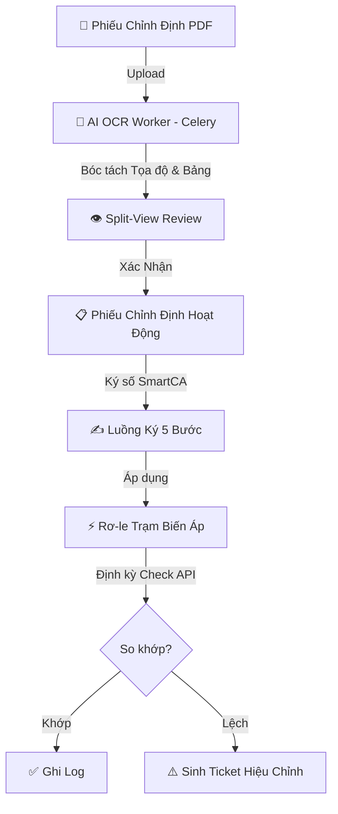
</details>

### 1. Quản Lý & AI OCR (Human-in-the-Loop)
* **Bóc tách tự động:** Nhận diện layout, bảng biểu, thông số kỹ thuật (dòng, áp, thời gian, chức năng 50/51, 87...).
* **Giao diện Split-View:** So sánh trực quan file PDF và biểu mẫu. Cảnh báo dữ liệu có độ tin cậy thấp.
* **Phiếu tạm thời (Temporary Setting):** Đặt thời hạn và tự động hoàn trả (revert) về cấu hình chuẩn.

### 2. Ký Số Đa Bước (EVN SmartCA)
* **Quy trình 5 bước:** `Điều độ` ➔ `Trưởng trạm` ➔ `Kỹ thuật viên` ➔ `Giám sát` ➔ `Lãnh đạo`.
* **Bảo mật:** Mã PIN / OTP giả lập, sinh mã băm SHA-256.
* **Stepper trực quan:** Trục tiến trình trạng thái thời gian thực.

### 3. Giám Sát & Quản Lý Hạ Tầng
* **Phân cấp dữ liệu:** Đơn vị ➔ Trạm Biến Áp ➔ Ngăn Lộ ➔ Thiết Bị / Rơ-le.
* **Tự động kiểm tra (Auto Check):** Cấu hình tần suất linh hoạt, so khớp thông số thực tế và định mức.
* **Xử lý sự cố:** Tự động phát hiện bất thường và sinh **Correction Ticket**.

---

## 🛠 Công Nghệ Sử Dụng

| Tầng Kiến Trúc | Công Nghệ / Thư Viện | Mục Đích |
|---|---|---|
| **Backend** | Python 3.12+, Django 6.x / 5.x | Xử lý nghiệp vụ chính, ORM, Bảo mật |
| **ASGI / Realtime** | Daphne, Django Channels 4.x | Hỗ trợ WebSockets, kết nối bất đồng bộ |
| **Task & Cache** | Celery 5.x, Redis 7 | Xử lý OCR, Job định kỳ, Caching |
| **Database** | PostgreSQL 15 | Cơ sở dữ liệu quan hệ, JSONField tối ưu |
| **Frontend** | HTMX, TailwindCSS, Vanilla JS | SPA-like siêu mượt, UI chuẩn chỉnh |
| **AI OCR** | PaddleOCR, VietOCR, OpenCV | Bóc tách PDF/Ảnh phiếu chỉnh định |
| **Deploy** | Docker, Docker Compose | Đóng gói môi trường, triển khai nhanh |

---

## 📁 Cấu Trúc Mã Nguồn

```text
electric/
├── core/                  # Core app: Auth, RBAC, WS Consumers, API Sync
├── stations/              # Trạm, Ngăn lộ, Rơ-le, Check log, Tickets
├── sheets/                # Phiếu Chỉnh Định, Ký số, OCR Job, Review UI
├── categories/            # Danh mục kỹ thuật (Đường dây, Công trình...)
├── rms_project/           # Cấu hình dự án Django (settings, celery, asgi)
├── OCR_PRJ/               # AI OCR On-premise (Pipeline bóc tách PDF)
├── templates/             # Giao diện HTML (Django Templates + HTMX)
├── static/                # CSS, JS, Assets
├── docs/                  # Tài liệu thiết kế chi tiết
└── docker-compose.yml     # Khởi chạy Docker đa dịch vụ
```

---

## 📦 Cài Đặt & Triển Khai

### 🐳 Cách 1: Triển Khai Nhanh Bằng Docker (Khuyên Dùng)

```bash
# 1. Clone mã nguồn
git clone https://github.com/xh1712006-debug/electric.git
cd electric

# 2. Tạo file cấu hình
cp .env.example .env

# 3. Khởi chạy toàn bộ hệ thống
docker compose up -d --build
```
> Truy cập hệ thống tại: **`http://localhost:9000`** (Bao gồm DB migrate, nạp dữ liệu mẫu và tạo admin).

### 💻 Cách 2: Cài Đặt Local Development (Chi tiết)

#### 1. Yêu cầu:
- Python 3.10 - 3.12, PostgreSQL 15+, Redis Server.

#### 2. Cài đặt môi trường Web:
```bash
python -m venv venv
# Windows: .\venv\Scripts\activate
# Linux/Mac: source venv/bin/activate
pip install -r requirements.txt
cp .env.example .env
```

#### 3. Cài đặt môi trường AI OCR:
```powershell
# Windows
powershell -NoProfile -ExecutionPolicy Bypass -File .\scripts\setup_ocr_env.ps1
```

#### 4. Khởi tạo Database & Dữ liệu mẫu:
```bash
python manage.py migrate
python manage.py seed_permissions
python seed_users_stations.py
```

#### 5. Khởi chạy Ứng dụng:
```bash
python run.py
```
> Lệnh trên sẽ chạy đồng thời: Django Server (Daphne), Celery Worker và Celery Beat. Truy cập: `http://localhost:8000`.

---

## 👥 Tài Khoản Thử Nghiệm Mặc Định

Sử dụng mật khẩu **`123456`** cho tất cả tài khoản bên dưới (trừ admin):

| Vai Trò | Tên Đăng Nhập | Nhiệm Vụ |
|---|---|---|
| **Admin** | `admin` (Pass: `admin`) | Toàn quyền, cấu hình hệ thống |
| **Điều độ viên** | `dispatcher_1` | Tạo phiếu, chạy OCR, phân phối |
| **Trưởng trạm** | `station_leader_1` | Tiếp nhận phiếu, phân công KTV |
| **Kỹ thuật viên** | `technician_1` | Cài đặt thông số rơ-le, ký xác nhận |
| **Giám sát viên** | `supervisor_1` | Giám sát, ký biên bản nghiệm thu |

---

## 🤖 Mô-đun AI OCR On-Premise

Hệ thống AI OCR được phát triển tại thư mục `OCR_PRJ/` hoạt động hoàn toàn offline:
- **Đặc tả:** Bóc tách Layout, trích xuất bảng thông số, tọa độ (Bounding Box) và độ tin cậy.
- **Tích hợp:** Gọi qua Celery Worker ➔ Subprocess API, trả về JSON.
- **An toàn (OT Compliance):** Không gửi dữ liệu ra Internet.

---

## 📚 Tài Liệu Kỹ Thuật

Tài liệu chi tiết được lưu trữ trong thư mục `docs/`:

* [Quản Lý Trạm & Thiết Bị](docs/features/01-station-management.md) | [Quy Trình Phiếu Chỉnh Định](docs/features/02-calibration-sheet.md) | [Cơ Chế Kiểm Tra Định Kỳ](docs/features/04-periodic-check.md)
* [Kiến Trúc Backend & API](docs/cores/02-backend.md) | [Thiết Kế Cơ Sở Dữ Liệu](docs/cores/01-database.md) | [Thiết Kế AI OCR](docs/features/05-ai-ocr.md)

---

<div align="center">
  <p>Được phát triển phục vụ công tác chuyển đổi số của Tập đoàn Điện lực Việt Nam (EVN).</p>
  <p><i>Mọi quyền được bảo lưu.</i></p>
</div>
````
